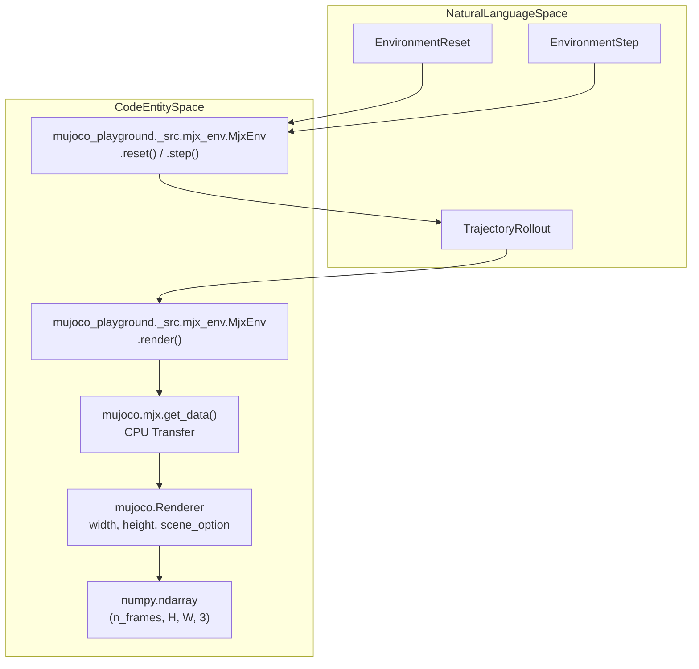
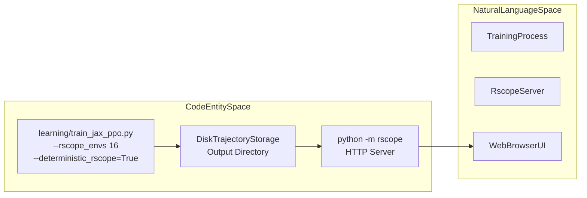
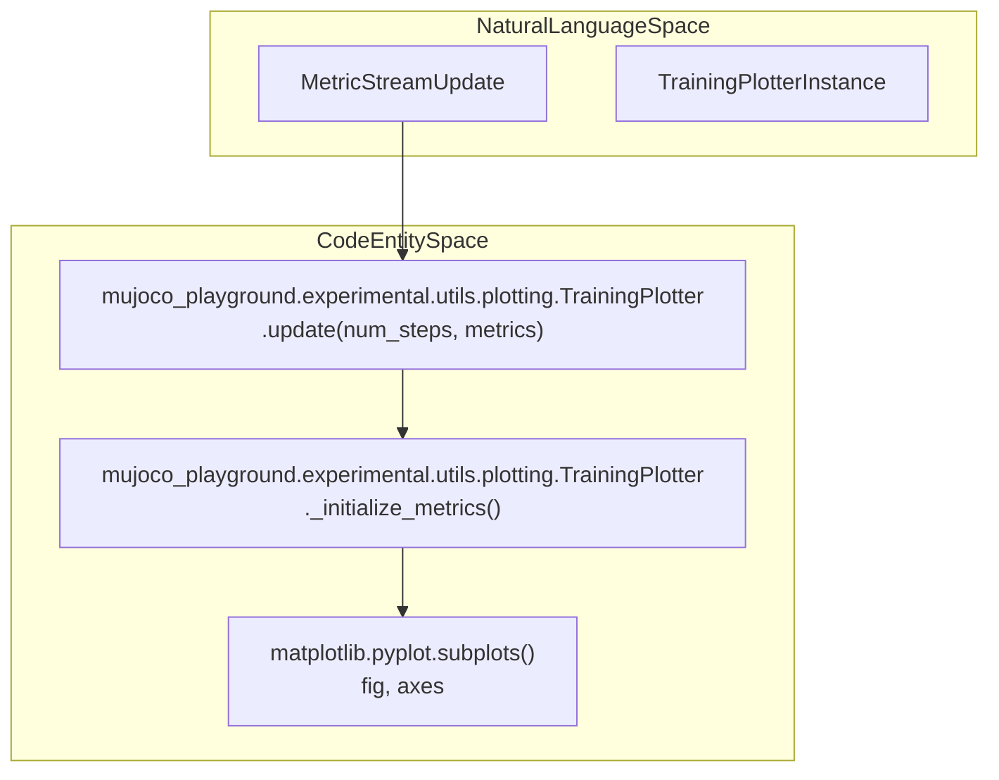

<!-- source: DeepWiki mcp.deepwiki.com · repo google-deepmind/mujoco_playground · page 6.4 Visualization and Debugging · fetched 2026-10-26 -->

# Visualization and Debugging

<details>
<summary>Relevant source files</summary>

The following files were used as context for generating this wiki page:

- [learning/notebooks/dm_control_suite.ipynb](learning/notebooks/dm_control_suite.ipynb)
- [learning/notebooks/locomotion.ipynb](learning/notebooks/locomotion.ipynb)
- [learning/notebooks/manipulation.ipynb](learning/notebooks/manipulation.ipynb)
- [learning/notebooks/vision.ipynb](learning/notebooks/vision.ipynb)
- [mujoco_playground/_src/locomotion/apollo/__init__.py](mujoco_playground/_src/locomotion/apollo/__init__.py)
- [mujoco_playground/_src/locomotion/apollo/constants.py](mujoco_playground/_src/locomotion/apollo/constants.py)
- [mujoco_playground/_src/locomotion/apollo/xmls/apollo_mjx_feetonly.xml](mujoco_playground/_src/locomotion/apollo/xmls/apollo_mjx_feetonly.xml)
- [mujoco_playground/_src/locomotion/apollo/xmls/scene_mjx_feetonly_flat_terrain.xml](mujoco_playground/_src/locomotion/apollo/xmls/scene_mjx_feetonly_flat_terrain.xml)
- [mujoco_playground/_src/mjx_env.py](mujoco_playground/_src/mjx_env.py)
- [mujoco_playground/experimental/learning/viz_sim_policies.ipynb](mujoco_playground/experimental/learning/viz_sim_policies.ipynb)
- [mujoco_playground/experimental/utils/plotting.py](mujoco_playground/experimental/utils/plotting.py)

</details>


This page documents the visualization and debugging tools available in MuJoCo Playground for inspecting environment behavior, monitoring training progress, analyzing policy performance, and diagnosing numerical issues such as TensorFloat-32 (TF32) precision discrepancies. These tools are essential for understanding learned behaviors, debugging reward shaping, and verifying sim-to-real transfer readiness.

For training configuration and experiment tracking with WandB, see [Command-Line Training](#5.4). For creating custom environments with proper observation and reward logging, see [Creating Custom Environments](#6.1).

## Environment Rendering System

MuJoCo Playground environments provide a rendering interface that converts simulation trajectories into visual output. The rendering system operates on sequences of environment states and produces video frames suitable for analysis, debugging, or publication.

### Basic Rendering Workflow

The core rendering method is implemented via `MjxEnv.render()`, which accepts a list of environment states and converts `mjx.Data` into CPU-side `mujoco.MjData` objects for rendering with `mujoco.Renderer`.



**Sources:** [mujoco_playground/_src/mjx_env.py:190-202](), [learning/notebooks/locomotion.ipynb:540-548]()

### Rendering Parameters and Scene Options

The `render()` method accepts several parameters for customization:

| Parameter | Type | Description | Example Values |
|-----------|------|-------------|----------------|
| `states` | `List[State]` | Sequence of environment states to render | `[state1, state2, ...]` |
| `camera` | `str` or `int` | Camera name or ID from XML model | `"track"`, `"side"`, `"cam0"` |
| `width` | `int` | Frame width in pixels | `640`, `1280` |
| `height` | `int` | Frame height in pixels | `480`, `720` |
| `scene_option` | `mujoco.MjvOption` | Rendering flags and visibility options | `mujoco.MjvOption()` |

`mujoco.MjvOption` controls visibility flags such as contact points (`mjVIS_CONTACTPOINT`), contact forces (`mjVIS_CONTACTFORCE`), and geometry groups (`geomgroup`).

**Sources:** [learning/notebooks/locomotion.ipynb:533-538](), [mujoco_playground/experimental/learning/viz_sim_policies.ipynb:224-228]()

## Interactive Trajectory Viewing with rscope

[rscope](https://github.com/Andrew-Luo1/rscope) provides real-time, interactive trajectory visualization during training. Unlike rendered static videos, rscope allows 3D navigation and frame-by-frame inspection while the training job is actively executing.

### rscope Architecture



**Sources:** [learning/notebooks/locomotion.ipynb:349-364]()

To enable rscope during training:
1. Start training with the appropriate flags:
```bash
python learning/train_jax_ppo.py \
    --env_name PandaPickCube \
    --rscope_envs 16 \
    --run_evals=False \
    --deterministic_rscope=True
```
2. In a separate terminal, launch the viewer:
```bash
python -m rscope
```

**Sources:** [learning/notebooks/locomotion.ipynb:349-364]()

## Training Progress and Metric Plotting Utilities

### Real-Time Metric Plotting

The `TrainingPlotter` utility in `mujoco_playground/experimental/utils/plotting.py` tracks training metrics such as evaluation rewards, episode lengths, and frames per second (FPS) dynamically during notebook execution.



**Sources:** [mujoco_playground/experimental/utils/plotting.py:24-80](), [mujoco_playground/experimental/utils/plotting.py:152-175]()

## Debugging Techniques and Numerical Stability

### TF32 Precision Issues and Numerical Divergence

When training GPU-accelerated RL policies using JAX on modern NVIDIA architectures (Ampere and newer), **TensorFloat-32 (TF32)** is often enabled by default for matrix multiplications. While TF32 accelerates training throughput, it reduces precision from standard IEEE 32-bit floating-point to 19 bits. 

In physics simulation engines like MuJoCo/MJX, lower precision can cause accumulation of rounding errors in constraint solvers, contact Jacobians, and rigid body dynamics integrations, leading to:
- **Environment Explosions**: Sudden NAN or INF values in `state.data.qpos` or `state.data.qvel`.
- **Contact Interpenetration**: Penetration tolerances being violated due to reduced precision in impulse solves.
- **Sim-to-Real Gap Discrepancies**: Policies exhibiting jittery behavior or unstable contact forces that do not match CPU validation runs.

#### Diagnosing TF32 Issues

To check if precision issues are causing divergence:
1. Force standard 32-bit float precision across XLA operations by disabling TF32 explicitly:
```python
import os
os.environ["XLA_FLAGS"] = "--xla_gpu_enable_cudnn_frontend=false"
```
2. Inspect action smoothness and evaluate finite differences of action rates:
```python
action_rate = jax.numpy.diff(actions_array, axis=0)
max_rate = jax.numpy.max(jax.numpy.linalg.norm(action_rate, axis=1))
print(f"Max action rate magnitude: {max_rate}")
```
If high-frequency jitter disappears when TF32 is disabled or when running under double precision (`jax.config.update("jax_enable_x64", True)`), the divergence stems from numerical sensitivity in the constraint solver.

**Sources:** [mujoco_playground/_src/mjx_env.py:190-202](), [learning/notebooks/vision.ipynb:105-108]()

## Video Output and Sharing

Rendered frames can be written directly to disk as compressed video files using `mediapy`:

```python
import mediapy as media

fps = 1.0 / env.dt
media.write_video("rollout.mp4", frames, fps=fps)
```

**Sources:** [learning/notebooks/locomotion.ipynb:528-548]()

---

