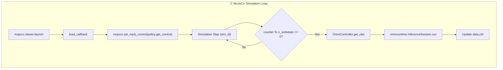

<!-- source: DeepWiki mcp.deepwiki.com · repo google-deepmind/mujoco_playground · page 6.5 Sim-to-Sim and Policy Export · fetched 2026-10-26 -->

# Sim-to-Sim and Policy Export

<details>
<summary>Relevant source files</summary>

The following files were used as context for generating this wiki page:

- [mujoco_playground/experimental/brax_network_to_onnx.ipynb](mujoco_playground/experimental/brax_network_to_onnx.ipynb)
- [mujoco_playground/experimental/learning/apollo_joystick.ipynb](mujoco_playground/experimental/learning/apollo_joystick.ipynb)
- [mujoco_playground/experimental/sim2sim/gamepad_reader.py](mujoco_playground/experimental/sim2sim/gamepad_reader.py)
- [mujoco_playground/experimental/sim2sim/onnx/apollo_policy.onnx](mujoco_playground/experimental/sim2sim/onnx/apollo_policy.onnx)
- [mujoco_playground/experimental/sim2sim/play_apollo_joystick.py](mujoco_playground/experimental/sim2sim/play_apollo_joystick.py)
- [mujoco_playground/experimental/sim2sim/play_go1_joystick.py](mujoco_playground/experimental/sim2sim/play_go1_joystick.py)
- [mujoco_playground/experimental/sim2sim/play_leap_reorient.py](mujoco_playground/experimental/sim2sim/play_leap_reorient.py)
- [mujoco_playground/experimental/sim2sim/play_t1_joystick.py](mujoco_playground/experimental/sim2sim/play_t1_joystick.py)

</details>


## Purpose and Scope

This page documents the experimental sim-to-sim (sim2sim) pipeline in `mujoco_playground`, enabling the transfer of policies trained in GPU-accelerated JAX/Brax environments into vanilla, C-based MuJoCo simulations. This pipeline covers policy conversion from Flax/Brax checkpoints to ONNX format, real-time gamepad input handling via HID, custom deployment control loops (`OnnxController`), and evaluation using the native MuJoCo interactive viewer.

Sources: [`mujoco_playground/experimental/brax_network_to_onnx.ipynb`]() [mujoco_playground/experimental/sim2sim/play_apollo_joystick.py]()

---

## Policy Export Pipeline (Brax to ONNX)

Policies trained using JAX and Brax store network parameters as Flax PyTrees alongside running normalization statistics. To deploy these models outside the JAX ecosystem (e.g., using ONNX Runtime in embedded systems or C++ runtimes), they must be exported to the ONNX format.

### Conversion Workflow in `brax_network_to_onnx.ipynb`

The conversion notebook `[mujoco_playground/experimental/brax_network_to_onnx.ipynb]()` executes the following procedural steps:
1. **Environment Setup & Parameter Loading**: Loads the target environment configuration (e.g., `BerkeleyHumanoidJoystickFlatTerrain`) via `locomotion.get_default_config()` and loads the trained checkpoint using `brax.training.checkpoint.load()` [mujoco_playground/experimental/brax_network_to_onnx.ipynb:50-115]().
2. **Network Reconstruction**: Rebuilds the PPO network structure using `ppo_networks.make_ppo_networks` with observation preprocessing configured via `running_statistics.normalize` [mujoco_playground/experimental/brax_network_to_onnx.ipynb:65-72]().
3. **Keras/TensorFlow Intermediate Representation**: Defines an equivalent Keras `MLP` model mirroring the Brax network architecture, embedding normalization statistics (`mean` and `std`) as non-trainable TensorFlow variables [mujoco_playground/experimental/brax_network_to_onnx.ipynb:144-198]().
4. **ONNX Export**: Converts the TensorFlow graph to ONNX using `tf2onnx`, outputting a standalone file (e.g., `bh_policy.onnx` or `apollo_policy.onnx`) containing both normalization layers and policy weights [mujoco_playground/experimental/brax_network_to_onnx.ipynb:36]().

```mermaid
graph TD
  A["Brax Checkpoint / PyTree"] --> B["brax.training.checkpoint.load"]
  B --> C["Keras MLP Model with Normalization"]
  C --> D["tf2onnx Conversion"]
  D --> E["ONNX Policy File (.onnx)"]

  sub: "Export Pipeline Entities"
  style A fill:none,stroke:none
  style E fill:none,stroke:none
```
*Figure 1: Data flow for converting Brax reinforcement learning checkpoints into ONNX inference models.*

Sources: [`mujoco_playground/experimental/brax_network_to_onnx.ipynb`]()

---

## Deployment and Play Scripts (`play_*_joystick.py`)

Deployment scripts such as `[mujoco_playground/experimental/sim2sim/play_apollo_joystick.py]`, `[mujoco_playground/experimental/sim2sim/play_t1_joystick.py]`, `[mujoco_playground/experimental/sim2sim/play_go1_joystick.py]`, and `[mujoco_playground/experimental/sim2sim/play_leap_reorient.py]` load the exported ONNX policies and execute them within a native C MuJoCo simulation loop.

### The `OnnxController` Class

The core runtime orchestration is managed by `OnnxController`, which encapsulates the ONNX runtime session, joystick input polling, state observation extraction, and control decimation [mujoco_playground/experimental/sim2sim/play_apollo_joystick.py:31-110]().

- **Initialization**: Loads the ONNX session via `onnxruntime.InferenceSession` using `CPUExecutionProvider` and initializes phase variables for gaits [mujoco_playground/experimental/sim2sim/play_apollo_joystick.py:45-68]().
- **Observation Construction (`get_obs`)**: Queries native MuJoCo sensors (`data.sensor`) for local linear velocity, gyros, projected gravity, joint angles, joint velocities, previous actions, and user joystick commands [mujoco_playground/experimental/sim2sim/play_apollo_joystick.py:70-90]().
- **Control Decimation (`get_control`)**: Runs at a higher simulation frequency (`sim_dt`) while executing policy inference at a decimated control frequency (`ctrl_dt`) determined by `n_substeps` [mujoco_playground/experimental/sim2sim/play_apollo_joystick.py:92-109]().


*Figure 2: Execution flow of the native MuJoCo simulation loop integrated with `OnnxController` callback execution.*

Sources: [`mujoco_playground/experimental/sim2sim/play_apollo_joystick.py`()](mujoco_playground/experimental/sim2sim/play_apollo_joystick.py), [`mujoco_playground/experimental/sim2sim/play_t1_joystick.py`()](mujoco_playground/experimental/sim2sim/play_t1_joystick.py), [`mujoco_playground/experimental/sim2sim/play_go1_joystick.py`()](mujoco_playground/experimental/sim2sim/play_go1_joystick.py), [`mujoco_playground/experimental/sim2sim/play_leap_reorient.py`()](mujoco_playground/experimental/sim2sim/play_leap_reorient.py)

---

## Gamepad Input Integration (`gamepad_reader.py`)

Real-time velocity and command inputs are provided via physical gamepads (such as the Logitech F710) abstracted through `[mujoco_playground/experimental/sim2sim/gamepad_reader.py]()`.

### `Gamepad` Implementation Details

- **HID Communication**: Connects directly via the `hid` library using vendor and product IDs (`vendor_id=0x046D`, `product_id=0xC219`) in non-blocking mode [mujoco_playground/experimental/sim2sim/gamepad_reader.py:36-69]().
- **Background Threading**: Spawns a daemon thread running `read_loop()` to poll input packets asynchronously without blocking the simulation rendering thread [mujoco_playground/experimental/sim2sim/gamepad_reader.py:57-88]().
- **Interpolation and Deadzones**: Maps raw HID joystick axis values to normalized velocity commands (`vx`, `vy`, `wz`) with configurable scaling and deadzone filtering (`_interpolate`) [mujoco_playground/experimental/sim2sim/gamepad_reader.py:26-30, 90-100]().

Sources: [`mujoco_playground/experimental/sim2sim/gamepad_reader.py`]()

---

## Validating Policies in Vanilla MuJoCo

To validate sim-to-sim transfer, the play scripts invoke the native MuJoCo interactive viewer `mujoco.viewer.launch()` using a custom `load_callback` function [mujoco_playground/experimental/sim2sim/play_apollo_joystick.py:111-144]().

1. **Model Loading**: Loads the robot XML scene (e.g., `apollo_constants.FEET_ONLY_FLAT_TERRAIN_XML`) along with required Menagerie assets [mujoco_playground/experimental/sim2sim/play_apollo_joystick.py:114-117]().
2. **Keyframe Reset**: Resets the simulation data to a designated keyframe (e.g., `knees_bent` or `home`) using `mujoco.mj_resetDataKeyframe` [mujoco_playground/experimental/sim2sim/play_apollo_joystick.py:120]().
3. **Callback Registration**: Binds `OnnxController.get_control` via `mujoco.set_mjcb_control()`, allowing the C simulation runtime to query the ONNX policy at every control step [mujoco_playground/experimental/sim2sim/play_apollo_joystick.py:138]().

Sources: [`mujoco_playground/experimental/sim2sim/play_apollo_joystick.py`()](mujoco_playground/experimental/sim2sim/play_apollo_joystick.py), [`mujoco_playground/experimental/sim2sim/play_t1_joystick.py`()](mujoco_playground/experimental/sim2sim/play_t1_joystick.py), [`mujoco_playground/experimental/sim2sim/play_go1_joystick.py`()](mujoco_playground/experimental/sim2sim/play_go1_joystick.py), [`mujoco_playground/experimental/sim2sim/play_leap_reorient.py`()](mujoco_playground/experimental/sim2sim/play_leap_reorient.py)

---

