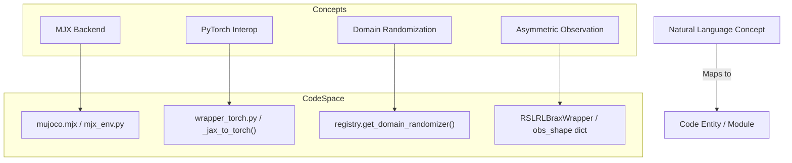
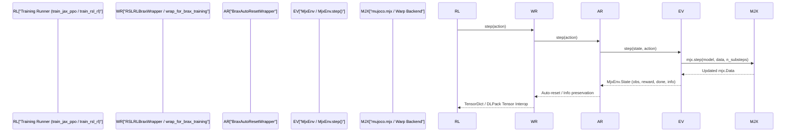

<!-- source: DeepWiki mcp.deepwiki.com · repo google-deepmind/mujoco_playground · page 7 Glossary · fetched 2026-10-26 -->

# Glossary

Relevant source files

The following files were used as context for generating this wiki page:

- [.gitignore](.gitignore)
- [CONTRIBUTING.md](CONTRIBUTING.md)
- [README.md](README.md)
- [learning/README.md](learning/README.md)
- [learning/train_rsl_rl.py](learning/train_rsl_rl.py)
- [mujoco_playground/_src/mjx_env.py](mujoco_playground/_src/mjx_env.py)
- [mujoco_playground/_src/registry.py](mujoco_playground/_src/registry.py)
- [mujoco_playground/_src/wrapper.py](mujoco_playground/_src/wrapper.py)
- [mujoco_playground/_src/wrapper_test.py](mujoco_playground/_src/wrapper_test.py)
- [mujoco_playground/_src/wrapper_torch.py](mujoco_playground/_src/wrapper_torch.py)

## Purpose and Scope

This page defines codebase-specific terms, jargon, abbreviations, and domain concepts used throughout `mujoco_playground`. It serves as a quick reference for developers and researchers navigating the architecture, environment suites, simulation backends, and training pipelines.

---

## Simulation Backends and Libraries

### MJX (MuJoCo XLA)
A GPU-accelerated implementation of MuJoCo written in JAX using XLA primitives, enabling massively parallelized simulation and gradient-based optimization.
- **Code Reference:** `mujoco.mjx` is imported and used in core environment steps [mujoco_playground/_src/mjx_env.py:28-28]().

### MuJoCo Warp
An alternative high-performance GPU physics backend leveraging NVIDIA Warp kernels for MuJoCo simulation.
- **Code Reference:** Configured via `impl='warp'` or `mjx.Impl.WARP` in environment loading and model initialization [mujoco_playground/_src/mjx_env.py:138-138]().

### Brax
Google's JAX-based library for rigid-body simulation and reinforcement learning, providing core wrappers (`EpisodeWrapper`, `VmapWrapper`, `EvalWrapper`) and training algorithms (PPO/SAC).
- **Code Reference:** Imported and used in environment wrapper orchestration [mujoco_playground/_src/wrapper.py:20-20]().

### RSL-RL
The Robotics Systems Lab Reinforcement Learning library, a PyTorch-based framework used for training robust quadruped and humanoid policies via On-Policy PPO.
- **Code Reference:** `OnPolicyRunner` from `rsl_rl.runners` is invoked in training loops [learning/train_rsl_rl.py:28-28]().

### Menagerie (`mujoco_menagerie`)
The official repository of high-fidelity MuJoCo robot XML models and assets (quadrupeds, manipulators, humanoids).
- **Code Reference:** Automatically cloned and checked out via `ensure_menagerie_exists()` into `MENAGERIE_PATH` [mujoco_playground/_src/mjx_env.py:94-96]().

Sources:
- [mujoco_playground/_src/mjx_env.py:28-28]()
- [mujoco_playground/_src/mjx_env.py:94-96]()
- [mujoco_playground/_src/mjx_env.py:138-138]()
- [mujoco_playground/_src/wrapper.py:20-20]()
- [learning/train_rsl_rl.py:28-28]()

---

## Physics and Environment Mechanics

### Substeps (`n_substeps`)
The number of physics simulation steps (`mjx.step`) executed per single reinforcement learning control decision step.
- **Code Reference:** Passed to `mjx_env.step()` to perform internal sub-stepping loops [mujoco_playground/_src/mjx_env.py:194-194]().

### Impl (`impl`)
A configuration option specifying which physics execution backend (`jax` or `warp`) to instantiate for `mujoco` and `mjx` models.
- **Code Reference:** Defined as a command-line flag `--impl` in training scripts [learning/train_rsl_rl.py:60-60]().

### Mocap Target
Motion capture (`mocap`) bodies embedded in the XML scene used to define target tracking positions and orientations for end-effectors or reference trajectories.
- **Code Reference:** Initialized and updated via `mocap_pos` and `mocap_quat` arrays in `make_data()` [mujoco_playground/_src/mjx_env.py:183-186]().

### Domain Randomization
The process of perturbing physical parameters (such as link masses, joint friction, armature, and gravity) across parallel environments during simulation to facilitate sim-to-real transfer.
- **Code Reference:** Retrieved via `registry.get_domain_randomizer()` and applied during wrapper construction [learning/train_rsl_rl.py:167-168]().

Sources:
- [mujoco_playground/_src/mjx_env.py:183-186]()
- [mujoco_playground/_src/mjx_env.py:194-194]()
- [learning/train_rsl_rl.py:60-60]()
- [learning/train_rsl_rl.py:167-168]()

---

## Reinforcement Learning and Observation Concepts

### Privileged State
Ground-truth internal simulator states (such as unobserved contact forces, exact base velocities, or terrain elevations) exposed exclusively to the critic network in asymmetric actor-critic setups.
- **Code Reference:** Populated under `obs["privileged_state"]` when `obs_size` is a dictionary [learning/train_rsl_rl.py:196-196]().

### Asymmetric Observations
An observation structure where the actor policy receives partial/noisy observations (simulating real-world sensor limits), while the critic receives full privileged state information.
- **Code Reference:** Handled in `RSLRLBraxWrapper` by splitting observation dictionaries into state and privileged state groups [mujoco_playground/_src/wrapper_torch.py:139-144]().

### Joystick Policy
Locomotion tasks where the robot's objective is to track velocity and heading commands supplied interactively or sampled randomly (e.g., linear velocity $v_x, v_y$, angular velocity $\omega_z$).
- **Code Reference:** Implemented across locomotion environment classes registered in `registry.locomotion._envs` [learning/train_rsl_rl.py:100-100]().

### Curriculum
An incremental training mechanism that progressively increases task difficulty (e.g., expanding terrain roughness or velocity command ranges) based on agent performance or episode termination metrics.
- **Code Reference:** Preserved across auto-resets using `AutoResetWrapper_preserve_info` state metadata [mujoco_playground/_src/wrapper.py:173-174]().

Sources:
- [mujoco_playground/_src/wrapper.py:173-174]()
- [mujoco_playground/_src/wrapper_torch.py:139-144]()
- [learning/train_rsl_rl.py:100-100]()
- [learning/train_rsl_rl.py:196-196]()

---

## Tooling and Interoperability

### DLPack
A standardized tensor memory sharing protocol allowing zero-copy tensor data exchange between JAX arrays and PyTorch tensors.
- **Code Reference:** Implemented in helper functions `_jax_to_torch` and `_torch_to_jax` inside `wrapper_torch.py` [mujoco_playground/_src/wrapper_torch.py:42-53]().

### rscope
An interactive visualization tool designed to stream and inspect parallel environment trajectories and metrics in real time during training.
- **Code Reference:** Enabled via the `--rscope_envs` flag in JAX training scripts [README.md:79-82]().

Sources:
- [README.md:79-82]()
- [mujoco_playground/_src/wrapper_torch.py:42-53]()

---

## Architecture and Terminology Mapping

The following diagram illustrates how high-level domain concepts map to concrete classes and execution modules across the codebase.

Sources:
- [mujoco_playground/_src/mjx_env.py:28-28]()
- [mujoco_playground/_src/wrapper_torch.py:42-53]()
- [mujoco_playground/_src/wrapper_torch.py:139-144]()
- [learning/train_rsl_rl.py:167-168]()

---

## Training Wrapper and Data Flow

The following data flow diagram traces how environment steps traverse core wrappers, backend dispatch, and framework interop during training execution.

Sources:
- [mujoco_playground/_src/mjx_env.py:190-202]()
- [mujoco_playground/_src/wrapper.py:126-132]()
- [mujoco_playground/_src/wrapper_torch.py:161-203]()