# Page: Overview

# Overview

<details>
<summary>Relevant source files</summary>

The following files were used as context for generating this wiki page:

- [.github/workflows/ci.yml](.github/workflows/ci.yml)
- [CHANGELOG.md](CHANGELOG.md)
- [CONTRIBUTING.md](CONTRIBUTING.md)
- [README.md](README.md)
- [learning/README.md](learning/README.md)
- [mujoco_playground/__init__.py](mujoco_playground/__init__.py)
- [mujoco_playground/_src/manipulation/franka_emika_panda/panda.py](mujoco_playground/_src/manipulation/franka_emika_panda/panda.py)
- [mujoco_playground/_src/registry.py](mujoco_playground/_src/registry.py)
- [pyproject.toml](pyproject.toml)
- [uv.lock](uv.lock)

</details>


This page introduces MuJoCo Playground, its architectural design, and the key systems that enable GPU-accelerated reinforcement learning for robotics. MuJoCo Playground is a comprehensive suite of environments built on [MuJoCo MJX](https://github.com/google-deepmind/mujoco/tree/main/mjx) [README.md:1-7]() supporting parallel GPU simulation, dual physics backends (MJX and MuJoCo Warp) [README.md:18-19](), and dual training framework support across JAX/Brax and PyTorch/RSL-RL [learning/README.md:1-3]().

For detailed information on getting started and repository layout, refer to the child pages:
- **Installation and Setup**: See [Installation and Setup](#1.1) for PyPI/source installation, `uv` setup, GPU configuration, and Menagerie asset downloading.
- **Package Structure**: See [Package Structure](#1.2) for details on the `mujoco_playground` and `learning` packages, entry points (`train-jax-ppo`, `train-rsl-ppo`), and directory organization.

## Purpose and Architecture Overview

MuJoCo Playground serves as an open-source framework for robot learning research and sim-to-real transfer [README.md:104-106](). It decouples environment physics and reward definitions from reinforcement learning algorithms through a clean two-package design and a unified environment registry [mujoco_playground/_src/registry.py:33-71]().

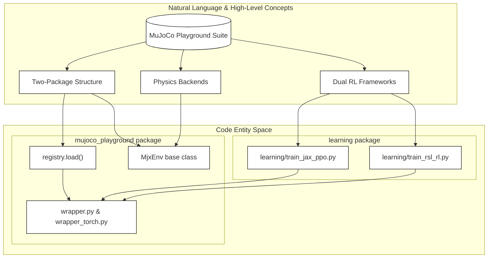
*Figure 1: Conceptual bridge connecting high-level architectural concepts to concrete code entities.*

**Sources:** [README.md:1-7](), [mujoco_playground/_src/registry.py:33-71](), [learning/README.md:1-4]()

## Two-Package Structure and Backends

The codebase divides responsibilities between environment modeling and training pipelines [pyproject.toml:78-84]():
1. **`mujoco_playground`**: Contains environment definitions, XML assets, observation/reward logic, domain randomization, and the `MjxEnv` base class [mujoco_playground/__init__.py:15-35]().
2. **`learning`**: Houses training scripts, network architectures, and configuration wrappers for both JAX/Brax and PyTorch/RSL-RL [learning/README.md:1-4]().

Additionally, the suite supports multiple physics backends via MuJoCo MJX [README.md:7]() and MuJoCo Warp (`--impl warp`) [CHANGELOG.md:16-20](), maximizing throughput across modern GPU hardware.

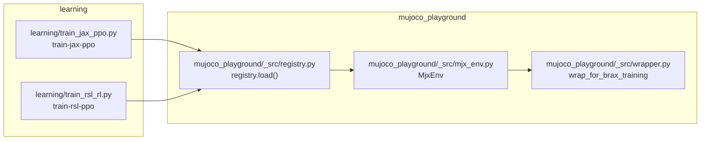
*Figure 2: Interaction between environment loading, wrappers, and training CLI entry points.*

**Sources:** [pyproject.toml:78-84](), [mujoco_playground/_src/registry.py:49-62](), [mujoco_playground/_src/mjx_env.py]()

---

## 1.1. Installation and Setup

For step-by-step instructions on installing MuJoCo Playground from PyPI or source using `uv`/`pip`, configuring JAX for CUDA, handling optional dependencies (`cuda`, `learning`, `notebooks`, `dev`), downloading Menagerie assets, and verifying your setup, see [Installation and Setup](#1.1).

**Sources:** [README.md:21-46](), [pyproject.toml:40-73]()

---

## 1.2. Package Structure

For detailed documentation on the organization of the `mujoco_playground` and `learning` packages, command-line entry points (`train-jax-ppo`, `train-rsl-ppo`), configuration directories, and module layouts, see [Package Structure](#1.2).

**Sources:** [pyproject.toml:78-84](), [learning/README.md:1-4]()

---

# Page: Installation and Setup

# Installation and Setup

<details>
<summary>Relevant source files</summary>

The following files were used as context for generating this wiki page:

- [.github/workflows/ci.yml](.github/workflows/ci.yml)
- [.github/workflows/pypi.yml](.github/workflows/pypi.yml)
- [CONTRIBUTING.md](CONTRIBUTING.md)
- [README.md](README.md)
- [learning/README.md](learning/README.md)
- [mujoco_playground/_src/registry.py](mujoco_playground/_src/registry.py)
- [pyproject.toml](pyproject.toml)
- [uv.lock](uv.lock)

</details>


This document guides you through installing MuJoCo Playground and its dependencies, configuring JAX for GPU acceleration, installing optional dependency groups, downloading MuJoCo Menagerie assets, and verifying your installation. For information about running training workflows after installation, see [Command-Line Training](#5.4). For development setup including testing infrastructure and pre-commit hooks, see [Testing and CI/CD](#6.2).

## Prerequisites

MuJoCo Playground requires:
- **Python 3.12 or later** (as specified in package requirements)
- **Git** (for source installation)
- **CUDA-capable GPU** (recommended for training, optional for basic usage)

**Sources**: [pyproject.toml:12](), [.github/workflows/ci.yml:14]()

## Installation Methods

### PyPI Installation (Basic)

The simplest installation method uses PyPI:

```bash
pip install playground
```

This installs the core `mujoco_playground` and `learning` packages with default dependencies. However, **source installation is strongly recommended** to access the latest MuJoCo features and bug fixes.

**Sources**: [README.md:23-27]()

### Source Installation (Recommended)

Source installation provides access to the latest MuJoCo development versions and all features.

#### Installation Flow

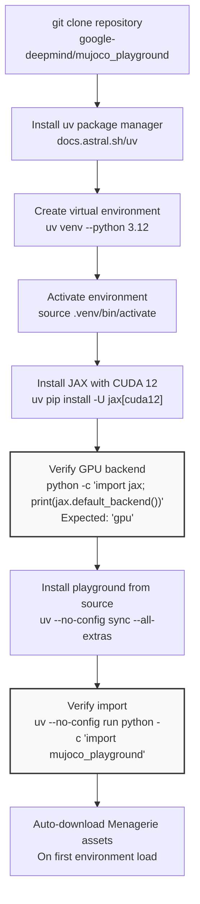

**Sources**: [README.md:32-46]()

#### Step-by-Step Instructions

1. **Clone the repository**:
   ```bash
   git clone git@github.com:google-deepmind/mujoco_playground.git
   cd mujoco_playground
   ```

2. **Install uv package manager**:
   ```bash
   curl -LsSf https://astral.sh/uv/install.sh | sh
   ```
   
   The `uv` tool is a faster alternative to `pip` used by the project.

3. **Create and activate virtual environment**:
   ```bash
   uv venv --python 3.12
   source .venv/bin/activate
   ```

4. **Install JAX with CUDA 12 support**:
   ```bash
   uv pip install -U "jax[cuda12]" --index-url https://pypi.org/simple
   ```

5. **Verify GPU backend**:
   ```bash
   python -c "import jax; print(jax.default_backend())"
   ```
   
   Expected output: `gpu`
   
   If the output is `cpu`, try running `unset LD_LIBRARY_PATH` before the verification command.

6. **Install playground with all dependencies**:
   ```bash
   uv --no-config sync --all-extras
   ```
   
   This installs packages defined in [pyproject.toml:23-73]() including `mujoco_playground` and `learning`.

7. **Verify installation**:
   ```bash
   uv --no-config run python -c "import mujoco_playground; print('Success')"
   ```

8. **Trigger Menagerie asset download** (optional but recommended):
   ```bash
   uv --no-config run python -c "from mujoco_playground import locomotion; locomotion.load('G1JoystickFlatTerrain')"
   ```
   
   Menagerie assets (robot XML models) are automatically downloaded on first use via `mujoco_playground/_src/mjx_env.ensure_menagerie_exists()`.

**Sources**: [README.md:37-45](), [.github/workflows/ci.yml:27-29]()

## Dependency Structure and Optional Installations

### Core Dependencies

The base installation includes these packages:

| Package | Version | Purpose |
|---------|---------|---------|
| `absl-py` | latest | Abseil Python common libraries |
| `brax` | ≥0.14.2 | JAX-based RL training framework |
| `etils` | latest | Python utilities |
| `flax` | latest | JAX neural network library |
| `jax` | latest | GPU computation and JIT compilation |
| `lxml` | latest | XML processing |
| `mediapy` | latest | Media rendering and display |
| `ml_collections` | latest | Configuration management |
| `mujoco` | ≥3.6.0 | CPU physics engine |
| `mujoco-mjx` | ≥3.6.0 | JAX-accelerated physics engine |
| `warp-lang` | ≥1.18.0 | NVIDIA GPU acceleration and Warp backend |
| `orbax-checkpoint` | ≥0.11.22 | Model checkpointing |
| `tqdm` | latest | Progress bars |

**Sources**: [pyproject.toml:23-37]()

### Optional Dependency Groups

The project defines several optional dependency groups in [pyproject.toml:40-73]():

| Group | Installation Command | Contents | Purpose |
|-------|---------------------|----------|---------|
| `cuda` | `pip install playground[cuda]` | `jax[cuda12]` | GPU-accelerated JAX for training |
| `test` | `pip install playground[test]` | `absl-py`, `dm_control`, `pytest`, `pytest-xdist` | Running test suite |
| `notebooks` | `pip install playground[notebooks]` | `matplotlib`, `jupyter` | Interactive tutorials |
| `learning` | `pip install playground[learning]` | `rsl-rl-lib>=3.0.0`, `wandb` | PyTorch training pipeline and experiment tracking |
| `dev` | `pip install playground[dev]` | `playground[test]`, `mypy`, `pyink`, `pytype`, `ruff`, `pre-commit`, `pylint`, `pytest-xdist` | Development tools (linting, type checking) |
| `all` | `pip install playground[all]` | `playground[dev]`, `playground[cuda]`, `playground[notebooks]`, `playground[learning]` | Complete installation |

To install with specific groups:
```bash
# Source installation with all extras
uv --no-config sync --all-extras

# Or install specific groups
pip install playground[cuda,learning]
```

**Sources**: [pyproject.toml:40-73]()

## Entry Points and Command-Line Scripts

After installation, two command-line scripts become available:

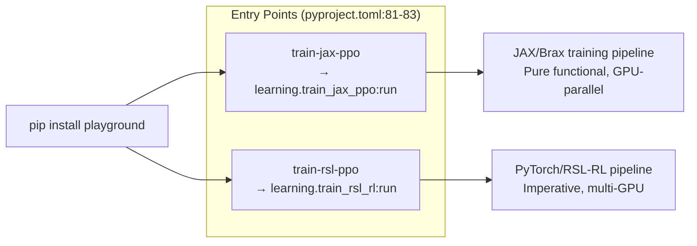

| Script | Module Path | Purpose |
|--------|-------------|---------|
| `train-jax-ppo` | `learning.train_jax_ppo:run` | Train with JAX/Brax PPO (see [JAX/Brax Training Pipeline](#4.1)) |
| `train-rsl-ppo` | `learning.train_rsl_rl:run` | Train with PyTorch/RSL-RL PPO (see [PyTorch/RSL-RL Training Pipeline](#4.2)) |

These are defined in [pyproject.toml:81-83]() and installed automatically.

**Sources**: [pyproject.toml:81-83](), [README.md:56-71]()

## Verifying Installation

### Basic Import Test

```bash
python -c "import mujoco_playground; print('Success')"
```

This verifies that the core package is installed correctly.

### GPU Backend Verification

```bash
python -c "import jax; print(jax.default_backend())"
```

Expected output: `gpu`

If you see `cpu`, JAX is not using GPU acceleration. Troubleshooting steps:
1. Run `unset LD_LIBRARY_PATH` and try again
2. Verify CUDA installation: `nvidia-smi`
3. Reinstall JAX with CUDA: `uv pip install -U "jax[cuda12]" --index-url https://pypi.org/simple`

### Environment Loading Test

```bash
python -c "from mujoco_playground import registry; env = registry.load('CartpoleBalance'); print('Environment loaded successfully')"
```

This test:
1. Imports the registry system [mujoco_playground/_src/registry.py:49-61]()
2. Loads a simple environment
3. Triggers Menagerie asset download if not already present

### Training Script Test

```bash
train-jax-ppo --env_name CartpoleBalance --num_timesteps 100000
```

This minimal training run verifies:
- Entry point installation
- JAX/Brax integration
- Environment wrapping
- Basic training loop

**Sources**: [README.md:44-45](), [README.md:56-58](), [mujoco_playground/_src/registry.py:49-61]()

## Troubleshooting

### GPU Precision Issues (Ampere Architecture)

**Problem**: Inconsistent behavior or training instability on NVIDIA Ampere GPUs (RTX 30/40 series).

**Cause**: JAX defaults to TF32 precision for matrix multiplications on Ampere GPUs, which can affect RL training stability.

**Solution**: Force full float32 precision before running experiments:
```bash
export JAX_DEFAULT_MATMUL_PRECISION=highest
```

Add this to `~/.bashrc` for persistent configuration:
```bash
echo 'export JAX_DEFAULT_MATMUL_PRECISION=highest' >> ~/.bashrc
source ~/.bashrc
```

**Sources**: [README.md:94-96]()

### LD_LIBRARY_PATH Conflicts

**Problem**: JAX reports `cpu` backend despite CUDA installation.

**Solution**: Unset `LD_LIBRARY_PATH` which may point to conflicting libraries:
```bash
unset LD_LIBRARY_PATH
python -c "import jax; print(jax.default_backend())"
```

**Sources**: [README.md:42]()

### Menagerie Asset Download

**Problem**: `FileNotFoundError` when loading locomotion or manipulation environments.

**Cause**: Menagerie robot models are not included in the package and must be downloaded separately.

**Solution**: The download happens automatically on first use via `mujoco_playground/_src/mjx_env.ensure_menagerie_exists()`. You can trigger it manually:
```bash
python -c "from mujoco_playground._src import mjx_env; mjx_env.ensure_menagerie_exists()"
```

**Sources**: [.github/workflows/ci.yml:32-34](), [README.md:45]()

### Package Version Conflicts

**Problem**: Dependency conflicts during installation.

**Solution**: Use `uv` instead of `pip` for more reliable dependency resolution:
```bash
pip install uv
uv pip install -e ".[all]"
```

The `uv` tool has superior conflict resolution compared to pip.

**Sources**: [README.md:38-39]()

## Next Steps

After successful installation:

1. **Try basic training**: See [Command-Line Training](#5.4)
2. **Explore environments**: See [Locomotion Environments](#3.1) and [Manipulation Environments](#3.2)
3. **Run notebooks**: See [Examples and Tutorials](#5) for interactive guides
4. **Configure for vision**: See [Vision-Based Training](#4.5) if training from pixels

For development setup including testing, linting, and pre-commit hooks, see [Testing and CI/CD](#6.2).

**Sources**: [README.md:51-92](), [learning/README.md:1-43]()

---

# Page: Package Structure

# Package Structure

<details>
<summary>Relevant source files</summary>

The following files were used as context for generating this wiki page:

- [.github/workflows/ci.yml](.github/workflows/ci.yml)
- [CHANGELOG.md](CHANGELOG.md)
- [learning/__init__.py](learning/__init__.py)
- [mujoco_playground/__init__.py](mujoco_playground/__init__.py)
- [mujoco_playground/_src/manipulation/franka_emika_panda/panda.py](mujoco_playground/_src/manipulation/franka_emika_panda/panda.py)
- [pyproject.toml](pyproject.toml)
- [uv.lock](uv.lock)

</details>


This document describes the organization of the MuJoCo Playground repository, structured as two primary Python packages: `mujoco_playground` (core simulation, physics backends, and RL environments) and `learning` (dual RL training infrastructure). This page covers package layout, entry points, dependency architecture, configuration layouts, and optional installation groups.

For installation instructions, see [Installation and Setup](#1.1). For details on how environments are organized and registered within the `mujoco_playground` package, see [Environment Registry](#2.2).

## Two Main Packages

The repository distributes two separate but complementary Python packages defined under project packaging settings [pyproject.toml:78-80]():

### mujoco_playground Package

The `mujoco_playground` package provides the core environment simulation framework built on top of MuJoCo, MuJoCo MJX [pyproject.toml:32-33](), and MuJoCo Warp [pyproject.toml:34](). It contains:

| Directory / Module | Purpose |
|--------------------|---------|
| `mujoco_playground/__init__.py` | Package root exporting public APIs like `MjxEnv`, `State`, `put_model`, and registries [mujoco_playground/__init__.py:1-53]() |
| `mujoco_playground/_src/` | Core implementation including `MjxEnv` base class, environment wrappers, and collections |
| `mujoco_playground/_src/locomotion/` | Quadruped and bipedal robot environments |
| `mujoco_playground/_src/manipulation/` | Dexterous hand and robotic arm environments |
| `mujoco_playground/_src/dm_control_suite/` | DeepMind Control Suite ported environments |
| `mujoco_playground/config/` | Default training parameter configuration modules |

**Diagram: Code Entity Architecture of `mujoco_playground`**

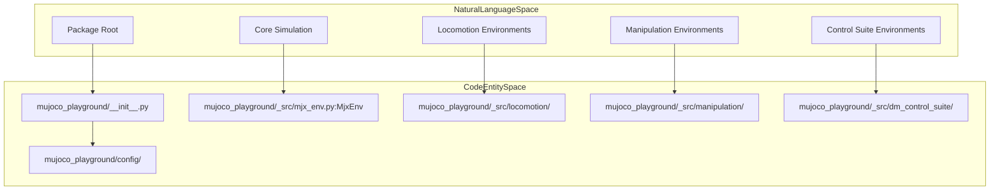

**Sources:** [pyproject.toml:78-80](), [mujoco_playground/__init__.py:1-53]()

### learning Package

The `learning` package provides reinforcement learning training entry points, algorithm execution wrappers, and neural network definitions supporting both JAX/Brax and PyTorch/RSL-RL pipelines.

| Module | Purpose |
|--------|---------|
| `learning/train_jax_ppo.py` | JAX/Brax PPO training pipeline and entry point |
| `learning/train_rsl_rl.py` | PyTorch/RSL-RL training pipeline and entry point |
| `learning/ppo_networks.py` | Policy and value network architectures for JAX |
| `learning/getup_rl_games.py` | Experimental RL Games integration |

**Sources:** [pyproject.toml:78-80](), [pyproject.toml:81-84]()

## Entry Points and Command-Line Scripts

The repository defines two primary command-line scripts via project console scripts in [pyproject.toml:81-84]():

**Diagram: Execution Flow of Entry Points**

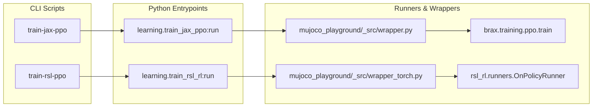

### train-jax-ppo

This executable script launches JAX-based PPO training sessions [pyproject.toml:82]():

- **Target Entry Point:** `learning.train_jax_ppo:run`
- **Mechanism:** Loads environments using `registry.load()`, wraps them for Brax training via `mujoco_playground/_src/wrapper.py`, builds PPO network graphs, and executes training using JIT compilation and VMAP parallelization.
- **Backends:** Fully compatible with MJX and MuJoCo Warp (`impl="warp"`) simulation backends.

**Sources:** [pyproject.toml:82](), [learning/__init__.py:1-15]()

### train-rsl-ppo

This executable script launches PyTorch-based RSL-RL training sessions [pyproject.toml:83]():

- **Target Entry Point:** `learning.train_rsl_rl:run`
- **Mechanism:** Interfacing JAX simulation state to PyTorch tensors via DLPack zero-copy memory sharing using wrappers in `mujoco_playground/_src/wrapper_torch.py`.
- **Runners:** Interfaces with `rsl_rl.runners.OnPolicyRunner` for accelerated actor-critic policy optimization.

**Sources:** [pyproject.toml:83](), [learning/__init__.py:1-15]()

## Configuration and Experimental Directories

The repository organizes default hyperparameter sets and experimental features in dedicated directories:

- **`mujoco_playground/config/`**: Contains default configuration files (`manipulation_params.py`, `locomotion_params.py`, `dm_control_suite_params.py`) structured using `ml_collections.ConfigDict`. These parameters control simulation timesteps, episode lengths, action scales, and reward component weights.
- **Experimental Directories**: Submodules and scripts intended for exploratory features, such as custom sim-to-sim export scripts and specialized wrapper variations. Note that pylint ignores experimental paths in static checks [pyproject.toml:160-161]().

**Sources:** [pyproject.toml:160-161](), [pyproject.toml:167]()

## Optional Dependency Groups

The project defines several optional dependency bundles in `pyproject.toml` to customize installation profiles [pyproject.toml:40-73]():

| Optional Group | Requirements | Target Use Case |
|----------------|--------------|-----------------|
| `cuda` | `jax[cuda12]` [pyproject.toml:41-43]() | NVIDIA GPU hardware acceleration |
| `test` | `absl-py`, `dm_control`, `pytest`, `pytest-xdist` [pyproject.toml:44-49]() | Running test suites and environment validation |
| `notebooks` | `matplotlib`, `jupyter` [pyproject.toml:50-53]() | Interactive exploration and tutorial notebooks |
| `dev` | `playground[test]`, `mypy`, `pyink`, `pytype`, `ruff`, `pre-commit`, `pylint`, `pytest-xdist` [pyproject.toml:54-63]() | Full code quality checks, type checking, and linting |
| `learning` | `rsl-rl-lib>=3.0.0`, `wandb` [pyproject.toml:64-67]() | PyTorch/RSL-RL training and experiment logging |
| `all` | Combines `dev`, `cuda`, `notebooks`, and `learning` [pyproject.toml:68-73]() | Complete installation for development and research |

**Diagram: Optional Dependency Tree**

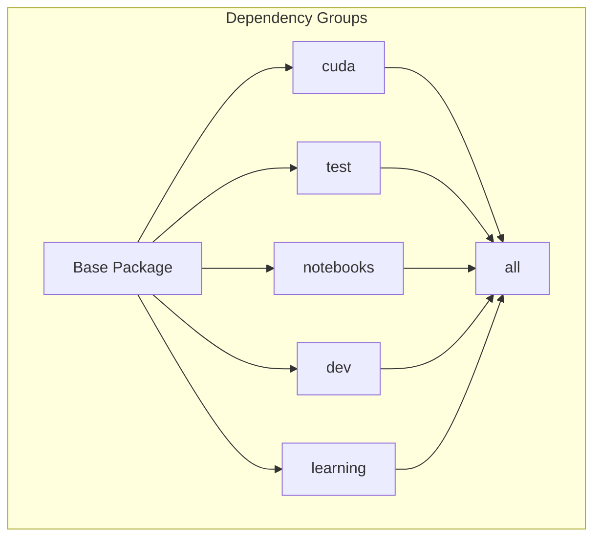

**Sources:** [pyproject.toml:40-73]()

---

# Page: Core Environment System

# Core Environment System

<details>
<summary>Relevant source files</summary>

The following files were used as context for generating this wiki page:

- [mujoco_playground/_src/dm_control_suite/__init__.py](mujoco_playground/_src/dm_control_suite/__init__.py)
- [mujoco_playground/_src/locomotion/__init__.py](mujoco_playground/_src/locomotion/__init__.py)
- [mujoco_playground/_src/locomotion/t1/randomize.py](mujoco_playground/_src/locomotion/t1/randomize.py)
- [mujoco_playground/_src/manipulation/__init__.py](mujoco_playground/_src/manipulation/__init__.py)
- [mujoco_playground/_src/mjx_env.py](mujoco_playground/_src/mjx_env.py)

</details>


This document provides a high-level overview of the foundational environment framework in MuJoCo Playground. The core environment system is built around the GPU-accelerated JAX and MuJoCo MJX backends, enabling parallelized, differentiable simulation for reinforcement learning. 

For detailed technical documentation, please refer to the child pages:
- **MjxEnv Base Class**: Detailed documentation of the `MjxEnv` abstract base class, required methods, properties, model/data helpers, Warp backend selection, and the `State` dataclass structure. For details, see [MjxEnv Base Class](#2.1).
- **Environment Registry**: Explanation of the registry system for discovering and loading environments across categories. For details, see [Environment Registry](#2.2).
- **Observations, Rewards, and State**: Documentation on generating noisy and privileged observations, history buffers, multi-component rewards, metrics, and termination conditions. For details, see [Observations, Rewards, and State](#2.3).
- **Domain Randomization**: Overview of physics parameter randomization with `jax.vmap` for sim-to-real transfer. For details, see [Domain Randomization](#2.4).

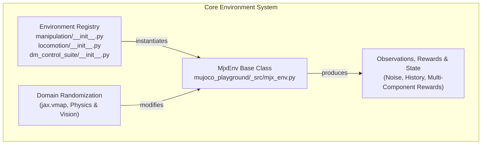

**Sources:** [mujoco_playground/_src/mjx_env.py:1-203](), [mujoco_playground/_src/manipulation/__init__.py:1-69](), [mujoco_playground/_src/locomotion/__init__.py:1-138]()

---

## MjxEnv Base Class

The `MjxEnv` class acts as the abstract base class for all simulation environments in MuJoCo Playground [mujoco_playground/_src/mjx_env.py:17-216](). It standardizes the environment interface—similar to Gym/Gymnasium—while relying entirely on JAX operations for high-throughput GPU execution. 

Concrete environments implement required abstract methods like `reset()`, `step()`, `xml_path()`, and `action_size()`, while utilizing helper utilities such as `put_model()` and `make_data()` for initialization [mujoco_playground/_src/mjx_env.py:130-187](). Episode states and physics arrays are encapsulated within a Flax `@struct.dataclass` named `State`.

For complete implementation details, method signatures, properties, and data structures, see [MjxEnv Base Class](#2.1).

**Sources:** [mujoco_playground/_src/mjx_env.py:130-216]()

---

## Environment Registry

Environments in MuJoCo Playground are managed through dedicated registry modules located across three primary domains: locomotion, manipulation, and the DeepMind Control Suite [mujoco_playground/_src/manipulation/__init__.py:33-44](), [mujoco_playground/_src/locomotion/__init__.py:45-87](), [mujoco_playground/_src/dm_control_suite/__init__.py:37-71](). 

The registry pattern provides unified functions to load environments (`registry.load()`), retrieve default configurations (`get_default_config()`), fetch domain randomizers (`get_domain_randomizer()`), and discover available environments via `ALL_ENVS` [mujoco_playground/_src/manipulation/__init__.py:66-133](). Additionally, the registry handles asset management by automatically downloading repository dependencies like `mujoco_menagerie` when required [mujoco_playground/_src/mjx_env.py:94-113]().

For detailed instructions on discovery, loading, and organization, see [Environment Registry](#2.2).

**Sources:** [mujoco_playground/_src/mjx_env.py:94-113](), [mujoco_playground/_src/manipulation/__init__.py:33-133](), [mujoco_playground/_src/locomotion/__init__.py:45-131]()

---

## Observations, Rewards, and State

During execution, environments process actions through physical substeps and concurrently compute observation vectors, reward signals, metrics, and termination flags. Observations can include sensory readings, task commands, and history buffers, often separated into noisy observation spaces for actors and privileged states for critics (asymmetric actor-critic).

Rewards are structured as weighted multi-component sums combining task objectives (such as velocity tracking or target reaching) with regularization penalties (such as energy or smoothness constraints). Episode termination logic monitors conditions like falling, constraint violations, or maximum episode lengths.

For details on observation construction, history buffers, reward shaping, and termination checks, see [Observations, Rewards, and State](#2.3).

**Sources:** [mujoco_playground/_src/mjx_env.py:190-203]()

---

## Domain Randomization

To bridge the reality gap and facilitate robust sim-to-real transfer, MuJoCo Playground implements domain randomization workflows via dedicated `randomize.py` modules [mujoco_playground/_src/locomotion/t1/randomize.py:15-130](). 

Physics parameters—such as geom friction, dof frictionloss, armature, body masses, joint stiffness, and damping—are perturbed across parallel environments using `jax.vmap` [mujoco_playground/_src/locomotion/t1/randomize.py:27-130](). These randomized models integrate directly with training wrappers and support specialized visual randomizations for vision-based policies.

For complete coverage of parameter randomization functions and vectorization patterns, see [Domain Randomization](#2.4).

**Sources:** [mujoco_playground/_src/locomotion/t1/randomize.py:15-130]()

---

# Page: MjxEnv Base Class

# MjxEnv Base Class

<details>
<summary>Relevant source files</summary>

The following files were used as context for generating this wiki page:

- [mujoco_playground/_src/mjx_env.py](mujoco_playground/_src/mjx_env.py)

</details>


This document covers the `MjxEnv` abstract base class, the foundational component that all MuJoCo Playground environments inherit from. It defines the standard interface for physics-based reinforcement learning environments and provides essential utilities for state management, asset handling, and GPU backend configuration (including the MuJoCo-Warp backend).

For information about how environments are registered and discovered, see [Environment Registry](#2.2). For details on specific environment implementations, see [Environment Collections](#3).

## Core Architecture and Data Flow

The `MjxEnv` base class establishes a standardized interface for MuJoCo-based environments, built on top of JAX and MJX (MuJoCo's JAX implementation). The architecture centers around the abstract `MjxEnv` class, the immutable `State` dataclass, and backend helper functions like `put_model` and `make_data` that support the Warp backend (`impl`).

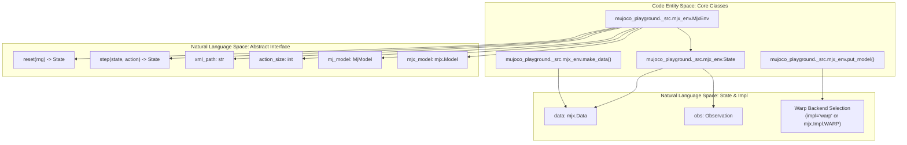

Sources: [mujoco_playground/_src/mjx_env.py:1-203]()

## State Dataclass Structure

The `State` dataclass serves as an immutable container for all environment state information during training and inference. It combines MuJoCo physics data with RL-specific information like observations, rewards, and termination signals.

### State Fields

| Field | Type | Purpose |
|-------|------|---------|
| `data` | `mjx.Data` | MuJoCo physics state (positions, velocities, forces, control inputs) |
| `obs` | `Observation` | Agent observations (can be a `jax.Array` or a mapping of string arrays) [mujoco_playground/_src/mjx_env.py:114-114]() |
| `reward` | `jax.Array` | Scalar reward signal |
| `done` | `jax.Array` | Episode termination flag |
| `metrics` | `Dict[str, jax.Array]` | Environment-specific metrics for logging |
| `info` | `Dict[str, Any]` | Additional debugging information |

### State Manipulation via `tree_replace`

Because `State` is implemented as a Flax dataclass (`@struct.dataclass`), it supports functional updates through `tree_replace`, enabling JIT-compatible immutable modifications across simulation steps:

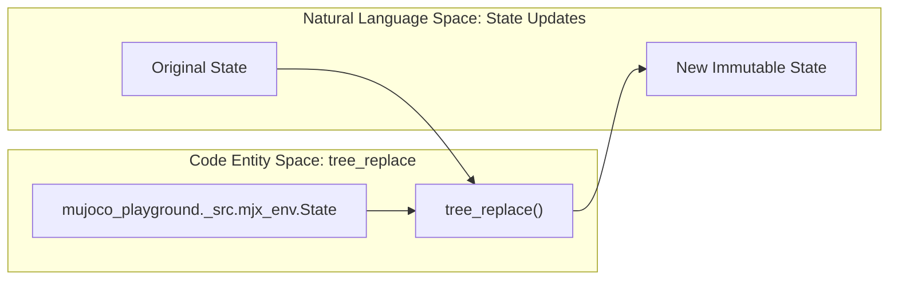

Sources: [mujoco_playground/_src/mjx_env.py:24-25]()

## Abstract Interface and Required Members

All concrete environment implementations must inherit from `MjxEnv` and provide specific abstract methods and properties.

### Required Methods

| Method | Signature | Purpose |
|--------|-----------|---------|
| `reset` | `reset(rng: jax.Array) -> State` | Initialize environment to a starting state using a JAX random key |
| `step` | `step(state: State, action: jax.Array) -> State` | Advance the simulation by one control step given an action |

### Required Properties

| Property | Type | Purpose |
|----------|------|---------|
| `xml_path` | `str` | Path to the MuJoCo XML model file |
| `action_size` | `int` | Dimensionality of the action space |
| `mj_model` | `mujoco.MjModel` | CPU MuJoCo model instance used for rendering and asset inspection |
| `mjx_model` | `mjx.Model` | GPU-accelerated MJX model instance used for vectorized simulation |

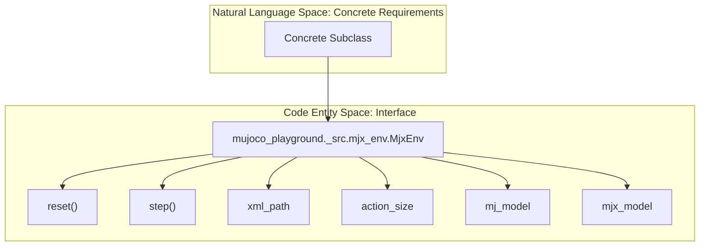

Sources: [mujoco_playground/_src/mjx_env.py:1-203]()

## Backend Helpers: `put_model`, `make_data`, and Warp Integration

The module provides helper functions to initialize models and data on accelerators, with specific handling for the MuJoCo-Warp backend (`impl`).

### `put_model` and Warp Backend Selection

The `put_model` function transfers a `mujoco.MjModel` to a target device with an optional implementation backend (`impl: Optional[Union[str, mjx.Impl]]`) [mujoco_playground/_src/mjx_env.py:130-137](). When using the Warp backend (`impl="warp"` or `mjx.Impl.WARP`), `put_model` automatically intercepts and filters overflow warnings (`warn_overflow`) caused by intentional tight tolerances in high-performance RL environments [mujoco_playground/_src/mjx_env.py:138-153]().

### `make_data` Initialization

The `make_data` function initializes an `mjx.Data` structure from an `mjx.Model`, supporting optional overrides for generalized positions (`qpos`), velocities (`qvel`), control inputs (`ctrl`), activation states (`act`), mocap targets (`mocap_pos`, `mocap_quat`), buffer sizes (`naconmax`, `naccdmax`, `njmax`), and target devices [mujoco_playground/_src/mjx_env.py:156-187]().

Sources: [mujoco_playground/_src/mjx_env.py:130-187]()

## Timestep Management

The base class manages the relationship between the control frequency (`dt`) and the physics simulation timestep (`sim_dt`) through substep calculations:

| Property / Parameter | Purpose |
|----------------------|---------|
| `dt` | Control timestep (frequency at which actions are updated) |
| `sim_dt` | Physics simulation integration timestep |
| `n_substeps` | Number of physics integration substeps executed per control step (`round(dt / sim_dt)`) |

Sources: [mujoco_playground/_src/mjx_env.py:1-203]()

## Asset Management and Utilities

Environments rely on external XML files and assets, managed via `update_assets` and automatic Menagerie downloading utilities (`ensure_menagerie_exists`) [mujoco_playground/_src/mjx_env.py:94-128]().

Sources: [mujoco_playground/_src/mjx_env.py:94-128]()

---

# Page: Environment Registry

# Environment Registry

<details>
<summary>Relevant source files</summary>

The following files were used as context for generating this wiki page:

- [CONTRIBUTING.md](CONTRIBUTING.md)
- [README.md](README.md)
- [learning/README.md](learning/README.md)
- [mujoco_playground/_src/dm_control_suite/__init__.py](mujoco_playground/_src/dm_control_suite/__init__.py)
- [mujoco_playground/_src/locomotion/__init__.py](mujoco_playground/_src/locomotion/__init__.py)
- [mujoco_playground/_src/locomotion/t1/randomize.py](mujoco_playground/_src/locomotion/t1/randomize.py)
- [mujoco_playground/_src/manipulation/__init__.py](mujoco_playground/_src/manipulation/__init__.py)
- [mujoco_playground/_src/registry.py](mujoco_playground/_src/registry.py)
- [mujoco_playground/_src/registry_test.py](mujoco_playground/_src/registry_test.py)
- [mujoco_playground/experimental/learning/ablate_device_topology.ipynb](mujoco_playground/experimental/learning/ablate_device_topology.ipynb)

</details>


## Purpose and Scope

The environment registry provides a centralized system for discovering, configuring, and instantiating environments in MuJoCo Playground. It organizes environments into three main categories (`locomotion`, `manipulation`, and `dm_control_suite`), maps environment names to their implementation classes via `ALL_ENVS`, and provides uniform interfaces for loading environments with default or custom configurations through `registry.load()`, `registry.get_default_config()`, and `registry.get_domain_randomizer()`. 

For details on the `MjxEnv` base class that all registered environments inherit from, see [MjxEnv Base Class](#2.1). For information on creating and registering custom environments, see [Creating Custom Environments](#6.1).

Sources: [mujoco_playground/_src/registry.py:15-36]()

---

## Global and Category Registry Architecture

MuJoCo Playground organizes its environment suites across three submodules (`locomotion`, `manipulation`, and `dm_control_suite`), which are unified under a central global registry module (`mujoco_playground._src.registry`) [mujoco_playground/_src/registry.py:22-35]().

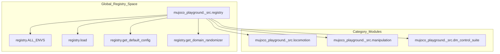
**Diagram 1: Global registry aggregation of environment category modules**

Sources: [mujoco_playground/_src/registry.py:22-71]()

---

## Internal Data Structures

Each environment module maintains internal dictionaries (`_envs`, `_cfgs`, and `_randomizer`) to map environment identifiers to their corresponding implementation classes, default configuration factories, and domain randomization functions.

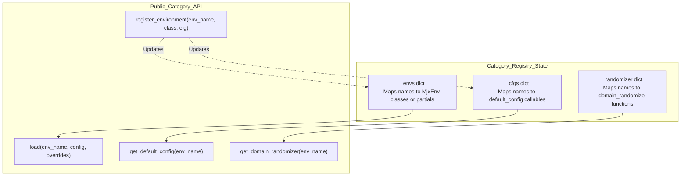
**Diagram 2: Internal dictionaries and public functions within category registries**

### Environment Class Dictionary (`_envs`)
Maps string keys (e.g., `"Go1JoystickFlatTerrain"`, `"PandaPickCube"`, `"AcrobotSwingup"`) to either concrete `MjxEnv` subclasses or `functools.partial` wrappers [mujoco_playground/_src/manipulation/__init__.py:33-44](), [mujoco_playground/_src/locomotion/__init__.py:45-87](), [mujoco_playground/_src/dm_control_suite/__init__.py:37-71]().

### Configuration Dictionary (`_cfgs`)
Maps environment names to functions returning `ml_collections.ConfigDict` objects [mujoco_playground/_src/manipulation/__init__.py:46-57](), [mujoco_playground/_src/locomotion/__init__.py:89-113](), [mujoco_playground/_src/dm_control_suite/__init__.py:73-99]().

### Domain Randomizer Dictionary (`_randomizer`)
Maps environment names to domain randomization callables with the signature `(mjx.Model, jax.Array) -> Tuple[mjx.Model, mjx.Model]` [mujoco_playground/_src/manipulation/__init__.py:59-63](), [mujoco_playground/_src/locomotion/__init__.py:115-131](), [mujoco_playground/_src/registry.py:27-29]().

Sources: [mujoco_playground/_src/manipulation/__init__.py:33-64](), [mujoco_playground/_src/locomotion/__init__.py:45-131](), [mujoco_playground/_src/dm_control_suite/__init__.py:37-99](), [mujoco_playground/_src/registry.py:27-35]()

---

## Loading Environments with `registry.load()`

The `registry.load()` function routes instantiation requests to the appropriate submodule depending on which category contains `env_name` [mujoco_playground/_src/registry.py:49-61]().

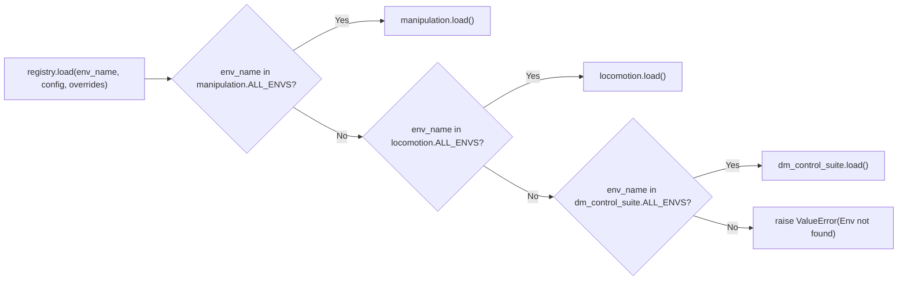
**Diagram 3: Control flow for environment resolution in `registry.load()`**

### Usage Example

```python
from mujoco_playground._src import registry

# Load environment using the global registry loader
env = registry.load("Go1JoystickFlatTerrain")

# Load with custom configuration overrides
env = registry.load(
    "PandaPickCube",
    config_overrides={"ctrl_dt": 0.02, "episode_length": 500}
)
```

Sources: [mujoco_playground/_src/registry.py:49-62]()

---

## Configuration Management

The function `registry.get_default_config(env_name)` inspects the environment suites to locate and return the default `ConfigDict` configuration for the requested environment [mujoco_playground/_src/registry.py:38-46]().

```python
from mujoco_playground._src import registry

# Retrieve default configuration
config = registry.get_default_config("CartpoleBalance")
print(config.ctrl_dt)
```

Sources: [mujoco_playground/_src/registry.py:38-47]()

---

## Domain Randomization

Domain randomizers are fetched via `registry.get_domain_randomizer(env_name)` [mujoco_playground/_src/registry.py:64-71](). If an environment supports domain randomization (predominantly locomotion and select manipulation tasks), a randomization function is returned; otherwise, `None` is returned [mujoco_playground/_src/registry.py:64-71]().

```python
from mujoco_playground._src import registry
import jax

randomizer = registry.get_domain_randomizer("Go1JoystickFlatTerrain")
if randomizer is not None:
    env = registry.load("Go1JoystickFlatTerrain")
    rng = jax.random.PRNGKey(0)
    rand_model, orig_model = randomizer(env.mjx_model, rng)
```

Sources: [mujoco_playground/_src/registry.py:64-71]()

---

## Environment Registration (`register_environment`)

New environments can be added dynamically to any of the suite registries using `register_environment()` [mujoco_playground/_src/manipulation/__init__.py:72-86](), [mujoco_playground/_src/locomotion/__init__.py:140-154](), [mujoco_playground/_src/dm_control_suite/__init__.py:108-122]().

```python
from mujoco_playground._src import locomotion, mjx_env
from ml_collections import config_dict

class DemoEnv(mjx_env.MjxEnv):
    def __init__(self, config, config_overrides):
        pass

def demo_default_config() -> config_dict.ConfigDict:
    return config_dict.ConfigDict()

locomotion.register_environment('DemoEnv', DemoEnv, demo_default_config)
```

Sources: [mujoco_playground/_src/registry_test.py:28-56](), [mujoco_playground/_src/locomotion/__init__.py:140-154]()

---

# Page: Observations, Rewards, and State

# Observations, Rewards, and State

<details>
<summary>Relevant source files</summary>

The following files were used as context for generating this wiki page:

- [mujoco_playground/_src/locomotion/go1/joystick.py](mujoco_playground/_src/locomotion/go1/joystick.py)
- [mujoco_playground/_src/manipulation/franka_emika_panda_robotiq/push_cube.py](mujoco_playground/_src/manipulation/franka_emika_panda_robotiq/push_cube.py)
- [mujoco_playground/_src/manipulation/leap_hand/reorient.py](mujoco_playground/_src/manipulation/leap_hand/reorient.py)
- [mujoco_playground/_src/manipulation/leap_hand/rotate_z.py](mujoco_playground/_src/manipulation/leap_hand/rotate_z.py)
- [mujoco_playground/_src/mjx_env.py](mujoco_playground/_src/mjx_env.py)

</details>


This page documents how MuJoCo Playground environments generate observations, calculate multi-component rewards, maintain episode state, and check termination conditions. Understanding these mechanisms is essential for training policies and customizing environment behavior.

For information about the environment step execution flow, see [Diagram 5](#) in the high-level system architecture. For creating custom environments with observations and rewards, see [Creating Custom Environments](#6.1).

---

## State Dataclass Structure

Every environment step returns an `mjx_env.State` dataclass that encapsulates all relevant information about the current episode state:

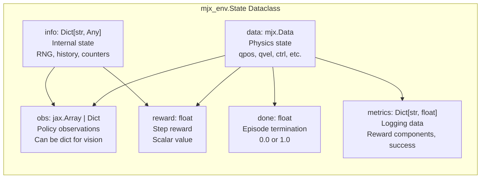
Sources: [mujoco_playground/_src/mjx_env.py:84-88]()

The `data` field contains MuJoCo/MJX physics state (generalized coordinates, velocities, contact forces). The `obs` field provides observations to the policy network. The `info` dictionary maintains episode-specific state that persists across steps but is not exposed to the policy. The `metrics` dictionary accumulates statistics for logging.

Sources: [mujoco_playground/_src/mjx_env.py:84-88]()

---

## Observation Generation

### Observation Types

Environments generate observations in three primary formats:

| Observation Type | Purpose | Characteristics | Availability |
|-----------------|---------|-----------------|--------------|
| **Standard** | Policy input | Noisy, partial state | All environments |
| **Privileged** | Critic input (asymmetric) | Full state, no noise | Manipulation, locomotion |
| **Vision** | Pixel-based policy | RGB images | With `--vision` flag |

**Standard observations** are designed for deployment on real robots and include realistic sensor noise. **Privileged observations** contain full ground-truth state information only available in simulation, enabling asymmetric actor-critic training where the critic has access to more information than the policy. **Vision observations** use rendered images instead of state vectors.

Sources: [mujoco_playground/_src/manipulation/leap_hand/reorient.py:273-375](), [mujoco_playground/_src/locomotion/go1/joystick.py:309-391]()

### Observation Dictionary Structure

Environments return observations as dictionaries with standardized keys:

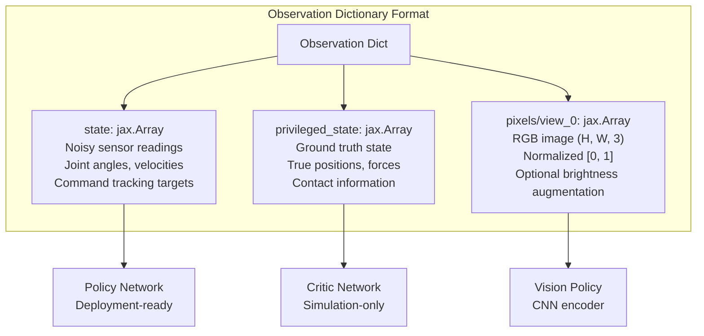
Sources: [mujoco_playground/_src/manipulation/leap_hand/reorient.py:372-375](), [mujoco_playground/_src/locomotion/go1/joystick.py:388-391]()

Sources: [mujoco_playground/_src/manipulation/leap_hand/reorient.py:372-375](), [mujoco_playground/_src/locomotion/go1/joystick.py:388-391]()

### Standard Observation Components

Standard observations typically include:

```python
# Example from Leap Hand CubeReorient
state = jp.concatenate([
    noisy_joint_angles,           # 16 - Joint positions with noise
    qpos_error_history,           # 16 * history_len - Tracking errors
    cube_pos_error_history,       # 3 * history_len - Position errors
    cube_ori_error_history,       # 6 * history_len - Orientation errors
    info["last_act"],             # 16 - Previous action
])

# Example from Go1 Joystick
state = jp.hstack([
    noisy_linvel,                 # 3 - Linear velocity
    noisy_gyro,                   # 3 - Angular velocity
    noisy_gravity,                # 3 - Gravity direction
    noisy_joint_angles - default_pose,  # 12 - Joint deviations
    noisy_joint_vel,              # 12 - Joint velocities
    info["last_act"],             # 12 - Previous action
    info["command"],              # 3 - Velocity command
])
```
Sources: [mujoco_playground/_src/manipulation/leap_hand/reorient.py:351-357](), [mujoco_playground/_src/locomotion/go1/joystick.py:357-365]()

### Privileged Observation Components

Privileged observations extend standard observations with ground-truth information:

```python
# Example from Leap Hand CubeReorient
privileged_state = jp.concatenate([
    state,                         # Include all standard observations
    data.qpos[hand_qids],          # True joint positions
    data.qvel[hand_dqids],         # True joint velocities
    get_fingertip_positions(data), # Fingertip Cartesian positions
    cube_pos_error_uncorrupted,    # True position error
    xmat_diff_uncorrupted,         # True orientation error
    get_cube_linvel(data),         # Cube linear velocity
    get_cube_angvel(data),         # Cube angular velocity
    info["pert_dir"],              # Perturbation direction
    data.xfrc_applied[cube_body_id],  # Applied forces
])

# Example from Go1 Joystick
privileged_state = jp.hstack([
    state,                         # Include all standard observations
    gyro,                          # True angular velocity
    accelerometer,                 # True acceleration
    gravity,                       # True gravity vector
    linvel,                        # True linear velocity
    angvel,                        # True angular velocity
    joint_angles - default_pose,   # True joint deviations
    joint_vel,                     # True joint velocities
    data.actuator_force,           # Joint torques
    info["last_contact"],          # Foot contact state
    feet_vel,                      # Foot velocities
    info["feet_air_time"],         # Time in air
    data.xfrc_applied[torso_body_id, :3],  # Applied forces
    steps_since_last_pert >= steps_until_next_pert,  # Perturbation flag
])
```
Sources: [mujoco_playground/_src/manipulation/leap_hand/reorient.py:359-370](), [mujoco_playground/_src/locomotion/go1/joystick.py:371-386]()

### Noise Injection for Sim-to-Real Transfer

Observations include configurable noise to simulate real sensor characteristics:

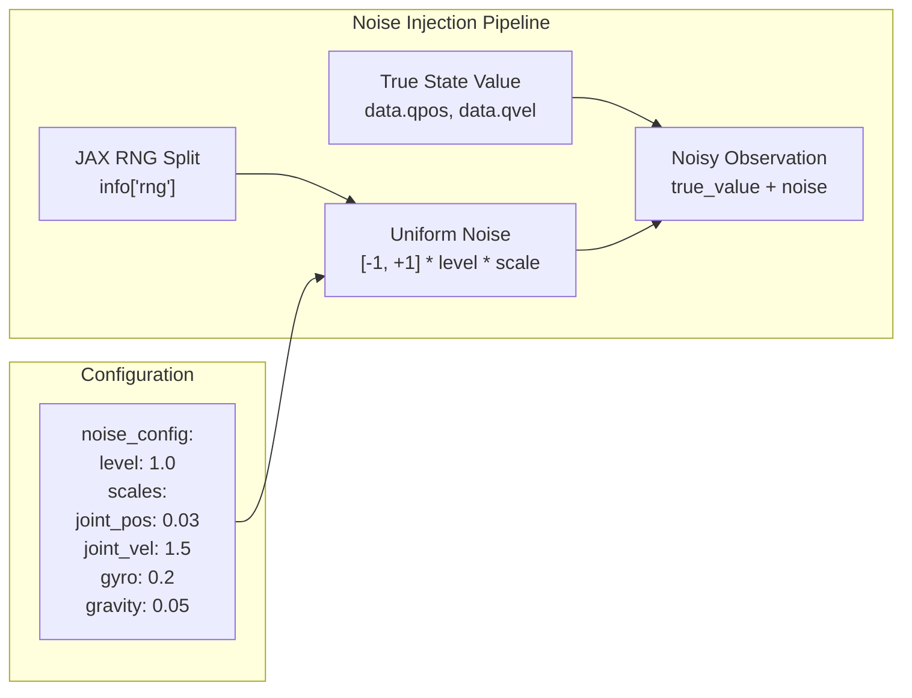
Sources: [mujoco_playground/_src/locomotion/go1/joystick.py:313-346](), [mujoco_playground/_src/manipulation/leap_hand/reorient.py:277-284]()

Noise is applied uniformly across different sensor modalities:

```python
# Pattern used across environments
info["rng"], noise_rng = jax.random.split(info["rng"])
noisy_value = (
    true_value
    + (2 * jax.random.uniform(noise_rng, shape=true_value.shape) - 1)
    * config.noise_config.level
    * config.noise_config.scales.sensor_name
)
```
Sources: [mujoco_playground/_src/locomotion/go1/joystick.py:313-346](), [mujoco_playground/_src/manipulation/leap_hand/reorient.py:277-284]()

Noise configuration example from Go1 Joystick:

```python
noise_config=config_dict.create(
    level=1.0,  # Global noise multiplier (set to 0.0 to disable)
    scales=config_dict.create(
        joint_pos=0.03,    # Joint position noise
        joint_vel=1.5,     # Joint velocity noise
        gyro=0.2,          # Gyroscope noise
        gravity=0.05,      # Gravity vector noise
        linvel=0.1,        # Linear velocity noise
    ),
)
```
Sources: [mujoco_playground/_src/locomotion/go1/joystick.py:42-50]()

### History Buffers

Environments maintain rolling history buffers to provide temporal context:

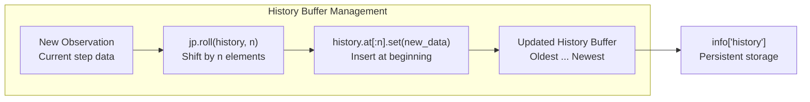
Sources: [mujoco_playground/_src/manipulation/leap_hand/reorient.py:177-292]()

Example from CubeReorient tracking joint position errors:

```python
# Initialize history buffer at reset
info["qpos_error_history"] = jp.zeros(config.history_len * 16)

# Update history at each step
qpos_error_history = (
    jp.roll(info["qpos_error_history"], 16)  # Shift by observation size
    .at[:16]                                  # Take first 16 elements
    .set(noisy_joint_angles - motor_targets) # Insert new data
)
info["qpos_error_history"] = qpos_error_history
```
Sources: [mujoco_playground/_src/manipulation/leap_hand/reorient.py:177-292]()

History buffers enable the policy to infer velocities from position changes and detect trends. The buffer length is configurable via `config.history_len`.

### Vision Observations

When `config.vision=True`, environments return pixel observations instead of or alongside state vectors:

```python
# Vision observation generation (PandaPickCubeCartesian)
_, rgb, _ = self.renderer.render(info['render_token'], data)
obs = jp.asarray(rgb[0][..., :3], dtype=jp.float32) / 255.0
obs = adjust_brightness(obs, info['brightness'])
obs = {'pixels/view_0': obs}  # Dictionary format
```
Sources: [mujoco_playground/_src/manipulation/franka_emika_panda/pick_cartesian.py:398-401]()

Vision observations include brightness augmentation for domain randomization:

```python
# Sample brightness at reset
rng_brightness, rng = jax.random.split(rng)
brightness = jax.random.uniform(
    rng_brightness,
    (1,),
    minval=config.obs_noise.brightness[0],
    maxval=config.obs_noise.brightness[1],
)
info.update({'brightness': brightness})

# Apply augmentation
def adjust_brightness(img, scale):
    return jp.clip(img * scale, 0, 1)
```
Sources: [mujoco_playground/_src/manipulation/franka_emika_panda/pick_cartesian.py:256-269, 84-86]()

---

## Reward Calculation

### Multi-Component Reward Architecture

Rewards are computed as a weighted sum of multiple components, each targeting different aspects of the task:

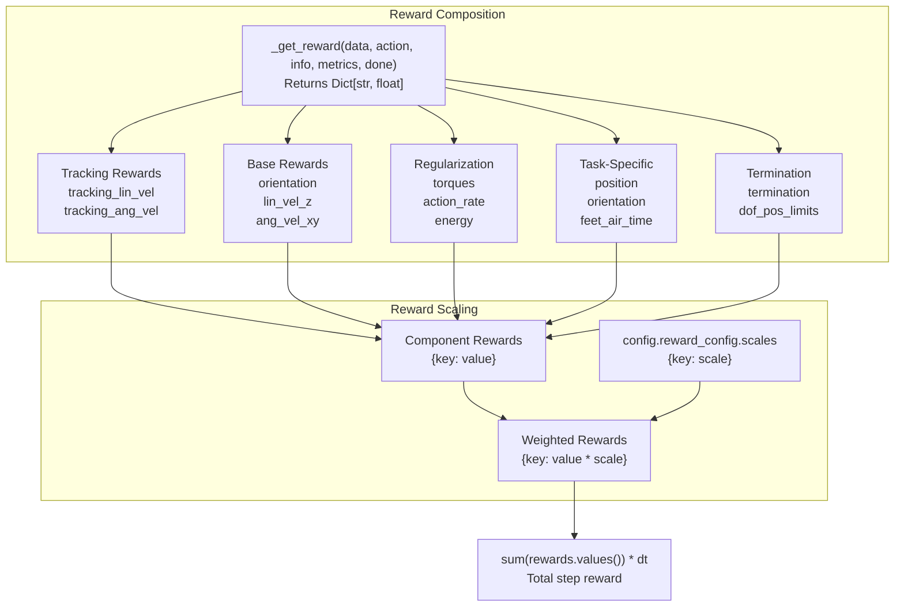
Sources: [mujoco_playground/_src/locomotion/go1/joystick.py:393-431](), [mujoco_playground/_src/manipulation/leap_hand/reorient.py:234-238, 379-414]()

Standard reward computation pattern:

```python
def step(self, state: mjx_env.State, action: jax.Array) -> mjx_env.State:
    # ... physics step ...
    
    # Get unscaled reward components
    rewards = self._get_reward(data, action, state.info, state.metrics, done)
    
    # Apply configured scales
    rewards = {
        k: v * self._config.reward_config.scales[k] 
        for k, v in rewards.items()
    }
    
    # Sum and scale by timestep
    reward = sum(rewards.values()) * self.dt
    
    # Update metrics for logging
    for k, v in rewards.items():
        state.metrics[f"reward/{k}"] = v
```
Sources: [mujoco_playground/_src/locomotion/go1/joystick.py:272-298](), [mujoco_playground/_src/manipulation/leap_hand/reorient.py:234-261]()

### Reward Configuration

Reward scales are defined in the environment's `default_config()`:

```python
# Example from Go1 Joystick
reward_config=config_dict.create(
    scales=config_dict.create(
        # Tracking rewards (positive)
        tracking_lin_vel=1.0,
        tracking_ang_vel=0.5,
        
        # Base regularization (negative)
        lin_vel_z=-0.5,
        ang_vel_xy=-0.05,
        orientation=-5.0,
        
        # Energy costs (negative)
        torques=-0.0002,
        action_rate=-0.01,
        energy=-0.001,
        
        # Task-specific (mixed)
        feet_clearance=-2.0,
        feet_air_time=0.1,
        
        # Termination penalty (negative)
        termination=-1.0,
    ),
    tracking_sigma=0.25,      # Gaussian tracking tolerance
    max_foot_height=0.1,      # Task-specific parameter
)
```
Sources: [mujoco_playground/_src/locomotion/go1/joystick.py:52-79]()

Example from Leap Hand CubeReorient:

```python
reward_config=config_dict.create(
    scales=config_dict.create(
        orientation=5.0,           # Main task objective
        position=0.5,              # Secondary objective
        termination=-100.0,        # Strong penalty
        hand_pose=-0.5,            # Regularization
        action_rate=-0.001,        # Smoothness
        joint_vel=0.0,             # Optional (disabled by default)
        energy=-1e-3,              # Energy efficiency
    ),
    success_reward=100.0,          # Sparse reward on success
)
```
Sources: [mujoco_playground/_src/manipulation/leap_hand/reorient.py:51-62]()

### Reward Component Types

#### Tracking Rewards

Exponential tracking rewards encourage following velocity commands:

```python
def _reward_tracking_lin_vel(
    self, commands: jax.Array, local_vel: jax.Array
) -> jax.Array:
    # Tracking of linear velocity commands (xy axes)
    lin_vel_error = jp.sum(jp.square(commands[:2] - local_vel[:2]))
    return jp.exp(-lin_vel_error / self._config.reward_config.tracking_sigma)

def _reward_tracking_ang_vel(
    self, commands: jax.Array, ang_vel: jax.Array
) -> jax.Array:
    # Tracking of angular velocity commands (yaw)
    ang_vel_error = jp.square(commands[2] - ang_vel[2])
    return jp.exp(-ang_vel_error / self._config.reward_config.tracking_sigma)
```
Sources: [mujoco_playground/_src/locomotion/go1/joystick.py:435-451]()

#### Tolerance-Based Rewards

The `reward.tolerance()` function provides smooth reward shaping:

```python
# From manipulation tasks
cube_pose_mse = jp.linalg.norm(palm_pos - cube_pos)
cube_pos_reward = reward.tolerance(
    cube_pose_mse,          # Distance metric
    (0, 0.02),              # Target bounds (min, max)
    margin=0.05,            # Full reward region
    sigmoid="linear"        # Interpolation type
)
```
Sources: [mujoco_playground/_src/manipulation/leap_hand/reorient.py:389-394]()

Orientation tracking uses angular distance:

```python
def _cube_orientation_error(self, data: mjx.Data):
    cube_ori = self.get_cube_orientation(data)
    goal_ori = self.get_cube_goal_orientation(data)
    quat_diff = math.quat_mul(cube_ori, math.quat_inv(goal_ori))
    quat_diff = math.normalize(quat_diff)
    return 2.0 * jp.asin(jp.clip(math.norm(quat_diff[1:]), a_max=1.0))

def _reward_cube_orientation(self, data: mjx.Data) -> jax.Array:
    ori_error = self._cube_orientation_error(data)
    return reward.tolerance(ori_error, (0, 0.2), margin=jp.pi, sigmoid="linear")
```
Sources: [mujoco_playground/_src/manipulation/leap_hand/reorient.py:421-430]()

#### Regularization Costs

Common regularization terms penalize undesirable behaviors:

```python
# Torque regularization
def _cost_torques(self, torques: jax.Array) -> jax.Array:
    return jp.sqrt(jp.sum(jp.square(torques))) + jp.sum(jp.abs(torques))

# Energy consumption
def _cost_energy(self, qvel: jax.Array, qfrc_actuator: jax.Array) -> jax.Array:
    return jp.sum(jp.abs(qvel) * jp.abs(qfrc_actuator))

# Action rate (smoothness)
def _cost_action_rate(
    self, act: jax.Array, last_act: jax.Array, last_last_act: jax.Array
) -> jax.Array:
    c1 = jp.sum(jp.square(act - last_act))           # First derivative
    c2 = jp.sum(jp.square(act - 2*last_act + last_last_act))  # Second derivative
    return c1 + c2
```
Sources: [mujoco_playground/_src/locomotion/go1/joystick.py:469-483](), [mujoco_playground/_src/manipulation/leap_hand/reorient.py:416-437]()

#### Constraint Penalties

Soft constraints prevent undesirable states:

```python
# Joint position limits
def _cost_joint_pos_limits(self, qpos: jax.Array) -> jax.Array:
    out_of_limits = -jp.clip(qpos - self._soft_lowers, None, 0.0)
    out_of_limits += jp.clip(qpos - self._soft_uppers, 0.0, None)
    return jp.sum(out_of_limits)

# Orientation constraint
def _cost_orientation(self, torso_zaxis: jax.Array) -> jax.Array:
    # Penalize non-flat base orientation
    return jp.sum(jp.square(torso_zaxis[:2]))

# Velocity constraints
def _cost_lin_vel_z(self, global_linvel) -> jax.Array:
    return jp.square(global_linvel[2])
```
Sources: [mujoco_playground/_src/locomotion/go1/joystick.py:455-465, 504-508]()

#### Task-Specific Rewards

Locomotion foot contact rewards:

```python
def _reward_feet_air_time(
    self, air_time: jax.Array, first_contact: jax.Array, commands: jax.Array
) -> jax.Array:
    cmd_norm = jp.linalg.norm(commands)
    rew_air_time = jp.sum((air_time - 0.1) * first_contact)
    rew_air_time *= cmd_norm > 0.01  # Only when moving
    return rew_air_time

def _cost_feet_slip(
    self, data: mjx.Data, contact: jax.Array, info: dict[str, Any]
) -> jax.Array:
    cmd_norm = jp.linalg.norm(info["command"])
    feet_vel = data.sensordata[self._foot_linvel_sensor_adr]
    vel_xy = feet_vel[..., :2]
    vel_xy_norm_sq = jp.sum(jp.square(vel_xy), axis=-1)
    return jp.sum(vel_xy_norm_sq * contact) * (cmd_norm > 0.01)
```
Sources: [mujoco_playground/_src/locomotion/go1/joystick.py:512-547]()

### Sparse and Dense Rewards

Environments combine dense shaping rewards with sparse success rewards:

```python
# Dense rewards from components
rewards = self._get_reward(data, action, state.info, state.metrics, done)
rewards = {k: v * self._config.reward_config.scales[k] for k, v in rewards.items()}
reward = sum(rewards.values()) * self.dt

# Sparse success reward
ori_error = self._cube_orientation_error(data)
success = ori_error < self._config.success_threshold
reward += success * self._config.reward_config.success_reward

# Sparse lifted reward (PandaPickCubeCartesian)
box_pos = data.xpos[self._obj_body]
lifted = (box_pos[2] > 0.05) * self._config.reward_config.lifted_reward
reward += lifted
```
Sources: [mujoco_playground/_src/manipulation/leap_hand/reorient.py:234-254](), [mujoco_playground/_src/manipulation/franka_emika_panda/pick_cartesian.py:356-360]()

### Potential-Based Reward Shaping

Some environments use reward progress tracking to encourage monotonic improvement:

```python
# Compute total potential-based reward
total_reward = jp.clip(sum(rewards.values()), -1e4, 1e4)

# Add sparse rewards
total_reward += lifted + success * config.reward_config.success_reward

# Return only positive progress
reward = jp.maximum(
    total_reward - state.info['prev_reward'], 
    jp.zeros_like(total_reward)
)
state.info['prev_reward'] = jp.maximum(total_reward, state.info['prev_reward'])
```
Sources: [mujoco_playground/_src/manipulation/franka_emika_panda/pick_cartesian.py:346-368]()

This prevents the agent from receiving negative rewards by regressing to worse states.

---

## Episode State Management

### Info Dictionary Structure

The `info` dictionary maintains episode-specific state that persists across steps:

| Category | Keys | Purpose |
|----------|------|---------|
| **RNG State** | `rng` | JAX random number generator for reproducible noise |
| **Action History** | `last_act`, `last_last_act` | Previous actions for smoothness penalties |
| **Command Tracking** | `command`, `steps_until_next_cmd` | Locomotion velocity commands |
| **Perturbation State** | `pert_dir`, `pert_steps`, `steps_until_next_pert` | External force application |
| **Task State** | `motor_targets`, `current_pos`, `reached_box` | Controller and progress tracking |
| **History Buffers** | `qpos_error_history`, `cube_pos_error_history` | Observation history |
| **Contact State** | `feet_air_time`, `last_contact`, `swing_peak` | Locomotion foot contact |
| **Counters** | `step`, `_steps`, `success_count` | Episode progress |

Sources: [mujoco_playground/_src/locomotion/go1/joystick.py:213-229](), [mujoco_playground/_src/manipulation/leap_hand/reorient.py:169-187](), [mujoco_playground/_src/manipulation/franka_emika_panda/pick_cartesian.py:237-249]()

### RNG State Management

JAX requires explicit random number generator splitting for deterministic pseudo-randomness:

```python
# Pattern used across all environments
def reset(self, rng: jax.Array) -> mjx_env.State:
    # Split RNG for different random operations
    rng, goal_rng = jax.random.split(rng)
    goal_quat = uniform_quat(goal_rng)
    
    rng, pos_rng, vel_rng = jax.random.split(rng, 3)
    # ... use pos_rng and vel_rng ...
    
    # Store RNG in info for step function
    info = {"rng": rng, ...}

def step(self, state: mjx_env.State, action: jax.Array) -> mjx_env.State:
    # Split RNG before each use
    state.info["rng"], noise_rng = jax.random.split(state.info["rng"])
    noisy_value = true_value + jax.random.uniform(noise_rng, ...)
```
Sources: [mujoco_playground/_src/manipulation/leap_hand/reorient.py:109-144, 278]()

### Command Sampling for Locomotion

Locomotion tasks sample velocity commands at random intervals:

```python
# Initialize command at reset
rng, key1, key2 = jax.random.split(rng, 3)
time_until_next_cmd = jax.random.exponential(key1) * 5.0
steps_until_next_cmd = jp.round(time_until_next_cmd / self.dt).astype(jp.int32)
cmd = jax.random.uniform(key2, shape=(3,), minval=-cmd_a, maxval=cmd_a)

info = {
    "command": cmd,
    "steps_until_next_cmd": steps_until_next_cmd,
}

# Update command in step
state.info["steps_until_next_cmd"] -= 1
state.info["rng"], key1, key2 = jax.random.split(state.info["rng"], 3)
state.info["command"] = jp.where(
    state.info["steps_until_next_cmd"] <= 0,
    self.sample_command(key1, state.info["command"]),
    state.info["command"],
)
state.info["steps_until_next_cmd"] = jp.where(
    done | (state.info["steps_until_next_cmd"] <= 0),
    jp.round(jax.random.exponential(key2) * 5.0 / self.dt).astype(jp.int32),
    state.info["steps_until_next_cmd"],
)
```
Sources: [mujoco_playground/_src/locomotion/go1/joystick.py:204-293]()

Command sampling uses exponential timing to create variable-length command intervals, with Bernoulli masking to zero out certain command dimensions:

```python
def sample_command(self, rng: jax.Array, x_k: jax.Array) -> jax.Array:
    rng, y_rng, w_rng, z_rng = jax.random.split(rng, 4)
    y_k = jax.random.uniform(
        y_rng, shape=(3,), minval=-self._cmd_a, maxval=self._cmd_a
    )
    z_k = jax.random.bernoulli(z_rng, self._cmd_b, shape=(3,))
    w_k = jax.random.bernoulli(w_rng, 0.5, shape=(3,))
    x_kp1 = x_k - w_k * (x_k - y_k * z_k)
    return x_kp1
```
Sources: [mujoco_playground/_src/locomotion/go1/joystick.py:607-615]()

### Perturbation State Management

External perturbations simulate disturbances during training:

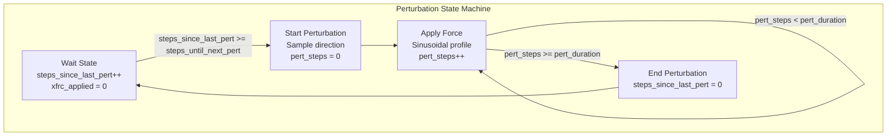
Sources: [mujoco_playground/_src/locomotion/go1/joystick.py:551-605]()

Perturbation implementation:

```python
def _maybe_apply_perturbation(self, state: mjx_env.State) -> mjx_env.State:
    def apply_pert(state: mjx_env.State) -> mjx_env.State:
        t = state.info["pert_steps"] * self.dt
        u_t = 0.5 * jp.sin(jp.pi * t / state.info["pert_duration_seconds"])
        force = (
            u_t * self._torso_mass * state.info["pert_mag"] 
            / state.info["pert_duration_seconds"]
        )
        xfrc_applied = jp.zeros((self.mjx_model.nbody, 6))
        xfrc_applied = xfrc_applied.at[self._torso_body_id, :3].set(
            force * state.info["pert_dir"]
        )
        data = state.data.replace(xfrc_applied=xfrc_applied)
        state.info["pert_steps"] += 1
        return state.replace(data=data)
    
    return jax.lax.cond(
        state.info["steps_since_last_pert"] >= state.info["steps_until_next_pert"],
        apply_pert,
        wait,
        state,
    )
```
Sources: [mujoco_playground/_src/locomotion/go1/joystick.py:551-605](), [mujoco_playground/_src/manipulation/leap_hand/reorient.py:447-481]()

---

## Termination Conditions

### Termination Check Pattern

All environments implement `_get_termination()` to detect episode-ending conditions:

```mermaid
graph TB
    subgraph "Termination Detection"
        STEP["step(state, action)"]
        PHYS["Physics Step<br/>mjx_env.step()"]
        TERM["_get_termination(data)<br/>Returns bool"]
        
        FALL["Fall Detection<br/>Base height or orientation"]
        NAN["Numerical Instability<br/>NaN in qpos/qvel"]
        BOUNDS["Out of Bounds<br/>Position limits"]
        SUCCESS["Task Success<br/>Goal achieved"]
        
        DONE["done flag<br/>Episode termination"]
    end
    
    STEP --> PHYS
    PHYS --> TERM
    TERM --> FALL
    TERM --> NAN
    TERM --> BOUNDS
    TERM --> SUCCESS
    
    FALL --> DONE
    NAN --> DONE
    BOUNDS --> DONE
    SUCCESS --> DONE
```
Sources: [mujoco_playground/_src/locomotion/go1/joystick.py:305-307](), [mujoco_playground/_src/manipulation/leap_hand/reorient.py:267-271]()

### Common Termination Conditions

#### Fall Detection (Locomotion)

```python
def _get_termination(self, data: mjx.Data) -> jax.Array:
    fall_termination = self.get_upvector(data)[-1] < 0.0
    return fall_termination
```
Sources: [mujoco_playground/_src/locomotion/go1/joystick.py:305-307]()

#### Fall and NaN Detection (Manipulation)

```python
def _get_termination(self, data: mjx.Data, info: dict[str, Any]) -> jax.Array:
    fall_termination = self.get_cube_position(data)[2] < -0.05
    nans = jp.any(jp.isnan(data.qpos)) | jp.any(jp.isnan(data.qvel))
    return fall_termination | nans
```
Sources: [mujoco_playground/_src/manipulation/leap_hand/reorient.py:267-271]()

#### Out of Bounds (Cartesian Tasks)

```python
out_of_bounds = jp.any(jp.abs(box_pos) > 1.0)
out_of_bounds |= box_pos[2] < 0.0
done = (
    out_of_bounds
    | jp.isnan(data.qpos).any()
    | jp.isnan(data.qvel).any()
    | success
)
```
Sources: [mujoco_playground/_src/manipulation/franka_emika_panda/pick_cartesian.py:371-385]()

### Episode Length Management

Episode length is enforced through auto-reset wrappers (see [Environment Wrappers](#4.4)), but environments may track steps internally:

```python
# Internal step counter for synchronization
state.info['_steps'] += self._config.action_repeat
state.info['_steps'] = jp.where(
    done | (state.info['_steps'] >= self._config.episode_length),
    0,
    state.info['_steps'],
)
```
Sources: [mujoco_playground/_src/manipulation/franka_emika_panda/pick_cartesian.py:388-393]()

---

## Metrics Tracking

### Metrics Dictionary

The `metrics` dictionary accumulates statistics for logging and analysis:

```python
# Initialize metrics at reset
metrics = {}
for k in self._config.reward_config.scales.keys():
    metrics[f"reward/{k}"] = jp.zeros(())
metrics["reward/success"] = jp.zeros((), dtype=float)
metrics["steps_since_last_success"] = 0
metrics["success_count"] = 0

# Update metrics at each step
for k, v in rewards.items():
    state.metrics[f"reward/{k}"] = v
state.metrics["reward/success"] = success.astype(float)
state.metrics["steps_since_last_success"] = state.info["steps_since_last_success"]
```
Sources: [mujoco_playground/_src/manipulation/leap_hand/reorient.py:189-262]()

### Success Tracking

Manipulation tasks track success events and time since last success:

```python
ori_error = self._cube_orientation_error(data)
success = ori_error < self._config.success_threshold

state.info["steps_since_last_success"] = jp.where(
    success, 0, state.info["steps_since_last_success"] + 1
)
state.info["success_count"] = jp.where(
    success, state.info["success_count"] + 1, state.info["success_count"]
)

state.metrics["steps_since_last_success"] = state.info["steps_since_last_success"]
state.metrics["success_count"] = state.info["success_count"]
```
Sources: [mujoco_playground/_src/manipulation/leap_hand/reorient.py:218-229]()

### Task-Specific Metrics

Locomotion environments track foot swing height:

```python
# Track maximum foot height during swing phase
p_f = data.site_xpos[self._feet_site_id]
p_fz = p_f[..., -1]
state.info["swing_peak"] = jp.maximum(state.info["swing_peak"], p_fz)

# Reset on contact
state.info["swing_peak"] *= ~contact

# Log average swing peak
state.metrics["swing_peak"] = jp.mean(state.info["swing_peak"])
```
Sources: [mujoco_playground/_src/locomotion/go1/joystick.py:263-299]()

### Reward Component Logging

All reward components are logged individually:

```python
# Raw rewards (before scaling)
raw_rewards = self._get_reward(data, state.info)

# Scaled rewards for training
rewards = {
    k: v * self._config.reward_config.reward_scales[k]
    for k, v in raw_rewards.items()
}

# Log both in metrics
state.metrics.update({f'reward/{k}': v for k, v in raw_rewards.items()})
```
Sources: [mujoco_playground/_src/manipulation/franka_emika_panda/pick_cartesian.py:333-378]()

This enables detailed analysis of which reward components are active during training and how they contribute to the total reward signal.

---

# Page: Domain Randomization

# Domain Randomization

<details>
<summary>Relevant source files</summary>

The following files were used as context for generating this wiki page:

- [mujoco_playground/_src/dm_control_suite/__init__.py](mujoco_playground/_src/dm_control_suite/__init__.py)
- [mujoco_playground/_src/locomotion/__init__.py](mujoco_playground/_src/locomotion/__init__.py)
- [mujoco_playground/_src/locomotion/berkeley_humanoid/randomize.py](mujoco_playground/_src/locomotion/berkeley_humanoid/randomize.py)
- [mujoco_playground/_src/locomotion/g1/randomize.py](mujoco_playground/_src/locomotion/g1/randomize.py)
- [mujoco_playground/_src/locomotion/go1/randomize.py](mujoco_playground/_src/locomotion/go1/randomize.py)
- [mujoco_playground/_src/locomotion/t1/randomize.py](mujoco_playground/_src/locomotion/t1/randomize.py)
- [mujoco_playground/_src/manipulation/__init__.py](mujoco_playground/_src/manipulation/__init__.py)
- [mujoco_playground/_src/manipulation/franka_emika_panda/randomize_vision.py](mujoco_playground/_src/manipulation/franka_emika_panda/randomize_vision.py)
- [mujoco_playground/_src/manipulation/franka_emika_panda/xmls/mjx_cabinet.xml](mujoco_playground/_src/manipulation/franka_emika_panda/xmls/mjx_cabinet.xml)
- [mujoco_playground/_src/manipulation/franka_emika_panda/xmls/mjx_single_cube.xml](mujoco_playground/_src/manipulation/franka_emika_panda/xmls/mjx_single_cube.xml)
- [mujoco_playground/_src/manipulation/franka_emika_panda/xmls/mjx_single_cube_camera.xml](mujoco_playground/_src/manipulation/franka_emika_panda/xmls/mjx_single_cube_camera.xml)

</details>


## Purpose and Scope

This page documents the domain randomization system in MuJoCo Playground, which enables sim-to-real transfer by training policies robust to variations in physics parameters, lighting, and camera setups. Domain randomization applies stochastic modifications to simulation properties (friction, mass, armature, actuator gains, light positions, and camera poses) during training, creating a diverse distribution of simulation environments. Policies trained with domain randomization generalize effectively to real hardware where exact parameters are uncertain.

For details on how domain randomization integrates with environment wrappers, see [Environment Wrappers](#4.4). For vision training workflows, see [Vision-Based Training](#4.5).

Sources: [mujoco_playground/_src/manipulation/franka_emika_panda/randomize_vision.py:58-187](), [mujoco_playground/_src/locomotion/g1/randomize.py:23-100]()

---

## Overview and Architecture

Domain randomization in MuJoCo Playground operates by modifying `mjx.Model` parameters at episode reset. Environments define a `domain_randomize()` function within their respective `randomize.py` modules (or `randomize_vision.py` for vision tasks). The system uses `jax.vmap` to vectorize parameter generation and model tree updates across parallel GPU environments.

```mermaid
graph TB
    subgraph "Code Entity Space"
        REGISTRY["_randomizer registry<br/>mujoco_playground/_src/locomotion/__init__.py"]
        LOAD_FN["registry.load()<br/>mujoco_playground/_src/locomotion/__init__.py"]
        RAND_FN["domain_randomize()<br/>mujoco_playground/_src/locomotion/g1/randomize.py"]
        VMAP_CALL["jax.vmap(rand_dynamics)<br/>mujoco_playground/_src/locomotion/g1/randomize.py"]
        TREE_REPLACE["model.tree_replace()<br/>mujoco_playground/_src/locomotion/g1/randomize.py"]
        WRAPPER["BraxDomainRandomizationVmapWrapper<br/>mujoco_playground/_src/wrapper.py"]
    end
    
    subgraph "Natural Language Space"
        INIT["Environment Initialization"]
        RESET["Episode Reset Hook"]
        BATCH_GEN["Batch Parameter Generation"]
        MODEL_UPDATE["Batched mjx.Model Creation"]
    end
    
    INIT --> LOAD_FN
    LOAD_FN --> WRAPPER
    WRAPPER --> RESET
    RESET --> RAND_FN
    RAND_FN --> VMAP_CALL
    VMAP_CALL --> BATCH_GEN
    BATCH_GEN --> TREE_REPLACE
    TREE_REPLACE --> MODEL_UPDATE
    
    style RAND_FN fill:#f9f,stroke:#333,stroke-width:2px
    style VMAP_CALL fill:#bbf,stroke:#333,stroke-width:2px
    style TREE_REPLACE fill:#bfb,stroke:#333,stroke-width:2px
```

Sources: [mujoco_playground/_src/locomotion/__init__.py:115-131](), [mujoco_playground/_src/locomotion/g1/randomize.py:23-100]()

---

## Physics Parameters and `randomize.py` Implementation

Physics randomization functions follow a standardized signature accepting an `mjx.Model` and a JAX random key `rng`, returning a modified batched `mjx.Model` and an `in_axes` tree structure.

```python
def domain_randomize(model: mjx.Model, rng: jax.Array) -> Tuple[mjx.Model, Any]:
  ...
```

### Key Parameter Categories

| Parameter | Model Field | Typical Operation / Range | Purpose |
|-----------|-------------|---------------------------|---------|
| Floor / Pair Friction | `geom_friction` / `pair_friction` | Uniform: `U(0.4, 1.0)` | Vary ground slip and foot grip |
| Joint Friction Loss | `dof_frictionloss` | Multiplicative: `*U(0.5, 2.0)` | Joint internal resistance |
| Armature | `dof_armature` | Multiplicative: `*U(1.0, 1.05)` | Rotor inertia representation |
| Body Masses | `body_mass` | Multiplicative: `*U(0.9, 1.1)` + Additive | Total weight & payload distribution |
| Center of Mass | `body_ipos` | Additive: `+U(-0.05, 0.05)` | CoM offset jitter |
| Joint Stiffness & Bias | `actuator_gainprm`, `actuator_biasprm` | Multiplicative: `*U(0.9, 1.1)` | PD controller gain variation |
| Initial Pose | `qpos0` | Additive: `+U(-0.05, 0.05)` | Starting configuration noise |

Sources: [mujoco_playground/_src/locomotion/t1/randomize.py:26-130](), [mujoco_playground/_src/locomotion/g1/randomize.py:23-100]()

### Vectorized Execution Flow

```mermaid
graph TB
    subgraph "Code Entity Space"
        ENTRY["domain_randomize(model, rng)<br/>mujoco_playground/_src/locomotion/t1/randomize.py"]
        VMAP["@jax.vmap<br/>rand_dynamics(rng)"]
        SPLIT["jax.random.split(rng)"]
        UNIFORM["jax.random.uniform()"]
        REPLACE["in_axes.tree_replace()<br/>model.tree_replace()"]
    end
    
    subgraph "Data Flow"
        RNG_IN["rng: jax.Array (num_envs,)"]
        KEYS["Split keys per parameter"]
        SAMPLED_VALS["Batched parameter tensors"]
        MODEL_OUT["Randomized mjx.Model"]
    end
    
    ENTRY --> VMAP
    RNG_IN --> VMAP
    VMAP --> SPLIT
    SPLIT --> KEYS
    KEYS --> UNIFORM
    UNIFORM --> SAMPLED_VALS
    SAMPLED_VALS --> REPLACE
    REPLACE --> MODEL_OUT
    
    style VMAP fill:#f9f,stroke:#333,stroke-width:2px
    style REPLACE fill:#bbf,stroke:#333,stroke-width:2px
```

Sources: [mujoco_playground/_src/locomotion/t1/randomize.py:26-130]()

---

## Vision-Specific Randomization

For vision-based tasks, `randomize_vision.py` randomizes appearance, cameras, and lighting parameters to bridge the visual gap between simulation and the real world.

### Implementation in `randomize_vision.py`

The vision randomizer modifies rendering and scene properties such as geom RGBA colors, material IDs, camera positions and orientations, light positions, light directions, and shadow casting flags [mujoco_playground/_src/manipulation/franka_emika_panda/randomize_vision.py:58-187]().

```mermaid
graph TB
    subgraph "Code Entity Space"
        VIS_RAND["domain_randomize(mjx_model, num_worlds)<br/>mujoco_playground/_src/manipulation/franka_emika_panda/randomize_vision.py"]
        SAMPLE_LIGHT["sample_light_position()<br/>mujoco_playground/_src/manipulation/franka_emika_panda/randomize_vision.py"]
        PERTURB_ORI["perturb_orientation(key, original, deg)<br/>mujoco_playground/_src/manipulation/franka_emika_panda/randomize_vision.py"]
        VMAP_RAND["@jax.vmap<br/>rand(rng, light_position)"]
        TREE_REP["mjx_model.tree_replace()"]
    end
    
    subgraph "Randomized Attributes"
        APPEARANCE["geom_rgba, geom_matid<br/>Box, floor, and strip colors"]
        CAMERAS["cam_pos, cam_quat<br/>Pose jitter and orientation perturbation"]
        LIGHTING["light_pos, light_dir, light_castshadow<br/>Light position, angle, and shadow toggles"]
    end
    
    VIS_RAND --> SAMPLE_LIGHT
    VIS_RAND --> VMAP_RAND
    VMAP_RAND --> PERTURB_ORI
    SAMPLE_LIGHT --> VMAP_RAND
    VMAP_RAND --> APPEARANCE
    VMAP_RAND --> CAMERAS
    VMAP_RAND --> LIGHTING
    APPEARANCE --> TREE_REP
    CAMERAS --> TREE_REP
    LIGHTING --> TREE_REP
    
    style VIS_RAND fill:#f9f,stroke:#333,stroke-width:2px
    style VMAP_RAND fill:#bbf,stroke:#333,stroke-width:2px
```

Sources: [mujoco_playground/_src/manipulation/franka_emika_panda/randomize_vision.py:27-187]()

---

## Integration with Training Wrappers

Domain randomization functions integrate into training workflows through environment wrappers like `BraxDomainRandomizationVmapWrapper` and `RSLRLBraxWrapper`.

```mermaid
graph TB
    subgraph "Training Framework Integration"
        REGISTRY_LOAD["registry.load(env_name)"]
        GET_RAND["registry.get_domain_randomizer(env_name)"]
        WRAPPER_BRAX["BraxDomainRandomizationVmapWrapper"]
        WRAPPER_TORCH["RSLRLBraxWrapper"]
        ENV_RESET["env.reset(rng)"]
        ENV_STEP["env.step(state, action)"]
    end
    
    REGISTRY_LOAD --> WRAPPER_BRAX
    GET_RAND --> WRAPPER_BRAX
    REGISTRY_LOAD --> WRAPPER_TORCH
    GET_RAND --> WRAPPER_TORCH
    
    WRAPPER_BRAX --> ENV_RESET
    WRAPPER_TORCH --> ENV_RESET
    ENV_RESET --> ENV_STEP
    
    style WRAPPER_BRAX fill:#f9f,stroke:#333,stroke-width:2px
    style WRAPPER_TORCH fill:#bbf,stroke:#333,stroke-width:2px
```

When an episode resets, the wrapper evaluates the domain randomization function to instantiate randomized physical or visual models across the batch dimension.

Sources: [mujoco_playground/_src/manipulation/__init__.py:123-133](), [mujoco_playground/_src/locomotion/__init__.py:115-131]()

---

## Summary of Environment Randomizers

The table below catalogs environments that include dedicated domain randomization modules:

| Environment Category | Environment Name | Randomizer Source File | Key Randomized Properties |
|----------------------|------------------|------------------------|---------------------------|
| Locomotion | `Go1JoystickFlatTerrain` / `RoughTerrain` / `Getup` / `Handstand` | `mujoco_playground/_src/locomotion/go1/randomize.py` | Floor friction, frictionloss, armature, CoM position, body masses, `qpos0` |
| Locomotion | `G1JoystickFlatTerrain` / `RoughTerrain` | `mujoco_playground/_src/locomotion/g1/randomize.py` | Pair friction, static friction, armature, body masses, torso mass, `qpos0` |
| Locomotion | `T1JoystickFlatTerrain` / `RoughTerrain` | `mujoco_playground/_src/locomotion/t1/randomize.py` | Geom friction, frictionloss, armature, body masses, torso mass, `qpos0`, gains, damping |
| Locomotion | `BerkeleyHumanoid` | `mujoco_playground/_src/locomotion/berkeley_humanoid/randomize.py` | Floor friction, frictionloss, armature, body masses, torso mass, `qpos0` |
| Manipulation | `LeapCubeReorient` / `CubeRotateZAxis` | `mujoco_playground/_src/manipulation/leap_hand/` | Fingertip friction, cube mass/inertia/CoM, joint friction/armature/stiffness/damping |
| Manipulation | `PandaPickCubeCartesian` (Vision) | `mujoco_playground/_src/manipulation/franka_emika_panda/randomize_vision.py` | Geom RGBA, material IDs, camera position/orientation, light position/direction/shadows |

Sources: [mujoco_playground/_src/manipulation/__init__.py:59-63](), [mujoco_playground/_src/locomotion/__init__.py:115-131](), [mujoco_playground/_src/manipulation/franka_emika_panda/randomize_vision.py:58-187]()

---

# Page: Environment Collections

# Environment Collections

<details>
<summary>Relevant source files</summary>

The following files were used as context for generating this wiki page:

- [mujoco_playground/_src/dm_control_suite/__init__.py](mujoco_playground/_src/dm_control_suite/__init__.py)
- [mujoco_playground/_src/locomotion/__init__.py](mujoco_playground/_src/locomotion/__init__.py)
- [mujoco_playground/_src/locomotion/t1/randomize.py](mujoco_playground/_src/locomotion/t1/randomize.py)
- [mujoco_playground/_src/manipulation/__init__.py](mujoco_playground/_src/manipulation/__init__.py)

</details>


This page provides an overview of the three main environment categories in MuJoCo Playground: Locomotion, Manipulation, and the DeepMind Control Suite. MuJoCo Playground organizes over 50 GPU-accelerated reinforcement learning environments across these categories, utilizing unified registry modules to manage environment instantiation, configuration, and domain randomization.

For detailed technical specifications, base classes, reward formulations, and task implementations, refer to the child pages:
- [Locomotion Environments](#3.1)
- [Manipulation Environments](#3.2)
- [DM Control Suite](#3.3)

Sources: [mujoco_playground/_src/locomotion/__init__.py:1-44](), [mujoco_playground/_src/manipulation/__init__.py:1-44](), [mujoco_playground/_src/dm_control_suite/__init__.py:1-36]()

## Registry Architecture

Each environment category implements a registry pattern that handles environment discovery, configuration management, and domain randomizer retrieval.

```mermaid
graph TB
    subgraph "Registry Modules"
        LOCO["locomotion registry<br/>mujoco_playground/_src/locomotion/__init__.py"]
        MANIP["manipulation registry<br/>mujoco_playground/_src/manipulation/__init__.py"]
        DM["dm_control_suite registry<br/>mujoco_playground/_src/dm_control_suite/__init__.py"]
    end
    
    subgraph "Registry Interface"
        LOAD["load(env_name, config, config_overrides)<br/>Returns: MjxEnv instance"]
        CFG["get_default_config(env_name)<br/>Returns: ConfigDict"]
        RAND["get_domain_randomizer(env_name)<br/>Returns: randomization function"]
    end
    
    subgraph "Internal Data Structures"
        ENVS["_envs: Dict[str, Type[MjxEnv]]<br/>Maps names to environment classes"]
        CFGS["_cfgs: Dict[str, Callable]<br/>Maps names to config functions"]
        RANDS["_randomizer: Dict[str, Callable]<br/>Maps names to randomization functions"]
    end
    
    LOCO --> LOAD
    LOCO --> CFG
    LOCO --> RAND
    
    MANIP --> LOAD
    MANIP --> CFG
    MANIP --> RAND
    
    DM --> LOAD
    DM --> CFG
    
    LOAD --> ENVS
    CFG --> CFGS
    RAND --> RANDS
```

Sources: [mujoco_playground/_src/locomotion/__init__.py:45-131](), [mujoco_playground/_src/manipulation/__init__.py:33-63]()

## 3.1. Locomotion Environments

The locomotion collection covers quadruped and bipedal robotic platforms performing tasks such as velocity joystick tracking, recovery, acrobatic maneuvers, and gait tracking. 

For detailed information on base classes, terrain XML scenes, command generators, and perturbation systems, see [Locomotion Environments](#3.1).

### Quadrupeds and Bipedal Catalog
- **Quadrupeds:** Unitree Go1 (`Go1JoystickFlatTerrain`, `Go1JoystickRoughTerrain`, `Go1Getup`, `Go1Handstand`, `Go1Footstand`), Boston Dynamics Spot (`SpotFlatTerrainJoystick`, `SpotGetup`, `SpotJoystickGaitTracking`), Barkour (`BarkourJoystick`), and Apollo (`ApolloJoystickFlatTerrain`). [mujoco_playground/_src/locomotion/__init__.py:45-87]()
- **Bipeds & Humanoids:** Unitree G1 (`G1JoystickFlatTerrain`, `G1JoystickRoughTerrain`), Berkeley Humanoid (`BerkeleyHumanoidJoystickFlatTerrain`, `BerkeleyHumanoidJoystickRoughTerrain`), Unitree H1 (`H1InplaceGaitTracking`, `H1JoystickGaitTracking`), Unitree T1 (`T1JoystickFlatTerrain`, `T1JoystickRoughTerrain`), and Robotis OP3 (`Op3Joystick`). [mujoco_playground/_src/locomotion/__init__.py:45-87]()

Sources: [mujoco_playground/_src/locomotion/__init__.py:45-87]()

## 3.2. Manipulation Environments

The manipulation collection spans dexterous hand control and robotic arm tasks, emphasizing in-hand reorientation, pick-and-place, open-cabinet, and bimanual handovers.

For detailed information on shared base classes, Cartesian control integration, and reward shaping, see [Manipulation Environments](#3.2).

### Manipulation Catalog
- **Dexterous Hands:** Leap Hand (`LeapCubeReorient`, `LeapCubeRotateZAxis`) and Aero Hand (`AeroCubeRotateZAxis`). [mujoco_playground/_src/manipulation/__init__.py:33-44]()
- **Robotic Arms:** Franka Emika Panda (`PandaPickCube`, `PandaPickCubeOrientation`, `PandaPickCubeCartesian`, `PandaOpenCabinet`), Panda with Robotiq gripper (`PandaRobotiqPushCube`), and ALOHA dual arms (`AlohaHandOver`, `AlohaSinglePegInsertion`). [mujoco_playground/_src/manipulation/__init__.py:33-44]()

Sources: [mujoco_playground/_src/manipulation/__init__.py:33-44]()

## 3.3. DM Control Suite

The DeepMind Control Suite integration ports classic continuous control benchmarks to the GPU-accelerated MJX backend. These environments support both dense and sparse reward variants as well as vision configurations.

For detailed information on the 25+ ported environments (cartpole, acrobot, cheetah, walker, finger, fish, hopper, humanoid, pendulum, point mass, reacher, swimmer, ball-in-cup), see [DM Control Suite](#3.3).

### DM Control Suite Catalog Highlights
- **Classic Control:** `AcrobotSwingup`, `AcrobotSwingupSparse`, `CartpoleBalance`, `CartpoleBalanceSparse`, `CartpoleSwingup`, `CartpoleSwingupSparse`, `PendulumSwingup`. [mujoco_playground/_src/dm_control_suite/__init__.py:37-71]()
- **Locomotion & Swimming:** `CheetahRun`, `FishSwim`, `HopperHop`, `HopperStand`, `HumanoidStand`, `HumanoidWalk`, `HumanoidRun`, `WalkerRun`, `WalkerStand`, `WalkerWalk`. [mujoco_playground/_src/dm_control_suite/__init__.py:37-71]()
- **Manipulation & Reaching:** `FingerSpin`, `FingerTurnEasy`, `FingerTurnHard`, `PointMass`, `ReacherEasy`, `ReacherHard`, `SwimmerSwimmer6`, `BallInCup`. [mujoco_playground/_src/dm_control_suite/__init__.py:37-71]()

Sources: [mujoco_playground/_src/dm_control_suite/__init__.py:37-71]()

---

# Page: Locomotion Environments

# Locomotion Environments

<details>
<summary>Relevant source files</summary>

The following files were used as context for generating this wiki page:

- [mujoco_playground/_src/locomotion/berkeley_humanoid/xmls/scene_mjx_feetonly_rough_terrain.xml](mujoco_playground/_src/locomotion/berkeley_humanoid/xmls/scene_mjx_feetonly_rough_terrain.xml)
- [mujoco_playground/_src/locomotion/g1/xmls/scene_mjx_feetonly_rough_terrain.xml](mujoco_playground/_src/locomotion/g1/xmls/scene_mjx_feetonly_rough_terrain.xml)
- [mujoco_playground/_src/locomotion/go1/base.py](mujoco_playground/_src/locomotion/go1/base.py)
- [mujoco_playground/_src/locomotion/go1/xmls/scene_mjx_feetonly_rough_terrain.xml](mujoco_playground/_src/locomotion/go1/xmls/scene_mjx_feetonly_rough_terrain.xml)
- [mujoco_playground/_src/locomotion/op3/base.py](mujoco_playground/_src/locomotion/op3/base.py)
- [mujoco_playground/_src/locomotion/t1/base.py](mujoco_playground/_src/locomotion/t1/base.py)
- [mujoco_playground/_src/locomotion/t1/xmls/scene_mjx_feetonly_rough_terrain.xml](mujoco_playground/_src/locomotion/t1/xmls/scene_mjx_feetonly_rough_terrain.xml)
- [mujoco_playground/config/locomotion_params.py](mujoco_playground/config/locomotion_params.py)
- [mujoco_playground/experimental/madrona_benchmarking/benchmark.py](mujoco_playground/experimental/madrona_benchmarking/benchmark.py)

</details>


This page provides an overview of the locomotion environments available in MuJoCo Playground, covering reinforcement learning tasks for both quadrupedal and bipedal robots. These GPU-accelerated environments support diverse locomotion behaviors, including joystick-controlled flat and rough terrain navigation, recovery tasks, specialized skills, and gait tracking.

For specific details on quadrupeds, see [Quadruped Robot Environments](#3.1.1). For bipeds and humanoids, see [Bipedal and Humanoid Environments](#3.1.2).

Sources: [mujoco_playground/config/locomotion_params.py:15-22]()

---

## Quadruped Robot Environments

Quadrupedal environments in MuJoCo Playground model robots such as Unitree Go1, Boston Dynamics Spot, Barkour, Apollo, and T1. These platforms feature high-frequency control loops, joint PD gain management [mujoco_playground/_src/locomotion/go1/base.py:58-61](), contact sensors, and specialized training pipelines. Task variations include velocity tracking via joystick on flat and rough terrain (hfields), getup and recovery tasks, footstands/handstands, and gait tracking.

For full details on task designs, reward components, command sampling, and perturbation systems for four-legged platforms, see [Quadruped Robot Environments](#3.1.1).

Sources: [mujoco_playground/config/locomotion_params.py:55-162](), [mujoco_playground/_src/locomotion/go1/base.py:40-78]()

---

## Bipedal and Humanoid Environments

Bipedal and humanoid environments cover complex balancing and locomotion tasks across platforms such as the Berkeley Humanoid, Unitree G1 and H1, Robotis OP3, and Booster T1. These environments utilize dedicated sensor XML layouts, root and joint state sensors, and specialized reward formulations to handle underactuation and stability during locomotion and gait tracking.

For comprehensive documentation on bipedal base classes, sensor interfaces, and joystick or gait-tracking task variations, see [Bipedal and Humanoid Environments](#3.1.2).

Sources: [mujoco_playground/config/locomotion_params.py:96-151](), [mujoco_playground/_src/locomotion/t1/base.py:39-100](), [mujoco_playground/_src/locomotion/op3/base.py:40-105]()

---

## Shared Infrastructure and Registration

All locomotion environments integrate with a centralized registry system, configuration manager, and domain randomization pipeline. 

### Robot Taxonomy and Tasks

The following diagram illustrates the taxonomy of locomotion environments across robot platforms and task types:

```mermaid
graph TD
    subgraph "Quadrupedal Robots"
        GO1["Go1 Robot"]
        SPOT["Spot Robot"] 
        BARKOUR["Barkour Robot"]
        APOLLO["Apollo Robot"]
        T1["T1 Robot"]
    end
    
    subgraph "Bipedal Humanoids"
        BERKELEY["Berkeley Humanoid"]
        G1["G1 Humanoid"]
        H1["H1 Humanoid"]
        OP3["OP3 Humanoid"]
    end
    
    subgraph "Joystick Control Tasks"
        GO1_JOY_FLAT["Go1JoystickFlatTerrain"]
        GO1_JOY_ROUGH["Go1JoystickRoughTerrain"]
        SPOT_JOY["SpotFlatTerrainJoystick"]
        BARKOUR_JOY["BarkourJoystick"]
        APOLLO_JOY["ApolloJoystickFlatTerrain"]
        T1_JOY_FLAT["T1JoystickFlatTerrain"]
        T1_JOY_ROUGH["T1JoystickRoughTerrain"]
        BERK_JOY_FLAT["BerkeleyHumanoidJoystickFlatTerrain"]
        BERK_JOY_ROUGH["BerkeleyHumanoidJoystickRoughTerrain"]
        G1_JOY_FLAT["G1JoystickFlatTerrain"]
        G1_JOY_ROUGH["G1JoystickRoughTerrain"]
        OP3_JOY["Op3Joystick"]
    end
    
    subgraph "Recovery and Skills"
        GO1_GET["Go1Getup"]
        SPOT_GET["SpotGetup"]
        GO1_HAND["Go1Handstand"]
    end
    
    subgraph "Gait Tracking"
        H1_INPLACE["H1InplaceGaitTracking"]
        H1_GAIT["H1JoystickGaitTracking"]
        SPOT_GAIT["SpotJoystickGaitTracking"]
    end
    
    GO1 --> GO1_JOY_FLAT
    GO1 --> GO1_JOY_ROUGH
    GO1 --> GO1_GET
    GO1 --> GO1_HAND
    
    SPOT --> SPOT_JOY
    SPOT --> SPOT_GET
    SPOT --> SPOT_GAIT
    
    BARKOUR --> BARKOUR_JOY
    APOLLO --> APOLLO_JOY
    T1 --> T1_JOY_FLAT
    T1 --> T1_JOY_ROUGH
    
    BERKELEY --> BERK_JOY_FLAT
    BERKELEY --> BERK_JOY_ROUGH
    
    G1 --> G1_JOY_FLAT
    G1 --> G1_JOY_ROUGH
    
    H1 --> H1_INPLACE
    H1 --> H1_GAIT
    OP3 --> OP3_JOY
```

Sources: [mujoco_playground/config/locomotion_params.py:24-166]()

### Configuration and Hyperparameters

Training parameters for locomotion environments are managed via `locomotion_params.py`, which provides tailored PPO configurations for both Brax [mujoco_playground/config/locomotion_params.py:24-166]() and RSL-RL [mujoco_playground/config/locomotion_params.py:169-202](). These configs specify neural network architectures (e.g., hidden dimensions `(512, 256, 128)`), asymmetric observation keys (`state` vs `privileged_state`), and rollout parameters.

Sources: [mujoco_playground/config/locomotion_params.py:24-202]()

---

# Page: Quadruped Robot Environments

# Quadruped Robot Environments

<details>
<summary>Relevant source files</summary>

The following files were used as context for generating this wiki page:

- [mujoco_playground/_src/locomotion/barkour/joystick.py](mujoco_playground/_src/locomotion/barkour/joystick.py)
- [mujoco_playground/_src/locomotion/go1/getup.py](mujoco_playground/_src/locomotion/go1/getup.py)
- [mujoco_playground/_src/locomotion/go1/handstand.py](mujoco_playground/_src/locomotion/go1/handstand.py)
- [mujoco_playground/_src/locomotion/go1/joystick.py](mujoco_playground/_src/locomotion/go1/joystick.py)
- [mujoco_playground/_src/locomotion/spot/getup.py](mujoco_playground/_src/locomotion/spot/getup.py)
- [mujoco_playground/_src/locomotion/spot/joystick.py](mujoco_playground/_src/locomotion/spot/joystick.py)
- [mujoco_playground/_src/manipulation/aloha/base.py](mujoco_playground/_src/manipulation/aloha/base.py)

</details>


This page provides detailed technical documentation for quadruped robot environments within MuJoCo Playground, covering platforms such as Unitree Go1, Boston Dynamics Spot, and Google Barkour. These environments implement dynamic locomotion tasks including velocity tracking (`Joystick`), fall recovery (`Getup`), and specialized maneuvers (`Handstand`). The page covers the common robot base classes, task-specific architectures, observation generation with sensor noise, multi-component reward systems, stochastic command sampling, and perturbation systems for robustness training.

For bipedal and humanoid platforms, see [Bipedal and Humanoid Environments](#3.1.2). For complete training pipelines, see [Locomotion Training Examples](#5.1).

## Available Quadruped Platforms

The locomotion suite provides GPU-accelerated MJX environments for multiple quadruped robots:

| Robot | Code Module / Base Class | DOF | Primary Tasks | Terrain Support |
|-------|--------------------------|-----|---------------|-----------------|
| **Unitree Go1** | `mujoco_playground._src.locomotion.go1` | 12 | Joystick, Handstand, Getup | Flat, Rough (`scene_mjx.xml`) |
| **Boston Dynamics Spot** | `mujoco_playground._src.locomotion.spot` | 12 | Joystick, Getup | Flat |
| **Barkour** | `mujoco_playground._src.locomotion.barkour` | 12 | Joystick | Custom (`google_barkour_vb`) |

All quadruped environments share common architectural patterns: 12 actuated joints (3 per leg), IMU-based sensing, foot contact sensors, and PD control loops executing on top of GPU-accelerated physics backends (`jax` or `warp`).

**Sources:** [mujoco_playground/_src/locomotion/go1/joystick.py:31-95](), [mujoco_playground/_src/locomotion/spot/joystick.py:31-84](), [mujoco_playground/_src/locomotion/barkour/joystick.py:51-107]()

## Base Class Architecture

Quadruped environments follow a two-level class hierarchy: a robot-specific base class inheriting from `mjx_env.MjxEnv`, paired with task classes implementing specific behaviors.

```mermaid
graph TB
    subgraph "Base Framework"
        MJXENV["mjx_env.MjxEnv"]
    end
    
    subgraph "Robot Modules"
        GO1BASE["go1_base.Go1Env<br/>mujoco_playground/_src/locomotion/go1/base.py"]
        SPOTBASE["spot_base.SpotEnv<br/>mujoco_playground/_src/locomotion/spot/base.py"]
        BARKOUR["barkour.Joystick<br/>mujoco_playground/_src/locomotion/barkour/joystick.py"]
    end
    
    subgraph "Task Implementations"
        GO1JOY["go1.Joystick<br/>go1/joystick.py"]
        GO1GET["go1.Getup<br/>getup.py"]
        GO1HAND["go1.Handstand<br/>handstand.py"]
        SPOTJOY["spot.Joystick<br/>spot/joystick.py"]
        SPOTGET["spot.Getup<br/>spot/getup.py"]
    end

    MJXENV --> GO1BASE
    MJXENV --> SPOTBASE
    MJXENV --> BARKOUR
    
    GO1BASE --> GO1JOY
    GO1BASE --> GO1GET
    GO1BASE --> GO1HAND
    
    SPOTBASE --> SPOTJOY
    SPOTBASE --> SPOTGET

    style MJXENV fill:#f9f9f9,stroke:#333,stroke-width:2px
    style GO1BASE fill:#f9f9f9,stroke:#333,stroke-width:2px
    style SPOTBASE fill:#f9f9f9,stroke:#333,stroke-width:2px
```

**Diagram: Quadruped Class Hierarchy linking Base Classes to Task Implementations**

**Sources:** [mujoco_playground/_src/locomotion/go1/joystick.py:98-115](), [mujoco_playground/_src/locomotion/spot/joystick.py:87-101](), [mujoco_playground/_src/locomotion/barkour/joystick.py:110-118]()

### Robot Base Classes and Sensor Interfaces

Robot base classes handle XML model loading, actuator configuration, physics timestep setup (`sim_dt`), and common sensor readings such as gyroscopes, accelerometers, body gravity vectors, and foot contact states.

For instance, `SpotEnv` and `Go1Env` configure actuator gains and joint damping upon initialization:
- **Go1**: `Kp = 35.0`, `Kd = 0.5` [mujoco_playground/_src/locomotion/go1/joystick.py:36-37]()
- **Spot**: `Kp = 300.0`, `Kd = 1.0` [mujoco_playground/_src/locomotion/spot/joystick.py:36-37]()
- **Barkour**: `Kp = 35.0`, damping `= 0.5239` [mujoco_playground/_src/locomotion/barkour/joystick.py:147-148]()

**Sources:** [mujoco_playground/_src/locomotion/go1/joystick.py:31-95](), [mujoco_playground/_src/locomotion/spot/joystick.py:31-84](), [mujoco_playground/_src/locomotion/barkour/joystick.py:51-107]()

---

## Task Architectures

### 1. Joystick Velocity Tracking

The `Joystick` task across Go1, Spot, and Barkour trains policies to track time-varying 3D velocity commands: forward/backward (`vx`), lateral (`vy`), and yaw rotation rate (`omega_z`).

```mermaid
graph TB
    subgraph "Execution Pipeline"
        RESET["reset(rng)<br/>Initialize qpos, qvel, command"]
        STEP["step(state, action)<br/>Compute motor targets & step physics"]
        OBS["_get_obs(data, info, rng)<br/>Assemble noisy observations"]
        REW["_get_reward(data, action, info, metrics)<br/>Calculate multi-component reward"]
        TERM["_get_termination(data)<br/>Check fall/out-of-bounds"]
    end

    RESET --> STEP
    STEP --> OBS
    STEP --> REW
    STEP --> TERM
    TERM -->|Done?| RESET

    style RESET fill:#f9f9f9,stroke:#333,stroke-width:2px
    style STEP fill:#f9f9f9,stroke:#333,stroke-width:2px
```

**Diagram: Joystick Environment Execution Flow (`mujoco_playground/_src/locomotion/go1/joystick.py`)**

- **Action Space**: 12-dimensional continuous outputs scaled by `action_scale` (e.g., `0.5` for Go1 [mujoco_playground/_src/locomotion/go1/joystick.py:39], `0.3` for Spot [mujoco_playground/_src/locomotion/spot/joystick.py:40] and Barkour [mujoco_playground/_src/locomotion/barkour/joystick.py:57]) added to the default standing pose.
- **Control Frequencies**: Typically `ctrl_dt = 0.02` s (50 Hz) with simulation dt `sim_dt = 0.004` s (250 Hz, `n_substeps = 5`) [mujoco_playground/_src/locomotion/go1/joystick.py:33-38]().

**Sources:** [mujoco_playground/_src/locomotion/go1/joystick.py:98-179](), [mujoco_playground/_src/locomotion/spot/joystick.py:87-147](), [mujoco_playground/_src/locomotion/barkour/joystick.py:110-190]()

### 2. Getup / Fall Recovery

The `Getup` task trains quadrupeds to recover from arbitrary fallen postures, drops from height, or flipped configurations back to a standing upright stance.

- **Initial State Distribution**: Controlled via `drop_from_height_prob` (e.g., `0.6` in Spot [mujoco_playground/_src/locomotion/spot/getup.py:37] and Go1 [mujoco_playground/_src/locomotion/getup.py:37]). When triggered, the robot spawns at an elevated height (`z = 0.5` m to `1.0` m) with randomized root orientation quaternions and joint angles sampled uniformly within joint limits.
- **Settle Phase**: Physics steps without policy control are run during `reset()` to let the robot settle before episode tracking begins (`settle_time = 0.5` s) [mujoco_playground/_src/locomotion/spot/getup.py:38]().
- **Reward Structure**: Focuses heavily on torso orientation alignment (`orientation`), maintaining target torso height (`torso_height`), maintaining neutral posture (`posture`), and minimizing action jitter (`stand_still`) [mujoco_playground/_src/locomotion/spot/getup.py:49-58]().

**Sources:** [mujoco_playground/_src/locomotion/spot/getup.py:30-149](), [mujoco_playground/_src/locomotion/go1/getup.py:30-198]()

### 3. Handstand Task

The `Handstand` task (implemented for Go1) challenges the robot to transition from a normal stance to balancing and holding an inverted or specialized posture (e.g., balancing on front legs with a desired torso height of `z_des = 0.55` m) [mujoco_playground/_src/locomotion/go1/handstand.py:75-115]().

- **Action Space & Masking**: Uses specialized joint subsets (`_joint_ids = jp.array([6, 7, 8, 9, 10, 11])`) and contact sensors to penalize unwanted body geometry contact with the floor (`_unwanted_contact_geom_ids`) [mujoco_playground/_src/locomotion/go1/handstand.py:116-135]().
- **Termination & Rewards**: Penalizes floor contact on hind legs/calves while rewarding target height and orientation matching `[0, 0, -1]` [mujoco_playground/_src/locomotion/go1/handstand.py:113-146]().

**Sources:** [mujoco_playground/_src/locomotion/go1/handstand.py:31-201]()

---

## Observation Generation and Noise Injection

Quadruped joystick environments maintain asymmetric observation spaces for actor policies and critic networks:
1. **Policy Observations**: Noisy sensor inputs mimicking real-world hardware. Gaussian noise is added to gyroscope readings, gravity vectors, joint positions, and velocities using scaling parameters defined in `config.noise_config` [mujoco_playground/_src/locomotion/go1/joystick.py:42-51]().
2. **Privileged State (Critic)**: Concatenates true physical states (un-noised velocities, exact foot contact forces, actuator torques, air times, and perturbation flags) to accelerate value function convergence during PPO training.

**Sources:** [mujoco_playground/_src/locomotion/go1/joystick.py:42-51](), [mujoco_playground/_src/locomotion/spot/joystick.py:41-49]()

---

## Multi-Component Reward Systems

Quadruped tasks aggregate multiple weighted reward components into scalar steps. For example, the Go1 and Spot `Joystick` tasks combine tracking, stability, and regularization terms:

```mermaid
graph LR
    subgraph "Reward Components"
        TRK["tracking_lin_vel<br/>tracking_ang_vel"]
        STA["orientation<br/>lin_vel_z<br/>ang_vel_xy"]
        REG["torques<br/>action_rate<br/>energy"]
        FEE["feet_clearance<br/>feet_air_time<br/>feet_slip"]
    end
    
    TRK --> SUM["Weighted Sum<br/>Σ (scale * component)"]
    STA --> SUM
    REG --> SUM
    FEE --> SUM
    
    SUM --> CLIP["Clip & Scale by dt<br/>[0.0, 10000.0]"]

    style SUM fill:#f9f9f9,stroke:#333,stroke-width:2px
```

**Diagram: Reward aggregation pipeline in quadruped joystick tasks**

- **Tracking**: Exponential error kernels `exp(-error^2 / sigma^2)` where `tracking_sigma = 0.25` [mujoco_playground/_src/locomotion/go1/joystick.py:77]().
- **Regularization**: L2 penalties on torques, action changes (`action_rate`), and vertical base velocities (`lin_vel_z`) [mujoco_playground/_src/locomotion/go1/joystick.py:52-76]().

**Sources:** [mujoco_playground/_src/locomotion/go1/joystick.py:52-79](), [mujoco_playground/_src/locomotion/spot/joystick.py:50-69](), [mujoco_playground/_src/locomotion/barkour/joystick.py:51-95]()

---

## Command Sampling Systems

Commands in joystick tasks are sampled using randomized intervals and distribution limits:
- **Go1 Command Config**: Uniform bounds `a = [1.5, 0.8, 1.2]` for `[vx, vy, omega_z]` with non-zero Bernoulli probability `b = [0.9, 0.25, 0.5]` [mujoco_playground/_src/locomotion/go1/joystick.py:86-91]().
- **Spot Command Config**: `lin_vel_x = [-1.0, 1.0]`, `lin_vel_y = [-0.8, 0.8]`, `ang_vel_yaw = [-1.0, 1.0]` [mujoco_playground/_src/locomotion/spot/joystick.py:76-80]().

Commands update periodically using JAX random state splitting, ensuring policies experience diverse linear and angular velocity combinations.

**Sources:** [mujoco_playground/_src/locomotion/go1/joystick.py:86-91](), [mujoco_playground/_src/locomotion/spot/joystick.py:76-80]()

---

## Perturbation Systems

To enforce sim-to-real robustness against unmodeled dynamics, pushes, and terrain impacts, environments like Go1 and Spot include an optional perturbation system (`pert_config`) [mujoco_playground/_src/locomotion/go1/joystick.py:80-85]():
- **Schedule**: Waits for a sampled interval (`kick_wait_times = [1.0, 3.0]` s), then applies a velocity kick (`velocity_kick = [0.0, 3.0]` m/s) over a short duration (`kick_durations = [0.05, 0.2]` s).
- **Force Application**: Smooth sinusoidal force envelopes are applied directly to the torso body index (`_torso_body_id`) via `data.xfrc_applied` [mujoco_playground/_src/locomotion/go1/joystick.py:551-605]().

**Sources:** [mujoco_playground/_src/locomotion/go1/joystick.py:80-85](), [mujoco_playground/_src/locomotion/go1/joystick.py:551-605]()

---

# Page: Bipedal and Humanoid Environments

# Bipedal and Humanoid Environments

<details>
<summary>Relevant source files</summary>

The following files were used as context for generating this wiki page:

- [mujoco_playground/_src/locomotion/apollo/__init__.py](mujoco_playground/_src/locomotion/apollo/__init__.py)
- [mujoco_playground/_src/locomotion/apollo/constants.py](mujoco_playground/_src/locomotion/apollo/constants.py)
- [mujoco_playground/_src/locomotion/apollo/joystick.py](mujoco_playground/_src/locomotion/apollo/joystick.py)
- [mujoco_playground/_src/locomotion/apollo/xmls/apollo_mjx_feetonly.xml](mujoco_playground/_src/locomotion/apollo/xmls/apollo_mjx_feetonly.xml)
- [mujoco_playground/_src/locomotion/apollo/xmls/scene_mjx_feetonly_flat_terrain.xml](mujoco_playground/_src/locomotion/apollo/xmls/scene_mjx_feetonly_flat_terrain.xml)
- [mujoco_playground/_src/locomotion/berkeley_humanoid/base.py](mujoco_playground/_src/locomotion/berkeley_humanoid/base.py)
- [mujoco_playground/_src/locomotion/berkeley_humanoid/joystick.py](mujoco_playground/_src/locomotion/berkeley_humanoid/joystick.py)
- [mujoco_playground/_src/locomotion/g1/base.py](mujoco_playground/_src/locomotion/g1/base.py)
- [mujoco_playground/_src/locomotion/g1/joystick.py](mujoco_playground/_src/locomotion/g1/joystick.py)
- [mujoco_playground/_src/locomotion/h1/inplace_gait_tracking.py](mujoco_playground/_src/locomotion/h1/inplace_gait_tracking.py)
- [mujoco_playground/_src/locomotion/h1/joystick.py](mujoco_playground/_src/locomotion/h1/joystick.py)
- [mujoco_playground/_src/locomotion/h1/joystick_gait_tracking.py](mujoco_playground/_src/locomotion/h1/joystick_gait_tracking.py)
- [mujoco_playground/_src/locomotion/op3/joystick.py](mujoco_playground/_src/locomotion/op3/joystick.py)
- [mujoco_playground/_src/locomotion/t1/joystick.py](mujoco_playground/_src/locomotion/t1/joystick.py)
- [mujoco_playground/experimental/utils/plotting.py](mujoco_playground/experimental/utils/plotting.py)

</details>


This page documents the bipedal and humanoid locomotion environments in MuJoCo Playground. These environments feature two-legged robots ranging from small humanoids to full-scale bipeds, with tasks focused on locomotion control, balance, and gait tracking. For quadruped environments (Go1, Spot, Barkour), see [Quadruped Robot Environments](#3.1.1). For general locomotion environment patterns including command generation and perturbation systems, see [Locomotion Environments](#3.1).

## Overview

Bipedal and humanoid environments present unique challenges compared to quadrupeds:
- **Balance complexity**: Two-leg contact requires active stabilization and more sophisticated control policies [mujoco_playground/_src/locomotion/g1/joystick.py:52-84]()
- **Higher dimensionality**: Humanoid robots include arm and torso joints, increasing action space from ~12 (quadruped) to 19-29+ dimensions [mujoco_playground/_src/locomotion/g1/joystick.py:106](), [mujoco_playground/_src/locomotion/h1/joystick.py:61]()
- **Diverse morphologies**: Platforms range from small research humanoids (OP3) to full-scale bipeds (G1, H1) to specialized designs (Berkeley Humanoid, T1, Apollo) [mujoco_playground/_src/locomotion/op3/joystick.py:68]()
- **Task focus**: Primarily joystick-style velocity tracking with variations for gait patterns (`InplaceGaitTracking`, `JoystickGaitTracking`) [mujoco_playground/_src/locomotion/h1/inplace_gait_tracking.py:15](), [mujoco_playground/_src/locomotion/h1/joystick_gait_tracking.py:15]()

The environments share a common architecture with quadrupeds: base classes provide sensor interfaces, task classes implement observation generation and reward functions, and the registry system enables uniform loading [mujoco_playground/_src/locomotion/berkeley_humanoid/base.py:40](), [mujoco_playground/_src/locomotion/g1/base.py:39]().

Sources: [mujoco_playground/_src/locomotion/g1/joystick.py:52-107](), [mujoco_playground/_src/locomotion/berkeley_humanoid/base.py:40-122](), [mujoco_playground/_src/locomotion/g1/base.py:39-122]()

## Available Platforms and Tasks

```mermaid
graph TB
    subgraph "Small Humanoids"
        OP3["OP3 (op3/joystick.py)<br/>20 actuators<br/>Joystick"]
    end
    
    subgraph "Medium Bipeds"
        BERKELEY["Berkeley Humanoid (berkeley_humanoid/joystick.py)<br/>12+ actuators<br/>Joystick"]
        T1["T1 (t1/joystick.py)<br/>19 actuators<br/>Joystick"]
    end
    
    subgraph "Full-Scale Humanoids"
        G1["G1 (g1/joystick.py)<br/>29 actuators<br/>Joystick"]
        H1["H1 (h1/joystick.py)<br/>InplaceGaitTracking<br/>JoystickGaitTracking"]
        APOLLO["Apollo (apollo/joystick.py)<br/>Joystick"]
    end
    
    REGISTRY["MjxEnv Registry"]
    
    REGISTRY -->|manages| OP3
    REGISTRY -->|manages| BERKELEY
    REGISTRY -->|manages| T1
    REGISTRY -->|manages| G1
    REGISTRY -->|manages| H1
    REGISTRY -->|manages| APOLLO

    style OP3 fill:#f9f9f9,stroke:#333,stroke-width:1px
    style BERKELEY fill:#f9f9f9,stroke:#333,stroke-width:1px
    style T1 fill:#f9f9f9,stroke:#333,stroke-width:1px
    style G1 fill:#f9f9f9,stroke:#333,stroke-width:1px
    style H1 fill:#f9f9f9,stroke:#333,stroke-width:1px
    style APOLLO fill:#f9f9f9,stroke:#333,stroke-width:1px
    style REGISTRY fill:#e8e8e8,stroke:#333,stroke-width:2px
```

**Platform Characteristics**

| Platform | Code Module | Key Features | Task Variants |
|----------|-------------|--------------|---------------|
| **OP3** | `mujoco_playground._src.locomotion.op3` | Small research humanoid | Joystick (`Joystick`) [mujoco_playground/_src/locomotion/op3/joystick.py:72]() |
| **Berkeley Humanoid** | `mujoco_playground._src.locomotion.berkeley_humanoid` | Agile research platform | Joystick (`Joystick`) [mujoco_playground/_src/locomotion/berkeley_humanoid/joystick.py:102]() |
| **T1** | `mujoco_playground._src.locomotion.t1` | Booster commercial biped | Joystick (`Joystick`) [mujoco_playground/_src/locomotion/t1/joystick.py:103]() |
| **G1** | `mujoco_playground._src.locomotion.g1` | Unitree full humanoid with arms | Joystick (`Joystick`) [mujoco_playground/_src/locomotion/g1/joystick.py:110]() |
| **H1** | `mujoco_playground._src.locomotion.h1` | Unitree high-speed biped | `Joystick`, `InplaceGaitTracking`, `JoystickGaitTracking` [mujoco_playground/_src/locomotion/h1/joystick.py:65](), [mujoco_playground/_src/locomotion/h1/inplace_gait_tracking.py:73](), [mujoco_playground/_src/locomotion/h1/joystick_gait_tracking.py:86]() |
| **Apollo** | `mujoco_playground._src.locomotion.apollo` | Experimental biped | Joystick (`Joystick`) [mujoco_playground/_src/locomotion/apollo/joystick.py:82]() |

Sources: [mujoco_playground/_src/locomotion/t1/joystick.py:103](), [mujoco_playground/_src/locomotion/g1/joystick.py:110](), [mujoco_playground/_src/locomotion/berkeley_humanoid/joystick.py:102](), [mujoco_playground/_src/locomotion/h1/joystick.py:65](), [mujoco_playground/_src/locomotion/apollo/joystick.py:82]()

## Base Class Architecture

Bipedal environments follow the same inheritance pattern as quadrupeds, with platform-specific base classes providing sensor interfaces and common initialization logic.

```mermaid
graph TB
    MJXENV["MjxEnv<br/>(mujoco_playground._src.mjx_env)"]
    
    BERKELEYBASE["BerkeleyHumanoidEnv<br/>(berkeley_humanoid/base.py)"]
    G1BASE["G1Env<br/>(g1/base.py)"]
    
    BERKELEYJOY["Joystick<br/>(berkeley_humanoid/joystick.py)"]
    G1JOY["Joystick<br/>(g1/joystick.py)"]
    
    MJXENV -->|inherits| BERKELEYBASE
    MJXENV -->|inherits| G1BASE
    
    BERKELEYBASE -->|base for| BERKELEYJOY
    G1BASE -->|base for| G1JOY

    style MJXENV fill:#e8e8e8,stroke:#333,stroke-width:2px
    style BERKELEYBASE fill:#f9f9f9,stroke:#333,stroke-width:1px
    style G1BASE fill:#f9f9f9,stroke:#333,stroke-width:1px
    style BERKELEYJOY fill:#f9f9f9,stroke:#333,stroke-width:1px
    style G1JOY fill:#f9f9f9,stroke:#333,stroke-width:1px
```

**Base Class Responsibilities**

Each platform base class (e.g., `G1Env`, `BerkeleyHumanoidEnv`) handles:
1. **Asset Loading**: Bundling XML models and mesh assets via `get_assets()` [mujoco_playground/_src/locomotion/berkeley_humanoid/base.py:30-37](), [mujoco_playground/_src/locomotion/g1/base.py:29-36]()
2. **Model Initialization**: Instantiating `mujoco.MjModel` from XML strings and setting opt timesteps (`self.sim_dt`) [mujoco_playground/_src/locomotion/berkeley_humanoid/base.py:51-55](), [mujoco_playground/_src/locomotion/g1/base.py:50-54]()
3. **MJX Translation**: Converting the model via `mjx_env.put_model()` [mujoco_playground/_src/locomotion/berkeley_humanoid/base.py:60-62](), [mujoco_playground/_src/locomotion/g1/base.py:63-65]()
4. **Sensor Accessors**: Providing methods to extract gravity, velocities, gyro readings, and accelerometer data [mujoco_playground/_src/locomotion/berkeley_humanoid/base.py:67-97](), [mujoco_playground/_src/locomotion/g1/base.py:70-104]()

Sources: [mujoco_playground/_src/locomotion/berkeley_humanoid/base.py:30-122](), [mujoco_playground/_src/locomotion/g1/base.py:29-122]()

## Sensor XML Interfaces

All bipedal base classes expose standard helper functions to query sensors defined in XML files. For example, `G1Env` provides framed sensor accessors:

```python
  def get_gravity(self, data: mjx.Data, frame: str) -> jax.Array:
    return mjx_env.get_sensor_data(
        self.mj_model, data, f"{consts.GRAVITY_SENSOR}_{frame}"
    )
```

Similarly, `BerkeleyHumanoidEnv` defines un-framed or specific sensor queries:
```python
  def get_gyro(self, data: mjx.Data) -> jax.Array:
    return mjx_env.get_sensor_data(self.mj_model, data, consts.GYRO_SENSOR)
```

Sources: [mujoco_playground/_src/locomotion/berkeley_humanoid/base.py:67-97](), [mujoco_playground/_src/locomotion/g1/base.py:70-104]()

## Task Variations: Joystick and Gait-Tracking

Bipedal environments implement two major task paradigms:
1. **Joystick Tracking**: Tracking linear velocity ($v_x, v_y$) and yaw angular velocity ($\omega_z$) commands. Implemented across T1, G1, Berkeley Humanoid, H1, OP3, and Apollo [mujoco_playground/_src/locomotion/t1/joystick.py:103](), [mujoco_playground/_src/locomotion/g1/joystick.py:110](), [mujoco_playground/_src/locomotion/berkeley_humanoid/joystick.py:102](), [mujoco_playground/_src/locomotion/h1/joystick.py:65](), [mujoco_playground/_src/locomotion/op3/joystick.py:72](), [mujoco_playground/_src/locomotion/apollo/joystick.py:82]().
2. **Gait Tracking**: Tracking internal or phase-based periodic foot trajectories (e.g., walking, jumping in place). Implemented on H1 via `InplaceGaitTracking` and `JoystickGaitTracking` [mujoco_playground/_src/locomotion/h1/inplace_gait_tracking.py:73](), [mujoco_playground/_src/locomotion/h1/joystick_gait_tracking.py:86]().

```mermaid
graph TB
    subgraph "Task Variations"
        JST["Joystick Task<br/>(e.g., T1, G1, Berkeley, H1, OP3, Apollo)<br/>- Velocity command sampling<br/>- Push perturbations<br/>- Orientation & foot clearance rewards"]
        
        GT["Gait Tracking Tasks<br/>(e.g., H1 Inplace / Joystick Gait Tracking)<br/>- Periodic phase tracking<br/>- Frequency & foot height sampling<br/>- Contact and air-time rewards"]
    end

    style JST fill:#f9f9f9,stroke:#333,stroke-width:1px
    style GT fill:#f9f9f9,stroke:#333,stroke-width:1px
```

### Joystick Task Workflow
In tasks like `mujoco_playground._src.locomotion.g1.joystick.Joystick`, environments initialize from keyframes (e.g. `knees_bent` [mujoco_playground/_src/locomotion/g1/joystick.py:127]()), randomize root poses and velocities, sample commands, apply PD target scaling, and execute substeps via `mjx_env.step()` [mujoco_playground/_src/locomotion/apollo/joystick.py:200-205]().

### Gait Tracking Task Workflow
In `mujoco_playground._src.locomotion.h1.inplace_gait_tracking.InplaceGaitTracking`, environments sample gait types (`walk`, `jump`), frequencies, and foot heights randomly at reset, maintaining phase buffers (`phase`, `phase_dt`) to score `feet_phase` reward components [mujoco_playground/_src/locomotion/h1/inplace_gait_tracking.py:151-218]().

Sources: [mujoco_playground/_src/locomotion/t1/joystick.py:32-104](), [mujoco_playground/_src/locomotion/g1/joystick.py:32-111](), [mujoco_playground/_src/locomotion/berkeley_humanoid/joystick.py:32-103](), [mujoco_playground/_src/locomotion/h1/inplace_gait_tracking.py:36-75](), [mujoco_playground/_src/locomotion/h1/joystick_gait_tracking.py:36-88]()

Sources: [mujoco_playground/_src/locomotion/t1/base.py:1-116](), [mujoco_playground/_src/locomotion/g1/base.py:29-122](), [mujoco_playground/_src/locomotion/berkeley_humanoid/base.py:30-122](), [mujoco_playground/_src/locomotion/t1/joystick.py:1-118](), [mujoco_playground/_src/locomotion/g1/joystick.py:1-125](), [mujoco_playground/_src/locomotion/berkeley_humanoid/joystick.py:1-117](), [mujoco_playground/_src/locomotion/h1/joystick.py:1-79](), [mujoco_playground/_src/locomotion/op3/joystick.py:1-86](), [mujoco_playground/_src/locomotion/apollo/joystick.py:1-96](), [mujoco_playground/_src/locomotion/h1/inplace_gait_tracking.py:1-89](), [mujoco_playground/_src/locomotion/h1/joystick_gait_tracking.py:1-102]()

---

# Page: Manipulation Environments

# Manipulation Environments

<details>
<summary>Relevant source files</summary>

The following files were used as context for generating this wiki page:

- [mujoco_playground/_src/dm_control_suite/__init__.py](mujoco_playground/_src/dm_control_suite/__init__.py)
- [mujoco_playground/_src/locomotion/__init__.py](mujoco_playground/_src/locomotion/__init__.py)
- [mujoco_playground/_src/locomotion/apollo/base.py](mujoco_playground/_src/locomotion/apollo/base.py)
- [mujoco_playground/_src/locomotion/h1/base.py](mujoco_playground/_src/locomotion/h1/base.py)
- [mujoco_playground/_src/locomotion/spot/base.py](mujoco_playground/_src/locomotion/spot/base.py)
- [mujoco_playground/_src/locomotion/t1/randomize.py](mujoco_playground/_src/locomotion/t1/randomize.py)
- [mujoco_playground/_src/manipulation/__init__.py](mujoco_playground/_src/manipulation/__init__.py)
- [mujoco_playground/_src/manipulation/franka_emika_panda_robotiq/panda_robotiq.py](mujoco_playground/_src/manipulation/franka_emika_panda_robotiq/panda_robotiq.py)
- [mujoco_playground/_src/manipulation/leap_hand/base.py](mujoco_playground/_src/manipulation/leap_hand/base.py)
- [mujoco_playground/config/manipulation_params.py](mujoco_playground/config/manipulation_params.py)

</details>


## Purpose and Scope

This document provides a high-level overview of manipulation environments in `mujoco_playground`, focusing on contact-rich robotic tasks involving dexterous multi-fingered hands and robotic arms [mujoco_playground/_src/manipulation/__init__.py:15-16](). These environments enable GPU-accelerated reinforcement learning for complex coordination tasks such as in-hand object reorientation, bimanual assembly, and cartesian trajectory tracking.

Because manipulation environments span diverse hardware platforms and control paradigms, this page outlines the shared architecture, registry system, and configuration pipelines. Detailed technical documentation for specific tasks, reward formulations, and observation spaces is organized into two child pages:
- **Dexterous Hand Manipulation**: See [Dexterous Hand Manipulation](#3.2.1) for Leap Hand and Aero Hand environments (`CubeReorient`, `CubeRotateZAxis`) [mujoco_playground/_src/manipulation/__init__.py:29-43]().
- **Robotic Arm Manipulation**: See [Robotic Arm Manipulation](#3.2.2) for Franka Emika Panda, Panda with Robotiq gripper, and ALOHA dual-arm environments (`PandaPickCube`, `AlohaHandOver`, `AlohaSinglePegInsertion`) [mujoco_playground/_src/manipulation/__init__.py:23-40]().

Sources: [mujoco_playground/_src/manipulation/__init__.py:15-43]()

---

## Environment Catalog and Registry

Manipulation environments are registered in the centralized module loader [mujoco_playground/_src/manipulation/__init__.py:33-44](), which provides helper functions for environment creation, default configuration lookup, and domain randomizer retrieval [mujoco_playground/_src/manipulation/__init__.py:72-133]().

```mermaid
graph TB
    subgraph "Registry Entity Space"
        LOAD["mujoco_playground/_src/manipulation/load()<br/>aloha, franka_emika_panda, leap_hand, aero_hand"]
        ENVS["ALL_ENVS Catalog<br/>AlohaHandOver, PandaPickCube, LeapCubeReorient, etc."]
        CFGS["get_default_config()<br/>ml_collections.ConfigDict"]
        RAND["get_domain_randomizer()<br/>JAX vmap dynamics"]
    end
    
    subgraph "Categories"
        DEXTEROUS["Dexterous Hands<br/>(#3.2.1)"]
        ARM["Robotic Arms<br/>(#3.2.2)"]
    end

    LOAD --> ENVS
    ENVS --> DEXTEROUS
    ENVS --> ARM
    LOAD --> CFGS
    LOAD --> RAND
```

**Available Manipulation Environments Catalog**:

| Environment Name | Category / Platform | Primary Task | Source Module |
|------------------|---------------------|--------------|---------------|
| `AlohaHandOver` | Robotic Arm (ALOHA) | Bimanual object transfer | [mujoco_playground/_src/manipulation/aloha/handover.py]() [mujoco_playground/_src/manipulation/__init__.py:34]() |
| `AlohaSinglePegInsertion` | Robotic Arm (ALOHA) | Precision peg insertion | [mujoco_playground/_src/manipulation/aloha/single_peg_insertion.py]() [mujoco_playground/_src/manipulation/__init__.py:35]() |
| `PandaPickCube` | Robotic Arm (Panda) | Joint-space pick and place | [mujoco_playground/_src/manipulation/franka_emika_panda/pick.py]() [mujoco_playground/_src/manipulation/__init__.py:36]() |
| `PandaPickCubeOrientation` | Robotic Arm (Panda) | Pick and orient cube | [mujoco_playground/_src/manipulation/franka_emika_panda/pick.py]() [mujoco_playground/_src/manipulation/__init__.py:37]() |
| `PandaPickCubeCartesian` | Robotic Arm (Panda) | Cartesian IK-based control | [mujoco_playground/_src/manipulation/franka_emika_panda/pick_cartesian.py]() [mujoco_playground/_src/manipulation/__init__.py:38]() |
| `PandaOpenCabinet` | Robotic Arm (Panda) | Articulated door opening | [mujoco_playground/_src/manipulation/franka_emika_panda/open_cabinet.py]() [mujoco_playground/_src/manipulation/__init__.py:39]() |
| `PandaRobotiqPushCube` | Robotic Arm (Panda+Robotiq) | Surface pushing task | [mujoco_playground/_src/manipulation/franka_emika_panda_robotiq/push_cube.py]() [mujoco_playground/_src/manipulation/__init__.py:40]() |
| `LeapCubeReorient` | Dexterous Hand (Leap) | In-hand target orientation | [mujoco_playground/_src/manipulation/leap_hand/reorient.py]() [mujoco_playground/_src/manipulation/__init__.py:41]() |
| `LeapCubeRotateZAxis` | Dexterous Hand (Leap) | Continuous z-axis rotation | [mujoco_playground/_src/manipulation/leap_hand/rotate_z.py]() [mujoco_playground/_src/manipulation/__init__.py:42]() |
| `AeroCubeRotateZAxis` | Dexterous Hand (Aero) | Continuous z-axis rotation | [mujoco_playground/_src/manipulation/aero_hand/rotate_z.py]() [mujoco_playground/_src/manipulation/__init__.py:43]() |

Sources: [mujoco_playground/_src/manipulation/__init__.py:23-64]()

---

## Shared Base Class Architecture

All manipulation environments inherit from the core `mujoco_playground._src.mjx_env.MjxEnv` base class [mujoco_playground/_src/manipulation/franka_emika_panda_robotiq/panda_robotiq.py:63-64](), [mujoco_playground/_src/manipulation/leap_hand/base.py:42-43](). Platform-specific base classes unify common asset loading, XML parsing, sensor mapping, and forward kinematics utilities before task-specific reward and observation logic is applied.

```mermaid
graph TB
    subgraph "Base Hierarchy Entity Space"
        MJX["MjxEnv<br/>mujoco_playground/_src/mjx_env.py"]
        LEAP_BASE["LeapHandEnv<br/>mujoco_playground/_src/manipulation/leap_hand/base.py"]
        PANDA_BASE["PandaRobotiqBase<br/>mujoco_playground/_src/manipulation/franka_emika_panda_robotiq/panda_robotiq.py"]
        ALOHA_BASE["AlohaEnv<br/>mujoco_playground/_src/manipulation/aloha/base.py"]
    end

    subgraph "Concrete Tasks"
        REORIENT["LeapCubeReorient & RotateZ"]
        PUSH["PandaRobotiqPushCube"]
        HANDOVER["AlohaHandOver"]
    end

    MJX --> LEAP_BASE
    MJX --> PANDA_BASE
    MJX --> ALOHA_BASE
    
    LEAP_BASE --> REORIENT
    PANDA_BASE --> PUSH
    ALOHA_BASE --> HANDOVER
```

Sources: [mujoco_playground/_src/manipulation/franka_emika_panda_robotiq/panda_robotiq.py:63-83](), [mujoco_playground/_src/manipulation/leap_hand/base.py:42-65]()

---

## Configuration and Training Hyperparameters

Reinforcement learning configurations for manipulation environments are centralized in [mujoco_playground/config/manipulation_params.py](). This module defines tuned PPO hyperparameters (such as discount factors, unroll lengths, network hidden dimensions, and entropy costs) for each task using `ml_collections.ConfigDict`.

```mermaid
graph LR
    subgraph "Config Entity Space"
        MANIP_PARAMS["mujoco_playground/config/manipulation_params.py"]
        PPO_CFG["brax_ppo_config()<br/>ml_collections.ConfigDict"]
        VISION_CFG["brax_vision_ppo_config()"]
    end

    subgraph "Environment Target"
        ENV_NAME["env_name:<br/>AlohaHandOver, PandaOpenCabinet,<br/>LeapCubeReorient, etc."]
    end

    MANIP_PARAMS --> PPO_CFG
    MANIP_PARAMS --> VISION_CFG
    PPO_CFG --> ENV_NAME
    VISION_CFG --> ENV_NAME
```

For instance, `AlohaHandOver` utilizes a 100M timestep training budget with 2048 parallel environments and a `(256, 256, 256)` policy network [mujoco_playground/config/manipulation_params.py:43-56](), whereas `PandaPickCubeCartesian` is configured with shorter unrolls and specialized actor-critic keys [mujoco_playground/config/manipulation_params.py:81-95]().

Sources: [mujoco_playground/config/manipulation_params.py:24-186]()

---

## Sub-Topics and Child Pages

### 3.2.1 Dexterous Hand Manipulation
Dexterous hand environments model multi-fingered hands (Leap Hand, Aero Hand) performing high-DOF manipulation tasks like `CubeReorient` and `CubeRotateZAxis`. Key architectural elements covered in the child page include:
- Observation generation with asymmetric actor-critic states and sensor noise history buffers.
- Multi-component reward formulations balancing orientation tracking, action smoothing, and energy penalty.
- Time-varying perturbation systems injecting external forces to test robustness.
- Specialized XML assets and Menagerie integration.

For full details, see [Dexterous Hand Manipulation](#3.2.1).

Sources: [mujoco_playground/_src/manipulation/leap_hand/base.py](), [mujoco_playground/_src/manipulation/leap_hand/reorient.py]()

### 3.2.2 Robotic Arm Manipulation
Robotic arm environments feature single-arm (`Panda`, `PandaRobotiq`) and dual-arm (`ALOHA`) platforms executing pick-and-place, cabinet opening, peg insertion, and object handover tasks. Key topics covered in the child page include:
- Cartesian control modes integrating analytical and numerical Inverse Kinematics (IK).
- Stage-based reward shaping and logistic barriers for bimanual coordination.
- Contact sensor integration and vision-based rendering pipelines.

For full details, see [Robotic Arm Manipulation](#3.2.2).

Sources: [mujoco_playground/_src/manipulation/aloha/handover.py](), [mujoco_playground/_src/manipulation/franka_emika_panda/pick_cartesian.py]()

---

# Page: Dexterous Hand Manipulation

# Dexterous Hand Manipulation

<details>
<summary>Relevant source files</summary>

The following files were used as context for generating this wiki page:

- [mujoco_playground/_src/manipulation/aero_hand/README.md](mujoco_playground/_src/manipulation/aero_hand/README.md)
- [mujoco_playground/_src/manipulation/aero_hand/__init__.py](mujoco_playground/_src/manipulation/aero_hand/__init__.py)
- [mujoco_playground/_src/manipulation/aero_hand/aero_hand_constants.py](mujoco_playground/_src/manipulation/aero_hand/aero_hand_constants.py)
- [mujoco_playground/_src/manipulation/aero_hand/base.py](mujoco_playground/_src/manipulation/aero_hand/base.py)
- [mujoco_playground/_src/manipulation/aero_hand/rotate_z.py](mujoco_playground/_src/manipulation/aero_hand/rotate_z.py)
- [mujoco_playground/_src/manipulation/franka_emika_panda_robotiq/push_cube.py](mujoco_playground/_src/manipulation/franka_emika_panda_robotiq/push_cube.py)
- [mujoco_playground/_src/manipulation/leap_hand/reorient.py](mujoco_playground/_src/manipulation/leap_hand/reorient.py)
- [mujoco_playground/_src/manipulation/leap_hand/rotate_z.py](mujoco_playground/_src/manipulation/leap_hand/rotate_z.py)
- [mujoco_playground/_src/manipulation/leap_hand/xmls/leap_rh_mjx.xml](mujoco_playground/_src/manipulation/leap_hand/xmls/leap_rh_mjx.xml)

</details>


This page documents dexterous hand manipulation environments for in-hand object manipulation tasks. These environments feature high-DOF anthropomorphic hands (`Leap Hand`, `Aero Hand`) that must manipulate objects through contact-rich interactions. The environments include configurable observation noise, multi-component reward functions, optional perturbation systems, tendon-driven mechanics (for Aero Hand), and comprehensive domain randomization for sim-to-real transfer.

For robotic arm manipulation tasks (Panda, ALOHA), see [Robotic Arm Manipulation](#3.2.2).

## Environment Overview

The dexterous hand manipulation suite provides tasks across two anthropomorphic hand platforms:

| Environment | Hand Platform | Task | Action Space | Key Features |
|------------|---------------|------|--------------|--------------|
| `LeapHandCubeReorient` | Leap Hand (16 DOF) | Reorient cube to match goal orientation | Joint position deltas | Continuous goal resampling, asymmetric observations |
| `LeapHandCubeRotateZ` | Leap Hand (16 DOF) | Rotate cube around z-axis as fast as possible | Joint position deltas | Velocity-based rewards, early termination |
| `AeroHandCubeRotateZ` | Aero Hand (16 DOF / 7 actuators) | Rotate cube around z-axis as fast as possible | Tendon length / action deltas | Tendon-driven actuation, spatial tendons, spring-loaded extension |

All environments inherit from respective base classes (`LeapHandEnv`, `AeroHandEnv`) which extend `mjx_env.MjxEnv` `[mujoco_playground/_src/manipulation/leap_hand/base.py](), [mujoco_playground/_src/manipulation/aero_hand/base.py]()`.

**Sources:** [mujoco_playground/_src/manipulation/leap_hand/reorient.py:1-631](), [mujoco_playground/_src/manipulation/leap_hand/rotate_z.py:1-419](), [mujoco_playground/_src/manipulation/aero_hand/rotate_z.py:1-466]()

## Class Architecture

```mermaid
graph TB
    MjxEnv["mjx_env.MjxEnv<br/>(mjx_env.py)<br/>reset(), step()"]
    
    LeapHandEnv["LeapHandEnv<br/>(base.py)<br/>Leap Hand utilities"]
    AeroHandEnv["aero_hand_base.AeroHandEnv<br/>(base.py)<br/>Aero Hand tendon utils"]
    
    CubeReorient["CubeReorient<br/>(reorient.py)<br/>Match goal orientation"]
    CubeRotateZ["CubeRotateZAxis<br/>(rotate_z.py)<br/>Leap Hand rotation"]
    AeroCubeRotateZ["aero_hand_rotate_z.CubeRotateZAxis<br/>(rotate_z.py)<br/>Aero Hand tendon rotation"]
    
    MjxEnv --> LeapHandEnv
    MjxEnv --> AeroHandEnv
    LeapHandEnv --> CubeReorient
    LeapHandEnv --> CubeRotateZ
    AeroHandEnv --> AeroCubeRotateZ
    
    CubeReorient -->|"Sensors"| UtilsReorient["get_cube_position()<br/>get_palm_position()<br/>get_fingertip_positions()"]
    AeroCubeRotateZ -->|"Sensors"| UtilsAero["get_sensor_data(len_if)<br/>get_cube_angvel()"]
```

**Diagram: Dexterous Hand Environment Class Hierarchy bridging code entities (`MjxEnv`, `LeapHandEnv`, `AeroHandEnv`, `CubeReorient`, `CubeRotateZAxis`)**

**Sources:** [mujoco_playground/_src/manipulation/leap_hand/reorient.py:76-106](), [mujoco_playground/_src/manipulation/leap_hand/rotate_z.py:62-87](), [mujoco_playground/_src/manipulation/aero_hand/base.py:43-119](), [mujoco_playground/_src/manipulation/aero_hand/rotate_z.py:61-91]()

## Hand XML Models and Actuation Systems

The simulation models utilize specialized XML specifications and asset setups:
- **Leap Hand (`leap_rh_mjx.xml`)**: Models a 16-DOF robotic hand with direct position-controlled joints (`kp=3.0`, joint limits, and custom collision exclusions between palm/mount and proximal/medial phalanges) `[mujoco_playground/_src/manipulation/leap_hand/xmls/leap_rh_mjx.xml:1-122]()`.
- **Aero Hand Open (`right_hand.xml`, `scene_mjx_cube.xml`)**: Features a tendon-driven cable system emulating under-actuated fingers `[mujoco_playground/_src/manipulation/aero_hand/README.md:1-114]()`. The actuation architecture relies on three primary XML components:
  1. **Tendon Drives**: Spatial tendons replicating real cable routing paths (`ACTUATOR_NAMES`) `[mujoco_playground/_src/manipulation/aero_hand/aero_hand_constants.py:51-64]()`.
  2. **Springs**: Tendon-modeled elastic elements providing backward restoring forces for finger extension.
  3. **Pulleys**: Cylinder geometries routing cables accurately.

**Sources:** [mujoco_playground/_src/manipulation/leap_hand/xmls/leap_rh_mjx.xml:1-142](), [mujoco_playground/_src/manipulation/aero_hand/README.md:1-114]()

## Environment Reset and Initialization

```mermaid
graph LR
    subgraph "Reset Flow"
        RNG["jax.Array (rng)"]
        SampleGoal["uniform_quat()"]
        SamplePose["Randomize Hand/Cube Pose<br/>qpos, qvel"]
        MakeData["mjx_env.make_data()<br/>mocap_quat/pos"]
        PertParams["Sample Perturbations<br/>pert_wait_steps"]
        InitInfo["info & metrics dicts"]
        GetObs["_get_obs()<br/>Noisy state / history"]
        State["mjx_env.State"]
    end
    
    RNG --> SampleGoal
    RNG --> SamplePose
    SampleGoal --> MakeData
    SamplePose --> MakeData
    MakeData --> InitInfo
    PertParams --> InitInfo
    MakeData --> GetObs
    InitInfo --> GetObs
    GetObs --> State
```

**Diagram: Environment Reset Initialization Flow connecting code structures (`mjx_env.make_data`, `_get_obs`, `mjx_env.State`)**

The reset method randomizes the goal orientation, hand configuration, cube pose, and perturbation parameters, returning an initial `mjx_env.State` object.

**Sources:** [mujoco_playground/_src/manipulation/leap_hand/reorient.py:107-198](), [mujoco_playground/_src/manipulation/leap_hand/rotate_z.py:89-136](), [mujoco_playground/_src/manipulation/aero_hand/rotate_z.py:92-137]()

## Observation System

The observation system implements asymmetric actor-critic training where the policy receives noisy observations while the critic accesses privileged ground-truth states.

### Observation Components & Tendon Space Inputs
- **Leap Hand Tasks**: Observations include noisy joint angles, error histories, previous actions, and object states `[mujoco_playground/_src/manipulation/leap_hand/reorient.py:273-375]()`.
- **Aero Hand Tasks**: Observations include sensor readings from tendon length sensors (`SENSOR_TENDON_NAMES` such as `len_if`, `len_mf`, etc.) and joint sensors (`SENSOR_JOINT_NAMES`), matching tendon-level control spaces `[mujoco_playground/_src/manipulation/aero_hand/aero_hand_constants.py:75-86](), [mujoco_playground/_src/manipulation/aero_hand/rotate_z.py:174-190]()`.

**Sources:** [mujoco_playground/_src/manipulation/leap_hand/reorient.py:273-375](), [mujoco_playground/_src/manipulation/aero_hand/aero_hand_constants.py:75-86](), [mujoco_playground/_src/manipulation/aero_hand/rotate_z.py:174-210]()

## Reward System

The reward system aggregates multi-component reward functions scaled by configuration weights.

### Aero Hand / Leap Hand Rotate-Z Reward Formulation
For `AeroHandCubeRotateZ`, the objective function emphasizes angular velocity tracking alongside action rate regularization:
$$\text{reward} = 1.0 \times \text{angular velocity} - 1.0 \times \text{action rate} + \text{termination} (-100.0)$$
`[mujoco_playground/_src/manipulation/aero_hand/README.md:55-60]()`

**Sources:** [mujoco_playground/_src/manipulation/leap_hand/reorient.py:51-62](), [mujoco_playground/_src/manipulation/leap_hand/rotate_z.py:45-55](), [mujoco_playground/_src/manipulation/aero_hand/rotate_z.py:47-56](), [mujoco_playground/_src/manipulation/aero_hand/README.md:52-60]()

## Perturbation System

Perturbations apply external forces (`xfrc_applied` on the cube body) during training following a sinusoidal ramp profile to improve robustness against environmental disturbances `[mujoco_playground/_src/manipulation/leap_hand/reorient.py:63-69,447-481]()`.

**Sources:** [mujoco_playground/_src/manipulation/leap_hand/reorient.py:63-69,447-481]()

## Domain Randomization

Domain randomization modifies physics parameters (`geom_friction`, `body_mass`, `dof_armature`, actuator gains) using `jax.vmap` over batched `mjx.Model` instances `[mujoco_playground/_src/manipulation/leap_hand/reorient.py:484-631]()`.

**Sources:** [mujoco_playground/_src/manipulation/leap_hand/reorient.py:484-631](), [mujoco_playground/_src/manipulation/leap_hand/rotate_z.py:270-418]()

## Usage Example

```python
import jax
from mujoco_playground import registry

# Load Leap Hand reorientation or Aero Hand rotation environment
env = registry.load('LeapHandCubeReorient')
# Or: env = registry.load('AeroHandCubeRotateZ')

rng = jax.random.PRNGKey(0)
state = env.reset(rng)
action = jax.random.uniform(rng, (env.action_size,), minval=-1, maxval=1)
state = env.step(state, action)
```

**Sources:** [mujoco_playground/_src/manipulation/leap_hand/reorient.py:76-88](), [mujoco_playground/_src/manipulation/aero_hand/rotate_z.py:61-75]()

---

# Page: Robotic Arm Manipulation

# Robotic Arm Manipulation

<details>
<summary>Relevant source files</summary>

The following files were used as context for generating this wiki page:

- [CHANGELOG.md](CHANGELOG.md)
- [mujoco_playground/__init__.py](mujoco_playground/__init__.py)
- [mujoco_playground/_src/locomotion/apollo/base.py](mujoco_playground/_src/locomotion/apollo/base.py)
- [mujoco_playground/_src/locomotion/h1/base.py](mujoco_playground/_src/locomotion/h1/base.py)
- [mujoco_playground/_src/locomotion/spot/base.py](mujoco_playground/_src/locomotion/spot/base.py)
- [mujoco_playground/_src/manipulation/aloha/aloha_constants.py](mujoco_playground/_src/manipulation/aloha/aloha_constants.py)
- [mujoco_playground/_src/manipulation/aloha/handover.py](mujoco_playground/_src/manipulation/aloha/handover.py)
- [mujoco_playground/_src/manipulation/aloha/single_peg_insertion.py](mujoco_playground/_src/manipulation/aloha/single_peg_insertion.py)
- [mujoco_playground/_src/manipulation/aloha/xmls/mjx_hand_over.xml](mujoco_playground/_src/manipulation/aloha/xmls/mjx_hand_over.xml)
- [mujoco_playground/_src/manipulation/franka_emika_panda/open_cabinet.py](mujoco_playground/_src/manipulation/franka_emika_panda/open_cabinet.py)
- [mujoco_playground/_src/manipulation/franka_emika_panda/panda.py](mujoco_playground/_src/manipulation/franka_emika_panda/panda.py)
- [mujoco_playground/_src/manipulation/franka_emika_panda/pick.py](mujoco_playground/_src/manipulation/franka_emika_panda/pick.py)
- [mujoco_playground/_src/manipulation/franka_emika_panda/pick_cartesian.py](mujoco_playground/_src/manipulation/franka_emika_panda/pick_cartesian.py)
- [mujoco_playground/_src/manipulation/franka_emika_panda_robotiq/panda_robotiq.py](mujoco_playground/_src/manipulation/franka_emika_panda_robotiq/panda_robotiq.py)
- [mujoco_playground/_src/manipulation/leap_hand/base.py](mujoco_playground/_src/manipulation/leap_hand/base.py)

</details>


## Purpose and Scope

This document covers robotic arm manipulation environments in MuJoCo Playground, including the Franka Emika Panda single-arm and ALOHA dual-arm systems. These environments focus on pick-place, object handover, peg insertion, and cabinet opening tasks using Cartesian control, inverse kinematics, and stage-based reward shaping.

For dexterous hand manipulation tasks (Leap Hand, Aero Hand), see [Dexterous Hand Manipulation](#3.2.1). For training workflows, see [Manipulation Training Examples](#5.2).

Sources: `[mujoco_playground/_src/manipulation/franka_emika_panda/pick_cartesian.py:16-17]()`, `[mujoco_playground/_src/manipulation/aloha/single_peg_insertion.py:15-15]()`, `[mujoco_playground/_src/manipulation/aloha/handover.py:15-15]()`

---

## Environment Catalog

MuJoCo Playground provides robust robotic arm platforms with diverse manipulation capabilities:

| Platform | Environment Classes | Tasks | Control Mode | Key Features |
|----------|-------------------|-------|--------------|--------------|
| **Franka Panda** | `PandaPickCube`<br/>`PandaPickCubeCartesian`<br/>`PandaOpenCabinet` | Pick-place, cabinet opening | Joint + Cartesian | IK integration, vision support (`BatchRenderer`) |
| **ALOHA** | `HandOver`<br/>`SinglePegInsertion` | Dual-arm handover, peg insertion | Joint space | Bimanual coordination, stage-based rewards |

All arm environments inherit from `mjx_env.MjxEnv` and follow the standard reset/step interface with MJX-accelerated physics.

Sources: `[mujoco_playground/_src/manipulation/franka_emika_panda/pick_cartesian.py:90-99]()`, `[mujoco_playground/_src/manipulation/aloha/handover.py:56-69]()`, `[mujoco_playground/_src/manipulation/aloha/single_peg_insertion.py:57-70]()`

---

## Panda Pick-Place with Cartesian Control

### Environment Architecture

```mermaid
graph TB
    MjxEnv["mjx_env.MjxEnv"] --> PandaBase["panda.PandaBase"]
    PandaBase --> PandaPickCube["pick.PandaPickCube"]
    PandaPickCube --> PandaPickCart["pick_cartesian.PandaPickCubeCartesian"]
    
    subgraph "Code Entities & Assets"
        XML["mjx_single_cube_camera.xml"]
        Assets["panda.get_assets()"]
        IK["panda_kinematics.compute_franka_ik()"]
        Vision["mujoco.mjx.render()"]
    end
    
    PandaPickCart -->|"loads"| XML
    PandaPickCart -->|"fetches"| Assets
    PandaPickCart -->|"solves"| IK
    PandaPickCart -->|"renders"| Vision
```

**Figure 1: Panda Environment Code Bridge**

The `PandaPickCubeCartesian` class (`[mujoco_playground/_src/manipulation/franka_emika_panda/pick_cartesian.py:90-123]()`) provides an alternative to joint-space control by accepting Cartesian increments and using inverse kinematics to compute joint targets. This design simplifies policy learning by operating in task-relevant Euclidean space.

Sources: `[mujoco_playground/_src/manipulation/franka_emika_panda/pick_cartesian.py:90-123]()`, `[mujoco_playground/_src/manipulation/franka_emika_panda/pick_cartesian.py:160-168]()`

---

### Inverse Kinematics Integration

```mermaid
graph LR
    subgraph "Execution Flow"
        Action["action: jp.Array"] --> Scale["action * config.action_scale"]
        Scale --> CurrentPos["state.info['current_pos']"]
        CurrentPos --> IK["panda_kinematics.compute_franka_ik()"]
        IK --> Check["isnan check"]
        Check -->|"Valid"| Ctrl["new_ctrl: jp.Array"]
        Check -->|"Failure"| Fallback["Revert to previous ctrl"]
        Fallback --> Ctrl
        Ctrl --> Step["mjx_env.step()"]
    end
```

**Figure 2: Cartesian IK Pipeline**

The controller scales actions by `action_scale` (default `0.005` or `5mm`) and computes inverse kinematics via `panda_kinematics.compute_franka_ik()` (`[mujoco_playground/_src/manipulation/franka_emika_panda/pick_cartesian.py:168-170]()`). Infeasibility or NaN outputs trigger fallback handling to maintain simulation stability.

Sources: `[mujoco_playground/_src/manipulation/franka_emika_panda/pick_cartesian.py:168-170]()`, `[mujoco_playground/_src/manipulation/franka_emika_panda/pick.py:159-185]()`

---

### Stage-Based Reward Shaping

```mermaid
graph TD
    subgraph "Reward Components"
        R1["gripper_box: 4.0"]
        R2["box_target: 8.0"]
        R3["no_floor_collision: 0.25"]
        R4["no_box_collision: 0.05"]
    end
    
    subgraph "Milestones"
        Lifted["lifted_reward: 0.5"]
        Success["success_reward: 2.0"]
    end
    
    R1 --> Total["Sum / Potential Scaling"]
    R2 --> Total
    R3 --> Total
    R4 --> Total
    Lifted --> Total
    Success --> Total
```

**Figure 3: Reward Component Structure**

Reward calculation in `PandaPickCubeCartesian` combines dense exponential distance shaping with sparse success milestones and penalty terms for floor or box collisions (`[mujoco_playground/_src/manipulation/franka_emika_panda/pick_cartesian.py:53-70]()`).

Sources: `[mujoco_playground/_src/manipulation/franka_emika_panda/pick_cartesian.py:53-70]()`

---

### Vision Support with Madrona

```mermaid
graph TB
    subgraph "Vision Pipeline"
        Config["vision_config"] --> Init["mjx.create_render_context()"]
        Init --> Refit["mjx.refit_bvh()"]
        Refit --> Render["mjx.render()"]
        Render --> Adjust["adjust_brightness()"]
    end
```

**Figure 4: Vision Pipeline Workflow**

When `vision=True`, environments instantiate a Madrona render context (`[mujoco_playground/_src/manipulation/franka_emika_panda/pick_cartesian.py:137-141]()`) and use `render_state` (`[mujoco_playground/_src/manipulation/franka_emika_panda/pick_cartesian.py:153-161]()`) to extract RGB images modulated by brightness scaling (`[mujoco_playground/_src/manipulation/franka_emika_panda/pick_cartesian.py:85-87]()`).

Sources: `[mujoco_playground/_src/manipulation/franka_emika_panda/pick_cartesian.py:85-141]`, `[mujoco_playground/_src/manipulation/franka_emika_panda/pick_cartesian.py:153-161]()`

---

## ALOHA Dual-Arm Handover and Peg Insertion

### Dual-Arm Architecture

```mermaid
graph TB
    subgraph "ALOHA System Entities"
        Env["aloha_base.AlohaEnv"] --> HandOver["HandOver"]
        Env --> SinglePeg["SinglePegInsertion"]
        
        HandOver --> XML1["mjx_hand_over.xml"]
        SinglePeg --> XML2["mjx_single_peg_insertion.xml"]
        
        HandOver --> Action1["Joint Control (14D)"]
        SinglePeg --> Action2["Joint Control (14D)"]
    end
```

**Figure 5: ALOHA Class Hierarchy**

The ALOHA environment suite implements bimanual manipulation through `HandOver` (`[mujoco_playground/_src/manipulation/aloha/handover.py:56-69]()`) and `SinglePegInsertion` (`[mujoco_playground/_src/manipulation/aloha/single_peg_insertion.py:57-70]()`), both inheriting from `aloha_base.AlohaEnv`.

Sources: `[mujoco_playground/_src/manipulation/aloha/handover.py:56-69]()`, `[mujoco_playground/_src/manipulation/aloha/single_peg_insertion.py:57-70]()`

---

### Stage-Based Handover and Insertion Rewards

The `HandOver` task implements progressive stage rewards based on spatial thresholds (`[mujoco_playground/_src/manipulation/aloha/handover.py:86-88]()`) and logistic barriers (`[mujoco_playground/_src/manipulation/aloha/handover.py:51-53]()`). Similarly, `SinglePegInsertion` computes alignment along socket axes using site positions (`[mujoco_playground/_src/manipulation/aloha/single_peg_insertion.py:72-85]()`) to issue insertion rewards conditional on proximity thresholds (`[mujoco_playground/_src/manipulation/aloha/single_peg_insertion.py:132-149]()`).

Sources: `[mujoco_playground/_src/manipulation/aloha/handover.py:51-88]`, `[mujoco_playground/_src/manipulation/aloha/single_peg_insertion.py:72-149]()`

---

## Common Patterns Across Arm Environments

### Action Scaling and Clipping
All robotic arm environments clip incoming policy actions against model actuator ranges (`[mujoco_playground/_src/manipulation/franka_emika_panda/pick_cartesian.py:124-126]()`, `[mujoco_playground/_src/manipulation/aloha/single_peg_insertion.py:124-125]()`) following scaling multipliers defined in their respective configurations.

Sources: `[mujoco_playground/_src/manipulation/franka_emika_panda/pick_cartesian.py:52]()`, `[mujoco_playground/_src/manipulation/aloha/single_peg_insertion.py:36]()`

### Contact Sensor Integration
Touch sensors defined in environment XML files are queried via `data.sensordata` indices (`[mujoco_playground/_src/manipulation/franka_emika_panda/pick_cartesian.py:129-135]()`, `[mujoco_playground/_src/manipulation/aloha/single_peg_insertion.py:129-139]()`) to penalize invalid collisions with floors, walls, or tables.

Sources: `[mujoco_playground/_src/manipulation/franka_emika_panda/pick_cartesian.py:129-135]()`, `[mujoco_playground/_src/manipulation/aloha/single_peg_insertion.py:129-139]()`

Sources: `[mujoco_playground/_src/manipulation/franka_emika_panda/pick_cartesian.py:16-17]()`, `[mujoco_playground/_src/manipulation/aloha/single_peg_insertion.py:57-70]()`, `[mujoco_playground/_src/manipulation/aloha/handover.py:56-69]()`

---

# Page: DM Control Suite

# DM Control Suite

<details>
<summary>Relevant source files</summary>

The following files were used as context for generating this wiki page:

- [learning/train_jax_ppo.py](learning/train_jax_ppo.py)
- [mujoco_playground/_src/dm_control_suite/acrobot.py](mujoco_playground/_src/dm_control_suite/acrobot.py)
- [mujoco_playground/_src/dm_control_suite/ball_in_cup.py](mujoco_playground/_src/dm_control_suite/ball_in_cup.py)
- [mujoco_playground/_src/dm_control_suite/cartpole.py](mujoco_playground/_src/dm_control_suite/cartpole.py)
- [mujoco_playground/_src/dm_control_suite/cheetah.py](mujoco_playground/_src/dm_control_suite/cheetah.py)
- [mujoco_playground/_src/dm_control_suite/finger.py](mujoco_playground/_src/dm_control_suite/finger.py)
- [mujoco_playground/_src/dm_control_suite/fish.py](mujoco_playground/_src/dm_control_suite/fish.py)
- [mujoco_playground/_src/dm_control_suite/hopper.py](mujoco_playground/_src/dm_control_suite/hopper.py)
- [mujoco_playground/_src/dm_control_suite/humanoid.py](mujoco_playground/_src/dm_control_suite/humanoid.py)
- [mujoco_playground/_src/dm_control_suite/pendulum.py](mujoco_playground/_src/dm_control_suite/pendulum.py)
- [mujoco_playground/_src/dm_control_suite/point_mass.py](mujoco_playground/_src/dm_control_suite/point_mass.py)
- [mujoco_playground/_src/dm_control_suite/reacher.py](mujoco_playground/_src/dm_control_suite/reacher.py)
- [mujoco_playground/_src/dm_control_suite/swimmer.py](mujoco_playground/_src/dm_control_suite/swimmer.py)
- [mujoco_playground/_src/dm_control_suite/walker.py](mujoco_playground/_src/dm_control_suite/walker.py)
- [mujoco_playground/config/dm_control_suite_params.py](mujoco_playground/config/dm_control_suite_params.py)

</details>


## Purpose and Scope

This document provides detailed technical information about the DM Control Suite implementation in MuJoCo Playground. The DM Control Suite comprises 25+ classic continuous control environments ported from the original DeepMind Control Suite, fully re-implemented in JAX to exploit MuJoCo MJX's GPU acceleration. This page details their internal implementation, physics configurations, dense versus sparse reward functions, vision configurations, and integration with the training pipeline. For information about other environment collections, see [Locomotion Environments](#3.1) and [Manipulation Environments](#3.2).

Sources: [mujoco_playground/_src/dm_control_suite/__init__.py:15-35](), [learning/train_jax_ppo.py:40-42]()

---

## Overview & Architecture

The DM Control Suite port in MuJoCo Playground maintains compatibility with the core `MjxEnv` abstract base class while leveraging JAX transformations (`jax.jit`, `jax.vmap`) and hardware acceleration. Each environment wraps standard MuJoCo models compiled into `mjx.Model` and `mjx.Data` structures, running parallelized across thousands of GPU threads.

```mermaid
graph TD
    subgraph "Environment Hierarchy"
        MjxEnv["MjxEnv Base Class"] --> DMControlSuite["DM Control Suite Environments"]
    end

    subgraph "Implementation Components"
        DMControlSuite --> Model["mjx.Model & MjModel (XML Assets)"]
        DMControlSuite --> State["mjx_env.State (data, obs, reward, done, metrics, info)"]
        DMControlSuite --> Rewards["Dense / Sparse Reward Functions"]
        DMControlSuite --> Vision["Vision Configs & MJWarp Renderer"]
    end
```

Sources: [mujoco_playground/_src/dm_control_suite/cartpole.py:59-107](), [mujoco_playground/_src/dm_control_suite/reacher.py:61-85]()

---

## Available Environments Catalog

The DM Control Suite includes the following core domains, task variants, and physical configurations:

| Environment | Task Variants | Key Features & Implementation Notes |
|-------------|---------------|-------------------------------------|
| Acrobot | `Balance`, `BalanceSparse`, `Swingup`, `SwingupSparse` | Double pendulum with actuator at the elbow joint; configurable sparse/dense margins. |
| Ball In Cup | `Catch` | Cup tracking a ball on a string; evaluates tracking and interception rewards. |
| Cartpole | `Balance`, `BalanceSparse`, `Swingup`, `SwingupSparse`, `Vision` | Cart-pole balancing/swingup; supports camera rendering and frame stacking for vision configs. |
| Cheetah | `Run` | 2D running cheetah; uses subtree linear velocity sensors for forward motion reward. |
| Finger | `Spin`, `TurnEasy`, `TurnHard` | 2D planar finger with touch sensors and target tracking. |
| Fish | `Swim` | Articulated fish agent in a 3D water-like basin tracking a moving mocap target. |
| Hopper | `Hop`, `Stand` | One-legged hopping agent using torso-to-foot height and subtree velocity metrics. |
| Humanoid | `Stand`, `Walk`, `Run` | 3D humanoid model with complex joint configurations and balance/velocity shaping. |
| Pendulum | `Swingup` | Simple pendulum swingup with action repeat and configurable discount factors. |
| Point Mass | `Default` | Point mass agent reaching randomized 2D/3D targets. |
| Reacher | `Easy`, `Hard` | 2D reacher arm with adjustable target geom sizes (`SMALL_TARGET`, `BIG_TARGET`). |
| Swimmer | `Swimmer6` | Snake-like multi-link swimming agent. |
| Walker | `Run`, `Stand`, `Walk` | Planar bipedal walker using torso orientation and subtree velocity metrics. |

Sources: [mujoco_playground/_src/dm_control_suite/__init__.py:37-71](), [mujoco_playground/_src/dm_control_suite/cartpole.py:59-91](), [mujoco_playground/_src/dm_control_suite/reacher.py:61-79]()

---

## GPU-Accelerated MJX Implementation & Physics

Environments are initialized by parsing MuJoCo XML specifications (`_XML_PATH`), configuring physical parameters such as timesteps (`sim_dt`, `ctrl_dt`), and lifting models into MJX via `mjx_env.put_model()`.

```mermaid
sequenceDiagram
    participant Registry as Registry / User
    participant Env as Environment Class (e.g. Cartpole/Reacher)
    participant Mujoco as mujoco.MjModel
    participant MJX as mjx.Model / mjx.Data
    
    Registry->>Env: __init__(config, config_overrides)
    Env->>Mujoco: MjModel.from_xml_string() / MjSpec
    Env->>Mujoco: Set opt.timestep = sim_dt
    Env->>MJX: mjx_env.put_model(mj_model, impl=config.impl)
    Env->>MJX: mjx_env.make_data(...)
    Env-->>Registry: Initialized MjxEnv
```

Sources: [mujoco_playground/_src/dm_control_suite/cartpole.py:65-102](), [mujoco_playground/_src/dm_control_suite/reacher.py:61-84]()

### Substep & Timestep Control
Unlike standard CPU implementations which often require very small physics timesteps, MJX implementations tune `sim_dt` and `ctrl_dt` explicitly. For example:
- **Cartpole**: `sim_dt = 0.01`, `ctrl_dt = 0.01` [mujoco_playground/_src/dm_control_suite/cartpole.py:47-48]()
- **Reacher**: `sim_dt = 0.005`, `ctrl_dt = 0.02` [mujoco_playground/_src/dm_control_suite/reacher.py:37-38]()
- **Humanoid**: `sim_dt = 0.005`, `ctrl_dt = 0.025` [mujoco_playground/_src/dm_control_suite/humanoid.py:40-41]()

Sources: [mujoco_playground/_src/dm_control_suite/cartpole.py:45-56](), [mujoco_playground/_src/dm_control_suite/reacher.py:35-45](), [mujoco_playground/_src/dm_control_suite/humanoid.py:38-48]()

---

## Reward Shaping: Dense vs. Sparse Rewards

Most DM Control Suite environments support both dense and sparse reward formulations. Dense rewards make extensive use of `reward.tolerance()` to smoothly scale components based on distances, orientations, or velocities.

### Dense Reward Example (Reacher)
In `Reacher`, the reward is calculated using a tolerance function over the distance between the fingertip and target:
```python
def _get_reward(self, data: mjx.Data, action: jax.Array, info: dict[str, Any], metrics: dict[str, Any]) -> jax.Array:
  del action, info, metrics
  return reward.tolerance(self._finger_to_target_dist(data), (0, self._radii))
```
[mujoco_playground/_src/dm_control_suite/reacher.py:153-162]()

### Sparse Reward Example (Acrobot / Cartpole)
Sparse variants configure `_margin = 0.0` or binary indicator conditions (`jp.where(...)`), rewarding agents only upon reaching precise goal thresholds (e.g., entering a target container or balancing within tight angular bounds).

```mermaid
graph TD
    subgraph "Reward Calculation Flow"
        Data["mjx.Data"] --> Metrics["Compute Metrics (distance, velocity, upright)"]
        Metrics --> CheckDenseOrSparse{"Reward Type?"}
        CheckDenseOrSparse -- "Dense" --> Tolerance["reward.tolerance(...) with margins"]
        CheckDenseOrSparse -- "Sparse" --> Indicator["Binary Threshold / Indicator (0.0 or 1.0)"]
        Tolerance --> FinalReward["Combined Scalar Reward"]
        Indicator --> FinalReward
    end
```

Sources: [mujoco_playground/_src/dm_control_suite/acrobot.py:45-60](), [mujoco_playground/_src/dm_control_suite/reacher.py:153-162]()

---

## Vision Configurations & Batch Rendering

Certain environments (such as `CartpoleBalance` with vision enabled) support camera-based observations. When `vision=True`:
1. `default_vision_config()` defines camera resolutions (`cam_res=(64, 64)`), world batch size (`nworld=1024`), active cameras, and geometry groups.
2. Render contexts (`mjx.create_render_context`) and pytrees (`_rc_pytree`) are instantiated during environment setup.
3. During `reset()` and `step()`, frames are rendered, converted to grayscale, and stacked (e.g., frame stacking of 3 channels) to form pixel observations (`obs = {"pixels/view_0": frame_stack}`).

```python
def default_vision_config() -> config_dict.ConfigDict:
  return config_dict.create(
      nworld=1024,
      cam_res=(64, 64),
      use_textures=False,
      use_shadows=False,
      render_rgb=(True,),
      render_depth=(False,),
      enabled_geom_groups=[0, 1, 2],
      cam_active=(True, False),
  )
```
[mujoco_playground/_src/dm_control_suite/cartpole.py:32-42]()

Sources: [mujoco_playground/_src/dm_control_suite/cartpole.py:32-42](), [mujoco_playground/_src/dm_control_suite/cartpole.py:103-191]()

---

## Integration with RL Training (PPO / SAC)

DM Control Suite environments integrate seamlessly with training scripts like `learning/train_jax_ppo.py` via `dm_control_suite_params.py`. Tuned hyperparameters vary by task:
- **PPO Configs**: Default timesteps range from 60M to 100M, using `reward_scaling=10.0`, `num_envs=2048`, and `discounting=0.995`.
- **SAC Configs**: Supported via `brax_sac_config()`, tuning replay buffer sizes and gradient updates per step.
- **Vision PPO**: Uses specialized CNN network factories (`cnn_output_channels=(16, 32)`, ELU activations) with `num_timesteps=5_000_000`.

```python
def brax_ppo_config(env_name: str, impl: Optional[str] = None) -> config_dict.ConfigDict:
  env_config = dm_control_suite.get_default_config(env_name)
  rl_config = config_dict.create(
      num_timesteps=60_000_000,
      num_evals=10,
      reward_scaling=10.0,
      episode_length=env_config.episode_length,
      normalize_observations=True,
      action_repeat=1,
      unroll_length=30,
      num_minibatches=32,
      num_updates_per_batch=16,
      discounting=0.995,
      learning_rate=1e-3,
      entropy_cost=1e-2,
      num_envs=2048,
      batch_size=1024,
  )
  return rl_config
```
[mujoco_playground/config/dm_control_suite_params.py:24-62]()

Sources: [learning/train_jax_ppo.py:40-42](), [mujoco_playground/config/dm_control_suite_params.py:24-152]()

---

# Page: Training Infrastructure

# Training Infrastructure

<details>
<summary>Relevant source files</summary>

The following files were used as context for generating this wiki page:

- [.gitignore](.gitignore)
- [learning/train_jax_ppo.py](learning/train_jax_ppo.py)
- [learning/train_rsl_rl.py](learning/train_rsl_rl.py)
- [mujoco_playground/_src/dm_control_suite/cartpole.py](mujoco_playground/_src/dm_control_suite/cartpole.py)
- [mujoco_playground/_src/wrapper.py](mujoco_playground/_src/wrapper.py)
- [mujoco_playground/_src/wrapper_test.py](mujoco_playground/_src/wrapper_test.py)
- [mujoco_playground/_src/wrapper_torch.py](mujoco_playground/_src/wrapper_torch.py)
- [mujoco_playground/config/dm_control_suite_params.py](mujoco_playground/config/dm_control_suite_params.py)

</details>


## Purpose and Scope

This page provides a high-level overview of the dual training framework architecture in MuJoCo Playground, which supports both JAX/Brax and PyTorch/RSL-RL ecosystems. It outlines how configurations, environment wrappers, and vision pipelines integrate to support GPU-accelerated reinforcement learning.

For deep technical details, refer to the child pages covering specific pipelines, wrappers, and configuration modules.

```mermaid
graph TB
    subgraph "Training Infrastructure"
        JAX_CLI["learning/train_jax_ppo.py"] --> JAX_PIPE["JAX/Brax Pipeline<br/>Section 4.1"]
        PYT_CLI["learning/train_rsl_rl.py"] --> PYT_PIPE["PyTorch/RSL-RL Pipeline<br/>Section 4.2"]
        CFG_SYS["mujoco_playground/config/<br/>Section 4.3"] --> JAX_PIPE
        CFG_SYS --> PYT_PIPE
        WRAP["mujoco_playground/_src/wrapper.py<br/>Section 4.4"] --> JAX_PIPE
        WRAP_T["mujoco_playground/_src/wrapper_torch.py<br/>Section 4.5"] --> PYT_PIPE
    end
```
Sources: [learning/train_jax_ppo.py:15-185](), [learning/train_rsl_rl.py:15-95](), [mujoco_playground/_src/wrapper.py:30-133]()

---

## 4.1 JAX/Brax Training Pipeline

The JAX training pipeline is orchestrated via `learning/train_jax_ppo.py` and leverages Brax's PPO and SAC agent implementations. It maximizes GPU utilization by compiling environment steps and gradient updates with JAX `jax.jit` and parallelizing rollouts across thousands of environments using `jax.vmap`. 

For details, see [JAX/Brax Training Pipeline](#4.1).

Sources: [learning/train_jax_ppo.py:27-30](), [mujoco_playground/config/dm_control_suite_params.py:24-152]()

---

## 4.2 PyTorch/RSL-RL Training Pipeline

The PyTorch training pipeline uses `learning/train_rsl_rl.py` to interface with the RSL-RL `OnPolicyRunner` class. It bridges JAX-based MJX environments with PyTorch tensors via `RSLRLBraxWrapper` [mujoco_playground/_src/wrapper_torch.py:84-132]() using zero-copy DLPack interop (`_jax_to_torch` and `_torch_to_jax`) [mujoco_playground/_src/wrapper_torch.py:42-53]().

For details, see [PyTorch/RSL-RL Training Pipeline](#4.2).

Sources: [learning/train_rsl_rl.py:28-34](), [mujoco_playground/_src/wrapper_torch.py:84-210]()

---

## 4.3 Configuration System

MuJoCo Playground uses a multi-layered configuration pattern powered by `ml_collections.config_dict`. Environment defaults (`default_config()`) are combined with algorithm-specific parameter sets from `manipulation_params`, `locomotion_params`, and `dm_control_suite_params`, and can be overridden via command-line flags or JSON override strings.

```mermaid
graph LR
    subgraph "Config Sources"
        DC["env.default_config()"]
        PARAMS["manipulation_params<br/>locomotion_params<br/>dm_control_suite_params"]
        CLI["CLI & JSON Overrides"]
    end
    DC --> MERGE["Merged ConfigDict"]
    PARAMS --> MERGE
    CLI --> MERGE
```
Sources: [learning/train_jax_ppo.py:186-190](), [learning/train_rsl_rl.py:97-134](), [mujoco_playground/config/dm_control_suite_params.py:24-63]()

For details, see [Configuration System](#4.3).

---

## 4.4 Environment Wrappers

The wrapper module provides modular environment transformations required for RL training. The orchestration function `wrap_for_brax_training` [mujoco_playground/_src/wrapper.py:87-132]() wraps environments with `VmapWrapper`, `EpisodeWrapper`, `BraxAutoResetWrapper`, and `DeferredVisionWrapper` to handle episode bookkeeping, auto-resetting, domain randomization, and deferred pixel rendering.

For details, see [Environment Wrappers](#4.4).

Sources: [mujoco_playground/_src/wrapper.py:30-160](), [mujoco_playground/_src/wrapper_test.py:30-153]()

---

## 4.5 Vision-Based Training

Vision-based workflows enable end-to-end policy learning directly from pixel observations. This pipeline incorporates the MJWarp batch renderer, convolutional neural network (CNN) feature extractors, asymmetric observation spaces (combining privileged state for critics and pixels for actors), and camera/appearance randomization.

For details, see [Vision-Based Training](#4.5).

Sources: [mujoco_playground/_src/dm_control_suite/cartpole.py:32-56](), [mujoco_playground/config/dm_control_suite_params.py:65-110]()

---

# Page: JAX/Brax Training Pipeline

# JAX/Brax Training Pipeline

<details>
<summary>Relevant source files</summary>

The following files were used as context for generating this wiki page:

- [CONTRIBUTING.md](CONTRIBUTING.md)
- [README.md](README.md)
- [learning/README.md](learning/README.md)
- [learning/train_jax_ppo.py](learning/train_jax_ppo.py)
- [mujoco_playground/_src/dm_control_suite/cartpole.py](mujoco_playground/_src/dm_control_suite/cartpole.py)
- [mujoco_playground/_src/registry.py](mujoco_playground/_src/registry.py)
- [mujoco_playground/config/dm_control_suite_params.py](mujoco_playground/config/dm_control_suite_params.py)

</details>


This document covers the JAX-based training pipeline using Brax PPO (Proximal Policy Optimization) in MuJoCo Playground. The system provides a command-line interface via `train-jax-ppo` for training reinforcement learning policies on any registered environment, leveraging JAX's JIT compilation and VMAP parallelization for GPU-accelerated training.

For alternative training frameworks, see [PyTorch/RSL-RL Training Pipeline](#4.2). For vision-based training details, see [Vision-Based Training](#4.5). For configuration details, see [Configuration System](#4.3). For environment wrappers, see [Environment Wrappers](#4.4).

## Overview

The JAX/Brax training pipeline is the primary training system in MuJoCo Playground. It uses:

- **Brax PPO**: Implementation from `brax.training.agents.ppo` [learning/train_jax_ppo.py:27-29]()
- **JAX Backend**: JIT compilation and VMAP for GPU parallelization [learning/train_jax_ppo.py:31-32]()
- **MJX Environments**: GPU-accelerated physics via MuJoCo MJX [README.md:7-14]()
- **Flax Networks**: Neural networks in pure JAX/Flax [learning/train_jax_ppo.py:27-28]()

The entry point is `learning/train_jax_ppo.py`, which can be invoked via the `train-jax-ppo` command-line script.

Sources: [learning/train_jax_ppo.py:1-68](), [README.md:56-64]()

## Training Pipeline Architecture

### High-Level Data Flow

```mermaid
graph TB
    CLI["train-jax-ppo"]
    
    subgraph CONFIG["Configuration Loading"]
        ENV_CFG["registry.get_default_config()"]
        RL_CFG["get_rl_config()"]
        OVERRIDE["Flag Overrides"]
    end
    
    subgraph ENV_SETUP["Environment Setup"]
        LOAD["registry.load()"]
        WRAP["wrap_for_brax_training()"]
        DOMAIN["randomization_fn"]
    end
    
    subgraph TRAIN_SETUP["Training Setup"]
        NET_FACTORY["network_factory"]
        PPO_PARAMS["ppo_params dict"]
        TRAIN_FN["functools.partial(ppo.train)"]
    end
    
    subgraph TRAIN_LOOP["Training Loop"]
        PPO["brax.training.agents.ppo.train()"]
        CALLBACK["progress_fn(steps, metrics)"]
        CKPT["Orbax checkpointing"]
    end
    
    subgraph OUTPUT["Output"]
        INFERENCE["make_inference_fn"]
        PARAMS["params"]
        EVAL["Evaluation rollouts"]
    end
    
    CLI --> CONFIG
    CONFIG --> ENV_SETUP
    ENV_SETUP --> TRAIN_SETUP
    TRAIN_SETUP --> TRAIN_LOOP
    TRAIN_LOOP --> OUTPUT
    
    CALLBACK -.->|"logging"| WANDB["wandb.log()"]
    CALLBACK -.->|"logging"| TB["tensorboardX.SummaryWriter"]
    CALLBACK -.->|"visualization"| RSCOPE["rscope.BraxRolloutSaver"]
```

**Diagram: Training pipeline data flow from CLI to trained policy**

The pipeline executes in these stages:

1. **Configuration**: Load default configs, apply overrides [learning/train_jax_ppo.py:215-288]()
2. **Environment Setup**: Load environment, wrap for Brax, add randomization [learning/train_jax_ppo.py:290-380]()
3. **Training Setup**: Create network factory and training function [learning/train_jax_ppo.py:349-394]()
4. **Training Loop**: Execute Brax PPO with callbacks [learning/train_jax_ppo.py:385-461]()
5. **Output**: Generate inference function and evaluate [learning/train_jax_ppo.py:463-539]()

Sources: [learning/train_jax_ppo.py:210-469]()

### Main Function Structure

The `main()` function in `train_jax_ppo.py` orchestrates the pipeline:

| Stage | Lines | Key Operations |
|-------|-------|----------------|
| Config Loading | [learning/train_jax_ppo.py:215-288]() | Load env config, get RL params, apply flag overrides |
| Setup | [learning/train_jax_ppo.py:290-344]() | Create logdir, setup W&B/TensorBoard, handle checkpoints |
| Network Factory | [learning/train_jax_ppo.py:349-359]() | Choose vision or standard networks |
| Domain Randomization | [learning/train_jax_ppo.py:361-364]() | Add randomization function if enabled |
| Wrapper | [learning/train_jax_ppo.py:366-380]() | Wrap environment for Brax (vision or standard) |
| Training Function | [learning/train_jax_ppo.py:385-394]() | Create partial `ppo.train` with all parameters |
| Callbacks | [learning/train_jax_ppo.py:399-461]() | Setup progress logging and rscope visualization |
| Training | [learning/train_jax_ppo.py:463-468]() | Execute training, get inference function |
| Evaluation | [learning/train_jax_ppo.py:476-539]() | Run rollouts and generate videos |

Sources: [learning/train_jax_ppo.py:210-549]()

## Brax PPO Implementation

### PPO Algorithm

The training uses `brax.training.agents.ppo.train()` which implements Proximal Policy Optimization with:

- **Clipped Surrogate Objective**: Constrains policy updates [learning/train_jax_ppo.py:27-29]()
- **Generalized Advantage Estimation (GAE)**: For advantage computation [learning/train_jax_ppo.py:27-29]()
- **Value Function Loss**: MSE between predicted and actual returns [learning/train_jax_ppo.py:27-29]()
- **Entropy Bonus**: Encourages exploration [learning/train_jax_ppo.py:127]()

The core PPO function signature:

```
ppo.train(
    environment,
    num_timesteps,
    episode_length,
    num_envs,
    learning_rate,
    entropy_cost,
    discounting,
    unroll_length,
    batch_size,
    num_minibatches,
    num_updates_per_batch,
    normalize_observations,
    reward_scaling,
    clipping_epsilon,
    max_grad_norm,
    network_factory,
    progress_fn,
    seed,
    ...
)
```

Sources: [learning/train_jax_ppo.py:385-394]()

### Training Parameters

Key PPO hyperparameters and their defaults:

| Parameter | Default | Description |
|-----------|---------|-------------|
| `learning_rate` | `5e-4` | Adam optimizer learning rate [learning/train_jax_ppo.py:126]() |
| `entropy_cost` | `5e-3` | Entropy bonus coefficient [learning/train_jax_ppo.py:127]() |
| `clipping_epsilon` | `0.3` | PPO clip range [learning/train_jax_ppo.py:134-136]() |
| `discounting` | `0.97` | Reward discount factor (γ) [learning/train_jax_ppo.py:125]() |
| `unroll_length` | `10` | Rollout steps before update [learning/train_jax_ppo.py:118]() |
| `num_minibatches` | `8` | Minibatches per update [learning/train_jax_ppo.py:119-121]() |
| `num_updates_per_batch` | `8` | SGD epochs per batch [learning/train_jax_ppo.py:122-124]() |
| `max_grad_norm` | `1.0` | Gradient clipping threshold [learning/train_jax_ppo.py:133]() |
| `batch_size` | `256` | Training batch size [learning/train_jax_ppo.py:132]() |
| `reward_scaling` | `0.1` | Scale rewards before training [learning/train_jax_ppo.py:112]() |

These are defined per environment category in config modules and can be overridden via flags [mujoco_playground/config/dm_control_suite_params.py:24-62]().

Sources: [learning/train_jax_ppo.py:112-136](), [mujoco_playground/config/dm_control_suite_params.py:24-62]()

### JIT Compilation and VMAP Parallelization

The Brax PPO implementation leverages JAX's key features:

**JIT Compilation**: The entire training loop is JIT-compiled for performance:
- Environment step functions: `jax.jit(env.step)` [mujoco_playground/_src/dm_control_suite/cartpole.py:194-195]()
- Policy forward pass: JIT-compiled within Brax [learning/train_jax_ppo.py:385-394]()
- PPO update: JIT-compiled gradient computation [learning/train_jax_ppo.py:385-394]()

**VMAP Parallelization**: Environments are batched and vectorized:
- `num_envs` environments run in parallel on GPU [learning/train_jax_ppo.py:128]()
- Each environment maintains independent state [mujoco_playground/_src/dm_control_suite/cartpole.py:192]()
- Single JIT-compiled function processes all environments simultaneously [learning/train_jax_ppo.py:385-394]()
- Typical batch sizes: 1024-4096 environments [learning/train_jax_ppo.py:128]()

The combination enables:
- 100-1000x speedup over CPU simulation [README.md:7-14]()
- Efficient GPU utilization through batching [README.md:7-14]()
- Minimal Python overhead through JIT [README.md:7-14]()

First compilation takes 30-60 seconds, then training is fast [learning/train_jax_ppo.py:385-469](). The `progress_fn` callback prints JIT compilation time [learning/train_jax_ppo.py:399-419]().

Sources: [learning/train_jax_ppo.py:128](), [README.md:7-14](), [learning/train_jax_ppo.py:385-469]()

## Network Architectures

### Standard Networks

The `ppo_networks.make_ppo_networks()` function creates standard MLP networks:

```mermaid
graph LR
    OBS["Observations<br/>(state vector)"]
    
    subgraph POLICY["Policy Network"]
        P_NORM["Normalization<br/>(optional)"]
        P_MLP["MLP Layers<br/>policy_hidden_layer_sizes"]
        P_HEAD["Tanh Action Head"]
    end
    
    subgraph VALUE["Value Network"]
        V_NORM["Normalization<br/>(optional)"]
        V_MLP["MLP Layers<br/>value_hidden_layer_sizes"]
        V_HEAD["Linear Value Head"]
    end
    
    OBS --> POLICY
    OBS --> VALUE
    
    P_NORM --> P_MLP
    P_MLP --> P_HEAD
    P_HEAD --> ACTIONS["Actions<br/>[-1, 1]"]
    
    V_NORM --> V_MLP
    V_MLP --> V_HEAD
    V_HEAD --> VALUE_EST["Value Estimate"]
```

**Diagram: Standard MLP network architecture**

Default architecture:
- Policy: 3 hidden layers of 64 units each [learning/train_jax_ppo.py:137-141]()
- Value: 3 hidden layers of 64 units each [learning/train_jax_ppo.py:142-146]()
- Activation: typically ELU or ReLU (set by Brax) [learning/train_jax_ppo.py:27-29]()
- Output: Tanh-squashed continuous actions [learning/train_jax_ppo.py:27-29]()

Configuration via flags:
```bash
--policy_hidden_layer_sizes 128,128,128
--value_hidden_layer_sizes 256,256,256
```

Sources: [learning/train_jax_ppo.py:27-29](), [learning/train_jax_ppo.py:137-146](), [learning/train_jax_ppo.py:349-359]()

### Vision Networks

The `ppo_networks_vision.make_ppo_networks_vision()` function creates CNN-based networks:

```mermaid
graph TB
    subgraph OBS["Observation Dict"]
        STATE["state:<br/>proprioception"]
        PIXELS["pixels:<br/>images"]
    end
    
    subgraph POLICY["Policy Network (Actor)"]
        CNN["ConvNet Encoder<br/>3 conv layers"]
        P_FLATTEN["Flatten"]
        P_MLP["MLP Layers"]
        P_ACTION["Action Head"]
    end
    
    subgraph VALUE["Value Network (Critic)"]
        V_MLP["MLP Layers<br/>(uses state)"]
        V_VALUE["Value Head"]
    end
    
    PIXELS --> CNN
    CNN --> P_FLATTEN
    P_FLATTEN --> P_MLP
    P_MLP --> P_ACTION
    
    STATE --> V_MLP
    V_MLP --> V_VALUE
    
    P_ACTION --> ACTIONS["Actions"]
    V_VALUE --> VALUE_EST["Value Estimate"]
```

**Diagram: Vision network architecture with asymmetric observations**

Key features:
- **Asymmetric Observations**: Policy sees pixels, value sees privileged state [mujoco_playground/config/dm_control_suite_params.py:65-110]()
- **CNN Encoder**: Convolutional layers for image processing [mujoco_playground/config/dm_control_suite_params.py:92-96]()
- **Observation Keys**: `policy_obs_key="pixels"`, `value_obs_key="state"` [learning/train_jax_ppo.py:147-150]()

Enabled via:
```bash
train-jax-ppo --env_name CartpoleBalance --vision
```

Sources: [learning/train_jax_ppo.py:28](), [learning/train_jax_ppo.py:142-150](), [mujoco_playground/config/dm_control_suite_params.py:65-110]()

## Configuration System

The training system uses a hierarchical configuration approach that combines default parameters with command-line overrides:

```mermaid
graph TB
    subgraph "Environment Categories"
        LOCO_ENV["Locomotion Environments"]
        MANIP_ENV["Manipulation Environments"]  
        DMCS_ENV["DM Control Suite Environments"]
    end
    
    subgraph "Configuration Modules"
        LOCO_PARAMS["locomotion_params<br/>brax_ppo_config()<br/>brax_vision_ppo_config()"]
        MANIP_PARAMS["manipulation_params<br/>brax_ppo_config()<br/>brax_vision_ppo_config()"]
        DMCS_PARAMS["dm_control_suite_params<br/>brax_ppo_config()<br/>brax_vision_ppo_config()"]
    end
    
    subgraph "Parameter Categories"
        PPO_CORE["PPO Core Parameters<br/>learning_rate, entropy_cost<br/>clipping_epsilon"]
        ENV_PARAMS["Environment Parameters<br/>num_envs, episode_length<br/>action_repeat"]
        NETWORK_PARAMS["Network Architecture<br/>policy_hidden_layer_sizes<br/>value_hidden_layer_sizes"]
        TRAINING_PARAMS["Training Control<br/>num_timesteps, num_evals<br/>batch_size, unroll_length"]
    end
    
    subgraph "Override Mechanism"
        CLI_FLAGS["Command Line Flags<br/>--learning_rate, --num_envs<br/>--episode_length"]
        PARAM_OVERRIDE["Parameter Override Logic<br/>if flag.present: param = flag.value"]
    end
    
    LOCO_ENV --> LOCO_PARAMS
    MANIP_ENV --> MANIP_PARAMS
    DMCS_ENV --> DMCS_PARAMS
    
    LOCO_PARAMS --> PPO_CORE
    LOCO_PARAMS --> ENV_PARAMS
    LOCO_PARAMS --> NETWORK_PARAMS
    LOCO_PARAMS --> TRAINING_PARAMS
    
    MANIP_PARAMS --> PPO_CORE
    MANIP_PARAMS --> ENV_PARAMS
    MANIP_PARAMS --> NETWORK_PARAMS
    MANIP_PARAMS --> TRAINING_PARAMS
    
    DMCS_PARAMS --> PPO_CORE
    DMCS_PARAMS --> ENV_PARAMS
    DMCS_PARAMS --> NETWORK_PARAMS
    DMCS_PARAMS --> TRAINING_PARAMS
    
    CLI_FLAGS --> PARAM_OVERRIDE
    PARAM_OVERRIDE --> PPO_CORE
    PARAM_OVERRIDE --> ENV_PARAMS
    PARAM_OVERRIDE --> NETWORK_PARAMS
    PARAM_OVERRIDE --> TRAINING_PARAMS
```

The `get_rl_config()` function determines the appropriate configuration module based on environment category [learning/train_jax_ppo.py:186-190]():

| Environment Category | Configuration Module | Function |
|---------------------|---------------------|----------|
| Locomotion | `locomotion_params` | `brax_ppo_config()` / `brax_vision_ppo_config()` [learning/train_jax_ppo.py:41]() |
| Manipulation | `manipulation_params` | `brax_ppo_config()` / `brax_vision_ppo_config()` [learning/train_jax_ppo.py:42]() |
| DM Control Suite | `dm_control_suite_params` | `brax_ppo_config()` / `brax_vision_ppo_config()` [learning/train_jax_ppo.py:40]() |

Sources: [learning/train_jax_ppo.py:39-43](), [learning/train_jax_ppo.py:186-190]()

## Command-Line Interface

The training script provides extensive command-line configuration through `absl.flags` [learning/train_jax_ppo.py:24-25]():

### Core Training Parameters

| Flag | Default | Description |
|------|---------|-------------|
| `--env_name` | `"LeapCubeReorient"` | Environment name from registry [learning/train_jax_ppo.py:74-78]() |
| `--num_timesteps` | `1_000_000` | Total training timesteps [learning/train_jax_ppo.py:105-107]() |
| `--learning_rate` | `5e-4` | PPO learning rate [learning/train_jax_ppo.py:126]() |
| `--num_envs` | `1024` | Parallel training environments [learning/train_jax_ppo.py:128]() |
| `--episode_length` | `1000` | Maximum episode length [learning/train_jax_ppo.py:113]() |

### Vision and Domain Randomization

| Flag | Default | Description |
|------|---------|-------------|
| `--vision` | `False` | Enable vision-based training [learning/train_jax_ppo.py:85]() |
| `--domain_randomization` | `False` | Enable domain randomization [learning/train_jax_ppo.py:101-103]() |

### Logging and Monitoring

| Flag | Default | Description |
|------|---------|-------------|
| `--use_wandb` | `False` | Enable Weights & Biases logging [learning/train_jax_ppo.py:93-97]() |
| `--use_tb` | `False` | Enable TensorBoard logging [learning/train_jax_ppo.py:98-100]() |
| `--rscope_envs` | `None` | Number of environments for rscope visualization [learning/train_jax_ppo.py:151-155]() |

### Checkpoint Management

| Flag | Default | Description |
|------|---------|-------------|
| `--load_checkpoint_path` | `None` | Path to load checkpoint from [learning/train_jax_ppo.py:86-88]() |
| `--play_only` | `False` | Skip training, only run inference [learning/train_jax_ppo.py:90-92]() |

### Advanced Training Flags

Additional control over training behavior:

| Flag | Default | Description |
|------|---------|-------------|
| `--run_evals` | `True` | Run evaluation rollouts during training [learning/train_jax_ppo.py:161-165]() |
| `--log_training_metrics` | `False` | Log training metrics (slows training) [learning/train_jax_ppo.py:166-171]() |
| `--training_metrics_steps` | `1_000_000` | Steps between training metric logs [learning/train_jax_ppo.py:172-177]() |
| `--normalize_observations` | `True` | Enable observation normalization [learning/train_jax_ppo.py:114-116]() |
| `--action_repeat` | `1` | Physics steps per control step [learning/train_jax_ppo.py:117]() |
| `--unroll_length` | `10` | Rollout length before PPO update [learning/train_jax_ppo.py:118]() |
| `--num_minibatches` | `8` | Minibatches for SGD [learning/train_jax_ppo.py:119-121]() |
| `--num_updates_per_batch` | `8` | SGD epochs per batch [learning/train_jax_ppo.py:122-124]() |

Sources: [learning/train_jax_ppo.py:69-184]()

### Example Command Lines

Basic training:
```bash
train-jax-ppo --env_name LeapCubeReorient --num_timesteps 5000000
```

With domain randomization and W&B logging:
```bash
train-jax-ppo --env_name Go1Joystick \
  --domain_randomization \
  --use_wandb \
  --num_envs 4096
```

Vision-based training:
```bash
train-jax-ppo --env_name PandaPickCube \
  --vision \
  --num_envs 2048
```

Resume from checkpoint:
```bash
train-jax-ppo --env_name LeapCubeReorient \
  --load_checkpoint_path logs/LeapCubeReorient-20250101-120000/checkpoints
```

Play-only mode (no training):
```bash
train-jax-ppo --env_name LeapCubeReorient \
  --load_checkpoint_path logs/LeapCubeReorient-20250101-120000/checkpoints \
  --play_only
```

Sources: [README.md:56-70](), [learning/README.md:16-26]()

## Training Workflow

The training process follows this sequence:

```mermaid
sequenceDiagram
    participant CLI as "Command Line"
    participant Config as "Configuration System"
    participant Registry as "Environment Registry"
    participant Wrapper as "Brax Wrapper"
    participant PPO as "Brax PPO Trainer"
    participant Monitor as "Progress Monitoring"
    participant Eval as "Evaluation System"
    
    CLI->>Config: Load environment config
    CLI->>Config: Get RL parameters
    CLI->>Config: Apply flag overrides
    
    Config->>Registry: registry.load(env_name, config)
    Registry->>Wrapper: wrap_for_brax_training()
    
    Config->>PPO: Create train_fn with parameters
    PPO->>Monitor: Setup progress callback
    
    loop Training Steps
        PPO->>PPO: ppo.train() step
        PPO->>Monitor: progress(num_steps, metrics)
        Monitor->>Monitor: Log to W&B/TensorBoard
    end
    
    PPO->>Eval: make_inference_fn(params)
    Eval->>Eval: Run evaluation rollout
    Eval->>Eval: Generate video
```

### Training Execution Sequence

```mermaid
sequenceDiagram
    participant Main as "main()"
    participant Config as "Configuration"
    participant Registry as "registry"
    participant Wrapper as "wrap_for_brax_training()"
    participant PPO as "ppo.train()"
    participant Progress as "progress_fn()"
    participant Checkpoint as "Orbax"
    
    Main->>Config: Load env config
    Main->>Config: Get RL params
    Main->>Config: Apply flag overrides
    
    Main->>Registry: registry.load(env_name)
    Registry-->>Main: MjxEnv instance
    
    Main->>Wrapper: wrap_for_brax_training(env)
    Wrapper-->>Main: Brax-compatible env
    
    Main->>PPO: Create train_fn partial
    Main->>PPO: ppo.train(environment, ...)
    
    Note over PPO: JIT compilation (30-60s)
    
    loop Training Loop
        PPO->>PPO: Collect rollouts (VMAP)
        PPO->>PPO: Compute advantages
        PPO->>PPO: Update policy (JIT)
        PPO->>Progress: progress_fn(steps, metrics)
        Progress->>Progress: Log to W&B/TB
        PPO->>Checkpoint: Save checkpoint
    end
    
    PPO-->>Main: (make_inference_fn, params, metrics)
    Main->>Main: Run evaluation rollouts
    Main->>Main: Generate videos
```

**Diagram: Execution sequence showing JIT compilation and training loop**

Sources: [learning/train_jax_ppo.py:210-469]()

## Progress Callbacks and Monitoring

### Progress Function

The `progress()` callback is called periodically during training:

```python
def progress(num_steps, metrics):
    times.append(time.monotonic())
    
    # Log to Weights & Biases
    if _USE_WANDB.value and not _PLAY_ONLY.value:
        wandb.log(metrics, step=num_steps)
    
    # Log to TensorBoard
    if _USE_TB.value and not _PLAY_ONLY.value:
        for key, value in metrics.items:
            writer.add_scalar(key, value, num_steps)
        writer.flush()
    
    # Print to console
    if _RUN_EVALS.value:
        print(f"{num_steps}: reward={metrics['eval/episode_reward']:.3f}")
```

Sources: [learning/train_jax_ppo.py:399-419]()

### Logged Metrics

Brax PPO reports these metrics via the progress callback:

| Metric | Description |
|--------|-------------|
| `eval/episode_reward` | Mean reward on evaluation rollouts [learning/train_jax_ppo.py:399-419]() |
| `eval/episode_length` | Mean episode length on evaluation [learning/train_jax_ppo.py:399-419]() |
| `training/policy_loss` | Policy network loss [learning/train_jax_ppo.py:399-419]() |
| `training/value_loss` | Value network loss [learning/train_jax_ppo.py:399-419]() |
| `training/entropy` | Policy entropy [learning/train_jax_ppo.py:399-419]() |
| `training/learning_rate` | Current learning rate [learning/train_jax_ppo.py:399-419]() |

Additional environment-specific metrics may be included in the `metrics` dict [learning/train_jax_ppo.py:399-419]().

Sources: [learning/train_jax_ppo.py:399-419]()

### Rscope Visualization

Optional integration with [rscope](https://github.com/Andrew-Luo1/rscope) for interactive policy visualization:

```bash
train-jax-ppo --env_name Go1Joystick --rscope_envs 16 --deterministic_rscope
```

This saves rollout trajectories that can be viewed interactively:
```bash
python -m rscope
```

The `rscope_fn()` callback processes rollouts and computes episode statistics [learning/train_jax_ppo.py:431-461]().

Sources: [learning/train_jax_ppo.py:151-160](), [learning/train_jax_ppo.py:431-461](), [README.md:79-85]()

## Checkpointing

### Checkpoint System

Brax uses [Orbax](https://github.com/google/orbax) for checkpointing [learning/train_jax_ppo.py:336-343]():

**Save Location**: `logs/{exp_name}/checkpoints/` [learning/train_jax_ppo.py:336-343]()

**Saved Data**:
- Policy network parameters [learning/train_jax_ppo.py:336-343]()
- Value network parameters [learning/train_jax_ppo.py:336-343]()
- Optimizer state [learning/train_jax_ppo.py:336-343]()
- Training step counter [learning/train_jax_ppo.py:336-343]()
- Normalizer statistics (if enabled) [learning/train_jax_ppo.py:336-343]()

**Checkpoint Structure**:
```
logs/LeapCubeReorient-20250101-120000/
└── checkpoints/
    ├── 0/           # Checkpoint at step 0
    ├── 100000/      # Checkpoint at step 100000
    ├── 200000/      # Checkpoint at step 200000
    └── config.json  # Environment configuration
```

Sources: [learning/train_jax_ppo.py:336-343]()

### Loading Checkpoints

To resume training or run inference:

```bash
# Resume training
train-jax-ppo --env_name LeapCubeReorient \
  --load_checkpoint_path logs/LeapCubeReorient-20250101-120000/checkpoints

# Play-only mode (inference)
train-jax-ppo --env_name LeapCubeReorient \
  --load_checkpoint_path logs/LeapCubeReorient-20250101-120000/checkpoints \
  --play_only
```

The script automatically finds the latest checkpoint in the directory [learning/train_jax_ppo.py:319-334]().

Sources: [learning/train_jax_ppo.py:319-334](), [learning/train_jax_ppo.py:390]()

### Environment Configuration Saving

The environment configuration is saved alongside checkpoints [learning/train_jax_ppo.py:342-343]():

```json
{
  "impl": "jax",
  "episode_length": 1000,
  "ctrl_dt": 0.02,
  "sim_dt": 0.002,
  "action_repeat": 1,
  "reward_config": {
    "scales": {...}
  }
}
```

This ensures reproducibility when loading checkpoints [learning/train_jax_ppo.py:342-343]().

Sources: [learning/train_jax_ppo.py:342-343]()

## Evaluation and Visualization

After training completes, the system performs evaluation and generates visualizations:

### Inference Function

The trained policy is converted to an inference function:

```python
# Create inference function (deterministic)
make_inference_fn, params, metrics = train_fn(...)
inference_fn = make_inference_fn(params, deterministic=True)
jit_inference_fn = jax.jit(inference_fn)
```

The `deterministic=True` flag disables exploration noise for evaluation [learning/train_jax_ppo.py:463-479]().

Sources: [learning/train_jax_ppo.py:463-479]()

### Rollout Generation

Evaluation rollouts use JAX's functional interface:

```mermaid
graph LR
    RESET["jit_reset(rng)"]
    SCAN["jax.lax.scan(step_fn)"]
    TRAJ["trajectory data"]
    
    subgraph STEP["step_fn(carry, _)"]
        STATE["state, rng"]
        SPLIT["jax.random.split(rng)"]
        INFER["jit_inference_fn(obs)"]
        STEP_ENV["env.step(state, action)"]
        COLLECT["Collect qpos, qvel, time, ctrl"]
    end
    
    RESET --> SCAN
    SCAN --> STEP
    STEP --> SCAN
    SCAN --> TRAJ
```

**Diagram: Rollout generation using jax.lax.scan**

The `jax.lax.scan()` function efficiently collects trajectories in a JIT-compiled loop [learning/train_jax_ppo.py:482-516]().

Sources: [learning/train_jax_ppo.py:482-516]()

### Video Rendering

Videos are rendered from trajectory data:

```python
# Render frames
render_every = 2  # Subsample for performance
fps = 1.0 / eval_env.dt / render_every
frames = eval_env.render(traj, height=480, width=640, scene_option=scene_option)

# Save video
media.write_video(f"rollout{i}.mp4", frames, fps=fps)
```

**Scene Options**: Control visualization features (transparency, forces, contacts) [learning/train_jax_ppo.py:526-539]()

**Output**: MP4 videos saved in the current directory [learning/train_jax_ppo.py:526-539]()

Sources: [learning/train_jax_ppo.py:526-539]()

## Integration Points

The JAX PPO training system integrates with several key components:

### Brax Integration
- Uses `brax.training.agents.ppo.train` for core PPO algorithm [learning/train_jax_ppo.py:27-29]()
- Supports both standard and vision network architectures [learning/train_jax_ppo.py:27-28]()
- Leverages JAX for vectorized training across many environments [learning/train_jax_ppo.py:31-32]()

### Registry Integration  
- Loads environments via `registry.load()` [mujoco_playground/registry.py:49-61]()
- Gets default configurations via `registry.get_default_config()` [mujoco_playground/registry.py:38-46]()
- Supports domain randomization via `registry.get_domain_randomizer()` [mujoco_playground/registry.py:64-71]()

### Wrapper Integration
- Uses `wrapper.wrap_for_brax_training()` to adapt MjxEnv to Brax interface [mujoco_playground/wrapper.py]()
- Handles vision environments separately with batch rendering [learning/train_jax_ppo.py:366-380]()
- Applies domain randomization and episode configuration [mujoco_playground/wrapper.py]()

### Monitoring Integration
- W&B integration via `wandb.log()` for experiment tracking [learning/train_jax_ppo.py:50-52]()
- TensorBoard integration via `SummaryWriter` [learning/train_jax_ppo.py:44-47]()
- Optional rscope integration for interactive policy visualization [learning/train_jax_ppo.py:151-155]()

Sources: [learning/train_jax_ppo.py:27-43](), [mujoco_playground/registry.py:38-71](), [learning/train_jax_ppo.py:366-380]()

---

# Page: PyTorch/RSL-RL Training Pipeline

# PyTorch/RSL-RL Training Pipeline

<details>
<summary>Relevant source files</summary>

The following files were used as context for generating this wiki page:

- [.gitignore](.gitignore)
- [learning/train_rsl_rl.py](learning/train_rsl_rl.py)
- [mujoco_playground/_src/wrapper_torch.py](mujoco_playground/_src/wrapper_torch.py)

</details>


## Purpose and Scope

This page documents the PyTorch-based training pipeline using the `rsl_rl` library. This pipeline provides an alternative to the JAX/Brax training path (see [JAX/Brax Training Pipeline](#4.1)) for users who prefer PyTorch's imperative programming model or need to integrate with PyTorch-based research workflows.

The key architectural difference is that environments remain JAX-based (using MuJoCo MJX for GPU-accelerated physics), while the policy network and training loop execute in PyTorch. The `RSLRLBraxWrapper` bridges these frameworks by converting tensors between JAX and PyTorch using the DLPack zero-copy protocol.

For configuration details, see [Configuration System](#4.3). For environment wrappers, see [Environment Wrappers](#4.4).

**Sources**: [learning/train_rsl_rl.py:1-291](), [mujoco_playground/_src/wrapper_torch.py:1-238]()

## Architecture Overview

The following diagram shows the complete PyTorch/RSL-RL training pipeline from command-line invocation to trained policy:

### Pipeline Architecture Overview
```mermaid
graph TB
    subgraph "EntryPoint"
        CLI["train-rsl-ppo"]
        FLAGS["Command-line Flags<br/>--env_name<br/>--num_envs<br/>--device<br/>--multi_gpu"]
    end
    
    subgraph "EnvironmentLoading"
        REG_LOAD["registry.load()"]
        ENV_CFG["Environment ConfigDict<br/>episode_length<br/>impl"]
        RANDOMIZER["registry.get_domain_randomizer()"]
    end
    
    subgraph "JAXPyTorchBridge"
        WRAPPER["RSLRLBraxWrapper"]
        BRAX_WRAP["wrap_for_brax_training()"]
        DLPACK["DLPack Conversion<br/>_jax_to_torch()<br/>_torch_to_jax()"]
    end
    
    subgraph "TrainingConfiguration"
        RL_CFG["get_rl_config()"]
        TRAIN_CFG["Training ConfigDict"]
    end
    
    subgraph "RSLRLTraining"
        RUNNER["OnPolicyRunner"]
        ACTOR_CRITIC["ActorCritic"]
        PPO["PPO Algorithm"]
        MULTI_GPU["Multi-GPU Support<br/>LOCAL_RANK"]
    end
    
    subgraph "Outputs"
        CKPT["Checkpoints<br/>model_*.pt"]
        LOGS["TensorBoard Logs"]
        WANDB["WandB Integration"]
    end
    
    CLI --> FLAGS
    FLAGS --> REG_LOAD
    FLAGS --> ENV_CFG
    FLAGS --> RL_CFG
    
    REG_LOAD --> WRAPPER
    ENV_CFG --> WRAPPER
    RANDOMIZER --> WRAPPER
    
    WRAPPER --> BRAX_WRAP
    BRAX_WRAP --> DLPACK
    
    RL_CFG --> TRAIN_CFG
    TRAIN_CFG --> RUNNER
    
    WRAPPER --> RUNNER
    DLPACK --> RUNNER
    
    RUNNER --> ACTOR_CRITIC
    RUNNER --> PPO
    FLAGS --> MULTI_GPU
    MULTI_GPU --> RUNNER
    
    RUNNER --> CKPT
    RUNNER --> LOGS
    RUNNER --> WANDB
    
    style CLI fill:#fff,stroke:#333,stroke-width:2px
    style WRAPPER fill:#fff,stroke:#333,stroke-width:2px
    style DLPACK fill:#fff,stroke:#333,stroke-width:2px
    style RUNNER fill:#fff,stroke:#333,stroke-width:2px
```

**Sources**: [learning/train_rsl_rl.py:106-227](), [mujoco_playground/_src/wrapper_torch.py:81-157]()

## RSLRLBraxWrapper: JAX-PyTorch Interoperability

The `RSLRLBraxWrapper` class is the core bridge between JAX-based environments and PyTorch-based training. It maintains environments in JAX for fast GPU physics simulation while exposing a PyTorch-compatible interface (`VecEnv`).

### Class Structure

### Wrapper Class Structure
```mermaid
graph TB
    subgraph "RSLRLBraxWrapperInterface"
        VECENV["VecEnv"]
        INIT["__init__()"]
        RESET["reset()"]
        STEP["step()"]
    end
    
    subgraph "InternalState"
        KEY["jax.random.PRNGKey"]
        ENV["BraxVmapWrapper"]
        ENV_STATE["env_state"]
        SUCCESS_QUEUE["success_queue"]
    end
    
    subgraph "TensorConversion"
        JAX_STEP["jax.jit(env.step)"]
        TORCH_ACTION["PyTorch Tensor Action"]
        JAX_ACTION["JAX Array Action<br/>_torch_to_jax()"]
        JAX_OBS["JAX Array Observation"]
        TORCH_OBS["PyTorch Tensor Observation<br/>_jax_to_torch()"]
    end
    
    subgraph "ObservationHandling"
        ASYMMETRIC["Asymmetric Observations"]
        TENSORDICT["TensorDict"]
    end
    
    VECENV --> INIT
    VECENV --> RESET
    VECENV --> STEP
    
    INIT --> KEY
    INIT --> ENV
    
    RESET --> ENV_STATE
    STEP --> TORCH_ACTION
    TORCH_ACTION --> JAX_ACTION
    JAX_ACTION --> JAX_STEP
    JAX_STEP --> ENV_STATE
    ENV_STATE --> JAX_OBS
    JAX_OBS --> TORCH_OBS
    
    ENV_STATE --> ASYMMETRIC
    TORCH_OBS --> TENSORDICT
    ASYMMETRIC --> TENSORDICT
    
    style VECENV fill:#fff,stroke:#333,stroke-width:2px
    style JAX_STEP fill:#fff,stroke:#333,stroke-width:2px
    style TENSORDICT fill:#fff,stroke:#333,stroke-width:2px
```

**Sources**: [mujoco_playground/_src/wrapper_torch.py:84-238]()

### DLPack Tensor Conversion

The wrapper uses DLPack for zero-copy tensor conversion between JAX and PyTorch:

### DLPack Conversion Flow
```mermaid
graph LR
    subgraph "JaxToTorch"
        JAX_ARRAY["JAX Array"]
        DLPACK_CAPSULE["DLPack Capsule"]
        TORCH_TENSOR["PyTorch Tensor"]
    end
    
    subgraph "TorchToJax"
        TORCH_INPUT["PyTorch Tensor"]
        DLPACK_CAP2["DLPack Capsule"]
        JAX_OUTPUT["JAX Array"]
    end
    
    JAX_ARRAY -->|"_jax_to_torch()"| DLPACK_CAPSULE
    DLPACK_CAPSULE -->|"torch.utils.dlpack.from_dlpack()"| TORCH_TENSOR
    
    TORCH_INPUT -->|"DLPack protocol"| DLPACK_CAP2
    DLPACK_CAP2 -->|"jax.dlpack.from_dlpack()"| JAX_OUTPUT
    
    style DLPACK_CAPSULE fill:#fff,stroke:#333,stroke-width:2px
    style DLPACK_CAP2 fill:#fff,stroke:#333,stroke-width:2px
```

The conversion functions are implemented at [mujoco_playground/_src/wrapper_torch.py:42-53]():

| Function | Purpose | Implementation |
|----------|---------|----------------|
| `_jax_to_torch` | Convert JAX Array to PyTorch Tensor | Uses `torch.utils.dlpack.from_dlpack()` [mujoco_playground/_src/wrapper_torch.py:43-46]() |
| `_torch_to_jax` | Convert PyTorch Tensor to JAX Array | Uses `jax.dlpack.from_dlpack()` [mujoco_playground/_src/wrapper_torch.py:50-53]() |

**Key properties:**
- Zero-copy: No data duplication in GPU memory.
- Maintains gradient flow when applicable.
- Automatic device placement alignment.

**Sources**: [mujoco_playground/_src/wrapper_torch.py:42-53]()

### Asymmetric Observation Support

The wrapper automatically detects and handles asymmetric observations for actor-critic training:

Configuration is set at [learning/train_rsl_rl.py:196-198]():
- If `observation_size` is a dict: Sets `obs_groups = {"policy": ["state"], "critic": ["privileged_state"]}` [learning/train_rsl_rl.py:196]()
- If `observation_size` is an int: Sets `obs_groups = {"policy": ["state"], "critic": ["state"]}` [learning/train_rsl_rl.py:198]()

**Sources**: [mujoco_playground/_src/wrapper_torch.py:135-147](), [learning/train_rsl_rl.py:194-199]()

## Training Configuration

Configuration for RSL-RL training is managed through environment-specific config functions defined in `locomotion_params` and `manipulation_params` [learning/train_rsl_rl.py:97-103]():

| Parameter | Type | Purpose |
|-----------|------|---------|
| `max_iterations` | int | Number of policy update iterations |
| `save_interval` | int | Iterations between checkpoint saves |
| `num_steps_per_env` | int | Rollout length per environment |
| `num_learning_epochs` | int | Number of SGD epochs per update |
| `actor_hidden_dims` | list[int] | Policy network layer sizes |
| `critic_hidden_dims` | list[int] | Value network layer sizes |
| `learning_rate` | float | Adam optimizer learning rate |

**Sources**: [learning/train_rsl_rl.py:97-104]()

## Command-Line Interface

The `train-rsl-ppo` command provides the entry point for PyTorch-based training [learning/train_rsl_rl.py:52-94]():

### Common Usage Patterns

```bash
# Basic training
train-rsl-ppo --env_name=LeapCubeReorient --num_envs=4096

# Multi-GPU training
train-rsl-ppo --env_name=Go1Joystick --multi_gpu --num_envs=8192

# Resume from checkpoint
train-rsl-ppo --env_name=BerkeleyHumanoidJoystickFlatTerrain \
  --load_run_name=BerkeleyHumanoidJoystickFlatTerrain-20240115-143022 \
  --checkpoint_num=500
```

**Sources**: [learning/train_rsl_rl.py:52-94]()

## OnPolicyRunner Integration

The `OnPolicyRunner` from `rsl_rl.runners` manages the complete training loop [learning/train_rsl_rl.py:28](). It initializes the `ActorCritic` network, manages rollouts via `RSLRLBraxWrapper`, computes GAE advantages, and executes PPO gradient updates.

**Sources**: [learning/train_rsl_rl.py:208-227]()

## Multi-GPU Training

Multi-GPU support uses PyTorch's distributed training variables (`LOCAL_RANK`) to partition environments across available GPUs [learning/train_rsl_rl.py:113-120](). The `device_rank` is passed down to `RSLRLBraxWrapper` to align JAX device allocations [mujoco_playground/_src/wrapper_torch.py:106-111]().

**Sources**: [learning/train_rsl_rl.py:113-120](), [mujoco_playground/_src/wrapper_torch.py:106-111]()

## Checkpoint Management

Checkpoints are saved in PyTorch's native `.pt` format under the configured `logdir` path [learning/train_rsl_rl.py:144-151](). The `get_load_path()` helper function handles locating runs and checkpoint files automatically [mujoco_playground/_src/wrapper_torch.py:56-81]().

**Sources**: [learning/train_rsl_rl.py:144-151](), [mujoco_playground/_src/wrapper_torch.py:56-81]()

---

# Page: Configuration System

# Configuration System

<details>
<summary>Relevant source files</summary>

The following files were used as context for generating this wiki page:

- [learning/train_jax_ppo.py](learning/train_jax_ppo.py)
- [mujoco_playground/_src/dm_control_suite/cartpole.py](mujoco_playground/_src/dm_control_suite/cartpole.py)
- [mujoco_playground/config/dm_control_suite_params.py](mujoco_playground/config/dm_control_suite_params.py)
- [mujoco_playground/config/locomotion_params.py](mujoco_playground/config/locomotion_params.py)
- [mujoco_playground/config/manipulation_params.py](mujoco_playground/config/manipulation_params.py)
- [mujoco_playground/experimental/madrona_benchmarking/benchmark.py](mujoco_playground/experimental/madrona_benchmarking/benchmark.py)

</details>


This page details the multi-layer configuration system in MuJoCo Playground, which manages hyperparameters from base physics environments up to reinforcement learning (RL) training algorithms, supporting command-line flags and JSON override strings.

Sources: [learning/train_jax_ppo.py:74-84](), [mujoco_playground/config/dm_control_suite_params.py:1-62](), [mujoco_playground/config/manipulation_params.py:1-42](), [mujoco_playground/config/locomotion_params.py:1-30]()

## Overview

The configuration architecture is layered across three distinct stages:
1. **Environment Defaults (`default_config()`)**: Defines core physics properties, simulation time steps (`sim_dt`), control time steps (`ctrl_dt`), action repeats, and vision sub-configurations.
2. **Algorithm Parameter Modules (`locomotion_params`, `manipulation_params`, `dm_control_suite_params`)**: Provides task-tuned RL hyperparameters (such as PPO network architectures, learning rates, discount factors, and unroll lengths).
3. **Runtime Overrides**: Allows modifying configurations dynamically via command-line flags and JSON override strings (`playground_config_overrides`).

```mermaid
graph TB
    subgraph "Code Entity Space: Config Sources"
        ENV_DEFAULT["default_config()<br/>mjx_env.MjxEnv"]
        ALGO_PARAMS["locomotion_params.py<br/>manipulation_params.py<br/>dm_control_suite_params.py"]
    end

    subgraph "Code Entity Space: Overrides"
        CLI_FLAG["_PLAYGROUND_CONFIG_OVERRIDES<br/>train_jax_ppo.py"]
        JSON_STR["JSON Override Strings<br/>config_overrides dict"]
    end

    subgraph "Code Entity Space: Consumers"
        REGISTRY_LOAD["registry.load()<br/>registry.py"]
        JAX_TRAIN["train_jax_ppo.py<br/>ppo.train()"]
    end

    ENV_DEFAULT --> REGISTRY_LOAD
    ALGO_PARAMS --> JAX_TRAIN
    CLI_FLAG --> REGISTRY_LOAD
    JSON_STR --> REGISTRY_LOAD
    REGISTRY_LOAD --> JAX_TRAIN
```

Sources: [learning/train_jax_ppo.py:74-90](), [mujoco_playground/_src/dm_control_suite/cartpole.py:45-56]()

## Environment Default Configurations

Every environment implements a `default_config()` function returning an `ml_collections.config_dict.ConfigDict` instance. For example, the Cartpole environment defines simulation parameters, time steps, and vision settings as follows:

```python
def default_config() -> config_dict.ConfigDict:
  return config_dict.create(
      ctrl_dt=0.01,
      sim_dt=0.01,
      episode_length=1000,
      action_repeat=1,
      vision=False,
      vision_config=default_vision_config(),
      impl="warp",
      naconmax=0,
      njmax=2,
  )
```

These parameters govern physical integration steps (`sim_dt`), high-level control ticks (`ctrl_dt`), collision buffer allocations (`naconmax`, `njmax`), and execution backends (`impl="warp"` or `"jax"`).

```mermaid
graph LR
    subgraph "Code Entity Space: default_config()"
        SIM["sim_dt<br/>Physics Step"]
        CTRL["ctrl_dt<br/>Control Step"]
        EP["episode_length<br/>Horizon"]
        IMPL["impl<br/>Backend Selector"]
    end

    subgraph "Code Entity Space: MjxEnv Base"
        INIT["MjxEnv.__init__()<br/>mjx_env.py"]
        OVERRIDES["config_overrides<br/>Dict Update"]
    end

    SIM --> INIT
    CTRL --> INIT
    EP --> INIT
    IMPL --> INIT
    OVERRIDES --> INIT
```

Sources: [mujoco_playground/_src/dm_control_suite/cartpole.py:32-56](), [mujoco_playground/_src/dm_control_suite/cartpole.py:65-72]()

## RL Algorithm Parameter Modules

Reinforcement learning parameters are decoupled from environment physics and structured into category-specific modules: `locomotion_params`, `manipulation_params`, and `dm_control_suite_params`.

### Algorithm Config Modules

| Module Name | File Path | Target Domain | Key Functions |
|---|---|---|---|
| `locomotion_params` | `mujoco_playground/config/locomotion_params.py` | Quadrupeds & Humanoids | `brax_ppo_config()`, `rsl_rl_config()` |
| `manipulation_params` | `mujoco_playground/config/manipulation_params.py` | Robotic Arms & Hands | `brax_ppo_config()`, `brax_vision_ppo_config()` |
| `dm_control_suite_params` | `mujoco_playground/config/dm_control_suite_params.py` | Control Suite (25+ tasks) | `brax_ppo_config()`, `brax_vision_ppo_config()`, `brax_sac_config()` |

Sources: [mujoco_playground/config/dm_control_suite_params.py:24-152](), [mujoco_playground/config/manipulation_params.py:24-180](), [mujoco_playground/config/locomotion_params.py:24-202]()

The algorithm parameter functions combine environment default properties with tuned algorithmic hyperparameters (such as entropy costs, learning rates, discount factors, and network layer dimensions):

```mermaid
graph TB
    subgraph "Natural Language Space"
        TUNED_ALGOS["Tuned RL Algorithms<br/>PPO, SAC, Vision-PPO"]
    end

    subgraph "Code Entity Space: Algorithm Configs"
        DM_PARAMS["dm_control_suite_params.py<br/>brax_ppo_config()"]
        MANIP_PARAMS["manipulation_params.py<br/>brax_ppo_config()"]
        LOCO_PARAMS["locomotion_params.py<br/>brax_ppo_config()"]
    end

    subgraph "Code Entity Space: Output ConfigDict"
        CONFIG_DICT["ml_collections.config_dict.ConfigDict<br/>num_timesteps, batch_size, network_factory"]
    end

    TUNED_ALGOS --> DM_PARAMS
    TUNED_ALGOS --> MANIP_PARAMS
    TUNED_ALGOS --> LOCO_PARAMS

    DM_PARAMS --> CONFIG_DICT
    MANIP_PARAMS --> CONFIG_DICT
    LOCO_PARAMS --> CONFIG_DICT
```

Sources: [mujoco_playground/config/dm_control_suite_params.py:24-46](), [mujoco_playground/config/manipulation_params.py:24-42](), [mujoco_playground/config/locomotion_params.py:24-53]()

## Command-Line Overrides and JSON Strings

When launching experiments using `learning/train_jax_ppo.py`, hyperparameters and environment options can be overridden via command-line flags or JSON override strings (`_PLAYGROUND_CONFIG_OVERRIDES`).

```python
_PLAYGROUND_CONFIG_OVERRIDES = flags.DEFINE_string(
    "playground_config_overrides",
    None,
    "Overrides for the playground env config.",
)
```

These overrides are parsed and passed directly to `registry.load()` via `config_overrides`, allowing developers to tune parameters (such as `vision_config.render_batch_size`, `episode_length`, or friction coefficients) without editing source files.

```mermaid
graph LR
    subgraph "Code Entity Space: CLI & Flags"
        FLAG["_PLAYGROUND_CONFIG_OVERRIDES<br/>learning/train_jax_ppo.py"]
        BENCH["benchmark.py<br/>config_overrides dict"]
    end

    subgraph "Code Entity Space: Loader"
        LOAD["registry.load()<br/>registry.py"]
    end

    subgraph "Code Entity Space: Environment"
        ENV["MjxEnv.__init__()<br/>mjx_env.py"]
    end

    FLAG -->|JSON String / Dict| LOAD
    BENCH -->|Python Dict| LOAD
    LOAD --> ENV
```

Sources: [learning/train_jax_ppo.py:80-84](), [mujoco_playground/experimental/madrona_benchmarking/benchmark.py:151-163]()

Sources: [learning/train_jax_ppo.py:74-90](), [mujoco_playground/_src/dm_control_suite/cartpole.py:45-72](), [mujoco_playground/config/dm_control_suite_params.py:24-110](), [mujoco_playground/config/manipulation_params.py:24-180](), [mujoco_playground/config/locomotion_params.py:24-202](), [mujoco_playground/experimental/madrona_benchmarking/benchmark.py:151-163]()

---

# Page: Environment Wrappers

# Environment Wrappers

<details>
<summary>Relevant source files</summary>

The following files were used as context for generating this wiki page:

- [mujoco_playground/_src/wrapper.py](mujoco_playground/_src/wrapper.py)
- [mujoco_playground/_src/wrapper_test.py](mujoco_playground/_src/wrapper_test.py)

</details>


Environment wrappers provide modular transformation layers that integrate MuJoCo Playground environments with the Brax JAX-based reinforcement learning training framework [mujoco_playground/_src/wrapper.py:15-31](). This system manages environment vectorization (`vmap`), automatic episode resetting (`AutoResetWrapper`), domain randomization (`BraxDomainRandomizationVmapWrapper`), episode truncation/length bounds (`EpisodeWrapper`), and deferred vision rendering for pixel-based observations (`DeferredVisionWrapper`) [mujoco_playground/_src/wrapper.py:87-133]().

For details on the JAX PPO training pipeline that consumes these wrapped environments, see [JAX/Brax Training Pipeline](#4.1). For the core environment base class, see [Core Environment System](#2).

## Wrapper Architecture and Composition

The wrapper framework builds a modular onion-like structure around the base `MjxEnv` environment, injecting functionality for vectorization, resetting, state management, and observation post-processing before feeding tensors into Brax training algorithms [mujoco_playground/_src/wrapper.py:87-133]().

```mermaid
graph TB
    subgraph "Base Environment"
        MJENV["MjxEnv / Environment Implementation"]
    end

    subgraph "Vectorization Layer"
        VMAP["VmapWrapper or BraxDomainRandomizationVmapWrapper"]
    end

    subgraph "Episode Management Layer"
        EP_WRAPPER["EpisodeWrapper"]
        AUTO_RESET["BraxAutoResetWrapper"]
    end

    subgraph "Vision Layer"
        DEF_VISION["DeferredVisionWrapper<br/>(Optional)"]
    end

    subgraph "Training Pipeline"
        BRAX_TRAIN["Brax PPO / SAC Training Loop"]
    end

    MJENV --> VMAP
    VMAP --> EP_WRAPPER
    EP_WRAPPER --> AUTO_RESET
    AUTO_RESET --> DEF_VISION
    DEF_VISION --> BRAX_TRAIN

    classDef env fill:none
    classDef wrapper fill:none
    classDef training fill:none
    class MJENV env
    class VMAP,EP_WRAPPER,AUTO_RESET,DEF_VISION wrapper
    class BRAX_TRAIN training
```

Sources: [mujoco_playground/_src/wrapper.py:87-133]()

---

## Core Wrapper Class

The base `Wrapper` class inherits from `mjx_env.MjxEnv` and acts as a transparent proxy for underlying environments, delegating model properties, step functions, resets, and rendering calls while allowing subclasses to override specific behaviors [mujoco_playground/_src/wrapper.py:30-86]().

### Key Properties and Methods

| Member | Type / Signature | Description |
| t | t | t |
| `__init__(env)` | Method | Stores the wrapped environment reference [mujoco_playground/_src/wrapper.py:33-34]() |
| `reset(rng)` | Method | Delegates environment reset to `self.env.reset(rng)` [mujoco_playground/_src/wrapper.py:36-37]() |
| `step(state, action)` | Method | Delegates environment step to `self.env.step(state, action)` [mujoco_playground/_src/wrapper.py:39-40]() |
| `observation_size` | Property | Returns the observation size or dictionary of sizes [mujoco_playground/_src/wrapper.py:43-45]() |
| `action_size` | Property | Returns the dimension of the action space [mujoco_playground/_src/wrapper.py:47-49]() |
| `unwrapped` | Property | Recursively unwraps to the root `MjxEnv` instance [mujoco_playground/_src/wrapper.py:51-53]() |
| `mj_model` / `mjx_model` | Property | Exposes the underlying MuJoCo `MjModel` and MJX model [mujoco_playground/_src/wrapper.py:60-65]() |
| `__getattr__(name)` | Method | Proxies all unhandled attributes and methods to the inner environment [mujoco_playground/_src/wrapper.py:54-57]() |

Sources: [mujoco_playground/_src/wrapper.py:30-86]()

---

## Training Orchestration: `wrap_for_brax_training`

The `wrap_for_brax_training()` function is the primary orchestration utility used to prepare an environment for Brax-based training loops [mujoco_playground/_src/wrapper.py:87-133](). It automatically chains vectorization, episode constraints, automatic resets, and vision rendering if required [mujoco_playground/_src/wrapper.py:117-132]().

### Orchestration Data Flow

```mermaid
graph LR
    subgraph "Input"
        RAW_ENV["MjxEnv Instance"]
        CONFIG["episode_length, action_repeat, randomization_fn, full_reset"]
    end

    subgraph "Processing Steps"
        CHECK_VISION{"Has defer_rendering?"}
        APPLY_VMAP{"randomization_fn provided?"}
        STD_VMAP["brax_training.VmapWrapper"]
        RAND_VMAP["BraxDomainRandomizationVmapWrapper"]
        EP_WRAP["brax_training.EpisodeWrapper"]
        AUTO_RESET["BraxAutoResetWrapper"]
        DEF_VISION_WRAP["DeferredVisionWrapper"]
    end

    subgraph "Output"
        WRAPPED["Fully Wrapped Environment"]
    end

    RAW_ENV --> CHECK_VISION
    CONFIG --> CHECK_VISION
    CHECK_VISION -- Yes --> CALL_DEF["env.defer_rendering()"]
    CALL_DEF --> APPLY_VMAP
    CHECK_VISION -- No --> APPLY_VMAP

    APPLY_VMAP -- No --> STD_VMAP
    APPLY_VMAP -- Yes --> RAND_VMAP

    STD_VMAP --> EP_WRAP
    RAND_VMAP --> EP_WRAP
    EP_WRAP --> AUTO_RESET
    AUTO_RESET --> CHECK_DEF2{"Deferred Vision?"}
    CHECK_DEF2 -- Yes --> DEF_VISION_WRAP --> WRAPPED
    CHECK_DEF2 -- No --> WRAPPED
```

Sources: [mujoco_playground/_src/wrapper.py:87-133]()

---

## Specialized Brax Wrappers

### `BraxAutoResetWrapper`
The `BraxAutoResetWrapper` intercepts environment steps to automatically reset environments when they reach termination or truncation states (`done == True`) [mujoco_playground/_src/wrapper.py:161-185](). 

- **Cached Reset vs Full Reset (`full_reset=False` vs `full_reset=True`)**:
  - When `full_reset=False` (default), environments reset to a cached initial state (`_first_data` and `_first_obs`), optimizing wall-clock performance by avoiding full procedural re-initialization [mujoco_playground/_src/wrapper.py:164-167]().
  - When `full_reset=True`, `env.reset()` is invoked upon completion, which fully randomizes initial conditions at a minor wall-clock penalty [mujoco_playground/_src/wrapper.py:168-174]().
- **Info Preservation**: Preserves custom metadata under `AutoResetWrapper_preserve_info` across automatic resets, supporting features like curriculum learning [mujoco_playground/_src/wrapper.py:172-174]().

Sources: [mujoco_playground/_src/wrapper.py:161-185]()

### `DeferredVisionWrapper`
When training vision-based policies (where observations consist of rendered pixels), rendering during the intermediate steps or cached resets can cause synchronization or memory overhead [mujoco_playground/_src/wrapper.py:135-141](). 
- The `DeferredVisionWrapper` captures pixel observations *after* episode bookkeeping and automatic resets have occurred [mujoco_playground/_src/wrapper.py:135-136]().
- It intercepts observation payloads using `_OBS_KEY`, executes environment steps, and delegates to `render_state()` or `render_observation()` on the unwrapped environment only after state transitions are finalized [mujoco_playground/_src/wrapper.py:143-158]().

Sources: [mujoco_playground/_src/wrapper.py:135-160]()

### `BraxDomainRandomizationVmapWrapper`
This wrapper combines JAX vectorization (`vmap`) with domain randomization functions (`randomization_fn`), mapping randomized physics models across parallel batch dimensions [mujoco_playground/_src/wrapper.py:124-125]().

Sources: [mujoco_playground/_src/wrapper.py:87-133]()

---

# Page: Vision-Based Training

# Vision-Based Training

<details>
<summary>Relevant source files</summary>

The following files were used as context for generating this wiki page:

- [learning/notebooks/dm_control_suite.ipynb](learning/notebooks/dm_control_suite.ipynb)
- [learning/notebooks/locomotion.ipynb](learning/notebooks/locomotion.ipynb)
- [learning/notebooks/manipulation.ipynb](learning/notebooks/manipulation.ipynb)
- [learning/notebooks/vision.ipynb](learning/notebooks/vision.ipynb)
- [mujoco_playground/_src/locomotion/g1/randomize.py](mujoco_playground/_src/locomotion/g1/randomize.py)
- [mujoco_playground/_src/manipulation/franka_emika_panda/pick_cartesian.py](mujoco_playground/_src/manipulation/franka_emika_panda/pick_cartesian.py)
- [mujoco_playground/_src/manipulation/franka_emika_panda/randomize_vision.py](mujoco_playground/_src/manipulation/franka_emika_panda/randomize_vision.py)
- [mujoco_playground/_src/manipulation/franka_emika_panda/xmls/mjx_cabinet.xml](mujoco_playground/_src/manipulation/franka_emika_panda/xmls/mjx_cabinet.xml)
- [mujoco_playground/_src/manipulation/franka_emika_panda/xmls/mjx_single_cube.xml](mujoco_playground/_src/manipulation/franka_emika_panda/xmls/mjx_single_cube.xml)
- [mujoco_playground/_src/manipulation/franka_emika_panda/xmls/mjx_single_cube_camera.xml](mujoco_playground/_src/manipulation/franka_emika_panda/xmls/mjx_single_cube_camera.xml)
- [mujoco_playground/experimental/learning/viz_sim_policies.ipynb](mujoco_playground/experimental/learning/viz_sim_policies.ipynb)

</details>


This page explains the technical workflow, architecture, and implementation details for training vision-based policies in MuJoCo Playground. Vision training processes rendered camera pixel observations via convolutional neural networks, enabling sim-to-real transfer capabilities.

For general training execution, see [JAX/Brax Training Pipeline](#4.1). For environment wrappers, see [Environment Wrappers](#4.4). For hands-on workflows, see [Vision Training Workflow](#5.3).

## 1. Vision Training Workflow & Architecture

Vision-based training integrates GPU-accelerated batch rendering via MuJoCo MJX rendering primitives with the Brax PPO training pipeline. Environments equipped with camera sensors generate RGB frames within the JAX compilation loop, producing multi-modal observation dictionaries containing both proprioceptive state vectors and image observations.

```mermaid
graph TB
    subgraph NaturalLanguageSpace["Natural Language Space"]
    CLI["CLI / Training Script"]
    EnvConfig["Environment Configuration"]
    BatchRenderer["Batch Renderer (MJX)"]
    PolicyNetwork["CNN Policy Network"]
    end

    subgraph CodeEntitySpace["Code Entity Space"]
    TrainScript["learning/train_jax_ppo.py"]
    VisionCfg["pick_cartesian.default_vision_config()"]
    RenderFn["mjx.create_render_context() / mjx.render()"]
    NetFactory["ppo_networks_vision.make_ppo_networks_vision()"]
    end

    CLI -->|Invokes| TrainScript
    EnvConfig -->|Uses| VisionCfg
    BatchRenderer -->|Executed via| RenderFn
    PolicyNetwork -->|Constructed by| NetFactory
```
*Figure 1: Bridging natural language concepts to code entities in vision training.*

Sources: [learning/notebooks/vision.ipynb](), [mujoco_playground/_src/manipulation/franka_emika_panda/pick_cartesian.py:32-42]()

---

## 2. Enabling Vision Mode and Environment Configuration

Vision mode is controlled through configuration flags in environment configuration dictionaries (e.g., `default_config()` in `pick_cartesian.py`). When `vision=True`, the environment configures camera parameters and rendering context specifications.

### Configuration Parameters

The vision configuration is defined by `default_vision_config()` [mujoco_playground/_src/manipulation/franka_emika_panda/pick_cartesian.py:32-43] and integrated into the main environment configuration [mujoco_playground/_src/manipulation/franka_emika_panda/pick_cartesian.py:45-82]:

| Parameter | Type | Default | Description |
|-----------|------|---------|-------------|
| `vision` | bool | `False` | Enables or disables vision-based observation mode |
| `vision_config.nworld` | int | `1024` | Number of parallel simulated worlds for batch rendering |
| `vision_config.cam_res` | tuple | `(64, 64)` | Resolution of rendered camera frames `(height, width)` |
| `vision_config.use_textures` | bool | `False` | Enables texture loading in render context |
| `vision_config.use_shadows` | bool | `False` | Enables shadow casting in render context |
| `vision_config.render_rgb` | tuple | `(True,)` | Specifies RGB rendering channels |

```mermaid
graph TB
    subgraph "Initialization Flow"
    Config["default_config()"] --> CheckVision{`config.vision == True`}
    CheckVision -->|Yes| InitRC["mjx.create_render_context()"]
    CheckVision -->|No| SkipRC["Standard State-Based Obs"]
    InitRC --> PyTree["self._rc_pytree = self._rc.pytree()"]
    PyTree --> ObsSize["observation_size returns pixels/view_0"]
    end
```
*Figure 2: Environment initialization flow when vision mode is enabled.*

Sources: [mujoco_playground/_src/manipulation/franka_emika_panda/pick_cartesian.py:32-149]()

---

## 3. MJX Batch Renderer and Render Pipeline

Rendering in MuJoCo Playground uses MJX's native GPU rendering routines (`mjx.create_render_context`, `mjx.refit_bvh`, `mjx.render`, and `mjx.get_rgb`) rather than external CPU renderers.

### Implementation in `PandaPickCubeCartesian`

In `pick_cartesian.py`, the rendering context is created during environment initialization if `self._vision` is true [mujoco_playground/_src/manipulation/franka_emika_panda/pick_cartesian.py:137-141]:

```python
    if self._vision:
      self._rc = mjx.create_render_context(
          mjm=self._mj_model, **self._config.vision_config.to_dict()
      )
      self._rc_pytree = self._rc.pytree()
```

During execution, `render_state()` processes pipeline states to update bounding volume hierarchies, render frames on GPU, extract RGB arrays, and apply brightness adjustments [mujoco_playground/_src/manipulation/franka_emika_panda/pick_cartesian.py:153-161]:

```python
  def render_state(self, state: mjx_env.State) -> mjx_env.State:
    data = mjx.refit_bvh(self._mjx_model, state.data, self._rc_pytree)
    out = mjx.render(self._mjx_model, data, self._rc_pytree)
    rgb = mjx.get_rgb(self._rc_pytree, 0, out[0])
    brightness = state.info['brightness'][..., None, None, :]
    rgb = adjust_brightness(rgb, brightness)
    return state.replace(
        data=out[2], obs={'pixels/view_0': rgb}
    )
```

```mermaid
graph TB
    subgraph "Render Pipeline Dataflow"
    StateIn["mjx_env.State"] --> Refit["mjx.refit_bvh()"]
    Refit --> Render["mjx.render()"]
    Render --> GetRGB["mjx.get_rgb()"]
    GetRGB --> Adjust["adjust_brightness()"]
    Adjust --> StateOut["mjx_env.State with obs['pixels/view_0']"]
    end
```
*Figure 3: Data flow inside `render_state`.*

Sources: [mujoco_playground/_src/manipulation/franka_emika_panda/pick_cartesian.py:137-161]()

---

## 4. Vision Domain Randomization

To bridge the reality gap during sim-to-real transfer, vision environments use specialized domain randomization functions (such as `domain_randomize` in `randomize_vision.py`) that randomize appearance properties, camera placement, and lighting parameters across vectorized worlds using `jax.vmap`.

### Randomization Pipeline

The `domain_randomize` function constructs batched model fields over `num_worlds`:

```mermaid
graph TB
    subgraph "Randomization Logic"
    Input["mjx.Model, num_worlds"] --> SampleLights["Sample Light Positions"]
    SampleLights --> VMapRand["jax.vmap(rand)"]
    VMapRand --> Appearance["Randomize Box/Floor RGBA & Materials"]
    VMapRand --> Cameras["Perturb Camera Position & Orientation"]
    VMapRand --> Lighting["Randomize Light Direction & Shadows"]
    Appearance --> Replace["mjx_model.tree_replace()"]
    Cameras --> Replace
    Lighting --> Replace
    Replace --> Output["Randomized mjx.Model & in_axes"]
    end
```
*Figure 4: Domain randomization workflow for vision environments.*

Key randomized components include:
- **Appearance**: Box RGBA colors, floor grayscale textures, and material indices [mujoco_playground/_src/manipulation/franka_emika_panda/randomize_vision.py:91-120].
- **Cameras**: Cartesian offset positions and perturbed orientations up to 10 degrees via `perturb_orientation` [mujoco_playground/_src/manipulation/franka_emika_panda/randomize_vision.py:122-130].
- **Lighting**: Light position sampling, directional perturbation, and Bernoulli shadow-casting flags [mujoco_playground/_src/manipulation/franka_emika_panda/randomize_vision.py:82-151].

Sources: [mujoco_playground/_src/manipulation/franka_emika_panda/randomize_vision.py:34-187]()

---

## 5. Asymmetric Observations and Network Architectures

Vision-based models in MuJoCo Playground utilize asymmetric actor-critic setups:
- **Actor (Policy)**: Receives high-dimensional pixel observations (`pixels/view_0`) processed through convolutional encoder layers.
- **Critic (Value Function)**: Receives privileged state vectors (full internal simulation states) to stabilize value estimation and training convergence.

```mermaid
graph TB
    subgraph "Asymmetric Actor-Critic Data Flow"
    EnvState["Environment State"] --> Pixels["pixels/view_0 (Policy Input)"]
    EnvState --> PrivState["state vector (Value Input)"]
    Pixels --> CNN["Convolutional Encoder (CNN)"]
    CNN --> PolicyMLP["Policy MLP Head"]
    PrivState --> ValueMLP["Value MLP Head"]
    PolicyMLP --> Actions["Action Output"]
    ValueMLP --> ValueEst["Value Estimate"]
    end
```
*Figure 5: Asymmetric observation architecture separating policy and value network inputs.*

Sources: [mujoco_playground/_src/manipulation/franka_emika_panda/pick_cartesian.py:143-161](), [learning/notebooks/vision.ipynb]()

---

# Page: Examples and Tutorials

# Examples and Tutorials

<details>
<summary>Relevant source files</summary>

The following files were used as context for generating this wiki page:

- [learning/notebooks/dm_control_suite.ipynb](learning/notebooks/dm_control_suite.ipynb)
- [learning/notebooks/locomotion.ipynb](learning/notebooks/locomotion.ipynb)
- [learning/notebooks/manipulation.ipynb](learning/notebooks/manipulation.ipynb)
- [learning/notebooks/vision.ipynb](learning/notebooks/vision.ipynb)
- [mujoco_playground/experimental/learning/cube_reorient.ipynb](mujoco_playground/experimental/learning/cube_reorient.ipynb)
- [mujoco_playground/experimental/learning/cube_rotate.ipynb](mujoco_playground/experimental/learning/cube_rotate.ipynb)
- [mujoco_playground/experimental/learning/gait_tracking.ipynb](mujoco_playground/experimental/learning/gait_tracking.ipynb)
- [mujoco_playground/experimental/learning/getup.ipynb](mujoco_playground/experimental/learning/getup.ipynb)
- [mujoco_playground/experimental/learning/handstand.ipynb](mujoco_playground/experimental/learning/handstand.ipynb)
- [mujoco_playground/experimental/learning/humanoid_joystick.ipynb](mujoco_playground/experimental/learning/humanoid_joystick.ipynb)
- [mujoco_playground/experimental/learning/humanoid_joystick_gait_tracking.ipynb](mujoco_playground/experimental/learning/humanoid_joystick_gait_tracking.ipynb)
- [mujoco_playground/experimental/learning/joystick.ipynb](mujoco_playground/experimental/learning/joystick.ipynb)
- [mujoco_playground/experimental/learning/viz_sim_policies.ipynb](mujoco_playground/experimental/learning/viz_sim_policies.ipynb)

</details>


This page provides a high-level overview of practical examples and interactive tutorials for training reinforcement learning policies in MuJoCo Playground. It covers interactive Jupyter notebooks and production-ready command-line scripts across locomotion, manipulation, vision, and classic control environments.

**Scope**: As a parent page, this section introduces the available training workflows and links to specialized child pages for deep technical details. For core training infrastructure, see [Training Infrastructure](#4).

```mermaid
graph TB
    subgraph "NaturalLanguageSpace"
        NL_LOCO["QuadrupedJoystickTraining"]
        NL_MANIP["DexterousHandReorientation"]
        NL_VISION["PixelBasedEnvironmentTraining"]
        NL_CLI["ProductionCommandLineTraining"]
    end

    subgraph "CodeEntitySpace"
        CE_LOCO["mujoco_playground.locomotion"]
        CE_MANIP["mujoco_playground.manipulation"]
        CE_VISION["learning/notebooks/vision.ipynb"]
        CE_CLI["learning/train_jax_ppo.py"]
    end

    NL_LOCO --> CE_LOCO
    NL_MANIP --> CE_MANIP
    NL_VISION --> CE_VISION
    NL_CLI --> CE_CLI

    style NL_LOCO fill:#f9f9f9,stroke:#333,stroke-width:2px
    style NL_MANIP fill:#f9f9f9,stroke:#333,stroke-width:2px
    style NL_VISION fill:#f9f9f9,stroke:#333,stroke-width:2px
    style NL_CLI fill:#f9f9f9,stroke:#333,stroke-width:2px
    style CE_LOCO fill:#f0f0f0,stroke:#333,stroke-width:2px
    style CE_MANIP fill:#f0f0f0,stroke:#333,stroke-width:2px
    style CE_VISION fill:#f0f0f0,stroke:#333,stroke-width:2px
    style CE_CLI fill:#f0f0f0,stroke:#333,stroke-width:2px
```

**Sources**: [learning/notebooks/locomotion.ipynb:1-50](), [learning/notebooks/vision.ipynb:1-50]()

---

## 5.1 Locomotion Training Examples

Locomotion training workflows leverage GPU-accelerated simulation to train quadruped and bipedal robots on tasks such as joystick control, fall recovery getups, handstands, and gait tracking. These workflows incorporate domain randomization for sim-to-real transfer and curriculum learning for advanced acrobatic behaviors.

For comprehensive walkthroughs, code examples, and parameter configurations, see [Locomotion Training Examples](#5.1).

**Sources**: [learning/notebooks/locomotion.ipynb:250-400](), [mujoco_playground/experimental/learning/joystick.ipynb:1-100]()

---

## 5.2 Manipulation Training Examples

Manipulation training examples cover robotic arm tasks like Franka Panda pick-and-place, open-cabinet, and peg insertion, as well as dexterous hand reorientation tasks using the Leap Hand and ALOHA bimanual systems. These environments rely on task-specific reward shaping, success metrics, Cartesian control interfaces, and inverse kinematics integration.

For details on reward structures, training scripts, and performance metrics, see [Manipulation Training Examples](#5.2).

**Sources**: [learning/notebooks/manipulation.ipynb:250-400](), [mujoco_playground/experimental/learning/cube_reorient.ipynb:60-100]()

---

## 5.3 Vision Training Workflow

Vision-based training replaces state vectors with high-throughput pixel observations rendered directly on the GPU. Using specialized batch renderers and convolutional neural network architectures, policies learn directly from raw visual inputs while leveraging asymmetric actor-critic setups where the critic retains access to privileged simulation states.

For step-by-step guidance on setting up `vision.ipynb`, configuring the `MJWarp` batch renderer, and evaluating vision policies, see [Vision Training Workflow](#5.3).

**Sources**: [learning/notebooks/vision.ipynb:25-50]()

---

## 5.4 Command-Line Training

For large-scale or headless training runs, MuJoCo Playground provides robust command-line entry points via `train-jax-ppo` and `train-rsl-ppo`. These scripts support flag-based configuration overrides (`--impl warp`, `--vision`, `--rscope_envs`), checkpoint persistence using Orbax, and integrated experiment tracking via Weights & Biases (WandB).

For command-line flag documentation, workflow examples, and integration instructions, see [Command-Line Training](#5.4).

**Sources**: [learning/README.md:13-43]()

---

```mermaid
graph TD
    subgraph "WorkflowExecution"
        LOAD["registry.load()"]
        CONFIG["registry.get_default_config()"]
        WRAP["wrapper.wrap_for_brax_training()"]
        TRAIN["ppo.train()"]
    end

    subgraph "CoreModules"
        MOD_REG["mujoco_playground.registry"]
        MOD_WRAP["mujoco_playground.wrapper"]
        MOD_PPO["brax.training.agents.ppo"]
    end

    LOAD --> MOD_REG
    CONFIG --> MOD_REG
    WRAP --> MOD_WRAP
    TRAIN --> MOD_PPO

    style LOAD fill:#f0f0f0,stroke:#333,stroke-width:2px
    style CONFIG fill:#f0f0f0,stroke:#333,stroke-width:2px
    style WRAP fill:#f0f0f0,stroke:#333,stroke-width:2px
    style TRAIN fill:#f0f0f0,stroke:#333,stroke-width:2px
```

**Sources**: [learning/notebooks/locomotion.ipynb:258-398](), [learning/notebooks/manipulation.ipynb:259-372]()

---

# Page: Locomotion Training Examples

# Locomotion Training Examples

<details>
<summary>Relevant source files</summary>

The following files were used as context for generating this wiki page:

- [learning/notebooks/dm_control_suite.ipynb](learning/notebooks/dm_control_suite.ipynb)
- [learning/notebooks/locomotion.ipynb](learning/notebooks/locomotion.ipynb)
- [learning/notebooks/manipulation.ipynb](learning/notebooks/manipulation.ipynb)
- [learning/notebooks/vision.ipynb](learning/notebooks/vision.ipynb)
- [mujoco_playground/experimental/learning/apollo_joystick.ipynb](mujoco_playground/experimental/learning/apollo_joystick.ipynb)
- [mujoco_playground/experimental/learning/cube_reorient.ipynb](mujoco_playground/experimental/learning/cube_reorient.ipynb)
- [mujoco_playground/experimental/learning/cube_rotate.ipynb](mujoco_playground/experimental/learning/cube_rotate.ipynb)
- [mujoco_playground/experimental/learning/gait_tracking.ipynb](mujoco_playground/experimental/learning/gait_tracking.ipynb)
- [mujoco_playground/experimental/learning/getup.ipynb](mujoco_playground/experimental/learning/getup.ipynb)
- [mujoco_playground/experimental/learning/handstand.ipynb](mujoco_playground/experimental/learning/handstand.ipynb)
- [mujoco_playground/experimental/learning/humanoid_joystick.ipynb](mujoco_playground/experimental/learning/humanoid_joystick.ipynb)
- [mujoco_playground/experimental/learning/humanoid_joystick_gait_tracking.ipynb](mujoco_playground/experimental/learning/humanoid_joystick_gait_tracking.ipynb)
- [mujoco_playground/experimental/learning/joystick.ipynb](mujoco_playground/experimental/learning/joystick.ipynb)
- [mujoco_playground/experimental/learning/joystick_gait_tracking.ipynb](mujoco_playground/experimental/learning/joystick_gait_tracking.ipynb)
- [mujoco_playground/experimental/learning/viz_sim_policies.ipynb](mujoco_playground/experimental/learning/viz_sim_policies.ipynb)
- [mujoco_playground/experimental/sim2sim/onnx/apollo_policy.onnx](mujoco_playground/experimental/sim2sim/onnx/apollo_policy.onnx)
- [mujoco_playground/experimental/sim2sim/play_apollo_joystick.py](mujoco_playground/experimental/sim2sim/play_apollo_joystick.py)

</details>


This page provides interactive walkthroughs and technical documentation for training locomotion policies using MuJoCo Playground's locomotion notebooks and scripts. It covers end-to-end workflows ranging from quadruped joystick control and curriculum learning for tricks (such as handstands) to bipedal locomotion, gait tracking, domain randomization, and sim-to-sim deployment.

For architectural details on the underlying locomotion environments, see [Locomotion Environments](#3.1). For details on the training pipelines, see [JAX/Brax Training Pipeline](#4.1) and [PyTorch/RSL-RL Training Pipeline](#4.2).

---

## 1. Overview of Locomotion Training Framework

Locomotion training in MuJoCo Playground leverages GPU-accelerated simulation via MJX alongside JAX-based PPO (`ppo.train`) from Brax. The framework standardizes environment discovery, configuration loading, domain randomization, and rollout collection across diverse robot platforms.

```mermaid
graph TB
    subgraph "Natural Language Space"
        N_REGISTRY["Environment Registry"]
        N_CONFIG["Configuration & Randomization"]
        N_TRAIN["PPO Training Pipeline"]
        N_DEPLOY["Sim-to-Sim Deployment"]
    end

    subgraph "Code Entity Space"
        C_REGISTRY["mujoco_playground.registry.load()"] --> C_ENV["MjxEnv Instance"]
        C_CONFIG["locomotion.get_default_config()<br/>locomotion.get_domain_randomizer()"] --> C_ENV
        C_TRAIN["brax.training.agents.ppo.train()"] --> C_POLICY["make_inference_fn()"]
        C_DEPLOY["mujoco_playground.experimental.sim2sim.play_apollo_joystick.OnnxController"] --> C_ONNX["onnxruntime.InferenceSession"]
    end

    N_REGISTRY -.-> C_REGISTRY
    N_CONFIG -.-> C_CONFIG
    N_TRAIN -.-> C_TRAIN
    N_DEPLOY -.-> C_DEPLOY
```

Sources: [learning/notebooks/locomotion.ipynb:242-268](), [mujoco_playground/experimental/sim2sim/play_apollo_joystick.py:31-69]()

---

## 2. Quadrupedal Locomotion Workflows

### 2.1 Go1 Joystick Control

The Go1 joystick workflow trains a robust velocity-tracking policy using `Go1JoystickFlatTerrain`. The agent is rewarded for matching linear velocity commands ($v_x, v_y$) and angular velocity commands ($\omega_z$) while minimizing energy usage, action rates, and undesirable foot slips.

```mermaid
graph LR
    subgraph "Training Pipeline"
        LD["registry.load('Go1JoystickFlatTerrain')"] --> CFG["registry.get_default_config()"]
        CFG --> RAND["registry.get_domain_randomizer()"]
        RAND --> WRAP["wrapper.wrap_for_brax_training()"]
        WRAP --> TRN["ppo.train()"]
    end
    
    subgraph "Execution & Callbacks"
        TRN --> PRG["progress() callback"]
        TRN --> RES["policy_params_fn() (Orbax Checkpoints)"]
    end
```

Sources: [learning/notebooks/locomotion.ipynb:266-324](), [mujoco_playground/experimental/learning/apollo_joystick.ipynb:147-158]()

### 2.2 Go1 Handstand and Curriculum Finetuning

Advanced quadrupedal behaviors like handstands require two-stage training pipelines where an initial policy is trained for general balance before being finetuned with tightened reward penalties and energy thresholds.

```mermaid
graph TB
    subgraph "Curriculum & Finetuning"
        STAGE1["Initial PPO Training<br/>('Go1Handstand')"] --> CKPT["Orbax Checkpoint Storage<br/>(ckpt_path / current_step)"]
        CKPT --> RESTORE["Restore Weights & Normalizer"]
        RESTORE --> MOD_CFG["Modify Config:<br/>- energy_termination_threshold = 400<br/>- reward_config.scales.energy = -0.003<br/>- reward_config.scales.dof_acc = -2.5e-7"]
        MOD_CFG --> STAGE2["Finetuned PPO Training<br/>(Smoother, Lower Power)"]
    end
```

Sources: [learning/notebooks/locomotion.ipynb:770-1027]()

---

## 3. Bipedal and Humanoid Locomotion Workflows

Bipedal and humanoid robots (such as the Berkeley Humanoid, Unitree G1/H1, and Booster Apollo) utilize specialized phase variables and balance control tasks.

### 3.1 Humanoid Joystick Training

Humanoid environments like `G1JoystickFlatTerrain` and `ApolloJoystickFlatTerrain` incorporate gait phase signals ($\cos(\phi), \sin(\phi)$) into the observation space to coordinate periodic leg swing dynamics.

```mermaid
graph TB
    subgraph "Humanoid Joystick Pipeline"
        H_ENV["registry.load('G1JoystickFlatTerrain')"] --> H_CFG["locomotion.get_default_config()"]
        H_CFG --> H_RAND["locomotion.get_domain_randomizer()"]
        H_RAND --> H_PPO["locomotion_params.brax_ppo_config()"]
        H_PPO --> H_TRAIN["ppo.train(wrap_env_fn=wrapper.wrap_for_brax_training)"]
        H_TRAIN --> H_INFER["jax.jit(make_inference_fn(params, deterministic=True))"]
    end
```

Sources: [mujoco_playground/experimental/learning/humanoid_joystick.ipynb:69-75](), [mujoco_playground/experimental/learning/apollo_joystick.ipynb:55-162]()

---

## 4. Gait Tracking and Domain Randomization

Gait tracking environments (e.g., `SpotInplaceGaitTracking` and `H1InplaceGaitTracking`) force the policy to follow reference joint trajectories or foot contact schedules.

### 4.1 Domain Randomization Integration

To achieve robust sim-to-real transfer, domain randomization functions modify physical attributes across parallelized environment instances using `jax.vmap`.

```mermaid
graph LR
    subgraph "Domain Randomization Flow"
        ENV_INIT["Base MjxModel & MjxData"] --> RAND_FN["RANDOMIZER[env_name].domain_randomize"]
        RAND_FN --> PARAMS["Randomized Physics Parameters:<br/>- Friction coefficients<br/>- Link masses & inertia<br/>- Joint armature & damping<br/>- Actuator motor gains"]
        PARAMS --> SIM["MJX GPU Simulation Batch"]
    end
```

Sources: [mujoco_playground/experimental/learning/gait_tracking.ipynb:65-172]()

---

## 5. Checkpointing, Progress Monitoring, and Sim-to-Sim Deployment

### 5.1 Training Progress and Checkpoint Management

During training, progress is monitored via custom callback functions that log metrics to WandB or render live Matplotlib charts. Checkpoints are persisted using Orbax (`ocp.PyTreeCheckpointer`).

```python
# Example Checkpointing Call Structure (from Apollo / Humanoid notebooks)
def policy_params_fn(current_step, make_policy, params):
  orbax_checkpointer = ocp.PyTreeCheckpointer()
  save_args = orbax_utils.save_args_from_target(params)
  path = ckpt_path / f"{current_step}"
  orbax_checkpointer.save(path, params, force=True, save_args=save_args)
```

Sources: [mujoco_playground/experimental/learning/apollo_joystick.ipynb:136-142]()

### 5.2 Sim-to-Sim Policy Export and Deployment

Trained policies can be converted to ONNX format and deployed in vanilla C MuJoCo using real-time gamepad control (`play_apollo_joystick.py`).

```mermaid
graph TB
    subgraph "Sim2Sim Deployment Architecture"
        GAMEPAD["Gamepad Input<br/>(mujoco_playground.experimental.sim2sim.gamepad_reader.Gamepad)"] --> CTRL["OnnxController.get_control()"]
        ONNX_MODEL["ONNX Inference Session<br/>(onnxruntime.InferenceSession)"] --> CTRL
        CTRL --> SIM_LOOP["MuJoCo C Viewer Loop<br/>(mujoco.viewer.launch)"]
    end
```

Sources: [mujoco_playground/experimental/sim2sim/play_apollo_joystick.py:31-144]()

---

---

# Page: Manipulation Training Examples

# Manipulation Training Examples

<details>
<summary>Relevant source files</summary>

The following files were used as context for generating this wiki page:

- [learning/notebooks/dm_control_suite.ipynb](learning/notebooks/dm_control_suite.ipynb)
- [learning/notebooks/locomotion.ipynb](learning/notebooks/locomotion.ipynb)
- [learning/notebooks/manipulation.ipynb](learning/notebooks/manipulation.ipynb)
- [learning/notebooks/vision.ipynb](learning/notebooks/vision.ipynb)
- [mujoco_playground/experimental/learning/open_cabinet.ipynb](mujoco_playground/experimental/learning/open_cabinet.ipynb)
- [mujoco_playground/experimental/learning/position_cube.ipynb](mujoco_playground/experimental/learning/position_cube.ipynb)
- [mujoco_playground/experimental/learning/viz_sim_policies.ipynb](mujoco_playground/experimental/learning/viz_sim_policies.ipynb)

</details>


This page provides practical walkthroughs for training manipulation policies in MuJoCo Playground. It demonstrates end-to-end training workflows using the Jupyter notebooks (`[learning/notebooks/manipulation.ipynb]()`, `[mujoco_playground/experimental/learning/open_cabinet.ipynb]()`, `[mujoco_playground/experimental/learning/position_cube.ipynb]()`) and command-line scripts, covering five key tasks:

- **Panda Pick-Place**: Basic robotic arm manipulation with reward shaping (`[mujoco_playground/_src/manipulation/panda/pick_cube.py]()`)
- **Open Cabinet**: Articulated object interaction (`[mujoco_playground/experimental/learning/open_cabinet.ipynb]()`, `[mujoco_playground/_src/manipulation/panda/cabinet.py]()`)
- **Cube Positioning**: Orientation and spatial placement (`[mujoco_playground/experimental/learning/position_cube.ipynb]()`, `[mujoco_playground/_src/manipulation/panda/orientation.py]()`)
- **Leap Hand Reorientation**: Dexterous manipulation with asymmetric actor-critic training (`[mujoco_playground/_src/manipulation/leap_hand/reorient.py]()`)
- **ALOHA Handover**: Bimanual coordination tasks (`[mujoco_playground/_src/manipulation/aloha/handover.py]()`)

For underlying environment implementations, see [Manipulation Environments](#3.2). For training system architecture, see [Training Infrastructure](#4).

## Overview

The manipulation training examples use interactive notebooks and Python scripts to demonstrate practical policy training workflows. Each example shows the complete pipeline from environment loading through training to policy visualization.

### Training Entry Points

| Entry Point | Framework | Use Case |
|-------------|-----------|----------|
| `[learning/notebooks/manipulation.ipynb]()` | JAX/Brax PPO | Interactive tutorials, pick-place, and reorientation |
| `[mujoco_playground/experimental/learning/open_cabinet.ipynb]()` | JAX/Brax PPO | Articulated object manipulation training |
| `[mujoco_playground/experimental/learning/position_cube.ipynb]()` | JAX/Brax PPO | Cube positioning and orientation training |
| `[learning/train_jax_ppo.py]()` | JAX/Brax PPO | Command-line training, batch jobs |
| `[learning/train_rsl_rl.py]()` | PyTorch/RSL-RL | PyTorch ecosystem, multi-algorithm support |

### Available Manipulation Environments

The manipulation registry provides environments across multiple robotic platforms (`[mujoco_playground/_src/manipulation/__init__.py:27-64]()`):

```python
registry.manipulation.ALL_ENVS
# Output: ['PandaPickCube', 'PandaPickCubeOrientation', 'PandaCabinet', 
#          'PandaPushCube', 'AlohaHandover', 'AlohaPegInsertion',
#          'LeapCubeReorient', 'LeapCubeRotateZ', 'AeroCubeRotateZ']
```

| Robot Platform | Environments | Key Features |
|----------------|--------------|--------------|
| Franka Emika Panda | `PandaPickCube`, `PandaPickCubeOrientation`, `PandaCabinet`, `PandaPushCube`, `PandaOrientation` | 7-DOF arm, parallel gripper, Cartesian control, articulated objects |
| ALOHA | `AlohaHandover`, `AlohaPegInsertion` | Dual-arm coordination, bimanual handover tasks |
| Leap Hand | `LeapCubeReorient`, `LeapCubeRotateZ` | 16-DOF dexterous hand, in-hand manipulation |
| Aero Hand | `AeroCubeRotateZ` | Alternative dexterous hand platform |

Sources: `[learning/notebooks/manipulation.ipynb:237-238]()`, `[mujoco_playground/_src/manipulation/__init__.py:27-64]()`

## Training Workflow

The manipulation training workflow follows a standard pipeline from environment setup through training to evaluation. This diagram maps natural language concepts to the underlying code entities:

```mermaid
graph TB
    subgraph "NaturalLanguageSpace"
        NOTEBOOK["InteractiveNotebooks"]
        CLI["CommandLineScripts"]
    end

    subgraph "CodeEntitySpace"
        REGISTRY["registry.load(env_name)<br/>[mujoco_playground/registry.py]()"]
        GET_CONFIG["registry.get_default_config(env_name)<br/>[mujoco_playground/registry.py]()"]
        LOAD_PARAMS["manipulation_params.brax_ppo_config(env_name)<br/>[mujoco_playground/config/manipulation_params.py]()"]
        WRAP["wrapper.wrap_for_brax_training(env)<br/>[mujoco_playground/_src/wrapper.py]()"]
        TRAIN["ppo.train(environment, network_factory)<br/>[brax/training/agents/ppo/train.py]()"]
        INFERENCE["make_inference_fn(params, deterministic=True)<br/>[brax/training/agents/ppo/networks.py]()"]
    end

    NOTEBOOK --> REGISTRY
    CLI --> REGISTRY
    REGISTRY --> GET_CONFIG
    REGISTRY --> LOAD_PARAMS
    GET_CONFIG --> WRAP
    LOAD_PARAMS --> TRAIN
    WRAP --> TRAIN
    TRAIN --> INFERENCE
```

Sources: `[learning/notebooks/manipulation.ipynb:258-372]()`, `[learning/train_jax_ppo.py:128-381]()`, `[mujoco_playground/config/manipulation_params.py:15-196]()`

## Example 1: Panda Pick Cube

The `PandaPickCubeOrientation` environment provides a foundational robotic arm manipulation task (`[mujoco_playground/_src/manipulation/panda/pick_cube.py]()`). The goal is to pick up a cube and lift it to a target position while maintaining a specific orientation.

### Environment Loading & Configuration

The environment and its configuration are loaded via the registry (`[learning/notebooks/manipulation.ipynb:258-279]()`):

```python
env_name = 'PandaPickCubeOrientation'
env = registry.load(env_name)
env_cfg = registry.get_default_config(env_name)
```

The configuration `env_cfg` defines critical timing and execution parameters:

| Parameter | Value | Purpose |
|-----------|-------|---------|
| `ctrl_dt` | 0.02 | Control timestep (50 Hz) |
| `sim_dt` | 0.002 | Simulation timestep (500 Hz) |
| `episode_length` | 200 | Episode duration in steps |
| `action_repeat` | 10 | Substeps per control action |

Sources: `[learning/notebooks/manipulation.ipynb:258-279]()`, `[mujoco_playground/_src/manipulation/panda/pick_cube.py]()`

### Reward Structure & Success Metrics

The Panda pick task uses a multi-component reward function combining reaching, lifting, and orientation penalties:
- **Reach reward**: End-effector distance to cube.
- **Lift reward**: Cube height above the table surface.
- **Orientation penalty**: Deviation from the target orientation quaternion.
- **Action rate / Torque penalty**: Regularization for smooth control.

Success is tracked via `state.metrics['success']`, evaluated when the cube exceeds a height threshold while maintaining valid orientation and contact stability (`[mujoco_playground/_src/manipulation/panda/pick_cube.py]()`).

Sources: `[mujoco_playground/_src/manipulation/panda/pick_cube.py]()`, `[learning/notebooks/manipulation.ipynb:270-279]()`

Sources: `[mujoco_playground/_src/manipulation/panda/pick_cube.py]()`, `[learning/notebooks/manipulation.ipynb:258-279]()`

---

## Example 2: Open Cabinet

The `PandaOpenCabinet` environment (`[mujoco_playground/experimental/learning/open_cabinet.ipynb]()`, `[mujoco_playground/_src/manipulation/panda/cabinet.py]()`) tasks the Franka Panda arm with opening a articulated cabinet door or drawer.

### Task Mechanics & Observation Space
- **Robot**: 7-DOF Franka Panda arm with parallel gripper.
- **Environment**: Cabinet model with revolute or prismatic joint representing the door/drawer.
- **Observations**: Joint positions, velocities, end-effector pose, and cabinet joint state.
- **Control**: Cartesian impedance or velocity control mapped through inverse kinematics.

### Training Setup in JAX

Training is executed using the experimental notebook workflow (`[mujoco_playground/experimental/learning/open_cabinet.ipynb:62-176]()`):

```python
env_name = "PandaOpenCabinet"
env_cfg = manipulation.get_default_config(env_name)

make_networks_factory = functools.partial(
    ppo_networks.make_ppo_networks, policy_hidden_layer_sizes=(32, 32, 32, 32)
)

env = manipulation.load(env_name, config=env_cfg)
make_inference_fn, params, _ = train_fn(
    wrap_env=False,
    environment=wrapper.wrap_for_brax_training(
        env,
        episode_length=env_cfg.episode_length,
        action_repeat=env_cfg.action_repeat,
    ),
    progress_fn=progress,
)
```

Sources: `[mujoco_playground/experimental/learning/open_cabinet.ipynb:62-176]()`, `[mujoco_playground/_src/manipulation/panda/cabinet.py]()`

---

## Example 3: Cube Positioning

The `PandaOrientation` environment (`[mujoco_playground/experimental/learning/position_cube.ipynb]()`, `[mujoco_playground/_src/manipulation/panda/orientation.py]()`) focuses on precise positioning and orientation of a cube on a workspace.

### Training Configuration (`position_cube.ipynb`)

The training hyperparameters for `PandaOrientation` are configured via PPO training arguments (`[mujoco_playground/experimental/learning/position_cube.ipynb:147-168]()`):

```python
train_fn = functools.partial(
    ppo.train,
    num_timesteps=20_000_000,
    num_evals=4,
    reward_scaling=0.1,
    episode_length=150,
    normalize_observations=True,
    action_repeat=1,
    unroll_length=10,
    num_minibatches=32,
    num_updates_per_batch=8,
    discounting=0.97,
    learning_rate=1e-3,
    entropy_cost=2e-2,
    num_envs=2048,
    batch_size=512,
    num_resets_per_eval=1,
    network_factory=make_networks_factory,
    seed=1,
    policy_params_fn=policy_params_fn,
)
```

Sources: `[mujoco_playground/experimental/learning/position_cube.ipynb:147-168]()`, `[mujoco_playground/_src/manipulation/panda/orientation.py]()`

---

## Example 4: Leap Hand Cube Reorient

The `LeapCubeReorient` environment (`[mujoco_playground/_src/manipulation/leap_hand/reorient.py]()`) demonstrates complex dexterous in-hand manipulation using the 16-DOF Leap Hand.

### Asymmetric Actor-Critic Architecture

Dexterous hand manipulation relies on asymmetric observations separating deployable proprioception from privileged simulator state (`[mujoco_playground/_src/manipulation/leap_hand/reorient.py:133-160]()`):

```mermaid
graph TB
    subgraph "Environment Execution"
        ENV["LeapCubeReorient Env<br/>[mujoco_playground/_src/manipulation/leap_hand/reorient.py]()"]
        OBS["obs['observation']<br/>Proprioceptive & Tracking State"]
        PRIV["obs['privileged_state']<br/>Full Simulator State & Contacts"]
    end

    subgraph "Neural Networks"
        ACTOR["Policy Network (Actor)<br/>[brax/training/agents/ppo/networks.py]()"]
        CRITIC["Value Network (Critic)<br/>[brax/training/agents/ppo/networks.py]()"]
    end

    ENV --> OBS
    ENV --> PRIV
    OBS --> ACTOR
    PRIV --> CRITIC
```

Sources: `[learning/notebooks/manipulation.ipynb:469-475]()`, `[mujoco_playground/_src/manipulation/leap_hand/reorient.py:133-160]()`

### Reward Shaping & Success Metrics
- **Orientation Reward**: Based on geodesic distance in $SO(3)$ between current and target object quaternions (`[mujoco_playground/_src/manipulation/leap_hand/reorient.py:186-213]()`).
- **Regularization**: Penalties on object linear/angular velocity, joint torque, and action rate.
- **Success Threshold**: Orientation error below `0.1` radians (`[mujoco_playground/_src/manipulation/leap_hand/reorient.py:161-185]()`).

Sources: `[mujoco_playground/_src/manipulation/leap_hand/reorient.py:161-213]()`, `[learning/notebooks/manipulation.ipynb:459-465]()`

---

## Example 5: ALOHA Handover Tasks

The `AlohaHandover` and `AlohaPegInsertion` environments (`[mujoco_playground/_src/manipulation/aloha/handover.py]()`, `[mujoco_playground/_src/manipulation/aloha/peg_insertion.py]()`) model bimanual manipulation coordination using dual arms.

### Task Characteristics
- **Bimanual Architecture**: Dual 6-DOF arms with parallel grippers.
- **Coordination Rewards**: Reward shaping encourages transferring objects smoothly between the primary and secondary arm, penalizing drops or excessive contact forces.
- **Metrics**: Track transfer success rate, insertion precision, and episode completion time.

Sources: `[mujoco_playground/_src/manipulation/aloha/handover.py]()`, `[mujoco_playground/_src/manipulation/aloha/peg_insertion.py]()`

---

## Configuration and Hyperparameter Management

The `manipulation_params` module (`[mujoco_playground/config/manipulation_params.py]()`) provides environment-specific training configurations for PPO and RSL-RL.

### Parameter Configuration Summary

| Environment Group | Timesteps (`num_timesteps`) | Batch Size (`num_envs`) | Episode Length (`episode_length`) | Notable Settings |
|----------------|----------------------------|-------------------------|-----------------------------------|------------------|
| Panda Pick / Cabinet | 20M – 50M | 2048 | 150 – 200 | Standard symmetric observation |
| Leap Hand Reorient | 100M | 4096 | 500 | Asymmetric observation keys enabled |
| ALOHA Handover | 50M | 2048 | 300 | Bimanual action space configuration |

Sources: `[mujoco_playground/config/manipulation_params.py:15-196]()`

---

## Command-Line Training & Alternative Frameworks

### JAX/Brax Training Script

```bash
python learning/train_jax_ppo.py \
    --env_name=PandaPickCube \
    --num_timesteps=20000000 \
    --use_wandb \
    --wandb_project=manipulation_training
```

Sources: `[learning/train_jax_ppo.py:128-381]()`, `[README.md:54-71]()`

### PyTorch / RSL-RL Integration

For PyTorch workflows, training uses `train_rsl_rl.py` with `RSLRLBraxWrapper` (`[mujoco_playground/_src/wrapper_torch.py:66-177]()`):

```bash
python learning/train_rsl_rl.py \
    --env_name=LeapCubeReorient \
    --num_envs=4096 \
    --use_wandb
```

Sources: `[learning/train_rsl_rl.py:83-198]()`, `[mujoco_playground/_src/wrapper_torch.py:66-177]()`

---

# Page: Vision Training Workflow

# Vision Training Workflow

<details>
<summary>Relevant source files</summary>

The following files were used as context for generating this wiki page:

- [learning/notebooks/dm_control_suite.ipynb](learning/notebooks/dm_control_suite.ipynb)
- [learning/notebooks/locomotion.ipynb](learning/notebooks/locomotion.ipynb)
- [learning/notebooks/manipulation.ipynb](learning/notebooks/manipulation.ipynb)
- [learning/notebooks/vision.ipynb](learning/notebooks/vision.ipynb)
- [mujoco_playground/experimental/learning/viz_sim_policies.ipynb](mujoco_playground/experimental/learning/viz_sim_policies.ipynb)

</details>


This page provides a comprehensive, step-by-step guide for training vision-based policies in MuJoCo Playground using `learning/notebooks/vision.ipynb` [learning/notebooks/vision.ipynb:28]() and related scripts. It covers environment setup, batch renderer configuration (`MJWarp` / Madrona-MJX), network architecture selection, domain randomization, and policy evaluation.

## Purpose and Scope
Vision-based reinforcement learning requires processing high-dimensional image streams rather than low-level state vectors. MuJoCo Playground integrates GPU-accelerated batch rendering backends (`MJWarp` and Madrona-MJX) to render thousands of parallel simulation worlds directly into pixel arrays on the GPU. This page outlines the precise setup, configuration options, CNN feature extractors, and wrapper mechanics needed to execute pixel-to-action training.

---

## 1. Environment Setup & GPU Configuration

To run vision-based training, specific environment variables and EGL rendering settings must be configured to allow headless GPU rendering and Triton-accelerated GEMM operations within JAX.

```mermaid
graph TD
    A["Python Process Start"] --> B["Set MUJOCO_GL=egl"]
    B --> C["Configure XLA_FLAGS --xla_gpu_triton_gemm_any=True"]
    C --> D["Verify NVIDIA EGL ICD /usr/share/glvnd/egl_vendor.d/10_nvidia.json"]
    D --> E["Load warp-lang & mujoco_mjx"]
    E --> F["Environment Ready for Vision Rollouts"]
```
**Vision Initialization and GPU Context**

- **EGL Context**: `MUJOCO_GL=egl` must be set prior to importing MuJoCo to ensure headless GPU-accelerated rendering [learning/notebooks/vision.ipynb:88]().
- **Triton GEMM**: XLA flags are updated to enable Triton operations, improving steps-per-second throughput [learning/notebooks/vision.ipynb:105-108]().
- **ICD Vendor Config**: On containerized or Colab runtimes, missing EGL vendor JSON files are programmatically populated [learning/notebooks/vision.ipynb:75-84]().

**Sources:** [learning/notebooks/vision.ipynb:75-108]()

---

## 2. Batch Renderer Configuration (`MJWarp` / Madrona-MJX)

Vision workflows rely on high-throughput batch rendering to supply parallel pixel frames to the PPO training loop. The environment accepts a `vision_config` dictionary or configuration object that controls camera properties, resolution, and rendering backend behavior.

```mermaid
graph LR
    A["Env Config"] --> B["vision_config"]
    B --> C["render_batch_size"]
    B --> D["render_width & render_height"]
    B --> E["use_rasterizer"]
    C --> F["MJWarp / Madrona Renderer"]
    D --> F
    E --> F
    F --> G["Batched Image Tensors"]
```
### Configuration Parameters

| Parameter | Type | Default / Example | Purpose |
|           |      |                   |         |
| `vision` | `bool` | `True` | Enables pixel observation mode in the environment wrapper. |
| `vision_config.render_batch_size` | `int` | `512`, `1024` | Number of parallel worlds rendered concurrently on device. |
| `vision_config.render_width` | `int` | `64`, `256` | Target pixel width of rendered frames. |
| `vision_config.render_height` | `int` | `64`, `256` | Target pixel height of rendered frames. |
| `vision_config.use_rasterizer` | `bool` | `True` / `False` | Selects between rasterization and ray-tracing pipelines. |

**Sources:** [learning/notebooks/vision.ipynb:294-317]()

---

## 3. Network Architecture Selection (CNN Encoders)

Because inputs consist of image tensors, standard MLP policies are insufficient. MuJoCo Playground uses specialized vision policy networks (`ppo_networks_vision`) from Brax, which prepend a convolutional neural network (CNN) feature extractor to the actor and critic networks.

```mermaid
graph TD
    A["Raw Pixel Observations"] --> B["CNN Feature Extractor"]
    B --> C["Flatten / Dense Projection"]
    C --> D["Actor Head (Policy Action Probs)"]
    C --> E["Critic Head (Value Estimation)"]
    
    F["ppo_networks_vision.make_ppo_networks_vision"] --> B
    F --> G["policy_hidden_layer_sizes"]
    F --> H["value_hidden_layer_sizes"]
    F --> I["normalise_channels"]
    
    G --> D
    H --> E
```
**Vision Network Architecture Pipeline**

### Implementation Details
- **Convolutional Backbones**: Automatically process multi-channel images (RGB or stacked grayscale frames).
- **Asymmetric Observations**: Privileged state can still be passed to the critic while the actor relies solely on visual features, or both can share visual representations depending on the configuration module (`dm_control_suite_params.brax_vision_ppo_config` or `manipulation_params.brax_vision_ppo_config`).

**Sources:** [learning/notebooks/vision.ipynb:156](), [learning/notebooks/vision.ipynb:419-426]()

---

## 4. Domain Randomization & Camera Augmentation

To bridge the sim-to-real gap, vision pipelines randomize rendering attributes and physics parameters concurrently across the vectorized environments.

```mermaid
graph TD
    A["Domain Randomization Engine"] --> B["Camera Pose & Orientation Noise"]
    A --> C["Lighting & Brightness Variation"]
    A --> D["Texture & Material Color Randomization"]
    A --> E["Dynamics Parameters (Friction, Mass)"]
    
    B --> F["Parallel World States"]
    C --> F
    D --> F
    E --> F
    F --> G["Robust Vision Policy"]
```
**Vision Domain Randomization Architecture**

- **Brightness & Color**: Modulates `obs_noise.brightness` (e.g., within `[0.75, 2.0]`) to handle varying lighting conditions [learning/notebooks/vision.ipynb:143-152]().
- **Camera Randomization**: Perturbs camera extrinsics per rollout to prevent overfitting to fixed viewpoints.
- **Integration**: Applied via `randomize.domain_randomize` inside `wrapper.wrap_for_brax_training()` where `num_worlds` matches the batch size.

**Sources:** [learning/notebooks/vision.ipynb:143-152]()

---

## 5. Evaluation and Visualization Workflow

Once training concludes, policies are evaluated using inference functions that load the saved parameter checkpoints and run deterministic rollouts, rendering frames for visualization with `mediapy`.

```mermaid
graph LR
    A["Saved Checkpoint (.pkl / Orbax)"] --> B["brax_io_model.load_params"]
    B --> C["get_inference_fn()"]
    C --> D["Environment Rollout (env.step)"]
    D --> E["Render Array / mediapy"]
    E --> F["Visual Artifacts / MP4 Video"]
```
**Inference and Evaluation Pipeline**

### Key Code Patterns
- **Inference Function Factory**: Combines observation normalization statistics with policy weights [learning/notebooks/viz_sim_policies.ipynb:82-120]().
- **Deterministic Evaluation**: Setting `deterministic=True` when invoking the policy network ensures stable evaluation trajectories.

**Sources:** [mujoco_playground/experimental/learning/viz_sim_policies.ipynb:82-164]()

---

# Page: Command-Line Training

# Command-Line Training

<details>
<summary>Relevant source files</summary>

The following files were used as context for generating this wiki page:

- [.gitignore](.gitignore)
- [CONTRIBUTING.md](CONTRIBUTING.md)
- [README.md](README.md)
- [learning/README.md](learning/README.md)
- [learning/train_jax_ppo.py](learning/train_jax_ppo.py)
- [learning/train_rsl_rl.py](learning/train_rsl_rl.py)
- [mujoco_playground/_src/dm_control_suite/cartpole.py](mujoco_playground/_src/dm_control_suite/cartpole.py)
- [mujoco_playground/_src/registry.py](mujoco_playground/_src/registry.py)
- [mujoco_playground/_src/wrapper_torch.py](mujoco_playground/_src/wrapper_torch.py)
- [mujoco_playground/config/dm_control_suite_params.py](mujoco_playground/config/dm_control_suite_params.py)

</details>


This page documents the command-line interfaces for training reinforcement learning policies using the `train-jax-ppo` and `train-rsl-ppo` scripts. These scripts provide terminal entry points for training with JAX/Brax or PyTorch/RSL-RL frameworks, respectively. For interactive training workflows and notebooks, see [Locomotion Training Examples](#5.1), [Manipulation Training Examples](#5.2), and [Vision Training Workflow](#5.3). For architectural details, consult [JAX/Brax Training Pipeline](#4.1) and [PyTorch/RSL-RL Training Pipeline](#4.2).

Sources: `learning/README.md:1-43](), [README.md:53-71]()`

## Overview

MuJoCo Playground provides two command-line training binaries corresponding to different RL backend frameworks:

| Script | Framework | Backend | Primary Use Case |
|--------|-----------|---------|------------------|
| `train-jax-ppo` | JAX/Brax | Pure JAX / MJX / Warp, JIT-compiled | Fast GPU-parallel training, vision tasks |
| `train-rsl-ppo` | PyTorch/RSL-RL | JAX physics + PyTorch NN (`RSLRLBraxWrapper`) | Multi-GPU distributed training, RSL-RL runner |

Sources: `learning/train_jax_ppo.py:15-29](), [learning/train_rsl_rl.py:15-30]()`

## Script Entry Points and Installation

The console scripts are registered during installation and can be invoked directly or via `uv`:

```bash
# Direct invocation after source install
train-jax-ppo --env_name CartpoleBalance
train-rsl-ppo --env_name LeapCubeReorient

# Development invocation via uv
uv --no-config run train-jax-ppo --env_name CartpoleBalance
uv --no-config run train-rsl-ppo --env_name CartpoleBalance
```

Sources: `README.md:62-67](), [learning/train_jax_ppo.py:542-548]()`

## train-jax-ppo Command-Line Interface

### Core Flags and Configuration Flow

```mermaid
graph TB
    subgraph "CLI_Arguments [learning/train_jax_ppo.py]"
        ENV_NAME["_ENV_NAME(\"env_name\")"]
        IMPL["_IMPL(\"impl\")"]
        CFG_OVERRIDE["_PLAYGROUND_CONFIG_OVERRIDES(\"playground_config_overrides\")"]
        VISION["_VISION(\"vision\")"]
    end
    
    subgraph "Registry_and_Config [mujoco_playground/_src/registry.py]"
        GET_DEFAULT["registry.get_default_config()"]
        LOAD_ENV["registry.load()"]
    end
    
    subgraph "Training_Pipeline [brax.training.agents.ppo]"
        PPO_TRAIN["ppo.train()"]
    end
    
    ENV_NAME --> GET_DEFAULT
    GET_DEFAULT --> LOAD_ENV
    CFG_OVERRIDE --> LOAD_ENV
    IMPL --> LOAD_ENV
    VISION --> LOAD_ENV
    LOAD_ENV --> PPO_TRAIN
    
    style ENV_NAME fill:none,stroke:#333,stroke-width:2px
    style GET_DEFAULT fill:none,stroke:#333,stroke-width:2px
    style PPO_TRAIN fill:none,stroke:#333,stroke-width:2px
```
Sources: `learning/train_jax_ppo.py:74-85](), [mujoco_playground/_src/registry.py:38-59]()`

**Basic usage examples:**
```bash
train-jax-ppo --env_name LeapCubeReorient
train-jax-ppo --env_name CartpoleBalance --impl warp
train-jax-ppo --env_name Go1Joystick --seed 42
```
Sources: `learning/train_jax_ppo.py:74-104]()`

### Training Hyperparameter Flags

The `train-jax-ppo` script [learning/train_jax_ppo.py:15]() exposes PPO hyperparameters as `absl.flags` that override the defaults defined in configuration modules like `manipulation_params` [learning/train_jax_ppo.py:42](), `locomotion_params` [learning/train_jax_ppo.py:41](), and `dm_control_suite_params` [learning/train_jax_ppo.py:40]():

| Flag | Type | Default | Description |
|------|------|---------|-------------|
| `--num_timesteps` | int | 1,000,000 | Total training timesteps [learning/train_jax_ppo.py:105-107]() |
| `--num_evals` | int | 5 | Number of evaluation intervals [learning/train_jax_ppo.py:111]() |
| `--num_envs` | int | 1024 | Parallel training environments [learning/train_jax_ppo.py:128]() |
| `--num_eval_envs` | int | 128 | Parallel evaluation environments [learning/train_jax_ppo.py:129-131]() |
| `--learning_rate` | float | 5e-4 | Adam optimizer learning rate [learning/train_jax_ppo.py:126]() |
| `--batch_size` | int | 256 | Mini-batch size for updates [learning/train_jax_ppo.py:132]() |
| `--unroll_length` | int | 10 | Steps per environment between updates [learning/train_jax_ppo.py:118]() |
| `--num_minibatches` | int | 8 | Minibatches per update [learning/train_jax_ppo.py:119-121]() |
| `--num_updates_per_batch` | int | 8 | SGD epochs per batch [learning/train_jax_ppo.py:122-124]() |
| `--discounting` | float | 0.97 | Reward discount factor ($\gamma$) [learning/train_jax_ppo.py:125]() |
| `--entropy_cost` | float | 5e-3 | Entropy regularization coefficient [learning/train_jax_ppo.py:127]() |
| `--max_grad_norm` | float | 1.0 | Gradient clipping threshold [learning/train_jax_ppo.py:133]() |
| `--clipping_epsilon` | float | 0.3 | PPO clipping parameter ($\epsilon$) [learning/train_jax_ppo.py:134-136]() |

Sources: `learning/train_jax_ppo.py:105-146]()`

### Network Architecture and Observation Keys

Network architectures and asymmetric observations are controlled via hidden layer flags and observation key bindings:

```bash
train-jax-ppo --env_name PandaPickCube \
  --policy_hidden_layer_sizes 128,128,128 \
  --value_hidden_layer_sizes 128,128,128 \
  --policy_obs_key state \
  --value_obs_key privileged_state
```

Sources: `learning/train_jax_ppo.py:137-150]()`

### Vision Mode and Domain Randomization

Enabling vision mode uses `ppo_networks_vision` and binds pixel observation channels:
```bash
train-jax-ppo --env_name CartpoleBalance --vision
```
Enabling domain randomization activates physics parameter variations via `registry.get_domain_randomizer()` [mujoco_playground/_src/registry.py:64-71]():
```bash
train-jax-ppo --env_name Go1Joystick --domain_randomization
```
Sources: `learning/train_jax_ppo.py:85](), [learning/train_jax_ppo.py:101-103]()`

### Checkpoint Management and Play-Only Mode

Checkpoints are saved using Orbax under `logs/{env_name}-{timestamp}-{suffix}/checkpoints/`.

```bash
# Save checkpoints with a custom experiment suffix
train-jax-ppo --env_name Go1Joystick --suffix my-experiment

# Resume or evaluate using play_only mode
train-jax-ppo --env_name Go1Joystick \
  --play_only \
  --load_checkpoint_path logs/Go1Joystick-20250115-143022-my-experiment/checkpoints \
  --num_videos 3
```
Sources: `learning/train_jax_ppo.py:86-92](), [learning/train_jax_ppo.py:290-343]()`

### Monitoring: WandB, TensorBoard, and rscope

- **Weights & Biases**: `--use_wandb` initializes `wandb` [learning/train_jax_ppo.py:93-97]() logging to project `mjxrl`.
- **TensorBoard**: `--use_tb` writes TF events [learning/train_jax_ppo.py:98-100]().
- **rscope**: Real-time trajectory streaming for offline/online debugging via `--rscope_envs` [learning/train_jax_ppo.py:151-155]():
  ```bash
  train-jax-ppo --env_name PandaPickCube --rscope_envs 16 --run_evals=False --deterministic_rscope=True
  python -m rscope
  ```
Sources: `README.md:77-85](), [learning/train_jax_ppo.py:88-100](), [learning/train_jax_ppo.py:151-160]()`

---

## train-rsl-ppo Command-Line Interface

### Architecture and Training Flow

```mermaid
graph TB
    subgraph "CLI_Script [learning/train_rsl_rl.py]"
        MAIN["main(argv)<br/>Line 106"]
        LOAD_CFG["get_rl_config()<br/>Line 97"]
    end
    
    subgraph "Interop_Wrapper [mujoco_playground/_src/wrapper_torch.py]"
        WRAPPER["RSLRLBraxWrapper<br/>DLPack conversion"]
    end
    
    subgraph "RSL_RL_Runner [rsl_rl.runners]"
        RUNNER["OnPolicyRunner"]
        LEARN["runner.learn()"]
    end
    
    MAIN --> LOAD_CFG
    MAIN --> WRAPPER
    LOAD_CFG --> RUNNER
    WRAPPER --> RUNNER
    RUNNER --> LEARN
    
    style MAIN fill:none,stroke:#333,stroke-width:2px
    style WRAPPER fill:none,stroke:#333,stroke-width:2px
    style RUNNER fill:none,stroke:#333,stroke-width:2px
```
Sources: `learning/train_rsl_rl.py:97-202](), [mujoco_playground/_src/wrapper_torch.py:84-132]()`

### PyTorch-Specific Flags

| Flag | Type | Default | Description |
|------|------|---------|-------------|
| `--device` | str | `cuda:0` | PyTorch training device [learning/train_rsl_rl.py:83]() |
| `--multi_gpu` | bool | False | Enable distributed multi-GPU training [learning/train_rsl_rl.py:84-86]() |
| `--num_envs` | int | 4096 | Parallel environments count [learning/train_rsl_rl.py:82]() |
| `--wp_kernel_cache_dir` | str | `/tmp/wp_kernel_cache_playground` | Warp kernel cache directory [learning/train_rsl_rl.py:90-94]() |

Sources: `learning/train_rsl_rl.py:82-94]()`

### Checkpoint and Run Restoration

RSL-RL checkpoints store PyTorch state dicts inside `/tmp/rslrl-training-logs/{run_name}/checkpoints/`.
```bash
# Train with custom run name
train-rsl-ppo --env_name LeapCubeReorient --suffix custom-run

# Play or evaluate using play_only
train-rsl-ppo --env_name LeapCubeReorient \
  --play_only \
  --load_run_name LeapCubeReorient-20250115-143022-custom-run \
  --checkpoint_num -1
```
Sources: `learning/train_rsl_rl.py:66-74](), [learning/train_rsl_rl.py:136-151]()`

---

## Configuration Resolution Flow

Configuration values are synthesized from multiple layers in priority order:
1. Command-line flags (`absl.flags`)
2. JSON override strings (`--playground_config_overrides`)
3. Algorithm parameter dictionaries (`manipulation_params`, `locomotion_params`, `dm_control_suite_params`)
4. Environment default configs (`default_config()`)

Sources: `learning/train_jax_ppo.py:74-184](), [learning/train_rsl_rl.py:52-134]()`

---

# Page: Development and Advanced Topics

# Development and Advanced Topics

<details>
<summary>Relevant source files</summary>

The following files were used as context for generating this wiki page:

- [.github/workflows/ci.yml](.github/workflows/ci.yml)
- [CONTRIBUTING.md](CONTRIBUTING.md)
- [README.md](README.md)
- [learning/README.md](learning/README.md)
- [mujoco_playground/_src/registry.py](mujoco_playground/_src/registry.py)
- [pyproject.toml](pyproject.toml)
- [uv.lock](uv.lock)

</details>


This page serves as a high-level guide to advanced development topics within MuJoCo Playground. It covers custom environment creation, testing infrastructure, GPU batch rendering and benchmarking, interactive visualization and debugging, and sim-to-sim deployment pipelines. 

As a parent page, this document provides an architectural overview and summarizes key components. For in-depth implementation guides, detailed code walkthroughs, and exhaustive parameters, refer to the individual child sections linked below.

Sources: [README.md:1-119](), [pyproject.toml:1-169]()

---

## 6.1 Creating Custom Environments

Implementing new tasks or robotic platforms within MuJoCo Playground involves subclassing core environment abstractions, defining custom XML models, configuring state transitions, and registering the environment for discovery. Custom environments leverage JAX-accelerated simulation via `mjx_env.MjxEnv` [mujoco_playground/_src/registry.py:25-25] and seamlessly integrate with the global configuration and training loops.

For a comprehensive guide on implementing custom environments by inheriting from `MjxEnv`, defining observations and rewards, creating MuJoCo XML models, and registering them via `register_environment`, see [Creating Custom Environments](#6.1).

Sources: [pyproject.toml:78-80](), [mujoco_playground/_src/registry.py:15-71]()

---

## 6.2 Testing and CI/CD

MuJoCo Playground maintains robust test suites and continuous integration workflows to ensure code health across multiple suites such as `dm_control_suite_test`, `manipulation_test`, `locomotion_test`, `wrapper_test`, and `registry_test`. Code quality is strictly enforced via linting and type-checking tools like `ruff`, `pyink`, `pylint`, `mypy`, and `pytype` [pyproject.toml:54-63, 113-118, 148-156].

```mermaid
graph TB
    subgraph "CI Pipeline [ci.yml]"
        PR["Pull Request / Push"] --> RUNNER["GitHub Actions runner ubuntu-latest"]
        RUNNER --> SYS["Install libosmesa6-dev"]
        SYS --> UV["Set up uv & Python 3.12"]
        UV --> DEPS["Install .[test]"]
        DEPS --> MENAGERIE["Ensure Menagerie Exists"]
        MENAGERIE --> PYTEST["Run pytest -n auto mujoco_playground/_src/"]
    end
    
    subgraph "Code Quality Tools [pyproject.toml]"
        LINT["ruff / pyink / pylint"] --> FORMAT["Style Compliance"]
        TYPE["mypy / pytype"] --> STATIC["Static Type Checking"]
    end
```

For detailed documentation on the test suites, GitHub Actions workflows, PyPI release procedures, and static analysis tools, see [Testing and CI/CD](#6.2).

Sources: [.github/workflows/ci.yml:1-37](), [pyproject.toml:44-63, 113-118, 148-162]()

---

## 6.3 Batch Rendering and Benchmarking

To support vision-based reinforcement learning and pixels-to-actions policies, MuJoCo Playground integrates GPU batch rendering via the `MJWarp` renderer and experimental backends. Performance benchmarks compare rendering throughput and simulation steps against platforms like IsaacLab and ManiSkill using dedicated benchmarking scripts.

```mermaid
graph LR
    subgraph "Rendering and Benchmarking Pipeline"
        ENV["GPU Environments"] --> MJWARP["MJWarp Batch Renderer"]
        MJWARP --> PIXELS["Batched Vision Observations"]
        PIXELS --> BENCH["madrona_benchmarking scripts"]
        BENCH --> METRICS["Performance Metrics & Plots"]
    end
```

For a deep dive into GPU batch rendering, the `MJWarp` renderer, benchmarking scripts, data plotting, and performance characteristics, see [Batch Rendering and Benchmarking](#6.3).

Sources: [README.md:14-14](), [pyproject.toml:34-34]()

---

## 6.4 Visualization and Debugging

Debugging high-throughput GPU simulations and reinforcement learning policies requires specialized visualization and inspection utilities. Tools include array rendering via `render_array` and `mediapy`, interactive trajectory viewing with `rscope`, metric plotting routines, and resolution of numerical precision issues such as NVIDIA TF32 floating-point behaviors.

```mermaid
graph TB
    subgraph "Visualization & Debugging Tools"
        SIM["Simulation States"] --> RENDER["render_array / mediapy"]
        RENDER --> VIDEO["Rollout Videos"]
        
        SIM --> RSCOPE["rscope Interactive Viewer"]
        RSCOPE --> TRAJ["Trajectory Inspection"]
        
        ENV["JAX Environment"] --> PRECISION["TF32 Precision Control"]
        PRECISION --> STABLE["Stable RL Training"]
    end
```

For detailed guides on visualization tools, interactive trajectory inspection with `rscope`, metric plotting utilities, and floating-point precision configurations, see [Visualization and Debugging](#6.4).

Sources: [README.md:30-30, 79-85, 94-96](), [pyproject.toml:30-30]()

---

## 6.5 Sim-to-Sim and Policy Export

To validate policies trained in GPU simulation on traditional or external physics engines, MuJoCo Playground provides experimental sim-to-sim pipelines. This includes exporting Brax-trained policies to ONNX format using notebooks like `brax_network_to_onnx.ipynb`, running real-time deployment and gamepad input scripts such as `play_*_joystick.py`, and validating policy behaviors in vanilla MuJoCo.

```mermaid
graph LR
    subgraph "Sim-to-Sim Export Pipeline"
        BRAX["Brax Trained Policy"] --> ONNX["brax_network_to_onnx.ipynb"]
        ONNX --> EXPORT["ONNX Model File"]
        EXPORT --> DEPLOY["play_*_joystick.py Scripts"]
        DEPLOY --> GAMEPAD["Gamepad Input Reading"]
        GAMEPAD --> MUJOCO["Vanilla MuJoCo Validation"]
    end
```

For complete instructions on exporting policies to ONNX, reading gamepad inputs, executing deployment scripts, and validating behavior in vanilla MuJoCo, see [Sim-to-Sim and Policy Export](#6.5).

Sources: [README.md:105-110](), [learning/README.md:1-43]()

---

# Page: Creating Custom Environments

# Creating Custom Environments

<details>
<summary>Relevant source files</summary>

The following files were used as context for generating this wiki page:

- [CONTRIBUTING.md](CONTRIBUTING.md)
- [README.md](README.md)
- [learning/README.md](learning/README.md)
- [mujoco_playground/_src/dm_control_suite/__init__.py](mujoco_playground/_src/dm_control_suite/__init__.py)
- [mujoco_playground/_src/locomotion/__init__.py](mujoco_playground/_src/locomotion/__init__.py)
- [mujoco_playground/_src/locomotion/t1/randomize.py](mujoco_playground/_src/locomotion/t1/randomize.py)
- [mujoco_playground/_src/manipulation/__init__.py](mujoco_playground/_src/manipulation/__init__.py)
- [mujoco_playground/_src/mjx_env.py](mujoco_playground/_src/mjx_env.py)
- [mujoco_playground/_src/registry.py](mujoco_playground/_src/registry.py)

</details>


This page guides developers through implementing custom reinforcement learning environments in MuJoCo Playground. It covers inheriting from `mjx_env.MjxEnv`, defining observations and rewards, creating XML models, and registering environments with the discovery system. For training custom environments, see [Training Infrastructure](#4). For examples of existing environments, see [Environment Collections](#3).

---

## Overview

Creating a custom environment involves five main steps:

1. **Define a configuration schema** using `ml_collections.ConfigDict`
2. **Create a MuJoCo XML model** with robot and task assets
3. **Implement the environment class** by inheriting from `mjx_env.MjxEnv`
4. **Implement domain randomization** (optional but recommended for sim-to-real transfer)
5. **Register the environment** in the appropriate category registry

All custom environments must inherit from the `mjx_env.MjxEnv` abstract base class and implement its required methods. The environment will automatically be compatible with both JAX/Brax and PyTorch/RSL-RL training pipelines through the wrapper system.

Sources: [mujoco_playground/_src/mjx_env.py:216-316]()

---

## MjxEnv Abstract Base Class

The `MjxEnv` class defines the interface that all environments must implement. Below is the mapping between the conceptual environment design and the code entities defined in `mujoco_playground/_src/mjx_env.py`.

Title: "Environment Class Architecture and Data Flow"
```mermaid
classDiagram
    class MjxEnv {
        <<abstract>>
        +__init__(config, config_overrides)
        +reset(rng: jax.Array)* State
        +step(state: State, action: jax.Array)* State
        +xml_path* str
        +action_size* int
        +mj_model* mujoco.MjModel
        +mjx_model* mjx.Model
        +dt float
        +sim_dt float
        +n_substeps int
        +observation_size ObservationSize
        +model_assets Dict[str, Any]
    }
    
    class State {
        +data: mjx.Data
        +obs: Observation
        +reward: jax.Array
        +done: jax.Array
        +metrics: Dict[str, jax.Array]
        +info: Dict[str, Any]
        +tree_replace(params) State
    }
    
    class ConfigDict {
        +ctrl_dt: float
        +sim_dt: float
        +episode_length: int
        +action_repeat: int
        +reward_config: ConfigDict
        +impl: str
    }
    
    MjxEnv --> State : "returns"
    MjxEnv ..> ConfigDict : "configures"
```
Sources: [mujoco_playground/_src/mjx_env.py:175-214](), [mujoco_playground/_src/mjx_env.py:216-280]()

### Required Abstract Methods

| Method | Return Type | Description |
|--------|-------------|-------------`
| `reset(rng)` | `State` | Initialize environment to a starting state with optional randomization |
| `step(state, action)` | `State` | Execute one control step and return new state |
| `xml_path` | `str` | Property returning path to the MuJoCo XML model file |
| `action_size` | `int` | Property returning dimensionality of the action space |
| `mj_model` | `mujoco.MjModel` | Property returning CPU-based MuJoCo model |
| `mjx_model` | `mjx.Model` | Property returning GPU-accelerated MJX model |

Sources: [mujoco_playground/_src/mjx_env.py:216-280]()

---

## Step 1: Define Configuration Schema

Every environment requires a configuration schema defined as a `ConfigDict` containing parameters like control timestep, physics timestep, episode length, and reward scaling factors.

Title: "Configuration Parameter Hierarchy"
```mermaid
graph LR
    subgraph "RequiredParameters"
        CTRL["ctrl_dt"]
        SIM["sim_dt"]
        EPISODE["episode_length"]
        ACTION_REPEAT["action_repeat"]
    end
    
    subgraph "RewardConfiguration"
        REWARD_SCALES["reward_config.scales"]
        SUCCESS["reward_config.success_reward"]
    end
    
    subgraph "OptionalParameters"
        NOISE["obs_noise"]
        PERT["pert_config"]
        IMPL["impl"]
    end
    
    CTRL --> CONFIG["ConfigDict"]
    SIM --> CONFIG
    EPISODE --> CONFIG
    ACTION_REPEAT --> CONFIG
    REWARD_SCALES --> CONFIG
    SUCCESS --> CONFIG
    NOISE --> CONFIG
    PERT --> CONFIG
    IMPL --> CONFIG
```
Sources: [mujoco_playground/_src/manipulation/leap_hand/reorient.py:32-73]()

---

## Step 2: Create MuJoCo XML Model

The XML file defines the robot, objects, and scene assets. Place it within the robot or task directory alongside the environment implementation. If external assets or Menagerie models are used, load them using `mujoco_playground._src.mjx_env.update_assets` and `mujoco_playground._src.mjx_env.ensure_menagerie_exists`.

Sources: [mujoco_playground/_src/mjx_env.py:94-129]()

---

## Step 3: Implement Environment Class

The environment class inherits from `mjx_env.MjxEnv` and implements the required properties and methods, utilizing `mujoco_playground._src.mjx_env.put_model` and `mujoco_playground._src.mjx_env.make_data` for model placement and state initialization.

Title: "Environment Initialization and Model Loading Pipeline"
```mermaid
graph TB
    subgraph "InitializationFlow"
        INIT["__init__"]
        SUPER["super().__init__"]
        LOAD_XML["LoadXMLString"]
        POST_INIT["_post_init"]
        
        INIT --> SUPER
        SUPER --> LOAD_XML
        LOAD_XML --> POST_INIT
    end
    
    subgraph "ModelCreation"
        XML_STR["XmlString"]
        ASSETS["ModelAssets"]
        MJ_MODEL["mujoco.MjModel"]
        MJX_MODEL["mjx.put_model"]
        
        XML_STR --> MJ_MODEL
        ASSETS --> MJ_MODEL
        MJ_MODEL --> MJX_MODEL
    end
    
    LOAD_XML --> XML_STR
    POST_INIT --> QPOS_IDS["GetQposIds"]
```
Sources: [mujoco_playground/_src/mjx_env.py:130-188](), [mujoco_playground/_src/mjx_env.py:216-280]()

---

## Step 4: Implement reset() Method

The `reset()` method initializes the environment state using a JAX random key (`rng`), returning a `State` dataclass instance containing physics data, observations, metrics, and metadata.

Title: "Reset Data Flow"
```mermaid
graph TB
    subgraph "ResetFlow"
        SPLIT_RNG["jax.random.split"]
        RAND_QPOS["RandomizeQpos"]
        RAND_QVEL["RandomizeQvel"]
        MAKE_DATA["mjx_env.make_data"]
        INIT_OBS["_get_obs"]
        RETURN_STATE["mjx_env.State"]
        
        SPLIT_RNG --> RAND_QPOS
        SPLIT_RNG --> RAND_QVEL
        RAND_QPOS --> MAKE_DATA
        RAND_QVEL --> MAKE_DATA
        MAKE_DATA --> INIT_OBS
        INIT_OBS --> RETURN_STATE
    end
```
Sources: [mujoco_playground/_src/mjx_env.py:156-188](), [mujoco_playground/_src/manipulation/leap_hand/reorient.py:107-198]()

---

## Step 5: Implement step() Method

The `step()` method processes actions, applies control inputs, advances the physics simulation using `mujoco_playground._src.mjx_env.step`, computes rewards and terminations, and returns the updated `State`.

Title: "Step Execution Pipeline"
```mermaid
graph TB
    subgraph "StepFlow"
        PROCESS_ACTION["ProcessAction"]
        PHYSICS["mjx_env.step"]
        GET_OBS["_get_obs"]
        GET_REWARD["_get_reward"]
        GET_DONE["_get_termination"]
        RETURN_STATE["mjx_env.State"]
        
        PROCESS_ACTION --> PHYSICS
        PHYSICS --> GET_OBS
        PHYSICS --> GET_REWARD
        PHYSICS --> GET_DONE
        GET_OBS --> RETURN_STATE
        GET_REWARD --> RETURN_STATE
        GET_DONE --> RETURN_STATE
    end
```
Sources: [mujoco_playground/_src/mjx_env.py:190-202](), [mujoco_playground/_src/manipulation/leap_hand/reorient.py:200-265]()

---

## Step 6: Define Observations

Observations can be a single array or a dictionary mapping keys such as `"state"` and `"privileged_state"` for asymmetric actor-critic architectures. Noise and history buffers can be incorporated to support sim-to-real robustness.

Sources: [mujoco_playground/_src/manipulation/leap_hand/reorient.py:273-375]()

---

## Step 7: Define Reward Function

Rewards aggregate multiple weighted components (task progress, regularization, energy penalty, and termination penalties) and are multiplied by the control timestep `dt`.

Sources: [mujoco_playground/_src/manipulation/leap_hand/reorient.py:379-414]()

---

## Step 8: Register Environment

After implementing the environment class, configuration generator, and optional domain randomizer, register them within the appropriate module registry (`manipulation`, `locomotion`, or `dm_control_suite`) and the global `registry`.

Title: "Environment Registry and Discovery Code Entities"
```mermaid
graph TB
    subgraph "RegistryEntities"
        REG_MOD["mujoco_playground._src.registry"]
        MANIP_INIT["mujoco_playground._src.manipulation"]
        LOCO_INIT["mujoco_playground._src.locomotion"]
        DM_INIT["mujoco_playground._src.dm_control_suite"]
        
        LOAD_FN["registry.load"]
        CONFIG_FN["registry.get_default_config"]
        RAND_FN["registry.get_domain_randomizer"]
        
        REG_MOD --> MANIP_INIT
        REG_MOD --> LOCO_INIT
        REG_MOD --> DM_INIT
        
        MANIP_INIT --> LOAD_FN
        MANIP_INIT --> CONFIG_FN
        MANIP_INIT --> RAND_FN
    end
```
Sources: [mujoco_playground/_src/registry.py:33-71](), [mujoco_playground/_src/manipulation/__init__.py:33-133]()

---

## Step 9: Domain Randomization (Optional)

Domain randomization modifies physics parameters (friction, mass, damping, armature, gains) across parallel environments using `jax.vmap` to enhance sim-to-real transfer.

Title: "Domain Randomization Architecture"
```mermaid
graph TB
    subgraph "RandomizationEntities"
        RAND_PY["domain_randomize"]
        VMAP_FN["jax.vmap"]
        MODEL_REPLACE["mjx.Model.tree_replace"]
        
        RAND_PY --> VMAP_FN
        VMAP_FN --> MODEL_REPLACE
    end
```
Sources: [mujoco_playground/_src/locomotion/t1/randomize.py:26-130]()

---

# Page: Testing and CI/CD

# Testing and CI/CD

<details>
<summary>Relevant source files</summary>

The following files were used as context for generating this wiki page:

- [.github/workflows/ci.yml](.github/workflows/ci.yml)
- [.github/workflows/pypi.yml](.github/workflows/pypi.yml)
- [mujoco_playground/_src/dm_control_suite/dm_control_suite_test.py](mujoco_playground/_src/dm_control_suite/dm_control_suite_test.py)
- [mujoco_playground/_src/locomotion/locomotion_test.py](mujoco_playground/_src/locomotion/locomotion_test.py)
- [mujoco_playground/_src/manipulation/manipulation_test.py](mujoco_playground/_src/manipulation/manipulation_test.py)
- [mujoco_playground/_src/registry_test.py](mujoco_playground/_src/registry_test.py)
- [mujoco_playground/_src/wrapper.py](mujoco_playground/_src/wrapper.py)
- [mujoco_playground/_src/wrapper_test.py](mujoco_playground/_src/wrapper_test.py)
- [mujoco_playground/experimental/learning/ablate_device_topology.ipynb](mujoco_playground/experimental/learning/ablate_device_topology.ipynb)
- [pyproject.toml](pyproject.toml)
- [uv.lock](uv.lock)

</details>


## Purpose and Scope

This document details the testing infrastructure, unit test suites, continuous integration (CI) workflows, and continuous deployment (CD) pipelines for MuJoCo Playground. It covers pytest-based verification across environment categories (`dm_control_suite_test.py`, `manipulation_test.py`, `locomotion_test.py`, `wrapper_test.py`, `registry_test.py`), static analysis and code quality tooling (`ruff`, `pyink`, `pylint`, `mypy`, `pytype`), and GitHub Actions workflows for automated testing and PyPI releases.

For information on building custom environments, see [Creating Custom Environments](#6.1). For interactive trajectory inspection, see [Visualization and Debugging](#6.4).

---

## Test Infrastructure and Unit Test Suites

MuJoCo Playground uses **pytest** as its primary test runner. Unit tests are co-located within source directories and target specific environment domains, wrappers, and registry mechanics.

### Test Organization and Key Test Modules

The test suite validates creation, state execution, constraints, and wrappers across all supported domains. The testing framework is configured in `pyproject.toml` [pyproject.toml:119-122]():

```toml
[tool.pytest.ini_options]
testpaths = [
    "mujoco_playground/_src/",
]
```

Key test modules include:
- **`dm_control_suite_test.py`**: Validates environment creation, action execution, observation shapes, NaN handling for humanoids, and warp/jax implementation parity for the 25+ DM Control Suite environments [mujoco_playground/_src/dm_control_suite/dm_control_suite_test.py:28-80]().
- **`manipulation_test.py`**: Ensures all robotic arm and dexterous hand manipulation tasks instantiate correctly, process default configs, and return valid non-NaN states through `manipulation.ALL_ENVS` [mujoco_playground/_src/manipulation/manipulation_test.py:25-43]().
- **`locomotion_test.py`**: Tests quadruped and bipedal locomotion environments (`locomotion.ALL_ENVS`), checking JIT compilation, reset/step cycles, and observation shapes [mujoco_playground/_src/locomotion/locomotion_test.py:24-40]().
- **`wrapper_test.py`**: Verifies Brax training wrappers such as `BraxAutoResetWrapper`, `DeferredVisionWrapper`, domain randomization wrappers, and evaluation metrics [mujoco_playground/_src/wrapper_test.py:30-200]().
- **`registry_test.py`**: Confirms environment registration workflows via `dm_control_suite`, `manipulation`, and `locomotion` registration helpers, ensuring `registry.ALL_ENVS` matches aggregate collections [mujoco_playground/_src/registry_test.py:26-70]().

```mermaid
graph TD
    subgraph "Test Execution Runner"
        PYTEST["pytest -n auto mujoco_playground/_src/"]
    end
    
    subgraph "Test Entity Space"
        DM["dm_control_suite_test.py<br/>TestSuite"]
        MAN["manipulation_test.py<br/>TestSuite"]
        LOC["locomotion_test.py<br/>TestSuite"]
        WRV["wrapper_test.py<br/>WrapperTest"]
        REG["registry_test.py<br/>RegistryTest"]
    end
    
    subgraph "Underlying Modules"
        DMSRC["dm_control_suite.load()"]
        MANSRC["manipulation.load()"]
        LOCSRC["locomotion.load()"]
        WRVSRC["wrapper.wrap_for_brax_training()"]
        REGSRC["registry.load()"]
    end
    
    PYTEST --> DM
    PYTEST --> MAN
    PYTEST --> LOC
    PYTEST --> WRV
    PYTEST --> REG
    
    DM --> DMSRC
    MAN --> MANSRC
    LOC --> LOCSRC
    WRV --> WRVSRC
    REG --> REGSRC
```

Sources: [pyproject.toml:119-122](), [mujoco_playground/_src/dm_control_suite/dm_control_suite_test.py:28-80](), [mujoco_playground/_src/manipulation/manipulation_test.py:25-43](), [mujoco_playground/_src/locomotion/locomotion_test.py:24-40](), [mujoco_playground/_src/wrapper_test.py:30-200](), [mujoco_playground/_src/registry_test.py:26-70]()

### Running Tests Locally

To install test requirements and run tests with parallel CPU execution via `pytest-xdist`:

```bash
# Install test dependencies
pip install -e ".[test]"

# Run all tests in parallel
pytest -n auto mujoco_playground/_src/
```

Sources: [pyproject.toml:44-49](), [.github/workflows/ci.yml:30-37]()

---

## Code Quality Tools

MuJoCo Playground enforces rigorous style, linting, and type checking rules through multiple integrated tools configured in `pyproject.toml`.

### Code Quality Architecture

```mermaid
graph TB
    subgraph "Source Code"
        SRC["mujoco_playground/_src/"]
    end
    
    subgraph "Linting & Formatting Tools"
        RUFF["ruff<br/>[tool.ruff]"]
        PYINK["pyink<br/>[tool.pyink]"]
        ISORT["isort<br/>[tool.isort]"]
        PYLINT["pylint<br/>[tool.pylint]"]
    end
    
    subgraph "Type Checking Tools"
        MYPY["mypy<br/>[tool.mypy]"]
        PYTYPE["pytype<br/>[pytype]"]
    end
    
    subgraph "Policy Enforcement"
        PRECOMMIT["pre-commit hooks"]
        CI["GitHub Actions CI<br/>ci.yml"]
    end
    
    SRC --> RUFF
    SRC --> PYINK
    SRC --> ISORT
    SRC --> PYLINT
    SRC --> MYPY
    SRC --> PYTYPE
    
    RUFF --> PRECOMMIT
    PYINK --> PRECOMMIT
    MYPY --> CI
    RUFF --> CI
```

Sources: [pyproject.toml:85-162]()

### Ruff: Fast Python Linter

**Ruff** replaces flake8, isort, and pyupgrade checks with a unified, high-performance rule engine [pyproject.toml:85-94]().

- **Selected Rules**: `E` (pycodestyle errors), `F` (Pyflakes rules), `PLC`/`PLE`/`PLR`/`PLW` (Pylint conventions, errors, refactors, warnings), and `I` (import sorting) [pyproject.toml:86-94]().
- **Ignored Rules**: Select strict checks such as `E501` (line length), `PLR2004` (magic values), and `PLR0913` (too many arguments) are ignored to accommodate complex physics parameterizations [pyproject.toml:95-108]().

Command:
```bash
ruff check --fix .
```

Sources: [pyproject.toml:85-111]()

### Pyink: Code Formatter

**Pyink** is Google's fork of Black configured with specific spacing and style preferences.
- `line-length = 80` [pyproject.toml:139]()
- `pyink-indentation = 2` [pyproject.toml:141]()
- `pyink-use-majority-quotes = true` [pyproject.toml:142]()

Command:
```bash
pyink .
```

Sources: [pyproject.toml:138-147]()

### Mypy & Pytype: Static Type Checkers

Type safety is verified using both Mypy and Google's Pytype [pyproject.toml:113-118](), [pyproject.toml:148-159]().
- **Mypy**: Targets Python `3.12` with `ignore_missing_imports = true` [pyproject.toml:113-115](). Excludes `scripts/` and `mujoco_menagerie/` [pyproject.toml:117]().
- **Pytype**: Performs deeper static analysis and type inference on codebase inputs while excluding test files and dynamic modules [pyproject.toml:148-156]().

Commands:
```bash
mypy .
pytype
```

Sources: [pyproject.toml:113-159]()

### Pylint & Isort

- **Pylint**: Analyzes code design patterns, ignoring experimental modules (`mujoco_playground/experimental/**`) [pyproject.toml:160-162]().
- **Isort**: Sorts imports lexicographically with single-line enforcement [pyproject.toml:124-137]().

Sources: [pyproject.toml:124-162]()

---

## GitHub Actions CI/CD Workflows

Continuous integration and publishing are managed via workflows in `.github/workflows/`.

### CI Pipeline Workflow (`ci.yml`)

The CI workflow triggers on every push and pull request to `main` [.github/workflows/ci.yml:3-7]().

```yaml
name: build
on:
  push:
    branches: [main]
  pull_request:
    branches: [main]
```

**Workflow Execution Steps:**
1. **Checkout Code**: Uses `actions/checkout@v2` (or v6) to clone the target commit [.github/workflows/ci.yml:17]().
2. **System Dependencies**: Installs `libosmesa6-dev` for headless software rendering [.github/workflows/ci.yml:20-23]().
3. **Environment Setup**: Configures Python `3.12` via `astral-sh/setup-uv` and creates a virtual environment [.github/workflows/ci.yml:24-31]().
4. **Menagerie Initialization**: Clones or verifies the `mujoco_menagerie` asset repository by executing `mjx_env.ensure_menagerie_exists()` [.github/workflows/ci.yml:32-34]().
5. **Test Execution**: Runs pytest in parallel across all core modules via `pytest -n auto mujoco_playground/_src/` [.github/workflows/ci.yml:35-37]().

Sources: [.github/workflows/ci.yml:1-37]()

### PyPI Release Workflow (`pypi.yml`)

When a GitHub release is created (`types: [created]`), the automated deployment workflow builds and publishes the package to PyPI [.github/workflows/pypi.yml:1-28]().

```yaml
name: Upload Python Package
on:
  release:
    types: [created]
```

**Deployment Steps:**
1. Sets up Python 3.11 and installs `uv`, `build`, and `twine` [.github/workflows/pypi.yml:12-21]().
2. Builds wheel and source distributions using `python -m build` [.github/workflows/pypi.yml:22-27]().
3. Uploads the built distribution to PyPI using repository secrets (`PYPI_USERNAME`, `PYPI_API_TOKEN`) [.github/workflows/pypi.yml:23-28]().

Sources: [.github/workflows/pypi.yml:1-28]()

---

## Development Workflow and Pre-Commit

Developers use **pre-commit** hooks to run linters, formatters, and type checks locally before commits are accepted.

```bash
# Install development dependencies including pre-commit
pip install -e ".[dev]"

# Register git pre-commit hooks
pre-commit install
```

Sources: [pyproject.toml:54-63]()

Sources: [pyproject.toml:44-67](), [pyproject.toml:119-122](), [.github/workflows/ci.yml:1-37](), [.github/workflows/pypi.yml:1-28]()

---

# Page: Batch Rendering and Benchmarking

# Batch Rendering and Benchmarking

<details>
<summary>Relevant source files</summary>

The following files were used as context for generating this wiki page:

- [learning/notebooks/dm_control_suite.ipynb](learning/notebooks/dm_control_suite.ipynb)
- [learning/notebooks/locomotion.ipynb](learning/notebooks/locomotion.ipynb)
- [learning/notebooks/manipulation.ipynb](learning/notebooks/manipulation.ipynb)
- [learning/notebooks/vision.ipynb](learning/notebooks/vision.ipynb)
- [mujoco_playground/config/locomotion_params.py](mujoco_playground/config/locomotion_params.py)
- [mujoco_playground/experimental/learning/viz_sim_policies.ipynb](mujoco_playground/experimental/learning/viz_sim_policies.ipynb)
- [mujoco_playground/experimental/madrona_benchmarking/benchmark.py](mujoco_playground/experimental/madrona_benchmarking/benchmark.py)
- [mujoco_playground/experimental/madrona_benchmarking/make_plots.py](mujoco_playground/experimental/madrona_benchmarking/make_plots.py)
- [mujoco_playground/experimental/madrona_benchmarking/print_tables.py](mujoco_playground/experimental/madrona_benchmarking/print_tables.py)

</details>


This page provides a comprehensive deep dive into GPU batch rendering and benchmarking within MuJoCo Playground. It covers the modern `MJWarp` renderer alongside the historical `Madrona-MJX` integration, details the benchmarking scripts (`benchmark.py`, `make_plots.py`, `print_tables.py`), analyzes performance data and plots, and compares throughput characteristics against external frameworks like `IsaacLab` and `ManiSkill`.

---

## 1. Overview of GPU Batch Rendering Architecture

MuJoCo Playground utilizes GPU-accelerated batch rendering to generate high-throughput pixel observations for vision-based reinforcement learning. By parallelizing both physics simulation via `MJX` and rendering via specialized backend layers, the playground avoids CPU-GPU synchronization bottlenecks during training rollouts.

The rendering subsystem historically integrated `Madrona-MJX` and evolved to support the `MJWarp` renderer. The pipeline tiles environment geometry and lighting properties across a batch dimension (`num_worlds`), allowing JAX `vmap` or custom CUDA kernels to process thousands of visual environments simultaneously.

```mermaid
graph TB
    subgraph "Code Entity Space"
        MODEL["mjx.Model<br/>mujoco_playground/_src/wrapper.py"]
        TILE["_identity_vision_randomization_fn<br/>_supplement_vision_randomization_fn<br/>mujoco_playground/_src/wrapper.py:257-329"]
        WRAPPER["MadronaWrapper / MJWarp Backend<br/>mujoco_playground/_src/wrapper.py:332-384"]
        BENCH["benchmark.py<br/>mujoco_playground/experimental/madrona_benchmarking/benchmark.py"]
    end
    
    subgraph "Natural Language Space"
        INPUT["Single Environment Model & Visuals"]
        FIELD_EXPAND["Tiling Visual Fields Across Batch Size (num_worlds)"]
        RENDER_EXEC["Parallel GPU Rendering & Observation Dict Generation"]
        PERF_EVAL["Measurement Modes: STATE, STATE_VISION, STATE_VISION_INF"]
    end
    
    INPUT --> MODEL
    MODEL --> TILE
    FIELD_EXPAND --> TILE
    TILE --> WRAPPER
    RENDER_EXEC --> WRAPPER
    BENCH --> PERF_EVAL
```

**Sources:** `[mujoco_playground/_src/wrapper.py:257-384]`, `[mujoco_playground/experimental/madrona_benchmarking/benchmark.py:32-175]`

---

## 2. Model Field Tiling and Randomization

To render multiple worlds in parallel without individual CPU draw calls, visual properties must be replicated into batched model structures.

### Required Visual Fields
The rendering wrappers enforce that specific visual fields carry a leading batch dimension matching `num_worlds`:
* `geom_rgba`: Geometry colors (RGBA) `[num_worlds, num_geoms, 4]`
* `geom_matid`: Material IDs `[num_worlds, num_geoms]`
* `geom_size`: Geometry dimensions `[num_worlds, num_geoms, 3]`
* `light_pos`, `light_dir`, `light_type`, `light_castshadow`, `light_cutoff`: Lighting parameters.

### Tiling Functions
The helper `_identity_vision_randomization_fn` replicates default visual fields using `jp.repeat` and `jp.expand_dims`, while `_supplement_vision_randomization_fn` merges user-supplied physics domain randomization with required visual fields `[mujoco_playground/_src/wrapper.py:257-288]()`.

```mermaid
graph LR
    subgraph "Input Model"
        M["mjx.Model (Single)"]
    end
    
    subgraph "Tiling Logic"
        T1["_identity_vision_randomization_fn<br/>mujoco_playground/_src/wrapper.py:257-300"]
        T2["_supplement_vision_randomization_fn<br/>mujoco_playground/_src/wrapper.py:303-329"]
    end
    
    subgraph "Batched Output"
        MV["mjx_model_v<br/>Shape: [num_worlds, ...]"]
        IA["in_axes specification<br/>Marked with dim=0"]
    end
    
    M --> T1
    M --> T2
    T1 --> MV
    T1 --> IA
    T2 --> MV
    T2 --> IA
```

**Sources:** `[mujoco_playground/_src/wrapper.py:257-329]`

---

## 3. Benchmarking Framework and Scripts

The `madrona_benchmarking` package provides rigorous performance profiling scripts under `mujoco_playground/experimental/madrona_benchmarking/`.

### Measurement Modes
`benchmark.py` defines three `MeasurementMode` enums to isolate physics simulation, rendering, and neural network inference overhead `[mujoco_playground/experimental/madrona_benchmarking/benchmark.py:32-41]()`:
1. `STATE` (Mode 0): Physics simulation via `mjx.step` only (no rendering).
2. `STATE_VISION` (Mode 1): Physics simulation combined with GPU batch rendering.
3. `STATE_VISION_INF` (Mode 2): Full pipeline including physics, GPU batch rendering, and CNN/Policy network inference.

```mermaid
graph TB
    subgraph "Measurement Modes & Scripts"
        MODE0["MeasurementMode.STATE<br/>benchmark.py:37"]
        MODE1["MeasurementMode.STATE_VISION<br/>benchmark.py:38"]
        MODE2["MeasurementMode.STATE_VISION_INF<br/>benchmark.py:39"]
        
        PLOT["make_plots.py<br/>mujoco_playground/experimental/madrona_benchmarking/make_plots.py"]
        TABLE["print_tables.py<br/>mujoco_playground/experimental/madrona_benchmarking/print_tables.py"]
    end
    
    subgraph "Execution & Output"
        SIM["Run N=1000 Rollout Steps<br/>Synchronize via token sum"]
        CSV["Export CSV Metrics<br/>data/madrona_mjx.csv"]
        FIG["Generate Comparative Plots<br/>Seaborn & Matplotlib"]
    end
    
    MODE0 --> SIM
    MODE1 --> SIM
    MODE2 --> SIM
    SIM --> CSV
    CSV --> PLOT
    CSV --> TABLE
    PLOT --> FIG
```

**Sources:** `[mujoco_playground/experimental/madrona_benchmarking/benchmark.py:32-250]`, `[mujoco_playground/experimental/madrona_benchmarking/make_plots.py:1-122]`, `[mujoco_playground/experimental/madrona_benchmarking/print_tables.py:1-152]`

---

## 4. Performance Characteristics and Comparisons

Performance benchmarks evaluate throughput (Frames Per Second, FPS) across varying environment counts and image resolutions on NVIDIA hardware (e.g., RTX 4090).

### Comparative Analysis vs. IsaacLab and ManiSkill
* **State-Based Simulation:** MuJoCo MJX achieves extreme scaling for pure physics (exceeding hundreds of thousands of FPS at batch sizes $\geq 16,384$), matching or exceeding `IsaacLab` and `ManiSkill3` due to JAX XLA compilation efficiency.
* **Vision-Based Rendering:** Utilizing GPU rasterization/raytracing pipelines (`Madrona-MJX` / `MJWarp`), rendering hundreds of parallel camera streams at resolutions like $128 \times 128$ or $256 \times 256$ maintains high throughput (~10k–50k FPS), scaling linearly until GPU memory bandwidth or tile rasterization saturation occurs.

```mermaid
graph LR
    subgraph "Simulators"
        IL["IsaacLab"]
        MS["ManiSkill3"]
        MP["MuJoCo Playground (MJX + MJWarp)"]
    end
    
    subgraph "Metrics Evaluated"
        STATE_FPS["State FPS (1k - 16k envs)<br/>make_plots.py:176-191"]
        VISION_FPS["Pixel FPS (80px - 256px)<br/>make_plots.py:197-214"]
        BOTTLENECK["Timing Breakdown<br/>print_tables.py:75-151"]
    end
    
    IL --> STATE_FPS
    MS --> STATE_FPS
    MP --> STATE_FPS
    IL --> VISION_FPS
    MS --> VISION_FPS
    MP --> VISION_FPS
    MP --> BOTTLENECK
```

**Sources:** `[mujoco_playground/experimental/madrona_benchmarking/benchmark.py:250-299]`, `[mujoco_playground/experimental/madrona_benchmarking/make_plots.py:58-122]`, `[mujoco_playground/experimental/madrona_benchmarking/print_tables.py:35-152]`

---

# Page: Visualization and Debugging

# Visualization and Debugging

<details>
<summary>Relevant source files</summary>

The following files were used as context for generating this wiki page:

- [learning/notebooks/dm_control_suite.ipynb](learning/notebooks/dm_control_suite.ipynb)
- [learning/notebooks/locomotion.ipynb](learning/notebooks/locomotion.ipynb)
- [learning/notebooks/manipulation.ipynb](learning/notebooks/manipulation.ipynb)
- [learning/notebooks/vision.ipynb](learning/notebooks/vision.ipynb)
- [mujoco_playground/_src/locomotion/apollo/__init__.py](mujoco_playground/_src/locomotion/apollo/__init__.py)
- [mujoco_playground/_src/locomotion/apollo/constants.py](mujoco_playground/_src/locomotion/apollo/constants.py)
- [mujoco_playground/_src/locomotion/apollo/xmls/apollo_mjx_feetonly.xml](mujoco_playground/_src/locomotion/apollo/xmls/apollo_mjx_feetonly.xml)
- [mujoco_playground/_src/locomotion/apollo/xmls/scene_mjx_feetonly_flat_terrain.xml](mujoco_playground/_src/locomotion/apollo/xmls/scene_mjx_feetonly_flat_terrain.xml)
- [mujoco_playground/_src/mjx_env.py](mujoco_playground/_src/mjx_env.py)
- [mujoco_playground/experimental/learning/viz_sim_policies.ipynb](mujoco_playground/experimental/learning/viz_sim_policies.ipynb)
- [mujoco_playground/experimental/utils/plotting.py](mujoco_playground/experimental/utils/plotting.py)

</details>


This page documents the visualization and debugging tools available in MuJoCo Playground for inspecting environment behavior, monitoring training progress, analyzing policy performance, and diagnosing numerical issues such as TensorFloat-32 (TF32) precision discrepancies. These tools are essential for understanding learned behaviors, debugging reward shaping, and verifying sim-to-real transfer readiness.

For training configuration and experiment tracking with WandB, see [Command-Line Training](#5.4). For creating custom environments with proper observation and reward logging, see [Creating Custom Environments](#6.1).

## Environment Rendering System

MuJoCo Playground environments provide a rendering interface that converts simulation trajectories into visual output. The rendering system operates on sequences of environment states and produces video frames suitable for analysis, debugging, or publication.

### Basic Rendering Workflow

The core rendering method is implemented via `MjxEnv.render()`, which accepts a list of environment states and converts `mjx.Data` into CPU-side `mujoco.MjData` objects for rendering with `mujoco.Renderer`.

```mermaid
graph TB
    subgraph "NaturalLanguageSpace"
        RESET["EnvironmentReset"]
        STEP["EnvironmentStep"]
        ROLLOUT["TrajectoryRollout"]
    end
    
    subgraph "CodeEntitySpace"
        STATE["mujoco_playground._src.mjx_env.MjxEnv<br/>.reset() / .step()"]
        RENDER_CALL["mujoco_playground._src.mjx_env.MjxEnv<br/>.render()"]
        DATA_CONVERT["mujoco.mjx.get_data()<br/>CPU Transfer"]
        RENDERER["mujoco.Renderer<br/>width, height, scene_option"]
        FRAMES["numpy.ndarray<br/>(n_frames, H, W, 3)"]
    end
    
    RESET --> STATE
    STEP --> STATE
    STATE --> ROLLOUT
    ROLLOUT --> RENDER_CALL
    RENDER_CALL --> DATA_CONVERT
    DATA_CONVERT --> RENDERER
    RENDERER --> FRAMES
```

**Sources:** [mujoco_playground/_src/mjx_env.py:190-202](), [learning/notebooks/locomotion.ipynb:540-548]()

### Rendering Parameters and Scene Options

The `render()` method accepts several parameters for customization:

| Parameter | Type | Description | Example Values |
|-----------|------|-------------|----------------|
| `states` | `List[State]` | Sequence of environment states to render | `[state1, state2, ...]` |
| `camera` | `str` or `int` | Camera name or ID from XML model | `"track"`, `"side"`, `"cam0"` |
| `width` | `int` | Frame width in pixels | `640`, `1280` |
| `height` | `int` | Frame height in pixels | `480`, `720` |
| `scene_option` | `mujoco.MjvOption` | Rendering flags and visibility options | `mujoco.MjvOption()` |

`mujoco.MjvOption` controls visibility flags such as contact points (`mjVIS_CONTACTPOINT`), contact forces (`mjVIS_CONTACTFORCE`), and geometry groups (`geomgroup`).

**Sources:** [learning/notebooks/locomotion.ipynb:533-538](), [mujoco_playground/experimental/learning/viz_sim_policies.ipynb:224-228]()

## Interactive Trajectory Viewing with rscope

[rscope](https://github.com/Andrew-Luo1/rscope) provides real-time, interactive trajectory visualization during training. Unlike rendered static videos, rscope allows 3D navigation and frame-by-frame inspection while the training job is actively executing.

### rscope Architecture

```mermaid
graph LR
    subgraph "NaturalLanguageSpace"
        TRAIN_JOB["TrainingProcess"]
        SERVER["RscopeServer"]
        BROWSER["WebBrowserUI"]
    end
    
    subgraph "CodeEntitySpace"
        TRAIN_SCRIPT["learning/train_jax_ppo.py<br/>--rscope_envs 16<br/>--deterministic_rscope=True"]
        SAVE_TRAJ["DiskTrajectoryStorage<br/>Output Directory"]
        RSCOPE_MOD["python -m rscope<br/>HTTP Server"]
    end
    
    TRAIN_SCRIPT --> SAVE_TRAJ
    SAVE_TRAJ --> RSCOPE_MOD
    RSCOPE_MOD --> BROWSER
```

**Sources:** [learning/notebooks/locomotion.ipynb:349-364]()

To enable rscope during training:
1. Start training with the appropriate flags:
```bash
python learning/train_jax_ppo.py \
    --env_name PandaPickCube \
    --rscope_envs 16 \
    --run_evals=False \
    --deterministic_rscope=True
```
2. In a separate terminal, launch the viewer:
```bash
python -m rscope
```

**Sources:** [learning/notebooks/locomotion.ipynb:349-364]()

## Training Progress and Metric Plotting Utilities

### Real-Time Metric Plotting

The `TrainingPlotter` utility in `mujoco_playground/experimental/utils/plotting.py` tracks training metrics such as evaluation rewards, episode lengths, and frames per second (FPS) dynamically during notebook execution.

```mermaid
graph TB
    subgraph "NaturalLanguageSpace"
        METRIC_STREAM["MetricStreamUpdate"]
        PLOTTER_CLS["TrainingPlotterInstance"]
    end
    
    subgraph "CodeEntitySpace"
        INIT_METRICS["mujoco_playground.experimental.utils.plotting.TrainingPlotter<br/>._initialize_metrics()"]
        UPDATE_METHOD["mujoco_playground.experimental.utils.plotting.TrainingPlotter<br/>.update(num_steps, metrics)"]
        MATPLOTLIB_FIG["matplotlib.pyplot.subplots()<br/>fig, axes"]
    end
    
    METRIC_STREAM --> UPDATE_METHOD
    UPDATE_METHOD --> INIT_METRICS
    INIT_METRICS --> MATPLOTLIB_FIG
```

**Sources:** [mujoco_playground/experimental/utils/plotting.py:24-80](), [mujoco_playground/experimental/utils/plotting.py:152-175]()

## Debugging Techniques and Numerical Stability

### TF32 Precision Issues and Numerical Divergence

When training GPU-accelerated RL policies using JAX on modern NVIDIA architectures (Ampere and newer), **TensorFloat-32 (TF32)** is often enabled by default for matrix multiplications. While TF32 accelerates training throughput, it reduces precision from standard IEEE 32-bit floating-point to 19 bits. 

In physics simulation engines like MuJoCo/MJX, lower precision can cause accumulation of rounding errors in constraint solvers, contact Jacobians, and rigid body dynamics integrations, leading to:
- **Environment Explosions**: Sudden NAN or INF values in `state.data.qpos` or `state.data.qvel`.
- **Contact Interpenetration**: Penetration tolerances being violated due to reduced precision in impulse solves.
- **Sim-to-Real Gap Discrepancies**: Policies exhibiting jittery behavior or unstable contact forces that do not match CPU validation runs.

#### Diagnosing TF32 Issues

To check if precision issues are causing divergence:
1. Force standard 32-bit float precision across XLA operations by disabling TF32 explicitly:
```python
import os
os.environ["XLA_FLAGS"] = "--xla_gpu_enable_cudnn_frontend=false"
```
2. Inspect action smoothness and evaluate finite differences of action rates:
```python
action_rate = jax.numpy.diff(actions_array, axis=0)
max_rate = jax.numpy.max(jax.numpy.linalg.norm(action_rate, axis=1))
print(f"Max action rate magnitude: {max_rate}")
```
If high-frequency jitter disappears when TF32 is disabled or when running under double precision (`jax.config.update("jax_enable_x64", True)`), the divergence stems from numerical sensitivity in the constraint solver.

**Sources:** [mujoco_playground/_src/mjx_env.py:190-202](), [learning/notebooks/vision.ipynb:105-108]()

## Video Output and Sharing

Rendered frames can be written directly to disk as compressed video files using `mediapy`:

```python
import mediapy as media

fps = 1.0 / env.dt
media.write_video("rollout.mp4", frames, fps=fps)
```

**Sources:** [learning/notebooks/locomotion.ipynb:528-548]()

---

# Page: Sim-to-Sim and Policy Export

# Sim-to-Sim and Policy Export

<details>
<summary>Relevant source files</summary>

The following files were used as context for generating this wiki page:

- [mujoco_playground/experimental/brax_network_to_onnx.ipynb](mujoco_playground/experimental/brax_network_to_onnx.ipynb)
- [mujoco_playground/experimental/learning/apollo_joystick.ipynb](mujoco_playground/experimental/learning/apollo_joystick.ipynb)
- [mujoco_playground/experimental/sim2sim/gamepad_reader.py](mujoco_playground/experimental/sim2sim/gamepad_reader.py)
- [mujoco_playground/experimental/sim2sim/onnx/apollo_policy.onnx](mujoco_playground/experimental/sim2sim/onnx/apollo_policy.onnx)
- [mujoco_playground/experimental/sim2sim/play_apollo_joystick.py](mujoco_playground/experimental/sim2sim/play_apollo_joystick.py)
- [mujoco_playground/experimental/sim2sim/play_go1_joystick.py](mujoco_playground/experimental/sim2sim/play_go1_joystick.py)
- [mujoco_playground/experimental/sim2sim/play_leap_reorient.py](mujoco_playground/experimental/sim2sim/play_leap_reorient.py)
- [mujoco_playground/experimental/sim2sim/play_t1_joystick.py](mujoco_playground/experimental/sim2sim/play_t1_joystick.py)

</details>


## Purpose and Scope

This page documents the experimental sim-to-sim (sim2sim) pipeline in `mujoco_playground`, enabling the transfer of policies trained in GPU-accelerated JAX/Brax environments into vanilla, C-based MuJoCo simulations. This pipeline covers policy conversion from Flax/Brax checkpoints to ONNX format, real-time gamepad input handling via HID, custom deployment control loops (`OnnxController`), and evaluation using the native MuJoCo interactive viewer.

Sources: [`mujoco_playground/experimental/brax_network_to_onnx.ipynb`]() [mujoco_playground/experimental/sim2sim/play_apollo_joystick.py]()

---

## Policy Export Pipeline (Brax to ONNX)

Policies trained using JAX and Brax store network parameters as Flax PyTrees alongside running normalization statistics. To deploy these models outside the JAX ecosystem (e.g., using ONNX Runtime in embedded systems or C++ runtimes), they must be exported to the ONNX format.

### Conversion Workflow in `brax_network_to_onnx.ipynb`

The conversion notebook `[mujoco_playground/experimental/brax_network_to_onnx.ipynb]()` executes the following procedural steps:
1. **Environment Setup & Parameter Loading**: Loads the target environment configuration (e.g., `BerkeleyHumanoidJoystickFlatTerrain`) via `locomotion.get_default_config()` and loads the trained checkpoint using `brax.training.checkpoint.load()` [mujoco_playground/experimental/brax_network_to_onnx.ipynb:50-115]().
2. **Network Reconstruction**: Rebuilds the PPO network structure using `ppo_networks.make_ppo_networks` with observation preprocessing configured via `running_statistics.normalize` [mujoco_playground/experimental/brax_network_to_onnx.ipynb:65-72]().
3. **Keras/TensorFlow Intermediate Representation**: Defines an equivalent Keras `MLP` model mirroring the Brax network architecture, embedding normalization statistics (`mean` and `std`) as non-trainable TensorFlow variables [mujoco_playground/experimental/brax_network_to_onnx.ipynb:144-198]().
4. **ONNX Export**: Converts the TensorFlow graph to ONNX using `tf2onnx`, outputting a standalone file (e.g., `bh_policy.onnx` or `apollo_policy.onnx`) containing both normalization layers and policy weights [mujoco_playground/experimental/brax_network_to_onnx.ipynb:36]().

```mermaid
graph TD
  A["Brax Checkpoint / PyTree"] --> B["brax.training.checkpoint.load"]
  B --> C["Keras MLP Model with Normalization"]
  C --> D["tf2onnx Conversion"]
  D --> E["ONNX Policy File (.onnx)"]

  sub: "Export Pipeline Entities"
  style A fill:none,stroke:none
  style E fill:none,stroke:none
```
*Figure 1: Data flow for converting Brax reinforcement learning checkpoints into ONNX inference models.*

Sources: [`mujoco_playground/experimental/brax_network_to_onnx.ipynb`]()

---

## Deployment and Play Scripts (`play_*_joystick.py`)

Deployment scripts such as `[mujoco_playground/experimental/sim2sim/play_apollo_joystick.py]`, `[mujoco_playground/experimental/sim2sim/play_t1_joystick.py]`, `[mujoco_playground/experimental/sim2sim/play_go1_joystick.py]`, and `[mujoco_playground/experimental/sim2sim/play_leap_reorient.py]` load the exported ONNX policies and execute them within a native C MuJoCo simulation loop.

### The `OnnxController` Class

The core runtime orchestration is managed by `OnnxController`, which encapsulates the ONNX runtime session, joystick input polling, state observation extraction, and control decimation [mujoco_playground/experimental/sim2sim/play_apollo_joystick.py:31-110]().

- **Initialization**: Loads the ONNX session via `onnxruntime.InferenceSession` using `CPUExecutionProvider` and initializes phase variables for gaits [mujoco_playground/experimental/sim2sim/play_apollo_joystick.py:45-68]().
- **Observation Construction (`get_obs`)**: Queries native MuJoCo sensors (`data.sensor`) for local linear velocity, gyros, projected gravity, joint angles, joint velocities, previous actions, and user joystick commands [mujoco_playground/experimental/sim2sim/play_apollo_joystick.py:70-90]().
- **Control Decimation (`get_control`)**: Runs at a higher simulation frequency (`sim_dt`) while executing policy inference at a decimated control frequency (`ctrl_dt`) determined by `n_substeps` [mujoco_playground/experimental/sim2sim/play_apollo_joystick.py:92-109]().

```mermaid
graph TD
  subgraph "C MuJoCo Simulation Loop"
    A["mujoco.viewer.launch"] --> B["load_callback"]
    B --> C["mujoco.set_mjcb_control(policy.get_control)"]
    C --> D["Simulation Step (sim_dt)"]
    D --> E{"counter % n_substeps == 0?"}
    E -- "Yes" --> F["OnnxController.get_obs"]
    F --> G["onnxruntime.InferenceSession.run"]
    G --> H["Update data.ctrl"]
    E -- "No" --> D
  end
```
*Figure 2: Execution flow of the native MuJoCo simulation loop integrated with `OnnxController` callback execution.*

Sources: [`mujoco_playground/experimental/sim2sim/play_apollo_joystick.py`()](mujoco_playground/experimental/sim2sim/play_apollo_joystick.py), [`mujoco_playground/experimental/sim2sim/play_t1_joystick.py`()](mujoco_playground/experimental/sim2sim/play_t1_joystick.py), [`mujoco_playground/experimental/sim2sim/play_go1_joystick.py`()](mujoco_playground/experimental/sim2sim/play_go1_joystick.py), [`mujoco_playground/experimental/sim2sim/play_leap_reorient.py`()](mujoco_playground/experimental/sim2sim/play_leap_reorient.py)

---

## Gamepad Input Integration (`gamepad_reader.py`)

Real-time velocity and command inputs are provided via physical gamepads (such as the Logitech F710) abstracted through `[mujoco_playground/experimental/sim2sim/gamepad_reader.py]()`.

### `Gamepad` Implementation Details

- **HID Communication**: Connects directly via the `hid` library using vendor and product IDs (`vendor_id=0x046D`, `product_id=0xC219`) in non-blocking mode [mujoco_playground/experimental/sim2sim/gamepad_reader.py:36-69]().
- **Background Threading**: Spawns a daemon thread running `read_loop()` to poll input packets asynchronously without blocking the simulation rendering thread [mujoco_playground/experimental/sim2sim/gamepad_reader.py:57-88]().
- **Interpolation and Deadzones**: Maps raw HID joystick axis values to normalized velocity commands (`vx`, `vy`, `wz`) with configurable scaling and deadzone filtering (`_interpolate`) [mujoco_playground/experimental/sim2sim/gamepad_reader.py:26-30, 90-100]().

Sources: [`mujoco_playground/experimental/sim2sim/gamepad_reader.py`]()

---

## Validating Policies in Vanilla MuJoCo

To validate sim-to-sim transfer, the play scripts invoke the native MuJoCo interactive viewer `mujoco.viewer.launch()` using a custom `load_callback` function [mujoco_playground/experimental/sim2sim/play_apollo_joystick.py:111-144]().

1. **Model Loading**: Loads the robot XML scene (e.g., `apollo_constants.FEET_ONLY_FLAT_TERRAIN_XML`) along with required Menagerie assets [mujoco_playground/experimental/sim2sim/play_apollo_joystick.py:114-117]().
2. **Keyframe Reset**: Resets the simulation data to a designated keyframe (e.g., `knees_bent` or `home`) using `mujoco.mj_resetDataKeyframe` [mujoco_playground/experimental/sim2sim/play_apollo_joystick.py:120]().
3. **Callback Registration**: Binds `OnnxController.get_control` via `mujoco.set_mjcb_control()`, allowing the C simulation runtime to query the ONNX policy at every control step [mujoco_playground/experimental/sim2sim/play_apollo_joystick.py:138]().

Sources: [`mujoco_playground/experimental/sim2sim/play_apollo_joystick.py`()](mujoco_playground/experimental/sim2sim/play_apollo_joystick.py), [`mujoco_playground/experimental/sim2sim/play_t1_joystick.py`()](mujoco_playground/experimental/sim2sim/play_t1_joystick.py), [`mujoco_playground/experimental/sim2sim/play_go1_joystick.py`()](mujoco_playground/experimental/sim2sim/play_go1_joystick.py), [`mujoco_playground/experimental/sim2sim/play_leap_reorient.py`()](mujoco_playground/experimental/sim2sim/play_leap_reorient.py)

---

# Page: Glossary

# Glossary

<details>
<summary>Relevant source files</summary>

The following files were used as context for generating this wiki page:

- [.gitignore](.gitignore)
- [CONTRIBUTING.md](CONTRIBUTING.md)
- [README.md](README.md)
- [learning/README.md](learning/README.md)
- [learning/train_rsl_rl.py](learning/train_rsl_rl.py)
- [mujoco_playground/_src/mjx_env.py](mujoco_playground/_src/mjx_env.py)
- [mujoco_playground/_src/registry.py](mujoco_playground/_src/registry.py)
- [mujoco_playground/_src/wrapper.py](mujoco_playground/_src/wrapper.py)
- [mujoco_playground/_src/wrapper_test.py](mujoco_playground/_src/wrapper_test.py)
- [mujoco_playground/_src/wrapper_torch.py](mujoco_playground/_src/wrapper_torch.py)

</details>


## Purpose and Scope

This page defines codebase-specific terms, jargon, abbreviations, and domain concepts used throughout `mujoco_playground`. It serves as a quick reference for developers and researchers navigating the architecture, environment suites, simulation backends, and training pipelines.

---

## Simulation Backends and Libraries

### MJX (MuJoCo XLA)
A GPU-accelerated implementation of MuJoCo written in JAX using XLA primitives, enabling massively parallelized simulation and gradient-based optimization.
- **Code Reference:** `mujoco.mjx` is imported and used in core environment steps [mujoco_playground/_src/mjx_env.py:28-28]().

### MuJoCo Warp
An alternative high-performance GPU physics backend leveraging NVIDIA Warp kernels for MuJoCo simulation.
- **Code Reference:** Configured via `impl='warp'` or `mjx.Impl.WARP` in environment loading and model initialization [mujoco_playground/_src/mjx_env.py:138-138]().

### Brax
Google's JAX-based library for rigid-body simulation and reinforcement learning, providing core wrappers (`EpisodeWrapper`, `VmapWrapper`, `EvalWrapper`) and training algorithms (PPO/SAC).
- **Code Reference:** Imported and used in environment wrapper orchestration [mujoco_playground/_src/wrapper.py:20-20]().

### RSL-RL
The Robotics Systems Lab Reinforcement Learning library, a PyTorch-based framework used for training robust quadruped and humanoid policies via On-Policy PPO.
- **Code Reference:** `OnPolicyRunner` from `rsl_rl.runners` is invoked in training loops [learning/train_rsl_rl.py:28-28]().

### Menagerie (`mujoco_menagerie`)
The official repository of high-fidelity MuJoCo robot XML models and assets (quadrupeds, manipulators, humanoids).
- **Code Reference:** Automatically cloned and checked out via `ensure_menagerie_exists()` into `MENAGERIE_PATH` [mujoco_playground/_src/mjx_env.py:94-96]().

Sources:
- [mujoco_playground/_src/mjx_env.py:28-28]()
- [mujoco_playground/_src/mjx_env.py:94-96]()
- [mujoco_playground/_src/mjx_env.py:138-138]()
- [mujoco_playground/_src/wrapper.py:20-20]()
- [learning/train_rsl_rl.py:28-28]()

---

## Physics and Environment Mechanics

### Substeps (`n_substeps`)
The number of physics simulation steps (`mjx.step`) executed per single reinforcement learning control decision step.
- **Code Reference:** Passed to `mjx_env.step()` to perform internal sub-stepping loops [mujoco_playground/_src/mjx_env.py:194-194]().

### Impl (`impl`)
A configuration option specifying which physics execution backend (`jax` or `warp`) to instantiate for `mujoco` and `mjx` models.
- **Code Reference:** Defined as a command-line flag `--impl` in training scripts [learning/train_rsl_rl.py:60-60]().

### Mocap Target
Motion capture (`mocap`) bodies embedded in the XML scene used to define target tracking positions and orientations for end-effectors or reference trajectories.
- **Code Reference:** Initialized and updated via `mocap_pos` and `mocap_quat` arrays in `make_data()` [mujoco_playground/_src/mjx_env.py:183-186]().

### Domain Randomization
The process of perturbing physical parameters (such as link masses, joint friction, armature, and gravity) across parallel environments during simulation to facilitate sim-to-real transfer.
- **Code Reference:** Retrieved via `registry.get_domain_randomizer()` and applied during wrapper construction [learning/train_rsl_rl.py:167-168]().

Sources:
- [mujoco_playground/_src/mjx_env.py:183-186]()
- [mujoco_playground/_src/mjx_env.py:194-194]()
- [learning/train_rsl_rl.py:60-60]()
- [learning/train_rsl_rl.py:167-168]()

---

## Reinforcement Learning and Observation Concepts

### Privileged State
Ground-truth internal simulator states (such as unobserved contact forces, exact base velocities, or terrain elevations) exposed exclusively to the critic network in asymmetric actor-critic setups.
- **Code Reference:** Populated under `obs["privileged_state"]` when `obs_size` is a dictionary [learning/train_rsl_rl.py:196-196]().

### Asymmetric Observations
An observation structure where the actor policy receives partial/noisy observations (simulating real-world sensor limits), while the critic receives full privileged state information.
- **Code Reference:** Handled in `RSLRLBraxWrapper` by splitting observation dictionaries into state and privileged state groups [mujoco_playground/_src/wrapper_torch.py:139-144]().

### Joystick Policy
Locomotion tasks where the robot's objective is to track velocity and heading commands supplied interactively or sampled randomly (e.g., linear velocity $v_x, v_y$, angular velocity $\omega_z$).
- **Code Reference:** Implemented across locomotion environment classes registered in `registry.locomotion._envs` [learning/train_rsl_rl.py:100-100]().

### Curriculum
An incremental training mechanism that progressively increases task difficulty (e.g., expanding terrain roughness or velocity command ranges) based on agent performance or episode termination metrics.
- **Code Reference:** Preserved across auto-resets using `AutoResetWrapper_preserve_info` state metadata [mujoco_playground/_src/wrapper.py:173-174]().

Sources:
- [mujoco_playground/_src/wrapper.py:173-174]()
- [mujoco_playground/_src/wrapper_torch.py:139-144]()
- [learning/train_rsl_rl.py:100-100]()
- [learning/train_rsl_rl.py:196-196]()

---

## Tooling and Interoperability

### DLPack
A standardized tensor memory sharing protocol allowing zero-copy tensor data exchange between JAX arrays and PyTorch tensors.
- **Code Reference:** Implemented in helper functions `_jax_to_torch` and `_torch_to_jax` inside `wrapper_torch.py` [mujoco_playground/_src/wrapper_torch.py:42-53]().

### rscope
An interactive visualization tool designed to stream and inspect parallel environment trajectories and metrics in real time during training.
- **Code Reference:** Enabled via the `--rscope_envs` flag in JAX training scripts [README.md:79-82]().

Sources:
- [README.md:79-82]()
- [mujoco_playground/_src/wrapper_torch.py:42-53]()

---

## Architecture and Terminology Mapping

The following diagram illustrates how high-level domain concepts map to concrete classes and execution modules across the codebase.

```mermaid
graph TD
    A["Natural Language Concept"] -->|Maps to| B["Code Entity / Module"]
    
    subgraph Concepts
        C1["MJX Backend"]
        C2["PyTorch Interop"]
        C3["Domain Randomization"]
        C4["Asymmetric Observation"]
    end
    
    subgraph CodeSpace
        D1["mujoco.mjx / mjx_env.py"]
        D2["wrapper_torch.py / _jax_to_torch()"]
        D3["registry.get_domain_randomizer()"]
        D4["RSLRLBraxWrapper / obs_shape dict"]
    end
    
    C1 --> D1
    C2 --> D2
    C3 --> D3
    C4 --> D4
```
Sources:
- [mujoco_playground/_src/mjx_env.py:28-28]()
- [mujoco_playground/_src/wrapper_torch.py:42-53]()
- [mujoco_playground/_src/wrapper_torch.py:139-144]()
- [learning/train_rsl_rl.py:167-168]()

---

## Training Wrapper and Data Flow

The following data flow diagram traces how environment steps traverse core wrappers, backend dispatch, and framework interop during training execution.

```mermaid
sequenceDiagram
    participant RL["Training Runner (train_jax_ppo / train_rsl_rl)"]
    participant WR["RSLRLBraxWrapper / wrap_for_brax_training"]
    participant AR["BraxAutoResetWrapper"]
    participant EV["MjxEnv / MjxEnv.step()"]
    participant MJX["mujoco.mjx / Warp Backend"]

    RL->>WR: step(action)
    WR->>AR: step(action)
    AR->>EV: step(state, action)
    EV->>MJX: mjx.step(model, data, n_substeps)
    MJX-->>EV: Updated mjx.Data
    EV-->>AR: MjxEnv.State (obs, reward, done, info)
    AR-->>WR: Auto-reset / Info preservation
    WR-->>RL: TensorDict / DLPack Tensor Interop
```
Sources:
- [mujoco_playground/_src/mjx_env.py:190-202]()
- [mujoco_playground/_src/wrapper.py:126-132]()
- [mujoco_playground/_src/wrapper_torch.py:161-203]()