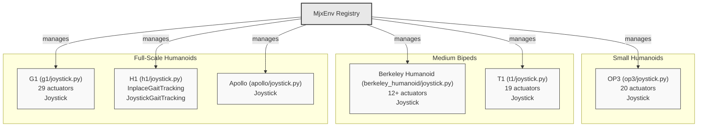
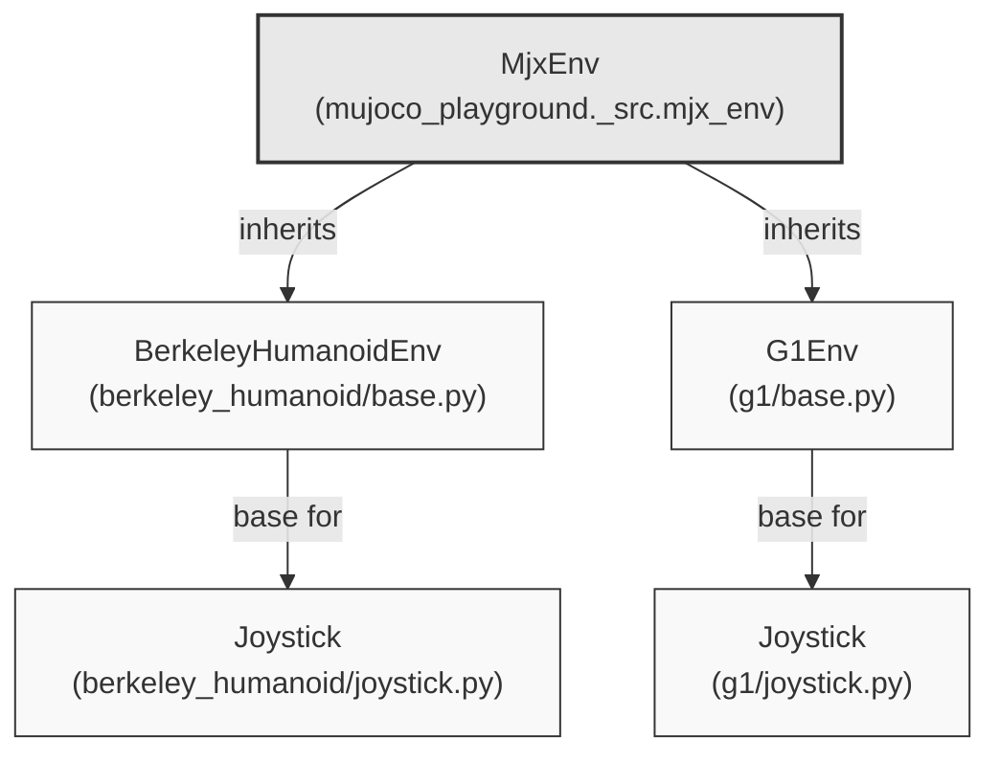
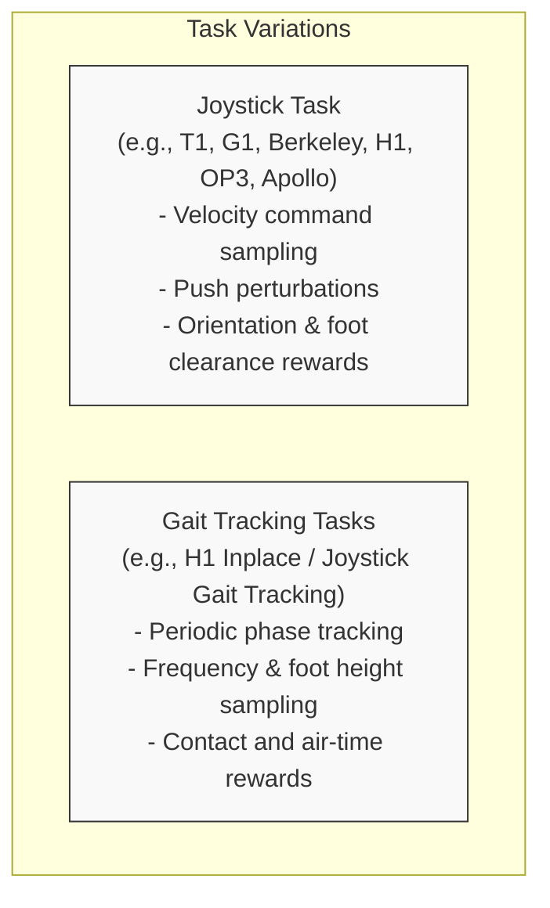

<!-- source: DeepWiki mcp.deepwiki.com · repo google-deepmind/mujoco_playground · extra page Bipedal and Humanoid Environments · fetched 2026-10-26 -->

# Bipedal and Humanoid Environments

<details>
<summary>Relevant source files</summary>

The following files were used as context for generating this wiki page:

- [mujoco_playground/_src/locomotion/apollo/__init__.py](mujoco_playground/_src/locomotion/apollo/__init__.py)
- [mujoco_playground/_src/locomotion/apollo/constants.py](mujoco_playground/_src/locomotion/apollo/constants.py)
- [mujoco_playground/_src/locomotion/apollo/joystick.py](mujoco_playground/_src/locomotion/apollo/joystick.py)
- [mujoco_playground/_src/locomotion/apollo/xmls/apollo_mjx_feetonly.xml](mujoco_playground/_src/locomotion/apollo/xmls/apollo_mjx_feetonly.xml)
- [mujoco_playground/_src/locomotion/apollo/xmls/scene_mjx_feetonly_flat_terrain.xml](mujoco_playground/_src/locomotion/apollo/xmls/scene_mjx_feetonly_flat_terrain.xml)
- [mujoco_playground/_src/locomotion/berkeley_humanoid/base.py](mujoco_playground/_src/locomotion/berkeley_humanoid/base.py)
- [mujoco_playground/_src/locomotion/berkeley_humanoid/joystick.py](mujoco_playground/_src/locomotion/berkeley_humanoid/joystick.py)
- [mujoco_playground/_src/locomotion/g1/base.py](mujoco_playground/_src/locomotion/g1/base.py)
- [mujoco_playground/_src/locomotion/g1/joystick.py](mujoco_playground/_src/locomotion/g1/joystick.py)
- [mujoco_playground/_src/locomotion/h1/inplace_gait_tracking.py](mujoco_playground/_src/locomotion/h1/inplace_gait_tracking.py)
- [mujoco_playground/_src/locomotion/h1/joystick.py](mujoco_playground/_src/locomotion/h1/joystick.py)
- [mujoco_playground/_src/locomotion/h1/joystick_gait_tracking.py](mujoco_playground/_src/locomotion/h1/joystick_gait_tracking.py)
- [mujoco_playground/_src/locomotion/op3/joystick.py](mujoco_playground/_src/locomotion/op3/joystick.py)
- [mujoco_playground/_src/locomotion/t1/joystick.py](mujoco_playground/_src/locomotion/t1/joystick.py)
- [mujoco_playground/experimental/utils/plotting.py](mujoco_playground/experimental/utils/plotting.py)

</details>


This page documents the bipedal and humanoid locomotion environments in MuJoCo Playground. These environments feature two-legged robots ranging from small humanoids to full-scale bipeds, with tasks focused on locomotion control, balance, and gait tracking. For quadruped environments (Go1, Spot, Barkour), see [Quadruped Robot Environments](#3.1.1). For general locomotion environment patterns including command generation and perturbation systems, see [Locomotion Environments](#3.1).

## Overview

Bipedal and humanoid environments present unique challenges compared to quadrupeds:
- **Balance complexity**: Two-leg contact requires active stabilization and more sophisticated control policies [mujoco_playground/_src/locomotion/g1/joystick.py:52-84]()
- **Higher dimensionality**: Humanoid robots include arm and torso joints, increasing action space from ~12 (quadruped) to 19-29+ dimensions [mujoco_playground/_src/locomotion/g1/joystick.py:106](), [mujoco_playground/_src/locomotion/h1/joystick.py:61]()
- **Diverse morphologies**: Platforms range from small research humanoids (OP3) to full-scale bipeds (G1, H1) to specialized designs (Berkeley Humanoid, T1, Apollo) [mujoco_playground/_src/locomotion/op3/joystick.py:68]()
- **Task focus**: Primarily joystick-style velocity tracking with variations for gait patterns (`InplaceGaitTracking`, `JoystickGaitTracking`) [mujoco_playground/_src/locomotion/h1/inplace_gait_tracking.py:15](), [mujoco_playground/_src/locomotion/h1/joystick_gait_tracking.py:15]()

The environments share a common architecture with quadrupeds: base classes provide sensor interfaces, task classes implement observation generation and reward functions, and the registry system enables uniform loading [mujoco_playground/_src/locomotion/berkeley_humanoid/base.py:40](), [mujoco_playground/_src/locomotion/g1/base.py:39]().

Sources: [mujoco_playground/_src/locomotion/g1/joystick.py:52-107](), [mujoco_playground/_src/locomotion/berkeley_humanoid/base.py:40-122](), [mujoco_playground/_src/locomotion/g1/base.py:39-122]()

## Available Platforms and Tasks



**Platform Characteristics**

| Platform | Code Module | Key Features | Task Variants |
|----------|-------------|--------------|---------------|
| **OP3** | `mujoco_playground._src.locomotion.op3` | Small research humanoid | Joystick (`Joystick`) [mujoco_playground/_src/locomotion/op3/joystick.py:72]() |
| **Berkeley Humanoid** | `mujoco_playground._src.locomotion.berkeley_humanoid` | Agile research platform | Joystick (`Joystick`) [mujoco_playground/_src/locomotion/berkeley_humanoid/joystick.py:102]() |
| **T1** | `mujoco_playground._src.locomotion.t1` | Booster commercial biped | Joystick (`Joystick`) [mujoco_playground/_src/locomotion/t1/joystick.py:103]() |
| **G1** | `mujoco_playground._src.locomotion.g1` | Unitree full humanoid with arms | Joystick (`Joystick`) [mujoco_playground/_src/locomotion/g1/joystick.py:110]() |
| **H1** | `mujoco_playground._src.locomotion.h1` | Unitree high-speed biped | `Joystick`, `InplaceGaitTracking`, `JoystickGaitTracking` [mujoco_playground/_src/locomotion/h1/joystick.py:65](), [mujoco_playground/_src/locomotion/h1/inplace_gait_tracking.py:73](), [mujoco_playground/_src/locomotion/h1/joystick_gait_tracking.py:86]() |
| **Apollo** | `mujoco_playground._src.locomotion.apollo` | Experimental biped | Joystick (`Joystick`) [mujoco_playground/_src/locomotion/apollo/joystick.py:82]() |

Sources: [mujoco_playground/_src/locomotion/t1/joystick.py:103](), [mujoco_playground/_src/locomotion/g1/joystick.py:110](), [mujoco_playground/_src/locomotion/berkeley_humanoid/joystick.py:102](), [mujoco_playground/_src/locomotion/h1/joystick.py:65](), [mujoco_playground/_src/locomotion/apollo/joystick.py:82]()

## Base Class Architecture

Bipedal environments follow the same inheritance pattern as quadrupeds, with platform-specific base classes providing sensor interfaces and common initialization logic.



**Base Class Responsibilities**

Each platform base class (e.g., `G1Env`, `BerkeleyHumanoidEnv`) handles:
1. **Asset Loading**: Bundling XML models and mesh assets via `get_assets()` [mujoco_playground/_src/locomotion/berkeley_humanoid/base.py:30-37](), [mujoco_playground/_src/locomotion/g1/base.py:29-36]()
2. **Model Initialization**: Instantiating `mujoco.MjModel` from XML strings and setting opt timesteps (`self.sim_dt`) [mujoco_playground/_src/locomotion/berkeley_humanoid/base.py:51-55](), [mujoco_playground/_src/locomotion/g1/base.py:50-54]()
3. **MJX Translation**: Converting the model via `mjx_env.put_model()` [mujoco_playground/_src/locomotion/berkeley_humanoid/base.py:60-62](), [mujoco_playground/_src/locomotion/g1/base.py:63-65]()
4. **Sensor Accessors**: Providing methods to extract gravity, velocities, gyro readings, and accelerometer data [mujoco_playground/_src/locomotion/berkeley_humanoid/base.py:67-97](), [mujoco_playground/_src/locomotion/g1/base.py:70-104]()

Sources: [mujoco_playground/_src/locomotion/berkeley_humanoid/base.py:30-122](), [mujoco_playground/_src/locomotion/g1/base.py:29-122]()

## Sensor XML Interfaces

All bipedal base classes expose standard helper functions to query sensors defined in XML files. For example, `G1Env` provides framed sensor accessors:

```python
  def get_gravity(self, data: mjx.Data, frame: str) -> jax.Array:
    return mjx_env.get_sensor_data(
        self.mj_model, data, f"{consts.GRAVITY_SENSOR}_{frame}"
    )
```

Similarly, `BerkeleyHumanoidEnv` defines un-framed or specific sensor queries:
```python
  def get_gyro(self, data: mjx.Data) -> jax.Array:
    return mjx_env.get_sensor_data(self.mj_model, data, consts.GYRO_SENSOR)
```

Sources: [mujoco_playground/_src/locomotion/berkeley_humanoid/base.py:67-97](), [mujoco_playground/_src/locomotion/g1/base.py:70-104]()

## Task Variations: Joystick and Gait-Tracking

Bipedal environments implement two major task paradigms:
1. **Joystick Tracking**: Tracking linear velocity ($v_x, v_y$) and yaw angular velocity ($\omega_z$) commands. Implemented across T1, G1, Berkeley Humanoid, H1, OP3, and Apollo [mujoco_playground/_src/locomotion/t1/joystick.py:103](), [mujoco_playground/_src/locomotion/g1/joystick.py:110](), [mujoco_playground/_src/locomotion/berkeley_humanoid/joystick.py:102](), [mujoco_playground/_src/locomotion/h1/joystick.py:65](), [mujoco_playground/_src/locomotion/op3/joystick.py:72](), [mujoco_playground/_src/locomotion/apollo/joystick.py:82]().
2. **Gait Tracking**: Tracking internal or phase-based periodic foot trajectories (e.g., walking, jumping in place). Implemented on H1 via `InplaceGaitTracking` and `JoystickGaitTracking` [mujoco_playground/_src/locomotion/h1/inplace_gait_tracking.py:73](), [mujoco_playground/_src/locomotion/h1/joystick_gait_tracking.py:86]().



### Joystick Task Workflow
In tasks like `mujoco_playground._src.locomotion.g1.joystick.Joystick`, environments initialize from keyframes (e.g. `knees_bent` [mujoco_playground/_src/locomotion/g1/joystick.py:127]()), randomize root poses and velocities, sample commands, apply PD target scaling, and execute substeps via `mjx_env.step()` [mujoco_playground/_src/locomotion/apollo/joystick.py:200-205]().

### Gait Tracking Task Workflow
In `mujoco_playground._src.locomotion.h1.inplace_gait_tracking.InplaceGaitTracking`, environments sample gait types (`walk`, `jump`), frequencies, and foot heights randomly at reset, maintaining phase buffers (`phase`, `phase_dt`) to score `feet_phase` reward components [mujoco_playground/_src/locomotion/h1/inplace_gait_tracking.py:151-218]().

Sources: [mujoco_playground/_src/locomotion/t1/joystick.py:32-104](), [mujoco_playground/_src/locomotion/g1/joystick.py:32-111](), [mujoco_playground/_src/locomotion/berkeley_humanoid/joystick.py:32-103](), [mujoco_playground/_src/locomotion/h1/inplace_gait_tracking.py:36-75](), [mujoco_playground/_src/locomotion/h1/joystick_gait_tracking.py:36-88]()

Sources: [mujoco_playground/_src/locomotion/t1/base.py:1-116](), [mujoco_playground/_src/locomotion/g1/base.py:29-122](), [mujoco_playground/_src/locomotion/berkeley_humanoid/base.py:30-122](), [mujoco_playground/_src/locomotion/t1/joystick.py:1-118](), [mujoco_playground/_src/locomotion/g1/joystick.py:1-125](), [mujoco_playground/_src/locomotion/berkeley_humanoid/joystick.py:1-117](), [mujoco_playground/_src/locomotion/h1/joystick.py:1-79](), [mujoco_playground/_src/locomotion/op3/joystick.py:1-86](), [mujoco_playground/_src/locomotion/apollo/joystick.py:1-96](), [mujoco_playground/_src/locomotion/h1/inplace_gait_tracking.py:1-89](), [mujoco_playground/_src/locomotion/h1/joystick_gait_tracking.py:1-102]()

---

