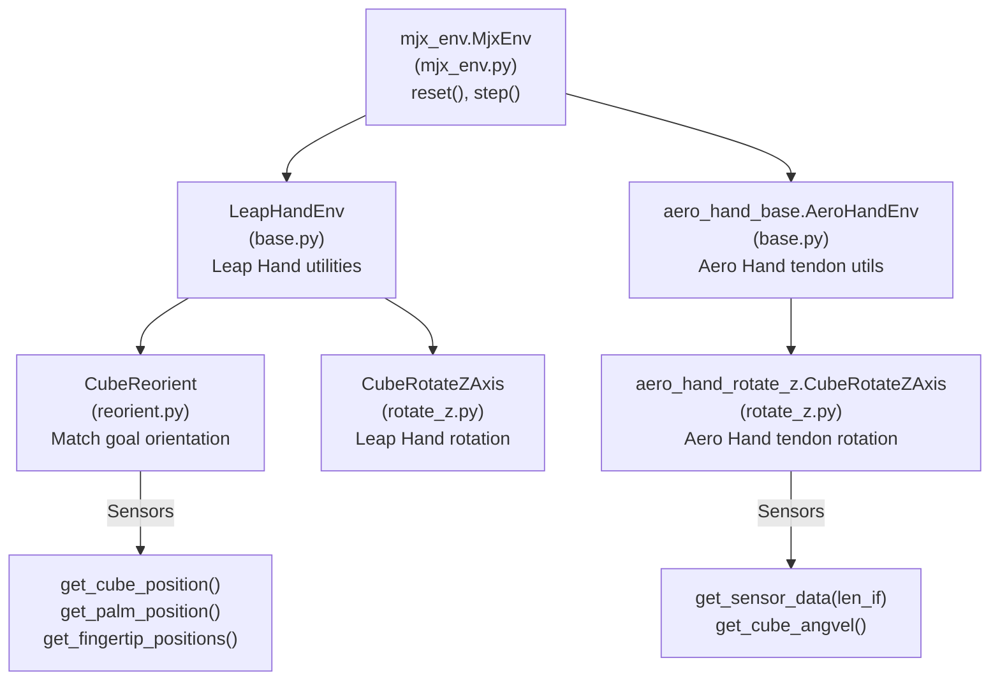
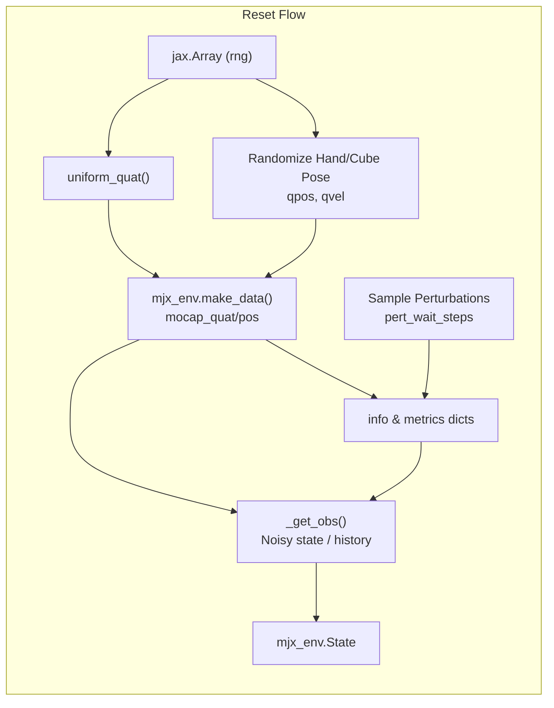

<!-- source: DeepWiki mcp.deepwiki.com · repo google-deepmind/mujoco_playground · extra page Dexterous Hand Manipulation · fetched 2026-10-26 -->

# Dexterous Hand Manipulation

<details>
<summary>Relevant source files</summary>

The following files were used as context for generating this wiki page:

- [mujoco_playground/_src/manipulation/aero_hand/README.md](mujoco_playground/_src/manipulation/aero_hand/README.md)
- [mujoco_playground/_src/manipulation/aero_hand/__init__.py](mujoco_playground/_src/manipulation/aero_hand/__init__.py)
- [mujoco_playground/_src/manipulation/aero_hand/aero_hand_constants.py](mujoco_playground/_src/manipulation/aero_hand/aero_hand_constants.py)
- [mujoco_playground/_src/manipulation/aero_hand/base.py](mujoco_playground/_src/manipulation/aero_hand/base.py)
- [mujoco_playground/_src/manipulation/aero_hand/rotate_z.py](mujoco_playground/_src/manipulation/aero_hand/rotate_z.py)
- [mujoco_playground/_src/manipulation/franka_emika_panda_robotiq/push_cube.py](mujoco_playground/_src/manipulation/franka_emika_panda_robotiq/push_cube.py)
- [mujoco_playground/_src/manipulation/leap_hand/reorient.py](mujoco_playground/_src/manipulation/leap_hand/reorient.py)
- [mujoco_playground/_src/manipulation/leap_hand/rotate_z.py](mujoco_playground/_src/manipulation/leap_hand/rotate_z.py)
- [mujoco_playground/_src/manipulation/leap_hand/xmls/leap_rh_mjx.xml](mujoco_playground/_src/manipulation/leap_hand/xmls/leap_rh_mjx.xml)

</details>


This page documents dexterous hand manipulation environments for in-hand object manipulation tasks. These environments feature high-DOF anthropomorphic hands (`Leap Hand`, `Aero Hand`) that must manipulate objects through contact-rich interactions. The environments include configurable observation noise, multi-component reward functions, optional perturbation systems, tendon-driven mechanics (for Aero Hand), and comprehensive domain randomization for sim-to-real transfer.

For robotic arm manipulation tasks (Panda, ALOHA), see [Robotic Arm Manipulation](#3.2.2).

## Environment Overview

The dexterous hand manipulation suite provides tasks across two anthropomorphic hand platforms:

| Environment | Hand Platform | Task | Action Space | Key Features |
|------------|---------------|------|--------------|--------------|
| `LeapHandCubeReorient` | Leap Hand (16 DOF) | Reorient cube to match goal orientation | Joint position deltas | Continuous goal resampling, asymmetric observations |
| `LeapHandCubeRotateZ` | Leap Hand (16 DOF) | Rotate cube around z-axis as fast as possible | Joint position deltas | Velocity-based rewards, early termination |
| `AeroHandCubeRotateZ` | Aero Hand (16 DOF / 7 actuators) | Rotate cube around z-axis as fast as possible | Tendon length / action deltas | Tendon-driven actuation, spatial tendons, spring-loaded extension |

All environments inherit from respective base classes (`LeapHandEnv`, `AeroHandEnv`) which extend `mjx_env.MjxEnv` `[mujoco_playground/_src/manipulation/leap_hand/base.py](), [mujoco_playground/_src/manipulation/aero_hand/base.py]()`.

**Sources:** [mujoco_playground/_src/manipulation/leap_hand/reorient.py:1-631](), [mujoco_playground/_src/manipulation/leap_hand/rotate_z.py:1-419](), [mujoco_playground/_src/manipulation/aero_hand/rotate_z.py:1-466]()

## Class Architecture



**Diagram: Dexterous Hand Environment Class Hierarchy bridging code entities (`MjxEnv`, `LeapHandEnv`, `AeroHandEnv`, `CubeReorient`, `CubeRotateZAxis`)**

**Sources:** [mujoco_playground/_src/manipulation/leap_hand/reorient.py:76-106](), [mujoco_playground/_src/manipulation/leap_hand/rotate_z.py:62-87](), [mujoco_playground/_src/manipulation/aero_hand/base.py:43-119](), [mujoco_playground/_src/manipulation/aero_hand/rotate_z.py:61-91]()

## Hand XML Models and Actuation Systems

The simulation models utilize specialized XML specifications and asset setups:
- **Leap Hand (`leap_rh_mjx.xml`)**: Models a 16-DOF robotic hand with direct position-controlled joints (`kp=3.0`, joint limits, and custom collision exclusions between palm/mount and proximal/medial phalanges) `[mujoco_playground/_src/manipulation/leap_hand/xmls/leap_rh_mjx.xml:1-122]()`.
- **Aero Hand Open (`right_hand.xml`, `scene_mjx_cube.xml`)**: Features a tendon-driven cable system emulating under-actuated fingers `[mujoco_playground/_src/manipulation/aero_hand/README.md:1-114]()`. The actuation architecture relies on three primary XML components:
  1. **Tendon Drives**: Spatial tendons replicating real cable routing paths (`ACTUATOR_NAMES`) `[mujoco_playground/_src/manipulation/aero_hand/aero_hand_constants.py:51-64]()`.
  2. **Springs**: Tendon-modeled elastic elements providing backward restoring forces for finger extension.
  3. **Pulleys**: Cylinder geometries routing cables accurately.

**Sources:** [mujoco_playground/_src/manipulation/leap_hand/xmls/leap_rh_mjx.xml:1-142](), [mujoco_playground/_src/manipulation/aero_hand/README.md:1-114]()

## Environment Reset and Initialization



**Diagram: Environment Reset Initialization Flow connecting code structures (`mjx_env.make_data`, `_get_obs`, `mjx_env.State`)**

The reset method randomizes the goal orientation, hand configuration, cube pose, and perturbation parameters, returning an initial `mjx_env.State` object.

**Sources:** [mujoco_playground/_src/manipulation/leap_hand/reorient.py:107-198](), [mujoco_playground/_src/manipulation/leap_hand/rotate_z.py:89-136](), [mujoco_playground/_src/manipulation/aero_hand/rotate_z.py:92-137]()

## Observation System

The observation system implements asymmetric actor-critic training where the policy receives noisy observations while the critic accesses privileged ground-truth states.

### Observation Components & Tendon Space Inputs
- **Leap Hand Tasks**: Observations include noisy joint angles, error histories, previous actions, and object states `[mujoco_playground/_src/manipulation/leap_hand/reorient.py:273-375]()`.
- **Aero Hand Tasks**: Observations include sensor readings from tendon length sensors (`SENSOR_TENDON_NAMES` such as `len_if`, `len_mf`, etc.) and joint sensors (`SENSOR_JOINT_NAMES`), matching tendon-level control spaces `[mujoco_playground/_src/manipulation/aero_hand/aero_hand_constants.py:75-86](), [mujoco_playground/_src/manipulation/aero_hand/rotate_z.py:174-190]()`.

**Sources:** [mujoco_playground/_src/manipulation/leap_hand/reorient.py:273-375](), [mujoco_playground/_src/manipulation/aero_hand/aero_hand_constants.py:75-86](), [mujoco_playground/_src/manipulation/aero_hand/rotate_z.py:174-210]()

## Reward System

The reward system aggregates multi-component reward functions scaled by configuration weights.

### Aero Hand / Leap Hand Rotate-Z Reward Formulation
For `AeroHandCubeRotateZ`, the objective function emphasizes angular velocity tracking alongside action rate regularization:
$$\text{reward} = 1.0 \times \text{angular velocity} - 1.0 \times \text{action rate} + \text{termination} (-100.0)$$
`[mujoco_playground/_src/manipulation/aero_hand/README.md:55-60]()`

**Sources:** [mujoco_playground/_src/manipulation/leap_hand/reorient.py:51-62](), [mujoco_playground/_src/manipulation/leap_hand/rotate_z.py:45-55](), [mujoco_playground/_src/manipulation/aero_hand/rotate_z.py:47-56](), [mujoco_playground/_src/manipulation/aero_hand/README.md:52-60]()

## Perturbation System

Perturbations apply external forces (`xfrc_applied` on the cube body) during training following a sinusoidal ramp profile to improve robustness against environmental disturbances `[mujoco_playground/_src/manipulation/leap_hand/reorient.py:63-69,447-481]()`.

**Sources:** [mujoco_playground/_src/manipulation/leap_hand/reorient.py:63-69,447-481]()

## Domain Randomization

Domain randomization modifies physics parameters (`geom_friction`, `body_mass`, `dof_armature`, actuator gains) using `jax.vmap` over batched `mjx.Model` instances `[mujoco_playground/_src/manipulation/leap_hand/reorient.py:484-631]()`.

**Sources:** [mujoco_playground/_src/manipulation/leap_hand/reorient.py:484-631](), [mujoco_playground/_src/manipulation/leap_hand/rotate_z.py:270-418]()

## Usage Example

```python
import jax
from mujoco_playground import registry

# Load Leap Hand reorientation or Aero Hand rotation environment
env = registry.load('LeapHandCubeReorient')
# Or: env = registry.load('AeroHandCubeRotateZ')

rng = jax.random.PRNGKey(0)
state = env.reset(rng)
action = jax.random.uniform(rng, (env.action_size,), minval=-1, maxval=1)
state = env.step(state, action)
```

**Sources:** [mujoco_playground/_src/manipulation/leap_hand/reorient.py:76-88](), [mujoco_playground/_src/manipulation/aero_hand/rotate_z.py:61-75]()

---

