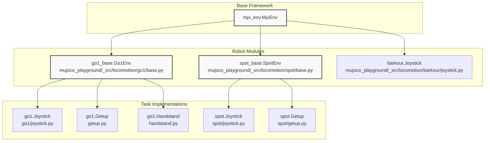
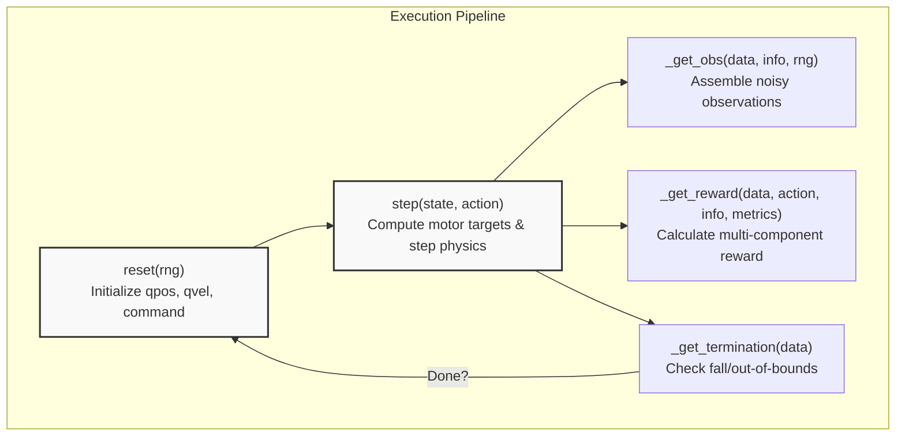
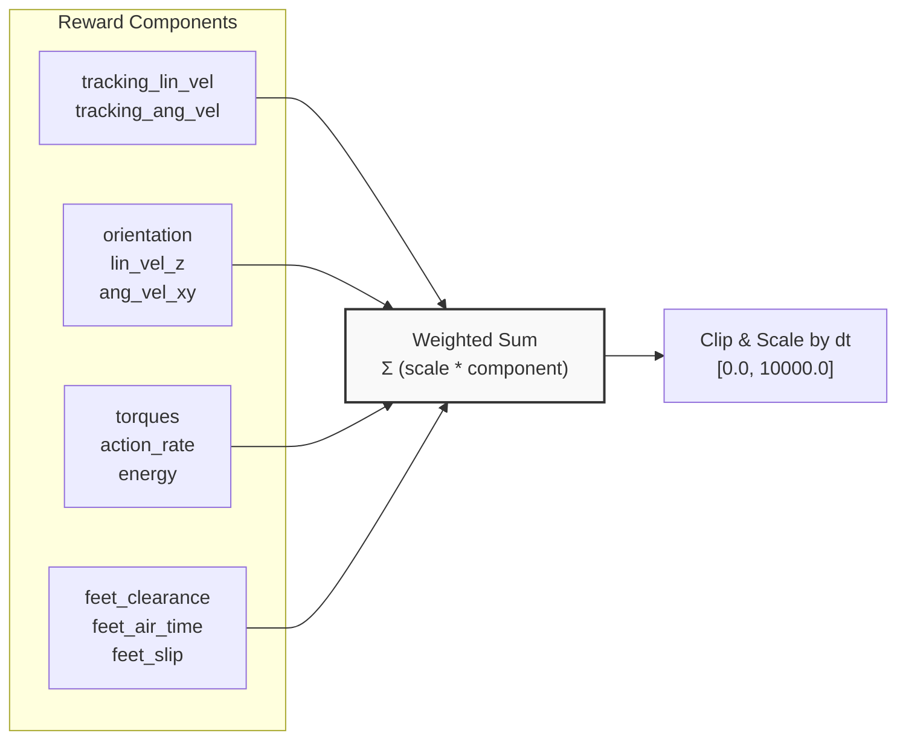

<!-- source: DeepWiki mcp.deepwiki.com · repo google-deepmind/mujoco_playground · extra page Quadruped Robot Environments · fetched 2026-10-26 -->

# Quadruped Robot Environments

Relevant source files

The following files were used as context for generating this wiki page:

- [mujoco_playground/_src/locomotion/barkour/joystick.py](mujoco_playground/_src/locomotion/barkour/joystick.py)
- [mujoco_playground/_src/locomotion/go1/getup.py](mujoco_playground/_src/locomotion/go1/getup.py)
- [mujoco_playground/_src/locomotion/go1/handstand.py](mujoco_playground/_src/locomotion/go1/handstand.py)
- [mujoco_playground/_src/locomotion/go1/joystick.py](mujoco_playground/_src/locomotion/go1/joystick.py)
- [mujoco_playground/_src/locomotion/spot/getup.py](mujoco_playground/_src/locomotion/spot/getup.py)
- [mujoco_playground/_src/locomotion/spot/joystick.py](mujoco_playground/_src/locomotion/spot/joystick.py)
- [mujoco_playground/_src/manipulation/aloha/base.py](mujoco_playground/_src/manipulation/aloha/base.py)

This page provides detailed technical documentation for quadruped robot environments within MuJoCo Playground, covering platforms such as Unitree Go1, Boston Dynamics Spot, and Google Barkour. These environments implement dynamic locomotion tasks including velocity tracking (`Joystick`), fall recovery (`Getup`), and specialized maneuvers (`Handstand`). The page covers the common robot base classes, task-specific architectures, observation generation with sensor noise, multi-component reward systems, stochastic command sampling, and perturbation systems for robustness training.

For bipedal and humanoid platforms, see [Bipedal and Humanoid Environments](#3.1.2). For complete training pipelines, see [Locomotion Training Examples](#5.1).

## Available Quadruped Platforms

The locomotion suite provides GPU-accelerated MJX environments for multiple quadruped robots:

| Robot | Code Module / Base Class | DOF | Primary Tasks | Terrain Support |
|-------|--------------------------|-----|---------------|-----------------|
| **Unitree Go1** | `mujoco_playground._src.locomotion.go1` | 12 | Joystick, Handstand, Getup | Flat, Rough (`scene_mjx.xml`) |
| **Boston Dynamics Spot** | `mujoco_playground._src.locomotion.spot` | 12 | Joystick, Getup | Flat |
| **Barkour** | `mujoco_playground._src.locomotion.barkour` | 12 | Joystick | Custom (`google_barkour_vb`) |

All quadruped environments share common architectural patterns: 12 actuated joints (3 per leg), IMU-based sensing, foot contact sensors, and PD control loops executing on top of GPU-accelerated physics backends (`jax` or `warp`).

**Sources:** [mujoco_playground/_src/locomotion/go1/joystick.py:31-95](), [mujoco_playground/_src/locomotion/spot/joystick.py:31-84](), [mujoco_playground/_src/locomotion/barkour/joystick.py:51-107]()

## Base Class Architecture

Quadruped environments follow a two-level class hierarchy: a robot-specific base class inheriting from `mjx_env.MjxEnv`, paired with task classes implementing specific behaviors.

**Diagram: Quadruped Class Hierarchy linking Base Classes to Task Implementations**

**Sources:** [mujoco_playground/_src/locomotion/go1/joystick.py:98-115](), [mujoco_playground/_src/locomotion/spot/joystick.py:87-101](), [mujoco_playground/_src/locomotion/barkour/joystick.py:110-118]()

### Robot Base Classes and Sensor Interfaces

Robot base classes handle XML model loading, actuator configuration, physics timestep setup (`sim_dt`), and common sensor readings such as gyroscopes, accelerometers, body gravity vectors, and foot contact states.

For instance, `SpotEnv` and `Go1Env` configure actuator gains and joint damping upon initialization:
- **Go1**: `Kp = 35.0`, `Kd = 0.5` [mujoco_playground/_src/locomotion/go1/joystick.py:36-37]()
- **Spot**: `Kp = 300.0`, `Kd = 1.0` [mujoco_playground/_src/locomotion/spot/joystick.py:36-37]()
- **Barkour**: `Kp = 35.0`, damping `= 0.5239` [mujoco_playground/_src/locomotion/barkour/joystick.py:147-148]()

**Sources:** [mujoco_playground/_src/locomotion/go1/joystick.py:31-95](), [mujoco_playground/_src/locomotion/spot/joystick.py:31-84](), [mujoco_playground/_src/locomotion/barkour/joystick.py:51-107]()

---

## Task Architectures

### 1. Joystick Velocity Tracking

The `Joystick` task across Go1, Spot, and Barkour trains policies to track time-varying 3D velocity commands: forward/backward (`vx`), lateral (`vy`), and yaw rotation rate (`omega_z`).

**Diagram: Joystick Environment Execution Flow (`mujoco_playground/_src/locomotion/go1/joystick.py`)**

- **Action Space**: 12-dimensional continuous outputs scaled by `action_scale` (e.g., `0.5` for Go1 [mujoco_playground/_src/locomotion/go1/joystick.py:39], `0.3` for Spot [mujoco_playground/_src/locomotion/spot/joystick.py:40] and Barkour [mujoco_playground/_src/locomotion/barkour/joystick.py:57]) added to the default standing pose.
- **Control Frequencies**: Typically `ctrl_dt = 0.02` s (50 Hz) with simulation dt `sim_dt = 0.004` s (250 Hz, `n_substeps = 5`) [mujoco_playground/_src/locomotion/go1/joystick.py:33-38]().

**Sources:** [mujoco_playground/_src/locomotion/go1/joystick.py:98-179](), [mujoco_playground/_src/locomotion/spot/joystick.py:87-147](), [mujoco_playground/_src/locomotion/barkour/joystick.py:110-190]()

### 2. Getup / Fall Recovery

The `Getup` task trains quadrupeds to recover from arbitrary fallen postures, drops from height, or flipped configurations back to a standing upright stance.

- **Initial State Distribution**: Controlled via `drop_from_height_prob` (e.g., `0.6` in Spot [mujoco_playground/_src/locomotion/spot/getup.py:37] and Go1 [mujoco_playground/_src/locomotion/getup.py:37]). When triggered, the robot spawns at an elevated height (`z = 0.5` m to `1.0` m) with randomized root orientation quaternions and joint angles sampled uniformly within joint limits.
- **Settle Phase**: Physics steps without policy control are run during `reset()` to let the robot settle before episode tracking begins (`settle_time = 0.5` s) [mujoco_playground/_src/locomotion/spot/getup.py:38]().
- **Reward Structure**: Focuses heavily on torso orientation alignment (`orientation`), maintaining target torso height (`torso_height`), maintaining neutral posture (`posture`), and minimizing action jitter (`stand_still`) [mujoco_playground/_src/locomotion/spot/getup.py:49-58]().

**Sources:** [mujoco_playground/_src/locomotion/spot/getup.py:30-149](), [mujoco_playground/_src/locomotion/go1/getup.py:30-198]()

### 3. Handstand Task

The `Handstand` task (implemented for Go1) challenges the robot to transition from a normal stance to balancing and holding an inverted or specialized posture (e.g., balancing on front legs with a desired torso height of `z_des = 0.55` m) [mujoco_playground/_src/locomotion/go1/handstand.py:75-115]().

- **Action Space & Masking**: Uses specialized joint subsets (`_joint_ids = jp.array([6, 7, 8, 9, 10, 11])`) and contact sensors to penalize unwanted body geometry contact with the floor (`_unwanted_contact_geom_ids`) [mujoco_playground/_src/locomotion/go1/handstand.py:116-135]().
- **Termination & Rewards**: Penalizes floor contact on hind legs/calves while rewarding target height and orientation matching `[0, 0, -1]` [mujoco_playground/_src/locomotion/go1/handstand.py:113-146]().

**Sources:** [mujoco_playground/_src/locomotion/go1/handstand.py:31-201]()

---

## Observation Generation and Noise Injection

Quadruped joystick environments maintain asymmetric observation spaces for actor policies and critic networks:
1. **Policy Observations**: Noisy sensor inputs mimicking real-world hardware. Gaussian noise is added to gyroscope readings, gravity vectors, joint positions, and velocities using scaling parameters defined in `config.noise_config` [mujoco_playground/_src/locomotion/go1/joystick.py:42-51]().
2. **Privileged State (Critic)**: Concatenates true physical states (un-noised velocities, exact foot contact forces, actuator torques, air times, and perturbation flags) to accelerate value function convergence during PPO training.

**Sources:** [mujoco_playground/_src/locomotion/go1/joystick.py:42-51](), [mujoco_playground/_src/locomotion/spot/joystick.py:41-49]()

---

## Multi-Component Reward Systems

Quadruped tasks aggregate multiple weighted reward components into scalar steps. For example, the Go1 and Spot `Joystick` tasks combine tracking, stability, and regularization terms:

**Diagram: Reward aggregation pipeline in quadruped joystick tasks**

- **Tracking**: Exponential error kernels `exp(-error^2 / sigma^2)` where `tracking_sigma = 0.25` [mujoco_playground/_src/locomotion/go1/joystick.py:77]().
- **Regularization**: L2 penalties on torques, action changes (`action_rate`), and vertical base velocities (`lin_vel_z`) [mujoco_playground/_src/locomotion/go1/joystick.py:52-76]().

**Sources:** [mujoco_playground/_src/locomotion/go1/joystick.py:52-79](), [mujoco_playground/_src/locomotion/spot/joystick.py:50-69](), [mujoco_playground/_src/locomotion/barkour/joystick.py:51-95]()

---

## Command Sampling Systems

Commands in joystick tasks are sampled using randomized intervals and distribution limits:
- **Go1 Command Config**: Uniform bounds `a = [1.5, 0.8, 1.2]` for `[vx, vy, omega_z]` with non-zero Bernoulli probability `b = [0.9, 0.25, 0.5]` [mujoco_playground/_src/locomotion/go1/joystick.py:86-91]().
- **Spot Command Config**: `lin_vel_x = [-1.0, 1.0]`, `lin_vel_y = [-0.8, 0.8]`, `ang_vel_yaw = [-1.0, 1.0]` [mujoco_playground/_src/locomotion/spot/joystick.py:76-80]().

Commands update periodically using JAX random state splitting, ensuring policies experience diverse linear and angular velocity combinations.

**Sources:** [mujoco_playground/_src/locomotion/go1/joystick.py:86-91](), [mujoco_playground/_src/locomotion/spot/joystick.py:76-80]()

---

## Perturbation Systems

To enforce sim-to-real robustness against unmodeled dynamics, pushes, and terrain impacts, environments like Go1 and Spot include an optional perturbation system (`pert_config`) [mujoco_playground/_src/locomotion/go1/joystick.py:80-85]():
- **Schedule**: Waits for a sampled interval (`kick_wait_times = [1.0, 3.0]` s), then applies a velocity kick (`velocity_kick = [0.0, 3.0]` m/s) over a short duration (`kick_durations = [0.05, 0.2]` s).
- **Force Application**: Smooth sinusoidal force envelopes are applied directly to the torso body index (`_torso_body_id`) via `data.xfrc_applied` [mujoco_playground/_src/locomotion/go1/joystick.py:551-605]().

**Sources:** [mujoco_playground/_src/locomotion/go1/joystick.py:80-85](), [mujoco_playground/_src/locomotion/go1/joystick.py:551-605]()

---

