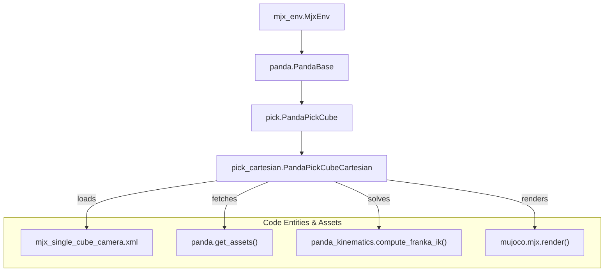
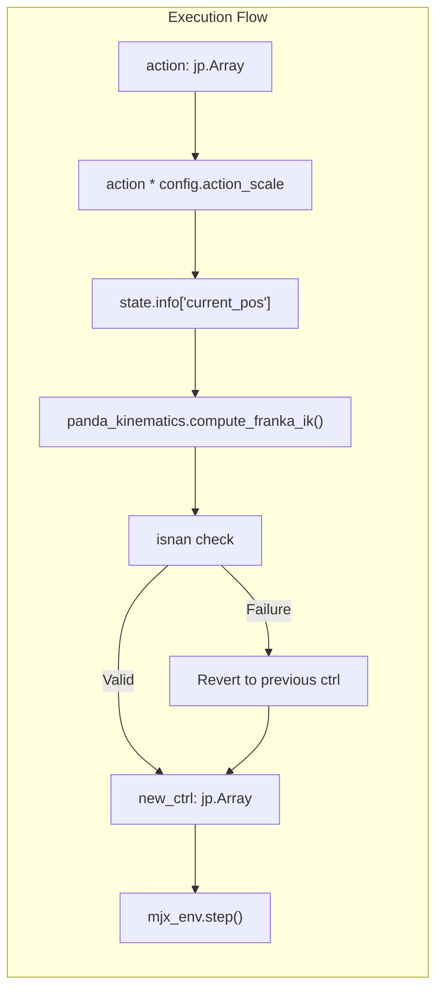
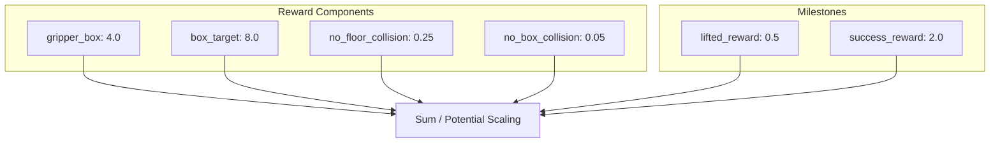
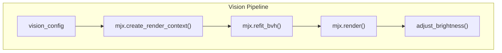
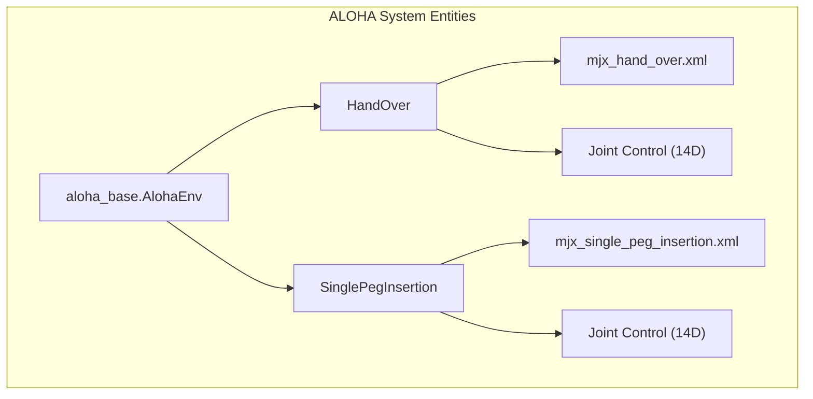

<!-- source: DeepWiki mcp.deepwiki.com · repo google-deepmind/mujoco_playground · extra page Robotic Arm Manipulation · fetched 2026-10-26 -->

# Robotic Arm Manipulation

Relevant source files

The following files were used as context for generating this wiki page:

- [CHANGELOG.md](CHANGELOG.md)
- [mujoco_playground/__init__.py](mujoco_playground/__init__.py)
- [mujoco_playground/_src/locomotion/apollo/base.py](mujoco_playground/_src/locomotion/apollo/base.py)
- [mujoco_playground/_src/locomotion/h1/base.py](mujoco_playground/_src/locomotion/h1/base.py)
- [mujoco_playground/_src/locomotion/spot/base.py](mujoco_playground/_src/locomotion/spot/base.py)
- [mujoco_playground/_src/manipulation/aloha/aloha_constants.py](mujoco_playground/_src/manipulation/aloha/aloha_constants.py)
- [mujoco_playground/_src/manipulation/aloha/handover.py](mujoco_playground/_src/manipulation/aloha/handover.py)
- [mujoco_playground/_src/manipulation/aloha/single_peg_insertion.py](mujoco_playground/_src/manipulation/aloha/single_peg_insertion.py)
- [mujoco_playground/_src/manipulation/aloha/xmls/mjx_hand_over.xml](mujoco_playground/_src/manipulation/aloha/xmls/mjx_hand_over.xml)
- [mujoco_playground/_src/manipulation/franka_emika_panda/open_cabinet.py](mujoco_playground/_src/manipulation/franka_emika_panda/open_cabinet.py)
- [mujoco_playground/_src/manipulation/franka_emika_panda/panda.py](mujoco_playground/_src/manipulation/franka_emika_panda/panda.py)
- [mujoco_playground/_src/manipulation/franka_emika_panda/pick.py](mujoco_playground/_src/manipulation/franka_emika_panda/pick.py)
- [mujoco_playground/_src/manipulation/franka_emika_panda/pick_cartesian.py](mujoco_playground/_src/manipulation/franka_emika_panda/pick_cartesian.py)
- [mujoco_playground/_src/manipulation/franka_emika_panda_robotiq/panda_robotiq.py](mujoco_playground/_src/manipulation/franka_emika_panda_robotiq/panda_robotiq.py)
- [mujoco_playground/_src/manipulation/leap_hand/base.py](mujoco_playground/_src/manipulation/leap_hand/base.py)

## Purpose and Scope

This document covers robotic arm manipulation environments in MuJoCo Playground, including the Franka Emika Panda single-arm and ALOHA dual-arm systems. These environments focus on pick-place, object handover, peg insertion, and cabinet opening tasks using Cartesian control, inverse kinematics, and stage-based reward shaping.

For dexterous hand manipulation tasks (Leap Hand, Aero Hand), see [Dexterous Hand Manipulation](#3.2.1). For training workflows, see [Manipulation Training Examples](#5.2).

Sources: `[mujoco_playground/_src/manipulation/franka_emika_panda/pick_cartesian.py:16-17]()`, `[mujoco_playground/_src/manipulation/aloha/single_peg_insertion.py:15-15]()`, `[mujoco_playground/_src/manipulation/aloha/handover.py:15-15]()`

---

## Environment Catalog

MuJoCo Playground provides robust robotic arm platforms with diverse manipulation capabilities:

| Platform | Environment Classes | Tasks | Control Mode | Key Features |
|----------|-------------------|-------|--------------|--------------|
| **Franka Panda** | `PandaPickCube` `PandaPickCubeCartesian` `PandaOpenCabinet` | Pick-place, cabinet opening | Joint + Cartesian | IK integration, vision support (`BatchRenderer`) |
| **ALOHA** | `HandOver` `SinglePegInsertion` | Dual-arm handover, peg insertion | Joint space | Bimanual coordination, stage-based rewards |

All arm environments inherit from `mjx_env.MjxEnv` and follow the standard reset/step interface with MJX-accelerated physics.

Sources: `[mujoco_playground/_src/manipulation/franka_emika_panda/pick_cartesian.py:90-99]()`, `[mujoco_playground/_src/manipulation/aloha/handover.py:56-69]()`, `[mujoco_playground/_src/manipulation/aloha/single_peg_insertion.py:57-70]()`

---

## Panda Pick-Place with Cartesian Control

### Environment Architecture

**Figure 1: Panda Environment Code Bridge**

The `PandaPickCubeCartesian` class (`[mujoco_playground/_src/manipulation/franka_emika_panda/pick_cartesian.py:90-123]()`) provides an alternative to joint-space control by accepting Cartesian increments and using inverse kinematics to compute joint targets. This design simplifies policy learning by operating in task-relevant Euclidean space.

Sources: `[mujoco_playground/_src/manipulation/franka_emika_panda/pick_cartesian.py:90-123]()`, `[mujoco_playground/_src/manipulation/franka_emika_panda/pick_cartesian.py:160-168]()`

---

### Inverse Kinematics Integration

**Figure 2: Cartesian IK Pipeline**

The controller scales actions by `action_scale` (default `0.005` or `5mm`) and computes inverse kinematics via `panda_kinematics.compute_franka_ik()` (`[mujoco_playground/_src/manipulation/franka_emika_panda/pick_cartesian.py:168-170]()`). Infeasibility or NaN outputs trigger fallback handling to maintain simulation stability.

Sources: `[mujoco_playground/_src/manipulation/franka_emika_panda/pick_cartesian.py:168-170]()`, `[mujoco_playground/_src/manipulation/franka_emika_panda/pick.py:159-185]()`

---

### Stage-Based Reward Shaping

**Figure 3: Reward Component Structure**

Reward calculation in `PandaPickCubeCartesian` combines dense exponential distance shaping with sparse success milestones and penalty terms for floor or box collisions (`[mujoco_playground/_src/manipulation/franka_emika_panda/pick_cartesian.py:53-70]()`).

Sources: `[mujoco_playground/_src/manipulation/franka_emika_panda/pick_cartesian.py:53-70]()`

---

### Vision Support with Madrona

**Figure 4: Vision Pipeline Workflow**

When `vision=True`, environments instantiate a Madrona render context (`[mujoco_playground/_src/manipulation/franka_emika_panda/pick_cartesian.py:137-141]()`) and use `render_state` (`[mujoco_playground/_src/manipulation/franka_emika_panda/pick_cartesian.py:153-161]()`) to extract RGB images modulated by brightness scaling (`[mujoco_playground/_src/manipulation/franka_emika_panda/pick_cartesian.py:85-87]()`).

Sources: `[mujoco_playground/_src/manipulation/franka_emika_panda/pick_cartesian.py:85-141]`, `[mujoco_playground/_src/manipulation/franka_emika_panda/pick_cartesian.py:153-161]()`

---

## ALOHA Dual-Arm Handover and Peg Insertion

### Dual-Arm Architecture

**Figure 5: ALOHA Class Hierarchy**

The ALOHA environment suite implements bimanual manipulation through `HandOver` (`[mujoco_playground/_src/manipulation/aloha/handover.py:56-69]()`) and `SinglePegInsertion` (`[mujoco_playground/_src/manipulation/aloha/single_peg_insertion.py:57-70]()`), both inheriting from `aloha_base.AlohaEnv`.

Sources: `[mujoco_playground/_src/manipulation/aloha/handover.py:56-69]()`, `[mujoco_playground/_src/manipulation/aloha/single_peg_insertion.py:57-70]()`

---

### Stage-Based Handover and Insertion Rewards

The `HandOver` task implements progressive stage rewards based on spatial thresholds (`[mujoco_playground/_src/manipulation/aloha/handover.py:86-88]()`) and logistic barriers (`[mujoco_playground/_src/manipulation/aloha/handover.py:51-53]()`). Similarly, `SinglePegInsertion` computes alignment along socket axes using site positions (`[mujoco_playground/_src/manipulation/aloha/single_peg_insertion.py:72-85]()`) to issue insertion rewards conditional on proximity thresholds (`[mujoco_playground/_src/manipulation/aloha/single_peg_insertion.py:132-149]()`).

Sources: `[mujoco_playground/_src/manipulation/aloha/handover.py:51-88]`, `[mujoco_playground/_src/manipulation/aloha/single_peg_insertion.py:72-149]()`

---

## Common Patterns Across Arm Environments

### Action Scaling and Clipping
All robotic arm environments clip incoming policy actions against model actuator ranges (`[mujoco_playground/_src/manipulation/franka_emika_panda/pick_cartesian.py:124-126]()`, `[mujoco_playground/_src/manipulation/aloha/single_peg_insertion.py:124-125]()`) following scaling multipliers defined in their respective configurations.

Sources: `[mujoco_playground/_src/manipulation/franka_emika_panda/pick_cartesian.py:52]()`, `[mujoco_playground/_src/manipulation/aloha/single_peg_insertion.py:36]()`

### Contact Sensor Integration
Touch sensors defined in environment XML files are queried via `data.sensordata` indices (`[mujoco_playground/_src/manipulation/franka_emika_panda/pick_cartesian.py:129-135]()`, `[mujoco_playground/_src/manipulation/aloha/single_peg_insertion.py:129-139]()`) to penalize invalid collisions with floors, walls, or tables.

Sources: `[mujoco_playground/_src/manipulation/franka_emika_panda/pick_cartesian.py:129-135]()`, `[mujoco_playground/_src/manipulation/aloha/single_peg_insertion.py:129-139]()`

Sources: `[mujoco_playground/_src/manipulation/franka_emika_panda/pick_cartesian.py:16-17]()`, `[mujoco_playground/_src/manipulation/aloha/single_peg_insertion.py:57-70]()`, `[mujoco_playground/_src/manipulation/aloha/handover.py:56-69]()`

---

