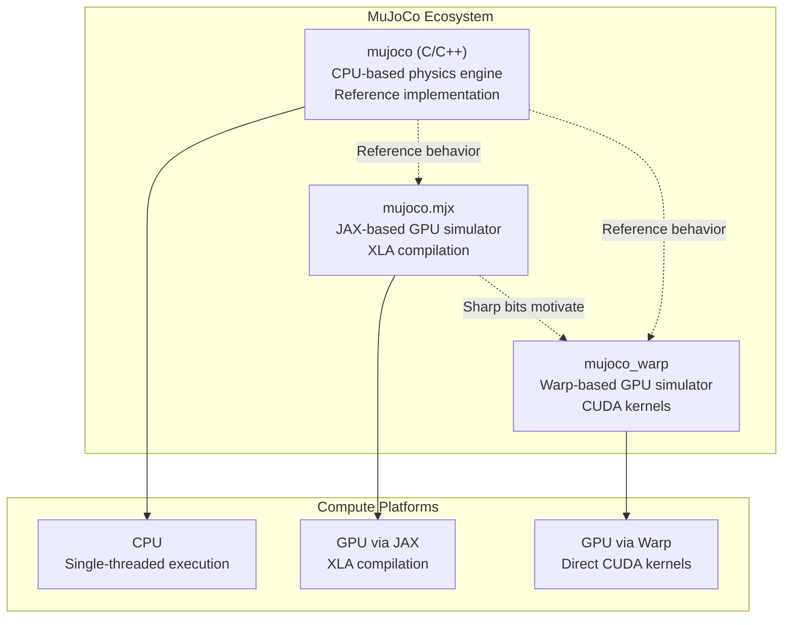
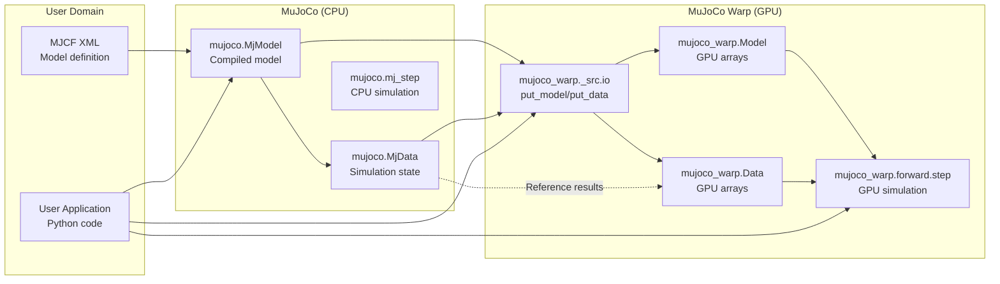
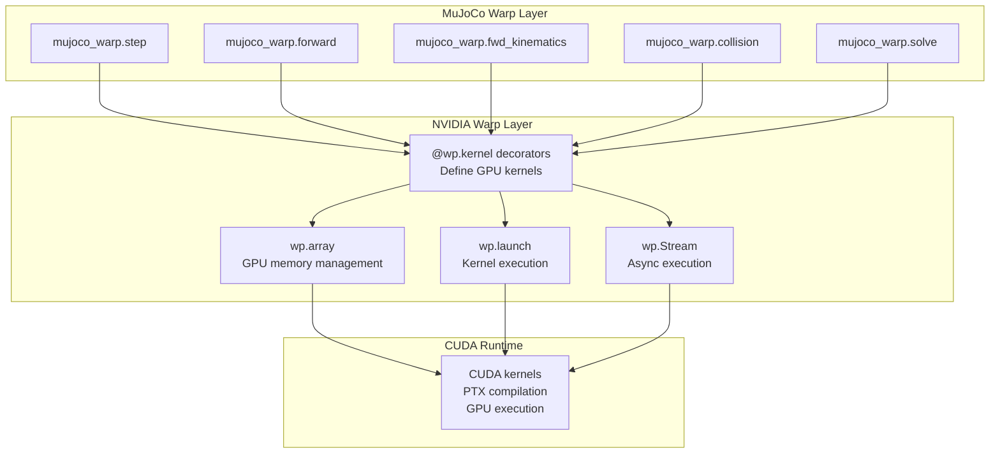
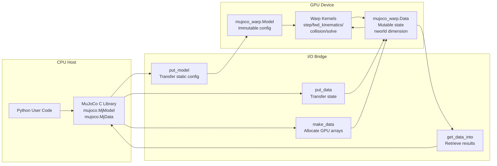
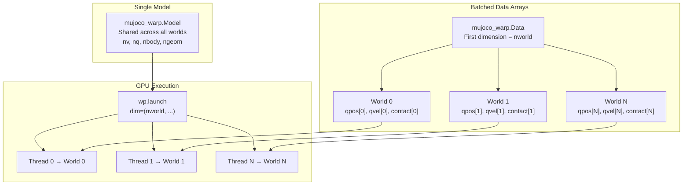
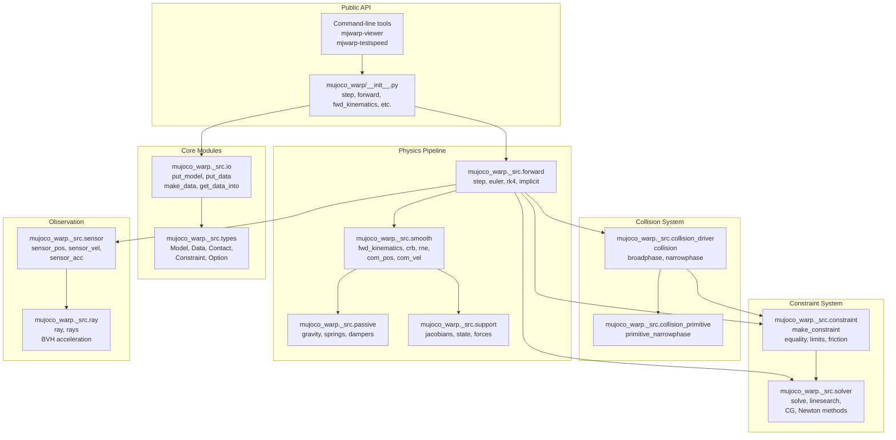

<!-- source: DeepWiki mcp.deepwiki.com · repo google-deepmind/mujoco_warp · page 1 Overview · fetched 2026-10-26 -->

# Overview

Relevant source files

The following files were used as context for generating this wiki page:

- [.agent/rules/project.md](.agent/rules/project.md)
- [AGENTS.md](AGENTS.md)
- [AUTHORS](AUTHORS)
- [CONTRIBUTING.md](CONTRIBUTING.md)
- [LICENSE](LICENSE)
- [README.md](README.md)
- [mujoco_warp/__init__.py](mujoco_warp/__init__.py)
- [mujoco_warp/_src/io_test.py](mujoco_warp/_src/io_test.py)

## Purpose and Scope

This document provides a high-level introduction to **MuJoCo Warp (MJWarp)**, a GPU-accelerated physics simulator built on the MuJoCo physics engine and NVIDIA Warp. It explains the system's purpose, design philosophy, and how it relates to the broader MuJoCo ecosystem. For installation instructions, see [Installation and Setup](#1.1). For command-line tools, see [Command-Line Tools](#1.2). For detailed architecture information, see [Core Architecture](#2).

Sources: [README.md:6-12]()

## What is MuJoCo Warp

MuJoCo Warp is a GPU-optimized implementation of the MuJoCo physics simulator designed specifically for NVIDIA hardware. It reimplements MuJoCo's core simulation algorithms using NVIDIA Warp, enabling massively parallel execution of physics simulations on GPU.

**MuJoCo Warp System Context**

MJWarp fills a specific niche in the MuJoCo ecosystem by providing GPU acceleration through NVIDIA Warp instead of JAX/XLA. This design choice enables it to avoid several limitations present in MJX while maintaining compatibility with the MuJoCo reference implementation.

Sources: [README.md:6-12]()

## Relationship to MuJoCo and MJX

MuJoCo Warp maintains strict compatibility with MuJoCo's physics behavior while implementing the algorithms on GPU. The relationship between these systems can be understood through their data flow:

**Data Flow Between MuJoCo CPU and MuJoCo Warp**

MJWarp is designed to consume MuJoCo models and data structures. Users compile their MJCF XML files using standard MuJoCo tools, then transfer the resulting `mujoco.MjModel` and `mujoco.MjData` objects to GPU using functions in the `mujoco_warp._src.io` module. The simulation then runs entirely on GPU, with results retrievable back to CPU when needed. For details on the I/O bridge, see [Host-Device I/O Bridge](#2.2).

### Comparison with MJX

MJX uses JAX for GPU acceleration and automatic differentiation. While powerful, this approach introduces several ["sharp bits"](https://mujoco.readthedocs.io/en/stable/mjx.html#mjx-the-sharp-bits) due to JAX's constraints:

| Aspect | MJX (JAX) | MJWarp (Warp) |
|--------|-----------|---------------|
| **Variable-length arrays** | Limited by XLA static shapes | Native support via dynamic allocation |
| **Conditional logic** | XLA constraints on control flow | Natural Python-style conditionals in kernels |
| **Debugging** | Complex due to tracing/compilation | Standard Python debugging in kernels |
| **Memory model** | Immutable arrays (functional paradigm) | Mutable arrays (imperative paradigm) |
| **Integration** | JAX ecosystem (Flax, Optax) | Direct CUDA, standalone |

MJWarp is integrated into both MJX and Newton frameworks, serving as an alternative physics backend that avoids XLA limitations.

Sources: [README.md:10]()

## NVIDIA Warp Foundation

NVIDIA Warp is a Python framework for writing high-performance simulation and graphics code. MJWarp uses Warp as its compute foundation:

**Warp as Compute Foundation**

Warp provides:
- **Python-embedded kernel language**: Write GPU kernels in Python with type annotations
- **Automatic code generation**: Kernels compile to optimized CUDA/PTX
- **Memory management**: `wp.array` handles GPU allocations and transfers
- **Asynchronous execution**: Streams enable pipelined computation

All MJWarp physics algorithms are implemented as Warp kernels decorated with `@wp.kernel`. Data structures use `wp.array` for GPU storage. This design provides direct control over GPU execution while maintaining Python's ease of use.

Sources: [README.md:8-10](), [mujoco_warp/_src/types.py:21-21]()

## Design Philosophy

MJWarp's architecture is guided by three core principles:

### 1. Host-Device Separation

**Host-Device Data Flow Architecture**

The system maintains clear separation between CPU (host) and GPU (device) domains. Model configuration (`Model`) is immutable and represents static simulation parameters. State data (`Data`) is mutable and contains time-varying quantities. The I/O bridge minimizes expensive CPU-GPU transfers by keeping simulation loops entirely on device.

Sources: [mujoco_warp/__init__.py:27-28](), [mujoco_warp/__init__.py:59-62]()

### 2. Batched Parallel Execution

MJWarp is designed for simulating multiple independent "worlds" in parallel:

**Batched Multi-World Execution Model**

All `Data` arrays have `nworld` as their first dimension. GPU kernels launch with `worldid` as the first thread index, assigning each GPU thread block to process one independent simulation. This architecture enables efficient parallel execution for reinforcement learning, Monte Carlo analysis, and parameter sweeps. For details, see [Multi-World Batching Architecture](#2.3).

Sources: [README.md:90-91](), [mujoco_warp/_src/render_util.py:144-155]()

### 3. Compatibility with MuJoCo Reference

MJWarp maintains algorithmic compatibility with MuJoCo's C implementation. The test suite validates results against MuJoCo across diverse scenarios. This ensures users can trust MJWarp produces correct physics while gaining GPU performance.

Sources: [README.md:54-75](), [notebooks/tutorial.ipynb:101-113]()

## System Architecture Overview

MJWarp's architecture consists of layered subsystems:

**Module-Level Architecture with Code Entities**

Key subsystems:

- **I/O Module**: Bridge between MuJoCo C and Warp GPU. Includes functions like `put_model` [mujoco_warp/_src/io.py:1-50]() and `make_data` [mujoco_warp/_src/io.py:1-50](). See [Host-Device I/O Bridge](#2.2).

- **Physics Pipeline**: Implements simulation stepping (`step` [mujoco_warp/_src/forward.py:1-50]()), kinematics (`fwd_kinematics` [mujoco_warp/_src/forward.py:1-50]()), and forces. See [Physics Simulation Pipeline](#3).

- **Collision System**: Handles `collision` orchestration [mujoco_warp/_src/collision_driver.py:1-50]() and narrowphase primitives [mujoco_warp/_src/collision_primitive.py:1-50](). See [Collision Detection](#5).

- **Constraint System**: Generates and solves constraint equations using `make_constraint` [mujoco_warp/_src/constraint.py:1-50]() and `solve` [mujoco_warp/_src/solver.py:1-50](). See [Constraint System](#4).

- **Observation**: Sensor computation (`sensor_pos` [mujoco_warp/_src/sensor.py:1-50]()) and geometric ray casting (`rays` [mujoco_warp/_src/ray.py:1-50]()). See [Observation and Rendering Systems](#6).

Sources: [mujoco_warp/__init__.py:26-113]()

## Feature Compatibility

MJWarp implements most MuJoCo features with some exceptions:

| Category | Support Level | Details |
|----------|---------------|---------|
| **Dynamics** | ✓ Full | Forward and inverse dynamics |
| **Transmission** | ✓ Full | All transmission types |
| **Actuators** | ⊘ Partial | All except `PLUGIN` |
| **Geom** | ✓ Full | All geometry types supported |
| **Constraint** | ✓ Full | All constraint types |
| **Equality** | ✓ Full | All equality constraint types |
| **Integrator** | ⊘ Partial | All except `IMPLICIT` |
| **Cone** | ✓ Full | All friction cone types |
| **Condim** | ✓ Full | All contact dimensionalities |
| **Solver** | ⊘ Partial | All except `PGS`, `noslip` |
| **Fluid Model** | ✓ Full | All fluid interaction models |
| **Tendon Wrap** | ✓ Full | All wrapping geometries |
| **Sensors** | ⊘ Partial | All except `PLUGIN` |
| **Flex** | ⊘ Partial | All except flex-flex, `selfcollide`, and specific flex constraints |
| **Mass Matrix** | ✓ Full | Sparse and dense formats |
| **Jacobian** | ⊘ Partial | Dense only (row-sparse, no islanding) |

### Current Limitations

1. **Differentiability**: Warp's automatic differentiation is not currently available for MJWarp [README.md:125-125]().

2. **Plugins**: `PLUGIN` types in actuators and sensors are not supported [README.md:122-122]().

3. **Advanced solver features**: The `PGS` solver and `noslip` option are not implemented [README.md:121-121]().

4. **Implicit integration**: While `implicit` is exposed in the API [mujoco_warp/__init__.py:49](), the general MuJoCo `IMPLICIT` integrator is listed as unsupported [README.md:120-120]().

Sources: [README.md:116-126]()

## Use Cases

MJWarp is designed for scenarios requiring:

### 1. Massively Parallel Simulation

Training reinforcement learning policies or performing parameter sweeps that require many parallel simulation instances. The `nworld` dimension in `make_data` [mujoco_warp/_src/io.py:1-50]() controls the batch size.

### 2. High-Throughput Benchmarking

Evaluating simulation performance across different models. The `mjwarp-testspeed` utility provides detailed performance metrics and event tracing. See [Command-Line Tools](#1.2).

### 3. Interactive Visualization

Exploring simulations with real-time GPU rendering using `mjwarp-viewer`. See [Command-Line Tools](#1.2).

### 4. High-Throughput Batch Rendering

MJWarp includes a GPU batch renderer designed for simultaneous rendering of cameras across many parallel worlds using ray-tracing [mujoco_warp/_src/render_util.py:1-50]().

Sources: [README.md:81-106]()

## Getting Started

To begin using MuJoCo Warp:

1. **Install**: Follow [Installation and Setup](#1.1) via pip or from source [README.md:19-29]().
2. **Tutorial**: See the [introductory Colab notebook](https://colab.research.google.com/github/google-deepmind/mujoco_warp/blob/main/notebooks/tutorial.ipynb).
3. **Documentation**: Read the [official MuJoCo Warp documentation](https://mujoco.readthedocs.io/en/latest/mjwarp/index.html).
4. **Examples**: Explore command-line tools in [Command-Line Tools](#1.2).
5. **Architecture**: Understand system design in [Core Architecture](#2).

MuJoCo Warp is maintained by Google DeepMind and NVIDIA. The project is open-source under the Apache 2.0 license.

Sources: [README.md:1-26](), [LICENSE:1-202]()

---

### Child Pages
- **Installation and Setup**: For details, see [Installation and Setup](#1.1).
- **Command-Line Tools**: For details, see [Command-Line Tools](#1.2).

Sources: [README.md:1-128](), [mujoco_warp/__init__.py:1-127]()

---

