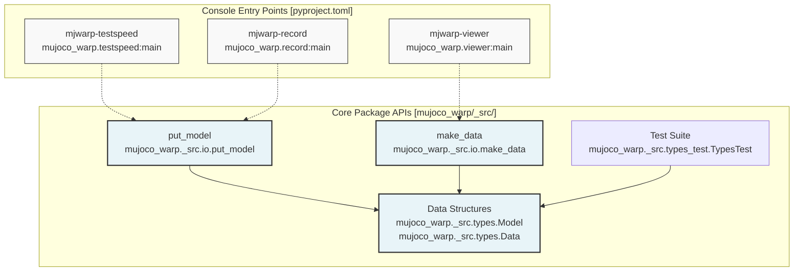
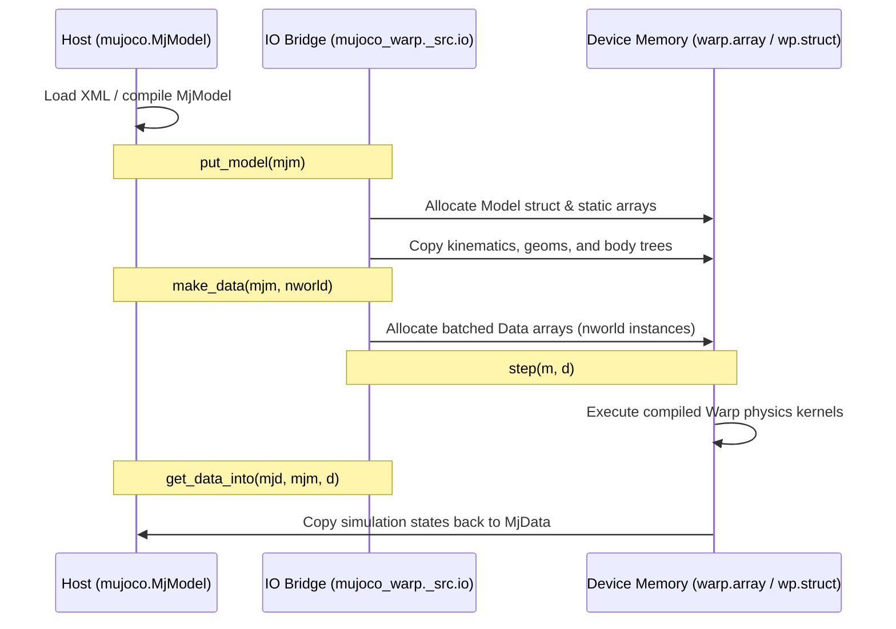

<!-- source: DeepWiki mcp.deepwiki.com · repo google-deepmind/mujoco_warp · page 1.1 Installation and Setup · fetched 2026-10-26 -->

# Installation and Setup

<details>
<summary>Relevant source files</summary>

The following files were used as context for generating this wiki page:

- [.agent/rules/project.md](.agent/rules/project.md)
- [AGENTS.md](AGENTS.md)
- [AUTHORS](AUTHORS)
- [CONTRIBUTING.md](CONTRIBUTING.md)
- [LICENSE](LICENSE)
- [mujoco_warp/_src/types_test.py](mujoco_warp/_src/types_test.py)
- [pyproject.toml](pyproject.toml)
- [uv.lock](uv.lock)

</details>


This page covers installing `mujoco_warp`, configuring dependencies, verifying the installation, understanding platform support, and managing devices. MuJoCo Warp (`mujoco-warp`) is a GPU-optimized physics simulation library built on NVIDIA Warp, designed to execute high-throughput parallel rigid-body and soft-body simulations [pyproject.toml:12]().

## Prerequisites and Platform Support

`mujoco_warp` targets modern Python environments and NVIDIA GPU hardware. The package specification defines the strict constraints for Python and underlying simulation packages.

| Component | Requirement | Code Reference |
|-----------|-------------|----------------|
| Python | `>=3.10` (supports 3.10, 3.11, 3.12, 3.13, 3.14) | `[pyproject.toml:21-28]()`, `[uv.lock:3-9]()` |
| MuJoCo C Library | `>=3.13.0` (core), `>=3.11.0` (dev) | `[pyproject.toml:32](), [pyproject.toml:59]()` |
| NVIDIA Warp | `>=1.15` | `[pyproject.toml:34](), [pyproject.toml:60]()` |
| NumPy | Latest compatible | `[pyproject.toml:33]()` |
| ABSL-Py | Latest compatible | `[pyproject.toml:30]()` |
| Etils (`etils[epath]`) | Latest compatible | `[pyproject.toml:31]()` |

Sources: `[pyproject.toml:21-35]()`, `[uv.lock:3-9]()`

## Installation Methods

### Installation via PyPI
To install the stable distribution from PyPI along with its default index dependencies:
```bash
pip install mujoco-warp
```

### Installation from Source and Dependency Management
For local development or accessing unreleased features, source installation uses `uv` for reproducible environment synchronization via `pyproject.toml` and `uv.lock`:
```bash
git clone https://github.com/google-deepmind/mujoco_warp.git
cd mujoco_warp
uv sync --all-extras
uv run pre-commit install
```
Sources: `[pyproject.toml:1-76]`, `[CONTRIBUTING.md:15-18]()`

### Optional Dependencies
Optional extras are defined under `[project.optional-dependencies]` in `pyproject.toml`:
- `dev`: Installs development tools such as `pre-commit`, `pytest`, `pytest-xdist`, `ruff`, `pygls`, `lsprotocol`, `mjviser`, and `pillow` `[pyproject.toml:51-63]()`.
- `cpu`: Includes CPU-based `jax` integration `[pyproject.toml:65-67]()`.
- `cuda`: Includes CUDA-accelerated JAX support (`jax[cuda12]`) `[pyproject.toml:68-70]()`.

Sources: `[pyproject.toml:51-70]()`

## Package Architecture and Code Entities

The following diagram maps the high-level system entry points and core modules to their corresponding code structures.



Sources: `[pyproject.toml:72-75]`, `[mujoco_warp/_src/types_test.py:27-31]`

## Verifying the Installation

### Running the Test Suite
The test infrastructure runs via `pytest` targeting the `mujoco_warp` package directory, excluding benchmarks and external contributions [pyproject.toml:121-123](). Run the test suite in parallel using `pytest-xdist`:
```bash
uv run pytest -n 8
```
Unit tests validate structural field ordering, bitmask flags (e.g., `OverflowType`), and parity against CPU MuJoCo references [mujoco_warp/_src/types_test.py:47-110]().

### Basic Initialization Check
You can verify the runtime environment, NVIDIA Warp initialization, and model structure conversion using a short Python script:
```python
import mujoco
import mujoco_warp as mjw
import warp as wp

# Initialize Warp runtime
wp.init()
print(f"Active Warp Device: {wp.get_device()}")

# Load standard MuJoCo model and transfer to GPU
mjm = mujoco.MjModel.from_xml_string('<mujoco/>')
m = mjw.put_model(mjm)
print(f"Successfully allocated GPU Model struct with {m.nq} DOFs.")
```
Sources: `[mujoco_warp/_src/types_test.py:112-117]`, `[mujoco_warp/_src/types_test.py:146-147]`

## Initialization Workflow & Data Flow

The sequence below illustrates the data transfer and allocation pipeline when bridging CPU MuJoCo models to GPU device memory structures.



### Key Setup Functions
- `put_model`: Converts host-side `mujoco.MjModel` descriptors into device-resident `Model` structures [mujoco_warp/_src/types_test.py:28]() [mujoco_warp/_src/types_test.py:113]().
- `override_model`: Overrides model parameters or option bitmasks like `opt.warn_overflow` [mujoco_warp/_src/types_test.py:27]() [mujoco_warp/_src/types_test.py:133]().
- `OverflowType`: Manages bitmask flags for tracking buffer overflow conditions across simulation pipelines [mujoco_warp/_src/types_test.py:32]() [mujoco_warp/_src/types_test.py:95-110]().

Sources: `[mujoco_warp/_src/types_test.py:27-32]`, `[mujoco_warp/_src/types_test.py:112-143]`

## Device Management & Kernel Caching

NVIDIA Warp relies on Just-In-Time (JIT) compilation to generate specialized CUDA kernels. 

### Scoped Device Execution
To target specific devices or multi-GPU environments, use `wp.ScopedDevice`:
```python
import warp as wp
import mujoco_warp as mjw

wp.init()
with wp.ScopedDevice("cuda:0"):
    # Executions inside this block target CUDA device 0
    pass
```

### Kernel Cache Clearing
If modifying source code or resolving compilation caches, clear the runtime kernel cache:
```python
import warp as wp
wp.clear_kernel_cache()
```
The console entrypoint `mjwarp-testspeed` exposes command-line flags to manage benchmark execution and cache behaviors [pyproject.toml:73]().

Sources: `[pyproject.toml:72-76]`, `[CONTRIBUTING.md:31-40]`

---

