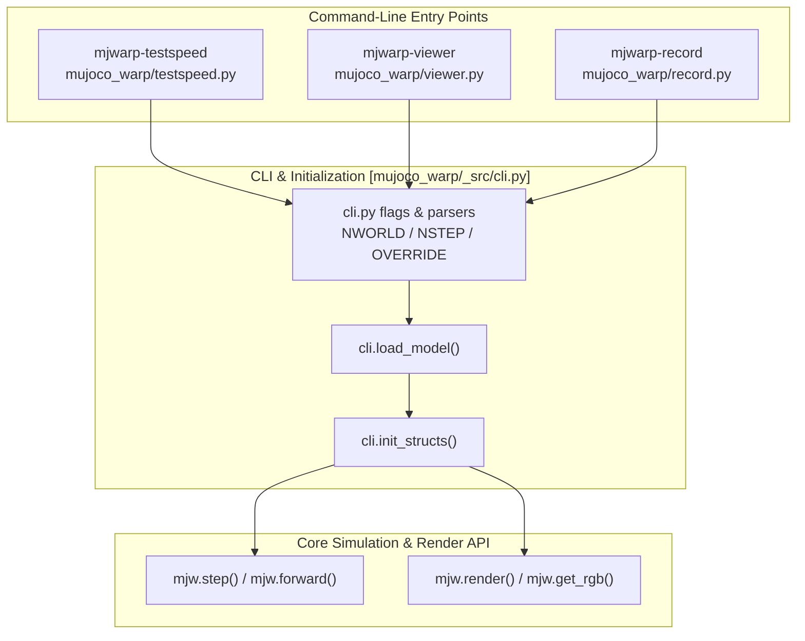

<!-- source: DeepWiki mcp.deepwiki.com · repo google-deepmind/mujoco_warp · page 1.2 Command-Line Tools · fetched 2026-10-26 -->

# Command-Line Tools

<details>
<summary>Relevant source files</summary>

The following files were used as context for generating this wiki page:

- [mujoco_warp/_src/cli.py](mujoco_warp/_src/cli.py)
- [mujoco_warp/record.py](mujoco_warp/record.py)
- [mujoco_warp/testspeed.py](mujoco_warp/testspeed.py)
- [mujoco_warp/viewer.py](mujoco_warp/viewer.py)

</details>


This page documents the three command-line utilities provided by `mujoco_warp`: `mjwarp-testspeed` for performance benchmarking, `mjwarp-viewer` for interactive visualization and debugging, and `mjwarp-record` for video and render data capture. These entry points provide direct access to the simulation pipeline configured via shared command-line flags.

## Overview

The `mujoco_warp` package exposes its core capabilities through console scripts built on top of standard CLI infrastructure (`mujoco_warp/_src/cli.py`) [mujoco_warp/_src/cli.py:16-32](). 

### Tool Architecture and Data Flow



**Sources:** [mujoco_warp/testspeed.py:16-22](), [mujoco_warp/viewer.py:16-22](), [mujoco_warp/record.py:16-22](), [mujoco_warp/_src/cli.py:16-56]()

---

## Shared CLI Infrastructure

Common configuration parameters across all CLI tools are centralized in `mujoco_warp/_src/cli.py`. These parameters control parallel batching, trajectory replays, overrides, and noise models.

| Flag | Type | Default | Description |
|------|------|---------|-------------|
| `--nworld` | int | `8192` | Number of parallel rollouts (batch size) [mujoco_warp/_src/cli.py:34]() |
| `--nstep` | int | `1000` | Number of steps per rollout [mujoco_warp/_src/cli.py:35]() |
| `--nconmax` | int | `None` | Override maximum contacts per world [mujoco_warp/_src/cli.py:36]() |
| `--njmax` | int | `None` | Override maximum constraints per world [mujoco_warp/_src/cli.py:37]() |
| `-o`/`--override` | multi | `[]` | Model overrides using `foo.bar = baz` notation [mujoco_warp/_src/cli.py:40]() |
| `--keyframe` | int | `0` | Keyframe index used to initialize simulation [mujoco_warp/_src/cli.py:41]() |
| `--device` | string | `None` | Target Warp execution device (e.g. `cuda:0`) [mujoco_warp/_src/cli.py:52]() |
| `--replay` | string | `None` | NPZ file containing control sequences to replay [mujoco_warp/_src/cli.py:53]() |

The `cli.load_model()` function handles loading standard MJCF XML files or binary `.mjb` models, registering necessary SDF plugins, and applying configuration overrides [mujoco_warp/_src/cli.py:78-100](). `cli.init_structs()` allocates the corresponding `mujoco_warp.Model` and `mujoco_warp.Data` structures on the active device [mujoco_warp/_src/cli.py:148-171]().

**Sources:** [mujoco_warp/_src/cli.py:33-171]()

---

## mjwarp-testspeed

### Purpose

`mjwarp-testspeed` benchmarks GPU-accelerated physics simulation performance. It measures JIT compilation time, aggregate throughput (steps per second), and provides detailed reporting on memory consumption, solver convergence, and event traces.

### Basic Usage

```bash
mjwarp-testspeed <mjcf_path> [flags]

# Example: benchmark humanoid with 4096 parallel worlds
mjwarp-testspeed benchmarks/humanoid/humanoid.xml --nworld 4096 -o "opt.solver=cg"
```

**Sources:** [mujoco_warp/testspeed.py:16-22]()

### Command-Line Flags

| Flag | Type | Default | Description |
|------|------|---------|-------------|
| `--function` | enum | `step` | Function to benchmark (e.g., `step`, `forward`) [mujoco_warp/testspeed.py:51]() |
| `--clear_warp_cache` | bool | `False` | Clear Warp kernel, LTO, and CUDA compute caches [mujoco_warp/testspeed.py:52]() |
| `--measure_alloc` | bool | `False` | Print report of contact/constraint counts per step [mujoco_warp/testspeed.py:53]() |
| `--measure_solver` | bool | `False` | Print report of solver iterations per step [mujoco_warp/testspeed.py:54]() |
| `--memory` | bool | `False` | Print detailed GPU memory breakdown report [mujoco_warp/testspeed.py:56]() |
| `--format` | enum | `human` | Output format: `human`, `short`, or `json` [mujoco_warp/testspeed.py:58]() |

**Sources:** [mujoco_warp/testspeed.py:45-61]()

---

## mjwarp-viewer

### Purpose

`mjwarp-viewer` provides interactive real-time simulation and visualization. It supports switching between the GPU-accelerated `WARP` backend and the CPU reference `C` backend, alongside native passive viewer and web-based (`viser`) frontends.

### Basic Usage

```bash
mjwarp-viewer <mjcf_path> [flags]

# Example: run with viser web viewer backend
mjwarp-viewer benchmarks/humanoid/humanoid.xml --viewer viser

# Example: compare against standard MuJoCo C simulation engine
mjwarp-viewer benchmarks/humanoid/humanoid.xml --engine C
```

**Sources:** [mujoco_warp/viewer.py:16-22]()

### Engine and Viewer Options

The viewer tool exposes simulation engine options via `EngineOptions` [mujoco_warp/viewer.py:42-48]():
* `EngineOptions.WARP`: Executes via `mujoco_warp` GPU routines [mujoco_warp/viewer.py:45]().
* `EngineOptions.C`: Executes via reference `mujoco.mj_step` on CPU [mujoco_warp/viewer.py:46]().

### CUDA Graph Compilation

When running with the `WARP` engine on CUDA devices, the viewer captures the physics step inside a Warp CUDA graph to eliminate host-dispatch latency [mujoco_warp/viewer.py:65-74]().

```python
def _compile_step(m, d):
  print("Compiling physics step...", end="", flush=True)
  with wp.ScopedCapture() as capture:
    mjw.step(m, d)
  return capture.graph
```

If model parameters are altered interactively (e.g., via GUI sliders modifying `mjm.opt`), the viewer detects the state mutation, updates the model via `mjw.put_model()`, and recompiles the execution graph [mujoco_warp/viewer.py:76-102]().

**Sources:** [mujoco_warp/viewer.py:65-102]()

---

## mjwarp-record

### Purpose

`mjwarp-record` captures animated videos or image sequences (RGB, depth, or segmentation channels) of parallel simulation rollouts.

### Basic Usage

```bash
mjwarp-record <mjcf_path> --video <output_path> [flags]

# Example: record a short rollout of humanoid to GIF/WebP
mjwarp-record benchmarks/humanoid/humanoid.xml --output humanoid.webp --nworld 1
```

**Sources:** [mujoco_warp/record.py:16-22]()

### Rendering Modes and Channels

The recorder supports two rendering pipelines via `--render_mode` [mujoco_warp/record.py:44]():
1. `warp`: Uses the GPU rendering pipeline (`mjw.render`, `mjw.get_rgb`, `mjw.get_depth`, `mjw.get_segmentation`) [mujoco_warp/record.py:109-136]().
2. `python`: Uses `mujoco.Renderer` with an orbit camera moving around the scene center [mujoco_warp/record.py:91-99](), [mujoco_warp/record.py:141-144]().

Segmentation images are dynamically post-processed with random color palettes mapped to geometry IDs via `_colorize_segmentation()` [mujoco_warp/record.py:49-57]().

**Sources:** [mujoco_warp/record.py:44-57](), [mujoco_warp/record.py:91-144]()

---

## Example Workflows

### Accuracy Validation
Users can validate GPU physics consistency against the MuJoCo C reference by launching the viewer with alternative engines:

```bash
# Launch with MuJoCo Warp GPU backend
mjwarp-viewer model.xml --engine WARP

# Launch with MuJoCo C CPU reference backend
mjwarp-viewer model.xml --engine C
```

**Sources:** [mujoco_warp/viewer.py:42-49](), [mujoco_warp/viewer.py:153-162]()

### Performance Profiling and Event Tracing
To inspect hierarchical execution latencies across pipeline stages (e.g., kinematics, collision detection, constraint solver):

```bash
mjwarp-testspeed benchmarks/humanoid/humanoid.xml --nworld 8192 --event_trace --measure_solver
```

**Sources:** [mujoco_warp/testspeed.py:51-61]()

---

