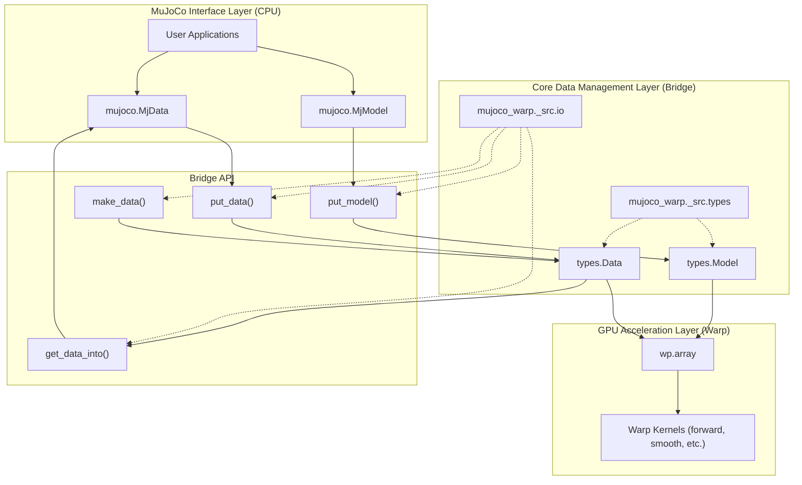
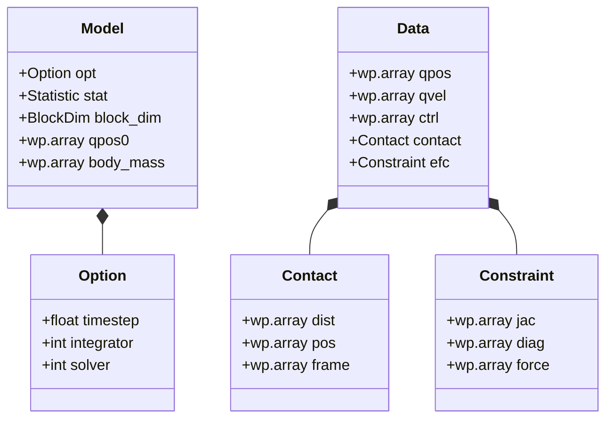

<!-- source: DeepWiki mcp.deepwiki.com · repo google-deepmind/mujoco_warp · page 2 Core Architecture · fetched 2026-10-26 -->

# Core Architecture

Relevant source files

The following files were used as context for generating this wiki page:

- [mujoco_warp/_src/io.py](mujoco_warp/_src/io.py)
- [mujoco_warp/_src/types.py](mujoco_warp/_src/types.py)

This page provides an overview of the fundamental architecture of MuJoCo Warp (`mujoco_warp`), including its layered design, host-device separation, GPU acceleration model, and public API surface. The core architecture enables GPU-accelerated physics simulation by providing seamless conversion between MuJoCo's native data structures and NVIDIA Warp's GPU-optimized representations.

For detailed information about specific components, see the child pages:
- Data Types and Structures: [Data Types and Structures](#2.1)
- Host-Device I/O Bridge: [Host-Device I/O Bridge](#2.2)
- Multi-World Batching Architecture: [Multi-World Batching Architecture](#2.3)
- Warp Kernel Infrastructure: [Warp Kernel Infrastructure](#2.4)

## System Overview

MuJoCo Warp is a GPU-optimized version of the MuJoCo physics simulator [README.md](). It uses NVIDIA Warp to provide a high-performance simulation environment that executes physics pipelines entirely on the GPU.

The architecture consists of three primary layers: the MuJoCo interface layer on the CPU, the core data management layer (Bridge), and the GPU acceleration layer powered by Warp kernels.

### High-Level System Architecture

Sources: [mujoco_warp/_src/io.py:77-85](), [mujoco_warp/_src/types.py:717-720]()

## Host-Device Separation and Data Flow

The system implements a bidirectional data flow between MuJoCo's native host C-structures and Warp's device-allocated arrays. This enables users to load models and inspect results using standard MuJoCo tools on the CPU while executing heavy parallel physics computations on the GPU.

The host-device bridge handles state transfers and memory allocation:
- `put_model`: Transfers static model information (`MjModel`) to the GPU `Model` structure [mujoco_warp/_src/io.py:77-85]().
- `put_data`: Transfers dynamic state (`MjData`) to the GPU `Data` structure [mujoco_warp/_src/io.py:800-805]().
- `make_data`: Allocates GPU memory for simulation data without requiring a pre-existing host `MjData` object [mujoco_warp/_src/io.py:1086-1090]().
- `get_data_into`: Retrieves GPU simulation results back into a host MuJoCo `MjData` object [mujoco_warp/_src/io.py:1181-1185]().

For detailed information on sparse versus dense layouts, padding, capacity estimation (`nconmax`/`njmax`), and trajectory loading, see [Host-Device I/O Bridge](#2.2).

Sources: [mujoco_warp/_src/io.py:77-1185]()

## Core Data Structures and Public API Surface

The type system defines the fundamental dataclasses representing physics models, simulation states, contacts, constraints, and solver options. These structures are optimized for GPU memory layouts while maintaining semantic equivalence with MuJoCo.

### Code Entity Space: Primary Types

Sources: [mujoco_warp/_src/types.py:717-987](), [mujoco_warp/_src/types.py:1269-1422](), [mujoco_warp/_src/types.py:484-536]()

For complete details on fields and relationships for `Model`, `Data`, `Contact`, `Constraint`, `Option`, `SolverContext`, and `RenderContext`, see [Data Types and Structures](#2.1).

## Multi-World Batching Architecture

To achieve high throughput, `mujoco_warp` introduces an `nworld` dimension across simulation data arrays. This allows a single Warp kernel launch to evaluate thousands of independent physical environments concurrently.

Key aspects of batching include:
- **Batched State Fields**: State vectors like `qpos` and `qvel` include `nworld` as their leading dimension [mujoco_warp/_src/io.py:360-370]().
- **Per-World Randomization**: Support for variant and mesh randomization across parallel worlds.
- **Batched Execution**: Unified pipelines that step all environments in lockstep on the GPU.

For details, see [Multi-World Batching Architecture](#2.3).

Sources: [mujoco_warp/_src/io.py:360-370](), [mujoco_warp/_src/types.py:34-35]()

## GPU Acceleration and Warp Kernel Infrastructure

All numeric pipelines are implemented using NVIDIA Warp kernels. The infrastructure manages kernel caching and specialization via `cache_kernel`, event tracing, CUDA graph capture for reduced launch overhead, and tile/block dimension configurations defined in `BlockDim` [mujoco_warp/_src/types.py:57-122]().

For details on kernel specialization, tracing, conditional graphs, and launch configurations, see [Warp Kernel Infrastructure](#2.4).

Sources: [mujoco_warp/_src/types.py:57-122]()

---

