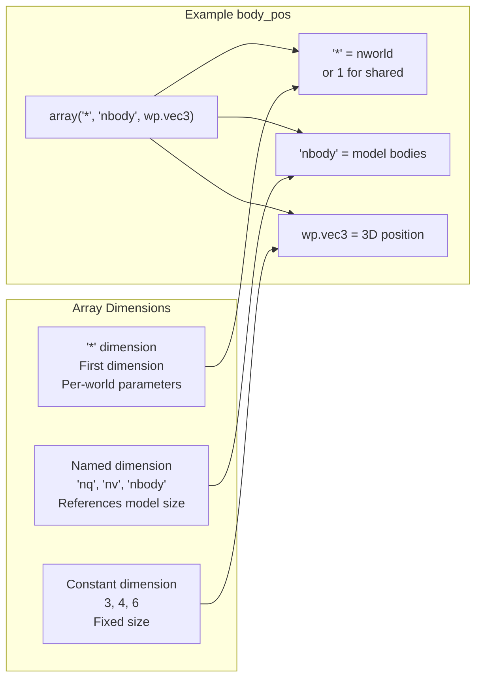
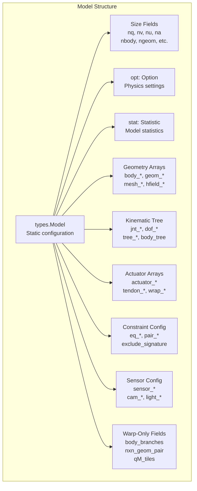
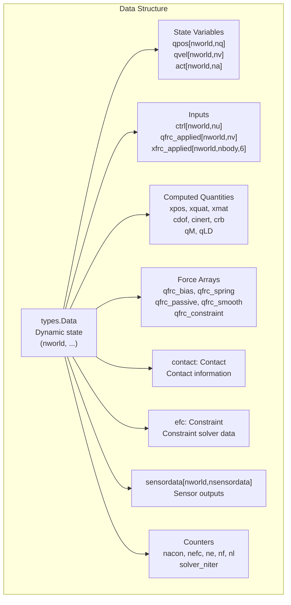
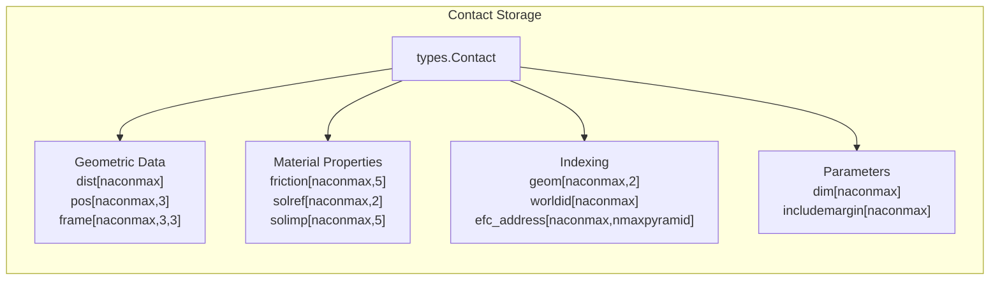
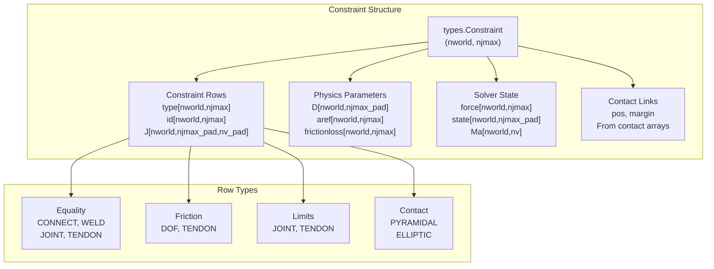
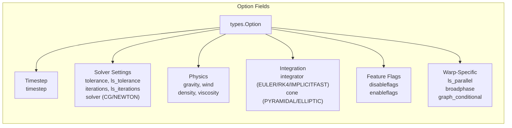
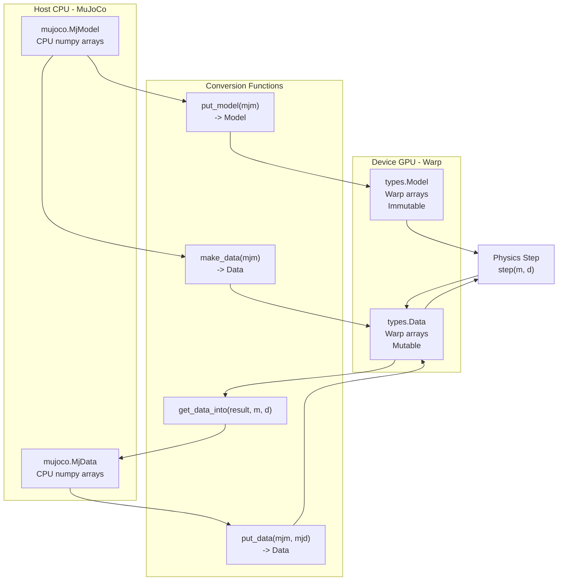

<!-- source: DeepWiki mcp.deepwiki.com · repo google-deepmind/mujoco_warp · page 2.1 Data Types and Structures · fetched 2026-10-26 -->

# Data Types and Structures

Relevant source files

The following files were used as context for generating this wiki page:

- [mujoco_warp/_src/types.py](mujoco_warp/_src/types.py)

## Purpose and Scope

This page documents the core data types and structures used throughout `mujoco_warp`. These types define the interface between CPU (host) and GPU (device) execution, organizing both static model parameters and dynamic simulation state. For information about transferring these types between host and device, see [Host-Device I/O Bridge](2.2). For details on how the `nworld` dimension enables parallel simulation, see [Multi-World Batching Architecture](2.3).

All types are defined as Python dataclasses and enums in `mujoco_warp/_src/types.py` and utilize NVIDIA Warp's array types for GPU computation [mujoco_warp/_src/types.py:15-22]().

Sources: `[mujoco_warp/_src/types.py:1-55]()`

---

## Type System Overview

MuJoCo Warp uses a custom type definition system built on top of NVIDIA Warp arrays. The central abstraction is the `array()` helper function that adds metadata for introspection and automatic array creation.

### Array Definition Convention

The `array()` function wraps `wp.array` with shape metadata, supporting constant dimensions, size references (such as `"nq"`, `"nworld"`), and variable wildcards (`"*"`) [mujoco_warp/_src/types.py:662-674]().

Sources: `[mujoco_warp/_src/types.py:662-674]()`

### Dimension Semantics

Sources: `[mujoco_warp/_src/types.py:662-674]()`

---

## Core Data Classes

### Model: Static Configuration

The `Model` class contains all time-invariant model parameters. It is immutable during simulation and shared across all worlds in batched execution [mujoco_warp/_src/types.py:771-1490]().

**Key Model Fields by Category:**

| Category | Fields | Purpose |
|----------|--------|---------|
| **Size Constants** | `nq`, `nv`, `nu`, `na`, `nbody`, `ngeom`, `njnt` | Define array dimensions |
| **Bodies** | `body_pos`, `body_quat`, `body_mass`, `body_inertia` | Body geometry and inertia |
| **Joints/DOFs** | `jnt_type`, `jnt_axis`, `dof_parentid`, `dof_armature` | Kinematic structure |
| **Geometries** | `geom_type`, `geom_size`, `geom_pos`, `geom_friction` | Collision geometry |
| **Actuators** | `actuator_trntype`, `actuator_dyntype`, `actuator_gear` | Actuation configuration |
| **Constraints** | `eq_type`, `eq_data`, `pair_geom1`, `pair_geom2` | Equality and contact pairs |
| **Sensors** | `sensor_type`, `sensor_objid`, `sensor_refid` | Sensor definitions |
| **Sparse Indices** | `M_rownnz`, `M_rowadr`, `M_colind`, `qLD_updates` | Sparse matrix structure |

Sources: `[mujoco_warp/_src/types.py:771-1490]()`

### Data: Dynamic State

The `Data` class contains all time-varying simulation state. Arrays are batched with `nworld` as the first dimension, allowing parallel simulation of multiple independent worlds [mujoco_warp/_src/types.py:1576-1755]().

**Key Data Fields by Stage:**

| Stage | Fields | Description |
|-------|--------|-------------|
| **Position** | `qpos`, `xpos`, `xquat`, `xmat`, `geom_xpos` | Configuration |
| **Velocity** | `qvel`, `cvel`, `cdof`, `ten_velocity` | Velocities |
| **Dynamics** | `crb`, `qM`, `qLD`, `qLDiagInv` | Inertia and factorization |
| **Forces** | `qfrc_bias`, `qfrc_passive`, `qfrc_actuator` | Applied forces |
| **Constraints** | `contact`, `efc`, `ne`, `nf`, `nl` | Contact and constraint data |
| **Acceleration** | `qacc`, `qacc_smooth`, `cacc` | Computed accelerations |
| **Integration** | `time`, `act_dot`, `qacc_warmstart` | Time-stepping state |

Sources: `[mujoco_warp/_src/types.py:1576-1755]()`

### Contact: Collision Information

The `Contact` class stores detected collision information. Contacts are stored in a heterogeneous array shared across all worlds, indexed by `worldid` [mujoco_warp/_src/types.py:1503-1540]().

Sources: `[mujoco_warp/_src/types.py:1503-1540]()`

### Constraint (EFC): Solver Data

The `Constraint` class represents the EFC (effective constraint) structure used by the constraint solver. Unlike contacts, constraint arrays are batched by world [mujoco_warp/_src/types.py:1542-1574]().

Sources: `[mujoco_warp/_src/types.py:1542-1574]()`

### Option: Physics Configuration

The `Option` class contains physics solver settings and simulation parameters [mujoco_warp/_src/types.py:676-743]().

Sources: `[mujoco_warp/_src/types.py:676-743]()`

---

## Supporting Types

### Enumerations

MuJoCo Warp defines extensive enumerations for type-safe configuration. All enums inherit from standard MuJoCo values for compatibility [mujoco_warp/_src/types.py:74-614]().

**Key Enumerations:**

| Enum | Purpose | Values |
|------|---------|--------|
| `IntegratorType` | Time-stepping method | `EULER`, `RK4`, `IMPLICITFAST` |
| `SolverType` | Constraint solver | `CG`, `NEWTON` |
| `ConeType` | Friction cone model | `PYRAMIDAL`, `ELLIPTIC` |
| `GeomType` | Geometry primitive | `PLANE`, `SPHERE`, `CAPSULE`, `BOX`, `MESH`, `HFIELD`, `SDF` |
| `JointType` | Joint DOF type | `FREE`, `BALL`, `SLIDE`, `HINGE` |
| `ConstraintType` | EFC constraint type | `EQUALITY`, `FRICTION_DOF`, `LIMIT_JOINT`, `CONTACT_PYRAMIDAL`, etc. |
| `SensorType` | Sensor measurement | 40+ types including `JOINTPOS`, `ACCELEROMETER`, `RANGEFINDER` |
| `DisableBit` | Feature disable flags | `CONSTRAINT`, `CONTACT`, `GRAVITY`, `WARMSTART`, etc. |
| `EnableBit` | Feature enable flags | `ENERGY`, `INVDISCRETE`, `MULTICCD` |
| `TrnType` | Actuator transmission | `JOINT`, `TENDON`, `SITE`, `BODY` |
| `DynType` | Actuator dynamics | `NONE`, `INTEGRATOR`, `FILTER`, `MUSCLE` |

**Warp-Specific Enumerations:**

| Enum | Purpose | Values |
|------|---------|--------|
| `BroadphaseType` | Collision broadphase | `NXN`, `SAP_TILE`, `SAP_SEGMENTED` [mujoco_warp/_src/types.py:124-136]() |
| `BroadphaseFilter` | Broadphase filtering | `PLANE`, `SPHERE`, `AABB`, `OBB` (bitflags) [mujoco_warp/_src/types.py:138-152]() |
| `OverflowType` | Physics / collision overflows | `NEFC`, `NJMAX_NNZ`, `BROADPHASE`, `NARROWPHASE`, etc. [mujoco_warp/_src/types.py:154-172]() |

Sources: `[mujoco_warp/_src/types.py:74-198]()`

### Custom Vector Types

MuJoCo Warp extends Warp's vector types for domain-specific sizes [mujoco_warp/_src/types.py:616-660]():
- `vec5`: solimp, friction parameters
- `vec6`: spatial vectors
- `vec8`: octree children
- `vec10`: actuator parameters, inertia
- `vec11`: equality constraint data

Sources: `[mujoco_warp/_src/types.py:616-660]()`

### Helper Classes

- **TileSet**: Configuration for block-diagonal matrix decomposition [mujoco_warp/_src/types.py:40-50]().
- **Statistic**: Model statistics computed at `qpos0` [mujoco_warp/_src/types.py:745-769]().
- **BlockDim**: Thread block dimensions for `wp.launch_tiled` operations across simulation kernels [mujoco_warp/_src/types.py:56-123]().

Sources: `[mujoco_warp/_src/types.py:40-123]`, `[mujoco_warp/_src/types.py:745-769]()`

---

## Type Relationships and Data Flow

### Model-Data Interaction

Sources: `[mujoco_warp/_src/types.py:771-1755]()`

### Sparse vs Dense Representations

MuJoCo Warp supports both sparse and dense matrix formats, selected automatically based on model size or options [mujoco_warp/_src/types.py:1046-1136]().

Sources: `[mujoco_warp/_src/types.py:1046-1136]()`

### Constraint-Contact Linkage

Contacts map into the EFC constraint structure via `contact.efc_address[conid, :]` [mujoco_warp/_src/types.py:1503-1574]().

Sources: `[mujoco_warp/_src/types.py:1503-1574]()`

---

