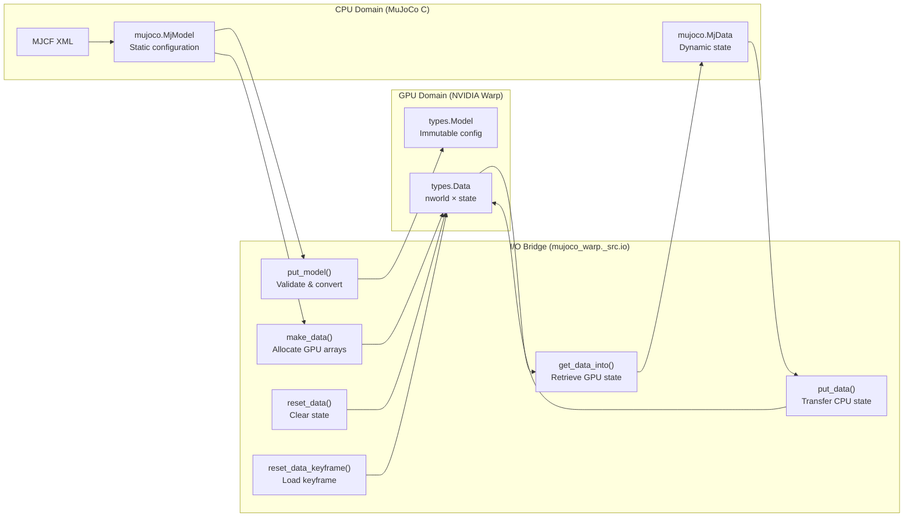
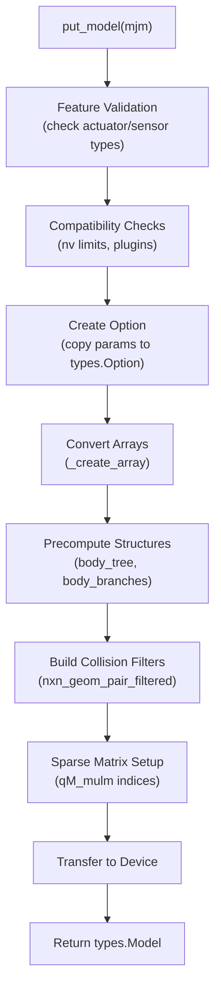

<!-- source: DeepWiki mcp.deepwiki.com · repo google-deepmind/mujoco_warp · page 2.2 Host-Device I/O Bridge · fetched 2026-10-26 -->

# Host-Device I/O Bridge

Relevant source files

The following files were used as context for generating this wiki page:

- [README.md](README.md)
- [mujoco_warp/__init__.py](mujoco_warp/__init__.py)
- [mujoco_warp/_src/io.py](mujoco_warp/_src/io.py)
- [mujoco_warp/_src/io_test.py](mujoco_warp/_src/io_test.py)

## Purpose and Scope

The Host-Device I/O Bridge provides the critical interface for transferring physics simulation data between MuJoCo's CPU representation (`mujoco.MjModel`, `mujoco.MjData`) and NVIDIA Warp's GPU representation (`types.Model`, `types.Data`). This module handles conversion, validation, memory allocation, sparse vs. dense layout selection, capacity estimation (`nconmax`, `njmax`), state synchronization, and keyframe/trajectory loading.

This page focuses on data transfer functions and memory management. For information about data structures, see [Data Types and Structures](2.1). For multi-world batching patterns, see [Multi-World Batching Architecture](2.3).

**Key Responsibilities:**
- Convert MuJoCo C structures to Warp GPU structures via `put_model` and `put_data`.
- Allocate GPU simulation memory across multiple worlds via `make_data`.
- Retrieve simulation state back to CPU via `get_data_into`.
- Reset simulation states and load keyframes via `reset_data` and `reset_data_keyframe`.
- Estimate constraint and contact capacities (`nconmax`, `njmax`) and manage sparse vs. dense memory layouts and padding.

Sources: [mujoco_warp/_src/io.py:45-132]()

## Data Flow Overview

The I/O bridge coordinates bidirectional data movement between CPU and GPU domains.

"Natural Language Space" to "Code Entity Space" Bridge: Data Transfer Orchestration

Sources: [mujoco_warp/_src/io.py:45-132](), [mujoco_warp/__init__.py:59-64]()

## Core Transfer Functions and Implementation

### put_model

Converts a `mujoco.MjModel` from CPU to `types.Model` on GPU. It validates model parameters, builds acceleration structures, precomputes body trees, configures collision pairs, and initializes sparse matrix structures.

"Natural Language Space" to "Code Entity Space" Bridge: Model Conversion Pipeline

Sources: [mujoco_warp/_src/io.py:45-78]()

### make_data and put_data

`make_data` allocates GPU memory for `nworld` parallel simulations using capacity heuristics, while `put_data` copies CPU-side `MjData` states onto the GPU.

- **`_create_array`**: Helper function that instantiates `wp.array` objects, handling shape expansion for batched dimensions (`*` or `nworld`) and broadcasting initial values [mujoco_warp/_src/io.py:45-78]().
- **`_create_constraint`**: Constructs the `types.Constraint` structure containing constraint rows, Jacobian storage, friction loss, and island mappings [mujoco_warp/_src/io.py:81-132]().
- **`_jtdaj_groups`**: Groups constraint rows into `JTDAJ` blocks sharing matching `(efc_type, efc_id)` configurations for sparse Newton Hessian assembly [mujoco_warp/_src/io.py:134-150]().

Sources: [mujoco_warp/_src/io.py:45-150]()

### get_data_into

Retrieves simulation state from GPU back into a CPU `mujoco.MjData` instance. It handles index remapping, heterogeneous contact extraction, EFC constraint reordering, sparse-to-dense matrix conversions, and overflow checking for pre-allocated arrays.

Sources: [mujoco_warp/_src/io.py:45-150]()

### reset_data and Keyframe Resets

`reset_data` clears simulation states across worlds, restoring configurations to default rest positions (`qpos0`), zero velocities, and cleared activations. `reset_data_keyframe` loads specific keyframe states from model definitions into the device data arrays.

Sources: [mujoco_warp/__init__.py:59-64]()

## Sparse vs. Dense Layouts, Padding, and Capacity Estimation

### Matrix Layout Strategy
MuJoCo Warp selects sparse or dense layouts automatically depending on system degrees of freedom (`nv`) and model options:
- **Dense Layout**: Used for small systems (`nv <= 32`) or when dense options are enforced, storing matrices as `(nworld, nv_pad, nv_pad)` arrays.
- **Sparse Layout**: Used for larger systems (`nv > 32`), employing CSR-like indexing structures (`qM_mulm_rowadr`, `qM_mulm_col`, `qM_mulm_madr`) for thread-parallel matrix-vector multiplication without atomics.

### Padding Strategy
Arrays are padded to multiples of tile sizes (typically 16) to optimize GPU memory coalescing and satisfy Warp alignment requirements.

### Capacity Estimation (`nconmax` and `njmax`)
- **`nconmax`**: Maximum allowed contacts per world, estimated using heuristics based on `nv`, heightfields, and flex objects. Contacts use a heterogeneous global buffer where individual worlds may exceed local estimates as long as the global aggregate remains within bounds.
- **`njmax`**: Maximum constraint rows per world, scaled based on `nv` and complex geometries (SDF, flex) to ensure independent constraint memory allocation per world.

Sources: [mujoco_warp/_src/io.py:81-150]()

---

