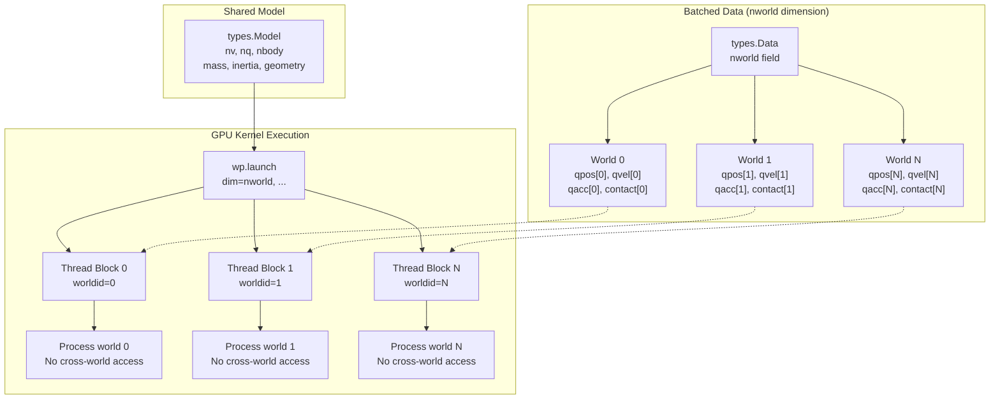
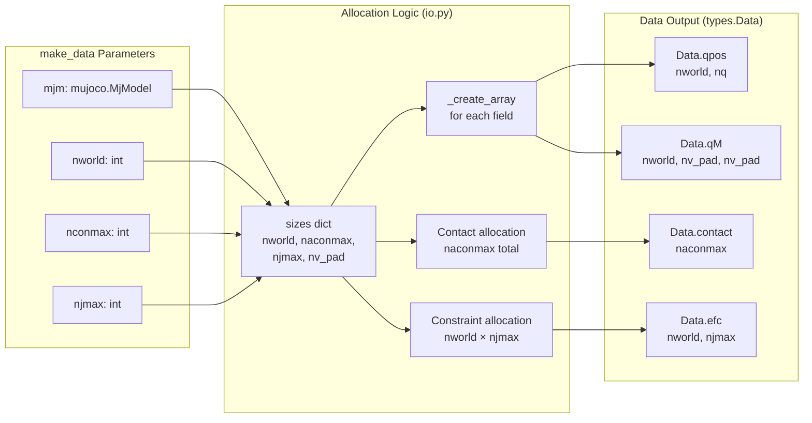
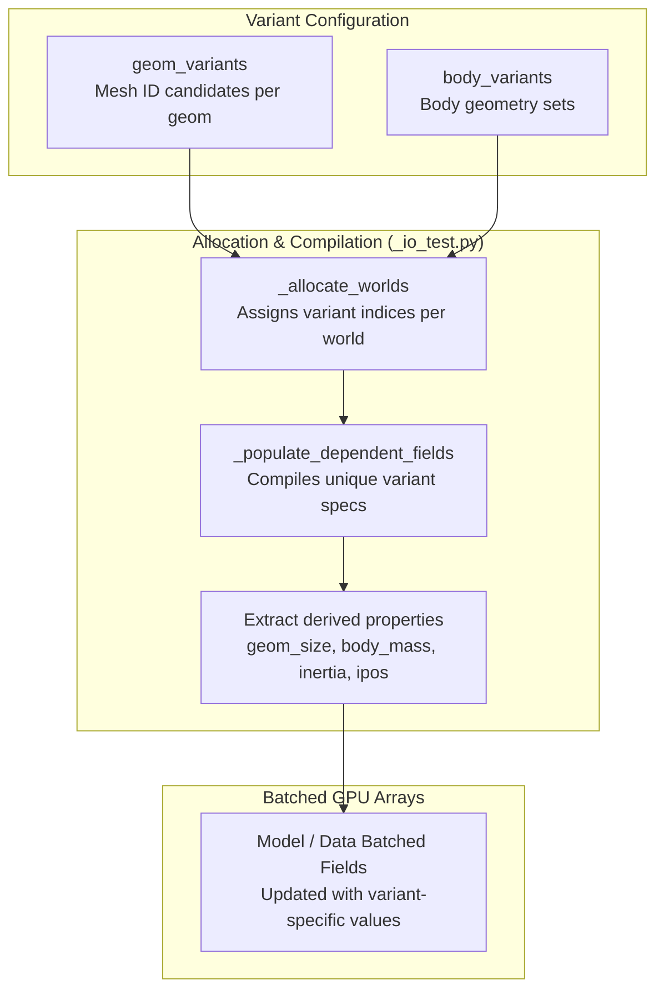
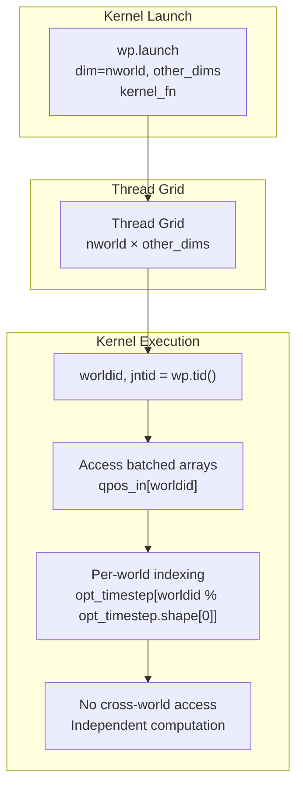
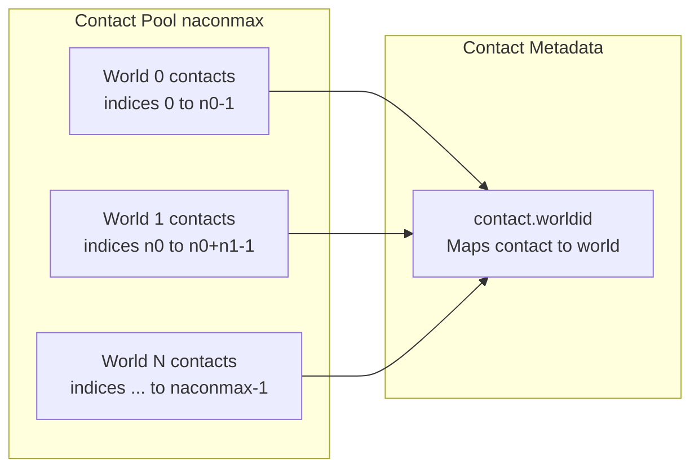

<!-- source: DeepWiki mcp.deepwiki.com · repo google-deepmind/mujoco_warp · page 2.3 Multi-World Batching Architecture · fetched 2026-10-26 -->

# Multi-World Batching Architecture

<details>
<summary>Relevant source files</summary>

The following files were used as context for generating this wiki page:

- [README.md](README.md)
- [mujoco_warp/__init__.py](mujoco_warp/__init__.py)
- [mujoco_warp/_src/io.py](mujoco_warp/_src/io.py)
- [mujoco_warp/_src/io_test.py](mujoco_warp/_src/io_test.py)

</details>


## Purpose and Scope

This document explains how `mujoco_warp` enables efficient parallel simulation of multiple independent physics worlds on the GPU through its batched execution architecture. It covers the distinction between shared `Model` configuration and per-world `Data` state, the memory layout of batched arrays, per-world mesh and variant randomization patterns, and the kernel execution model that processes worlds in parallel.

For details on how data is transferred between CPU and GPU, see [Host-Device I/O Bridge](2.2). For information on the core data structures themselves, see [Data Types and Structures](2.1).

Sources: `[mujoco_warp/_src/types.py:1072-1323]()`, `[mujoco_warp/_src/io.py:45-131]()`

---

## Architecture Overview

The multi-world batching architecture allows `mujoco_warp` to simulate `nworld` independent physics environments simultaneously on the GPU. Each world maintains its own state (positions, velocities, contacts, etc.) but shares the same model configuration (joint structure, geometry, parameters) managed through `types.Model`. This design exploits the embarrassingly parallel nature of running multiple instances of the same model with different initial conditions or control inputs.

**Key principle**: Worlds never communicate during simulation. Each world's computation is completely independent, enabling efficient SIMD-style parallelism on the GPU via Warp kernel launches.

### Multi-World Architecture Overview



Sources: `[mujoco_warp/_src/types.py:1072-1323]()`, `[mujoco_warp/_src/io.py:763-935]()`

---

## Model vs Data: Shared vs Batched

The architecture separates immutable model configuration from mutable simulation state:

### Model: Shared Configuration

The `Model` class contains parameters that define the physics system but do not change during simulation. A single `Model` instance is shared across all worlds.

| Field Category | Examples | Batched? |
|----------------|----------|----------|
| Sizes | `nq`, `nv`, `nbody`, `ngeom` | No |
| Topology | `body_parentid`, `jnt_type`, `dof_parentid` | No |
| Parameters | `body_mass`, `body_inertia`, `geom_size` | No (or per-world via `*`) |
| Options | `opt.timestep`, `opt.gravity`, `opt.solver` | No (or per-world via `*`) |

**Note**: Some `Model` fields use the `*` dimension in their specification to support per-world variations (e.g., `body_mass: array("*", "nbody")` allows different masses per world). This is primarily used for parameter sweeps and domain randomization.

### Data: Per-World State

The `Data` class contains the simulation state and outputs. Most fields have `nworld` as their first dimension, enabling each world to maintain independent state.

| Field Category | Examples | Shape | Batched? |
|----------------|----------|-------|----------|
| Configuration | `nworld`, `naconmax`, `njmax` | scalar | Metadata only |
| State | `qpos`, `qvel`, `act` | `(nworld, nq/nv/na)` | Yes |
| Outputs | `qacc`, `xpos`, `xmat` | `(nworld, nv/nbody/...)` | Yes |
| Contacts | `contact.dist`, `contact.pos` | `(naconmax, ...)` | Heterogeneous pool |
| Constraints | `efc.force`, `efc.J` | `(nworld, njmax, ...)` | Yes |

**Contact Array Special Case**: Contact arrays use `naconmax` (total contacts across all worlds) rather than `(nworld, nconmax)` because contact counts vary widely between worlds.

Sources: `[mujoco_warp/_src/types.py:1072-1323]()`, `[mujoco_warp/_src/io.py:763-935]()`

---

## Memory Layout and Array Batching

### Array Creation with `*` Dimension

The `_create_array` helper function in `mujoco_warp/_src/io.py` defines array shapes using symbolic dimensions. The `*` dimension represents a batch dimension that resolves to `nworld` at runtime:

```python
def _create_array(data: Any, spec, sizes: dict[str, int], batch_size: int = 1) -> wp.array | None:
  spec_shape = getattr(spec, "shape", (0,))
  if spec_shape == (0,):
    if data is None:
      return None
    return wp.array(np.array(data), dtype=spec.dtype)

  shape = tuple(
    batch_size
    if dim == "*"
    else (int(dim) if isinstance(dim, str) and dim.isdigit() else (sizes[dim] if isinstance(dim, str) else dim))
    for dim in spec_shape
  )

  is_batched = spec_shape[0] in ("*", "nworld")
  # ... array allocation and broadcasting ...
  return array
```

### Data Allocation Flow



Key allocation patterns:
- **State arrays**: `(nworld, size)` — e.g., `qpos: (nworld, nq)` `[mujoco_warp/_src/types.py:1088]()`
- **Contact arrays**: `(naconmax,)` — heterogeneous pool shared across worlds `[mujoco_warp/_src/io.py:838-855]()`
- **Constraint arrays**: `(nworld, njmax, ...)` — homogeneous per-world slices `[mujoco_warp/_src/types.py:1145-1150]()`
- **Matrix arrays**: `(nworld, nv_pad, nv_pad)` for dense storage `[mujoco_warp/_src/types.py:1120]()`.

Sources: `[mujoco_warp/_src/io.py:45-78]`, `[mujoco_warp/_src/types.py:1072-1323]()`

---

## Per-World Mesh and Variant Randomization

In addition to scalar and vector parameter batching, `mujoco_warp` supports per-world mesh and variant randomization (e.g., assigning different collision meshes, geom sizes, or body mass properties to different worlds in a batch). 

When worlds within a batch utilize differing geometries or topological variants, `mujoco_warp` resolves variant allocations via helper routines such as `_allocate_worlds` and `_populate_dependent_fields` found in test and utility infrastructure:

```python
def _allocate_worlds(
  candidates: list[tuple[int, float]],
  nworld: int,
) -> list[int]:
  """Assign worlds contiguously by prm fraction (largest remainder method)."""
  ...
```

### Variant Compilation and Field Population Flow



During initialization, unique variant configurations are compiled independently, and their resulting inertial and geometric tensors are gathered into batched GPU arrays, allowing heterogeneous object shapes within a single `nworld` batch execution.

Sources: `[mujoco_warp/_src/io_test.py:39-180]()`

---

## Kernel Execution Model

### Thread Indexing with `worldid`

GPU kernels use `worldid` as the first dimension of thread indexing. The Warp API `wp.tid()` returns a tuple where the first element is `worldid`.

### Kernel Thread Indexing Pattern



### Example: Position Integration Kernel

The position integration kernels demonstrate the standard pattern:

```python
@wp.kernel
def _next_position(
    opt_timestep: wp.array(dtype=float),
    qpos_in: wp.array2d(dtype=float),
    qpos_out: wp.array2d(dtype=float),
):
    worldid, jntid = wp.tid()  # First dimension is worldid
    timestep = opt_timestep[worldid % opt_timestep.shape[0]]
    
    qpos = qpos_in[worldid]    # Data arrays indexed by worldid
    qpos_next = qpos_out[worldid]
    # ...
```

**Key patterns**:
1. **First `wp.tid()` component is `worldid`**: Used to index all batched `Data` arrays.
2. **Model arrays**: Not indexed by `worldid` if shared across worlds.
3. **Data arrays**: First index is `worldid` (per-world state).
4. **Per-world parameters**: Use modulo for broadcasting: `arr[worldid % arr.shape[0]]`.

Sources: `[mujoco_warp/_src/forward.py:49-111]()`

---

## Independent World Processing

### No Cross-World Communication

The architecture guarantees that worlds never communicate during simulation. Each world's computation executes entirely self-contained:

```mermaid
graph TB
    subgraph "World 0 Computation"
        W0_IN["qpos[0], qvel[0]<br/>contact data for world 0"]
        W0_COMP["Kinematics<br/>Collision<br/>Constraints<br/>Integration"]
        W0_OUT["qacc[0], xpos[0]<br/>Updated state"]
        
        W0_IN --> W0_COMP
        W0_COMP --> W0_OUT
    end
    
    subgraph "World 1 Computation"
        W1_IN["qpos[1], qvel[1]<br/>contact data for world 1"]
        W1_COMP["Kinematics<br/>Collision<br/>Constraints<br/>Integration"]
        W1_OUT["qacc[1], xpos[1]<br/>Updated state"]
        
        W1_IN --> W1_COMP
        W1_COMP --> W1_OUT
    end
    
    subgraph "World N Computation"
        WN_IN["qpos[N], qvel[N]<br/>contact data for world N"]
        WN_COMP["Kinematics<br/>Collision<br/>Constraints<br/>Integration"]
        WN_OUT["qacc[N], xpos[N]<br/>Updated state"]
        
        WN_IN --> WN_COMP
        WN_COMP --> WN_OUT
    end
```



### Heterogeneous Contact Handling

Contacts are an exception to the uniform batching pattern. Since contact counts vary widely between worlds, contacts use a heterogeneous pooling strategy:



The `contact.worldid` array tracks which world each contact belongs to `[mujoco_warp/_src/types.py:1290]()`, enabling kernels to filter contacts by world when needed (e.g., during sensor evaluation).

Sources: `[mujoco_warp/_src/io.py:838-855]()`, `[mujoco_warp/_src/types.py:1282-1323]()`

---

## Performance Considerations

### Memory Efficiency

The batched architecture trades memory for massive parallelism. Memory usage scales with:
- **State vectors**: `O(nworld * nv)` — positions, velocities, accelerations `[mujoco_warp/_src/types.py:1088-1090]()`
- **Contact arrays**: `O(naconmax)` — shared pool `[mujoco_warp/_src/io.py:838-855]()`
- **Constraint arrays**: `O(nworld * njmax)` — homogeneous allocation `[mujoco_warp/_src/types.py:1145-1150]()`
- **Matrix arrays**: `O(nworld * nv^2)` for dense representations `[mujoco_warp/_src/types.py:1120]()`.

**Recommendation**: For large degrees of freedom `nv`, use sparse mode (`opt.jacobian = SPARSE`) to significantly reduce memory footprint of matrix arrays `[mujoco_warp/_src/io.py:67-75]()`.

### Overflow Handling

Two array sizes must be pre-allocated and may overflow:
1. **Contact overflow**: If `nacon > naconmax`, excess contacts are dropped.
2. **Constraint overflow**: If `nefc > njmax`, simulation may truncate constraints or produce numerical instability.

`make_data()` uses heuristic rules to size `nconmax` and `njmax` safely based on model complexity `[mujoco_warp/_src/io.py:821-835]()`.

Sources: `[mujoco_warp/_src/io.py:763-935]()`, `[mujoco_warp/_src/types.py:1072-1323]()`

---

