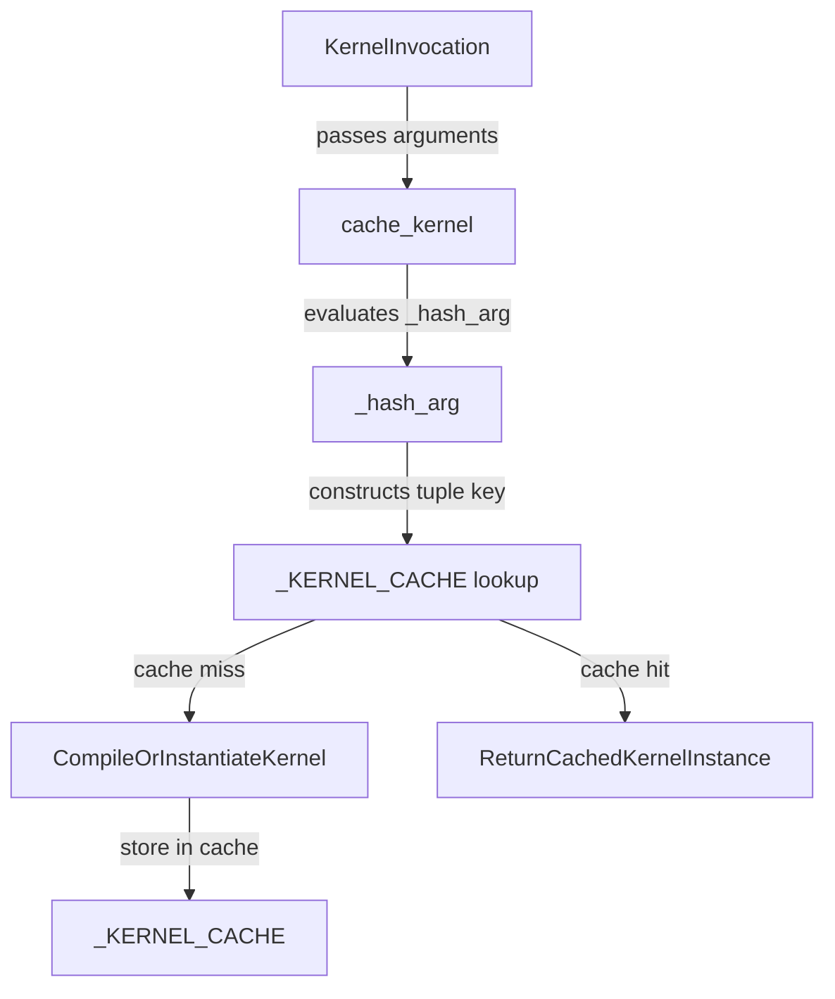

<!-- source: DeepWiki mcp.deepwiki.com · repo google-deepmind/mujoco_warp · page 2.4 Warp Kernel Infrastructure · fetched 2026-10-26 -->

# Warp Kernel Infrastructure

<details>
<summary>Relevant source files</summary>

The following files were used as context for generating this wiki page:

- [mujoco_warp/_src/set_const.py](mujoco_warp/_src/set_const.py)
- [mujoco_warp/_src/set_const_test.py](mujoco_warp/_src/set_const_test.py)
- [mujoco_warp/_src/util_pkg.py](mujoco_warp/_src/util_pkg.py)
- [mujoco_warp/_src/util_pkg_test.py](mujoco_warp/_src/util_pkg_test.py)
- [mujoco_warp/_src/warp_util.py](mujoco_warp/_src/warp_util.py)
- [mujoco_warp/test_data/actuation/adhesion.xml](mujoco_warp/test_data/actuation/adhesion.xml)

</details>


## Purpose and Scope

This page documents the low-level infrastructure supporting NVIDIA Warp kernel execution, caching, event tracing, CUDA graph capture, and launch configuration within `mujoco_warp`. This infrastructure bridges high-level physics pipeline orchestration and low-level GPU execution routines, ensuring optimal kernel specialization, reliable CUDA graph capture under conditional execution, and precise profiling via `warp_util.py` [mujoco_warp/_src/warp_util.py:1-182]() and module configurations in `set_const.py` [mujoco_warp/_src/set_const.py:1-28]().

---

## 1. Kernel Caching and Specialization (`cache_kernel`)

Dynamic kernel generation in Warp can introduce substantial overhead if kernels are repeatedly instantiated with varying argument types or shapes, or when operating inside CUDA graph conditional blocks. To mitigate this, `mujoco_warp` implements a caching decorator `cache_kernel` [mujoco_warp/_src/warp_util.py:151-167]().

### Implementation and Data Flow
The `cache_kernel` decorator intercepts kernel creation calls, computes a deterministic hash of the provided arguments using an internal helper `_hash_arg`, and checks against a global dictionary `_KERNEL_CACHE` [mujoco_warp/_src/warp_util.py:148-165]().



Sources: [mujoco_warp/_src/warp_util.py:148-167]()

---

## 2. Event Tracing and Profiling (`EventTracer` and `event_scope`)

Profiling GPU execution across asynchronous kernel launches requires specialized event recording. The event tracing subsystem comprises `EventTracer`, `event_scope`, and stack-based helpers that utilize Warp events (`wp.Event`) configured with timing enabled [mujoco_warp/_src/warp_util.py:51-145]().

### Key Components

- **`EventTracer`**: A context manager that manages a global execution stack (`_STACK`) to record nested execution times [mujoco_warp/_src/warp_util.py:51-99]().
- **`event_scope`**: A function wrapper that inspects the call stack (bypassing tracing during CUDA graph capture routines like `capture_while` or `capture_if`), records start and end `wp.Event` instances around the wrapped function, and aggregates execution metrics [mujoco_warp/_src/warp_util.py:115-145]().

```mermaid
graph TD
  A["ApplicationCode"] -->|with EventTracer| B["EventTracer.__enter__"]
  B -->|invokes| C["event_scope"]
  C -->|inspects stack| D{"In Graph Capture?"}
  D -->|yes| E["DirectFnCall"]
  D -->|no| F["wp.record_event beg"]
  F -->|executes fn| G["KernelExecution"]
  G -->|wp.record_event end| H["AppendToStack"]
  H -->|trace()| I["wp.get_event_elapsed_time"]
```

Sources: [mujoco_warp/_src/warp_util.py:51-145]()

---

## 3. CUDA Graphs and Conditional Execution

CUDA graphs enable the capture and replay of kernel execution sequences with minimal CPU overhead. `mujoco_warp` manages CUDA toolkit compatibility and graph conditional constraints via `check_toolkit_driver()` [mujoco_warp/_src/warp_util.py:170-182]().

### Toolkit Validation and Version Checks
`check_toolkit_driver` initializes the Warp runtime and inspects whether conditional graphs are supported by the underlying CUDA driver [mujoco_warp/_src/warp_util.py:170-182](). If CUDA version 12.4+ is not detected, warnings are emitted indicating potential unreliability in graph capture and disabling graph conditional features (`Model.opt.graph_conditional`) [mujoco_warp/_src/warp_util.py:170-182]().

Sources: [mujoco_warp/_src/warp_util.py:170-182]()

---

## 4. Launch Configuration, Tiling, and Module Options

Warp modules in `mujoco_warp` configure execution grid behavior and thread indexing policies to ensure compatibility with multi-world batching (`nworld`) and structured memory layouts.

### Module Options
By default, module-level options disable default grid stride loops to allow explicit thread-to-world mapping:
```python
wp.set_module_options({"default_grid_stride": False})
```
This is explicitly configured across infrastructure modules such as `set_const.py` [mujoco_warp/_src/set_const.py:28](). 

### Thread Indexing and Tiling in `set_const.py`
Kernels such as `_init_subtreemass`, `_accumulate_subtreemass`, and `_compute_eq_data0` use `wp.tid()` to retrieve multidimensional thread indices [mujoco_warp/_src/set_const.py:33-154](). They map global thread identifiers across batch dimensions (`worldid`) and structural components (`bodyid`, `eqid`, `tenid`), handling modulo arithmetic when unbatched models are broadcasted across multiple simulation worlds [mujoco_warp/_src/set_const.py:38-41]().

Sources: [mujoco_warp/_src/set_const.py:28-196](), [mujoco_warp/_src/warp_util.py:1-49]()

---

