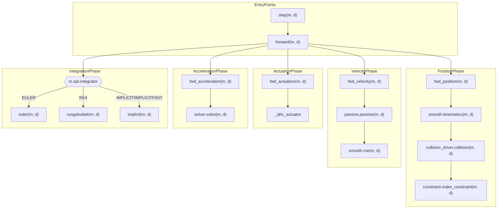

<!-- source: DeepWiki mcp.deepwiki.com · repo google-deepmind/mujoco_warp · page 3 Physics Simulation Pipeline · fetched 2026-10-26 -->

# Physics Simulation Pipeline

Relevant source files

The following files were used as context for generating this wiki page:

- [mujoco_warp/_src/forward.py](mujoco_warp/_src/forward.py)

This page provides an overview of the complete physics simulation step and data flow through `forward(m, d)` and `step(m, d)` in MuJoCo Warp [mujoco_warp/_src/forward.py:1-2279](). The pipeline coordinates position-dependent kinematics, velocity-dependent Coriolis and passive forces, actuation processing, acceleration resolution, constraint solving, and time integration.

For deep technical details on specific sub-pipelines, refer to the child pages:
- **Forward Dynamics and Integration:** See [Forward Dynamics and Integration](#3.1) for step execution, `step1`, `step2`, integrators (Euler, RK4, implicit, discrete), and actuator dynamics.
- **Kinematics and Dynamics:** See [Kinematics and Dynamics](#3.2) for smooth kinematics, center of mass, composite rigid body inertias (`crb`), mass matrix factorization (`factor_m`, `solve_m`), Recursive Newton-Euler (`rne`), tendons, and transmission.
- **Passive Forces:** See [Passive Forces](#3.3) for springs, dampers, gravity compensation, fluid dynamics, and flex elasticity contributions to `qfrc_passive`.
- **Inverse Dynamics:** See [Inverse Dynamics](#3.4) for `qfrc_inverse`, `discrete_acc` conversion, and inverse constraint solving.
- **Flexible Bodies (Flex):** See [Flexible Bodies (Flex)](#3.5) for soft-body/flex elements, shells, strain constraints, and Stable Neo-Hookean elasticity models.

---

## Pipeline Architecture and Data Flow

The simulation pipeline follows a structured, multi-phase sequence implemented in `mujoco_warp/_src/forward.py`. Each phase computes specific physical quantities required by downstream routines.

### Simulation Orchestration Diagram

The following diagram bridges natural language simulation phases to code entities within `mujoco_warp/_src/forward.py`.

**Sources:** [mujoco_warp/_src/forward.py:1-2279]()

---

## Sub-Pipeline Overview

### 3.1 Forward Dynamics and Integration
The forward dynamics pipeline governs how forces and constraints are translated into state derivatives and how time integration advances `qpos`, `qvel`, and `act`. Supported integrators include semi-implicit Euler, 4th-order Runge-Kutta, implicit velocity integration, and the modern discrete variational integrator.

For details, see [Forward Dynamics and Integration](#3.1).

**Sources:** [mujoco_warp/_src/forward.py:1-2279]()

### 3.2 Kinematics and Dynamics
Smooth dynamics computations propagate motion through the kinematic tree. This includes calculating body positions/orientations (`kinematics`), center-of-mass positions (`com_pos`), composite rigid body inertias (`crb`), mass matrix factorization and solves (`factor_m`, `solve_m`), and Recursive Newton-Euler inverse dynamics (`rne`).

For details, see [Kinematics and Dynamics](#3.2).

**Sources:** [mujoco_warp/_src/forward.py:1-2279]()

### 3.3 Passive Forces
Passive forces evaluate internal mechanical effects independent of active user controls, including joint springs, dampers, gravity compensation terms, fluid damping, and flex elasticity contributions accumulated into `qfrc_passive`.

For details, see [Passive Forces](#3.3).

**Sources:** [mujoco_warp/_src/forward.py:1-2279]()

### 3.4 Inverse Dynamics
Inverse dynamics computes required joint forces corresponding to prescribed accelerations or trajectories. It handles `discrete_acc` conversion, inverse constraint solving (`inv_constraint`), and `qfrc_inverse` evaluations.

For details, see [Inverse Dynamics](#3.4).

**Sources:** [mujoco_warp/_src/forward.py:1-2279]()

### 3.5 Flexible Bodies (Flex)
Flexible body support handles volumetric soft bodies, shells, strain constraints, flex collisions, and advanced elasticity models such as Stable Neo-Hookean (SNH).

For details, see [Flexible Bodies (Flex)](#3.5).

**Sources:** [mujoco_warp/_src/forward.py:1-2279]()

---

