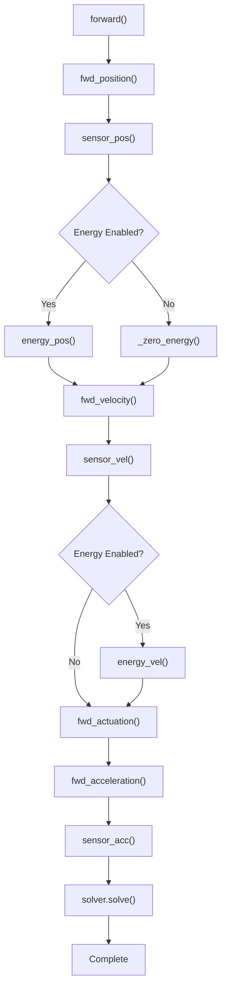
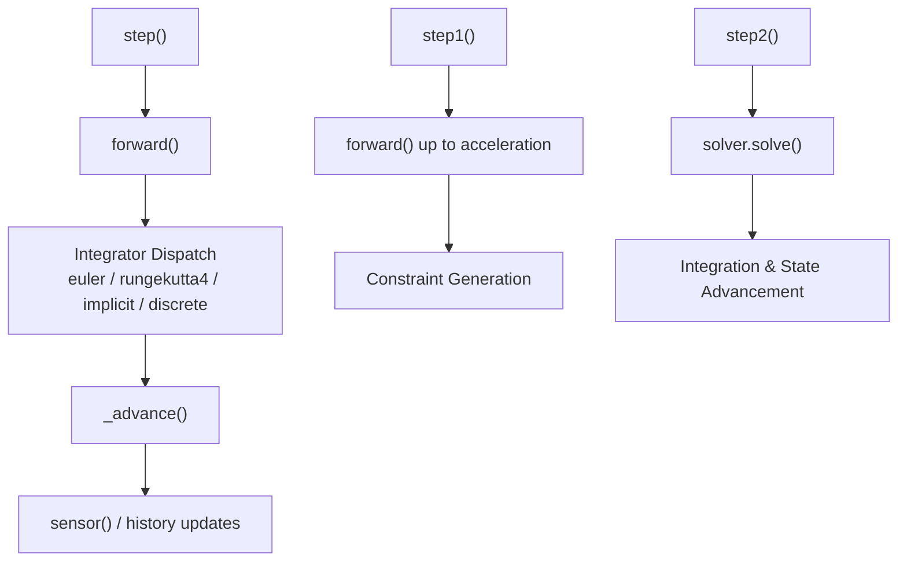
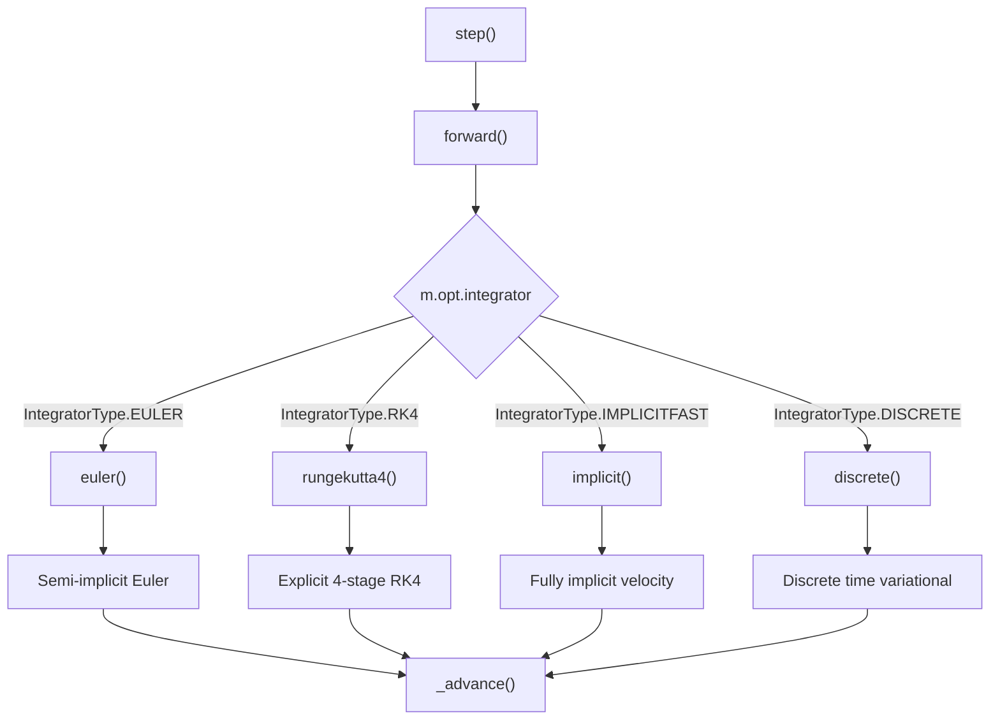
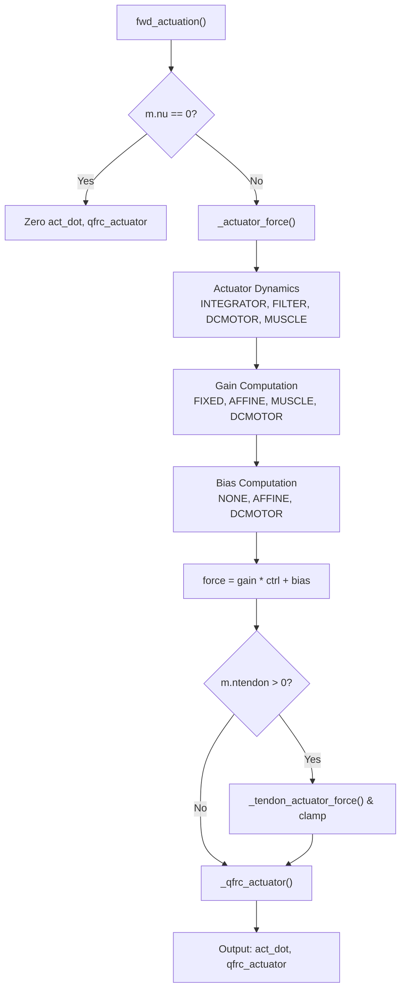

<!-- source: DeepWiki mcp.deepwiki.com · repo google-deepmind/mujoco_warp · page 3.1 Forward Dynamics and Integration · fetched 2026-10-26 -->

# Forward Dynamics and Integration

Relevant source files

The following files were used as context for generating this wiki page:

- [mujoco_warp/_src/derivative.py](mujoco_warp/_src/derivative.py)
- [mujoco_warp/_src/derivative_test.py](mujoco_warp/_src/derivative_test.py)
- [mujoco_warp/_src/forward.py](mujoco_warp/_src/forward.py)
- [mujoco_warp/_src/forward_test.py](mujoco_warp/_src/forward_test.py)

This page covers the forward dynamics computation system and integration pipeline in MuJoCo Warp (`mujoco_warp/_src/forward.py` [mujoco_warp/_src/forward.py:1-2279]()). Forward dynamics computes system accelerations from the current state and applied forces, while the integration step advances positions, velocities, and activations over a simulation timestep (`dt`).

---

## 1. Forward Dynamics Pipeline

The forward dynamics orchestration is centered around the `forward()` function [mujoco_warp/_src/forward.py:992-1021](), which executes a sequence of sub-pipelines to compute kinematic transforms, velocities, actuator forces, passive forces, and unconstrained accelerations.

### Forward Dynamics Flow Diagram

**Sources:** [mujoco_warp/_src/forward.py:992-1021]()

---

## 2. Simulation Step and Two-Phase Execution (`step`, `step1`, `step2`)

The high-level simulation step is executed via `step()`, which can be split into two partial phases via `step1()` and `step2()` to allow external interventions or custom control loops between position/velocity advancement and constraint solving.

- **`step(m, Model, d: Data)`**: Executes a full simulation timestep by calling `forward()` followed by integration and state advancement [mujoco_warp/_src/forward.py:1024-1035]().
- **`step1(m, Model, d: Data)`**: Computes forward dynamics up to unconstrained acceleration and prepares the solver context.
- **`step2(m, Model, d: Data)`**: Solves constraints and performs state integration based on precomputed accelerations.

### Step Pipeline Architecture

**Sources:** [mujoco_warp/_src/forward.py:1024-1035]()

---

## 3. Integration Methods

MuJoCo Warp supports four primary integration schemes selected by `m.opt.integrator`: **Euler**, **RK4**, **Implicit**, and **Discrete**.

### Integration Flow and Method Dispatch

### Integrator Characteristics

| Method | Function | Key Characteristics |
|--------|----------|---------------------|
| Euler | `euler()` | Semi-implicit Euler; optional damping integration via `_euler_sparse` [mujoco_warp/_src/forward.py:335-361]() or `_tile_euler_dense` [mujoco_warp/_src/forward.py:364-399](). |
| RK4 | `rungekutta4()` | Explicit 4th-order Runge-Kutta; executes four evaluations using `_rk_accumulate` and `_rk_perturb_state` [mujoco_warp/_src/forward.py:424-497](). |
| Implicit | `implicit()` | Fully implicit velocity integration using `derivative.deriv_smooth_vel()` and `solver.solve()` [mujoco_warp/_src/forward.py:531-546](). |
| Discrete | `discrete()` | Discrete-time variational integrator required for stable Neo-Hookean elasticity and advanced passive flex models [mujoco_warp/_src/forward.py:56-82](). |

### Model Validation for Discrete Integrator (`check_discrete`)
The `check_discrete(m: Model)` function validates model flags and configurations when `IntegratorType.DISCRETE` is active [mujoco_warp/_src/forward.py:56-82]():
- Stable Neo-Hookean elasticity (`m.has_flex_snh`) and passive flex contact require `integrator='discrete'` [mujoco_warp/_src/forward.py:59-62]().
- General flex attachments are incompatible with the Newton solver, requiring `solver='CG'` [mujoco_warp/_src/forward.py:71-76]().
- Sleep flags combined with discrete integration enforce specific island and assembly constraints [mujoco_warp/_src/forward.py:77-82]().

**Sources:** [mujoco_warp/_src/forward.py:56-82](), [mujoco_warp/_src/forward.py:335-546](), [mujoco_warp/_src/derivative.py:1-45]()

---

## 4. Actuator Dynamics and Integration Pipeline

Actuator forces are computed in `fwd_actuation()` by mapping controls (`ctrl`) and activations (`act`) through dynamics, gain, and bias functions [mujoco_warp/_src/forward.py:648-765]().

### Actuator Computation Data Flow

### Actuator Dynamics Types
- **`DynType.INTEGRATOR`**: `act_dot = ctrl` [mujoco_warp/_src/forward.py:648-765]()
- **`DynType.FILTER`**: First-order lag dynamics `act_dot = (ctrl - act) / tau` [mujoco_warp/_src/forward.py:648-765]()
- **`DynType.DCMOTOR`**: Coupled electrical and mechanical state dynamics including winding resistance and back-EMF [mujoco_warp/_src/forward.py:100-151]().
- **`DynType.MUSCLE`**: Hill-type activation dynamics [mujoco_warp/_src/forward.py:648-765]().

Activations and kinematic states are advanced in kernels such as `_next_activation()`, `_next_velocity()`, and `_next_position()` [mujoco_warp/_src/forward.py:51-203](), properly handling joint-specific representations like free-joint quaternions (`math.quat_integrate()`) and hinge/slide linear updates.

**Sources:** [mujoco_warp/_src/forward.py:51-203](), [mujoco_warp/_src/forward.py:648-765]()

---

