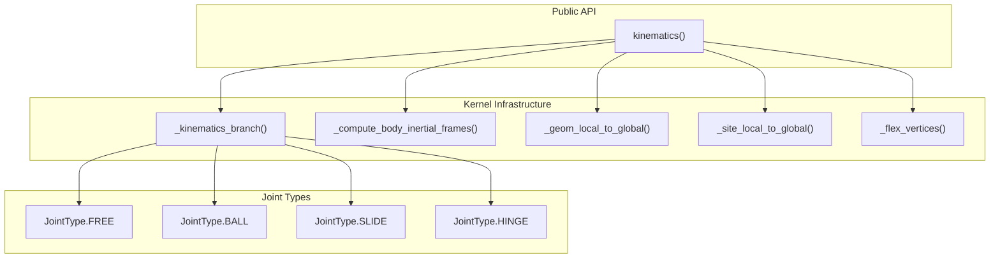
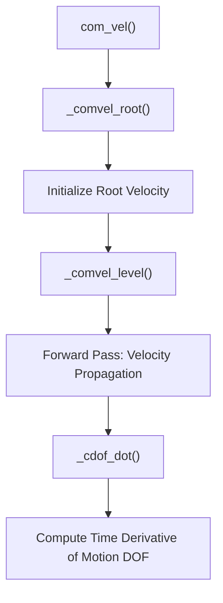
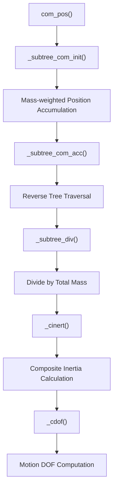
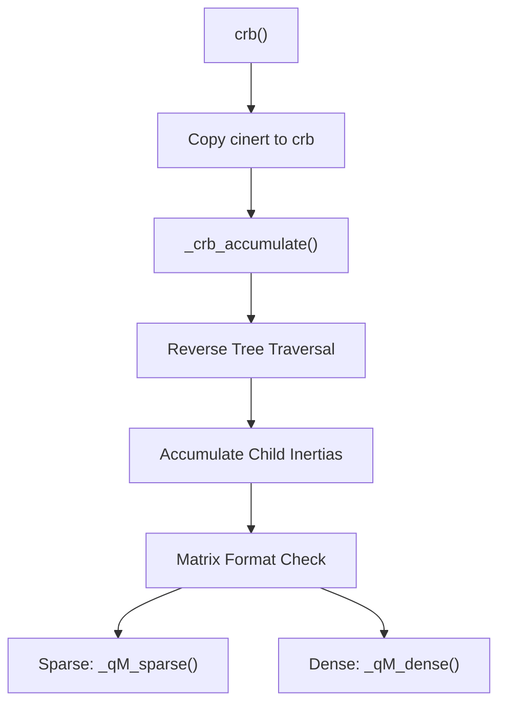
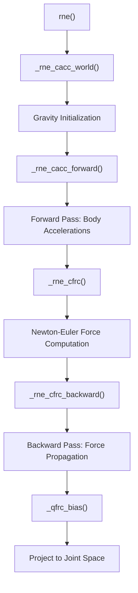

<!-- source: DeepWiki mcp.deepwiki.com · repo google-deepmind/mujoco_warp · page 3.2 Kinematics and Dynamics · fetched 2026-10-26 -->

# Kinematics and Dynamics

Relevant source files

The following files were used as context for generating this wiki page:

- [mujoco_warp/_src/block_cholesky.py](mujoco_warp/_src/block_cholesky.py)
- [mujoco_warp/_src/smooth.py](mujoco_warp/_src/smooth.py)
- [mujoco_warp/_src/smooth_test.py](mujoco_warp/_src/smooth_test.py)
- [mujoco_warp/_src/support.py](mujoco_warp/_src/support.py)
- [mujoco_warp/_src/support_test.py](mujoco_warp/_src/support_test.py)

This document covers the core smooth dynamics computations in MuJoCo Warp (`mujoco_warp`), including forward kinematics, velocity kinematics, center of mass calculations, the Composite Rigid Body (CRB) algorithm, matrix factorization and solvers (`factor_m`, `solve_m`), the Recursive Newton-Euler (RNE) algorithm for inverse dynamics, and passive force systems. These components transform joint-level states into global body poses, velocities, and inertial forces required for physics simulation.

For constraint generation and solving, see [Constraint System](#4). For forward dynamics integration, see [Forward Dynamics and Integration](#3.1).

---

## Forward Kinematics System

The forward kinematics pipeline computes global positions, orientations, inertial frames, geoms, sites, and flexible elements based on joint positions (`qpos`). Computations are parallelized across kinematic tree branches on the GPU.

### Diagram: Forward Kinematics Code Entities

Sources: [mujoco_warp/_src/smooth.py:44-195]()

### Component Summary

| Component | Kernel Function | Purpose |
|-----------|----------------|---------|
| Body Hierarchy | `_kinematics_branch` | Computes poses level-by-level through kinematic tree branches [mujoco_warp/_src/smooth.py:44-148]() |
| Inertial Frames | `_compute_body_inertial_frames` | Computes center-of-mass positions (`xipos`) and orientations (`ximat`) [mujoco_warp/_src/smooth.py:150-166]() |
| Geometry | `_geom_local_to_global` | Transforms geom poses to global coordinates [mujoco_warp/_src/smooth.py:180-195]() |

Sources: [mujoco_warp/_src/smooth.py:44-195]()

### Joint Type Processing

The `_kinematics_branch` kernel dispatches execution based on the joint type defined in the model:

| Joint Type | DOF | Computation Logic |
|------------|-----|-------------------|
| `FREE` | 7 | Directly maps 3 translation and 4 quaternion components from `qpos` [mujoco_warp/_src/smooth.py:88-98]() |
| `BALL` | 3 | Normalizes the `qpos` local quaternion and multiplies with parent rotation [mujoco_warp/_src/smooth.py:125-130]() |
| `SLIDE` | 1 | Translates body along `xaxis` based on `qpos` displacement [mujoco_warp/_src/smooth.py:131-132]() |
| `HINGE` | 1 | Rotates body around `xaxis` using axis-angle to quaternion conversion [mujoco_warp/_src/smooth.py:133-138]() |

Sources: [mujoco_warp/_src/smooth.py:86-143]()

---

## Velocity Kinematics

Velocity kinematics propagates spatial velocities (`cvel`) through the kinematic tree and computes time derivatives of motion degrees of freedom (`cdof_dot`).

### Velocity Computation Flow

Sources: [mujoco_warp/_src/smooth.py:1660-1751]()

The `com_vel` function handles spatial velocity propagation, providing essential kinematic velocities required for Coriolis and centrifugal acceleration calculations in RNE.

Sources: [mujoco_warp/_src/smooth.py:1660-1751]()

---

## Center of Mass and Inertia Computation

The center of mass system aggregates subtree masses and positions to determine composite inertia tensors and motion degrees of freedom.

### COM Computation Pipeline

Sources: [mujoco_warp/_src/smooth.py:343-507]()

| Stage | Function | Operation |
|-------|----------|-----------|
| Initialize | `_subtree_com_init` | Multiplies body positions by mass [mujoco_warp/_src/smooth.py:343-356]() |
| Accumulate | `_subtree_com_acc` | Sums mass-weighted positions up tree using `body_parentid` [mujoco_warp/_src/smooth.py:359-373]() |
| Normalize | `_subtree_div` | Divides by subtree mass to compute `subtree_com` [mujoco_warp/_src/smooth.py:376-389]() |
| Inertia | `_cinert` | Computes composite inertias (`cinert`) in COM frame [mujoco_warp/_src/smooth.py:392-421]() |
| Motion | `_cdof` | Computes motion degrees of freedom (`cdof`) [mujoco_warp/_src/smooth.py:424-473]() |

Sources: [mujoco_warp/_src/smooth.py:343-507]()

---

## Composite Rigid Body Algorithm (`crb`)

The `crb` function implements the Composite Rigid Body Algorithm to construct the joint-space inertia matrix $M$ (`qM`).

Sources: [mujoco_warp/_src/smooth.py:686-797]()

The system supports sparse CSR layout (`_qM_sparse`) and dense active-DOF layouts (`_qM_dense`) depending on model configuration and flags.

Sources: [mujoco_warp/_src/smooth.py:686-797]()

---

## Matrix Factorization and Linear Solves (`factor_m` and `solve_m`)

To solve equations of motion of the form $M \ddot{q} = \tau$, the inertia matrix must be factorized and solved.

*   **Factorization (`factor_m`)**: Performs LDLT factorization optimized for kinematic trees (`_qLD_acc`) or block Cholesky factorization for dense structures (`block_cholesky.py`) [mujoco_warp/_src/smooth.py:868-951]().
*   **Linear Solve (`solve_m`)**: Applies forward and backward substitution using the precomputed factorization factors to compute accelerations or inverse updates efficiently [mujoco_warp/_src/smooth.py:1118-1162]().

Sources: [mujoco_warp/_src/smooth.py:868-964](), [mujoco_warp/_src/block_cholesky.py:45-116]()

---

## Recursive Newton-Euler Algorithm (`rne`)

The RNE algorithm computes inverse dynamics and bias forces (`qfrc_bias`), accounting for Coriolis, centrifugal, and gravitational forces.

### RNE Computation Flow

Sources: [mujoco_warp/_src/smooth.py:976-1115]()

1.  **Forward Pass**: Computes spatial accelerations (`cacc`) starting from world gravity [mujoco_warp/_src/smooth.py:976-1011]().
2.  **Force Computation**: Calculates spatial forces (`cfrc`) required for body motions [mujoco_warp/_src/smooth.py:1014-1033]().
3.  **Backward Pass**: Accumulates forces from children to parents up the kinematic tree [mujoco_warp/_src/smooth.py:1036-1055]().
4.  **Projection**: Projects spatial forces onto joint axes to produce `qfrc_bias` [mujoco_warp/_src/smooth.py:1058-1095]().

Sources: [mujoco_warp/_src/smooth.py:976-1115]()

---

## Passive Forces, Tendons, and Transmissions

Passive forces combine spring, damper, gravity compensation, and fluid dynamics contributions into `qfrc_passive`.

| Force Type | Kernel Function | Description |
|------------|----------------|-------------|
| Joint Spring/Damper | `_spring_damper_dof_passive` | Linear and angular springs/dampers at joint levels [mujoco_warp/_src/support.py:28-66]() |
| Tendon Forces | Tendon pass logic | Forces arising from tendon elasticity and transmission paths |
| Flex Elasticity | `_flex_elasticity` | Internal strain and elastic forces for flexible bodies [mujoco_warp/_src/support.py:102-152]() |

Sources: [mujoco_warp/_src/support.py:28-152]()

---

