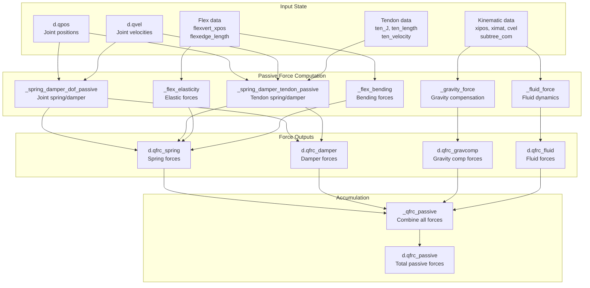
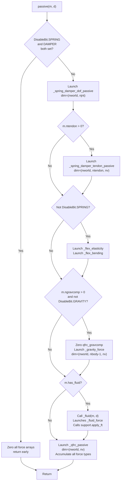
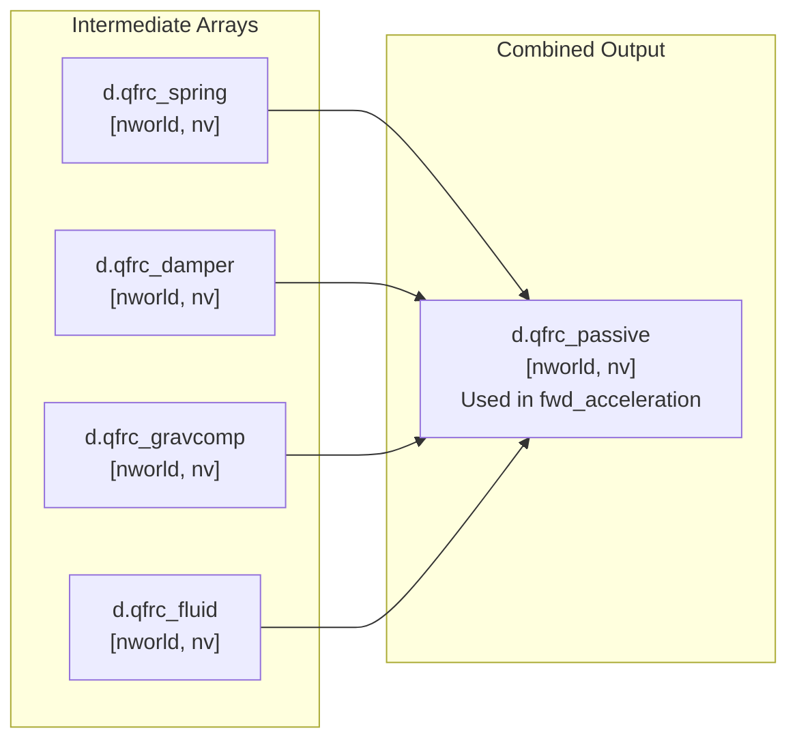

<!-- source: DeepWiki mcp.deepwiki.com · repo google-deepmind/mujoco_warp · page 3.3 Passive Forces · fetched 2026-10-26 -->

# Passive Forces

<details>
<summary>Relevant source files</summary>

The following files were used as context for generating this wiki page:

- [mujoco_warp/_src/passive.py](mujoco_warp/_src/passive.py)
- [mujoco_warp/_src/passive_test.py](mujoco_warp/_src/passive_test.py)

</details>


## Purpose and Scope

This page documents the passive force computation system in MuJoCo Warp (`mujoco_warp/_src/passive.py`). Passive forces are velocity-dependent and position-dependent forces that do not require external control, including springs, dampers, gravity compensation, fluid dynamics, and flexible body elasticity. These forces contribute to `qfrc_passive` in the generalized force vector during the velocity-level phase of forward dynamics.

For information about how passive forces integrate into the overall simulation pipeline, see [Physics Simulation Pipeline](). For constraint forces and contact response, see [Constraint System](). For actuator-generated forces, see [Forward Dynamics and Integration]().

Sources: [mujoco_warp/_src/passive.py:1-28]()

---

## Overview

The passive force system computes five types of forces that act on the system without external control:

1. **Spring forces** - restoring forces from joint and tendon stiffness.
2. **Damper forces** - velocity-dependent dissipation.
3. **Gravity compensation** - partial or full negation of gravitational effects.
4. **Fluid forces** - drag and lift from interaction with surrounding fluid medium.
5. **Flex forces** - elasticity and bending in deformable elements.

All passive forces are computed by the `passive(m: Model, d: Data)` function, which orchestrates multiple GPU kernels to populate the force arrays. The function respects disable flags from `m.opt.disableflags` to allow selective activation of force types.

Sources: [mujoco_warp/_src/passive.py:711-848]()

---

## Passive Force Types and Data Flow



**Diagram: Passive Force Computation Pipeline**

Sources: [mujoco_warp/_src/passive.py:711-848]()

---

## Spring and Damper Forces

### DOF Spring and Damper

The `_spring_damper_dof_passive` kernel computes spring and damper forces for degrees of freedom (DOF). Springs apply restoring forces proportional to displacement from a reference position (`qpos_spring`), while dampers apply forces proportional to velocity.

**Force equations:**
- Spring: `F_spring = -stiffness * (qpos - qpos_spring)`
- Damper: `F_damper = -damping * qvel`

The kernel handles three joint types with different kinematics:

| Joint Type | Position DOF | Special Handling |
|------------|-------------|------------------|
| `JointType.FREE` | 7 (3 translation + 4 quaternion) | 6 velocity DOF, quaternion subtraction for rotation |
| `JointType.BALL` | 4 (quaternion) | 3 velocity DOF, quaternion subtraction |
| `JointType.SLIDE`, `JointType.HINGE` | 1 | Direct scalar subtraction |

For free and ball joints, rotational springs use `math.quat_sub(rot, ref)` to compute the minimal rotation difference, producing a 3D torque vector [mujoco_warp/_src/passive.py:153-159]().

Sources: [mujoco_warp/_src/passive.py:70-206]()

### Tendon Spring and Damper

The `_spring_damper_tendon_passive` kernel computes spring and damper forces for tendons, which are virtual cables that span multiple joints. Tendon springs activate only when the tendon length exceeds the specified range `[lengthspring[0], lengthspring[1]]`.

The tendon force is transformed to joint torques using the tendon Jacobian: `qfrc += J * frc_tendon`. This uses atomic adds since multiple tendons can affect the same DOF [mujoco_warp/_src/passive.py:228-232]().

Sources: [mujoco_warp/_src/passive.py:208-235]()

---

## Gravity Compensation

The `_gravity_force` kernel computes partial or full negation of gravitational forces for bodies with `body_gravcomp > 0`. This allows certain bodies to behave as if they experience reduced gravity.

The force is applied at the body center of mass (`xipos`) and transformed to joint torques using the geometric Jacobian. The kernel launches with dimensions `(nworld, nbody-1, nv)` to compute the contribution of each body's gravity compensation to each DOF [mujoco_warp/_src/passive.py:237-264]().

**Special handling:** If a joint has `actuatorgravcomp=true` (stored in `jnt_actgravcomp`), the gravity compensation force is applied by actuators instead of passive forces, preventing double-counting [mujoco_warp/_src/passive.py:808-827]().

Sources: [mujoco_warp/_src/passive.py:237-264](), [mujoco_warp/_src/passive.py:808-827]()

---

## Fluid Dynamics

### Fluid Force Models

The fluid force system supports two models:
1. **Inertia-box model** - default, computes drag based on equivalent box dimensions derived from body inertia [mujoco_warp/_src/passive.py:446-458]().
2. **Ellipsoid model** - geometry-specific, computes drag for each geom as an ellipsoid with detailed aerodynamics [mujoco_warp/_src/passive.py:319-330]().

The model is selected per-body using the `body_fluid_ellipsoid` flag.

### Inertia-Box Model

For bodies using the inertia-box model, equivalent box dimensions are computed from the inertia tensor [mujoco_warp/_src/passive.py:446-458]():

```python
scl = 6.0 / mass
box[0] = sqrt((I_y + I_z - I_x) * scl)
box[1] = sqrt((I_x + I_z - I_y) * scl)
box[2] = sqrt((I_x + I_y - I_z) * scl)
```

Forces include viscous drag (linear/angular) and pressure drag (linear/angular) [mujoco_warp/_src/passive.py:461-491]().

Sources: [mujoco_warp/_src/passive.py:446-491]()

### Ellipsoid Model

For bodies with `body_fluid_ellipsoid=true`, the kernel iterates over all geoms attached to the body and computes detailed aerodynamic forces using ellipsoid models [mujoco_warp/_src/passive.py:319-330]().

Forces computed per geom:
- Added mass forces
- Magnus force
- Kutta force
- Viscous drag
- Pressure drag

Sources: [mujoco_warp/_src/passive.py:319-443](), [mujoco_warp/_src/passive.py:42-68]()

---

## Flexible Body Forces

### Flex Elasticity

The `_flex_elasticity` kernel computes elastic forces for deformable elements (tetrahedra or triangles). Each element's elastic energy depends on edge elongation and stiffness [mujoco_warp/_src/passive.py:557-645](). Forces are accumulated to vertex DOFs using atomic adds.

Sources: [mujoco_warp/_src/passive.py:557-645]()

### Flex Bending

The `_flex_bending` kernel computes bending forces for 2D flexible elements (shells). Bending resists changes in the dihedral angle between adjacent triangles sharing an edge [mujoco_warp/_src/passive.py:647-709]().

Sources: [mujoco_warp/_src/passive.py:647-709]()

---

## Main Function: `passive`



**Diagram: Control Flow in `passive` Function**

Sources: [mujoco_warp/_src/passive.py:711-848]()

---

## Kernel Dimensions and Parallelization

| Kernel | Launch Dimensions | Parallelization Strategy |
|--------|------------------|-------------------------|
| `_spring_damper_dof_passive` | `(nworld, njnt)` | One thread per world-joint pair [mujoco_warp/_src/passive.py:90]() |
| `_spring_damper_tendon_passive` | `(nworld, ntendon, nv)` | One thread per world-tendon-DOF triple [mujoco_warp/_src/passive.py:218]() |
| `_gravity_force` | `(nworld, nbody-1, nv)` | One thread per world-body-DOF triple [mujoco_warp/_src/passive.py:246]() |
| `_fluid_force` | `(nworld, nbody)` | One thread per world-body pair [mujoco_warp/_src/passive.py:277]() |
| `_flex_elasticity` | `(nworld, nflexelem)` | One thread per world-element pair [mujoco_warp/_src/passive.py:570]() |
| `_flex_bending` | `(nworld, nflexedge)` | One thread per world-edge pair [mujoco_warp/_src/passive.py:657]() |
| `_qfrc_passive` | `(nworld, nv)` | One thread per world-DOF pair [mujoco_warp/_src/passive.py:537]() |

Sources: [mujoco_warp/_src/passive.py:725-848]()

---

## Output Force Arrays



**Diagram: Force Array Data Structure**

Sources: [mujoco_warp/_src/passive.py:527-554]()

---

## Testing and Validation

The `passive_test.py` file validates passive force computations against the MuJoCo reference implementation with tolerance `_TOLERANCE = 5e-5` [mujoco_warp/_src/passive_test.py:30](). Key test cases include per-DOF damping, fluid models (box and ellipsoid), and gravity compensation [mujoco_warp/_src/passive_test.py:41-211]().

Sources: [mujoco_warp/_src/passive_test.py:1-211]()

---

