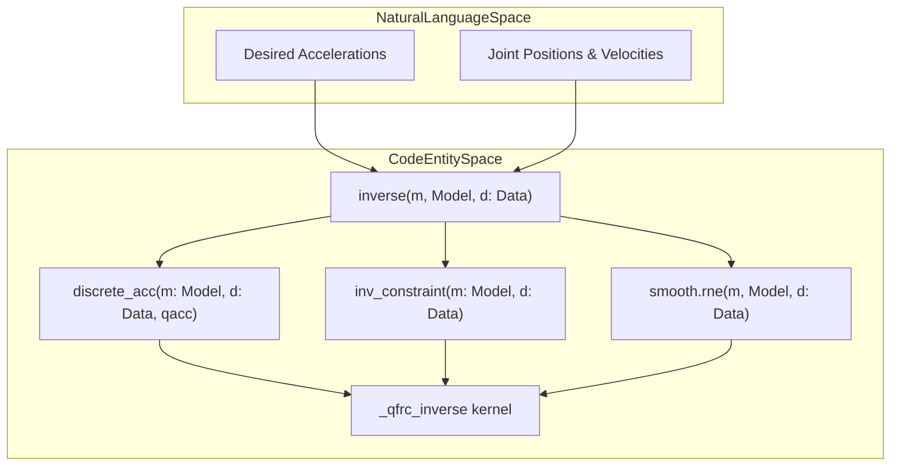
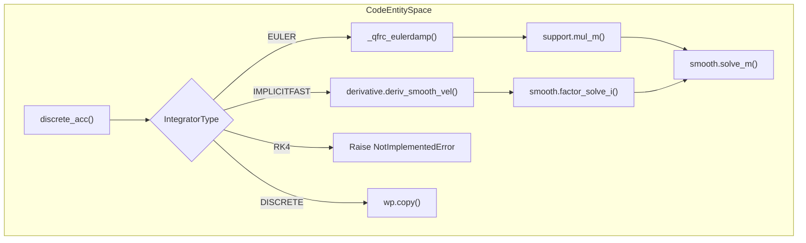
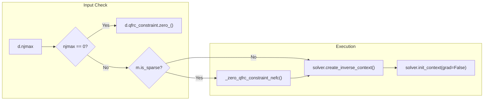

<!-- source: DeepWiki mcp.deepwiki.com · repo google-deepmind/mujoco_warp · page 3.4 Inverse Dynamics · fetched 2026-10-26 -->

# Inverse Dynamics

Relevant source files

The following files were used as context for generating this wiki page:

- [mujoco_warp/_src/inverse.py](mujoco_warp/_src/inverse.py)
- [mujoco_warp/_src/inverse_test.py](mujoco_warp/_src/inverse_test.py)

## Purpose and Scope

The inverse dynamics system computes the forces required to achieve desired accelerations in a mechanical system. Given joint accelerations (`qacc`), the system calculates the corresponding joint forces (`qfrc_inverse`) needed to produce those accelerations, accounting for constraints, actuators, passive forces, and inertial effects.

This system is complementary to forward dynamics (see [Forward Dynamics](3.1)) which computes accelerations from given forces. For information about constraint handling, see [Constraint System](4). For kinematics and dynamics fundamentals, see [Kinematics and Dynamics](3.2).

Sources: [mujoco_warp/_src/inverse.py:178-213]()

## System Overview

The inverse dynamics system is implemented in `mujoco_warp/_src/inverse.py` [mujoco_warp/_src/inverse.py:1-213]() and orchestrates several interconnected components to solve the inverse problem:

**Inverse Dynamics Architecture & Code Entities**

Sources: [mujoco_warp/_src/inverse.py:80-125](), [mujoco_warp/_src/inverse.py:159-176](), [mujoco_warp/_src/inverse.py:178-213]()

## Core Inverse Dynamics Pipeline

The main inverse dynamics computation is implemented in `inverse()` [mujoco_warp/_src/inverse.py:178-213]() and follows this sequence:

**Inverse Pipeline Execution**

```mermaid
graph LR
    subgraph "Position & Velocity Phase"
        A["forward.fwd_position()"] --> B["sensor.sensor_pos()"]
        B --> C["forward.fwd_velocity()"] 
        C --> D["sensor.sensor_vel()"]
    end
    
    subgraph "Acceleration Processing"
        D --> E["inverse.discrete_acc()"]
        E --> F["inverse.inv_constraint()"]
        F --> G["smooth.rne()"]
        G --> H["smooth.tendon_bias()"]
    end
    
    subgraph "Force Computation"
        H --> I["support.mul_m()"]
        I --> J["_qfrc_inverse kernel"]
        J --> K["sensor.sensor_acc()"]
    end
```

The standard inverse dynamics equation solved in `_qfrc_inverse` is:
`qfrc_inverse = qfrc_bias + M*qacc - qfrc_passive - qfrc_constraint` [mujoco_warp/_src/inverse.py:72-75]()

For discrete integrators with `EnableBit.INVDISCRETE`, `_qfrc_inverse_discrete` also subtracts `efm_c` and `efm_ca` terms [mujoco_warp/_src/inverse.py:144-145]().

Sources: [mujoco_warp/_src/inverse.py:60-78](), [mujoco_warp/_src/inverse.py:128-150](), [mujoco_warp/_src/inverse.py:178-213]()

## Discrete-Time Acceleration Handling

The system supports both continuous and discrete-time formulations through the `discrete_acc()` function [mujoco_warp/_src/inverse.py:80-125](). This is critical when `EnableBit.INVDISCRETE` or `IntegratorType.DISCRETE` is active, allowing the system to handle finite-differenced accelerations correctly according to the selected integrator.

| Integrator Type | Behavior |
|-----------------|----------|
| `EULER` | Adjusts for damping: `qfrc = (M + dt * diag(damp_deriv)) * qacc` via `_qfrc_eulerdamp` [mujoco_warp/_src/inverse.py:37-57]() |
| `IMPLICITFAST` | Uses `derivative.deriv_smooth_vel` to compute `qDeriv` and performs `smooth.factor_solve_i` [mujoco_warp/_src/inverse.py:111-115]() |
| `RK4` | Not supported (raises `NotImplementedError`) [mujoco_warp/_src/inverse.py:90-91]() |
| `DISCRETE` | Copies `qacc` directly (implied discrete step map) [mujoco_warp/_src/inverse.py:116-119]() |

**Discrete Acceleration Flow and Code Entities**

Sources: [mujoco_warp/_src/inverse.py:36-125]()

## Constraint Inverse Solving

The `inv_constraint()` function [mujoco_warp/_src/inverse.py:159-176]() handles constraint forces in inverse dynamics. If `d.njmax == 0`, constraint forces are zeroed out [mujoco_warp/_src/inverse.py:162-164](). If sparse layouts are used and `nefc == 0`, `_zero_qfrc_constraint_nefc` clears constraint forces [mujoco_warp/_src/inverse.py:153-157](). Otherwise, it creates an inverse solver context via `solver.create_inverse_context()` and initializes it with `grad=False` [mujoco_warp/_src/inverse.py:174-175]().

**Constraint Solver Branching**

Sources: [mujoco_warp/_src/inverse.py:153-176]()

## Key Warp Kernels and Functions

| Function / Kernel | Description | Location |
|-------------------|-------------|----------|
| `inverse` | Main entry point for inverse dynamics calculation. | [mujoco_warp/_src/inverse.py:178-213]() |
| `discrete_acc` | Converts discrete-time accelerations to continuous equivalents. | [mujoco_warp/_src/inverse.py:80-125]() |
| `inv_constraint` | Solves constraint forces during inverse dynamics. | [mujoco_warp/_src/inverse.py:159-176]() |
| `_qfrc_inverse` | Kernel summing bias, inertia, passive, and constraint forces. | [mujoco_warp/_src/inverse.py:60-78]() |
| `_qfrc_eulerdamp` | Kernel calculating damping-adjusted forces for Euler integrator. | [mujoco_warp/_src/inverse.py:36-57]() |
| `_qfrc_inverse_discrete` | Kernel handling discrete inverse dynamics forces including `efm_c` and `efm_ca`. | [mujoco_warp/_src/inverse.py:128-150]() |
| `_zero_qfrc_constraint_nefc` | Zeroes out constraint forces when sparse and `nefc == 0`. | [mujoco_warp/_src/inverse.py:153-157]() |

Sources: [mujoco_warp/_src/inverse.py:36-213]()

## Configuration and Flags

The inverse dynamics pipeline relies on model configurations and capability flags:
* **`EnableBit.INVDISCRETE`**: Triggers finite-difference acceleration conversion via `discrete_acc()` [mujoco_warp/_src/inverse.py:187-191]().
* **`DisableBit.EULERDAMP`**: Bypasses Euler damping computations in `discrete_acc()` [mujoco_warp/_src/inverse.py:93-95]().
* **`IntegratorType`**: Determines how `discrete_acc` handles time discretization (supports `EULER`, `IMPLICITFAST`, `DISCRETE`; rejects `RK4`) [mujoco_warp/_src/inverse.py:90-121]().

Sources: [mujoco_warp/_src/inverse.py:90-121](), [mujoco_warp/_src/inverse.py:187-191]()

---

