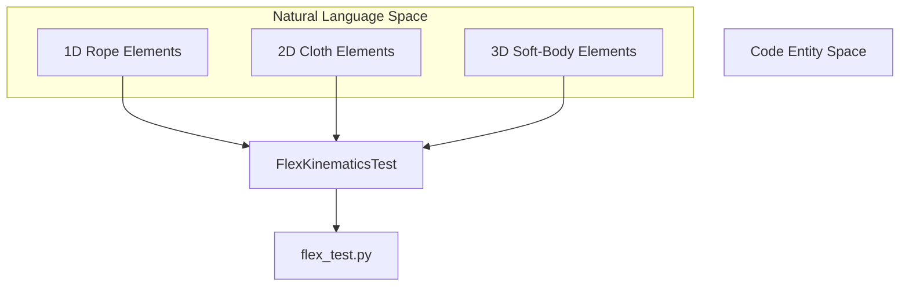
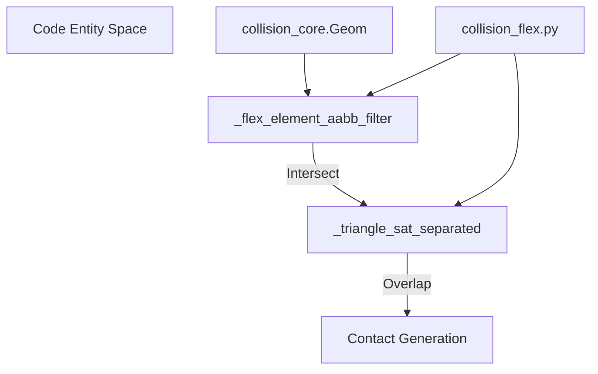

<!-- source: DeepWiki mcp.deepwiki.com · repo google-deepmind/mujoco_warp · page 3.5 Flexible Bodies (Flex) · fetched 2026-10-26 -->

# Flexible Bodies (Flex)

Relevant source files

The following files were used as context for generating this wiki page:

- [mujoco_warp/_src/collision_flex.py](mujoco_warp/_src/collision_flex.py)
- [mujoco_warp/_src/flex_test.py](mujoco_warp/_src/flex_test.py)
- [mujoco_warp/test_data/flex/floppy.xml](mujoco_warp/test_data/flex/floppy.xml)
- [mujoco_warp/test_data/flex/moving_base_strain.xml](mujoco_warp/test_data/flex/moving_base_strain.xml)
- [mujoco_warp/test_data/flex/scene.xml](mujoco_warp/test_data/flex/scene.xml)

## Purpose and Scope
This section covers the soft-body and flexible body ("flex") simulation subsystem in `mujoco_warp`. The flex pipeline extends rigid-body dynamics to support deformable structures such as ropes (1D), cloth (2D), and volumetric soft bodies (3D). It encompasses element topologies, kinematic representations, elasticity models (including Stable Neo-Hookean mechanics), strain constraints, specialized collision detection algorithms between geometry primitives and flex elements, and validation test suites.

Sources: `mujoco_warp/_src/collision_flex.py:14-14]`, `mujoco_warp/_src/flex_test.py:16-17]()`

---

## Flex Elements and Topologies
Flexible bodies in `mujoco_warp` are defined via element configurations that specify element dimension (`dim`), internal degrees of freedom (`dof`), and grid layouts. Supported topologies include grid-based structures and volumetric boxes.

* **Dimensions (`dim`)**: 
  - `dim="1"`: Ropes and cables [mujoco_warp/_src/flex_test.py:136-136]().
  - `dim="2"`: Cloth and shells [mujoco_warp/_src/flex_test.py:149-149]().
  - `dim="3"`: Volumetric soft bodies [mujoco_warp/_src/flex_test.py:175-175]().
* **Degrees of Freedom (`dof`)**: Controls the generalized coordinates and kinematic mapping for the flex elements, supporting configurations such as `dof="2d"` [mujoco_warp/_src/flex_test.py:162-162](), `dof="full"` [mujoco_warp/_src/flex_test.py:175-175](), and `dof="trilinear"` [mujoco_warp/_src/flex_test.py:196-196]().

Kinematic parity with reference MuJoCo implementations is verified across these dimensionalities in the test suite [mujoco_warp/_src/flex_test.py:126-128]().

*Sources: `mujoco_warp/_src/flex_test.py:126-198()`*

---

## Elasticity Models and Strain Constraints
Flex bodies incorporate internal forces via edge properties, material elasticity parameters, and constraint formulations:

* **Elasticity & Damping**: Elements support properties such as Young's modulus (`young`), Poisson's ratio (`poisson`), and structural damping (`damping`) to model viscoelastic responses [mujoco_warp/test_data/flex/floppy.xml:34-34]().
* **Stable Neo-Hookean Models**: Volumetric deformations utilize hyperelastic energy formulations capable of handling large deformations without inversion artifacts [mujoco_warp/test_data/flex/floppy.xml:31-35]().
* **Strain Constraints**: Internal distances or deformations can be enforced via equality constraint rows, such as strain constraints configured on element edges [mujoco_warp/test_data/flex/moving_base_strain.xml:14-14]().

Sources: `mujoco_warp/test_data/flex/floppy.xml:31-35()`, `mujoco_warp/test_data/flex/moving_base_strain.xml:12-16()`

---

## Flex Collision Detection Pipeline
Collision detection between rigid geometries (`Geom`) and flex triangulation elements is implemented in `collision_flex.py`. The pipeline uses broadphase AABB checks followed by Separating Axis Theorem (SAT) tests tailored for triangles.

### Key Collision Functions
* `_flex_element_aabb_filter`: Performs axis-aligned bounding box intersection checks to quickly discard non-intersecting geom-element pairs [mujoco_warp/_src/collision_flex.py:53-67]().
* `_triangle_sat_separated`: Implements the Separating Axis Theorem for pairs of triangles (considering face normals, edge-edge cross products, in-plane edge normals, and vertex-vertex/vertex-edge configurations) to determine separation [mujoco_warp/_src/collision_flex.py:106-234]().

*Sources: `mujoco_warp/_src/collision_flex.py:53-234()`*

---

## Test Models and Validation
The reliability of the flex subsystem is enforced through benchmark XML models and parity test routines:

* **`floppy.xml`**: Defines a 3D volumetric soft body interacting under gravity with high elasticity settings and self-collision rules, serving as a test case for Stable Neo-Hookean material behavior [mujoco_warp/test_data/flex/floppy.xml:16-46]().
* **`moving_base_strain.xml`**: Tests flex bodies attached to a moving kinematic base with explicit strain constraints under CG solvers [mujoco_warp/test_data/flex/moving_base_strain.xml:1-19]().

Sources: `mujoco_warp/test_data/flex/floppy.xml:16-46()`, `mujoco_warp/test_data/flex/moving_base_strain.xml:1-19()`

---

