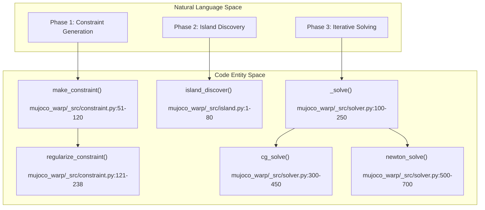
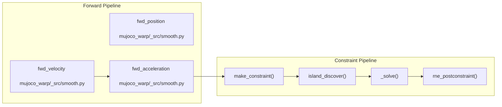

<!-- source: DeepWiki mcp.deepwiki.com · repo google-deepmind/mujoco_warp · page 4 Constraint System · fetched 2026-10-26 -->

# Constraint System

Relevant source files

The following files were used as context for generating this wiki page:

- [mujoco_warp/_src/constraint.py](mujoco_warp/_src/constraint.py)
- [mujoco_warp/_src/constraint_test.py](mujoco_warp/_src/constraint_test.py)
- [mujoco_warp/_src/solver.py](mujoco_warp/_src/solver.py)
- [mujoco_warp/_src/solver_test.py](mujoco_warp/_src/solver_test.py)

## Purpose and Scope

The constraint system is responsible for enforcing physical constraints in the simulation through a multi-phase pipeline: **constraint generation**, **island discovery**, and **constraint solving**. During generation, constraints from contacts, joints, tendons, user-defined equality relationships, and flexible body strains are collected into a unified data structure called the EFC (Effective Constraint). During island discovery, independent groups of degrees of freedom and constraints are identified. During solving, iterative optimization algorithms determine the constraint forces needed to satisfy these constraints while respecting friction cones, joint limits, and other bounds.

This is a parent page providing a high-level overview of the constraint pipeline. For detailed technical information, refer to the child pages:
- For generation mechanics, equality constraints, friction loss, limits, and the `_efc_row` pattern → see [Constraint Generation](#4.1)
- For iterative CG and Newton solvers, linesearch variants, and convergence criteria → see [Constraint Solver](#4.2)
- For disjoint-set union island discovery and parallel per-island solves → see [Constraint Islands](#4.3)

---

## Constraint Pipeline Overview

The constraint system executes during the acceleration-level phase of forward dynamics (`fwd_acceleration`). It takes kinematic state, velocities, and collision detection results as input, populates EFC rows, partitions the system into independent islands, and computes constraint forces that are integrated into system accelerations.

### Logic Flow: Natural Language to Code Entities

**Sources:**
- [mujoco_warp/_src/constraint.py:51-238]()
- [mujoco_warp/_src/island.py:1-80]()
- [mujoco_warp/_src/solver.py:100-700]()

---

## EFC Structure: Unified Constraint Representation

All constraints are stored in the EFC (Effective Constraint) structure (`types.Data.efc`) [mujoco_warp/_src/types.py:614-635]() with a consistent row format. Each row represents a scalar constraint equation of the form $J \cdot q_{\text{acc}} = a_{\text{ref}}$, where violations are penalized through impedance parameters.

| Field | Type | Description |
|-------|------|-------------|
| `type` | `wp.array2d[int]` | Constraint type (equality, friction, limit, contact, flex) |
| `id` | `wp.array2d[int]` | ID of source object (joint, tendon, contact, etc.) |
| `J` | `wp.array3d[float]` | Jacobian matrix (sparse or dense layout) |
| `D` | `wp.array2d[float]` | Impedance diagonal (1 / compliance) |
| `vel` | `wp.array2d[float]` | Current constraint velocity |
| `aref` | `wp.array2d[float]` | Reference acceleration driving constraint satisfaction |
| `frictionloss` | `wp.array2d[float]` | Friction loss magnitude |
| `force` | `wp.array2d[float]` | Computed constraint force (solver output) |

**Sources:**
- [mujoco_warp/_src/types.py:614-635]()
- [mujoco_warp/_src/constraint.py:113-120]()

---

## 4.1 Constraint Generation

The constraint generation phase converts physical interactions and kinematic limits into linearized constraint equations. The primary entry point is `make_constraint`, which coordinates specialized kernels for equality constraints, joint/tendon limits, friction losses, contacts, and flexible body strains.

Key aspects include the `_efc_row` computation pattern (which translates MuJoCo `solref` and `solimp` parameters into stiffness, damping, and impedance), sparse versus dense Jacobian representations, and constraint regularization via `regularize_constraint`.

For detailed mechanics, implementations of individual constraint types, and Jacobian layouts, see [Constraint Generation](#4.1).

**Sources:**
- [mujoco_warp/_src/constraint.py:51-238]()

---

## 4.2 Constraint Solver

Once EFC rows and Jacobians are populated, the constraint solver computes the constraint forces required to maintain physical validity. MuJoCo Warp supports both Conjugate Gradient (CG) and Newton iterative solver variants configured via model options.

The solver utilizes workspace buffers allocated in `SolverContext` to manage gradients, search directions, Jacobian-vector products, and linesearch evaluations. Advanced features include incremental updates, compact solves, noslip iterations, and custom termination criteria.

For detailed solver algorithms, linesearch variants, and Hessian updates, see [Constraint Solver](#4.2).

**Sources:**
- [mujoco_warp/_src/solver.py:51-186]()

---

## 4.3 Constraint Islands

To accelerate simulation across independent articulated bodies or multi-world batches, the constraint system partitions degrees of freedom and constraints into disconnected components called **islands**. Using disjoint-set union algorithms on body connectivity and contact graphs, `mujoco_warp` maps degrees of freedom (`dof`) and effective constraints (`efc`) to distinct islands.

This partitioning enables parallel per-island solves, significantly reducing computational bottlenecks in scenes with many separate objects or contacts.

For implementation details on island discovery and mapping, see [Constraint Islands](#4.3).

**Sources:**
- [mujoco_warp/_src/island.py:1-120]()

---

## Integration with Forward Dynamics

The constraint pipeline is embedded within the forward dynamics acceleration step (`fwd_acceleration`), linking smooth dynamics, collision detection, and force integration.

**Sources:**
- [mujoco_warp/_src/smooth.py:1001-1050]()
- [mujoco_warp/_src/solver.py:1218-1246]()

---

