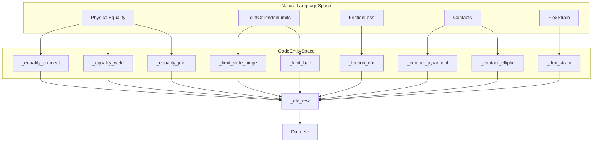
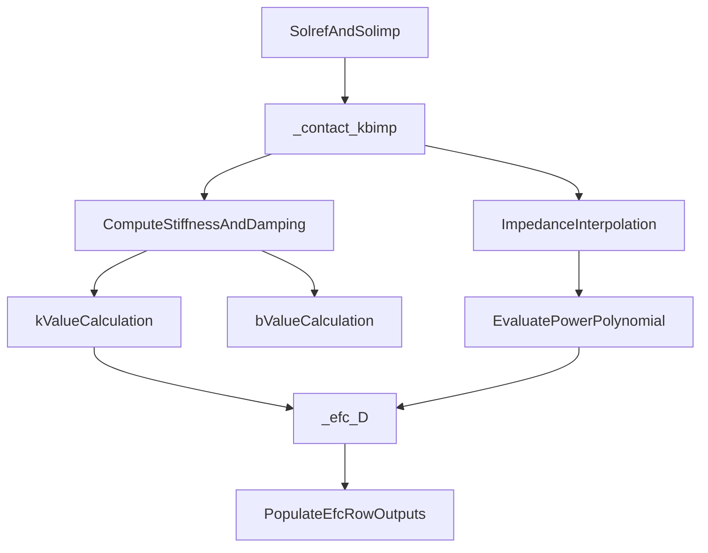

<!-- source: DeepWiki mcp.deepwiki.com · repo google-deepmind/mujoco_warp · page 4.1 Constraint Generation · fetched 2026-10-26 -->

# Constraint Generation

Relevant source files

The following files were used as context for generating this wiki page:

- [mujoco_warp/_src/constraint.py](mujoco_warp/_src/constraint.py)
- [mujoco_warp/_src/constraint_test.py](mujoco_warp/_src/constraint_test.py)
- [mujoco_warp/test_data/constraints.xml](mujoco_warp/test_data/constraints.xml)

## Purpose and Scope

The constraint generation system converts physical constraints defined in the MuJoCo model into Effective Force Constraints (EFC) that can be solved by the iterative constraint solver. This system handles equality constraints (connects, welds, joints, tendons), inequality constraints (limits, contacts), friction loss, and flex strain, transforming them into a unified mathematical representation with sparse or dense Jacobians, impedance parameters, and reference accelerations.

For information about the constraint solving process that operates on the generated EFCs, see [Constraint Solver](4.2). For collision detection that generates contact constraints, see [Collision Detection](5).

Sources: [mujoco_warp/_src/constraint.py:1-213]()

## EFC System Overview and Entrypoints

The EFC (Effective Force Constraint) system provides a unified representation for all constraint types in MuJoCo Warp. The high-level orchestration functions `make_constraint` and `regularize_constraint` coordinate the gathering of constraints across batches and worlds, populating the constraint buffers stored in the `Data` structure.

Each constraint is converted into rows of a constraint matrix containing:
- **Jacobian** (`efc_J`): Maps generalized velocities to constraint space (supporting both dense and sparse representations).
- **Impedance** (`efc_D`): Constraint compliance/stiffness characteristics computed via `_efc_D`.
- **Reference acceleration** (`efc_aref`): Target constraint acceleration.
- **Position error** (`efc_pos`): Current constraint violation.
- **Margin** (`efc_margin`): Safety margin for inequality constraints.

### Constraint Mapping Diagram

This diagram bridges the natural language definitions of constraints to the specific code entities in `mujoco_warp/_src/constraint.py`.

Sources: [mujoco_warp/_src/constraint.py:35-213](), [mujoco_warp/_src/constraint_test.py:121-162]()

## Core EFC Generation Pattern and the `_efc_row` Pattern

The constraint generation process follows a consistent pattern centered around the `_efc_row` device function [mujoco_warp/_src/constraint.py:153-181](). This function populates a single row of the constraint structures (`type_out`, `id_out`, `pos_out`, `margin_out`, `D_out`, `vel_out`, `aref_out`, `frictionloss_out`) by combining contact impedance, spring-damper parameters, and reference accelerations.

### Spring-Damper Parameter Computation (`_contact_kbimp`)

All compliant constraints use a spring-damper model with impedance control computed via `_contact_kbimp` [mujoco_warp/_src/constraint.py:84-144]().

| Parameter | Source | Computation / Description |
|-----------|--------|---------------------------|
| `timeconst` | `solref[0]` | Clamped to minimum `2 * timestep` if `refsafe` is enabled [mujoco_warp/_src/constraint.py:104-105]() |
| `dampratio` | `solref[1]` | Used alongside `timeconst` to calculate stiffness `k` and damping `b` [mujoco_warp/_src/constraint.py:96-124]() |
| `dmin` / `dmax` | `solimp[0..1]` | Clamped impedance range boundaries [mujoco_warp/_src/constraint.py:107-108]() |
| `width` / `mid` / `power` | `solimp[2..4]` | Transition width, midpoint, and exponent for polynomial impedance interpolation [mujoco_warp/_src/constraint.py:109-142]() |

Sources: [mujoco_warp/_src/constraint.py:83-152]()

## Sparse and Dense Jacobians

MuJoCo Warp supports both dense and sparse Jacobian storage formats for constraints (`opt.jacobian`), controlled by model configuration flags:
- **Dense Layout**: `d.efc.J` is stored as a contiguous 2D array of shape `(nworld, nefc, nv)`, allocating full rows regardless of kinematic sparsity [mujoco_warp/_src/constraint_test.py:62-72]().
- **Sparse Layout**: Utilizes compressed sparse row (CSR)-like bookkeeping (`J_rownnz`, `J_rowadr`, `J_colind`) to store only non-zero Jacobian blocks corresponding to connected degrees of freedom, optimizing memory bandwidth and compute performance on the GPU during matrix operations [mujoco_warp/_src/constraint_test.py:62-70]().

Sources: [mujoco_warp/_src/constraint_test.py:62-90]()

## Constraint Counting and Allocation

Before generating constraints, the system initializes counters for each independent world using `_zero_constraint_counts` [mujoco_warp/_src/constraint.py:61-81]().

| Counter Array | Purpose | Description |
|---------------|---------|-------------|
| `ne_out` | Equality constraints | Total equality constraint rows |
| `nf_out` | Friction constraints | Total friction constraint rows (DOF and tendon) |
| `nl_out` | Limit constraints | Total limit constraint rows (joint and tendon) |
| `nefc_out` | Total EFC rows | Cumulative sum of all generated constraint rows per world |

Sources: [mujoco_warp/_src/constraint.py:61-81]()

## Specific Constraint Types

### Equality Constraints
Equality constraints enforce geometric relationships between bodies, sites, or joints:
- **Connect Constraints**: Maintain invariant point-to-point distances between bodies or sites (generating 3 EFC rows per constraint).
- **Weld Constraints**: Enforce relative position and orientation between two bodies or sites (generating 6 EFC rows, scaling rotational components via `torquescale`).
- **Joint / Tendon Polynomial Constraints**: Couple multiple joints or tendons using polynomial coefficients (`polycoef`).

Sources: [mujoco_warp/test_data/constraints.xml:91-98]()

### Limits and Friction Loss
- **Joint and Tendon Limits**: Implemented via `_limit_slide_hinge` and related kernels, activating when generalized coordinates exceed specified `range` bounds with margins.
- **Friction Loss**: Reserves dedicated friction rows (`frictionloss > 0`) for individual degrees of freedom and tendons, enforcing dry friction limits in the solver.

Sources: [mujoco_warp/test_data/constraints.xml:34-45]()

### Contacts
Contacts generate constraints based on contact dimensionality (`condim`):
- `condim = 1`: Frictionless normal contact (`_contact_frictionless`) [mujoco_warp/_src/constraint.py:198]().
- `condim = 3` or `4`: Pyramidal friction cone approximation (`_contact_pyramidal`) [mujoco_warp/_src/constraint.py:199]().
- `condim = 6`: Elliptic friction cones (`_contact_elliptic`) [mujoco_warp/_src/constraint.py:200]().

Sources: [mujoco_warp/_src/constraint.py:188-213](), [mujoco_warp/test_data/constraints.xml:16-77]()

### Flex Strain Constraints
For soft bodies and flexible objects (flexcomp), internal strain constraints restrict stretching, shearing, and bending along element edges and shells, contributing specialized rows to the EFC system.

Sources: [mujoco_warp/_src/constraint_test.py:172-192]()

---

