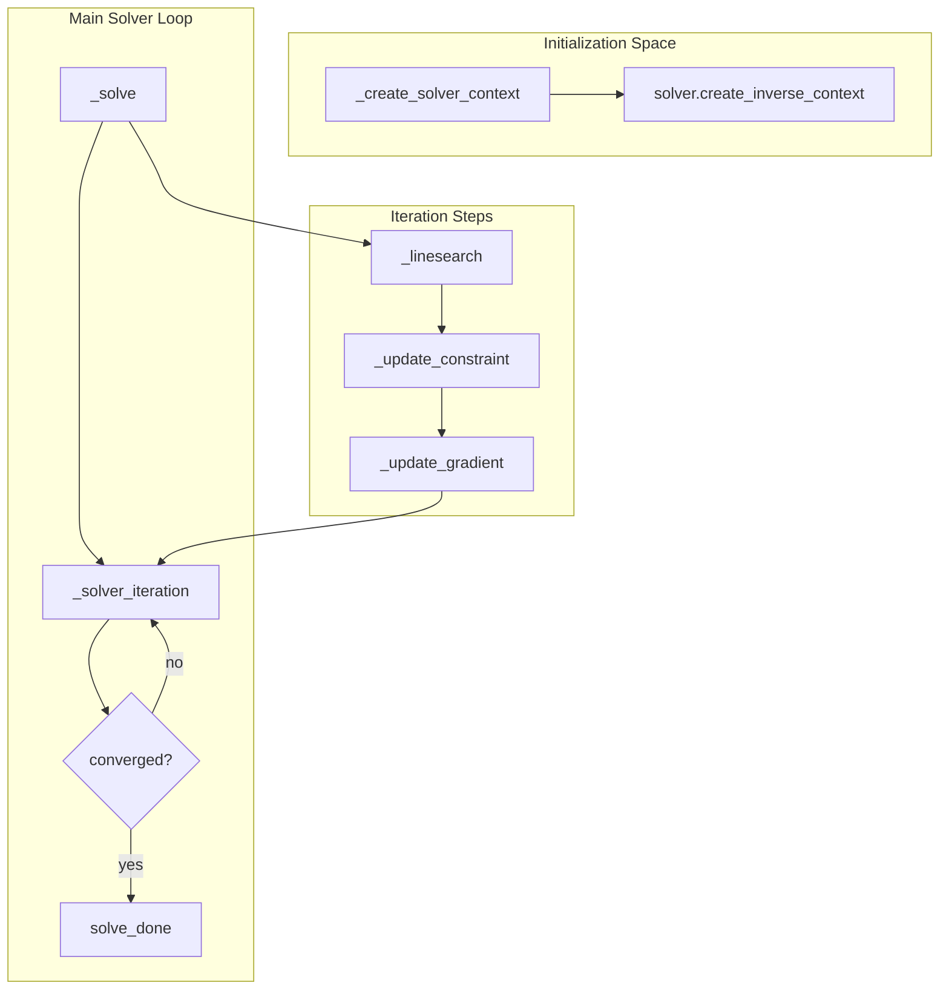
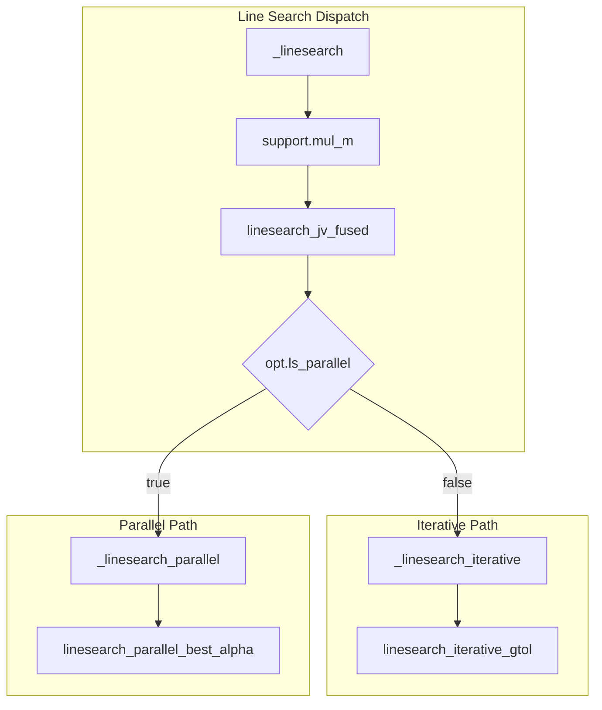
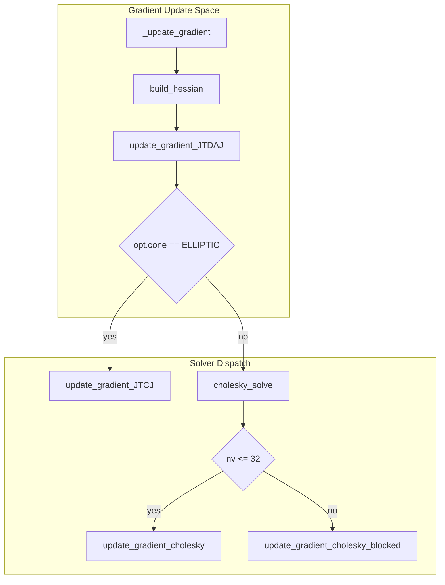

<!-- source: DeepWiki mcp.deepwiki.com · repo google-deepmind/mujoco_warp · page 4.2 Constraint Solver · fetched 2026-10-26 -->

# Constraint Solver

Relevant source files

The following files were used as context for generating this wiki page:

- [mujoco_warp/_src/block_cholesky.py](mujoco_warp/_src/block_cholesky.py)
- [mujoco_warp/_src/solver.py](mujoco_warp/_src/solver.py)
- [mujoco_warp/_src/solver_test.py](mujoco_warp/_src/solver_test.py)
- [mujoco_warp/_src/support.py](mujoco_warp/_src/support.py)
- [mujoco_warp/_src/support_test.py](mujoco_warp/_src/support_test.py)

## Purpose and Scope

The constraint solver finds forces that satisfy system constraints in the physics simulation pipeline. It solves the constrained optimization problem arising from equality constraints (joints), inequality constraints (contact forces), and friction forces during each simulation step. The solver employs iterative methods—Conjugate Gradient (CG) or Newton—combined with line search variants to optimize constraint forces.

For information about constraint generation, see [Constraint Generation (4.1)](). For details about the broader physics simulation pipeline, see [Physics Simulation Pipeline (3)]().

Sources: `[mujoco_warp/_src/solver.py:67-115]()`, `[mujoco_warp/_src/solver.py:2260-2391]()`

---

## Solver Architecture

The constraint solver follows a multi-stage iterative architecture that alternates between line search updates, constraint force evaluations, and gradient/Hessian updates until convergence criteria are met.

### Solver Data Flow and Code Mapping

Sources: `[mujoco_warp/_src/solver.py:43-64]()`, `[mujoco_warp/_src/solver.py:67-115]()`

---

## Line Search Implementation

The line search component determines the optimal step size $\alpha$ along the search direction. It supports both iterative bracketing and parallel GPU evaluation paths.

*   **Iterative Line Search**: Implements a bracketing approach analogous to MuJoCo's CPU solver to locate cost minima along the active search direction.
*   **Parallel Line Search**: Evaluates multiple potential step sizes concurrently across GPU threads to select the optimal candidate efficiently.

### Line Search Execution Flow

Sources: `[mujoco_warp/_src/solver.py:764-908]()`, `[mujoco_warp/_src/support.py:219-226]()`

---

## Constraint Update System

The `_update_constraint` routine computes constraint forces (`efc_force`) and evaluates costs based on the active state and friction cone type (Pyramidal vs. Elliptic).

*   **Pyramidal Cones**: Treated as a collection of independent scalar inequality constraints.
*   **Elliptic Cones**: Require explicit projection onto the elliptic cone boundary, handling quadratic updates across different cone regions.

Sources: `[mujoco_warp/_src/solver.py:1447-1506]`, `[mujoco_warp/_src/solver.py:1508-1730]()`

---

## Gradient Update and Newton Method

The solver computes optimization cost gradients and resolves search directions using either Conjugate Gradient or Newton updates.

*   **CG Solver**: Utilizes the mass matrix `M` as a preconditioner via sparse or dense multiplication kernels.
*   **Newton Solver**: Constructs the system Hessian $H = M + J^T D J$ and solves $H \cdot \text{search} = \text{grad}$.
    *   For small models ($\text{nv} \le 32$), it uses a dense Cholesky solver.
    *   For large models, it invokes specialized **Block Cholesky** factorizations.

### Hessian Assembly and Factorization Routing

Sources: `[mujoco_warp/_src/solver.py:2260-2391]`, `[mujoco_warp/_src/block_cholesky.py:45-115]()`

---

## Block Cholesky Factorization

To maintain high GPU utilization during Newton solves for large state spaces, `mujoco_warp` implements blocked Cholesky factorizations (`create_blocked_cholesky_factorize_solve_func`) that operate on shared memory tiles.

Sources: `[mujoco_warp/_src/block_cholesky.py:45-115]()`

---

## Workspace Contexts

The solver maintains dedicated memory contexts to eliminate dynamic allocations during simulation steps:

| Class | Purpose | Key Fields |
| :--- | :--- | :--- |
| `SolverContext` | Workspace for iterative solvers | `grad`, `Mgrad`, `search`, `h`, `hfactor` |
| `InverseContext` | Workspace for inverse dynamics | `Jaref`, `search_dot`, `done` |

Sources: `[mujoco_warp/_src/solver.py:43-115]()`

---

## Performance Optimizations

1.  **Fused Kernels**: `linesearch_jv_fused` combines Jacobian-vector products and line-search preparations to lower memory bandwidth demands.
2.  **Event Tracing**: Utilizes `event_scope` from `warp_util.py` for fine-grained kernel profiling.
3.  **Incremental Updates**: Tracks changed constraint IDs to update only relevant submatrices of the Hessian when constraint states shift.

Sources: `[mujoco_warp/_src/solver.py:75-76]`, `[mujoco_warp/_src/warp_util.py:89-119]()`

---

