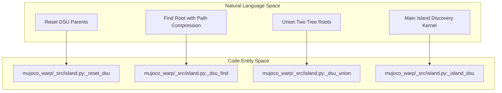
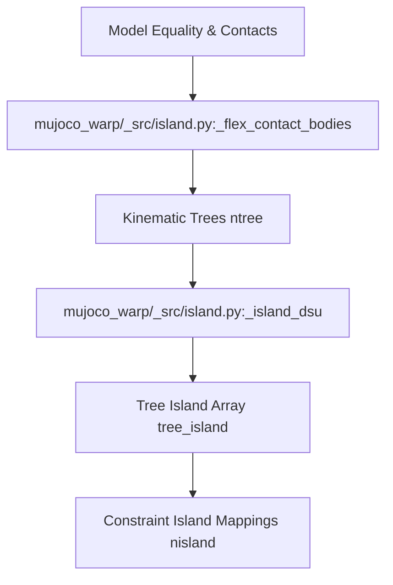

<!-- source: DeepWiki mcp.deepwiki.com · repo google-deepmind/mujoco_warp · page 4.3 Constraint Islands · fetched 2026-10-26 -->

# Constraint Islands

Relevant source files

The following files were used as context for generating this wiki page:

- [mujoco_warp/_src/island.py](mujoco_warp/_src/island.py)
- [mujoco_warp/_src/island_test.py](mujoco_warp/_src/island_test.py)

## 1. Purpose and Scope

Constraint islands partition independent multibody sub-graphs and active constraints within a simulation batch into disjoint sets. By identifying groups of kinematic trees and constraints that interact through contacts or equality constraints, `mujoco_warp` allows the constraint solver to execute independent sub-problems in parallel. This eliminates global synchronization bottlenecks and optimizes GPU compute utilization across batched worlds (`nworld`).

Sources: [mujoco_warp/_src/island.py:1-232](), [mujoco_warp/_src/island_test.py:1-181]()

---

## 2. Island Discovery via Disjoint-Set Union (DSU)

Island discovery operates on kinematic trees and active constraint rows (`efc`). The algorithm uses a parallel Disjoint-Set Union (DSU) data structure implemented in Warp kernels. 

Each kinematic tree is initially treated as its own root. Equality constraints, joint limits, and contacts act as edges that merge trees into shared equivalence classes (islands). The process is managed by several core device functions and kernels:
- `_reset_dsu`: Initializes identity parent pointers and clears active island markers [mujoco_warp/_src/island.py:79-93]().
- `_dsu_find`: Traverses and flattens parent paths using atomic path shortening to locate the canonical root of a tree [mujoco_warp/_src/island.py:33-45]().
- `_dsu_union`: Atomically links higher-indexed roots to lower-indexed roots using atomic compare-and-swap (`wp.atomic_cas`) [mujoco_warp/_src/island.py:54-77]().
- `_island_dsu`: The primary GPU kernel iterating over constraints, contacts, and equality definitions to construct the disjoint sets [mujoco_warp/_src/island.py:197-232]().

### DSU Natural Language to Code Entity Mapping

Sources: [mujoco_warp/_src/island.py:32-93](), [mujoco_warp/_src/island.py:197-232]()

---

## 3. Mapping DoFs and Constraints to Islands

To tie scalar constraint rows (`efc`) and degrees of freedom (`dof`) to discovered islands, the framework maps each constraint to the bodies and kinematic trees it constrains. 

For standard constraints and contacts, participating bodies are retrieved directly from geometry or joint indices. For flexible bodies (`flex`), complex contacts are resolved via `_flex_contact_bodies`, which maps contact points and elements back to their underlying nodes, vertices, and body trees [mujoco_warp/_src/island.py:113-194]().

### Constraint-to-Island Mapping Data Flow

Sources: [mujoco_warp/_src/island.py:113-194](), [mujoco_warp/_src/island.py:197-232]()

---

## 4. Parallel Per-Island Solves

Once the disjoint-set union pass completes, every active kinematic tree holds a reference to its canonical island index in `dof_treeid` and `tree_island`. 

This mapping enables:
- **Batched Indexing**: Grouping rows of the constraint force vector (`efc`) and Delassus matrix blocks by island.
- **Independent Kernel Launches**: Executing solver iterations over parallel island blocks without cross-thread data hazards.
- **Topology Verification**: Validating that unconstrained trees remain unlabeled (`-1`) while connected components collapse to ascending canonical IDs [mujoco_warp/_src/island_test.py:32-146]().

Sources: [mujoco_warp/_src/island.py:1-232](), [mujoco_warp/_src/island_test.py:32-146]()

---

