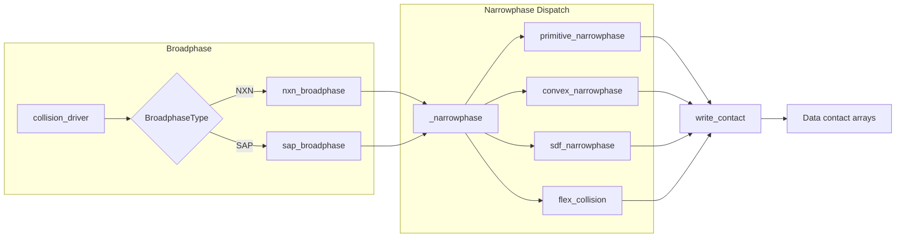

<!-- source: DeepWiki mcp.deepwiki.com · repo google-deepmind/mujoco_warp · page 5 Collision Detection · fetched 2026-10-26 -->

# Collision Detection

Relevant source files

The following files were used as context for generating this wiki page:

- [mujoco_warp/_src/broadphase_test.py](mujoco_warp/_src/broadphase_test.py)
- [mujoco_warp/_src/collision_driver.py](mujoco_warp/_src/collision_driver.py)
- [mujoco_warp/_src/collision_driver_test.py](mujoco_warp/_src/collision_driver_test.py)
- [mujoco_warp/_src/collision_primitive.py](mujoco_warp/_src/collision_primitive.py)
- [mujoco_warp/_src/collision_sdf.py](mujoco_warp/_src/collision_sdf.py)

This document covers the high-level architecture of the collision detection pipeline in MuJoCo Warp, which identifies potentially colliding geometry pairs, filters them, performs narrowphase checks, and generates contact constraints using GPU acceleration.

For detailed information about individual sub-components, refer to the child pages:
- For broadphase algorithms and filtering, see [Broadphase Collision Detection](#5.1).
- For narrowphase routing, GJK/EPA, primitives, and SDF collision routines, see [Narrowphase Collision Detection](#5.2).

## Overview

The collision pipeline is orchestrated on the GPU by the collision driver infrastructure [mujoco_warp/_src/collision_driver.py:47-96](). It processes simulation geometries across multiple sequential stages:

1. **Broadphase Filtering**: Reduces the quadratic $O(N^2)$ geometry pair space down to a manageable list of potentially intersecting candidate pairs using bounding primitives and spatial sorting.
2. **Narrowphase Dispatch**: Routes candidate pairs through the collision dispatch table (`MJ_COLLISION_TABLE`) to invoke specialized intersection and distance queries based on geometry types [mujoco_warp/_src/collision_driver.py:47-81]().
3. **Contact Generation**: Computes contact manifolds, penetration depths, normals, and material parameters, writing the resulting constraints into buffers.

### Collision Orchestration Pipeline

Sources: [mujoco_warp/_src/collision_driver.py:47-96]()

## Broadphase Collision Detection

The broadphase stage efficiently prunes non-intersecting geometry pairs before expensive geometric tests are executed. MuJoCo Warp supports multiple broadphase strategies, including brute-force $N \times N$ checks (`nxn_broadphase`) and axis-aligned sweep-and-prune variants (`sap_broadphase`) [mujoco_warp/_src/collision_driver.py:20-43]().

Before algorithmic pairing, geometries pass through a filtering cascade consisting of plane distance checks (`_plane_filter`), bounding sphere intersection tests (`_sphere_filter`), and axis-aligned bounding box (`_aabb_filter`) checks [mujoco_warp/_src/collision_driver.py:98-210]().

For complete details on broadphase algorithms, filtering flags, `CollisionContext`, and pair bookkeeping, see [Broadphase Collision Detection](#5.1).

Sources: [mujoco_warp/_src/collision_driver.py:20-210]()

## Narrowphase Collision Detection

Once candidate pairs are identified by the broadphase stage, the narrowphase pipeline evaluates exact geometric intersections. The routing is governed by `MJ_COLLISION_TABLE`, which maps pairs of geometry types (`GeomType`) to specific narrowphase execution kernels [mujoco_warp/_src/collision_driver.py:47-81]():

| Handler | Target Geometry Pairs | Core Technique |
| :--- | :--- | :--- |
| `primitive_narrowphase` | Plane, Sphere, Capsule, Cylinder, Box | Analytical formulas [mujoco_warp/_src/collision_primitive.py:25-36]() |
| `convex_narrowphase` | Mesh, HField, Ellipsoid, Box | GJK / EPA [mujoco_warp/_src/collision_convex.py:20-40]() |
| `sdf_narrowphase` | Signed Distance Fields, Plugins | Gradient descent and octree traversal [mujoco_warp/_src/collision_sdf.py:82-128]() |
| `flex_collision` | Flexible bodies vs primitives/convex | Vertex-face and edge-edge checks [mujoco_warp/_src/collision_flex.py:25-35]() |

For comprehensive technical breakdowns of the GJK/EPA core, multicontact manifold generation, analytical primitives, and SDF octree routines, see [Narrowphase Collision Detection](#5.2).

Sources: [mujoco_warp/_src/collision_driver.py:47-96](), [mujoco_warp/_src/collision_primitive.py:25-36](), [mujoco_warp/_src/collision_sdf.py:82-128]()

## Contact Generation and Parameters

All narrowphase routines ultimately pass computed contact geometry into helper routines that populate the simulation's contact buffers. The unified geometry representation (`Geom`) abstracts positions, orientations, and sizes across primitives and meshes [mujoco_warp/_src/collision_core.py:35-62]().

Contact friction, compliance (`solref`), and impedance (`solimp`) parameters are resolved by mixing properties from the two colliding geometries or extracting them from explicit model pair definitions [mujoco_warp/_src/collision_core.py:255-331](). These parameters directly structure the equality and inequality rows generated for the constraint solver.

Sources: [mujoco_warp/_src/collision_core.py:35-331]()

---

