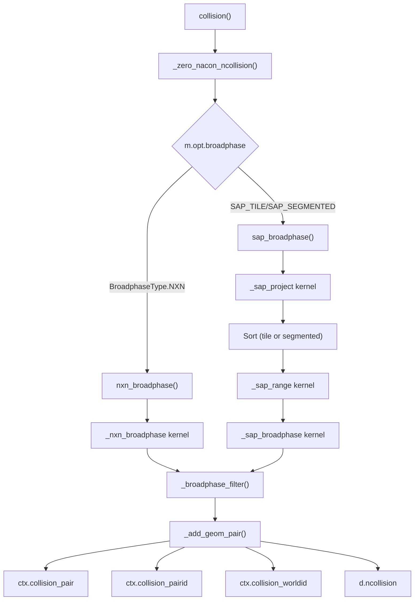
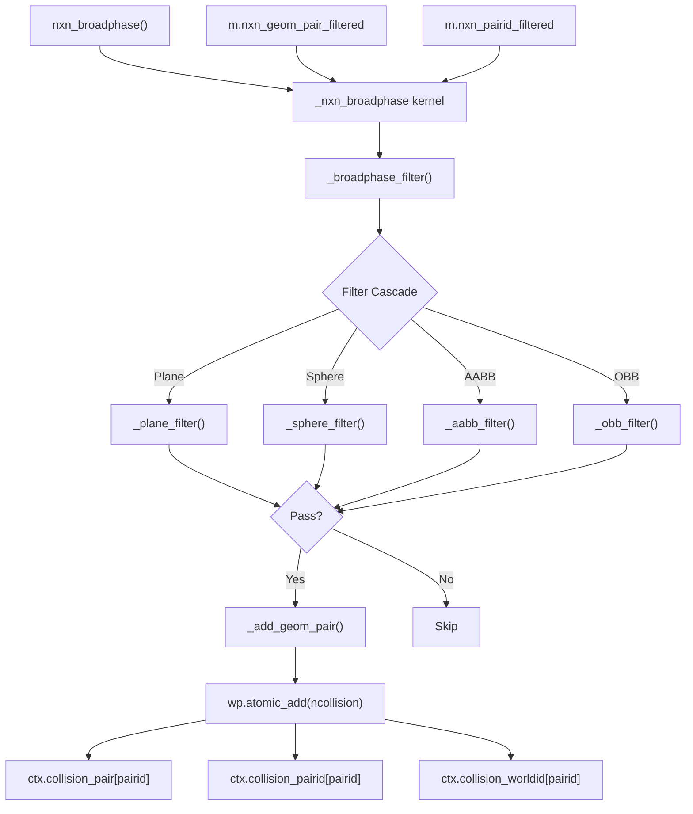
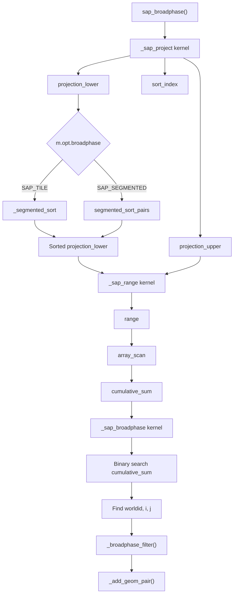
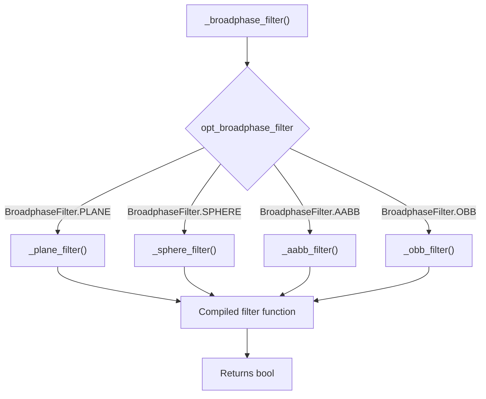
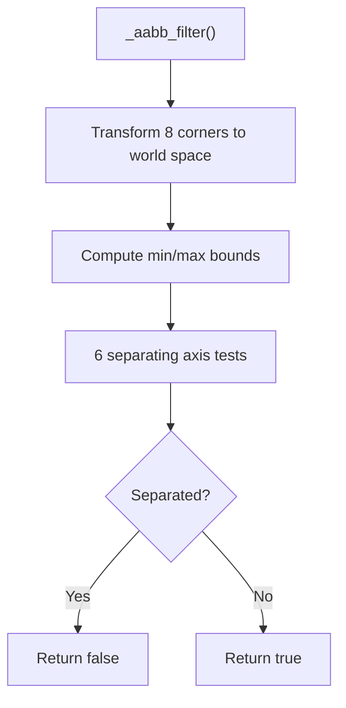

<!-- source: DeepWiki mcp.deepwiki.com · repo google-deepmind/mujoco_warp · page 5.1 Broadphase Collision Detection · fetched 2026-10-26 -->

# Broadphase Collision Detection

Relevant source files

The following files were used as context for generating this wiki page:

- [mujoco_warp/_src/broadphase_test.py](mujoco_warp/_src/broadphase_test.py)
- [mujoco_warp/_src/collision_driver.py](mujoco_warp/_src/collision_driver.py)
- [mujoco_warp/_src/collision_driver_test.py](mujoco_warp/_src/collision_driver_test.py)
- [mujoco_warp/_src/collision_primitive.py](mujoco_warp/_src/collision_primitive.py)
- [mujoco_warp/_src/collision_sdf.py](mujoco_warp/_src/collision_sdf.py)

This document covers the broadphase collision detection system in MuJoCo Warp. The broadphase identifies potentially colliding geometry pairs through efficient spatial filtering, producing a candidate list for the narrowphase. Two algorithms are supported: a brute-force N-squared approach and a sweep-and-prune (SAP) algorithm. Both algorithms apply a filtering cascade (plane, sphere, AABB, OBB) to eliminate non-colliding pairs before expensive narrowphase computation.

For detailed collision detection and contact generation, see [Narrowphase Collision Detection](#5.2). For the overall collision pipeline orchestration, see [Collision Detection](#5).

## System Architecture

The broadphase system identifies potentially colliding geometry pairs using spatial filtering. The collision function in `mujoco_warp/_src/collision_driver.py` dispatches to either `nxn_broadphase` or `sap_broadphase` based on `m.opt.broadphase` [mujoco_warp/_src/collision_driver.py:758-790]().

**Broadphase Selection Flow**

Sources: [mujoco_warp/_src/collision_driver.py:758-790](), [mujoco_warp/_src/collision_driver.py:78-84]()

## Broadphase Algorithms

The broadphase supports two algorithms controlled by `m.opt.broadphase`:

### N-Squared (NXN) Algorithm

The `nxn_broadphase` function performs brute-force checking of all geometry pairs from a pre-filtered list created at model load time [mujoco_warp/_src/collision_driver.py:704-738]():

**NXN Broadphase Data Flow**

Sources: [mujoco_warp/_src/collision_driver.py:704-738](), [mujoco_warp/_src/collision_driver.py:653-701]()

### Sweep and Prune (SAP) Algorithm

The `sap_broadphase` function projects bounding spheres onto a single axis, sorts them, and sweeps to identify overlapping pairs [mujoco_warp/_src/collision_driver.py:560-650]():

**SAP Broadphase Pipeline**

Sources: [mujoco_warp/_src/collision_driver.py:560-650](), [mujoco_warp/_src/collision_driver.py:380-424]()

## Filtering Cascade

The `_broadphase_filter` function constructs a cascade of geometric filters based on `m.opt.broadphase_filter` flags [mujoco_warp/_src/collision_driver.py:281-328]():

**Filter Construction and Execution**

Sources: [mujoco_warp/_src/collision_driver.py:281-328]()

### Plane Filter

The `_plane_filter` handles infinite planes where geometries have `rbound = 0` [mujoco_warp/_src/collision_driver.py:99-112]().

Sources: [mujoco_warp/_src/collision_driver.py:99-112]()

### Sphere Filter

The `_sphere_filter` performs bounding sphere overlap tests using positions and pre-computed bounding sphere radii [mujoco_warp/_src/collision_driver.py:114-120]().

Sources: [mujoco_warp/_src/collision_driver.py:114-120]()

### AABB Filter

The `_aabb_filter` computes axis-aligned bounding boxes (AABBs) in world coordinates and tests for overlap [mujoco_warp/_src/collision_driver.py:123-221]().

**AABB Computation and Overlap Test**

Sources: [mujoco_warp/_src/collision_driver.py:123-221]()

### OBB Filter

The `_obb_filter` performs oriented bounding box (OBB) tests using the separating axis theorem across 6 potential separating axes [mujoco_warp/_src/collision_driver.py:224-278]().

Sources: [mujoco_warp/_src/collision_driver.py:224-278]()

## Data Structures

The broadphase outputs collision pair candidates to `CollisionContext`, created by `create_collision_context` [mujoco_warp/_src/collision_core.py:22-24]():

| Field | Type | Purpose |
|-------|------|---------|
| `collision_pair` | `wp.array(dtype=wp.vec2i)` | Geometry pair indices `(g1, g2)` |
| `collision_pairid` | `wp.array(dtype=wp.vec2i)` | Pair metadata: `[0]` = pair ID, `[1]` = sensor ID |
| `collision_worldid` | `wp.array(dtype=int)` | World index for batched execution |

Sources: [mujoco_warp/_src/collision_driver.py:78-84](), [mujoco_warp/_src/collision_core.py:22-24]()

### Collision Pair Ordering

The `_add_geom_pair` function ensures consistent geometry ordering and atomically increments the collision count using `wp.atomic_add` [mujoco_warp/_src/collision_driver.py:331-365]().

Sources: [mujoco_warp/_src/collision_driver.py:331-365]()

---

