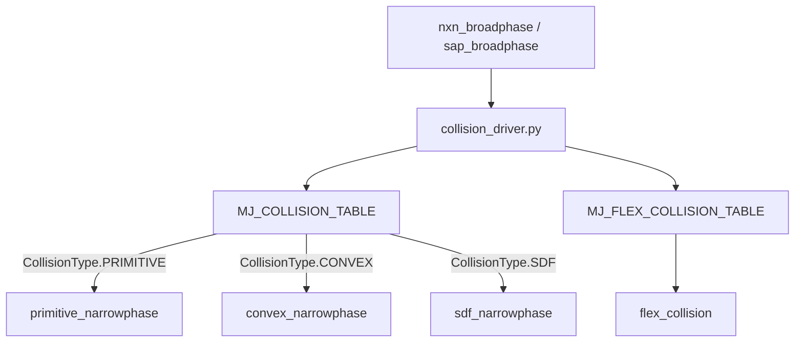
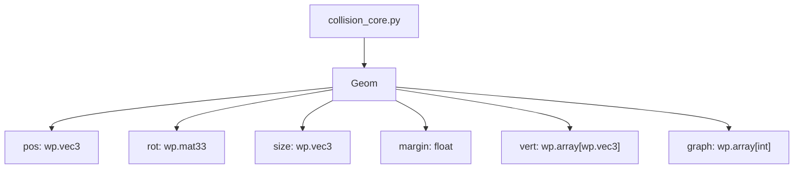

<!-- source: DeepWiki mcp.deepwiki.com · repo google-deepmind/mujoco_warp · page 5.2 Narrowphase Collision Detection · fetched 2026-10-26 -->

# Narrowphase Collision Detection

Relevant source files

The following files were used as context for generating this wiki page:

- [mujoco_warp/_src/broadphase_test.py](mujoco_warp/_src/broadphase_test.py)
- [mujoco_warp/_src/collision_convex.py](mujoco_warp/_src/collision_convex.py)
- [mujoco_warp/_src/collision_core.py](mujoco_warp/_src/collision_core.py)
- [mujoco_warp/_src/collision_driver.py](mujoco_warp/_src/collision_driver.py)
- [mujoco_warp/_src/collision_driver_test.py](mujoco_warp/_src/collision_driver_test.py)
- [mujoco_warp/_src/collision_gjk.py](mujoco_warp/_src/collision_gjk.py)
- [mujoco_warp/_src/collision_gjk_test.py](mujoco_warp/_src/collision_gjk_test.py)
- [mujoco_warp/_src/collision_primitive.py](mujoco_warp/_src/collision_primitive.py)
- [mujoco_warp/_src/collision_sdf.py](mujoco_warp/_src/collision_sdf.py)

Narrowphase collision detection performs precise geometric calculations between geometry pairs that pass broadphase filtering. This system evaluates penetration depths, contact normals, and contact positions, populating the global contact buffers used by the constraint solver.

For convex geometry interactions (GJK, EPA, and multicontact manifolds), see [Convex Collision: GJK, EPA and Multicontact](#5.2.1). For analytical primitives and signed-distance-field (SDF) narrowphase routines, see [Primitive and SDF Collision](#5.2.2). For broadphase pair generation, see [Broadphase Collision Detection](5.1).

## Collision Routing and Table Dispatch

Narrowphase dispatch is governed by lookup tables that map pairs of geometry types (`GeomType`) to a specific execution path (`CollisionType`). The primary routing definitions are stored in `MJ_COLLISION_TABLE` and `MJ_FLEX_COLLISION_TABLE` within `mujoco_warp/_src/collision_driver.py` [mujoco_warp/_src/collision_driver.py:46-96]().

Sources: [mujoco_warp/_src/collision_driver.py:46-96](), [mujoco_warp/_src/collision_driver.py:20-27]()

The driver evaluates each candidate pair against these tables to invoke the appropriate Warp kernels for primitive, convex, SDF, or flexible body collisions.

## Geometry Representation (`Geom`)

All narrowphase routines consume geometric properties packaged into the `Geom` struct [mujoco_warp/_src/collision_core.py:35-62](). This structure consolidates poses, sizes, surface margins, and pointers to mesh topology or graph data.

Sources: [mujoco_warp/_src/collision_core.py:35-62]()

## Child Page Overview

Detailed implementations of narrowphase algorithms are divided into two child pages:

### Convex Collision: GJK, EPA, and Multicontact (`#5.2.1`)
- **GJK & EPA**: Implementation of the Gilbert-Johnson-Keerthi distance query and Expanding Polytope Algorithm in `collision_gjk.py` [mujoco_warp/_src/collision_gjk.py:1-100]() for general convex shapes and meshes.
- **Support Mappings**: Support functions for boxes, capsules, cylinders, ellipsoids, and mesh graph hill-climbing [mujoco_warp/_src/collision_gjk.py:120-210]().
- **Multicontact Manifolds**: Polytope clipping and contact point generation for stable multi-point contacts [mujoco_warp/_src/collision_gjk.py:1-100]() and heightfield filtering (`_hfield_filter`) [mujoco_warp/_src/collision_convex.py:63-162]().

### Primitive and SDF Collision (`#5.2.2`)
- **Primitive Pairs**: Analytical functions in `collision_primitive_core.py` covering plane, sphere, capsule, box, cylinder, and ellipsoid combinations [mujoco_warp/_src/collision_primitive.py:25-36]().
- **SDF Narrowphase**: Octree traversal (`VolumeData`), gradient evaluation (`sample_volume_grad`), and gradient descent optimization (`gradient_step`) in `collision_sdf.py` [mujoco_warp/_src/collision_sdf.py:40-128]() to locate surface penetration.

Sources: [mujoco_warp/_src/collision_gjk.py:1-100](), [mujoco_warp/_src/collision_primitive.py:25-36](), [mujoco_warp/_src/collision_sdf.py:40-128]()

## Contact Writing and Material Parameters

Once narrowphase routines compute penetration depths and contact frames, the contact results are committed to global device arrays via `write_contact` [mujoco_warp/_src/collision_core.py:214-241](). Physical properties such as friction coefficients, stiffness, and damping are resolved via `contact_params` [mujoco_warp/_src/collision_core.py:244-321]().

Sources: [mujoco_warp/_src/collision_core.py:214-321]()

---

