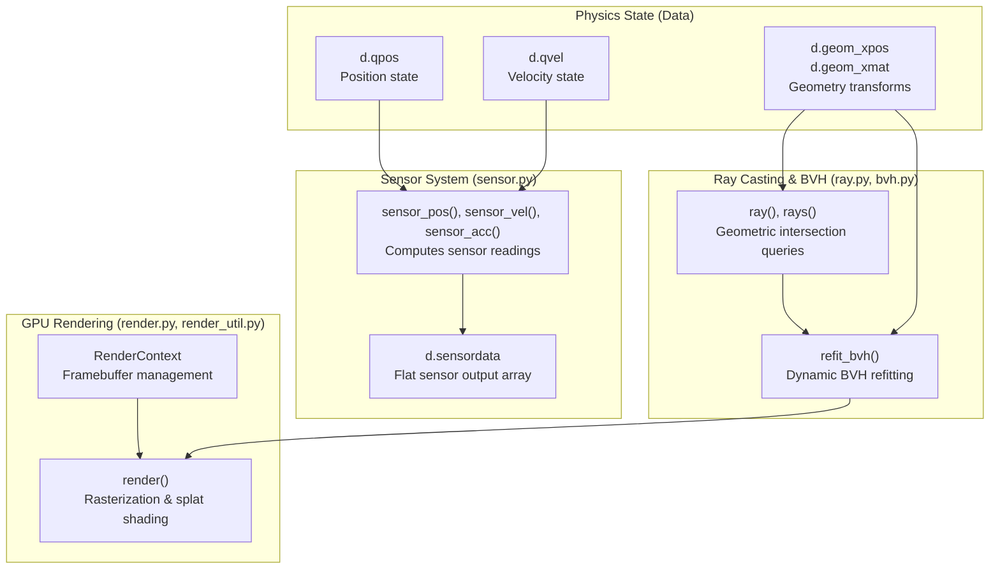

<!-- source: DeepWiki mcp.deepwiki.com · repo google-deepmind/mujoco_warp · page 6 Observation and Rendering Systems · fetched 2026-10-26 -->

# Observation and Rendering Systems

Relevant source files

The following files were used as context for generating this wiki page:

- [contrib/render.py](contrib/render.py)
- [mujoco_warp/_src/bvh.py](mujoco_warp/_src/bvh.py)
- [mujoco_warp/_src/render.py](mujoco_warp/_src/render.py)
- [mujoco_warp/_src/render_test.py](mujoco_warp/_src/render_test.py)
- [mujoco_warp/_src/sensor.py](mujoco_warp/_src/sensor.py)
- [mujoco_warp/_src/sensor_test.py](mujoco_warp/_src/sensor_test.py)

## Purpose and Scope

This document describes the observation and rendering systems in `mujoco_warp` that enable extracting state, sensor readings, ray intersection queries, and high-performance GPU-accelerated images from simulation states. These systems provide three primary capabilities:

1. **Sensor System** ([Sensor System](#6.1)): Computes sensor readings at position, velocity, and acceleration levels, supporting a wide variety of sensor types including joint sensors, frame sensors, contact sensors, energy sensors, and rangefinders.
2. **Ray Casting System** ([Ray Casting System](#6.2)): Performs geometric intersection queries for rangefinder sensors and raycasting applications, with BVH acceleration.
3. **GPU Rendering** ([GPU Rendering](#6.3)): Renders RGB, depth, and segmentation images using `RenderContext`, supporting camera/projection models, dynamic BVH refitting (`bvh.py`), textures, skyboxes, and 3D Gaussian Splatting (`render.py`, `render_util.py`).

For information about the physics simulation that generates the state observed by these systems, see [Physics Simulation Pipeline](#3). For information about how sensor and rendering data is transferred to/from the host, see [Host-Device I/O Bridge](#2.2).

---

## System Architecture Overview

The observation and rendering pipelines execute after the physics simulation step has finalized geometry transforms, velocities, and constraint forces. Sensors read from various data structures in `Data`, ray casting performs geometric queries against geometry transforms, and the rendering engine uses dynamic BVH structures to rasterize scenes and shade Gaussian splats.

The following diagram maps high-level observation and rendering concepts to specific code entities and data structures.

### Natural Language to Code Entity Mapping: Observations and Rendering

**Sources:** [mujoco_warp/_src/sensor.py:758-900](), [mujoco_warp/_src/ray.py:889-1028](), [mujoco_warp/_src/render.py:55-156](), [mujoco_warp/_src/bvh.py:38-44]()

---

## Sensor System

Sensors in `mujoco_warp` are evaluated in three distinct stages corresponding to the position, velocity, and acceleration levels of the physics pipeline. Each stage reads from simulation state variables and writes formatted outputs to the flat `d.sensordata` array.

- **Position Stage**: Evaluated via position-level kinematics, including joint positions, tendon lengths, actuator lengths, frame transforms, subtree COM, and rangefinder initializations [mujoco_warp/_src/sensor.py:182-203]().
- **Velocity Stage**: Evaluated via velocity state (`qvel`, `cvel`), including velocimeters, gyros, joint/tendon velocities, and frame linear/angular velocities.
- **Acceleration Stage**: Evaluated after the constraint solver, reading accelerations, constraint forces (`efc_force`), contact data, and actuator forces.

For detailed documentation on sensor types, tactile sensors, contact reductions, and energy evaluation, see [Sensor System](#6.1).

**Sources:** [mujoco_warp/_src/sensor.py:57-116](), [mujoco_warp/_src/sensor_test.py:41-170]()

---

## Ray Casting System

The ray casting module provides geometric intersection queries used by rangefinder sensors and raycasting utilities. It supports single-ray (`ray`) and batched-ray (`rays`) queries across all MuJoCo geometry types.

- **BVH Acceleration**: Complex geometries like meshes and flexes use bounding volume hierarchies built and refitted via `bvh.py` to accelerate intersection queries.
- **Analytical Intersection**: Primitive geometries (spheres, capsules, boxes, cylinders, planes, and ellipsoids) are intersected using analytical ray equations.

For detailed information on ray intersection math and query functions, see [Ray Casting System](#6.2).

**Sources:** [mujoco_warp/_src/ray.py:1-50](), [mujoco_warp/_src/bvh.py:46-132]()

---

## GPU Rendering

GPU rendering is implemented in `render.py` and `render_util.py`, providing real-time rendering capabilities across batched parallel worlds (`nworld`). 

- **RenderContext**: Sets up camera models, projection matrices, light sources, and output buffers (`rgb_data`, `depth_data`, `seg_data`) [mujoco_warp/_src/types.py:650-670]().
- **BVH & Refitting**: Scene geometry and dynamic flexes are tracked using BVH acceleration structures managed by `bvh.py` [mujoco_warp/_src/bvh.py:38-44]().
- **Gaussian Splatting**: Supports rendering 3D Gaussian splats (`ray_splat`, `shade_splats`) with opacity, rotation, scale, and spherical harmonic colors [mujoco_warp/_src/render.py:55-156]().
- **Tooling**: Command-line utilities such as `mjwarp-render` (`contrib/render.py`) allow rendering frames, camera orbits, and rollout videos directly from MJCF models.

For detailed documentation on camera setup, lighting models, texture handling, and Gaussian splatting, see [GPU Rendering](#6.3).

**Sources:** [mujoco_warp/_src/render.py:55-156](), [mujoco_warp/_src/render_test.py:56-118](), [mujoco_warp/_src/bvh.py:38-44](), [contrib/render.py:16-65]()

---

