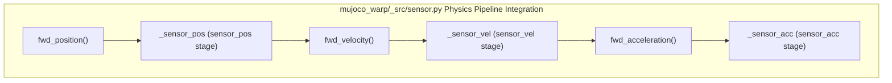
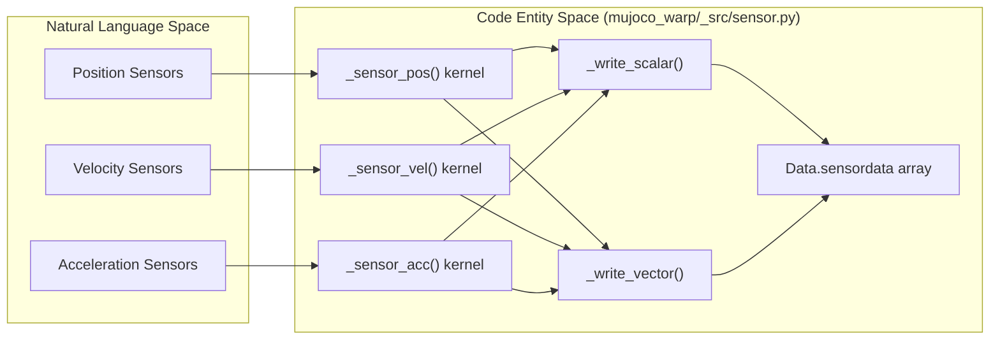
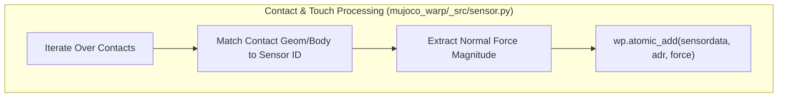

<!-- source: DeepWiki mcp.deepwiki.com · repo google-deepmind/mujoco_warp · page 6.1 Sensor System · fetched 2026-10-26 -->

# Sensor System

Relevant source files

The following files were used as context for generating this wiki page:

- [mujoco_warp/_src/sensor.py](mujoco_warp/_src/sensor.py)
- [mujoco_warp/_src/sensor_test.py](mujoco_warp/_src/sensor_test.py)

## Purpose and Overview

The Sensor System in MuJoCo Warp provides a GPU-accelerated framework for measuring physical quantities across simulation worlds (`nworld`). It mirrors MuJoCo's native sensor capabilities, supporting position-, velocity-, and acceleration-dependent measurements, along with tactile sensors, contact force reductions, and energy evaluations. 

Execution occurs across three distinct pipeline stages (`sensor_pos`, `sensor_vel`, and `sensor_acc`), ensuring that measurements access up-to-date kinematic and dynamic states via Warp kernels.

Sources: [mujoco_warp/_src/sensor.py:16-55]()

## Sensor System Architecture & Pipeline Stages

The sensor evaluation is split into three phases corresponding to the physics pipeline progression:
1. **`sensor_pos`**: Evaluated after forward kinematics (`fwd_position`), computing position, orientation, joint positions, tendon lengths, frame positions, and rangefinder/camera projections.
2. **`sensor_vel`**: Evaluated after velocity updates (`fwd_velocity`), computing velocities, angular velocities, velocimeters, gyros, and subtree linear velocities.
3. **`sensor_acc`**: Evaluated after acceleration and constraint solves (`fwd_acceleration`), computing accelerations, contact forces, touch sensors, joint limit forces, and actuator forces.

**Diagram: Sensor Stages in the Physics Pipeline**

Sources: [mujoco_warp/_src/sensor.py:601-724](), [mujoco_warp/_src/sensor.py:1205-1282](), [mujoco_warp/_src/sensor.py:1737-1887]()

## Code Entity Mapping: Sensor Dispatch & Output

To bridge natural language descriptions to actual codebase entities, the following diagram illustrates how conceptual sensor categories map to internal Warp kernels and utility functions like `_write_scalar` and `_write_vector`.

**Diagram: Mapping Sensor Categories to Warp Kernels and Output Utilities**

Sources: [mujoco_warp/_src/sensor.py:57-116](), [mujoco_warp/_src/sensor.py:601-724]()

## Supported Sensor Types

Sensors are defined by the `SensorType` enum and categorized by their computational stage. Each entry extracts data using helper routines and writes to `sensordata` via `_write_scalar` [mujoco_warp/_src/sensor.py:58-84]() or `_write_vector` [mujoco_warp/_src/sensor.py:86-116]().

| Sensor Category | Sensor Types (`SensorType`) | Primary Internal Functions |
|-----------------|-----------------------------|----------------------------|
| **Position**    | `JOINTPOS`, `TENDONPOS`, `ACTUATORPOS`, `BALLQUAT`, `FRAMEPOS`, `FRAMEXAXIS`, `FRAMEQUAT`, `SUBTREECOM`, `MAGNETOMETER`, `CAMPROJECTION`, `RANGEFINDER` | `_joint_pos`, `_tendon_pos`, `_actuator_pos`, `_frame_pos`, `_magnetometer`, `_cam_projection`, `ray.rays` [mujoco_warp/_src/sensor.py:204-219](), [mujoco_warp/_src/sensor.py:334-349]() |
| **Velocity**    | `VELOCIMETER`, `GYRO`, `JOINTVEL`, `TENDONVEL`, `ACTUATORVEL`, `BALLANGVEL`, `FRAMELINVEL`, `FRAMEANGVEL`, `SUBTREELINVEL` | `_velocimeter`, `_gyro`, `_joint_vel`, `_ball_ang_vel`, `_subtree_linvel` [mujoco_warp/_src/sensor.py:821-846](), [mujoco_warp/_src/sensor.py:1011-1013]() |
| **Acceleration**| `ACCELEROMETER`, `FORCE`, `TORQUE`, `ACTUATORFRC`, `TOUCH`, `JOINTLIMITFRC` | `_accelerometer`, `_force`, `_torque`, `_sensor_touch`, `_limit_frc` [mujoco_warp/_src/sensor.py:1335-1371](), [mujoco_warp/_src/sensor.py:1614-1659]() |

Sources: [mujoco_warp/_src/sensor.py:601-724](), [mujoco_warp/_src/sensor.py:1205-1282](), [mujoco_warp/_src/sensor.py:1737-1887]()

## Tactile Sensors, Contact Reductions, and Atomic Operations

Tactile and contact-based sensors (such as `TOUCH`) aggregate forces across interacting geometry pairs and contacts. Because multiple contacts can map to a single sensor body, GPU kernels leverage `wp.atomic_add` to safely accumulate normal force contributions without race conditions.

**Diagram: Touch Sensor Contact Reduction Flow**

Sources: [mujoco_warp/_src/sensor.py:1614-1659](), [mujoco_warp/_src/sensor.py:1821-1887]()

## Energy Evaluation

Potential and kinetic energy sensors (`E_POTENTIAL`, `E_KINETIC`) are evaluated to monitor mechanical energy conservation. Potential energy accounts for contributions from gravity, joint spring potentials, and tendon elasticity.

Sources: [mujoco_warp/_src/sensor.py:2039-2123]()

## Implementation Details: Cutoff Handling and GPU Parallelization

### Cutoff Filtering
All sensor outputs pass through `_write_scalar` [mujoco_warp/_src/sensor.py:58-84]() or `_write_vector` [mujoco_warp/_src/sensor.py:86-116](), which apply `sensor_cutoff` thresholds based on the `DataType` enum:
- **`DataType.REAL`**: Clamps the measured value to the range `[-cutoff, cutoff]`.
- **`DataType.POSITIVE`**: Clamps the value to a maximum of `cutoff`.

### GPU Parallelization Model
The sensor kernels map thread execution directly to individual sensor instances across all batched simulation worlds (`nworld`). This allows thousands of sensor readings to be computed concurrently across the GPU grid.

Sources: [mujoco_warp/_src/sensor.py:58-116](), [mujoco_warp/_src/sensor.py:601-605]()

---

