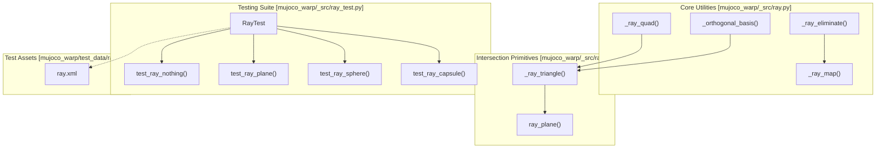
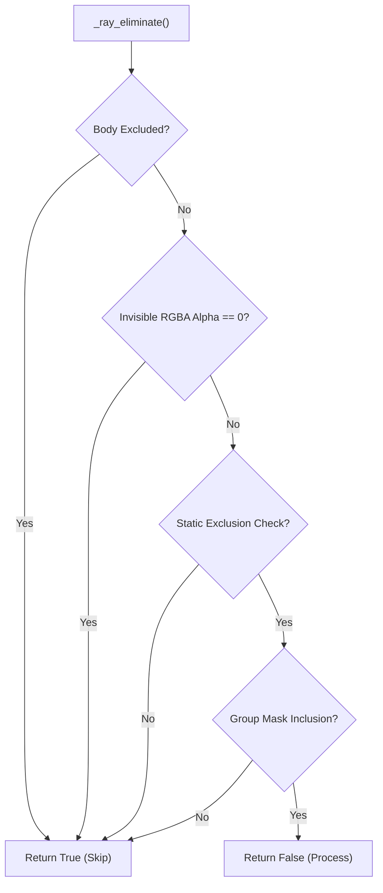

<!-- source: DeepWiki mcp.deepwiki.com · repo google-deepmind/mujoco_warp · page 6.2 Ray Casting System · fetched 2026-10-26 -->

# Ray Casting System

Relevant source files

The following files were used as context for generating this wiki page:

- [contrib/kernel_analyzer/kernel-analyzer-0.8.2.vsix](contrib/kernel_analyzer/kernel-analyzer-0.8.2.vsix)
- [mujoco_warp/_src/ray.py](mujoco_warp/_src/ray.py)
- [mujoco_warp/_src/ray_test.py](mujoco_warp/_src/ray_test.py)
- [mujoco_warp/test_data/meshes/dodecahedron.stl](mujoco_warp/test_data/meshes/dodecahedron.stl)
- [mujoco_warp/test_data/meshes/tetrahedron.stl](mujoco_warp/test_data/meshes/tetrahedron.stl)
- [mujoco_warp/test_data/ray.xml](mujoco_warp/test_data/ray.xml)

## Purpose and Scope

The Ray Casting System provides GPU-accelerated ray-geometry intersection testing capabilities for MuJoCo Warp. This system enables efficient computation of ray intersections with various geometry types, primarily used for rangefinder sensors and ray-based queries in physics simulations. The system supports batched ray casting operations across multiple worlds and rays simultaneously, and features acceleration structures for high-performance queries in complex scenes.

Sources: [mujoco_warp/_src/ray.py:1-30](), [mujoco_warp/_src/ray_test.py:15-30]()

## System Architecture

The ray casting system is built around a hierarchical architecture that processes rays in parallel using Warp kernels. The system supports multiple geometry types and includes comprehensive filtering capabilities.

### Code-to-System Mapping
The following diagram bridges high-level ray casting concepts to specific implementation entities in the codebase.

Sources: [mujoco_warp/_src/ray.py:36-229](), [mujoco_warp/_src/ray_test.py:38-165](), [mujoco_warp/test_data/ray.xml:1-21]()

## Core Components and Helper Functions

The system relies on several low-level Warp functions for coordinate transformation, pruning, and geometric calculations:

| Function | Purpose | Implementation |
|----------|---------|----------------|
| `_ray_map()` | Transforms ray starting points and directions into local geometry frame coordinates. | [mujoco_warp/_src/ray.py:36-53]() |
| `_ray_quad()` | Computes solutions for quadratic equations $a x^2 + 2 b x + c = 0$ during quadric intersections. | [mujoco_warp/_src/ray.py:110-130]() |
| `_orthogonal_basis()` | Generates two orthonormal basis vectors perpendicular to a unit vector without branch singularities. | [mujoco_warp/_src/ray.py:133-156]() |
| `_ray_triangle()` | Computes intersection distance and normal against a triangle using planar projection and barycentric coordinates. | [mujoco_warp/_src/ray.py:159-215]() |

Sources: [mujoco_warp/_src/ray.py:36-215]()

## Geometry Intersection Algorithms

### Primitive Geometries
The system implements specialized analytical intersection math for primitive shapes:
- **Plane:** `ray_plane()` maps the ray into the local frame, checks front-facing conditions (`lvec[2] <= -MJ_MINVAL`), and computes the intersection parameter `[mujoco_warp/_src/ray.py:218-229]()`.

Sources: [mujoco_warp/_src/ray.py:218-229]()

## Filtering and Elimination

### Elimination Logic
The `_ray_eliminate()` function implements MuJoCo-compatible filtering to determine whether a geometry should be ignored during ray casting queries.

- **Body Exclusion:** Skips geometries belonging to an excluded body id [mujoco_warp/_src/ray.py:56-77]().
- **Visibility Checks:** Excludes geoms or materials with zero alpha values [mujoco_warp/_src/ray.py:79-86]().
- **Static Exclusion:** Skips world-welded geoms when static flags are disabled [mujoco_warp/_src/ray.py:88-90]().
- **Group Filtering:** Evaluates `geom_group` against a `vec6` inclusion/exclusion mask [mujoco_warp/_src/ray.py:92-107]().

Sources: [mujoco_warp/_src/ray.py:56-107]()

## Testing and Validation

The ray casting system is validated against reference MuJoCo outputs using parameterized unit tests:

- **Unit Tests:** `RayTest` defines test cases for misses (`test_ray_nothing`), planes (`test_ray_plane`), spheres (`test_ray_sphere`), and capsules (`test_ray_capsule`) [mujoco_warp/_src/ray_test.py:38-165]().
- **Asset Corpus:** Tests utilize the `ray.xml` scene fixture containing various primitive geometries, hfields, and meshes [mujoco_warp/test_data/ray.xml:1-21]().
- **Precision Tolerances:** Assertions enforce strict error bounds (`_TOLERANCE = 5e-5`) to account for floating-point differences between CPU reference implementations and GPU Warp execution [mujoco_warp/_src/ray_test.py:27-36]().

Sources: [mujoco_warp/_src/ray_test.py:38-165](), [mujoco_warp/test_data/ray.xml:1-21]()

---

