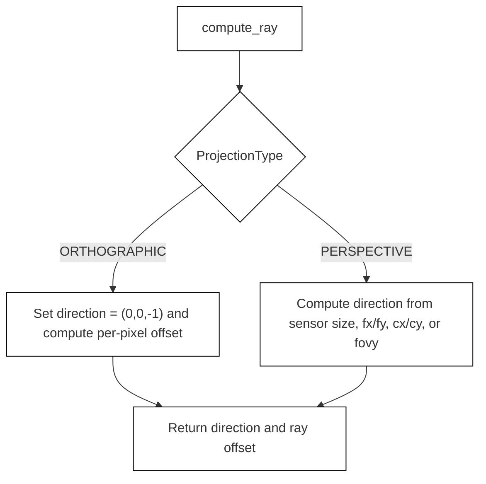
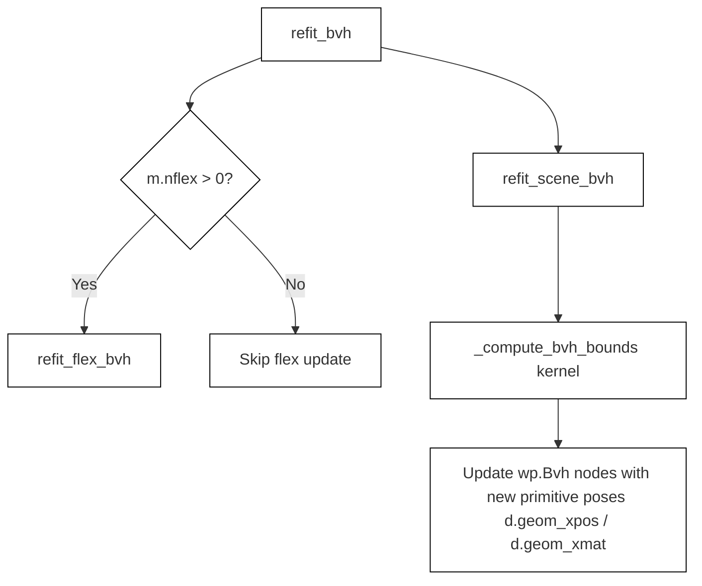
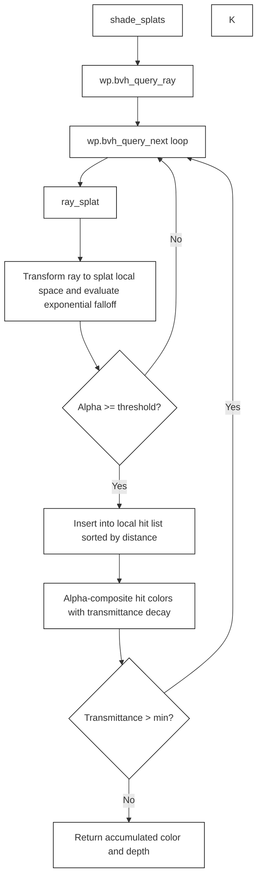

<!-- source: DeepWiki mcp.deepwiki.com · repo google-deepmind/mujoco_warp · page 6.3 GPU Rendering · fetched 2026-10-26 -->

# GPU Rendering

Relevant source files

The following files were used as context for generating this wiki page:

- [benchmarks/render/README.md](benchmarks/render/README.md)
- [benchmarks/render/__init__.py](benchmarks/render/__init__.py)
- [benchmarks/render/primitives.webp](benchmarks/render/primitives.webp)
- [benchmarks/render/primitives.xml](benchmarks/render/primitives.xml)
- [contrib/render.py](contrib/render.py)
- [mujoco_warp/_src/bvh.py](mujoco_warp/_src/bvh.py)
- [mujoco_warp/_src/bvh_test.py](mujoco_warp/_src/bvh_test.py)
- [mujoco_warp/_src/render.py](mujoco_warp/_src/render.py)
- [mujoco_warp/_src/render_test.py](mujoco_warp/_src/render_test.py)
- [mujoco_warp/_src/render_util.py](mujoco_warp/_src/render_util.py)
- [mujoco_warp/_src/render_util_test.py](mujoco_warp/_src/render_util_test.py)

The GPU rendering subsystem in `mujoco_warp` provides a fully accelerated, parallel ray-tracing and rasterization pipeline implemented via NVIDIA Warp kernels (`render.py` and `render_util.py`). Its primary purpose is to bridge simulation state across multiple parallel worlds (`nworld`) directly to visual framebuffers (RGB, depth, and segmentation images) on the GPU without CPU-GPU synchronization overhead. This subsystem supports dynamic bounding volume hierarchy (BVH) acceleration, camera projection models, texture mapping, skyboxes, and 3D Gaussian Splatting (3DGS).

---

## 2. RenderContext and Camera/Projection Models

The lifecycle of rendering revolves around the `RenderContext` data structure, which manages GPU buffers for images, camera intrinsic parameters, and BVH acceleration nodes. 

### Camera and Projection Formulation
Ray generation for each pixel is handled by `compute_ray` in `render_util.py` [mujoco_warp/_src/render_util.py:73-160](). It supports both perspective and orthographic projection types (`ProjectionType.PERSPECTIVE` and `ProjectionType.ORTHOGRAPHIC`) [mujoco_warp/_src/render_util.py:96-160](). 

For perspective projections, rays are initialized from camera intrinsics (`intrinsic` vector containing focal lengths `fx`, `fy` and principal points `cx`, `cy`) or field of view (`fovy`), accounting for aspect ratios and near-plane clipping (`znear`) [mujoco_warp/_src/render_util.py:113-160](). For orthographic projections, the ray direction remains constant along the optical axis (`-1.0` in $z$), while the origin shifts per pixel according to sensor dimensions and orthographic bounds [mujoco_warp/_src/render_util.py:96-112]().

*Diagram 1: Control flow of batched per-pixel ray generation across perspective and orthographic camera models.*

Sources: `mujoco_warp/_src/render_util.py:73-160()`, `mujoco_warp/_src/types.py`

---

## 3. Acceleration Structures and BVH Construction (`bvh.py`)

To achieve interactive ray-tracing performance across thousands of parallel worlds, `mujoco_warp` constructs and maintains hierarchical bounding volume hierarchies (BVHs) using `bvh.py`.

### Dynamic Bounds Computation and Refitting
Scene geometries are wrapped in a unified BVH structure (`bvh_id`) configured per render context. The bounds for each primitive type (spheres, capsules, planes, boxes, cylinders, ellipsoids, meshes, and signed distance fields) are computed concurrently via the `_compute_bvh_bounds` kernel [mujoco_warp/_src/bvh.py:177-215]().

*Diagram 2: Execution path for dynamic BVH refitting during simulation steps.*

Primitive bounds helpers evaluate minimum and maximum world-space coordinates [mujoco_warp/_src/bvh.py:47-176]():
* Spheres: `pos ± radius` [mujoco_warp/_src/bvh.py:72-80]()
* Capsules: Segment endpoints expanded by radius [mujoco_warp/_src/bvh.py:83-100]()
* Boxes & Meshes: Rotated vertex extremal expansions [mujoco_warp/_src/bvh.py:47-68]()

Sources: `mujoco_warp/_src/bvh.py:38-215()`, `mujoco_warp/_src/bvh_test.py:73-207()`

---

## 4. Textures, Skyboxes, and Gaussian Splatting

Rendering involves material evaluation, texture lookup, and volumetric compositing.

### Texture Conversion and Material Sampling
MuJoCo byte-level texture arrays (`mjm.tex_data`) are converted into GPU-accessible float formats via `create_warp_texture` and the `_convert_texture_data` kernel [mujoco_warp/_src/render_util.py:30-70](). Textures are normalized to `[0, 1]` ranges and stored in Warp `wp.Texture2D` instances with linear filtering enabled [mujoco_warp/_src/render_util.py:47-69]().

### 3D Gaussian Splatting (`render.py`)
In addition to analytical geometries, `mujoco_warp` supports volumetric rendering of 3D Gaussian Splats via `ray_splat` and `shade_splats` [mujoco_warp/_src/render.py:55-156](). 

*Diagram 3: BVH ray query and alpha-compositing loop for Gaussian splat shading.*

The splat opacity and response criteria are bounded by numerical thresholds:
* Maximum hits tracked per traversal pass: `_MAX_SPLAT_HITS = 32` [mujoco_warp/_src/render.py:48]()
* Minimum transmittance cutoff: `_MIN_SPLAT_TRANSMITTANCE = 0.005` [mujoco_warp/_src/render.py:50]()
* Minimum alpha filtering: `_MIN_SPLAT_ALPHA = 1.0 / 255.0` [mujoco_warp/_src/render.py:52]()

Sources: `mujoco_warp/_src/render.py:55-156()`, `mujoco_warp/_src/render_util.py:30-70()`, `contrib/render.py:90-148()`

---

## 5. Benchmarking and Validation

Performance characteristics of the GPU ray-tracing pipeline are evaluated using benchmark suites under the `benchmarks/render/` directory [benchmarks/render/README.md:1-20]().

### Primitives Render Benchmark
The `primitives` benchmark suite configuration defines a stress test layout featuring 126 bodies, 750 DoFs, 127 geoms, and 8,192 parallel worlds rendering $64 \times 64$ resolution viewports [benchmarks/render/README.md:7-19](), [benchmarks/render/__init__.py:1-11]().

| Benchmark Property | Configuration Value |
|--------------------|---------------------|
| MJCF Source | `primitives.xml` [benchmarks/render/__init__.py:4]() |
| Parallel Worlds (`nworld`) | 8,192 [benchmarks/render/__init__.py:6]() |
| Contact Capacity (`nconmax`) | 100 [benchmarks/render/__init__.py:7]() |
| Constraint Capacity (`njmax`) | 256 [benchmarks/render/__init__.py:8]() |
| Steps / Frame Count | 100 [benchmarks/render/__init__.py:9]() |

Testing suites such as `RenderTest` validate multi-world RGB, depth, and segmentation extractions alongside CUDA graph capture compatibility [mujoco_warp/_src/render_test.py:56-162]().

Sources: `benchmarks/render/README.md:1-21()`, `benchmarks/render/__init__.py:1-11()`, `mujoco_warp/_src/render_test.py:56-162()`

---

