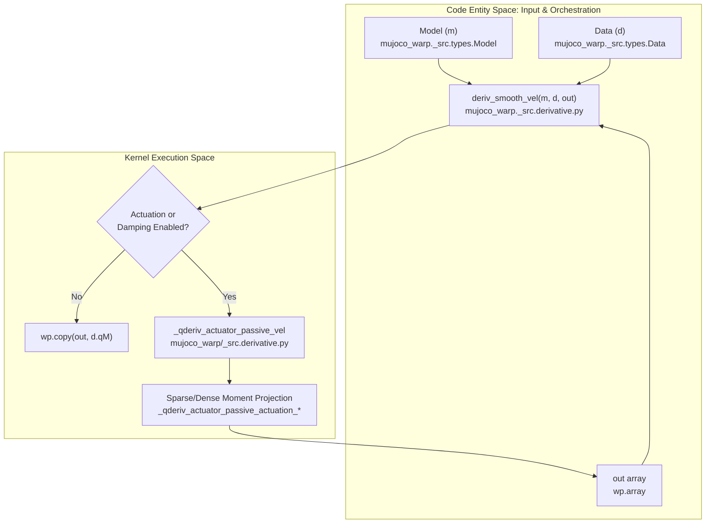
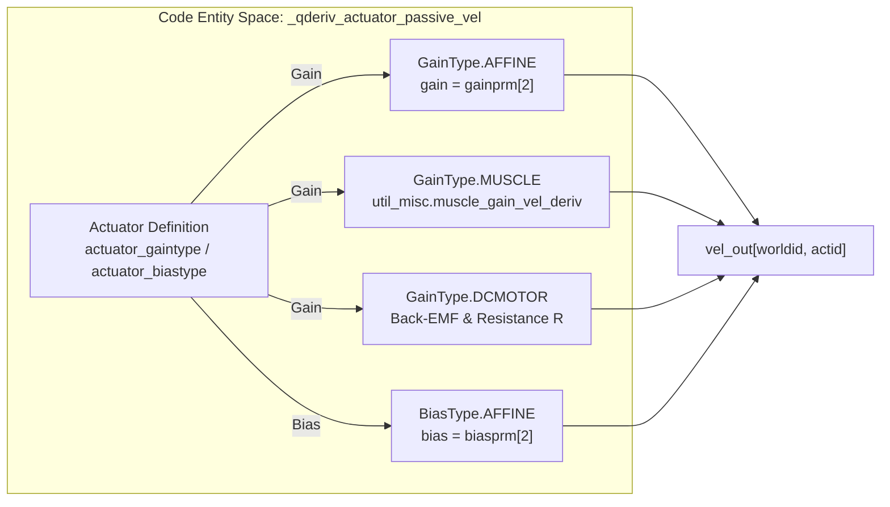
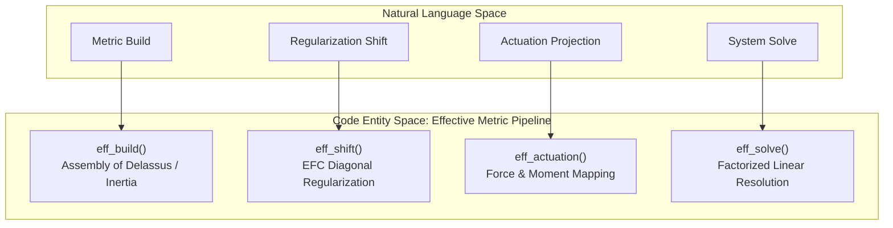
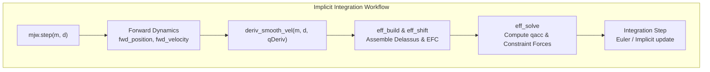

<!-- source: DeepWiki mcp.deepwiki.com · repo google-deepmind/mujoco_warp · page 7.2 Derivative Computations · fetched 2026-10-26 -->

# Derivative Computations

<details>
<summary>Relevant source files</summary>

The following files were used as context for generating this wiki page:

- [mujoco_warp/_src/derivative.py](mujoco_warp/_src/derivative.py)
- [mujoco_warp/_src/derivative_test.py](mujoco_warp/_src/derivative_test.py)
- [mujoco_warp/_src/forward_test.py](mujoco_warp/_src/forward_test.py)

</details>


## Purpose and Scope

This page documents the analytical computation of derivatives of smooth forces with respect to velocities (`deriv_smooth_vel`, `qDeriv`) and the effective-metric assembly routines (`eff_build`, `eff_shift`, `eff_actuation`, `eff_solve`) within the `mujoco_warp` physics pipeline [mujoco_warp/_src/derivative.py:1-46](). These components are essential for implicit integration schemes (such as `implicit` and `implicitfast`) and discrete-time dynamics, where the simulation must compute $\partial f/\partial v$ and assemble effective system metrics to solve for next-step states.

For information about forward dynamics and numerical integration schemes, see [Forward Dynamics and Integration](). For details about smooth dynamics functions whose derivatives are computed here, see [Kinematics and Dynamics](). For inverse dynamics that utilizes these metrics, see [Inverse Dynamics]().

**Sources:** [mujoco_warp/_src/derivative.py:1-46]()

## Overview and Core Data Structures (`deriv_smooth_vel` & `qDeriv`)

The derivative computation system computes the analytical Jacobian $\partial f/\partial v$ where $f$ represents smooth forces (actuator forces, damping forces, passive spring forces) and $v$ represents generalized velocities [mujoco_warp/_src/derivative.py:48-188](). The primary output, `qDeriv`, represents a modified inertia matrix:

```
qDeriv = qM - dt * ∂f/∂v
```

This matrix is used by implicit integrators and inverse dynamics solvers to account for velocity-dependent force gradients. The computation is executed entirely on the GPU using custom Warp kernels supporting both sparse and dense representations.



**Figure 1: Derivative Computation Orchestration**

**Sources:** [mujoco_warp/_src/derivative.py:48-188](), [mujoco_warp/_src/derivative_test.py:100-115]()

## Actuator Velocity Derivatives (`_qderiv_actuator_passive_vel`)

The kernel `_qderiv_actuator_passive_vel` extracts velocity-dependent coefficients from actuator gain and bias parameters [mujoco_warp/_src/derivative.py:48-132](). 



**Figure 2: Actuator Velocity Coefficient Kernel Structure**

For affine gain and bias types, coefficients are retrieved directly from parameter arrays. For specialized actuators like DC motors (`GainType.DCMOTOR`), the kernel calculates winding resistance, back-EMF contributions, and controller velocity derivatives ($\partial V/\partial \omega$) [mujoco_warp/_src/derivative.py:100-134]().

**Sources:** [mujoco_warp/_src/derivative.py:48-188]()

## Effective-Metric Assembly (`eff_build`, `eff_shift`, `eff_actuation`, `eff_solve`)

In implicit and discrete integration workflows, effective metrics combine the system inertia, derivative terms, constraint Jacobians, and regularizations into unified systems. The effective-metric functions (`eff_build`, `eff_shift`, `eff_actuation`, `eff_solve`) manage this construction and resolution.

| Function / Symbol | Role in Pipeline | Description |
|-------------------|------------------|-------------|
| `eff_build` | Metric Construction | Constructs the effective Delassus matrix or operational space metric incorporating `qDeriv` and constraint Jacobians. |
| `eff_shift` | Regularization / Shift | Applies constraint diagonal regularization (impedance, damping, or Newton-Raphson shifts) to the effective matrix. |
| `eff_actuation` | Force Projection | Projects actuator and passive force gradients into the constraint or generalized coordinate space. |
| `eff_solve` | System Resolution | Solves linear systems using factorized effective metrics (e.g., block Cholesky or conjugate gradients) to compute accelerations or constraint forces. |



**Figure 3: Effective-Metric Bridge from Concepts to Code**

**Sources:** [mujoco_warp/_src/derivative.py:1-46](), [mujoco_warp/_src/derivative_test.py:100-128]()

## Integration with Implicit and Discrete Schemes

Implicit integrators rely on `deriv_smooth_vel` and effective-metric routines to solve stiff systems without requiring excessively small timesteps. 



**Figure 4: Integration Pipeline with Derivative and Metric Routines**

**Sources:** [mujoco_warp/_src/derivative.py:180-242](), [mujoco_warp/_src/derivative_test.py:100-128]()

## Performance Characteristics

- **Dense vs. Sparse Layouts**: Dense implementations iterate over all DOF pairs ($nv^2$), whereas sparse implementations leverage CSR row/column indices (`M_rownnz`, `M_colind`) to restrict computations to non-zero entries.
- **GPU Parallelization**: All per-actuator velocity extractions and effective-metric assemblies utilize Warp grid-strided kernels across the `nworld` batch dimension, minimizing host-device synchronization overhead.

**Sources:** [mujoco_warp/_src/derivative.py:144-242](), [mujoco_warp/_src/derivative_test.py:43-128]()

---

