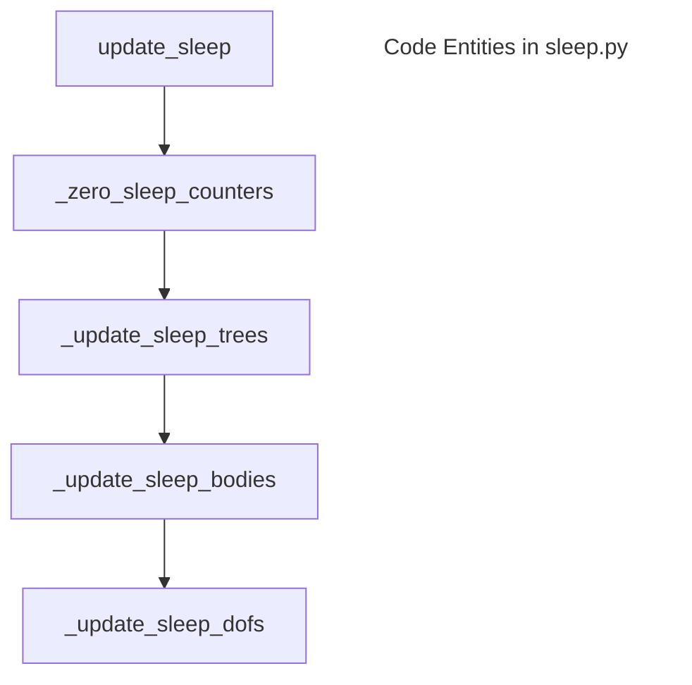
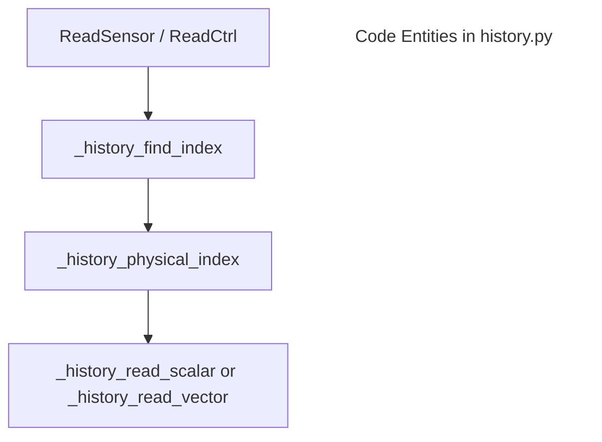

<!-- source: DeepWiki mcp.deepwiki.com · repo google-deepmind/mujoco_warp · page 7.3 Sleeping and Sensor History · fetched 2026-10-26 -->

# Sleeping and Sensor History

Relevant source files

The following files were used as context for generating this wiki page:

- [mujoco_warp/_src/history.py](mujoco_warp/_src/history.py)
- [mujoco_warp/_src/history_test.py](mujoco_warp/_src/history_test.py)
- [mujoco_warp/_src/sleep.py](mujoco_warp/_src/sleep.py)
- [mujoco_warp/_src/sleep_test.py](mujoco_warp/_src/sleep_test.py)

This page documents the implementation of sleep policies and states for inactive kinematic trees (`sleep.py`) and sensor/actuator delay history buffers (`history.py`) in `mujoco_warp`. These systems optimize computational throughput by bypassing physics evaluations for quiescent bodies and accurately interpolating delayed control inputs and sensor measurements.

---

## 1. Sleep Policies and Inactive Kinematic Trees (`sleep.py`)

The sleep subsystem manages inactive kinematic trees to eliminate redundant computations during simulation. When a kinematic tree remains stationary and below the sleep tolerance threshold for a specified duration, it enters an asleep state. 

### Core State and Kernels
Sleep states are tracked via per-world and per-tree arrays in `Data`:
* `d.tree_asleep`: Encodes sleep dependency cycles or awake flags (`K_AWAKE_VAL`).
* `d.tree_awake`: Binary indicator per tree (`0` for asleep, `1` for awake).
* `d.body_awake`: Per-body sleep states (`SleepState.AWAKE`, `SleepState.ASLEEP`, `SleepState.STATIC`).
* `d.body_awake_ind` and `d.dof_awake_ind`: Compact sparse index arrays containing indices of active bodies and degrees of freedom, enabling sparse kernels to skip inactive elements.

The pipeline is orchestrated by `update_sleep` [mujoco_warp/_src/sleep.py:171-216] and lightweight tree-only updates via `update_sleep_trees` [mujoco_warp/_src/sleep.py:218-234].

*Sources: [mujoco_warp/_src/sleep.py:86-216]*, [mujoco_warp/_src/sleep_test.py:35-143]()

### Waking Mechanisms
Sleeping trees automatically wake up when subjected to external perturbations, such as contacts or constraint/tendon violations. The function `_tendon_limit_active` [mujoco_warp/_src/sleep.py:58-83] checks whether a tendon's length violates its active limits within a given margin, triggering propagation across connected trees via `_wake_tree` [mujoco_warp/_src/sleep.py:236-251]. Similarly, collision detection interactions automatically invoke wake routines to transition impacted trees from `SleepState.ASLEEP` to `SleepState.AWAKE`.

Sources: [mujoco_warp/_src/sleep.py:32-251](), [mujoco_warp/_src/sleep_test.py:90-192]()

---

## 2. Sensor and Control History Buffers (`history.py`)

Sensor and actuator delays are managed using circular history buffers. Each buffer records historical scalar or vector values alongside their corresponding simulation timestamps.

### Circular Buffer Indexing and Search
History buffers store temporal data in a rolling layout. The physical array index corresponding to a logical age is resolved via `_history_physical_index` [mujoco_warp/_src/history.py:30-33]:

$$\text{phys} = (\text{cursor} + 1 + \text{logical}) \pmod n$$

To query a historical value at arbitrary time $t$, `_history_find_index` [mujoco_warp/_src/history.py:36-76] executes a circular binary search matching the reference MuJoCo `historyFindIndex` routine.

*Sources: [mujoco_warp/_src/history.py:29-216]*, [mujoco_warp/_src/history_test.py:45-153]()

### Interpolation Methods
Once the bracketing historical entries are identified, `_history_read_scalar` [mujoco_warp/_src/history.py:80-156] and `_history_read_vector` [mujoco_warp/_src/history.py:159-216] support three interpolation modes:
1. **Zero-Order Hold (ZOH, `interp = 0`)**: Returns the value of the older bracketing sample.
2. **Linear Interpolation (`interp = 1`)**: Computes a linear blend between bracketing samples based on $\alpha$.
3. **Cubic Spline (`interp = 2`)**: Evaluates Catmull-Rom cubic splines using finite-differenced slopes at the endpoints for smooth trajectory reconstruction.

Sources: [mujoco_warp/_src/history.py:29-216](), [mujoco_warp/_src/history_test.py:45-192]()

---

## 3. Interaction with Collision, Solver, and Fast Paths

The sleeping and history subsystems integrate directly with the broader physics pipeline to maximize performance:
* **Collision Filtering**: Broadphase and narrowphase collision routines check body sleep states (`body_awake`) to prune collision pairs involving two sleeping bodies, avoiding redundant distance and contact calculations.
* **Solver Fast Paths**: Kinematic trees marked as asleep are excluded from forward kinematics (`fwd_position`, `fwd_velocity`), passive force evaluations, and dense constraint block solves. Only awake DOFs populate active index arrays (`dof_awake_ind`), restricting constraint matrix assembly (`efc`) and iterative updates to active physics islands.

Sources: [mujoco_warp/_src/sleep.py:115-168](), [mujoco_warp/_src/sleep_test.py:35-90]()

---

