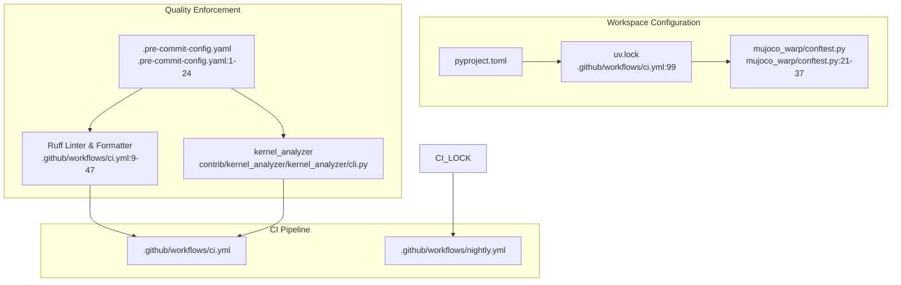
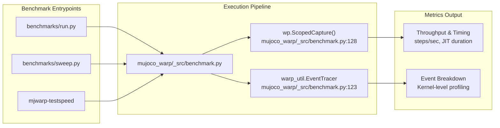

<!-- source: DeepWiki mcp.deepwiki.com · repo google-deepmind/mujoco_warp · page 8 Development, Testing and Benchmarking · fetched 2026-10-26 -->

# Development, Testing and Benchmarking

Relevant source files

The following files were used as context for generating this wiki page:

- [.agent/rules/project.md](.agent/rules/project.md)
- [.github/workflows/ci.yml](.github/workflows/ci.yml)
- [.github/workflows/nightly.yml](.github/workflows/nightly.yml)
- [.github/workflows/pypi.yml](.github/workflows/pypi.yml)
- [.pre-commit-config.yaml](.pre-commit-config.yaml)
- [AGENTS.md](AGENTS.md)
- [AUTHORS](AUTHORS)
- [CONTRIBUTING.md](CONTRIBUTING.md)
- [LICENSE](LICENSE)
- [mujoco_warp/conftest.py](mujoco_warp/conftest.py)

## Purpose and Scope

This page provides a high-level overview of the development workflows, test infrastructure, CI/CD pipelines, benchmarking tools, tooling, and framework integrations in `mujoco_warp`. For detailed coverage of specific sub-systems, refer to the designated child pages:

- **Testing Infrastructure**: See [Testing Infrastructure](#8.1) for pytest configuration, conftest fixtures, model test corpora, pre-commit validation, and MuJoCo C reference comparisons.
- **Benchmarking and Profiling**: See [Benchmarking and Profiling](#8.2) for `mjwarp-testspeed`, event tracing, performance measurement, and the `benchmarks/` suite.
- **JAX Integration**: See [JAX Integration](#8.3) for differentiable physics wrapping via `ffi.jax_callable`, `io_jax`, and unrolling patterns.
- **Contrib Tooling and Kernel Analyzer**: See [Contrib Tooling and Kernel Analyzer](#8.4) for the `contrib/` directory, kernel argument conventions, and the kernel analyzer LSP/CLI tool.

---

## Development Workflow and Environment Setup

The repository utilizes `uv` for dependency management, Python virtual environments, and reproducible builds [CONTRIBUTING.md:16-20](). Code formatting and linting are strictly enforced via Ruff and pre-commit hooks [.pre-commit-config.yaml:1-23]().

*Diagram 1: Development toolchain and configuration entity mapping.*

Sources: [.github/workflows/ci.yml:1-144](), [.pre-commit-config.yaml:1-23](), [CONTRIBUTING.md:11-20](), [mujoco_warp/conftest.py:21-37]()

---

## 8.1 Testing Infrastructure

The testing framework leverages `pytest` alongside custom `conftest.py` command-line options (`--cpu`, `--verify_cuda`, `--lineinfo`, `--debug_mode`) to validate warp kernels and physics pipelines [mujoco_warp/conftest.py:21-52](). Tests compare `mujoco_warp` simulation outputs directly against the upstream MuJoCo C reference implementation using standardized tolerances [CONTRIBUTING.md:53-54]().

For detailed information on conftest fixtures, model test corpora, CI workflows, and validation suites, see [Testing Infrastructure](#8.1).

Sources: [mujoco_warp/conftest.py:21-52](), [CONTRIBUTING.md:41-61]()

---

## 8.2 Benchmarking and Profiling

Performance evaluation is driven by utilities such as `mjwarp-testspeed` and the `benchmarks/` directory [CONTRIBUTING.md:62-87](). These tools capture simulation execution graphs via `wp.ScopedCapture()` and analyze kernel-level latencies using event tracing [mujoco_warp/_src/benchmark.py:123-132]().

*Diagram 2: Benchmarking control flow and performance metric collection.*

For detailed configuration of assets, menagerie fetching, trajectory replays, and sweep scripts, see [Benchmarking and Profiling](#8.2).

Sources: [CONTRIBUTING.md:62-87](), [mujoco_warp/_src/benchmark.py:41-171]()

---

## 8.3 JAX Integration

`mujoco_warp` integrates seamlessly with JAX via the `warp.jax_experimental.ffi` module. This bridge exposes an `ffi.jax_callable` wrapper that wraps Warp kernels, enabling differentiable physics and JIT-compiled simulation loops within JAX workflows.

For complete implementation patterns, `io_jax` utilities, unrolling strategies, and tutorial notebooks, see [JAX Integration](#8.3).

Sources: [CONTRIBUTING.md:1-101]()

---

## 8.4 Contrib Tooling and Kernel Analyzer

The `contrib/` directory hosts auxiliary scripts and quality tools, most notably the `kernel_analyzer` [contrib/kernel_analyzer/kernel_analyzer/cli.py](). The analyzer inspects kernel argument conventions (`_in` for inputs, `_out` for outputs) and enforces parameter ordering rules in accordance with `Model` and `Data` structures [CONTRIBUTING.md:28-30]().

For detailed documentation on the VS Code extension, LSP server integration, and automated verification scripts, see [Contrib Tooling and Kernel Analyzer](#8.4).

Sources: [.github/workflows/ci.yml:129-144](), [CONTRIBUTING.md:24-30](), [.pre-commit-config.yaml:17-23]()

---

