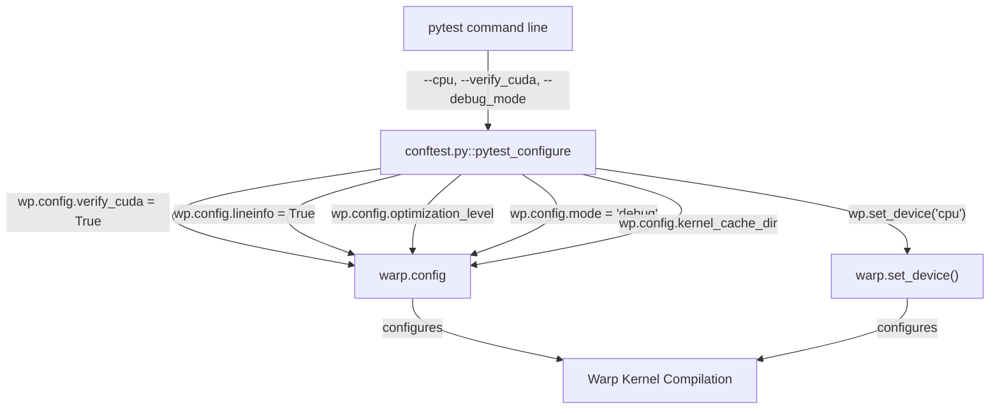
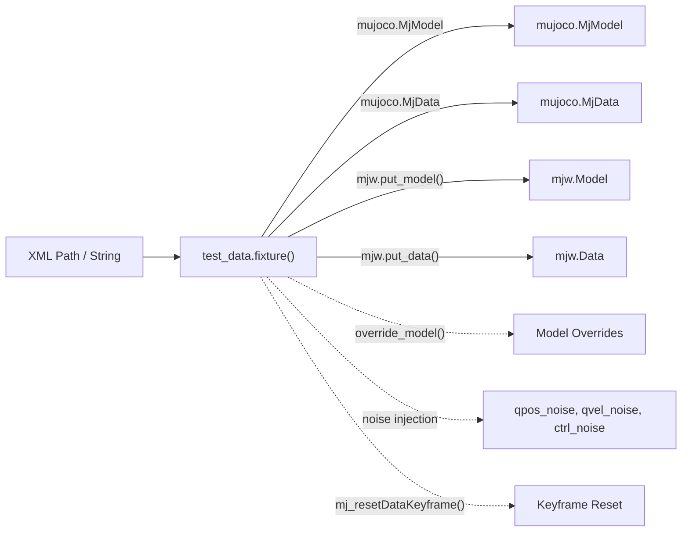
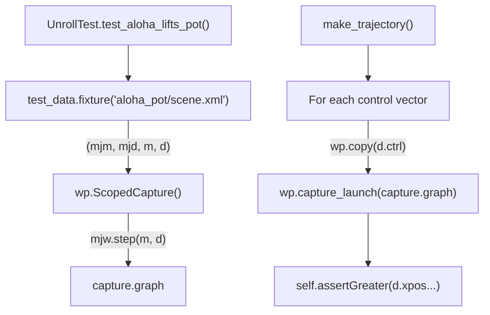
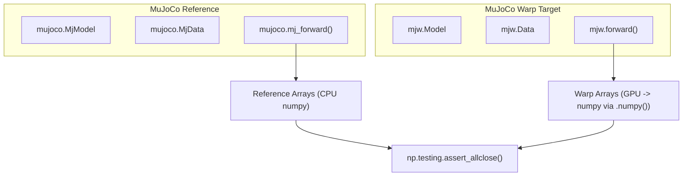

<!-- source: DeepWiki mcp.deepwiki.com · repo google-deepmind/mujoco_warp · page 8.1 Testing Infrastructure · fetched 2026-10-26 -->

# Testing Infrastructure

Relevant source files

The following files were used as context for generating this wiki page:

- [.github/workflows/ci.yml](.github/workflows/ci.yml)
- [.github/workflows/nightly.yml](.github/workflows/nightly.yml)
- [.github/workflows/pypi.yml](.github/workflows/pypi.yml)
- [.pre-commit-config.yaml](.pre-commit-config.yaml)
- [mujoco_warp/_src/unroll_test.py](mujoco_warp/_src/unroll_test.py)
- [mujoco_warp/conftest.py](mujoco_warp/conftest.py)
- [mujoco_warp/test_data/__init__.py](mujoco_warp/test_data/__init__.py)

## Purpose and Scope

This page documents the testing infrastructure for MuJoCo Warp, including pytest configuration, test organization patterns, trajectory unrolling tests, CI/CD pipelines, and pre-commit hooks. The testing infrastructure is designed to ensure mathematical parity with the MuJoCo reference implementation while maintaining high performance on GPU hardware.

The testing infrastructure serves three primary goals:
1.  **Correctness validation** - Verify that MuJoCo Warp produces results matching the MuJoCo C reference implementation [mujoco_warp/_src/broadphase_test.py:123-133]().
2.  **Long-horizon stability** - Catch subtle numerical regressions over hundreds or thousands of physics steps via trajectory unrolling tests [mujoco_warp/_src/unroll_test.py:16-22]().
3.  **Regression prevention** - Catch breaking changes through automated CI/CD checks across multiple Python versions (`3.10`, `3.14`) and dependency states [.github/workflows/ci.yml:65-71]().

Sources: [.github/workflows/ci.yml:65-71](), [mujoco_warp/_src/unroll_test.py:16-22]()

## pytest Configuration System

MuJoCo Warp uses `pytest` with custom configuration options defined in [mujoco_warp/conftest.py:21-52]() to support testing across different hardware platforms and compilation modes.

### Configuration Options

The pytest configuration provides the following command-line options via `conftest.py::pytest_addoption`:

| Option | Type | Purpose |
| :--- | :--- | :--- |
| `--cpu` | flag | Force tests to run on CPU instead of GPU [mujoco_warp/conftest.py:22-22](). |
| `--verify_cuda` | flag | Enable CUDA error checking for debugging GPU kernels [mujoco_warp/conftest.py:23-28](). |
| `--lineinfo` | flag | Add line information to Warp kernel compilation for profiling [mujoco_warp/conftest.py:29-29](). |
| `--optimization_level` | integer | Set `wp.config.optimization_level` (0-3) [mujoco_warp/conftest.py:30-30](). |
| `--debug_mode` | flag | Compile kernels in debug mode (`wp.config.mode = "debug"`) [mujoco_warp/conftest.py:31-31](). |
| `--kernel_cache_dir` | path | Override default directory for compiled kernel cache [mujoco_warp/conftest.py:32-37](). |

### Configuration Flow

The `pytest_configure` function processes these options and applies them to the global `wp.config` state before test execution [mujoco_warp/conftest.py:40-52]().

Title: Pytest Configuration Mapping to Warp Runtime

Sources: [mujoco_warp/conftest.py:21-52]()

## Test Organization and Patterns

### Test Fixture Pattern

Tests use a centralized fixture utility defined in `mujoco_warp.test_data.fixture` [mujoco_warp/test_data/__init__.py:28-45](). This helper orchestrates loading models, injecting noise, initializing state, and wrapping them for both MuJoCo C and GPU Warp execution.

Title: Data Flow in test_data.fixture

Sources: [mujoco_warp/test_data/__init__.py:28-121]()

The fixture function supports parameters such as `path`, `xml`, `keyframe`, noise magnitudes (`qpos_noise`, `qvel_noise`, `ctrl_noise`, `qfrc_noise`, `xfrc_noise`, `mocap_noise`), `overrides`, `nworld`, `nvmax`, and `batch_sizes` [mujoco_warp/test_data/__init__.py:28-44](). It executes `mujoco.mj_forward` to stabilize states before calling `mjw.put_model` and `mjw.put_data` [mujoco_warp/test_data/__init__.py:106-119]().

### Long-Horizon Trajectory Unrolling

To catch subtle numerical and physics stability regressions over extended execution horizons, tests like `UnrollTest` in `mujoco_warp/_src/unroll_test.py` replay full trajectories using CUDA graph capture [mujoco_warp/_src/unroll_test.py:16-22]().

Title: Trajectory Unrolling and Capture Flow

Sources: [mujoco_warp/_src/unroll_test.py:37-56]()

### Validation Against Reference Implementation

Tests validate correctness by comparing Warp array results against MuJoCo C reference arrays using `np.testing.assert_allclose`.

Title: Reference Validation Pattern

Sources: [mujoco_warp/_src/broadphase_test.py:123-133](), [mujoco_warp/test_data/__init__.py:106-119]()

Sources: [mujoco_warp/_src/unroll_test.py:37-56](), [mujoco_warp/test_data/__init__.py:28-121]()

## CI/CD Pipeline and Pre-commit Hooks

The CI pipeline is defined in [.github/workflows/ci.yml]() and uses parallel jobs to enforce code quality, linting, and correctness across Python versions.

### Workflow Structure

1.  **Format and Linting**: Uses `ruff format --check` and `ruff check` on Python `3.14` [.github/workflows/ci.yml:9-48]().
2.  **Pre-commit Checks**: Executes all pre-commit hooks via `uvx --with absl-py pre-commit run -a` [.github/workflows/ci.yml:49-64]().
3.  **Testing Strategy**:
    *   Runs on Python `3.10` and `3.14` with both locked `uv` dependencies and stable PyPI releases [.github/workflows/ci.yml:68-71]().
    *   Executes `pytest -n 2` with `pytest-xdist` [.github/workflows/ci.yml:115-121]().
    *   Runs specialized checks such as out-of-bounds validation for batched model fields (`mujoco_warp/_src/io_test.py -k test_model_batched_fields --debug_mode`) [.github/workflows/ci.yml:124-127]().
4.  **Kernel Analyzer**: Runs `contrib/kernel_analyzer/kernel_analyzer/cli.py` to inspect Warp kernels in `mujoco_warp/_src/*.py` [.github/workflows/ci.yml:129-144]().

### Nightly Upstream Checks

A nightly workflow [.github/workflows/nightly.yml]() runs daily at 11 AM UTC [.github/workflows/nightly.yml:1-5](). It tests against the latest upstream versions (including pre-releases of `mujoco` and `warp-lang`) using `uv lock --upgrade` to provide early warnings for breaking changes [.github/workflows/nightly.yml:12-45]().

### Pre-commit Configuration

The project configures local and remote hooks in [.pre-commit-config.yaml]() [,.pre-commit-config.yaml:1-24]().

| Hook ID | Source | Role |
| :--- | :--- | :--- |
| `ruff` | `ruff-pre-commit` | Lints and auto-fixes Python code [.pre-commit-config.yaml:5-6](). |
| `ruff-format` | `ruff-pre-commit` | Formats code according to project style [.pre-commit-config.yaml:7-7](). |
| `uv-lock` | `uv-pre-commit` | Ensures `uv.lock` is up to date [.pre-commit-config.yaml:16-16](). |
| `kernel-analyzer` | local | Static analysis of Warp kernel arguments [.pre-commit-config.yaml:19-23](). |

Sources: [.github/workflows/ci.yml:1-144](), [.github/workflows/nightly.yml:1-45](), [.pre-commit-config.yaml:1-23]()

---

