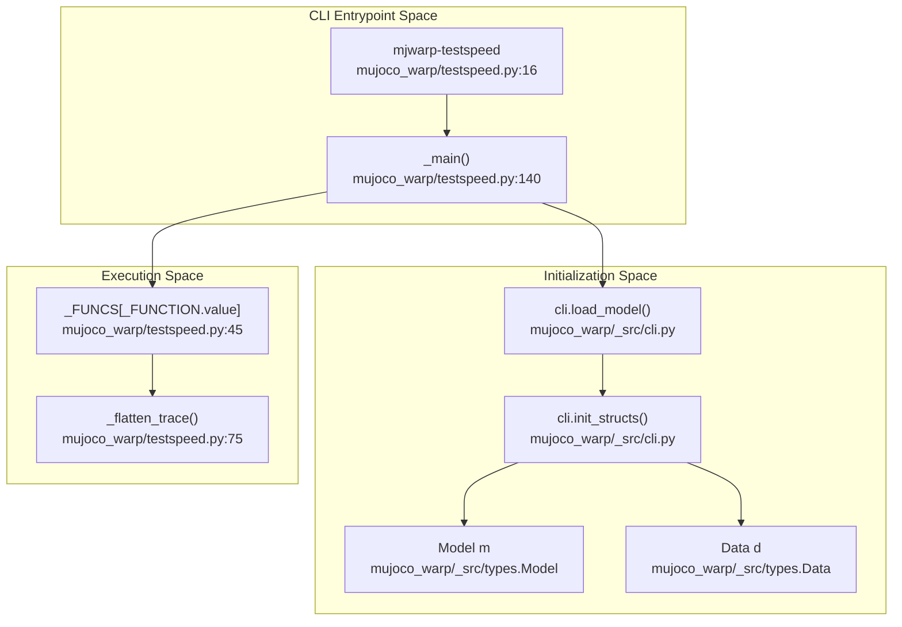
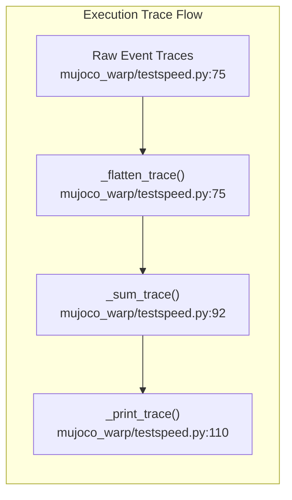
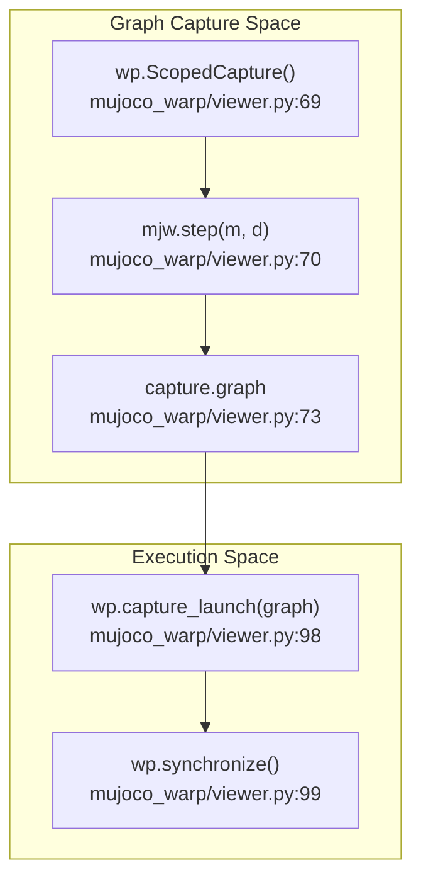

<!-- source: DeepWiki mcp.deepwiki.com · repo google-deepmind/mujoco_warp · page 8.2 Benchmarking and Profiling · fetched 2026-10-26 -->

# Benchmarking and Profiling

Relevant source files

The following files were used as context for generating this wiki page:

- [mujoco_warp/testspeed.py](mujoco_warp/testspeed.py)
- [mujoco_warp/viewer.py](mujoco_warp/viewer.py)

This page documents the performance measurement, event tracing, memory profiling, and benchmarking workflows provided by `mujoco_warp`. The primary tool for performance analysis is the `mjwarp-testspeed` command-line utility [mujoco_warp/testspeed.py:16-22](), which measures throughput, timing breakdowns, allocation counts, and solver convergence rates across parallel GPU worlds.

---

## Performance Measurement with `mjwarp-testspeed`

The `mjwarp-testspeed` utility serves as the core entrypoint for evaluating simulation performance on NVIDIA GPUs [mujoco_warp/testspeed.py:16-22](). It loads an MJCF XML file, initializes the device structures via `cli.init_structs` [mujoco_warp/testspeed.py:171](), and executes parallel rollouts for functions such as `step` or `forward` [mujoco_warp/testspeed.py:51]().

### Configuration Flags
The utility exposes several flags for configuring runtime diagnostics and solver parameters:

| Flag | Default | Description |
|------|---------|-------------|
| `--function` | `step` | The target function to benchmark (e.g., `step`, `forward`) [mujoco_warp/testspeed.py:51](). |
| `--clear_warp_cache` | `False` | Clear Warp kernel, LTO, and compute caches before execution [mujoco_warp/testspeed.py:52](). |
| `--measure_alloc` | `False` | Print a report of contacts and constraints per step [mujoco_warp/testspeed.py:53](). |
| `--measure_solver` | `False` | Print a report of solver iterations per step [mujoco_warp/testspeed.py:54](). |
| `--memory` | `False` | Print detailed GPU memory allocation report [mujoco_warp/testspeed.py:56](). |
| `--format` | `human` | Output format (`human`, `short`, or `json`) [mujoco_warp/testspeed.py:58](). |

Sources: [mujoco_warp/testspeed.py:16-62](), [mujoco_warp/testspeed.py:140-175]()

---

## Profiling Workflows: Tracing and Memory

Profiling workflows in `mujoco_warp` include event tracing for hierarchical kernel execution timing and recursive dataclass inspection for memory usage.

### Event Tracing and Kernel Timings
Event tracing flattens nested execution metrics across parallel rollouts using helper functions like `_flatten_trace` and `_sum_trace` [mujoco_warp/testspeed.py:75-107](). When profiling is active, execution durations of individual pipeline stages are measured and normalized per step and world.

### Memory Profiling
The `--memory` flag initiates a recursive traversal via `_dataclass_memory` to inspect capacity metrics for every `wp.array` within the `Model` and `Data` structures [mujoco_warp/testspeed.py:64-72](). 

Sources: [mujoco_warp/testspeed.py:64-138]()

---

## Benchmark Suite

For automated performance regressions, menagerie integration, and multi-scene evaluations, `mujoco_warp` provides a comprehensive test and benchmark driver collection. 

For details, see [Benchmark Suite](#8.2.1).

Sources: [mujoco_warp/testspeed.py:16-22]()

---

## CUDA Graph Acceleration

To minimize host-side launch overhead during benchmarking and interactive sessions (`mjwarp-viewer`), simulation loops can be captured into CUDA graphs using Warp scoping primitives [mujoco_warp/viewer.py:68-73]().

Sources: [mujoco_warp/viewer.py:65-102](), [mujoco_warp/viewer.py:164-168]()

---

