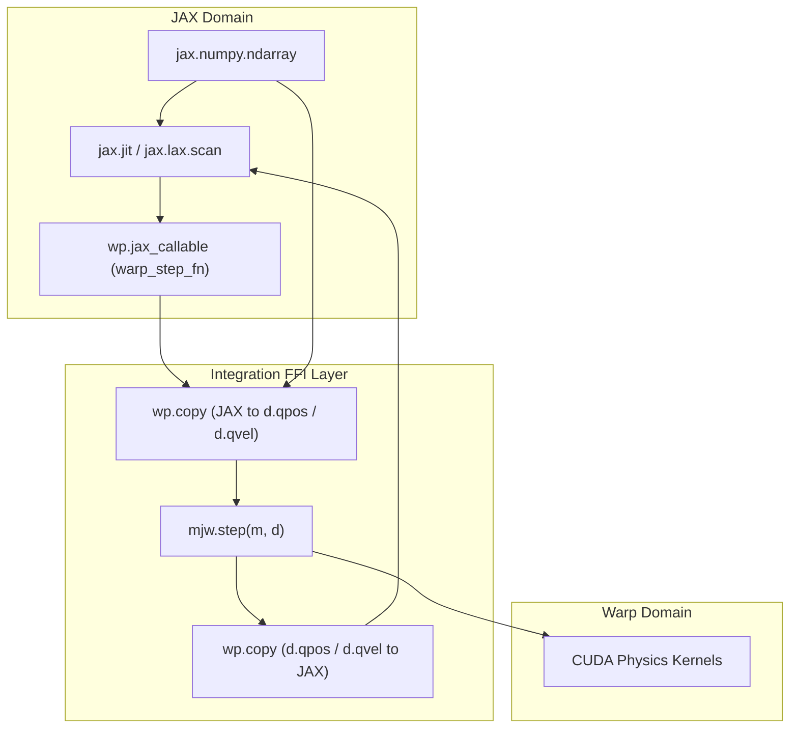
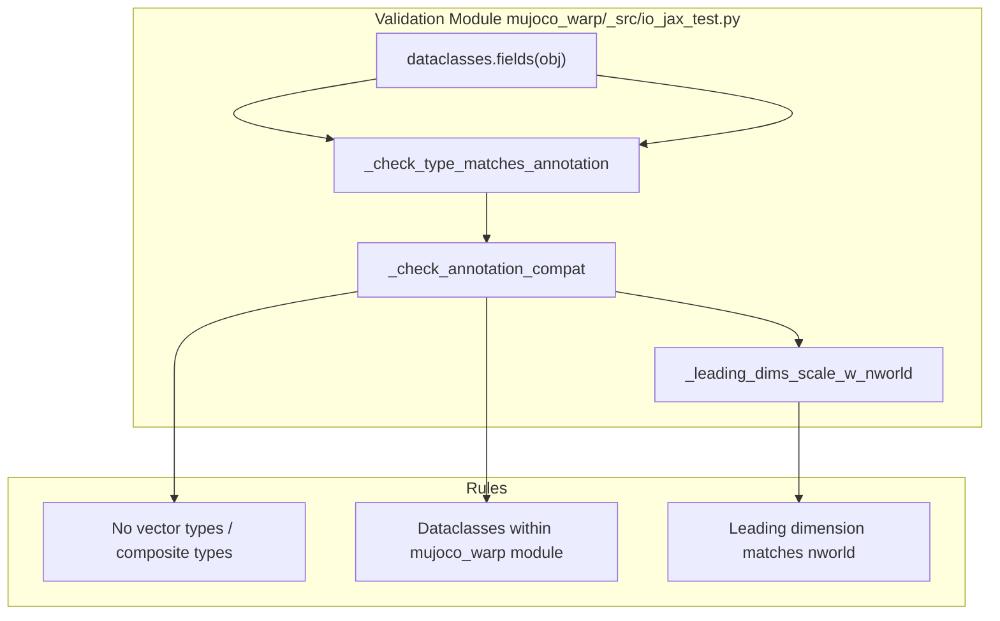

<!-- source: DeepWiki mcp.deepwiki.com · repo google-deepmind/mujoco_warp · page 8.3 JAX Integration · fetched 2026-10-26 -->

# JAX Integration

<details>
<summary>Relevant source files</summary>

The following files were used as context for generating this wiki page:

- [contrib/apptronik_apollo_locomotion.ipynb](contrib/apptronik_apollo_locomotion.ipynb)
- [contrib/jax_unroll.py](contrib/jax_unroll.py)
- [mujoco_warp/_src/io_jax_test.py](mujoco_warp/_src/io_jax_test.py)
- [mujoco_warp/_src/jax_test.py](mujoco_warp/_src/jax_test.py)
- [notebooks/tutorial.ipynb](notebooks/tutorial.ipynb)

</details>


This page covers the JAX integration capabilities of MuJoCo Warp (`mujoco_warp`), enabling differentiable physics simulation, compilation via JIT, and integration into machine learning workflows using JAX.

## Overview

The JAX integration in MuJoCo Warp bridges NVIDIA Warp's GPU-accelerated parallel physics simulation pipeline with JAX's ecosystem. By wrapping Warp kernels using `wp.jax_callable` [mujoco_warp/_src/jax_test.py:82](), the simulation state can be synchronized bidirectionally with JAX arrays (`jax.numpy.ndarray`), allowing simulations to be unrolled within `jax.lax.scan` [mujoco_warp/_src/jax_test.py:78](), differentiated, and optimized via XLA.

Sources: [mujoco_warp/_src/jax_test.py:35-94](), [contrib/jax_unroll.py:38-73]()

## Core Integration Architecture

The integration relies on Warp's Foreign Function Interface (FFI) to expose Warp operations to the XLA compiler graph. 

### FFI and JAX-Warp Bridge

Title: JAX-Warp FFI Bridge Architecture



**JAX-Warp Integration Flow**
Data passes from JAX arrays into MuJoCo Warp `Data` buffers via `wp.copy` [mujoco_warp/_src/jax_test.py:66-67](), executed through `mjw.step` [mujoco_warp/_src/jax_test.py:68](), and copied back for JAX gradient computation or unrolling.

Sources: [mujoco_warp/_src/jax_test.py:61-88](), [contrib/jax_unroll.py:38-56]()

## Implementation Components

### The `wp.jax_callable` Wrapper

The primary hook for exposing Warp step functions to JAX is `wp.jax_callable` [mujoco_warp/_src/jax_test.py:82](). It takes a native Warp-compatible function containing kernel launches and data copies, defines the expected output shapes, and returns a JAX-compatible primitive.

```python
warp_step_fn = wp.jax_callable(
    warp_step,
    num_outputs=2,
    output_dims={"qpos_out": (NWORLDS, mjm.nq), "qvel_out": (NWORLDS, mjm.nv)},
    graph_mode=wp.JaxCallableGraphMode.WARP,
)
```

| Parameter | Code Reference / Purpose |
|-----------|--------------------------|
| `warp_step` | Python function executing `mjw.step(m, d)` with explicit `wp.copy` calls [mujoco_warp/_src/jax_test.py:61-71](). |
| `num_outputs` | Number of output arrays returned by the FFI call [mujoco_warp/_src/jax_test.py:84](). |
| `output_dims` | Dictionary specifying batch and feature dimensions for outputs [mujoco_warp/_src/jax_test.py:85](). |
| `graph_mode` | Graph capture setting (`wp.JaxCallableGraphMode.WARP`) [mujoco_warp/_src/jax_test.py:86](). |

Sources: [mujoco_warp/_src/jax_test.py:61-87](), [contrib/jax_unroll.py:38-56]()

### Environment Configuration

To ensure seamless memory sharing and CUDA graph capture between JAX and Warp, specific environment variables must be configured before running simulations:

```python
os.environ["XLA_FLAGS"] = "--xla_gpu_graph_min_graph_size=1"
os.environ["XLA_PYTHON_CLIENT_ALLOCATOR"] = "platform"
```

- `XLA_FLAGS`: `--xla_gpu_graph_min_graph_size=1` forces XLA to capture small graphs, aligning with Warp's internal CUDA graph handling [mujoco_warp/_src/jax_test.py:31]().
- `XLA_PYTHON_CLIENT_ALLOCATOR`: Set to `"platform"` to prevent memory fragmentation and allow allocations to be returned on demand when sharing the GPU context [mujoco_warp/_src/jax_test.py:33]().

Sources: [mujoco_warp/_src/jax_test.py:31-33](), [contrib/jax_unroll.py:18]()

Sources: [mujoco_warp/_src/jax_test.py:31-88](), [contrib/jax_unroll.py:18-56]()

## Usage Patterns and Unrolling

### Trajectory Unrolling with `jax.lax.scan`

Long-horizon simulations and reinforcement learning rollouts use `jax.lax.scan` wrapped in `jax.jit` to compile and execute unrolled simulation loops efficiently on the GPU.

```python
def unroll(qpos, qvel):
  def step(carry, _):
    qpos, qvel = carry
    qpos, qvel = warp_step_fn(qpos, qvel)
    return (qpos, qvel), None

  (qpos, qvel), _ = jax.lax.scan(step, (qpos, qvel), length=UNROLL_LENGTH)
  return qpos, qvel

jax_unroll_fn = jax.jit(unroll).lower(jax_qpos, jax_qvel).compile()
```

Sources: [mujoco_warp/_src/jax_test.py:72-81](), [contrib/jax_unroll.py:62-73]()

Sources: [mujoco_warp/_src/jax_test.py:72-93](), [contrib/jax_unroll.py:62-79]()

## Data Compatibility and Validation

MuJoCo Warp includes test suites (such as `mujoco_warp/_src/io_jax_test.py`) to validate that internal model and data dataclasses satisfy JAX serialization and typing constraints.

Title: JAX Data Compatibility Validation Pipeline



**JAX Compatibility Checks**
The validation suite enforces that all state fields mapped across the FFI comply with JAX typing rules, avoiding unsupported composite vectors and confirming proper leading `nworld` dimensions.

Sources: [mujoco_warp/_src/io_jax_test.py:45-185]()

Sources: [mujoco_warp/_src/io_jax_test.py:45-185]()

---

