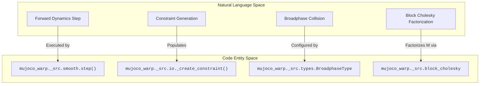
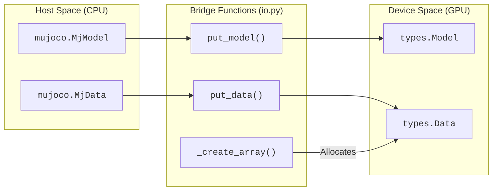

<!-- source: DeepWiki mcp.deepwiki.com · repo google-deepmind/mujoco_warp · page 9 Glossary · fetched 2026-10-26 -->

# Glossary

Relevant source files

The following files were used as context for generating this wiki page:

- [mujoco_warp/_src/io.py](mujoco_warp/_src/io.py)
- [mujoco_warp/_src/solver.py](mujoco_warp/_src/solver.py)
- [mujoco_warp/_src/solver_test.py](mujoco_warp/_src/solver_test.py)
- [mujoco_warp/_src/types.py](mujoco_warp/_src/types.py)

## Purpose and Scope
This page defines codebase-specific terms, jargon, abbreviations, and domain concepts used throughout the **MuJoCo Warp** (`mujoco_warp`) implementation. It serves as a technical reference for mapping physics simulation jargon and NVIDIA Warp primitives to their concrete data structures, functions, and kernel code paths.

## Core Simulation Concepts

### MJWarp
The codebase architecture and package name referring to the GPU-accelerated implementation of MuJoCo physics algorithms using NVIDIA Warp.
*   **Sources:** [mujoco_warp/_src/io.py:1-35](), [mujoco_warp/_src/types.py:1-20]()

### Multi-World Batching (`nworld`)
The capacity to simulate multiple independent MuJoCo environments simultaneously within a single GPU launch. Represented across batched fields via the `nworld` dimension.
*   **Data Representation:** `wp.array` where the leading dimension corresponds to `nworld`.
*   **Sources:** [mujoco_warp/_src/types.py:41-80](), [mujoco_warp/_src/io.py:42-64]()

### Model and Data (Device-Side)
Device-side representations of MuJoCo's `MjModel` and `MjData` structures transferred via the I/O bridge.
*   **`Model`**: Dataclass holding static environment definitions (geoms, joints, bodies) on the device [mujoco_warp/_src/types.py:32-38]().
*   **`Data`**: Dataclass holding dynamic states (`qpos`, `qvel`, forces) and solver workspace allocations per world [mujoco_warp/_src/io.py:77-150]().

---

## Constraint System Terms

### EFC (Effective Constraint)
A flattened representation of all active constraint rows (contacts, limits, equality constraints, flex strain) handled during the constraint solver phase.
*   **`efc_J`**: Constraint Jacobian matrix [mujoco_warp/_src/io.py:89-91]()
*   **`efc_D`**: Constraint impedance/diagonal mass entries [mujoco_warp/_src/io.py:94-108]()
*   **`efc_aref`**: Reference acceleration vector in constraint space [mujoco_warp/_src/io.py:95-108]()
*   **Sources:** [mujoco_warp/_src/io.py:81-131](), [mujoco_warp/_src/solver.py:67-116]()

### Solver Types
Iterative algorithms used to resolve constraints and compute accelerations:
*   **`CG`**: Conjugate Gradient solver path [mujoco_warp/_src/solver.py:87-97]().
*   **`NEWTON`**: Newton-based solver path assembling the system Hessian $H = M + J^T D J$ [mujoco_warp/_src/solver.py:85-86]().
*   **Sources:** [mujoco_warp/_src/solver.py:67-116]()

### Linesearch
An optimization procedure finding step-size scaling ($\alpha$) to satisfy descent conditions in the solver.
*   **`ls_iterative`**: Sequential linesearch update implementation [mujoco_warp/_src/types.py:112]().
*   **Sources:** [mujoco_warp/_src/solver.py:118-186](), [mujoco_warp/_src/solver_test.py:98-128]()

---

## Collision Detection Jargon

### Broadphase vs. Narrowphase
*   **Broadphase**: Spatial filtering stage (`nxn_broadphase` or `sap_broadphase`) filtering impossible collision pairs using bounding volumes (`BroadphaseFilter`) [mujoco_warp/_src/types.py:124-152]().
*   **Narrowphase**: Precise geometry intersection routines (primitives, GJK/EPA, signed distance fields) generating contact manifolds.
*   **Sources:** [mujoco_warp/_src/types.py:124-152](), [mujoco_warp/_src/solver.py:118-163]()

### GJK / EPA and CCD
*   **GJK (Gilbert-Johnson-Keerthi)**: Distance and intersection query algorithm between convex shapes using support mappings.
*   **EPA (Expansion Polytope Algorithm)**: Penetration depth and contact vector calculation for overlapping convex geometry.
*   **CCD (Continuous Collision Detection)**: Time-of-impact intersection tracking over dynamic intervals.
*   **Sources:** [mujoco_warp/_src/types.py:33-36](), [mujoco_warp/_src/solver_test.py:131-163]()

### Support Point
A function evaluating the extremal point of a convex shape along a provided direction vector, serving as the basis for GJK/EPA queries.
*   **Sources:** [mujoco_warp/_src/solver_test.py:165-218]()

---

## System Mapping Diagrams

### From Physics Concepts to Code Entities
This diagram associates natural language physics concepts with their concrete implementations in code entities and Warp kernels.

**Sources:** [mujoco_warp/_src/io.py:81-131](), [mujoco_warp/_src/types.py:124-136]()

### Data Flow Mapping: CPU to GPU I/O Bridge
Mapping the transfer of model specifications and dynamic data structures from host MuJoCo to device-side Warp arrays.

**Sources:** [mujoco_warp/_src/io.py:45-131](), [mujoco_warp/_src/types.py:32-38]()

---

## Technical Abbreviations

| Abbreviation | Full Term | Description | Code Pointer |
| :--- | :--- | :--- | :--- |
| **qpos** | Generalized Positions | Joint coordinate state vector. | `Data.qpos` in [mujoco_warp/_src/types.py]() |
| **qvel** | Generalized Velocities | Joint velocity state vector. | `Data.qvel` in [mujoco_warp/_src/types.py]() |
| **nv** | Degrees of Freedom | Dimension of generalized velocity space. | `Model.nv` in [mujoco_warp/_src/types.py:81]() |
| **nefc** | Effective Constraints | Count of active scalar constraint rows. | `Data.nefc` in [mujoco_warp/_src/io.py:96]() |
| **njmax** | Max Constraints Capacity | Preallocated allocation size limit for EFC rows. | `Data.njmax` in [mujoco_warp/_src/io.py:84]() |
| **nworld** | Batch Worlds Count | Number of parallel simulated worlds. | `Data.nworld` in [mujoco_warp/_src/solver.py:53]() |
| **SAP** | Sweep and Prune | Broadphase axis-projection sorting algorithm. | `BroadphaseType.SAP_TILE` in [mujoco_warp/_src/types.py:129]() |

**Sources:** [mujoco_warp/_src/types.py:1-198](), [mujoco_warp/_src/io.py:1-186]()