# Page: Overview

# Overview

<details>
<summary>Relevant source files</summary>

The following files were used as context for generating this wiki page:

- [.agent/rules/project.md](.agent/rules/project.md)
- [AGENTS.md](AGENTS.md)
- [AUTHORS](AUTHORS)
- [CONTRIBUTING.md](CONTRIBUTING.md)
- [LICENSE](LICENSE)
- [README.md](README.md)
- [mujoco_warp/__init__.py](mujoco_warp/__init__.py)
- [mujoco_warp/_src/io_test.py](mujoco_warp/_src/io_test.py)

</details>


## Purpose and Scope

This document provides a high-level introduction to **MuJoCo Warp (MJWarp)**, a GPU-accelerated physics simulator built on the MuJoCo physics engine and NVIDIA Warp. It explains the system's purpose, design philosophy, and how it relates to the broader MuJoCo ecosystem. For installation instructions, see [Installation and Setup](#1.1). For command-line tools, see [Command-Line Tools](#1.2). For detailed architecture information, see [Core Architecture](#2).

Sources: [README.md:6-12]()

## What is MuJoCo Warp

MuJoCo Warp is a GPU-optimized implementation of the MuJoCo physics simulator designed specifically for NVIDIA hardware. It reimplements MuJoCo's core simulation algorithms using NVIDIA Warp, enabling massively parallel execution of physics simulations on GPU.

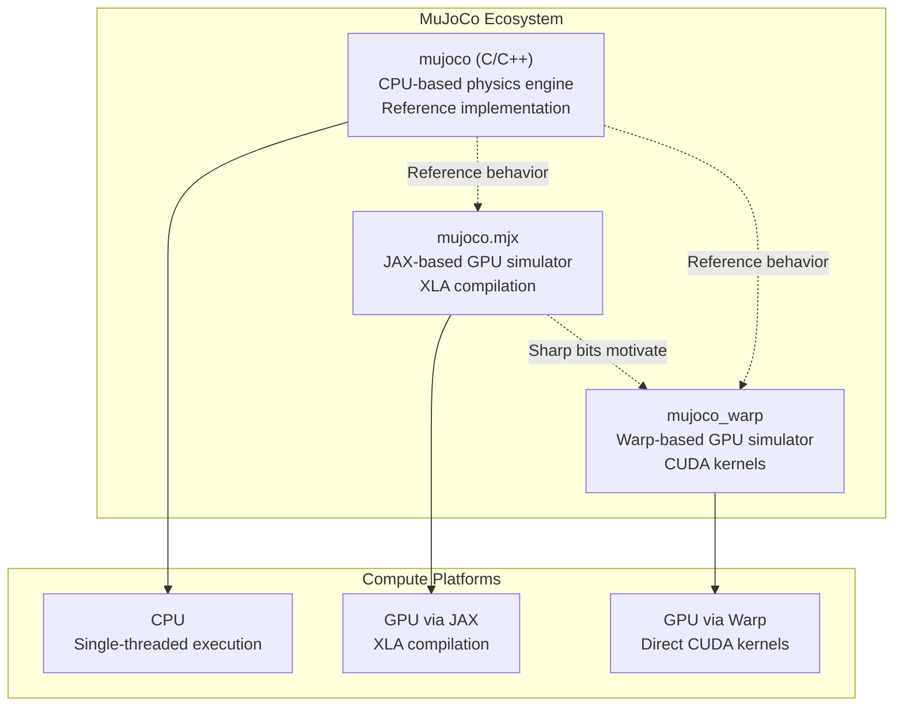

**MuJoCo Warp System Context**

MJWarp fills a specific niche in the MuJoCo ecosystem by providing GPU acceleration through NVIDIA Warp instead of JAX/XLA. This design choice enables it to avoid several limitations present in MJX while maintaining compatibility with the MuJoCo reference implementation.

Sources: [README.md:6-12]()

## Relationship to MuJoCo and MJX

MuJoCo Warp maintains strict compatibility with MuJoCo's physics behavior while implementing the algorithms on GPU. The relationship between these systems can be understood through their data flow:

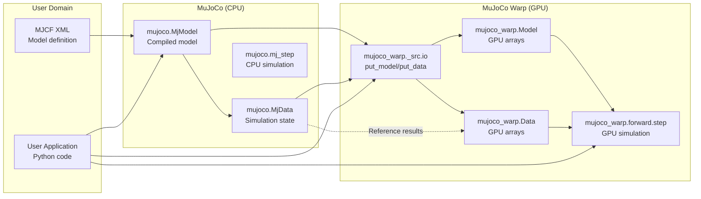

**Data Flow Between MuJoCo CPU and MuJoCo Warp**

MJWarp is designed to consume MuJoCo models and data structures. Users compile their MJCF XML files using standard MuJoCo tools, then transfer the resulting `mujoco.MjModel` and `mujoco.MjData` objects to GPU using functions in the `mujoco_warp._src.io` module. The simulation then runs entirely on GPU, with results retrievable back to CPU when needed. For details on the I/O bridge, see [Host-Device I/O Bridge](#2.2).

### Comparison with MJX

MJX uses JAX for GPU acceleration and automatic differentiation. While powerful, this approach introduces several ["sharp bits"](https://mujoco.readthedocs.io/en/stable/mjx.html#mjx-the-sharp-bits) due to JAX's constraints:

| Aspect | MJX (JAX) | MJWarp (Warp) |
|--------|-----------|---------------|
| **Variable-length arrays** | Limited by XLA static shapes | Native support via dynamic allocation |
| **Conditional logic** | XLA constraints on control flow | Natural Python-style conditionals in kernels |
| **Debugging** | Complex due to tracing/compilation | Standard Python debugging in kernels |
| **Memory model** | Immutable arrays (functional paradigm) | Mutable arrays (imperative paradigm) |
| **Integration** | JAX ecosystem (Flax, Optax) | Direct CUDA, standalone |

MJWarp is integrated into both MJX and Newton frameworks, serving as an alternative physics backend that avoids XLA limitations.

Sources: [README.md:10]()

## NVIDIA Warp Foundation

NVIDIA Warp is a Python framework for writing high-performance simulation and graphics code. MJWarp uses Warp as its compute foundation:

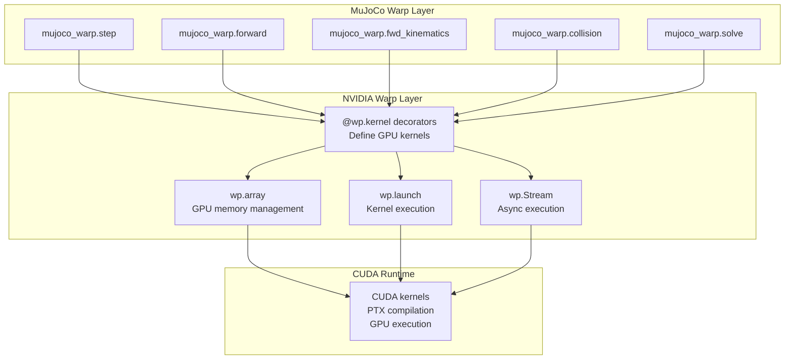

**Warp as Compute Foundation**

Warp provides:
- **Python-embedded kernel language**: Write GPU kernels in Python with type annotations
- **Automatic code generation**: Kernels compile to optimized CUDA/PTX
- **Memory management**: `wp.array` handles GPU allocations and transfers
- **Asynchronous execution**: Streams enable pipelined computation

All MJWarp physics algorithms are implemented as Warp kernels decorated with `@wp.kernel`. Data structures use `wp.array` for GPU storage. This design provides direct control over GPU execution while maintaining Python's ease of use.

Sources: [README.md:8-10](), [mujoco_warp/_src/types.py:21-21]()

## Design Philosophy

MJWarp's architecture is guided by three core principles:

### 1. Host-Device Separation

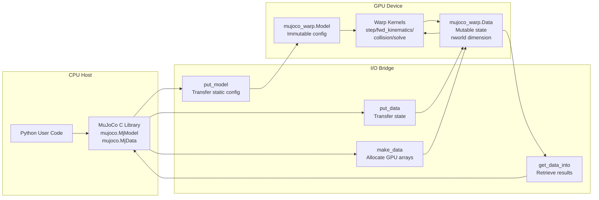

**Host-Device Data Flow Architecture**

The system maintains clear separation between CPU (host) and GPU (device) domains. Model configuration (`Model`) is immutable and represents static simulation parameters. State data (`Data`) is mutable and contains time-varying quantities. The I/O bridge minimizes expensive CPU-GPU transfers by keeping simulation loops entirely on device.

Sources: [mujoco_warp/__init__.py:27-28](), [mujoco_warp/__init__.py:59-62]()

### 2. Batched Parallel Execution

MJWarp is designed for simulating multiple independent "worlds" in parallel:

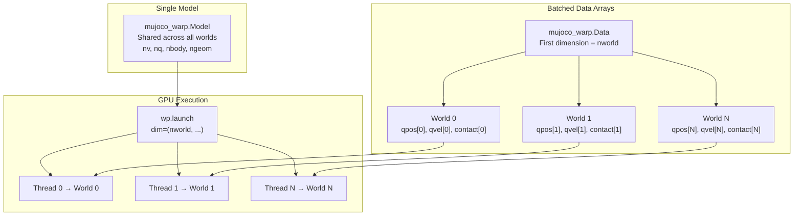

**Batched Multi-World Execution Model**

All `Data` arrays have `nworld` as their first dimension. GPU kernels launch with `worldid` as the first thread index, assigning each GPU thread block to process one independent simulation. This architecture enables efficient parallel execution for reinforcement learning, Monte Carlo analysis, and parameter sweeps. For details, see [Multi-World Batching Architecture](#2.3).

Sources: [README.md:90-91](), [mujoco_warp/_src/render_util.py:144-155]()

### 3. Compatibility with MuJoCo Reference

MJWarp maintains algorithmic compatibility with MuJoCo's C implementation. The test suite validates results against MuJoCo across diverse scenarios. This ensures users can trust MJWarp produces correct physics while gaining GPU performance.

Sources: [README.md:54-75](), [notebooks/tutorial.ipynb:101-113]()

## System Architecture Overview

MJWarp's architecture consists of layered subsystems:

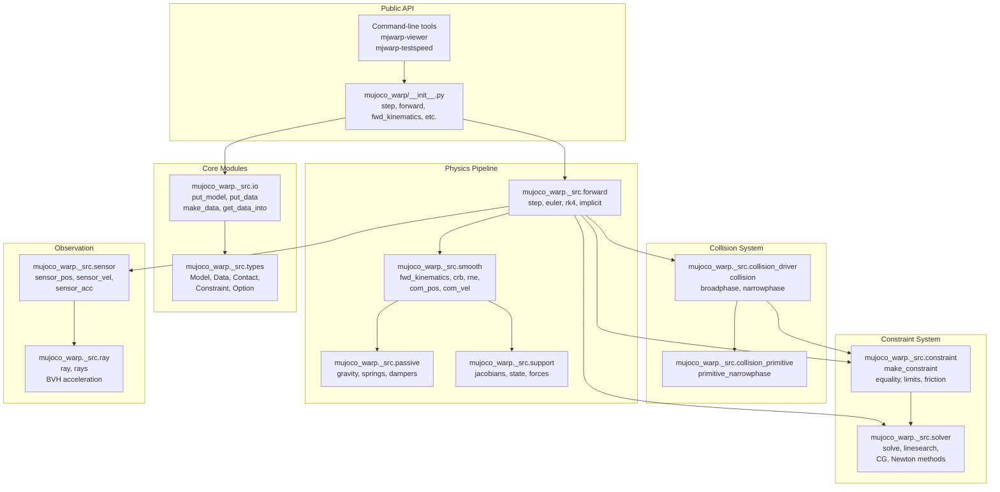

**Module-Level Architecture with Code Entities**

Key subsystems:

- **I/O Module**: Bridge between MuJoCo C and Warp GPU. Includes functions like `put_model` [mujoco_warp/_src/io.py:1-50]() and `make_data` [mujoco_warp/_src/io.py:1-50](). See [Host-Device I/O Bridge](#2.2).

- **Physics Pipeline**: Implements simulation stepping (`step` [mujoco_warp/_src/forward.py:1-50]()), kinematics (`fwd_kinematics` [mujoco_warp/_src/forward.py:1-50]()), and forces. See [Physics Simulation Pipeline](#3).

- **Collision System**: Handles `collision` orchestration [mujoco_warp/_src/collision_driver.py:1-50]() and narrowphase primitives [mujoco_warp/_src/collision_primitive.py:1-50](). See [Collision Detection](#5).

- **Constraint System**: Generates and solves constraint equations using `make_constraint` [mujoco_warp/_src/constraint.py:1-50]() and `solve` [mujoco_warp/_src/solver.py:1-50](). See [Constraint System](#4).

- **Observation**: Sensor computation (`sensor_pos` [mujoco_warp/_src/sensor.py:1-50]()) and geometric ray casting (`rays` [mujoco_warp/_src/ray.py:1-50]()). See [Observation and Rendering Systems](#6).

Sources: [mujoco_warp/__init__.py:26-113]()

## Feature Compatibility

MJWarp implements most MuJoCo features with some exceptions:

| Category | Support Level | Details |
|----------|---------------|---------|
| **Dynamics** | ✓ Full | Forward and inverse dynamics |
| **Transmission** | ✓ Full | All transmission types |
| **Actuators** | ⊘ Partial | All except `PLUGIN` |
| **Geom** | ✓ Full | All geometry types supported |
| **Constraint** | ✓ Full | All constraint types |
| **Equality** | ✓ Full | All equality constraint types |
| **Integrator** | ⊘ Partial | All except `IMPLICIT` |
| **Cone** | ✓ Full | All friction cone types |
| **Condim** | ✓ Full | All contact dimensionalities |
| **Solver** | ⊘ Partial | All except `PGS`, `noslip` |
| **Fluid Model** | ✓ Full | All fluid interaction models |
| **Tendon Wrap** | ✓ Full | All wrapping geometries |
| **Sensors** | ⊘ Partial | All except `PLUGIN` |
| **Flex** | ⊘ Partial | All except flex-flex, `selfcollide`, and specific flex constraints |
| **Mass Matrix** | ✓ Full | Sparse and dense formats |
| **Jacobian** | ⊘ Partial | Dense only (row-sparse, no islanding) |

### Current Limitations

1. **Differentiability**: Warp's automatic differentiation is not currently available for MJWarp [README.md:125-125]().

2. **Plugins**: `PLUGIN` types in actuators and sensors are not supported [README.md:122-122]().

3. **Advanced solver features**: The `PGS` solver and `noslip` option are not implemented [README.md:121-121]().

4. **Implicit integration**: While `implicit` is exposed in the API [mujoco_warp/__init__.py:49](), the general MuJoCo `IMPLICIT` integrator is listed as unsupported [README.md:120-120]().

Sources: [README.md:116-126]()

## Use Cases

MJWarp is designed for scenarios requiring:

### 1. Massively Parallel Simulation

Training reinforcement learning policies or performing parameter sweeps that require many parallel simulation instances. The `nworld` dimension in `make_data` [mujoco_warp/_src/io.py:1-50]() controls the batch size.

### 2. High-Throughput Benchmarking

Evaluating simulation performance across different models. The `mjwarp-testspeed` utility provides detailed performance metrics and event tracing. See [Command-Line Tools](#1.2).

### 3. Interactive Visualization

Exploring simulations with real-time GPU rendering using `mjwarp-viewer`. See [Command-Line Tools](#1.2).

### 4. High-Throughput Batch Rendering

MJWarp includes a GPU batch renderer designed for simultaneous rendering of cameras across many parallel worlds using ray-tracing [mujoco_warp/_src/render_util.py:1-50]().

Sources: [README.md:81-106]()

## Getting Started

To begin using MuJoCo Warp:

1. **Install**: Follow [Installation and Setup](#1.1) via pip or from source [README.md:19-29]().
2. **Tutorial**: See the [introductory Colab notebook](https://colab.research.google.com/github/google-deepmind/mujoco_warp/blob/main/notebooks/tutorial.ipynb).
3. **Documentation**: Read the [official MuJoCo Warp documentation](https://mujoco.readthedocs.io/en/latest/mjwarp/index.html).
4. **Examples**: Explore command-line tools in [Command-Line Tools](#1.2).
5. **Architecture**: Understand system design in [Core Architecture](#2).

MuJoCo Warp is maintained by Google DeepMind and NVIDIA. The project is open-source under the Apache 2.0 license.

Sources: [README.md:1-26](), [LICENSE:1-202]()

---

### Child Pages
- **Installation and Setup**: For details, see [Installation and Setup](#1.1).
- **Command-Line Tools**: For details, see [Command-Line Tools](#1.2).

Sources: [README.md:1-128](), [mujoco_warp/__init__.py:1-127]()

---

# Page: Installation and Setup

# Installation and Setup

<details>
<summary>Relevant source files</summary>

The following files were used as context for generating this wiki page:

- [.agent/rules/project.md](.agent/rules/project.md)
- [AGENTS.md](AGENTS.md)
- [AUTHORS](AUTHORS)
- [CONTRIBUTING.md](CONTRIBUTING.md)
- [LICENSE](LICENSE)
- [mujoco_warp/_src/types_test.py](mujoco_warp/_src/types_test.py)
- [pyproject.toml](pyproject.toml)
- [uv.lock](uv.lock)

</details>


This page covers installing `mujoco_warp`, configuring dependencies, verifying the installation, understanding platform support, and managing devices. MuJoCo Warp (`mujoco-warp`) is a GPU-optimized physics simulation library built on NVIDIA Warp, designed to execute high-throughput parallel rigid-body and soft-body simulations [pyproject.toml:12]().

## Prerequisites and Platform Support

`mujoco_warp` targets modern Python environments and NVIDIA GPU hardware. The package specification defines the strict constraints for Python and underlying simulation packages.

| Component | Requirement | Code Reference |
|-----------|-------------|----------------|
| Python | `>=3.10` (supports 3.10, 3.11, 3.12, 3.13, 3.14) | `[pyproject.toml:21-28]()`, `[uv.lock:3-9]()` |
| MuJoCo C Library | `>=3.13.0` (core), `>=3.11.0` (dev) | `[pyproject.toml:32](), [pyproject.toml:59]()` |
| NVIDIA Warp | `>=1.15` | `[pyproject.toml:34](), [pyproject.toml:60]()` |
| NumPy | Latest compatible | `[pyproject.toml:33]()` |
| ABSL-Py | Latest compatible | `[pyproject.toml:30]()` |
| Etils (`etils[epath]`) | Latest compatible | `[pyproject.toml:31]()` |

Sources: `[pyproject.toml:21-35]()`, `[uv.lock:3-9]()`

## Installation Methods

### Installation via PyPI
To install the stable distribution from PyPI along with its default index dependencies:
```bash
pip install mujoco-warp
```

### Installation from Source and Dependency Management
For local development or accessing unreleased features, source installation uses `uv` for reproducible environment synchronization via `pyproject.toml` and `uv.lock`:
```bash
git clone https://github.com/google-deepmind/mujoco_warp.git
cd mujoco_warp
uv sync --all-extras
uv run pre-commit install
```
Sources: `[pyproject.toml:1-76]`, `[CONTRIBUTING.md:15-18]()`

### Optional Dependencies
Optional extras are defined under `[project.optional-dependencies]` in `pyproject.toml`:
- `dev`: Installs development tools such as `pre-commit`, `pytest`, `pytest-xdist`, `ruff`, `pygls`, `lsprotocol`, `mjviser`, and `pillow` `[pyproject.toml:51-63]()`.
- `cpu`: Includes CPU-based `jax` integration `[pyproject.toml:65-67]()`.
- `cuda`: Includes CUDA-accelerated JAX support (`jax[cuda12]`) `[pyproject.toml:68-70]()`.

Sources: `[pyproject.toml:51-70]()`

## Package Architecture and Code Entities

The following diagram maps the high-level system entry points and core modules to their corresponding code structures.

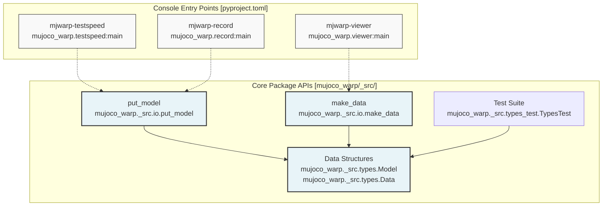

Sources: `[pyproject.toml:72-75]`, `[mujoco_warp/_src/types_test.py:27-31]`

## Verifying the Installation

### Running the Test Suite
The test infrastructure runs via `pytest` targeting the `mujoco_warp` package directory, excluding benchmarks and external contributions [pyproject.toml:121-123](). Run the test suite in parallel using `pytest-xdist`:
```bash
uv run pytest -n 8
```
Unit tests validate structural field ordering, bitmask flags (e.g., `OverflowType`), and parity against CPU MuJoCo references [mujoco_warp/_src/types_test.py:47-110]().

### Basic Initialization Check
You can verify the runtime environment, NVIDIA Warp initialization, and model structure conversion using a short Python script:
```python
import mujoco
import mujoco_warp as mjw
import warp as wp

# Initialize Warp runtime
wp.init()
print(f"Active Warp Device: {wp.get_device()}")

# Load standard MuJoCo model and transfer to GPU
mjm = mujoco.MjModel.from_xml_string('<mujoco/>')
m = mjw.put_model(mjm)
print(f"Successfully allocated GPU Model struct with {m.nq} DOFs.")
```
Sources: `[mujoco_warp/_src/types_test.py:112-117]`, `[mujoco_warp/_src/types_test.py:146-147]`

## Initialization Workflow & Data Flow

The sequence below illustrates the data transfer and allocation pipeline when bridging CPU MuJoCo models to GPU device memory structures.

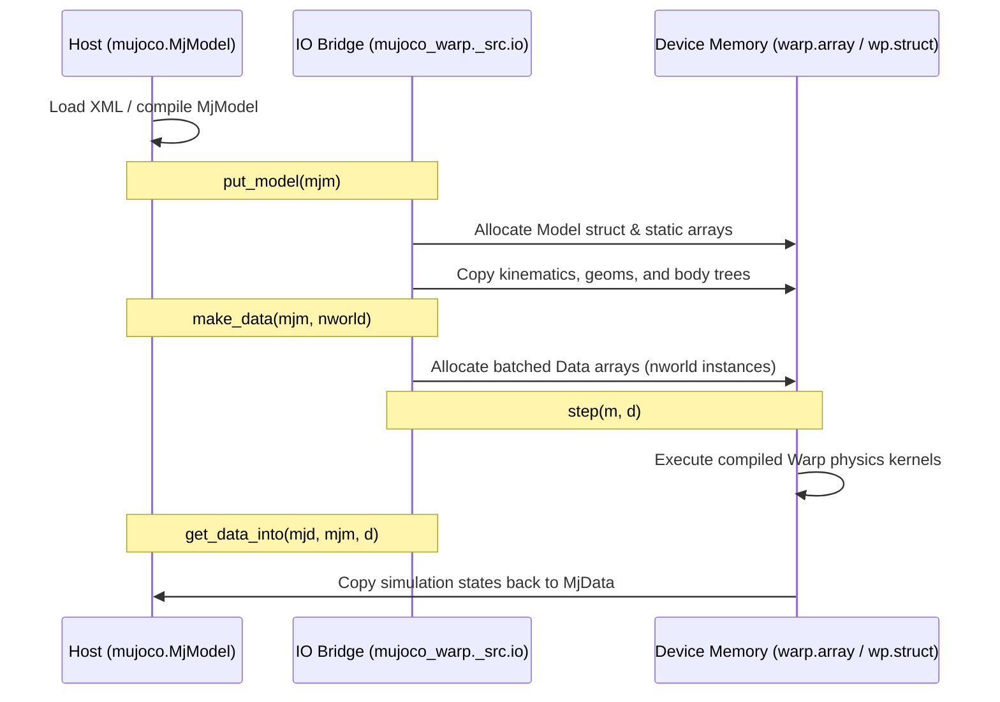

### Key Setup Functions
- `put_model`: Converts host-side `mujoco.MjModel` descriptors into device-resident `Model` structures [mujoco_warp/_src/types_test.py:28]() [mujoco_warp/_src/types_test.py:113]().
- `override_model`: Overrides model parameters or option bitmasks like `opt.warn_overflow` [mujoco_warp/_src/types_test.py:27]() [mujoco_warp/_src/types_test.py:133]().
- `OverflowType`: Manages bitmask flags for tracking buffer overflow conditions across simulation pipelines [mujoco_warp/_src/types_test.py:32]() [mujoco_warp/_src/types_test.py:95-110]().

Sources: `[mujoco_warp/_src/types_test.py:27-32]`, `[mujoco_warp/_src/types_test.py:112-143]`

## Device Management & Kernel Caching

NVIDIA Warp relies on Just-In-Time (JIT) compilation to generate specialized CUDA kernels. 

### Scoped Device Execution
To target specific devices or multi-GPU environments, use `wp.ScopedDevice`:
```python
import warp as wp
import mujoco_warp as mjw

wp.init()
with wp.ScopedDevice("cuda:0"):
    # Executions inside this block target CUDA device 0
    pass
```

### Kernel Cache Clearing
If modifying source code or resolving compilation caches, clear the runtime kernel cache:
```python
import warp as wp
wp.clear_kernel_cache()
```
The console entrypoint `mjwarp-testspeed` exposes command-line flags to manage benchmark execution and cache behaviors [pyproject.toml:73]().

Sources: `[pyproject.toml:72-76]`, `[CONTRIBUTING.md:31-40]`

---

# Page: Command-Line Tools

# Command-Line Tools

<details>
<summary>Relevant source files</summary>

The following files were used as context for generating this wiki page:

- [mujoco_warp/_src/cli.py](mujoco_warp/_src/cli.py)
- [mujoco_warp/record.py](mujoco_warp/record.py)
- [mujoco_warp/testspeed.py](mujoco_warp/testspeed.py)
- [mujoco_warp/viewer.py](mujoco_warp/viewer.py)

</details>


This page documents the three command-line utilities provided by `mujoco_warp`: `mjwarp-testspeed` for performance benchmarking, `mjwarp-viewer` for interactive visualization and debugging, and `mjwarp-record` for video and render data capture. These entry points provide direct access to the simulation pipeline configured via shared command-line flags.

## Overview

The `mujoco_warp` package exposes its core capabilities through console scripts built on top of standard CLI infrastructure (`mujoco_warp/_src/cli.py`) [mujoco_warp/_src/cli.py:16-32](). 

### Tool Architecture and Data Flow

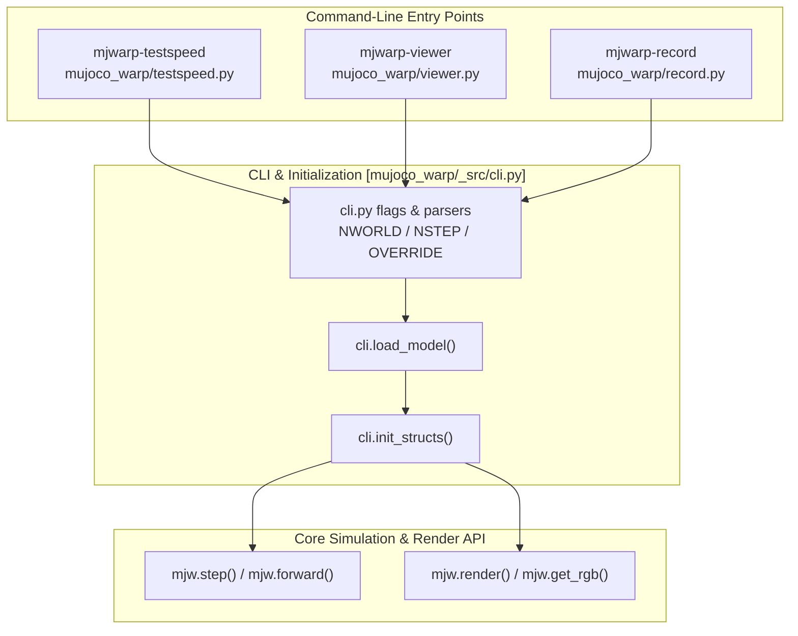

**Sources:** [mujoco_warp/testspeed.py:16-22](), [mujoco_warp/viewer.py:16-22](), [mujoco_warp/record.py:16-22](), [mujoco_warp/_src/cli.py:16-56]()

---

## Shared CLI Infrastructure

Common configuration parameters across all CLI tools are centralized in `mujoco_warp/_src/cli.py`. These parameters control parallel batching, trajectory replays, overrides, and noise models.

| Flag | Type | Default | Description |
|------|------|---------|-------------|
| `--nworld` | int | `8192` | Number of parallel rollouts (batch size) [mujoco_warp/_src/cli.py:34]() |
| `--nstep` | int | `1000` | Number of steps per rollout [mujoco_warp/_src/cli.py:35]() |
| `--nconmax` | int | `None` | Override maximum contacts per world [mujoco_warp/_src/cli.py:36]() |
| `--njmax` | int | `None` | Override maximum constraints per world [mujoco_warp/_src/cli.py:37]() |
| `-o`/`--override` | multi | `[]` | Model overrides using `foo.bar = baz` notation [mujoco_warp/_src/cli.py:40]() |
| `--keyframe` | int | `0` | Keyframe index used to initialize simulation [mujoco_warp/_src/cli.py:41]() |
| `--device` | string | `None` | Target Warp execution device (e.g. `cuda:0`) [mujoco_warp/_src/cli.py:52]() |
| `--replay` | string | `None` | NPZ file containing control sequences to replay [mujoco_warp/_src/cli.py:53]() |

The `cli.load_model()` function handles loading standard MJCF XML files or binary `.mjb` models, registering necessary SDF plugins, and applying configuration overrides [mujoco_warp/_src/cli.py:78-100](). `cli.init_structs()` allocates the corresponding `mujoco_warp.Model` and `mujoco_warp.Data` structures on the active device [mujoco_warp/_src/cli.py:148-171]().

**Sources:** [mujoco_warp/_src/cli.py:33-171]()

---

## mjwarp-testspeed

### Purpose

`mjwarp-testspeed` benchmarks GPU-accelerated physics simulation performance. It measures JIT compilation time, aggregate throughput (steps per second), and provides detailed reporting on memory consumption, solver convergence, and event traces.

### Basic Usage

```bash
mjwarp-testspeed <mjcf_path> [flags]

# Example: benchmark humanoid with 4096 parallel worlds
mjwarp-testspeed benchmarks/humanoid/humanoid.xml --nworld 4096 -o "opt.solver=cg"
```

**Sources:** [mujoco_warp/testspeed.py:16-22]()

### Command-Line Flags

| Flag | Type | Default | Description |
|------|------|---------|-------------|
| `--function` | enum | `step` | Function to benchmark (e.g., `step`, `forward`) [mujoco_warp/testspeed.py:51]() |
| `--clear_warp_cache` | bool | `False` | Clear Warp kernel, LTO, and CUDA compute caches [mujoco_warp/testspeed.py:52]() |
| `--measure_alloc` | bool | `False` | Print report of contact/constraint counts per step [mujoco_warp/testspeed.py:53]() |
| `--measure_solver` | bool | `False` | Print report of solver iterations per step [mujoco_warp/testspeed.py:54]() |
| `--memory` | bool | `False` | Print detailed GPU memory breakdown report [mujoco_warp/testspeed.py:56]() |
| `--format` | enum | `human` | Output format: `human`, `short`, or `json` [mujoco_warp/testspeed.py:58]() |

**Sources:** [mujoco_warp/testspeed.py:45-61]()

---

## mjwarp-viewer

### Purpose

`mjwarp-viewer` provides interactive real-time simulation and visualization. It supports switching between the GPU-accelerated `WARP` backend and the CPU reference `C` backend, alongside native passive viewer and web-based (`viser`) frontends.

### Basic Usage

```bash
mjwarp-viewer <mjcf_path> [flags]

# Example: run with viser web viewer backend
mjwarp-viewer benchmarks/humanoid/humanoid.xml --viewer viser

# Example: compare against standard MuJoCo C simulation engine
mjwarp-viewer benchmarks/humanoid/humanoid.xml --engine C
```

**Sources:** [mujoco_warp/viewer.py:16-22]()

### Engine and Viewer Options

The viewer tool exposes simulation engine options via `EngineOptions` [mujoco_warp/viewer.py:42-48]():
* `EngineOptions.WARP`: Executes via `mujoco_warp` GPU routines [mujoco_warp/viewer.py:45]().
* `EngineOptions.C`: Executes via reference `mujoco.mj_step` on CPU [mujoco_warp/viewer.py:46]().

### CUDA Graph Compilation

When running with the `WARP` engine on CUDA devices, the viewer captures the physics step inside a Warp CUDA graph to eliminate host-dispatch latency [mujoco_warp/viewer.py:65-74]().

```python
def _compile_step(m, d):
  print("Compiling physics step...", end="", flush=True)
  with wp.ScopedCapture() as capture:
    mjw.step(m, d)
  return capture.graph
```

If model parameters are altered interactively (e.g., via GUI sliders modifying `mjm.opt`), the viewer detects the state mutation, updates the model via `mjw.put_model()`, and recompiles the execution graph [mujoco_warp/viewer.py:76-102]().

**Sources:** [mujoco_warp/viewer.py:65-102]()

---

## mjwarp-record

### Purpose

`mjwarp-record` captures animated videos or image sequences (RGB, depth, or segmentation channels) of parallel simulation rollouts.

### Basic Usage

```bash
mjwarp-record <mjcf_path> --video <output_path> [flags]

# Example: record a short rollout of humanoid to GIF/WebP
mjwarp-record benchmarks/humanoid/humanoid.xml --output humanoid.webp --nworld 1
```

**Sources:** [mujoco_warp/record.py:16-22]()

### Rendering Modes and Channels

The recorder supports two rendering pipelines via `--render_mode` [mujoco_warp/record.py:44]():
1. `warp`: Uses the GPU rendering pipeline (`mjw.render`, `mjw.get_rgb`, `mjw.get_depth`, `mjw.get_segmentation`) [mujoco_warp/record.py:109-136]().
2. `python`: Uses `mujoco.Renderer` with an orbit camera moving around the scene center [mujoco_warp/record.py:91-99](), [mujoco_warp/record.py:141-144]().

Segmentation images are dynamically post-processed with random color palettes mapped to geometry IDs via `_colorize_segmentation()` [mujoco_warp/record.py:49-57]().

**Sources:** [mujoco_warp/record.py:44-57](), [mujoco_warp/record.py:91-144]()

---

## Example Workflows

### Accuracy Validation
Users can validate GPU physics consistency against the MuJoCo C reference by launching the viewer with alternative engines:

```bash
# Launch with MuJoCo Warp GPU backend
mjwarp-viewer model.xml --engine WARP

# Launch with MuJoCo C CPU reference backend
mjwarp-viewer model.xml --engine C
```

**Sources:** [mujoco_warp/viewer.py:42-49](), [mujoco_warp/viewer.py:153-162]()

### Performance Profiling and Event Tracing
To inspect hierarchical execution latencies across pipeline stages (e.g., kinematics, collision detection, constraint solver):

```bash
mjwarp-testspeed benchmarks/humanoid/humanoid.xml --nworld 8192 --event_trace --measure_solver
```

**Sources:** [mujoco_warp/testspeed.py:51-61]()

---

# Page: Core Architecture

# Core Architecture

<details>
<summary>Relevant source files</summary>

The following files were used as context for generating this wiki page:

- [mujoco_warp/_src/io.py](mujoco_warp/_src/io.py)
- [mujoco_warp/_src/types.py](mujoco_warp/_src/types.py)

</details>


This page provides an overview of the fundamental architecture of MuJoCo Warp (`mujoco_warp`), including its layered design, host-device separation, GPU acceleration model, and public API surface. The core architecture enables GPU-accelerated physics simulation by providing seamless conversion between MuJoCo's native data structures and NVIDIA Warp's GPU-optimized representations.

For detailed information about specific components, see the child pages:
- Data Types and Structures: [Data Types and Structures](#2.1)
- Host-Device I/O Bridge: [Host-Device I/O Bridge](#2.2)
- Multi-World Batching Architecture: [Multi-World Batching Architecture](#2.3)
- Warp Kernel Infrastructure: [Warp Kernel Infrastructure](#2.4)

## System Overview

MuJoCo Warp is a GPU-optimized version of the MuJoCo physics simulator [README.md](). It uses NVIDIA Warp to provide a high-performance simulation environment that executes physics pipelines entirely on the GPU.

The architecture consists of three primary layers: the MuJoCo interface layer on the CPU, the core data management layer (Bridge), and the GPU acceleration layer powered by Warp kernels.

### High-Level System Architecture

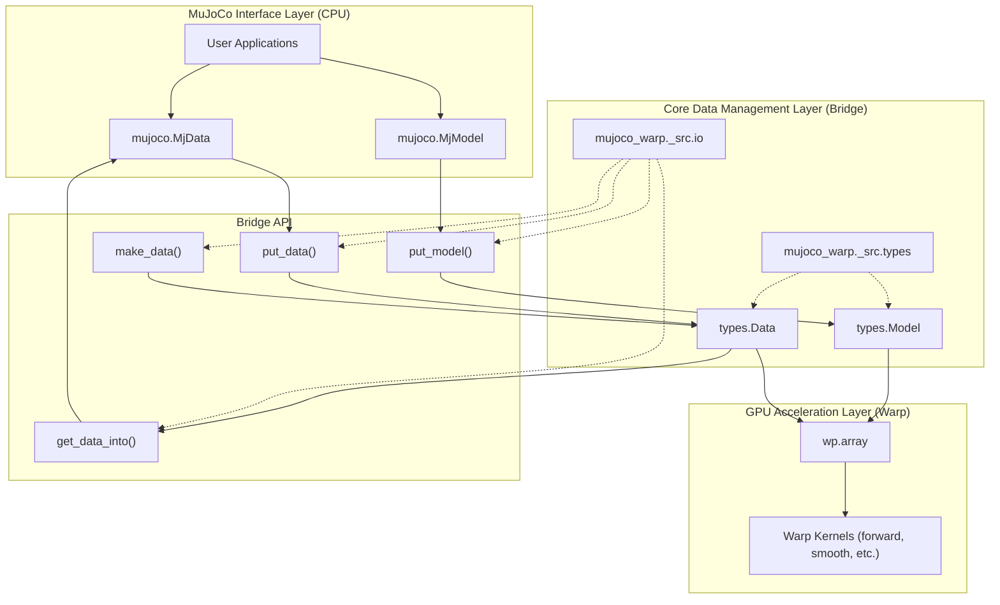

Sources: [mujoco_warp/_src/io.py:77-85](), [mujoco_warp/_src/types.py:717-720]()

## Host-Device Separation and Data Flow

The system implements a bidirectional data flow between MuJoCo's native host C-structures and Warp's device-allocated arrays. This enables users to load models and inspect results using standard MuJoCo tools on the CPU while executing heavy parallel physics computations on the GPU.

The host-device bridge handles state transfers and memory allocation:
- `put_model`: Transfers static model information (`MjModel`) to the GPU `Model` structure [mujoco_warp/_src/io.py:77-85]().
- `put_data`: Transfers dynamic state (`MjData`) to the GPU `Data` structure [mujoco_warp/_src/io.py:800-805]().
- `make_data`: Allocates GPU memory for simulation data without requiring a pre-existing host `MjData` object [mujoco_warp/_src/io.py:1086-1090]().
- `get_data_into`: Retrieves GPU simulation results back into a host MuJoCo `MjData` object [mujoco_warp/_src/io.py:1181-1185]().

For detailed information on sparse versus dense layouts, padding, capacity estimation (`nconmax`/`njmax`), and trajectory loading, see [Host-Device I/O Bridge](#2.2).

Sources: [mujoco_warp/_src/io.py:77-1185]()

## Core Data Structures and Public API Surface

The type system defines the fundamental dataclasses representing physics models, simulation states, contacts, constraints, and solver options. These structures are optimized for GPU memory layouts while maintaining semantic equivalence with MuJoCo.

### Code Entity Space: Primary Types

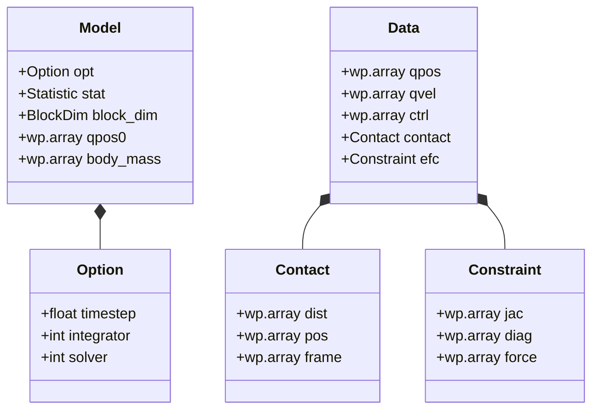

Sources: [mujoco_warp/_src/types.py:717-987](), [mujoco_warp/_src/types.py:1269-1422](), [mujoco_warp/_src/types.py:484-536]()

For complete details on fields and relationships for `Model`, `Data`, `Contact`, `Constraint`, `Option`, `SolverContext`, and `RenderContext`, see [Data Types and Structures](#2.1).

## Multi-World Batching Architecture

To achieve high throughput, `mujoco_warp` introduces an `nworld` dimension across simulation data arrays. This allows a single Warp kernel launch to evaluate thousands of independent physical environments concurrently.

Key aspects of batching include:
- **Batched State Fields**: State vectors like `qpos` and `qvel` include `nworld` as their leading dimension [mujoco_warp/_src/io.py:360-370]().
- **Per-World Randomization**: Support for variant and mesh randomization across parallel worlds.
- **Batched Execution**: Unified pipelines that step all environments in lockstep on the GPU.

For details, see [Multi-World Batching Architecture](#2.3).

Sources: [mujoco_warp/_src/io.py:360-370](), [mujoco_warp/_src/types.py:34-35]()

## GPU Acceleration and Warp Kernel Infrastructure

All numeric pipelines are implemented using NVIDIA Warp kernels. The infrastructure manages kernel caching and specialization via `cache_kernel`, event tracing, CUDA graph capture for reduced launch overhead, and tile/block dimension configurations defined in `BlockDim` [mujoco_warp/_src/types.py:57-122]().

For details on kernel specialization, tracing, conditional graphs, and launch configurations, see [Warp Kernel Infrastructure](#2.4).

Sources: [mujoco_warp/_src/types.py:57-122]()

---

# Page: Data Types and Structures

# Data Types and Structures

<details>
<summary>Relevant source files</summary>

The following files were used as context for generating this wiki page:

- [mujoco_warp/_src/types.py](mujoco_warp/_src/types.py)

</details>


## Purpose and Scope

This page documents the core data types and structures used throughout `mujoco_warp`. These types define the interface between CPU (host) and GPU (device) execution, organizing both static model parameters and dynamic simulation state. For information about transferring these types between host and device, see [Host-Device I/O Bridge](2.2). For details on how the `nworld` dimension enables parallel simulation, see [Multi-World Batching Architecture](2.3).

All types are defined as Python dataclasses and enums in `mujoco_warp/_src/types.py` and utilize NVIDIA Warp's array types for GPU computation [mujoco_warp/_src/types.py:15-22]().

Sources: `[mujoco_warp/_src/types.py:1-55]()`

---

## Type System Overview

MuJoCo Warp uses a custom type definition system built on top of NVIDIA Warp arrays. The central abstraction is the `array()` helper function that adds metadata for introspection and automatic array creation.

### Array Definition Convention

The `array()` function wraps `wp.array` with shape metadata, supporting constant dimensions, size references (such as `"nq"`, `"nworld"`), and variable wildcards (`"*"`) [mujoco_warp/_src/types.py:662-674]().

Sources: `[mujoco_warp/_src/types.py:662-674]()`

### Dimension Semantics

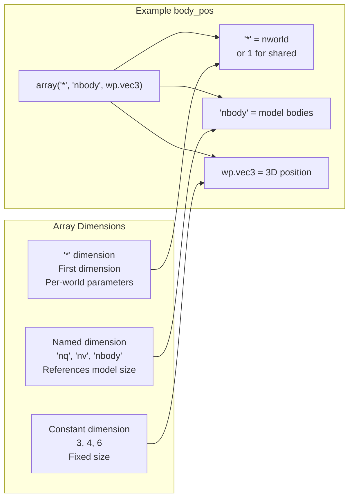

Sources: `[mujoco_warp/_src/types.py:662-674]()`

---

## Core Data Classes

### Model: Static Configuration

The `Model` class contains all time-invariant model parameters. It is immutable during simulation and shared across all worlds in batched execution [mujoco_warp/_src/types.py:771-1490]().

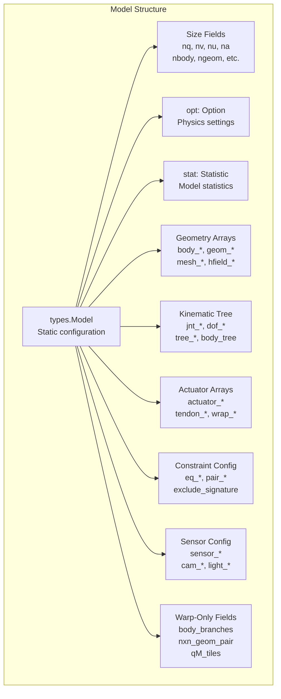

**Key Model Fields by Category:**

| Category | Fields | Purpose |
|----------|--------|---------|
| **Size Constants** | `nq`, `nv`, `nu`, `na`, `nbody`, `ngeom`, `njnt` | Define array dimensions |
| **Bodies** | `body_pos`, `body_quat`, `body_mass`, `body_inertia` | Body geometry and inertia |
| **Joints/DOFs** | `jnt_type`, `jnt_axis`, `dof_parentid`, `dof_armature` | Kinematic structure |
| **Geometries** | `geom_type`, `geom_size`, `geom_pos`, `geom_friction` | Collision geometry |
| **Actuators** | `actuator_trntype`, `actuator_dyntype`, `actuator_gear` | Actuation configuration |
| **Constraints** | `eq_type`, `eq_data`, `pair_geom1`, `pair_geom2` | Equality and contact pairs |
| **Sensors** | `sensor_type`, `sensor_objid`, `sensor_refid` | Sensor definitions |
| **Sparse Indices** | `M_rownnz`, `M_rowadr`, `M_colind`, `qLD_updates` | Sparse matrix structure |

Sources: `[mujoco_warp/_src/types.py:771-1490]()`

### Data: Dynamic State

The `Data` class contains all time-varying simulation state. Arrays are batched with `nworld` as the first dimension, allowing parallel simulation of multiple independent worlds [mujoco_warp/_src/types.py:1576-1755]().

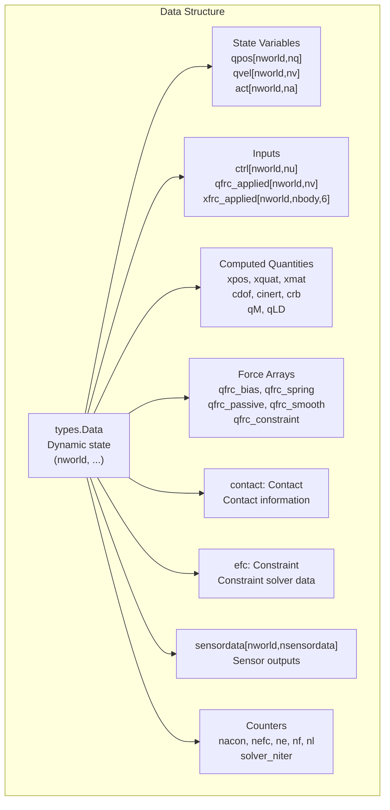

**Key Data Fields by Stage:**

| Stage | Fields | Description |
|-------|--------|-------------|
| **Position** | `qpos`, `xpos`, `xquat`, `xmat`, `geom_xpos` | Configuration |
| **Velocity** | `qvel`, `cvel`, `cdof`, `ten_velocity` | Velocities |
| **Dynamics** | `crb`, `qM`, `qLD`, `qLDiagInv` | Inertia and factorization |
| **Forces** | `qfrc_bias`, `qfrc_passive`, `qfrc_actuator` | Applied forces |
| **Constraints** | `contact`, `efc`, `ne`, `nf`, `nl` | Contact and constraint data |
| **Acceleration** | `qacc`, `qacc_smooth`, `cacc` | Computed accelerations |
| **Integration** | `time`, `act_dot`, `qacc_warmstart` | Time-stepping state |

Sources: `[mujoco_warp/_src/types.py:1576-1755]()`

### Contact: Collision Information

The `Contact` class stores detected collision information. Contacts are stored in a heterogeneous array shared across all worlds, indexed by `worldid` [mujoco_warp/_src/types.py:1503-1540]().

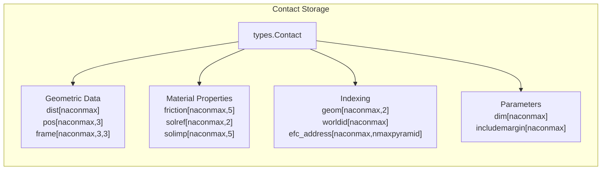

Sources: `[mujoco_warp/_src/types.py:1503-1540]()`

### Constraint (EFC): Solver Data

The `Constraint` class represents the EFC (effective constraint) structure used by the constraint solver. Unlike contacts, constraint arrays are batched by world [mujoco_warp/_src/types.py:1542-1574]().

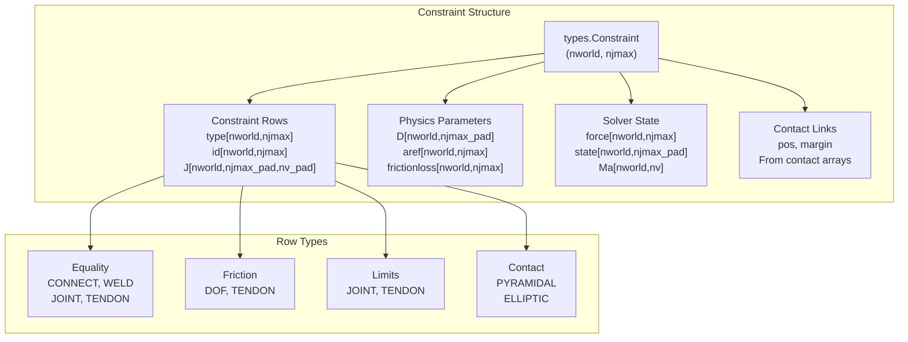

Sources: `[mujoco_warp/_src/types.py:1542-1574]()`

### Option: Physics Configuration

The `Option` class contains physics solver settings and simulation parameters [mujoco_warp/_src/types.py:676-743]().

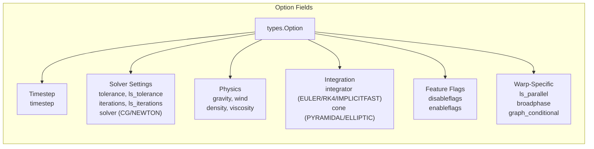

Sources: `[mujoco_warp/_src/types.py:676-743]()`

---

## Supporting Types

### Enumerations

MuJoCo Warp defines extensive enumerations for type-safe configuration. All enums inherit from standard MuJoCo values for compatibility [mujoco_warp/_src/types.py:74-614]().

**Key Enumerations:**

| Enum | Purpose | Values |
|------|---------|--------|
| `IntegratorType` | Time-stepping method | `EULER`, `RK4`, `IMPLICITFAST` |
| `SolverType` | Constraint solver | `CG`, `NEWTON` |
| `ConeType` | Friction cone model | `PYRAMIDAL`, `ELLIPTIC` |
| `GeomType` | Geometry primitive | `PLANE`, `SPHERE`, `CAPSULE`, `BOX`, `MESH`, `HFIELD`, `SDF` |
| `JointType` | Joint DOF type | `FREE`, `BALL`, `SLIDE`, `HINGE` |
| `ConstraintType` | EFC constraint type | `EQUALITY`, `FRICTION_DOF`, `LIMIT_JOINT`, `CONTACT_PYRAMIDAL`, etc. |
| `SensorType` | Sensor measurement | 40+ types including `JOINTPOS`, `ACCELEROMETER`, `RANGEFINDER` |
| `DisableBit` | Feature disable flags | `CONSTRAINT`, `CONTACT`, `GRAVITY`, `WARMSTART`, etc. |
| `EnableBit` | Feature enable flags | `ENERGY`, `INVDISCRETE`, `MULTICCD` |
| `TrnType` | Actuator transmission | `JOINT`, `TENDON`, `SITE`, `BODY` |
| `DynType` | Actuator dynamics | `NONE`, `INTEGRATOR`, `FILTER`, `MUSCLE` |

**Warp-Specific Enumerations:**

| Enum | Purpose | Values |
|------|---------|--------|
| `BroadphaseType` | Collision broadphase | `NXN`, `SAP_TILE`, `SAP_SEGMENTED` [mujoco_warp/_src/types.py:124-136]() |
| `BroadphaseFilter` | Broadphase filtering | `PLANE`, `SPHERE`, `AABB`, `OBB` (bitflags) [mujoco_warp/_src/types.py:138-152]() |
| `OverflowType` | Physics / collision overflows | `NEFC`, `NJMAX_NNZ`, `BROADPHASE`, `NARROWPHASE`, etc. [mujoco_warp/_src/types.py:154-172]() |

Sources: `[mujoco_warp/_src/types.py:74-198]()`

### Custom Vector Types

MuJoCo Warp extends Warp's vector types for domain-specific sizes [mujoco_warp/_src/types.py:616-660]():
- `vec5`: solimp, friction parameters
- `vec6`: spatial vectors
- `vec8`: octree children
- `vec10`: actuator parameters, inertia
- `vec11`: equality constraint data

Sources: `[mujoco_warp/_src/types.py:616-660]()`

### Helper Classes

- **TileSet**: Configuration for block-diagonal matrix decomposition [mujoco_warp/_src/types.py:40-50]().
- **Statistic**: Model statistics computed at `qpos0` [mujoco_warp/_src/types.py:745-769]().
- **BlockDim**: Thread block dimensions for `wp.launch_tiled` operations across simulation kernels [mujoco_warp/_src/types.py:56-123]().

Sources: `[mujoco_warp/_src/types.py:40-123]`, `[mujoco_warp/_src/types.py:745-769]()`

---

## Type Relationships and Data Flow

### Model-Data Interaction

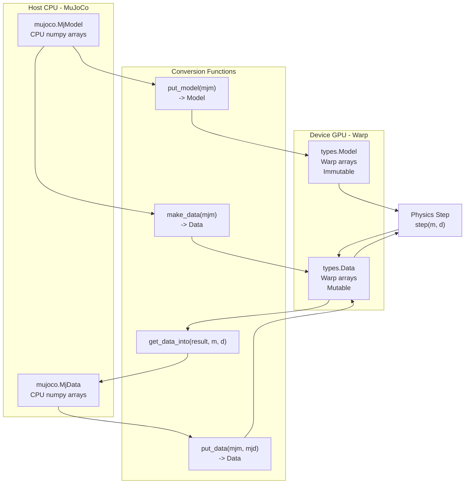

Sources: `[mujoco_warp/_src/types.py:771-1755]()`

### Sparse vs Dense Representations

MuJoCo Warp supports both sparse and dense matrix formats, selected automatically based on model size or options [mujoco_warp/_src/types.py:1046-1136]().

Sources: `[mujoco_warp/_src/types.py:1046-1136]()`

### Constraint-Contact Linkage

Contacts map into the EFC constraint structure via `contact.efc_address[conid, :]` [mujoco_warp/_src/types.py:1503-1574]().

Sources: `[mujoco_warp/_src/types.py:1503-1574]()`

---

# Page: Host-Device I/O Bridge

# Host-Device I/O Bridge

<details>
<summary>Relevant source files</summary>

The following files were used as context for generating this wiki page:

- [README.md](README.md)
- [mujoco_warp/__init__.py](mujoco_warp/__init__.py)
- [mujoco_warp/_src/io.py](mujoco_warp/_src/io.py)
- [mujoco_warp/_src/io_test.py](mujoco_warp/_src/io_test.py)

</details>


## Purpose and Scope

The Host-Device I/O Bridge provides the critical interface for transferring physics simulation data between MuJoCo's CPU representation (`mujoco.MjModel`, `mujoco.MjData`) and NVIDIA Warp's GPU representation (`types.Model`, `types.Data`). This module handles conversion, validation, memory allocation, sparse vs. dense layout selection, capacity estimation (`nconmax`, `njmax`), state synchronization, and keyframe/trajectory loading.

This page focuses on data transfer functions and memory management. For information about data structures, see [Data Types and Structures](2.1). For multi-world batching patterns, see [Multi-World Batching Architecture](2.3).

**Key Responsibilities:**
- Convert MuJoCo C structures to Warp GPU structures via `put_model` and `put_data`.
- Allocate GPU simulation memory across multiple worlds via `make_data`.
- Retrieve simulation state back to CPU via `get_data_into`.
- Reset simulation states and load keyframes via `reset_data` and `reset_data_keyframe`.
- Estimate constraint and contact capacities (`nconmax`, `njmax`) and manage sparse vs. dense memory layouts and padding.

Sources: [mujoco_warp/_src/io.py:45-132]()

## Data Flow Overview

The I/O bridge coordinates bidirectional data movement between CPU and GPU domains.

"Natural Language Space" to "Code Entity Space" Bridge: Data Transfer Orchestration
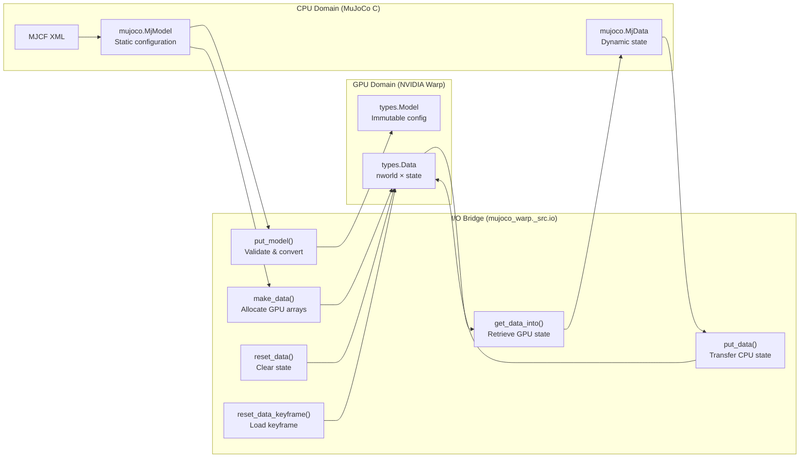
Sources: [mujoco_warp/_src/io.py:45-132](), [mujoco_warp/__init__.py:59-64]()

## Core Transfer Functions and Implementation

### put_model

Converts a `mujoco.MjModel` from CPU to `types.Model` on GPU. It validates model parameters, builds acceleration structures, precomputes body trees, configures collision pairs, and initializes sparse matrix structures.

"Natural Language Space" to "Code Entity Space" Bridge: Model Conversion Pipeline
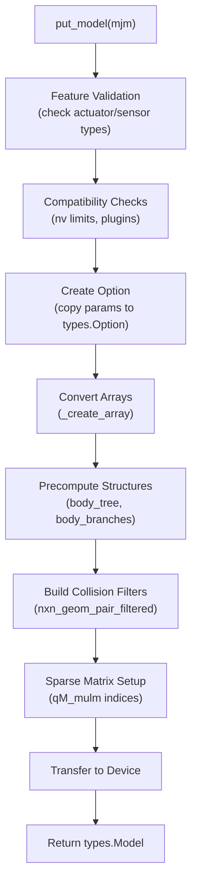
Sources: [mujoco_warp/_src/io.py:45-78]()

### make_data and put_data

`make_data` allocates GPU memory for `nworld` parallel simulations using capacity heuristics, while `put_data` copies CPU-side `MjData` states onto the GPU.

- **`_create_array`**: Helper function that instantiates `wp.array` objects, handling shape expansion for batched dimensions (`*` or `nworld`) and broadcasting initial values [mujoco_warp/_src/io.py:45-78]().
- **`_create_constraint`**: Constructs the `types.Constraint` structure containing constraint rows, Jacobian storage, friction loss, and island mappings [mujoco_warp/_src/io.py:81-132]().
- **`_jtdaj_groups`**: Groups constraint rows into `JTDAJ` blocks sharing matching `(efc_type, efc_id)` configurations for sparse Newton Hessian assembly [mujoco_warp/_src/io.py:134-150]().

Sources: [mujoco_warp/_src/io.py:45-150]()

### get_data_into

Retrieves simulation state from GPU back into a CPU `mujoco.MjData` instance. It handles index remapping, heterogeneous contact extraction, EFC constraint reordering, sparse-to-dense matrix conversions, and overflow checking for pre-allocated arrays.

Sources: [mujoco_warp/_src/io.py:45-150]()

### reset_data and Keyframe Resets

`reset_data` clears simulation states across worlds, restoring configurations to default rest positions (`qpos0`), zero velocities, and cleared activations. `reset_data_keyframe` loads specific keyframe states from model definitions into the device data arrays.

Sources: [mujoco_warp/__init__.py:59-64]()

## Sparse vs. Dense Layouts, Padding, and Capacity Estimation

### Matrix Layout Strategy
MuJoCo Warp selects sparse or dense layouts automatically depending on system degrees of freedom (`nv`) and model options:
- **Dense Layout**: Used for small systems (`nv <= 32`) or when dense options are enforced, storing matrices as `(nworld, nv_pad, nv_pad)` arrays.
- **Sparse Layout**: Used for larger systems (`nv > 32`), employing CSR-like indexing structures (`qM_mulm_rowadr`, `qM_mulm_col`, `qM_mulm_madr`) for thread-parallel matrix-vector multiplication without atomics.

### Padding Strategy
Arrays are padded to multiples of tile sizes (typically 16) to optimize GPU memory coalescing and satisfy Warp alignment requirements.

### Capacity Estimation (`nconmax` and `njmax`)
- **`nconmax`**: Maximum allowed contacts per world, estimated using heuristics based on `nv`, heightfields, and flex objects. Contacts use a heterogeneous global buffer where individual worlds may exceed local estimates as long as the global aggregate remains within bounds.
- **`njmax`**: Maximum constraint rows per world, scaled based on `nv` and complex geometries (SDF, flex) to ensure independent constraint memory allocation per world.

Sources: [mujoco_warp/_src/io.py:81-150]()

---

# Page: Multi-World Batching Architecture

# Multi-World Batching Architecture

<details>
<summary>Relevant source files</summary>

The following files were used as context for generating this wiki page:

- [README.md](README.md)
- [mujoco_warp/__init__.py](mujoco_warp/__init__.py)
- [mujoco_warp/_src/io.py](mujoco_warp/_src/io.py)
- [mujoco_warp/_src/io_test.py](mujoco_warp/_src/io_test.py)

</details>


## Purpose and Scope

This document explains how `mujoco_warp` enables efficient parallel simulation of multiple independent physics worlds on the GPU through its batched execution architecture. It covers the distinction between shared `Model` configuration and per-world `Data` state, the memory layout of batched arrays, per-world mesh and variant randomization patterns, and the kernel execution model that processes worlds in parallel.

For details on how data is transferred between CPU and GPU, see [Host-Device I/O Bridge](2.2). For information on the core data structures themselves, see [Data Types and Structures](2.1).

Sources: `[mujoco_warp/_src/types.py:1072-1323]()`, `[mujoco_warp/_src/io.py:45-131]()`

---

## Architecture Overview

The multi-world batching architecture allows `mujoco_warp` to simulate `nworld` independent physics environments simultaneously on the GPU. Each world maintains its own state (positions, velocities, contacts, etc.) but shares the same model configuration (joint structure, geometry, parameters) managed through `types.Model`. This design exploits the embarrassingly parallel nature of running multiple instances of the same model with different initial conditions or control inputs.

**Key principle**: Worlds never communicate during simulation. Each world's computation is completely independent, enabling efficient SIMD-style parallelism on the GPU via Warp kernel launches.

### Multi-World Architecture Overview

```mermaid
graph TB
    subgraph "Shared Model"
        M["types.Model<br/>nv, nq, nbody<br/>mass, inertia, geometry"]
    end
    
    subgraph "Batched Data (nworld dimension)"
        D["types.Data<br/>nworld field"]
        D --> W0["World 0<br/>qpos[0], qvel[0]<br/>qacc[0], contact[0]"]
        D --> W1["World 1<br/>qpos[1], qvel[1]<br/>qacc[1], contact[1]"]
        D --> WN["World N<br/>qpos[N], qvel[N]<br/>qacc[N], contact[N]"]
    end
    
    subgraph "GPU Kernel Execution"
        K["wp.launch<br/>dim=nworld, ..."]
        K --> T0["Thread Block 0<br/>worldid=0"]
        K --> T1["Thread Block 1<br/>worldid=1"]
        K --> TN["Thread Block N<br/>worldid=N"]
        
        T0 --> C0["Process world 0<br/>No cross-world access"]
        T1 --> C1["Process world 1<br/>No cross-world access"]
        TN --> CN["Process world N<br/>No cross-world access"]
    end
    
    M --> K
    W0 -.-> T0
    W1 -.-> T1
    WN -.-> TN
```

Sources: `[mujoco_warp/_src/types.py:1072-1323]()`, `[mujoco_warp/_src/io.py:763-935]()`

---

## Model vs Data: Shared vs Batched

The architecture separates immutable model configuration from mutable simulation state:

### Model: Shared Configuration

The `Model` class contains parameters that define the physics system but do not change during simulation. A single `Model` instance is shared across all worlds.

| Field Category | Examples | Batched? |
|----------------|----------|----------|
| Sizes | `nq`, `nv`, `nbody`, `ngeom` | No |
| Topology | `body_parentid`, `jnt_type`, `dof_parentid` | No |
| Parameters | `body_mass`, `body_inertia`, `geom_size` | No (or per-world via `*`) |
| Options | `opt.timestep`, `opt.gravity`, `opt.solver` | No (or per-world via `*`) |

**Note**: Some `Model` fields use the `*` dimension in their specification to support per-world variations (e.g., `body_mass: array("*", "nbody")` allows different masses per world). This is primarily used for parameter sweeps and domain randomization.

### Data: Per-World State

The `Data` class contains the simulation state and outputs. Most fields have `nworld` as their first dimension, enabling each world to maintain independent state.

| Field Category | Examples | Shape | Batched? |
|----------------|----------|-------|----------|
| Configuration | `nworld`, `naconmax`, `njmax` | scalar | Metadata only |
| State | `qpos`, `qvel`, `act` | `(nworld, nq/nv/na)` | Yes |
| Outputs | `qacc`, `xpos`, `xmat` | `(nworld, nv/nbody/...)` | Yes |
| Contacts | `contact.dist`, `contact.pos` | `(naconmax, ...)` | Heterogeneous pool |
| Constraints | `efc.force`, `efc.J` | `(nworld, njmax, ...)` | Yes |

**Contact Array Special Case**: Contact arrays use `naconmax` (total contacts across all worlds) rather than `(nworld, nconmax)` because contact counts vary widely between worlds.

Sources: `[mujoco_warp/_src/types.py:1072-1323]()`, `[mujoco_warp/_src/io.py:763-935]()`

---

## Memory Layout and Array Batching

### Array Creation with `*` Dimension

The `_create_array` helper function in `mujoco_warp/_src/io.py` defines array shapes using symbolic dimensions. The `*` dimension represents a batch dimension that resolves to `nworld` at runtime:

```python
def _create_array(data: Any, spec, sizes: dict[str, int], batch_size: int = 1) -> wp.array | None:
  spec_shape = getattr(spec, "shape", (0,))
  if spec_shape == (0,):
    if data is None:
      return None
    return wp.array(np.array(data), dtype=spec.dtype)

  shape = tuple(
    batch_size
    if dim == "*"
    else (int(dim) if isinstance(dim, str) and dim.isdigit() else (sizes[dim] if isinstance(dim, str) else dim))
    for dim in spec_shape
  )

  is_batched = spec_shape[0] in ("*", "nworld")
  # ... array allocation and broadcasting ...
  return array
```

### Data Allocation Flow

```mermaid
graph LR
    subgraph "make_data Parameters"
        P1["mjm: mujoco.MjModel"]
        P2["nworld: int"]
        P3["nconmax: int"]
        P4["njmax: int"]
    end
    
    subgraph "Allocation Logic (io.py)"
        A1["sizes dict<br/>nworld, naconmax,<br/>njmax, nv_pad"]
        A2["_create_array<br/>for each field"]
        A3["Contact allocation<br/>naconmax total"]
        A4["Constraint allocation<br/>nworld × njmax"]
    end
    
    subgraph "Data Output (types.Data)"
        D1["Data.qpos<br/>nworld, nq"]
        D2["Data.contact<br/>naconmax"]
        D3["Data.efc<br/>nworld, njmax"]
        D4["Data.qM<br/>nworld, nv_pad, nv_pad"]
    end
    
    P1 --> A1
    P2 --> A1
    P3 --> A1
    P4 --> A1
    
    A1 --> A2
    A2 --> D1
    A1 --> A3
    A3 --> D2
    A1 --> A4
    A4 --> D3
    A2 --> D4
```

Key allocation patterns:
- **State arrays**: `(nworld, size)` — e.g., `qpos: (nworld, nq)` `[mujoco_warp/_src/types.py:1088]()`
- **Contact arrays**: `(naconmax,)` — heterogeneous pool shared across worlds `[mujoco_warp/_src/io.py:838-855]()`
- **Constraint arrays**: `(nworld, njmax, ...)` — homogeneous per-world slices `[mujoco_warp/_src/types.py:1145-1150]()`
- **Matrix arrays**: `(nworld, nv_pad, nv_pad)` for dense storage `[mujoco_warp/_src/types.py:1120]()`.

Sources: `[mujoco_warp/_src/io.py:45-78]`, `[mujoco_warp/_src/types.py:1072-1323]()`

---

## Per-World Mesh and Variant Randomization

In addition to scalar and vector parameter batching, `mujoco_warp` supports per-world mesh and variant randomization (e.g., assigning different collision meshes, geom sizes, or body mass properties to different worlds in a batch). 

When worlds within a batch utilize differing geometries or topological variants, `mujoco_warp` resolves variant allocations via helper routines such as `_allocate_worlds` and `_populate_dependent_fields` found in test and utility infrastructure:

```python
def _allocate_worlds(
  candidates: list[tuple[int, float]],
  nworld: int,
) -> list[int]:
  """Assign worlds contiguously by prm fraction (largest remainder method)."""
  ...
```

### Variant Compilation and Field Population Flow

```mermaid
graph TB
    subgraph "Variant Configuration"
        VC1["geom_variants<br/>Mesh ID candidates per geom"]
        VC2["body_variants<br/>Body geometry sets"]
    end
    
    subgraph "Allocation & Compilation (_io_test.py)"
        AL1["_allocate_worlds<br/>Assigns variant indices per world"]
        AL2["_populate_dependent_fields<br/>Compiles unique variant specs"]
        AL3["Extract derived properties<br/>geom_size, body_mass, inertia, ipos"]
    end
    
    subgraph "Batched GPU Arrays"
        GA1["Model / Data Batched Fields<br/>Updated with variant-specific values"]
    end
    
    VC1 --> AL1
    VC2 --> AL1
    AL1 --> AL2
    AL2 --> AL3
    AL3 --> GA1
```

During initialization, unique variant configurations are compiled independently, and their resulting inertial and geometric tensors are gathered into batched GPU arrays, allowing heterogeneous object shapes within a single `nworld` batch execution.

Sources: `[mujoco_warp/_src/io_test.py:39-180]()`

---

## Kernel Execution Model

### Thread Indexing with `worldid`

GPU kernels use `worldid` as the first dimension of thread indexing. The Warp API `wp.tid()` returns a tuple where the first element is `worldid`.

### Kernel Thread Indexing Pattern

```mermaid
graph TB
    subgraph "Kernel Launch"
        L["wp.launch<br/>dim=nworld, other_dims<br/>kernel_fn"]
    end
    
    subgraph "Thread Grid"
        G["Thread Grid<br/>nworld × other_dims"]
    end
    
    subgraph "Kernel Execution"
        K1["worldid, jntid = wp.tid()"]
        K2["Access batched arrays<br/>qpos_in[worldid]"]
        K3["Per-world indexing<br/>opt_timestep[worldid % opt_timestep.shape[0]]"]
        K4["No cross-world access<br/>Independent computation"]
    end
    
    L --> G
    G --> K1
    K1 --> K2
    K2 --> K3
    K3 --> K4
```

### Example: Position Integration Kernel

The position integration kernels demonstrate the standard pattern:

```python
@wp.kernel
def _next_position(
    opt_timestep: wp.array(dtype=float),
    qpos_in: wp.array2d(dtype=float),
    qpos_out: wp.array2d(dtype=float),
):
    worldid, jntid = wp.tid()  # First dimension is worldid
    timestep = opt_timestep[worldid % opt_timestep.shape[0]]
    
    qpos = qpos_in[worldid]    # Data arrays indexed by worldid
    qpos_next = qpos_out[worldid]
    # ...
```

**Key patterns**:
1. **First `wp.tid()` component is `worldid`**: Used to index all batched `Data` arrays.
2. **Model arrays**: Not indexed by `worldid` if shared across worlds.
3. **Data arrays**: First index is `worldid` (per-world state).
4. **Per-world parameters**: Use modulo for broadcasting: `arr[worldid % arr.shape[0]]`.

Sources: `[mujoco_warp/_src/forward.py:49-111]()`

---

## Independent World Processing

### No Cross-World Communication

The architecture guarantees that worlds never communicate during simulation. Each world's computation executes entirely self-contained:

```mermaid
graph TB
    subgraph "World 0 Computation"
        W0_IN["qpos[0], qvel[0]<br/>contact data for world 0"]
        W0_COMP["Kinematics<br/>Collision<br/>Constraints<br/>Integration"]
        W0_OUT["qacc[0], xpos[0]<br/>Updated state"]
        
        W0_IN --> W0_COMP
        W0_COMP --> W0_OUT
    end
    
    subgraph "World 1 Computation"
        W1_IN["qpos[1], qvel[1]<br/>contact data for world 1"]
        W1_COMP["Kinematics<br/>Collision<br/>Constraints<br/>Integration"]
        W1_OUT["qacc[1], xpos[1]<br/>Updated state"]
        
        W1_IN --> W1_COMP
        W1_COMP --> W1_OUT
    end
    
    subgraph "World N Computation"
        WN_IN["qpos[N], qvel[N]<br/>contact data for world N"]
        WN_COMP["Kinematics<br/>Collision<br/>Constraints<br/>Integration"]
        WN_OUT["qacc[N], xpos[N]<br/>Updated state"]
        
        WN_IN --> WN_COMP
        WN_COMP --> WN_OUT
    end
```

### Heterogeneous Contact Handling

Contacts are an exception to the uniform batching pattern. Since contact counts vary widely between worlds, contacts use a heterogeneous pooling strategy:

```mermaid
graph LR
    subgraph "Contact Pool naconmax"
        C0["World 0 contacts<br/>indices 0 to n0-1"]
        C1["World 1 contacts<br/>indices n0 to n0+n1-1"]
        CN["World N contacts<br/>indices ... to naconmax-1"]
    end
    
    subgraph "Contact Metadata"
        M["contact.worldid<br/>Maps contact to world"]
    end
    
    C0 --> M
    C1 --> M
    CN --> M
```

The `contact.worldid` array tracks which world each contact belongs to `[mujoco_warp/_src/types.py:1290]()`, enabling kernels to filter contacts by world when needed (e.g., during sensor evaluation).

Sources: `[mujoco_warp/_src/io.py:838-855]()`, `[mujoco_warp/_src/types.py:1282-1323]()`

---

## Performance Considerations

### Memory Efficiency

The batched architecture trades memory for massive parallelism. Memory usage scales with:
- **State vectors**: `O(nworld * nv)` — positions, velocities, accelerations `[mujoco_warp/_src/types.py:1088-1090]()`
- **Contact arrays**: `O(naconmax)` — shared pool `[mujoco_warp/_src/io.py:838-855]()`
- **Constraint arrays**: `O(nworld * njmax)` — homogeneous allocation `[mujoco_warp/_src/types.py:1145-1150]()`
- **Matrix arrays**: `O(nworld * nv^2)` for dense representations `[mujoco_warp/_src/types.py:1120]()`.

**Recommendation**: For large degrees of freedom `nv`, use sparse mode (`opt.jacobian = SPARSE`) to significantly reduce memory footprint of matrix arrays `[mujoco_warp/_src/io.py:67-75]()`.

### Overflow Handling

Two array sizes must be pre-allocated and may overflow:
1. **Contact overflow**: If `nacon > naconmax`, excess contacts are dropped.
2. **Constraint overflow**: If `nefc > njmax`, simulation may truncate constraints or produce numerical instability.

`make_data()` uses heuristic rules to size `nconmax` and `njmax` safely based on model complexity `[mujoco_warp/_src/io.py:821-835]()`.

Sources: `[mujoco_warp/_src/io.py:763-935]()`, `[mujoco_warp/_src/types.py:1072-1323]()`

---

# Page: Warp Kernel Infrastructure

# Warp Kernel Infrastructure

<details>
<summary>Relevant source files</summary>

The following files were used as context for generating this wiki page:

- [mujoco_warp/_src/set_const.py](mujoco_warp/_src/set_const.py)
- [mujoco_warp/_src/set_const_test.py](mujoco_warp/_src/set_const_test.py)
- [mujoco_warp/_src/util_pkg.py](mujoco_warp/_src/util_pkg.py)
- [mujoco_warp/_src/util_pkg_test.py](mujoco_warp/_src/util_pkg_test.py)
- [mujoco_warp/_src/warp_util.py](mujoco_warp/_src/warp_util.py)
- [mujoco_warp/test_data/actuation/adhesion.xml](mujoco_warp/test_data/actuation/adhesion.xml)

</details>


## Purpose and Scope

This page documents the low-level infrastructure supporting NVIDIA Warp kernel execution, caching, event tracing, CUDA graph capture, and launch configuration within `mujoco_warp`. This infrastructure bridges high-level physics pipeline orchestration and low-level GPU execution routines, ensuring optimal kernel specialization, reliable CUDA graph capture under conditional execution, and precise profiling via `warp_util.py` [mujoco_warp/_src/warp_util.py:1-182]() and module configurations in `set_const.py` [mujoco_warp/_src/set_const.py:1-28]().

---

## 1. Kernel Caching and Specialization (`cache_kernel`)

Dynamic kernel generation in Warp can introduce substantial overhead if kernels are repeatedly instantiated with varying argument types or shapes, or when operating inside CUDA graph conditional blocks. To mitigate this, `mujoco_warp` implements a caching decorator `cache_kernel` [mujoco_warp/_src/warp_util.py:151-167]().

### Implementation and Data Flow
The `cache_kernel` decorator intercepts kernel creation calls, computes a deterministic hash of the provided arguments using an internal helper `_hash_arg`, and checks against a global dictionary `_KERNEL_CACHE` [mujoco_warp/_src/warp_util.py:148-165]().

```mermaid
graph TD
  A["KernelInvocation"] -->|passes arguments| B["cache_kernel"]
  B -->|evaluates _hash_arg| C["_hash_arg"]
  C -->|constructs tuple key| D["_KERNEL_CACHE lookup"]
  D -->|cache miss| E["CompileOrInstantiateKernel"]
  E -->|store in cache| F["_KERNEL_CACHE"]
  D -->|cache hit| G["ReturnCachedKernelInstance"]
```

Sources: [mujoco_warp/_src/warp_util.py:148-167]()

---

## 2. Event Tracing and Profiling (`EventTracer` and `event_scope`)

Profiling GPU execution across asynchronous kernel launches requires specialized event recording. The event tracing subsystem comprises `EventTracer`, `event_scope`, and stack-based helpers that utilize Warp events (`wp.Event`) configured with timing enabled [mujoco_warp/_src/warp_util.py:51-145]().

### Key Components

- **`EventTracer`**: A context manager that manages a global execution stack (`_STACK`) to record nested execution times [mujoco_warp/_src/warp_util.py:51-99]().
- **`event_scope`**: A function wrapper that inspects the call stack (bypassing tracing during CUDA graph capture routines like `capture_while` or `capture_if`), records start and end `wp.Event` instances around the wrapped function, and aggregates execution metrics [mujoco_warp/_src/warp_util.py:115-145]().

```mermaid
graph TD
  A["ApplicationCode"] -->|with EventTracer| B["EventTracer.__enter__"]
  B -->|invokes| C["event_scope"]
  C -->|inspects stack| D{"In Graph Capture?"}
  D -->|yes| E["DirectFnCall"]
  D -->|no| F["wp.record_event beg"]
  F -->|executes fn| G["KernelExecution"]
  G -->|wp.record_event end| H["AppendToStack"]
  H -->|trace()| I["wp.get_event_elapsed_time"]
```

Sources: [mujoco_warp/_src/warp_util.py:51-145]()

---

## 3. CUDA Graphs and Conditional Execution

CUDA graphs enable the capture and replay of kernel execution sequences with minimal CPU overhead. `mujoco_warp` manages CUDA toolkit compatibility and graph conditional constraints via `check_toolkit_driver()` [mujoco_warp/_src/warp_util.py:170-182]().

### Toolkit Validation and Version Checks
`check_toolkit_driver` initializes the Warp runtime and inspects whether conditional graphs are supported by the underlying CUDA driver [mujoco_warp/_src/warp_util.py:170-182](). If CUDA version 12.4+ is not detected, warnings are emitted indicating potential unreliability in graph capture and disabling graph conditional features (`Model.opt.graph_conditional`) [mujoco_warp/_src/warp_util.py:170-182]().

Sources: [mujoco_warp/_src/warp_util.py:170-182]()

---

## 4. Launch Configuration, Tiling, and Module Options

Warp modules in `mujoco_warp` configure execution grid behavior and thread indexing policies to ensure compatibility with multi-world batching (`nworld`) and structured memory layouts.

### Module Options
By default, module-level options disable default grid stride loops to allow explicit thread-to-world mapping:
```python
wp.set_module_options({"default_grid_stride": False})
```
This is explicitly configured across infrastructure modules such as `set_const.py` [mujoco_warp/_src/set_const.py:28](). 

### Thread Indexing and Tiling in `set_const.py`
Kernels such as `_init_subtreemass`, `_accumulate_subtreemass`, and `_compute_eq_data0` use `wp.tid()` to retrieve multidimensional thread indices [mujoco_warp/_src/set_const.py:33-154](). They map global thread identifiers across batch dimensions (`worldid`) and structural components (`bodyid`, `eqid`, `tenid`), handling modulo arithmetic when unbatched models are broadcasted across multiple simulation worlds [mujoco_warp/_src/set_const.py:38-41]().

Sources: [mujoco_warp/_src/set_const.py:28-196](), [mujoco_warp/_src/warp_util.py:1-49]()

---

# Page: Physics Simulation Pipeline

# Physics Simulation Pipeline

<details>
<summary>Relevant source files</summary>

The following files were used as context for generating this wiki page:

- [mujoco_warp/_src/forward.py](mujoco_warp/_src/forward.py)

</details>


This page provides an overview of the complete physics simulation step and data flow through `forward(m, d)` and `step(m, d)` in MuJoCo Warp [mujoco_warp/_src/forward.py:1-2279](). The pipeline coordinates position-dependent kinematics, velocity-dependent Coriolis and passive forces, actuation processing, acceleration resolution, constraint solving, and time integration.

For deep technical details on specific sub-pipelines, refer to the child pages:
- **Forward Dynamics and Integration:** See [Forward Dynamics and Integration](#3.1) for step execution, `step1`, `step2`, integrators (Euler, RK4, implicit, discrete), and actuator dynamics.
- **Kinematics and Dynamics:** See [Kinematics and Dynamics](#3.2) for smooth kinematics, center of mass, composite rigid body inertias (`crb`), mass matrix factorization (`factor_m`, `solve_m`), Recursive Newton-Euler (`rne`), tendons, and transmission.
- **Passive Forces:** See [Passive Forces](#3.3) for springs, dampers, gravity compensation, fluid dynamics, and flex elasticity contributions to `qfrc_passive`.
- **Inverse Dynamics:** See [Inverse Dynamics](#3.4) for `qfrc_inverse`, `discrete_acc` conversion, and inverse constraint solving.
- **Flexible Bodies (Flex):** See [Flexible Bodies (Flex)](#3.5) for soft-body/flex elements, shells, strain constraints, and Stable Neo-Hookean elasticity models.

---

## Pipeline Architecture and Data Flow

The simulation pipeline follows a structured, multi-phase sequence implemented in `mujoco_warp/_src/forward.py`. Each phase computes specific physical quantities required by downstream routines.

### Simulation Orchestration Diagram

The following diagram bridges natural language simulation phases to code entities within `mujoco_warp/_src/forward.py`.

```mermaid
graph TD
    subgraph "EntryPoints"
        step["step(m, d)"]
        forward["forward(m, d)"]
    end
    
    subgraph "PositionPhase"
        fwd_position["fwd_position(m, d)"]
        kinematics["smooth.kinematics(m, d)"]
        collision["collision_driver.collision(m, d)"]
        constraint_gen["constraint.make_constraint(m, d)"]
    end
    
    subgraph "VelocityPhase"
        fwd_velocity["fwd_velocity(m, d)"]
        passive["passive.passive(m, d)"]
        rne["smooth.rne(m, d)"]
    end
    
    subgraph "ActuationPhase"
        fwd_actuation["fwd_actuation(m, d)"]
        qfrc_actuator["_qfrc_actuator"]
    end
    
    subgraph "AccelerationPhase"
        fwd_acceleration["fwd_acceleration(m, d)"]
        solve_constraints["solver.solve(m, d)"]
    end
    
    subgraph "IntegrationPhase"
        integrator_choice{{"m.opt.integrator"}}
        euler["euler(m, d)"]
        rk4["rungekutta4(m, d)"]
        implicit["implicit(m, d)"]
    end
    
    step --> forward
    forward --> fwd_position
    fwd_position --> kinematics
    kinematics --> collision
    collision --> constraint_gen
    
    forward --> fwd_velocity
    fwd_velocity --> passive
    passive --> rne
    
    forward --> fwd_actuation
    fwd_actuation --> qfrc_actuator
    
    forward --> fwd_acceleration
    fwd_acceleration --> solve_constraints
    
    forward --> integrator_choice
    integrator_choice -->|"EULER"| euler
    integrator_choice -->|"RK4"| rk4
    integrator_choice -->|"IMPLICIT/IMPLICITFAST"| implicit
```

**Sources:** [mujoco_warp/_src/forward.py:1-2279]()

---

## Sub-Pipeline Overview

### 3.1 Forward Dynamics and Integration
The forward dynamics pipeline governs how forces and constraints are translated into state derivatives and how time integration advances `qpos`, `qvel`, and `act`. Supported integrators include semi-implicit Euler, 4th-order Runge-Kutta, implicit velocity integration, and the modern discrete variational integrator.

For details, see [Forward Dynamics and Integration](#3.1).

**Sources:** [mujoco_warp/_src/forward.py:1-2279]()

### 3.2 Kinematics and Dynamics
Smooth dynamics computations propagate motion through the kinematic tree. This includes calculating body positions/orientations (`kinematics`), center-of-mass positions (`com_pos`), composite rigid body inertias (`crb`), mass matrix factorization and solves (`factor_m`, `solve_m`), and Recursive Newton-Euler inverse dynamics (`rne`).

For details, see [Kinematics and Dynamics](#3.2).

**Sources:** [mujoco_warp/_src/forward.py:1-2279]()

### 3.3 Passive Forces
Passive forces evaluate internal mechanical effects independent of active user controls, including joint springs, dampers, gravity compensation terms, fluid damping, and flex elasticity contributions accumulated into `qfrc_passive`.

For details, see [Passive Forces](#3.3).

**Sources:** [mujoco_warp/_src/forward.py:1-2279]()

### 3.4 Inverse Dynamics
Inverse dynamics computes required joint forces corresponding to prescribed accelerations or trajectories. It handles `discrete_acc` conversion, inverse constraint solving (`inv_constraint`), and `qfrc_inverse` evaluations.

For details, see [Inverse Dynamics](#3.4).

**Sources:** [mujoco_warp/_src/forward.py:1-2279]()

### 3.5 Flexible Bodies (Flex)
Flexible body support handles volumetric soft bodies, shells, strain constraints, flex collisions, and advanced elasticity models such as Stable Neo-Hookean (SNH).

For details, see [Flexible Bodies (Flex)](#3.5).

**Sources:** [mujoco_warp/_src/forward.py:1-2279]()

---

# Page: Forward Dynamics and Integration

# Forward Dynamics and Integration

<details>
<summary>Relevant source files</summary>

The following files were used as context for generating this wiki page:

- [mujoco_warp/_src/derivative.py](mujoco_warp/_src/derivative.py)
- [mujoco_warp/_src/derivative_test.py](mujoco_warp/_src/derivative_test.py)
- [mujoco_warp/_src/forward.py](mujoco_warp/_src/forward.py)
- [mujoco_warp/_src/forward_test.py](mujoco_warp/_src/forward_test.py)

</details>


This page covers the forward dynamics computation system and integration pipeline in MuJoCo Warp (`mujoco_warp/_src/forward.py` [mujoco_warp/_src/forward.py:1-2279]()). Forward dynamics computes system accelerations from the current state and applied forces, while the integration step advances positions, velocities, and activations over a simulation timestep (`dt`).

---

## 1. Forward Dynamics Pipeline

The forward dynamics orchestration is centered around the `forward()` function [mujoco_warp/_src/forward.py:992-1021](), which executes a sequence of sub-pipelines to compute kinematic transforms, velocities, actuator forces, passive forces, and unconstrained accelerations.

### Forward Dynamics Flow Diagram

```mermaid
graph TD
    A["forward()"] --> B["fwd_position()"]
    B --> C["sensor_pos()"]
    C --> D{Energy Enabled?}
    D -->|Yes| E["energy_pos()"]
    D -->|No| F["_zero_energy()"]
    E --> G["fwd_velocity()"]
    F --> G
    G --> H["sensor_vel()"]
    H --> I{Energy Enabled?}
    I -->|Yes| J["energy_vel()"]
    I -->|No| K["fwd_actuation()"]
    J --> K
    K --> L["fwd_acceleration()"]
    L --> M["sensor_acc()"]
    M --> N["solver.solve()"]
    N --> O["Complete"]
```

**Sources:** [mujoco_warp/_src/forward.py:992-1021]()

---

## 2. Simulation Step and Two-Phase Execution (`step`, `step1`, `step2`)

The high-level simulation step is executed via `step()`, which can be split into two partial phases via `step1()` and `step2()` to allow external interventions or custom control loops between position/velocity advancement and constraint solving.

- **`step(m, Model, d: Data)`**: Executes a full simulation timestep by calling `forward()` followed by integration and state advancement [mujoco_warp/_src/forward.py:1024-1035]().
- **`step1(m, Model, d: Data)`**: Computes forward dynamics up to unconstrained acceleration and prepares the solver context.
- **`step2(m, Model, d: Data)`**: Solves constraints and performs state integration based on precomputed accelerations.

### Step Pipeline Architecture

```mermaid
graph TD
    A["step()"] --> B["forward()"]
    B --> C["Integrator Dispatch<br/>euler / rungekutta4 / implicit / discrete"]
    C --> D["_advance()"]
    D --> E["sensor() / history updates"]
    
    F["step1()"] --> G["forward() up to acceleration"]
    G --> H["Constraint Generation"]
    
    I["step2()"] --> J["solver.solve()"]
    J --> K["Integration & State Advancement"]
```

**Sources:** [mujoco_warp/_src/forward.py:1024-1035]()

---

## 3. Integration Methods

MuJoCo Warp supports four primary integration schemes selected by `m.opt.integrator`: **Euler**, **RK4**, **Implicit**, and **Discrete**.

### Integration Flow and Method Dispatch

```mermaid
graph TD
    A["step()"] --> B["forward()"]
    B --> C{m.opt.integrator}
    C -->|"IntegratorType.EULER"| D["euler()"]
    C -->|"IntegratorType.RK4"| E["rungekutta4()"]
    C -->|"IntegratorType.IMPLICITFAST"| F["implicit()"]
    C -->|"IntegratorType.DISCRETE"| G["discrete()"]
    
    D --> H["Semi-implicit Euler"]
    E --> I["Explicit 4-stage RK4"]
    F --> J["Fully implicit velocity"]
    G --> K["Discrete time variational"]
    
    H --> L["_advance()"]
    I --> L
    J --> L
    K --> L
```

### Integrator Characteristics

| Method | Function | Key Characteristics |
|--------|----------|---------------------|
| Euler | `euler()` | Semi-implicit Euler; optional damping integration via `_euler_sparse` [mujoco_warp/_src/forward.py:335-361]() or `_tile_euler_dense` [mujoco_warp/_src/forward.py:364-399](). |
| RK4 | `rungekutta4()` | Explicit 4th-order Runge-Kutta; executes four evaluations using `_rk_accumulate` and `_rk_perturb_state` [mujoco_warp/_src/forward.py:424-497](). |
| Implicit | `implicit()` | Fully implicit velocity integration using `derivative.deriv_smooth_vel()` and `solver.solve()` [mujoco_warp/_src/forward.py:531-546](). |
| Discrete | `discrete()` | Discrete-time variational integrator required for stable Neo-Hookean elasticity and advanced passive flex models [mujoco_warp/_src/forward.py:56-82](). |

### Model Validation for Discrete Integrator (`check_discrete`)
The `check_discrete(m: Model)` function validates model flags and configurations when `IntegratorType.DISCRETE` is active [mujoco_warp/_src/forward.py:56-82]():
- Stable Neo-Hookean elasticity (`m.has_flex_snh`) and passive flex contact require `integrator='discrete'` [mujoco_warp/_src/forward.py:59-62]().
- General flex attachments are incompatible with the Newton solver, requiring `solver='CG'` [mujoco_warp/_src/forward.py:71-76]().
- Sleep flags combined with discrete integration enforce specific island and assembly constraints [mujoco_warp/_src/forward.py:77-82]().

**Sources:** [mujoco_warp/_src/forward.py:56-82](), [mujoco_warp/_src/forward.py:335-546](), [mujoco_warp/_src/derivative.py:1-45]()

---

## 4. Actuator Dynamics and Integration Pipeline

Actuator forces are computed in `fwd_actuation()` by mapping controls (`ctrl`) and activations (`act`) through dynamics, gain, and bias functions [mujoco_warp/_src/forward.py:648-765]().

### Actuator Computation Data Flow

```mermaid
graph TD
    A["fwd_actuation()"] --> B{m.nu == 0?}
    B -->|Yes| C["Zero act_dot, qfrc_actuator"]
    B -->|No| D["_actuator_force()"]
    
    D --> E["Actuator Dynamics<br/>INTEGRATOR, FILTER, DCMOTOR, MUSCLE"]
    E --> F["Gain Computation<br/>FIXED, AFFINE, MUSCLE, DCMOTOR"]
    F --> G["Bias Computation<br/>NONE, AFFINE, DCMOTOR"]
    G --> H["force = gain * ctrl + bias"]
    
    H --> I{m.ntendon > 0?}
    I -->|Yes| J["_tendon_actuator_force() & clamp"]
    I -->|No| K["_qfrc_actuator()"]
    
    J --> K
    K --> L["Output: act_dot, qfrc_actuator"]
```

### Actuator Dynamics Types
- **`DynType.INTEGRATOR`**: `act_dot = ctrl` [mujoco_warp/_src/forward.py:648-765]()
- **`DynType.FILTER`**: First-order lag dynamics `act_dot = (ctrl - act) / tau` [mujoco_warp/_src/forward.py:648-765]()
- **`DynType.DCMOTOR`**: Coupled electrical and mechanical state dynamics including winding resistance and back-EMF [mujoco_warp/_src/forward.py:100-151]().
- **`DynType.MUSCLE`**: Hill-type activation dynamics [mujoco_warp/_src/forward.py:648-765]().

Activations and kinematic states are advanced in kernels such as `_next_activation()`, `_next_velocity()`, and `_next_position()` [mujoco_warp/_src/forward.py:51-203](), properly handling joint-specific representations like free-joint quaternions (`math.quat_integrate()`) and hinge/slide linear updates.

**Sources:** [mujoco_warp/_src/forward.py:51-203](), [mujoco_warp/_src/forward.py:648-765]()

---

# Page: Kinematics and Dynamics

# Kinematics and Dynamics

<details>
<summary>Relevant source files</summary>

The following files were used as context for generating this wiki page:

- [mujoco_warp/_src/block_cholesky.py](mujoco_warp/_src/block_cholesky.py)
- [mujoco_warp/_src/smooth.py](mujoco_warp/_src/smooth.py)
- [mujoco_warp/_src/smooth_test.py](mujoco_warp/_src/smooth_test.py)
- [mujoco_warp/_src/support.py](mujoco_warp/_src/support.py)
- [mujoco_warp/_src/support_test.py](mujoco_warp/_src/support_test.py)

</details>


This document covers the core smooth dynamics computations in MuJoCo Warp (`mujoco_warp`), including forward kinematics, velocity kinematics, center of mass calculations, the Composite Rigid Body (CRB) algorithm, matrix factorization and solvers (`factor_m`, `solve_m`), the Recursive Newton-Euler (RNE) algorithm for inverse dynamics, and passive force systems. These components transform joint-level states into global body poses, velocities, and inertial forces required for physics simulation.

For constraint generation and solving, see [Constraint System](#4). For forward dynamics integration, see [Forward Dynamics and Integration](#3.1).

---

## Forward Kinematics System

The forward kinematics pipeline computes global positions, orientations, inertial frames, geoms, sites, and flexible elements based on joint positions (`qpos`). Computations are parallelized across kinematic tree branches on the GPU.

### Diagram: Forward Kinematics Code Entities

```mermaid
graph TD
    subgraph "Public API"
        A["kinematics()"]
    end

    subgraph "Kernel Infrastructure"
        B["_kinematics_branch()"]
        C["_compute_body_inertial_frames()"]
        D["_geom_local_to_global()"]
        E["_site_local_to_global()"]
        F["_flex_vertices()"]
    end

    subgraph "Joint Types"
        G["JointType.FREE"]
        H["JointType.BALL"]
        I["JointType.SLIDE"]
        J["JointType.HINGE"]
    end

    A --> B
    A --> C
    A --> D
    A --> E
    A --> F
    B --> G
    B --> H
    B --> I
    B --> J
```
Sources: [mujoco_warp/_src/smooth.py:44-195]()

### Component Summary

| Component | Kernel Function | Purpose |
|-----------|----------------|---------|
| Body Hierarchy | `_kinematics_branch` | Computes poses level-by-level through kinematic tree branches [mujoco_warp/_src/smooth.py:44-148]() |
| Inertial Frames | `_compute_body_inertial_frames` | Computes center-of-mass positions (`xipos`) and orientations (`ximat`) [mujoco_warp/_src/smooth.py:150-166]() |
| Geometry | `_geom_local_to_global` | Transforms geom poses to global coordinates [mujoco_warp/_src/smooth.py:180-195]() |

Sources: [mujoco_warp/_src/smooth.py:44-195]()

### Joint Type Processing

The `_kinematics_branch` kernel dispatches execution based on the joint type defined in the model:

| Joint Type | DOF | Computation Logic |
|------------|-----|-------------------|
| `FREE` | 7 | Directly maps 3 translation and 4 quaternion components from `qpos` [mujoco_warp/_src/smooth.py:88-98]() |
| `BALL` | 3 | Normalizes the `qpos` local quaternion and multiplies with parent rotation [mujoco_warp/_src/smooth.py:125-130]() |
| `SLIDE` | 1 | Translates body along `xaxis` based on `qpos` displacement [mujoco_warp/_src/smooth.py:131-132]() |
| `HINGE` | 1 | Rotates body around `xaxis` using axis-angle to quaternion conversion [mujoco_warp/_src/smooth.py:133-138]() |

Sources: [mujoco_warp/_src/smooth.py:86-143]()

---

## Velocity Kinematics

Velocity kinematics propagates spatial velocities (`cvel`) through the kinematic tree and computes time derivatives of motion degrees of freedom (`cdof_dot`).

### Velocity Computation Flow

```mermaid
graph TD
    A["com_vel()"] --> B["_comvel_root()"]
    B --> C["Initialize Root Velocity"]
    C --> D["_comvel_level()"]
    D --> E["Forward Pass: Velocity Propagation"]
    E --> F["_cdof_dot()"]
    F --> G["Compute Time Derivative of Motion DOF"]
```
Sources: [mujoco_warp/_src/smooth.py:1660-1751]()

The `com_vel` function handles spatial velocity propagation, providing essential kinematic velocities required for Coriolis and centrifugal acceleration calculations in RNE.

Sources: [mujoco_warp/_src/smooth.py:1660-1751]()

---

## Center of Mass and Inertia Computation

The center of mass system aggregates subtree masses and positions to determine composite inertia tensors and motion degrees of freedom.

### COM Computation Pipeline

```mermaid
graph TD
    A["com_pos()"] --> B["_subtree_com_init()"]
    B --> C["Mass-weighted Position Accumulation"]
    C --> D["_subtree_com_acc()"]
    D --> E["Reverse Tree Traversal"]
    E --> F["_subtree_div()"]
    F --> G["Divide by Total Mass"]
    G --> H["_cinert()"]
    H --> I["Composite Inertia Calculation"]
    I --> J["_cdof()"]
    J --> K["Motion DOF Computation"]
```
Sources: [mujoco_warp/_src/smooth.py:343-507]()

| Stage | Function | Operation |
|-------|----------|-----------|
| Initialize | `_subtree_com_init` | Multiplies body positions by mass [mujoco_warp/_src/smooth.py:343-356]() |
| Accumulate | `_subtree_com_acc` | Sums mass-weighted positions up tree using `body_parentid` [mujoco_warp/_src/smooth.py:359-373]() |
| Normalize | `_subtree_div` | Divides by subtree mass to compute `subtree_com` [mujoco_warp/_src/smooth.py:376-389]() |
| Inertia | `_cinert` | Computes composite inertias (`cinert`) in COM frame [mujoco_warp/_src/smooth.py:392-421]() |
| Motion | `_cdof` | Computes motion degrees of freedom (`cdof`) [mujoco_warp/_src/smooth.py:424-473]() |

Sources: [mujoco_warp/_src/smooth.py:343-507]()

---

## Composite Rigid Body Algorithm (`crb`)

The `crb` function implements the Composite Rigid Body Algorithm to construct the joint-space inertia matrix $M$ (`qM`).

```mermaid
graph TD
    A["crb()"] --> B["Copy cinert to crb"]
    B --> C["_crb_accumulate()"]
    C --> D["Reverse Tree Traversal"]
    D --> E["Accumulate Child Inertias"]
    E --> F["Matrix Format Check"]
    F --> G["Sparse: _qM_sparse()"]
    F --> H["Dense: _qM_dense()"]
```
Sources: [mujoco_warp/_src/smooth.py:686-797]()

The system supports sparse CSR layout (`_qM_sparse`) and dense active-DOF layouts (`_qM_dense`) depending on model configuration and flags.

Sources: [mujoco_warp/_src/smooth.py:686-797]()

---

## Matrix Factorization and Linear Solves (`factor_m` and `solve_m`)

To solve equations of motion of the form $M \ddot{q} = \tau$, the inertia matrix must be factorized and solved.

*   **Factorization (`factor_m`)**: Performs LDLT factorization optimized for kinematic trees (`_qLD_acc`) or block Cholesky factorization for dense structures (`block_cholesky.py`) [mujoco_warp/_src/smooth.py:868-951]().
*   **Linear Solve (`solve_m`)**: Applies forward and backward substitution using the precomputed factorization factors to compute accelerations or inverse updates efficiently [mujoco_warp/_src/smooth.py:1118-1162]().

Sources: [mujoco_warp/_src/smooth.py:868-964](), [mujoco_warp/_src/block_cholesky.py:45-116]()

---

## Recursive Newton-Euler Algorithm (`rne`)

The RNE algorithm computes inverse dynamics and bias forces (`qfrc_bias`), accounting for Coriolis, centrifugal, and gravitational forces.

### RNE Computation Flow

```mermaid
graph TD
    A["rne()"] --> B["_rne_cacc_world()"]
    B --> C["Gravity Initialization"]
    C --> D["_rne_cacc_forward()"]
    D --> E["Forward Pass: Body Accelerations"]
    E --> F["_rne_cfrc()"]
    F --> G["Newton-Euler Force Computation"]
    G --> H["_rne_cfrc_backward()"]
    H --> I["Backward Pass: Force Propagation"]
    I --> J["_qfrc_bias()"]
    J --> K["Project to Joint Space"]
```
Sources: [mujoco_warp/_src/smooth.py:976-1115]()

1.  **Forward Pass**: Computes spatial accelerations (`cacc`) starting from world gravity [mujoco_warp/_src/smooth.py:976-1011]().
2.  **Force Computation**: Calculates spatial forces (`cfrc`) required for body motions [mujoco_warp/_src/smooth.py:1014-1033]().
3.  **Backward Pass**: Accumulates forces from children to parents up the kinematic tree [mujoco_warp/_src/smooth.py:1036-1055]().
4.  **Projection**: Projects spatial forces onto joint axes to produce `qfrc_bias` [mujoco_warp/_src/smooth.py:1058-1095]().

Sources: [mujoco_warp/_src/smooth.py:976-1115]()

---

## Passive Forces, Tendons, and Transmissions

Passive forces combine spring, damper, gravity compensation, and fluid dynamics contributions into `qfrc_passive`.

| Force Type | Kernel Function | Description |
|------------|----------------|-------------|
| Joint Spring/Damper | `_spring_damper_dof_passive` | Linear and angular springs/dampers at joint levels [mujoco_warp/_src/support.py:28-66]() |
| Tendon Forces | Tendon pass logic | Forces arising from tendon elasticity and transmission paths |
| Flex Elasticity | `_flex_elasticity` | Internal strain and elastic forces for flexible bodies [mujoco_warp/_src/support.py:102-152]() |

Sources: [mujoco_warp/_src/support.py:28-152]()

---

# Page: Passive Forces

# Passive Forces

<details>
<summary>Relevant source files</summary>

The following files were used as context for generating this wiki page:

- [mujoco_warp/_src/passive.py](mujoco_warp/_src/passive.py)
- [mujoco_warp/_src/passive_test.py](mujoco_warp/_src/passive_test.py)

</details>


## Purpose and Scope

This page documents the passive force computation system in MuJoCo Warp (`mujoco_warp/_src/passive.py`). Passive forces are velocity-dependent and position-dependent forces that do not require external control, including springs, dampers, gravity compensation, fluid dynamics, and flexible body elasticity. These forces contribute to `qfrc_passive` in the generalized force vector during the velocity-level phase of forward dynamics.

For information about how passive forces integrate into the overall simulation pipeline, see [Physics Simulation Pipeline](). For constraint forces and contact response, see [Constraint System](). For actuator-generated forces, see [Forward Dynamics and Integration]().

Sources: [mujoco_warp/_src/passive.py:1-28]()

---

## Overview

The passive force system computes five types of forces that act on the system without external control:

1. **Spring forces** - restoring forces from joint and tendon stiffness.
2. **Damper forces** - velocity-dependent dissipation.
3. **Gravity compensation** - partial or full negation of gravitational effects.
4. **Fluid forces** - drag and lift from interaction with surrounding fluid medium.
5. **Flex forces** - elasticity and bending in deformable elements.

All passive forces are computed by the `passive(m: Model, d: Data)` function, which orchestrates multiple GPU kernels to populate the force arrays. The function respects disable flags from `m.opt.disableflags` to allow selective activation of force types.

Sources: [mujoco_warp/_src/passive.py:711-848]()

---

## Passive Force Types and Data Flow

```mermaid
graph TD
    subgraph "Input State"
        QPOS["d.qpos<br/>Joint positions"]
        QVEL["d.qvel<br/>Joint velocities"]
        KINEMATICS["Kinematic data<br/>xipos, ximat, cvel<br/>subtree_com"]
        TENDON["Tendon data<br/>ten_J, ten_length<br/>ten_velocity"]
        FLEX["Flex data<br/>flexvert_xpos<br/>flexedge_length"]
    end
    
    subgraph "Passive Force Computation"
        SPRING_DOF["_spring_damper_dof_passive<br/>Joint spring/damper"]
        SPRING_TEN["_spring_damper_tendon_passive<br/>Tendon spring/damper"]
        GRAV["_gravity_force<br/>Gravity compensation"]
        FLUID["_fluid_force<br/>Fluid dynamics"]
        FLEX_ELAST["_flex_elasticity<br/>Elastic forces"]
        FLEX_BEND["_flex_bending<br/>Bending forces"]
    end
    
    subgraph "Force Outputs"
        QFRC_SPRING["d.qfrc_spring<br/>Spring forces"]
        QFRC_DAMPER["d.qfrc_damper<br/>Damper forces"]
        QFRC_GRAVCOMP["d.qfrc_gravcomp<br/>Gravity comp forces"]
        QFRC_FLUID["d.qfrc_fluid<br/>Fluid forces"]
    end
    
    subgraph "Accumulation"
        COMBINE["_qfrc_passive<br/>Combine all forces"]
        QFRC_PASSIVE["d.qfrc_passive<br/>Total passive forces"]
    end
    
    QPOS --> SPRING_DOF
    QVEL --> SPRING_DOF
    QPOS --> SPRING_TEN
    QVEL --> SPRING_TEN
    TENDON --> SPRING_TEN
    
    KINEMATICS --> GRAV
    KINEMATICS --> FLUID
    FLEX --> FLEX_ELAST
    FLEX --> FLEX_BEND
    
    SPRING_DOF --> QFRC_SPRING
    SPRING_DOF --> QFRC_DAMPER
    SPRING_TEN --> QFRC_SPRING
    SPRING_TEN --> QFRC_DAMPER
    FLEX_ELAST --> QFRC_SPRING
    FLEX_BEND --> QFRC_SPRING
    
    GRAV --> QFRC_GRAVCOMP
    FLUID --> QFRC_FLUID
    
    QFRC_SPRING --> COMBINE
    QFRC_DAMPER --> COMBINE
    QFRC_GRAVCOMP --> COMBINE
    QFRC_FLUID --> COMBINE
    
    COMBINE --> QFRC_PASSIVE
```

**Diagram: Passive Force Computation Pipeline**

Sources: [mujoco_warp/_src/passive.py:711-848]()

---

## Spring and Damper Forces

### DOF Spring and Damper

The `_spring_damper_dof_passive` kernel computes spring and damper forces for degrees of freedom (DOF). Springs apply restoring forces proportional to displacement from a reference position (`qpos_spring`), while dampers apply forces proportional to velocity.

**Force equations:**
- Spring: `F_spring = -stiffness * (qpos - qpos_spring)`
- Damper: `F_damper = -damping * qvel`

The kernel handles three joint types with different kinematics:

| Joint Type | Position DOF | Special Handling |
|------------|-------------|------------------|
| `JointType.FREE` | 7 (3 translation + 4 quaternion) | 6 velocity DOF, quaternion subtraction for rotation |
| `JointType.BALL` | 4 (quaternion) | 3 velocity DOF, quaternion subtraction |
| `JointType.SLIDE`, `JointType.HINGE` | 1 | Direct scalar subtraction |

For free and ball joints, rotational springs use `math.quat_sub(rot, ref)` to compute the minimal rotation difference, producing a 3D torque vector [mujoco_warp/_src/passive.py:153-159]().

Sources: [mujoco_warp/_src/passive.py:70-206]()

### Tendon Spring and Damper

The `_spring_damper_tendon_passive` kernel computes spring and damper forces for tendons, which are virtual cables that span multiple joints. Tendon springs activate only when the tendon length exceeds the specified range `[lengthspring[0], lengthspring[1]]`.

The tendon force is transformed to joint torques using the tendon Jacobian: `qfrc += J * frc_tendon`. This uses atomic adds since multiple tendons can affect the same DOF [mujoco_warp/_src/passive.py:228-232]().

Sources: [mujoco_warp/_src/passive.py:208-235]()

---

## Gravity Compensation

The `_gravity_force` kernel computes partial or full negation of gravitational forces for bodies with `body_gravcomp > 0`. This allows certain bodies to behave as if they experience reduced gravity.

The force is applied at the body center of mass (`xipos`) and transformed to joint torques using the geometric Jacobian. The kernel launches with dimensions `(nworld, nbody-1, nv)` to compute the contribution of each body's gravity compensation to each DOF [mujoco_warp/_src/passive.py:237-264]().

**Special handling:** If a joint has `actuatorgravcomp=true` (stored in `jnt_actgravcomp`), the gravity compensation force is applied by actuators instead of passive forces, preventing double-counting [mujoco_warp/_src/passive.py:808-827]().

Sources: [mujoco_warp/_src/passive.py:237-264](), [mujoco_warp/_src/passive.py:808-827]()

---

## Fluid Dynamics

### Fluid Force Models

The fluid force system supports two models:
1. **Inertia-box model** - default, computes drag based on equivalent box dimensions derived from body inertia [mujoco_warp/_src/passive.py:446-458]().
2. **Ellipsoid model** - geometry-specific, computes drag for each geom as an ellipsoid with detailed aerodynamics [mujoco_warp/_src/passive.py:319-330]().

The model is selected per-body using the `body_fluid_ellipsoid` flag.

### Inertia-Box Model

For bodies using the inertia-box model, equivalent box dimensions are computed from the inertia tensor [mujoco_warp/_src/passive.py:446-458]():

```python
scl = 6.0 / mass
box[0] = sqrt((I_y + I_z - I_x) * scl)
box[1] = sqrt((I_x + I_z - I_y) * scl)
box[2] = sqrt((I_x + I_y - I_z) * scl)
```

Forces include viscous drag (linear/angular) and pressure drag (linear/angular) [mujoco_warp/_src/passive.py:461-491]().

Sources: [mujoco_warp/_src/passive.py:446-491]()

### Ellipsoid Model

For bodies with `body_fluid_ellipsoid=true`, the kernel iterates over all geoms attached to the body and computes detailed aerodynamic forces using ellipsoid models [mujoco_warp/_src/passive.py:319-330]().

Forces computed per geom:
- Added mass forces
- Magnus force
- Kutta force
- Viscous drag
- Pressure drag

Sources: [mujoco_warp/_src/passive.py:319-443](), [mujoco_warp/_src/passive.py:42-68]()

---

## Flexible Body Forces

### Flex Elasticity

The `_flex_elasticity` kernel computes elastic forces for deformable elements (tetrahedra or triangles). Each element's elastic energy depends on edge elongation and stiffness [mujoco_warp/_src/passive.py:557-645](). Forces are accumulated to vertex DOFs using atomic adds.

Sources: [mujoco_warp/_src/passive.py:557-645]()

### Flex Bending

The `_flex_bending` kernel computes bending forces for 2D flexible elements (shells). Bending resists changes in the dihedral angle between adjacent triangles sharing an edge [mujoco_warp/_src/passive.py:647-709]().

Sources: [mujoco_warp/_src/passive.py:647-709]()

---

## Main Function: `passive`

```mermaid
graph TB
    START["passive(m, d)"]
    CHECK_DISABLE{"DisableBit.SPRING<br/>and DAMPER<br/>both set?"}
    
    ZERO_ALL["Zero all force arrays<br/>return early"]
    
    DOF_KERNEL["Launch _spring_damper_dof_passive<br/>dim=(nworld, njnt)"]
    
    CHECK_TENDON{"m.ntendon > 0?"}
    TENDON_KERNEL["Launch _spring_damper_tendon_passive<br/>dim=(nworld, ntendon, nv)"]
    
    CHECK_SPRING{"Not DisableBit.SPRING?"}
    FLEX_KERNELS["Launch _flex_elasticity<br/>Launch _flex_bending"]
    
    CHECK_GRAV{"m.ngravcomp > 0<br/>and not DisableBit.GRAVITY?"}
    GRAV_KERNEL["Zero qfrc_gravcomp<br/>Launch _gravity_force<br/>dim=(nworld, nbody-1, nv)"]
    
    CHECK_FLUID{"m.has_fluid?"}
    FLUID_FUNC["Call _fluid(m, d)<br/>Launches _fluid_force<br/>Calls support.apply_ft"]
    
    COMBINE["Launch _qfrc_passive<br/>dim=(nworld, nv)<br/>Accumulate all force types"]
    
    END["Return"]
    
    START --> CHECK_DISABLE
    CHECK_DISABLE -->|Yes| ZERO_ALL
    CHECK_DISABLE -->|No| DOF_KERNEL
    ZERO_ALL --> END
    
    DOF_KERNEL --> CHECK_TENDON
    CHECK_TENDON -->|Yes| TENDON_KERNEL
    CHECK_TENDON -->|No| CHECK_SPRING
    TENDON_KERNEL --> CHECK_SPRING
    
    CHECK_SPRING -->|Yes| FLEX_KERNELS
    CHECK_SPRING -->|No| CHECK_GRAV
    FLEX_KERNELS --> CHECK_GRAV
    
    CHECK_GRAV -->|Yes| GRAV_KERNEL
    CHECK_GRAV -->|No| CHECK_FLUID
    GRAV_KERNEL --> CHECK_FLUID
    
    CHECK_FLUID -->|Yes| FLUID_FUNC
    CHECK_FLUID -->|No| COMBINE
    FLUID_FUNC --> COMBINE
    
    COMBINE --> END
```

**Diagram: Control Flow in `passive` Function**

Sources: [mujoco_warp/_src/passive.py:711-848]()

---

## Kernel Dimensions and Parallelization

| Kernel | Launch Dimensions | Parallelization Strategy |
|--------|------------------|-------------------------|
| `_spring_damper_dof_passive` | `(nworld, njnt)` | One thread per world-joint pair [mujoco_warp/_src/passive.py:90]() |
| `_spring_damper_tendon_passive` | `(nworld, ntendon, nv)` | One thread per world-tendon-DOF triple [mujoco_warp/_src/passive.py:218]() |
| `_gravity_force` | `(nworld, nbody-1, nv)` | One thread per world-body-DOF triple [mujoco_warp/_src/passive.py:246]() |
| `_fluid_force` | `(nworld, nbody)` | One thread per world-body pair [mujoco_warp/_src/passive.py:277]() |
| `_flex_elasticity` | `(nworld, nflexelem)` | One thread per world-element pair [mujoco_warp/_src/passive.py:570]() |
| `_flex_bending` | `(nworld, nflexedge)` | One thread per world-edge pair [mujoco_warp/_src/passive.py:657]() |
| `_qfrc_passive` | `(nworld, nv)` | One thread per world-DOF pair [mujoco_warp/_src/passive.py:537]() |

Sources: [mujoco_warp/_src/passive.py:725-848]()

---

## Output Force Arrays

```mermaid
graph LR
    subgraph "Intermediate Arrays"
        SPRING["d.qfrc_spring<br/>[nworld, nv]"]
        DAMPER["d.qfrc_damper<br/>[nworld, nv]"]
        GRAVCOMP["d.qfrc_gravcomp<br/>[nworld, nv]"]
        FLUID["d.qfrc_fluid<br/>[nworld, nv]"]
    end
    
    subgraph "Combined Output"
        PASSIVE["d.qfrc_passive<br/>[nworld, nv]<br/>Used in fwd_acceleration"]
    end
    
    SPRING --> PASSIVE
    DAMPER --> PASSIVE
    GRAVCOMP --> PASSIVE
    FLUID --> PASSIVE
```

**Diagram: Force Array Data Structure**

Sources: [mujoco_warp/_src/passive.py:527-554]()

---

## Testing and Validation

The `passive_test.py` file validates passive force computations against the MuJoCo reference implementation with tolerance `_TOLERANCE = 5e-5` [mujoco_warp/_src/passive_test.py:30](). Key test cases include per-DOF damping, fluid models (box and ellipsoid), and gravity compensation [mujoco_warp/_src/passive_test.py:41-211]().

Sources: [mujoco_warp/_src/passive_test.py:1-211]()

---

# Page: Inverse Dynamics

# Inverse Dynamics

<details>
<summary>Relevant source files</summary>

The following files were used as context for generating this wiki page:

- [mujoco_warp/_src/inverse.py](mujoco_warp/_src/inverse.py)
- [mujoco_warp/_src/inverse_test.py](mujoco_warp/_src/inverse_test.py)

</details>


## Purpose and Scope

The inverse dynamics system computes the forces required to achieve desired accelerations in a mechanical system. Given joint accelerations (`qacc`), the system calculates the corresponding joint forces (`qfrc_inverse`) needed to produce those accelerations, accounting for constraints, actuators, passive forces, and inertial effects.

This system is complementary to forward dynamics (see [Forward Dynamics](3.1)) which computes accelerations from given forces. For information about constraint handling, see [Constraint System](4). For kinematics and dynamics fundamentals, see [Kinematics and Dynamics](3.2).

Sources: [mujoco_warp/_src/inverse.py:178-213]()

## System Overview

The inverse dynamics system is implemented in `mujoco_warp/_src/inverse.py` [mujoco_warp/_src/inverse.py:1-213]() and orchestrates several interconnected components to solve the inverse problem:

**Inverse Dynamics Architecture & Code Entities**
```mermaid
graph TB
    subgraph "NaturalLanguageSpace"
        A["Desired Accelerations"]
        B["Joint Positions & Velocities"]
    end
    
    subgraph "CodeEntitySpace"
        inverse["inverse(m, Model, d: Data)"]
        discrete_acc["discrete_acc(m: Model, d: Data, qacc)"]
        inv_constraint["inv_constraint(m: Model, d: Data)"]
        rne["smooth.rne(m, Model, d: Data)"]
        qfrc_kernel["_qfrc_inverse kernel"]
    end
    
    A --> inverse
    B --> inverse
    inverse --> discrete_acc
    inverse --> inv_constraint
    inverse --> rne
    discrete_acc --> qfrc_kernel
    inv_constraint --> qfrc_kernel
    rne --> qfrc_kernel
```
Sources: [mujoco_warp/_src/inverse.py:80-125](), [mujoco_warp/_src/inverse.py:159-176](), [mujoco_warp/_src/inverse.py:178-213]()

## Core Inverse Dynamics Pipeline

The main inverse dynamics computation is implemented in `inverse()` [mujoco_warp/_src/inverse.py:178-213]() and follows this sequence:

**Inverse Pipeline Execution**
```mermaid
graph LR
    subgraph "Position & Velocity Phase"
        A["forward.fwd_position()"] --> B["sensor.sensor_pos()"]
        B --> C["forward.fwd_velocity()"] 
        C --> D["sensor.sensor_vel()"]
    end
    
    subgraph "Acceleration Processing"
        D --> E["inverse.discrete_acc()"]
        E --> F["inverse.inv_constraint()"]
        F --> G["smooth.rne()"]
        G --> H["smooth.tendon_bias()"]
    end
    
    subgraph "Force Computation"
        H --> I["support.mul_m()"]
        I --> J["_qfrc_inverse kernel"]
        J --> K["sensor.sensor_acc()"]
    end
```
The standard inverse dynamics equation solved in `_qfrc_inverse` is:
`qfrc_inverse = qfrc_bias + M*qacc - qfrc_passive - qfrc_constraint` [mujoco_warp/_src/inverse.py:72-75]()

For discrete integrators with `EnableBit.INVDISCRETE`, `_qfrc_inverse_discrete` also subtracts `efm_c` and `efm_ca` terms [mujoco_warp/_src/inverse.py:144-145]().

Sources: [mujoco_warp/_src/inverse.py:60-78](), [mujoco_warp/_src/inverse.py:128-150](), [mujoco_warp/_src/inverse.py:178-213]()

## Discrete-Time Acceleration Handling

The system supports both continuous and discrete-time formulations through the `discrete_acc()` function [mujoco_warp/_src/inverse.py:80-125](). This is critical when `EnableBit.INVDISCRETE` or `IntegratorType.DISCRETE` is active, allowing the system to handle finite-differenced accelerations correctly according to the selected integrator.

| Integrator Type | Behavior |
|-----------------|----------|
| `EULER` | Adjusts for damping: `qfrc = (M + dt * diag(damp_deriv)) * qacc` via `_qfrc_eulerdamp` [mujoco_warp/_src/inverse.py:37-57]() |
| `IMPLICITFAST` | Uses `derivative.deriv_smooth_vel` to compute `qDeriv` and performs `smooth.factor_solve_i` [mujoco_warp/_src/inverse.py:111-115]() |
| `RK4` | Not supported (raises `NotImplementedError`) [mujoco_warp/_src/inverse.py:90-91]() |
| `DISCRETE` | Copies `qacc` directly (implied discrete step map) [mujoco_warp/_src/inverse.py:116-119]() |

**Discrete Acceleration Flow and Code Entities**
```mermaid
graph TD
    subgraph "CodeEntitySpace"
        A["discrete_acc()"] --> B{IntegratorType}
        B -->|EULER| C["_qfrc_eulerdamp()"]
        B -->|IMPLICITFAST| D["derivative.deriv_smooth_vel()"]
        B -->|RK4| E["Raise NotImplementedError"]
        B -->|DISCRETE| F["wp.copy()"]
        
        C --> G["support.mul_m()"]
        D --> H["smooth.factor_solve_i()"]
        G --> I["smooth.solve_m()"]
        H --> I
    end
```
Sources: [mujoco_warp/_src/inverse.py:36-125]()

## Constraint Inverse Solving

The `inv_constraint()` function [mujoco_warp/_src/inverse.py:159-176]() handles constraint forces in inverse dynamics. If `d.njmax == 0`, constraint forces are zeroed out [mujoco_warp/_src/inverse.py:162-164](). If sparse layouts are used and `nefc == 0`, `_zero_qfrc_constraint_nefc` clears constraint forces [mujoco_warp/_src/inverse.py:153-157](). Otherwise, it creates an inverse solver context via `solver.create_inverse_context()` and initializes it with `grad=False` [mujoco_warp/_src/inverse.py:174-175]().

**Constraint Solver Branching**
```mermaid
graph LR
    subgraph "Input Check"
        A["d.njmax"] --> B{njmax == 0?}
        B -->|Yes| C["d.qfrc_constraint.zero_()"]
        B -->|No| D{m.is_sparse?}
    end
    
    subgraph "Execution"
        D -->|Yes| E["_zero_qfrc_constraint_nefc()"]
        D -->|No| F["solver.create_inverse_context()"]
        E --> F
        F --> G["solver.init_context(grad=False)"]
    end
```
Sources: [mujoco_warp/_src/inverse.py:153-176]()

## Key Warp Kernels and Functions

| Function / Kernel | Description | Location |
|-------------------|-------------|----------|
| `inverse` | Main entry point for inverse dynamics calculation. | [mujoco_warp/_src/inverse.py:178-213]() |
| `discrete_acc` | Converts discrete-time accelerations to continuous equivalents. | [mujoco_warp/_src/inverse.py:80-125]() |
| `inv_constraint` | Solves constraint forces during inverse dynamics. | [mujoco_warp/_src/inverse.py:159-176]() |
| `_qfrc_inverse` | Kernel summing bias, inertia, passive, and constraint forces. | [mujoco_warp/_src/inverse.py:60-78]() |
| `_qfrc_eulerdamp` | Kernel calculating damping-adjusted forces for Euler integrator. | [mujoco_warp/_src/inverse.py:36-57]() |
| `_qfrc_inverse_discrete` | Kernel handling discrete inverse dynamics forces including `efm_c` and `efm_ca`. | [mujoco_warp/_src/inverse.py:128-150]() |
| `_zero_qfrc_constraint_nefc` | Zeroes out constraint forces when sparse and `nefc == 0`. | [mujoco_warp/_src/inverse.py:153-157]() |

Sources: [mujoco_warp/_src/inverse.py:36-213]()

## Configuration and Flags

The inverse dynamics pipeline relies on model configurations and capability flags:
* **`EnableBit.INVDISCRETE`**: Triggers finite-difference acceleration conversion via `discrete_acc()` [mujoco_warp/_src/inverse.py:187-191]().
* **`DisableBit.EULERDAMP`**: Bypasses Euler damping computations in `discrete_acc()` [mujoco_warp/_src/inverse.py:93-95]().
* **`IntegratorType`**: Determines how `discrete_acc` handles time discretization (supports `EULER`, `IMPLICITFAST`, `DISCRETE`; rejects `RK4`) [mujoco_warp/_src/inverse.py:90-121]().

Sources: [mujoco_warp/_src/inverse.py:90-121](), [mujoco_warp/_src/inverse.py:187-191]()

---

# Page: Flexible Bodies (Flex)

# Flexible Bodies (Flex)

<details>
<summary>Relevant source files</summary>

The following files were used as context for generating this wiki page:

- [mujoco_warp/_src/collision_flex.py](mujoco_warp/_src/collision_flex.py)
- [mujoco_warp/_src/flex_test.py](mujoco_warp/_src/flex_test.py)
- [mujoco_warp/test_data/flex/floppy.xml](mujoco_warp/test_data/flex/floppy.xml)
- [mujoco_warp/test_data/flex/moving_base_strain.xml](mujoco_warp/test_data/flex/moving_base_strain.xml)
- [mujoco_warp/test_data/flex/scene.xml](mujoco_warp/test_data/flex/scene.xml)

</details>


## Purpose and Scope
This section covers the soft-body and flexible body ("flex") simulation subsystem in `mujoco_warp`. The flex pipeline extends rigid-body dynamics to support deformable structures such as ropes (1D), cloth (2D), and volumetric soft bodies (3D). It encompasses element topologies, kinematic representations, elasticity models (including Stable Neo-Hookean mechanics), strain constraints, specialized collision detection algorithms between geometry primitives and flex elements, and validation test suites.

Sources: `mujoco_warp/_src/collision_flex.py:14-14]`, `mujoco_warp/_src/flex_test.py:16-17]()`

---

## Flex Elements and Topologies
Flexible bodies in `mujoco_warp` are defined via element configurations that specify element dimension (`dim`), internal degrees of freedom (`dof`), and grid layouts. Supported topologies include grid-based structures and volumetric boxes.

* **Dimensions (`dim`)**: 
  - `dim="1"`: Ropes and cables [mujoco_warp/_src/flex_test.py:136-136]().
  - `dim="2"`: Cloth and shells [mujoco_warp/_src/flex_test.py:149-149]().
  - `dim="3"`: Volumetric soft bodies [mujoco_warp/_src/flex_test.py:175-175]().
* **Degrees of Freedom (`dof`)**: Controls the generalized coordinates and kinematic mapping for the flex elements, supporting configurations such as `dof="2d"` [mujoco_warp/_src/flex_test.py:162-162](), `dof="full"` [mujoco_warp/_src/flex_test.py:175-175](), and `dof="trilinear"` [mujoco_warp/_src/flex_test.py:196-196]().

Kinematic parity with reference MuJoCo implementations is verified across these dimensionalities in the test suite [mujoco_warp/_src/flex_test.py:126-128]().

```mermaid
graph TD
    subcode["Code Entity Space"]
    FlexTest["FlexKinematicsTest"]
    TestModels["flex_test.py"]
    
    subgraph NaturalLanguage["Natural Language Space"]
        Rope["1D Rope Elements"]
        Cloth["2D Cloth Elements"]
        SoftBody["3D Soft-Body Elements"]
    end

    Rope --> FlexTest
    Cloth --> FlexTest
    SoftBody --> FlexTest
    FlexTest --> TestModels
```
*Sources: `mujoco_warp/_src/flex_test.py:126-198()`*

---

## Elasticity Models and Strain Constraints
Flex bodies incorporate internal forces via edge properties, material elasticity parameters, and constraint formulations:

* **Elasticity & Damping**: Elements support properties such as Young's modulus (`young`), Poisson's ratio (`poisson`), and structural damping (`damping`) to model viscoelastic responses [mujoco_warp/test_data/flex/floppy.xml:34-34]().
* **Stable Neo-Hookean Models**: Volumetric deformations utilize hyperelastic energy formulations capable of handling large deformations without inversion artifacts [mujoco_warp/test_data/flex/floppy.xml:31-35]().
* **Strain Constraints**: Internal distances or deformations can be enforced via equality constraint rows, such as strain constraints configured on element edges [mujoco_warp/test_data/flex/moving_base_strain.xml:14-14]().

Sources: `mujoco_warp/test_data/flex/floppy.xml:31-35()`, `mujoco_warp/test_data/flex/moving_base_strain.xml:12-16()`

---

## Flex Collision Detection Pipeline
Collision detection between rigid geometries (`Geom`) and flex triangulation elements is implemented in `collision_flex.py`. The pipeline uses broadphase AABB checks followed by Separating Axis Theorem (SAT) tests tailored for triangles.

### Key Collision Functions
* `_flex_element_aabb_filter`: Performs axis-aligned bounding box intersection checks to quickly discard non-intersecting geom-element pairs [mujoco_warp/_src/collision_flex.py:53-67]().
* `_triangle_sat_separated`: Implements the Separating Axis Theorem for pairs of triangles (considering face normals, edge-edge cross products, in-plane edge normals, and vertex-vertex/vertex-edge configurations) to determine separation [mujoco_warp/_src/collision_flex.py:106-234]().

```mermaid
graph TD
    subcode["Code Entity Space"]
    Geom["collision_core.Geom"]
    FlexColl["collision_flex.py"]
    AABBFilter["_flex_element_aabb_filter"]
    SATTest["_triangle_sat_separated"]
    ContactGen["Contact Generation"]

    Geom --> AABBFilter
    AABBFilter -->|Intersect| SATTest
    SATTest -->|Overlap| ContactGen
    FlexColl --> AABBFilter
    FlexColl --> SATTest
```
*Sources: `mujoco_warp/_src/collision_flex.py:53-234()`*

---

## Test Models and Validation
The reliability of the flex subsystem is enforced through benchmark XML models and parity test routines:

* **`floppy.xml`**: Defines a 3D volumetric soft body interacting under gravity with high elasticity settings and self-collision rules, serving as a test case for Stable Neo-Hookean material behavior [mujoco_warp/test_data/flex/floppy.xml:16-46]().
* **`moving_base_strain.xml`**: Tests flex bodies attached to a moving kinematic base with explicit strain constraints under CG solvers [mujoco_warp/test_data/flex/moving_base_strain.xml:1-19]().

Sources: `mujoco_warp/test_data/flex/floppy.xml:16-46()`, `mujoco_warp/test_data/flex/moving_base_strain.xml:1-19()`

---

# Page: Constraint System

# Constraint System

<details>
<summary>Relevant source files</summary>

The following files were used as context for generating this wiki page:

- [mujoco_warp/_src/constraint.py](mujoco_warp/_src/constraint.py)
- [mujoco_warp/_src/constraint_test.py](mujoco_warp/_src/constraint_test.py)
- [mujoco_warp/_src/solver.py](mujoco_warp/_src/solver.py)
- [mujoco_warp/_src/solver_test.py](mujoco_warp/_src/solver_test.py)

</details>


## Purpose and Scope

The constraint system is responsible for enforcing physical constraints in the simulation through a multi-phase pipeline: **constraint generation**, **island discovery**, and **constraint solving**. During generation, constraints from contacts, joints, tendons, user-defined equality relationships, and flexible body strains are collected into a unified data structure called the EFC (Effective Constraint). During island discovery, independent groups of degrees of freedom and constraints are identified. During solving, iterative optimization algorithms determine the constraint forces needed to satisfy these constraints while respecting friction cones, joint limits, and other bounds.

This is a parent page providing a high-level overview of the constraint pipeline. For detailed technical information, refer to the child pages:
- For generation mechanics, equality constraints, friction loss, limits, and the `_efc_row` pattern → see [Constraint Generation](#4.1)
- For iterative CG and Newton solvers, linesearch variants, and convergence criteria → see [Constraint Solver](#4.2)
- For disjoint-set union island discovery and parallel per-island solves → see [Constraint Islands](#4.3)

---

## Constraint Pipeline Overview

The constraint system executes during the acceleration-level phase of forward dynamics (`fwd_acceleration`). It takes kinematic state, velocities, and collision detection results as input, populates EFC rows, partitions the system into independent islands, and computes constraint forces that are integrated into system accelerations.

### Logic Flow: Natural Language to Code Entities

```mermaid
graph TB
    subgraph "Natural Language Space"
        P1["Phase 1: Constraint Generation"]
        P2["Phase 2: Island Discovery"]
        P3["Phase 3: Iterative Solving"]
    end

    subgraph "Code Entity Space"
        MAKE["make_constraint() <br/> mujoco_warp/_src/constraint.py:51-120"]
        REG["regularize_constraint() <br/> mujoco_warp/_src/constraint.py:121-238"]
        
        ISLAND["island_discover() <br/> mujoco_warp/_src/island.py:1-80"]
        
        SOLVE["_solve() <br/> mujoco_warp/_src/solver.py:100-250"]
        CG["cg_solve() <br/> mujoco_warp/_src/solver.py:300-450"]
        NEWTON["newton_solve() <br/> mujoco_warp/_src/solver.py:500-700"]
    end

    P1 --> MAKE
    MAKE --> REG
    P2 --> ISLAND
    P3 --> SOLVE
    SOLVE --> CG
    SOLVE --> NEWTON
```

**Sources:**
- [mujoco_warp/_src/constraint.py:51-238]()
- [mujoco_warp/_src/island.py:1-80]()
- [mujoco_warp/_src/solver.py:100-700]()

---

## EFC Structure: Unified Constraint Representation

All constraints are stored in the EFC (Effective Constraint) structure (`types.Data.efc`) [mujoco_warp/_src/types.py:614-635]() with a consistent row format. Each row represents a scalar constraint equation of the form $J \cdot q_{\text{acc}} = a_{\text{ref}}$, where violations are penalized through impedance parameters.

| Field | Type | Description |
|-------|------|-------------|
| `type` | `wp.array2d[int]` | Constraint type (equality, friction, limit, contact, flex) |
| `id` | `wp.array2d[int]` | ID of source object (joint, tendon, contact, etc.) |
| `J` | `wp.array3d[float]` | Jacobian matrix (sparse or dense layout) |
| `D` | `wp.array2d[float]` | Impedance diagonal (1 / compliance) |
| `vel` | `wp.array2d[float]` | Current constraint velocity |
| `aref` | `wp.array2d[float]` | Reference acceleration driving constraint satisfaction |
| `frictionloss` | `wp.array2d[float]` | Friction loss magnitude |
| `force` | `wp.array2d[float]` | Computed constraint force (solver output) |

**Sources:**
- [mujoco_warp/_src/types.py:614-635]()
- [mujoco_warp/_src/constraint.py:113-120]()

---

## 4.1 Constraint Generation

The constraint generation phase converts physical interactions and kinematic limits into linearized constraint equations. The primary entry point is `make_constraint`, which coordinates specialized kernels for equality constraints, joint/tendon limits, friction losses, contacts, and flexible body strains.

Key aspects include the `_efc_row` computation pattern (which translates MuJoCo `solref` and `solimp` parameters into stiffness, damping, and impedance), sparse versus dense Jacobian representations, and constraint regularization via `regularize_constraint`.

For detailed mechanics, implementations of individual constraint types, and Jacobian layouts, see [Constraint Generation](#4.1).

**Sources:**
- [mujoco_warp/_src/constraint.py:51-238]()

---

## 4.2 Constraint Solver

Once EFC rows and Jacobians are populated, the constraint solver computes the constraint forces required to maintain physical validity. MuJoCo Warp supports both Conjugate Gradient (CG) and Newton iterative solver variants configured via model options.

The solver utilizes workspace buffers allocated in `SolverContext` to manage gradients, search directions, Jacobian-vector products, and linesearch evaluations. Advanced features include incremental updates, compact solves, noslip iterations, and custom termination criteria.

For detailed solver algorithms, linesearch variants, and Hessian updates, see [Constraint Solver](#4.2).

**Sources:**
- [mujoco_warp/_src/solver.py:51-186]()

---

## 4.3 Constraint Islands

To accelerate simulation across independent articulated bodies or multi-world batches, the constraint system partitions degrees of freedom and constraints into disconnected components called **islands**. Using disjoint-set union algorithms on body connectivity and contact graphs, `mujoco_warp` maps degrees of freedom (`dof`) and effective constraints (`efc`) to distinct islands.

This partitioning enables parallel per-island solves, significantly reducing computational bottlenecks in scenes with many separate objects or contacts.

For implementation details on island discovery and mapping, see [Constraint Islands](#4.3).

**Sources:**
- [mujoco_warp/_src/island.py:1-120]()

---

## Integration with Forward Dynamics

The constraint pipeline is embedded within the forward dynamics acceleration step (`fwd_acceleration`), linking smooth dynamics, collision detection, and force integration.

```mermaid
graph LR
    subgraph "Forward Pipeline"
        F1["fwd_position <br/> mujoco_warp/_src/smooth.py"]
        F2["fwd_velocity <br/> mujoco_warp/_src/smooth.py"]
        F3["fwd_acceleration <br/> mujoco_warp/_src/smooth.py"]
    end
    
    subgraph "Constraint Pipeline"
        C1["make_constraint()"]
        C2["island_discover()"]
        C3["_solve()"]
        C4["rne_postconstraint()"]
    end
    
    F2 --> F3
    F3 --> C1
    C1 --> C2
    C2 --> C3
    C3 --> C4
```

**Sources:**
- [mujoco_warp/_src/smooth.py:1001-1050]()
- [mujoco_warp/_src/solver.py:1218-1246]()

---

# Page: Constraint Generation

# Constraint Generation

<details>
<summary>Relevant source files</summary>

The following files were used as context for generating this wiki page:

- [mujoco_warp/_src/constraint.py](mujoco_warp/_src/constraint.py)
- [mujoco_warp/_src/constraint_test.py](mujoco_warp/_src/constraint_test.py)
- [mujoco_warp/test_data/constraints.xml](mujoco_warp/test_data/constraints.xml)

</details>


## Purpose and Scope

The constraint generation system converts physical constraints defined in the MuJoCo model into Effective Force Constraints (EFC) that can be solved by the iterative constraint solver. This system handles equality constraints (connects, welds, joints, tendons), inequality constraints (limits, contacts), friction loss, and flex strain, transforming them into a unified mathematical representation with sparse or dense Jacobians, impedance parameters, and reference accelerations.

For information about the constraint solving process that operates on the generated EFCs, see [Constraint Solver](4.2). For collision detection that generates contact constraints, see [Collision Detection](5).

Sources: [mujoco_warp/_src/constraint.py:1-213]()

## EFC System Overview and Entrypoints

The EFC (Effective Force Constraint) system provides a unified representation for all constraint types in MuJoCo Warp. The high-level orchestration functions `make_constraint` and `regularize_constraint` coordinate the gathering of constraints across batches and worlds, populating the constraint buffers stored in the `Data` structure.

Each constraint is converted into rows of a constraint matrix containing:
- **Jacobian** (`efc_J`): Maps generalized velocities to constraint space (supporting both dense and sparse representations).
- **Impedance** (`efc_D`): Constraint compliance/stiffness characteristics computed via `_efc_D`.
- **Reference acceleration** (`efc_aref`): Target constraint acceleration.
- **Position error** (`efc_pos`): Current constraint violation.
- **Margin** (`efc_margin`): Safety margin for inequality constraints.

### Constraint Mapping Diagram

This diagram bridges the natural language definitions of constraints to the specific code entities in `mujoco_warp/_src/constraint.py`.

```mermaid
graph TD
    subgraph "NaturalLanguageSpace"
        N1["PhysicalEquality"]
        N2["JointOrTendonLimits"]
        N3["FrictionLoss"]
        N4["Contacts"]
        N5["FlexStrain"]
    end

    subgraph "CodeEntitySpace"
        C1["_equality_connect"]
        C2["_equality_weld"]
        C3["_equality_joint"]
        C4["_limit_slide_hinge"]
        C5["_limit_ball"]
        C6["_friction_dof"]
        C7["_contact_pyramidal"]
        C8["_contact_elliptic"]
        C9["_flex_strain"]
    end

    N1 --> C1
    N1 --> C2
    N1 --> C3
    N2 --> C4
    N2 --> C5
    N3 --> C6
    N4 --> C7
    N4 --> C8
    N5 --> C9

    C1 & C2 & C3 & C4 & C5 & C6 & C7 & C8 & C9 --> EFC["_efc_row"]
    EFC --> OUT["Data.efc"]
```

Sources: [mujoco_warp/_src/constraint.py:35-213](), [mujoco_warp/_src/constraint_test.py:121-162]()

## Core EFC Generation Pattern and the `_efc_row` Pattern

The constraint generation process follows a consistent pattern centered around the `_efc_row` device function [mujoco_warp/_src/constraint.py:153-181](). This function populates a single row of the constraint structures (`type_out`, `id_out`, `pos_out`, `margin_out`, `D_out`, `vel_out`, `aref_out`, `frictionloss_out`) by combining contact impedance, spring-damper parameters, and reference accelerations.

### Spring-Damper Parameter Computation (`_contact_kbimp`)

All compliant constraints use a spring-damper model with impedance control computed via `_contact_kbimp` [mujoco_warp/_src/constraint.py:84-144]().

| Parameter | Source | Computation / Description |
|-----------|--------|---------------------------|
| `timeconst` | `solref[0]` | Clamped to minimum `2 * timestep` if `refsafe` is enabled [mujoco_warp/_src/constraint.py:104-105]() |
| `dampratio` | `solref[1]` | Used alongside `timeconst` to calculate stiffness `k` and damping `b` [mujoco_warp/_src/constraint.py:96-124]() |
| `dmin` / `dmax` | `solimp[0..1]` | Clamped impedance range boundaries [mujoco_warp/_src/constraint.py:107-108]() |
| `width` / `mid` / `power` | `solimp[2..4]` | Transition width, midpoint, and exponent for polynomial impedance interpolation [mujoco_warp/_src/constraint.py:109-142]() |

```mermaid
graph TD
    A["SolrefAndSolimp"] --> B["_contact_kbimp"]
    B --> C["ComputeStiffnessAndDamping"]
    C --> D1["kValueCalculation"]
    C --> D2["bValueCalculation"]
    B --> E["ImpedanceInterpolation"]
    E --> E1["EvaluatePowerPolynomial"]
    D1 & E1 --> F["_efc_D"]
    F --> G["PopulateEfcRowOutputs"]
```

Sources: [mujoco_warp/_src/constraint.py:83-152]()

## Sparse and Dense Jacobians

MuJoCo Warp supports both dense and sparse Jacobian storage formats for constraints (`opt.jacobian`), controlled by model configuration flags:
- **Dense Layout**: `d.efc.J` is stored as a contiguous 2D array of shape `(nworld, nefc, nv)`, allocating full rows regardless of kinematic sparsity [mujoco_warp/_src/constraint_test.py:62-72]().
- **Sparse Layout**: Utilizes compressed sparse row (CSR)-like bookkeeping (`J_rownnz`, `J_rowadr`, `J_colind`) to store only non-zero Jacobian blocks corresponding to connected degrees of freedom, optimizing memory bandwidth and compute performance on the GPU during matrix operations [mujoco_warp/_src/constraint_test.py:62-70]().

Sources: [mujoco_warp/_src/constraint_test.py:62-90]()

## Constraint Counting and Allocation

Before generating constraints, the system initializes counters for each independent world using `_zero_constraint_counts` [mujoco_warp/_src/constraint.py:61-81]().

| Counter Array | Purpose | Description |
|---------------|---------|-------------|
| `ne_out` | Equality constraints | Total equality constraint rows |
| `nf_out` | Friction constraints | Total friction constraint rows (DOF and tendon) |
| `nl_out` | Limit constraints | Total limit constraint rows (joint and tendon) |
| `nefc_out` | Total EFC rows | Cumulative sum of all generated constraint rows per world |

Sources: [mujoco_warp/_src/constraint.py:61-81]()

## Specific Constraint Types

### Equality Constraints
Equality constraints enforce geometric relationships between bodies, sites, or joints:
- **Connect Constraints**: Maintain invariant point-to-point distances between bodies or sites (generating 3 EFC rows per constraint).
- **Weld Constraints**: Enforce relative position and orientation between two bodies or sites (generating 6 EFC rows, scaling rotational components via `torquescale`).
- **Joint / Tendon Polynomial Constraints**: Couple multiple joints or tendons using polynomial coefficients (`polycoef`).

Sources: [mujoco_warp/test_data/constraints.xml:91-98]()

### Limits and Friction Loss
- **Joint and Tendon Limits**: Implemented via `_limit_slide_hinge` and related kernels, activating when generalized coordinates exceed specified `range` bounds with margins.
- **Friction Loss**: Reserves dedicated friction rows (`frictionloss > 0`) for individual degrees of freedom and tendons, enforcing dry friction limits in the solver.

Sources: [mujoco_warp/test_data/constraints.xml:34-45]()

### Contacts
Contacts generate constraints based on contact dimensionality (`condim`):
- `condim = 1`: Frictionless normal contact (`_contact_frictionless`) [mujoco_warp/_src/constraint.py:198]().
- `condim = 3` or `4`: Pyramidal friction cone approximation (`_contact_pyramidal`) [mujoco_warp/_src/constraint.py:199]().
- `condim = 6`: Elliptic friction cones (`_contact_elliptic`) [mujoco_warp/_src/constraint.py:200]().

Sources: [mujoco_warp/_src/constraint.py:188-213](), [mujoco_warp/test_data/constraints.xml:16-77]()

### Flex Strain Constraints
For soft bodies and flexible objects (flexcomp), internal strain constraints restrict stretching, shearing, and bending along element edges and shells, contributing specialized rows to the EFC system.

Sources: [mujoco_warp/_src/constraint_test.py:172-192]()

---

# Page: Constraint Solver

# Constraint Solver

<details>
<summary>Relevant source files</summary>

The following files were used as context for generating this wiki page:

- [mujoco_warp/_src/block_cholesky.py](mujoco_warp/_src/block_cholesky.py)
- [mujoco_warp/_src/solver.py](mujoco_warp/_src/solver.py)
- [mujoco_warp/_src/solver_test.py](mujoco_warp/_src/solver_test.py)
- [mujoco_warp/_src/support.py](mujoco_warp/_src/support.py)
- [mujoco_warp/_src/support_test.py](mujoco_warp/_src/support_test.py)

</details>


## Purpose and Scope

The constraint solver finds forces that satisfy system constraints in the physics simulation pipeline. It solves the constrained optimization problem arising from equality constraints (joints), inequality constraints (contact forces), and friction forces during each simulation step. The solver employs iterative methods—Conjugate Gradient (CG) or Newton—combined with line search variants to optimize constraint forces.

For information about constraint generation, see [Constraint Generation (4.1)](). For details about the broader physics simulation pipeline, see [Physics Simulation Pipeline (3)]().

Sources: `[mujoco_warp/_src/solver.py:67-115]()`, `[mujoco_warp/_src/solver.py:2260-2391]()`

---

## Solver Architecture

The constraint solver follows a multi-stage iterative architecture that alternates between line search updates, constraint force evaluations, and gradient/Hessian updates until convergence criteria are met.

### Solver Data Flow and Code Mapping

```mermaid
graph TD
    subgraph "Initialization Space"
        A["_create_solver_context"] --> B["solver.create_inverse_context"]
    end
    
    subgraph "Main Solver Loop"
        C["_solve"] --> D["_solver_iteration"]
        D --> E{"converged?"}
        E -->|no| D
        E -->|yes| F["solve_done"]
    end
    
    subgraph "Iteration Steps"
        G["_linesearch"] --> H["_update_constraint"]
        H --> I["_update_gradient"]
    end
    
    C --> G
    I --> D
```
Sources: `[mujoco_warp/_src/solver.py:43-64]()`, `[mujoco_warp/_src/solver.py:67-115]()`

---

## Line Search Implementation

The line search component determines the optimal step size $\alpha$ along the search direction. It supports both iterative bracketing and parallel GPU evaluation paths.

*   **Iterative Line Search**: Implements a bracketing approach analogous to MuJoCo's CPU solver to locate cost minima along the active search direction.
*   **Parallel Line Search**: Evaluates multiple potential step sizes concurrently across GPU threads to select the optimal candidate efficiently.

### Line Search Execution Flow

```mermaid
graph TD
    subgraph "Line Search Dispatch"
        A["_linesearch"] --> B["support.mul_m"]
        B --> C["linesearch_jv_fused"]
        C --> D{"opt.ls_parallel"}
    end
    
    subgraph "Iterative Path"
        E["_linesearch_iterative"] --> F["linesearch_iterative_gtol"]
    end
    
    subgraph "Parallel Path"
        G["_linesearch_parallel"] --> H["linesearch_parallel_best_alpha"]
    end
    
    D -->|false| E
    D -->|true| G
```
Sources: `[mujoco_warp/_src/solver.py:764-908]()`, `[mujoco_warp/_src/support.py:219-226]()`

---

## Constraint Update System

The `_update_constraint` routine computes constraint forces (`efc_force`) and evaluates costs based on the active state and friction cone type (Pyramidal vs. Elliptic).

*   **Pyramidal Cones**: Treated as a collection of independent scalar inequality constraints.
*   **Elliptic Cones**: Require explicit projection onto the elliptic cone boundary, handling quadratic updates across different cone regions.

Sources: `[mujoco_warp/_src/solver.py:1447-1506]`, `[mujoco_warp/_src/solver.py:1508-1730]()`

---

## Gradient Update and Newton Method

The solver computes optimization cost gradients and resolves search directions using either Conjugate Gradient or Newton updates.

*   **CG Solver**: Utilizes the mass matrix `M` as a preconditioner via sparse or dense multiplication kernels.
*   **Newton Solver**: Constructs the system Hessian $H = M + J^T D J$ and solves $H \cdot \text{search} = \text{grad}$.
    *   For small models ($\text{nv} \le 32$), it uses a dense Cholesky solver.
    *   For large models, it invokes specialized **Block Cholesky** factorizations.

### Hessian Assembly and Factorization Routing

```mermaid
graph TD
    subgraph "Gradient Update Space"
        A["_update_gradient"] --> B["build_hessian"]
        B --> C["update_gradient_JTDAJ"]
        C --> D{"opt.cone == ELLIPTIC"}
    end
    
    subgraph "Solver Dispatch"
        D -->|yes| E["update_gradient_JTCJ"]
        D -->|no| F["cholesky_solve"]
        F --> G{"nv <= 32"}
        G -->|yes| H["update_gradient_cholesky"]
        G -->|no| I["update_gradient_cholesky_blocked"]
    end
```
Sources: `[mujoco_warp/_src/solver.py:2260-2391]`, `[mujoco_warp/_src/block_cholesky.py:45-115]()`

---

## Block Cholesky Factorization

To maintain high GPU utilization during Newton solves for large state spaces, `mujoco_warp` implements blocked Cholesky factorizations (`create_blocked_cholesky_factorize_solve_func`) that operate on shared memory tiles.

Sources: `[mujoco_warp/_src/block_cholesky.py:45-115]()`

---

## Workspace Contexts

The solver maintains dedicated memory contexts to eliminate dynamic allocations during simulation steps:

| Class | Purpose | Key Fields |
| :--- | :--- | :--- |
| `SolverContext` | Workspace for iterative solvers | `grad`, `Mgrad`, `search`, `h`, `hfactor` |
| `InverseContext` | Workspace for inverse dynamics | `Jaref`, `search_dot`, `done` |

Sources: `[mujoco_warp/_src/solver.py:43-115]()`

---

## Performance Optimizations

1.  **Fused Kernels**: `linesearch_jv_fused` combines Jacobian-vector products and line-search preparations to lower memory bandwidth demands.
2.  **Event Tracing**: Utilizes `event_scope` from `warp_util.py` for fine-grained kernel profiling.
3.  **Incremental Updates**: Tracks changed constraint IDs to update only relevant submatrices of the Hessian when constraint states shift.

Sources: `[mujoco_warp/_src/solver.py:75-76]`, `[mujoco_warp/_src/warp_util.py:89-119]()`

---

# Page: Constraint Islands

# Constraint Islands

<details>
<summary>Relevant source files</summary>

The following files were used as context for generating this wiki page:

- [mujoco_warp/_src/island.py](mujoco_warp/_src/island.py)
- [mujoco_warp/_src/island_test.py](mujoco_warp/_src/island_test.py)

</details>


## 1. Purpose and Scope

Constraint islands partition independent multibody sub-graphs and active constraints within a simulation batch into disjoint sets. By identifying groups of kinematic trees and constraints that interact through contacts or equality constraints, `mujoco_warp` allows the constraint solver to execute independent sub-problems in parallel. This eliminates global synchronization bottlenecks and optimizes GPU compute utilization across batched worlds (`nworld`).

Sources: [mujoco_warp/_src/island.py:1-232](), [mujoco_warp/_src/island_test.py:1-181]()

---

## 2. Island Discovery via Disjoint-Set Union (DSU)

Island discovery operates on kinematic trees and active constraint rows (`efc`). The algorithm uses a parallel Disjoint-Set Union (DSU) data structure implemented in Warp kernels. 

Each kinematic tree is initially treated as its own root. Equality constraints, joint limits, and contacts act as edges that merge trees into shared equivalence classes (islands). The process is managed by several core device functions and kernels:
- `_reset_dsu`: Initializes identity parent pointers and clears active island markers [mujoco_warp/_src/island.py:79-93]().
- `_dsu_find`: Traverses and flattens parent paths using atomic path shortening to locate the canonical root of a tree [mujoco_warp/_src/island.py:33-45]().
- `_dsu_union`: Atomically links higher-indexed roots to lower-indexed roots using atomic compare-and-swap (`wp.atomic_cas`) [mujoco_warp/_src/island.py:54-77]().
- `_island_dsu`: The primary GPU kernel iterating over constraints, contacts, and equality definitions to construct the disjoint sets [mujoco_warp/_src/island.py:197-232]().

### DSU Natural Language to Code Entity Mapping

```mermaid
graph TD
    subgraph NaturalLanguage["Natural Language Space"]
        Reset["Reset DSU Parents"]
        Find["Find Root with Path Compression"]
        Union["Union Two Tree Roots"]
        Kernel["Main Island Discovery Kernel"]
    end

    subgraph CodeSpace["Code Entity Space"]
        R["mujoco_warp/_src/island.py:_reset_dsu"]
        F["mujoco_warp/_src/island.py:_dsu_find"]
        U["mujoco_warp/_src/island.py:_dsu_union"]
        K["mujoco_warp/_src/island.py:_island_dsu"]
    end

    Reset --> R
    Find --> F
    Union --> U
    Kernel --> K
```
Sources: [mujoco_warp/_src/island.py:32-93](), [mujoco_warp/_src/island.py:197-232]()

---

## 3. Mapping DoFs and Constraints to Islands

To tie scalar constraint rows (`efc`) and degrees of freedom (`dof`) to discovered islands, the framework maps each constraint to the bodies and kinematic trees it constrains. 

For standard constraints and contacts, participating bodies are retrieved directly from geometry or joint indices. For flexible bodies (`flex`), complex contacts are resolved via `_flex_contact_bodies`, which maps contact points and elements back to their underlying nodes, vertices, and body trees [mujoco_warp/_src/island.py:113-194]().

### Constraint-to-Island Mapping Data Flow

```mermaid
graph TD
    A["Model Equality & Contacts"] --> B["mujoco_warp/_src/island.py:_flex_contact_bodies"]
    B --> C["Kinematic Trees ntree"]
    C --> D["mujoco_warp/_src/island.py:_island_dsu"]
    D --> E["Tree Island Array tree_island"]
    E --> F["Constraint Island Mappings nisland"]
```
Sources: [mujoco_warp/_src/island.py:113-194](), [mujoco_warp/_src/island.py:197-232]()

---

## 4. Parallel Per-Island Solves

Once the disjoint-set union pass completes, every active kinematic tree holds a reference to its canonical island index in `dof_treeid` and `tree_island`. 

This mapping enables:
- **Batched Indexing**: Grouping rows of the constraint force vector (`efc`) and Delassus matrix blocks by island.
- **Independent Kernel Launches**: Executing solver iterations over parallel island blocks without cross-thread data hazards.
- **Topology Verification**: Validating that unconstrained trees remain unlabeled (`-1`) while connected components collapse to ascending canonical IDs [mujoco_warp/_src/island_test.py:32-146]().

Sources: [mujoco_warp/_src/island.py:1-232](), [mujoco_warp/_src/island_test.py:32-146]()

---

# Page: Collision Detection

# Collision Detection

<details>
<summary>Relevant source files</summary>

The following files were used as context for generating this wiki page:

- [mujoco_warp/_src/broadphase_test.py](mujoco_warp/_src/broadphase_test.py)
- [mujoco_warp/_src/collision_driver.py](mujoco_warp/_src/collision_driver.py)
- [mujoco_warp/_src/collision_driver_test.py](mujoco_warp/_src/collision_driver_test.py)
- [mujoco_warp/_src/collision_primitive.py](mujoco_warp/_src/collision_primitive.py)
- [mujoco_warp/_src/collision_sdf.py](mujoco_warp/_src/collision_sdf.py)

</details>


This document covers the high-level architecture of the collision detection pipeline in MuJoCo Warp, which identifies potentially colliding geometry pairs, filters them, performs narrowphase checks, and generates contact constraints using GPU acceleration.

For detailed information about individual sub-components, refer to the child pages:
- For broadphase algorithms and filtering, see [Broadphase Collision Detection](#5.1).
- For narrowphase routing, GJK/EPA, primitives, and SDF collision routines, see [Narrowphase Collision Detection](#5.2).

## Overview

The collision pipeline is orchestrated on the GPU by the collision driver infrastructure [mujoco_warp/_src/collision_driver.py:47-96](). It processes simulation geometries across multiple sequential stages:

1. **Broadphase Filtering**: Reduces the quadratic $O(N^2)$ geometry pair space down to a manageable list of potentially intersecting candidate pairs using bounding primitives and spatial sorting.
2. **Narrowphase Dispatch**: Routes candidate pairs through the collision dispatch table (`MJ_COLLISION_TABLE`) to invoke specialized intersection and distance queries based on geometry types [mujoco_warp/_src/collision_driver.py:47-81]().
3. **Contact Generation**: Computes contact manifolds, penetration depths, normals, and material parameters, writing the resulting constraints into buffers.

### Collision Orchestration Pipeline

```mermaid
graph LR
    subgraph "Broadphase"
        A["collision_driver"] --> B{"BroadphaseType"}
        B -->|"NXN"| C["nxn_broadphase"]
        B -->|"SAP"| D["sap_broadphase"]
    end
    
    subgraph "Narrowphase Dispatch"
        G["_narrowphase"] --> H["primitive_narrowphase"]
        G --> I["convex_narrowphase"]
        G --> J["sdf_narrowphase"]
        G --> FLEX["flex_collision"]
    end
    
    C --> G
    D --> G
    H --> K["write_contact"]
    I --> K
    J --> K
    FLEX --> K
    K --> L["Data contact arrays"]
```

Sources: [mujoco_warp/_src/collision_driver.py:47-96]()

## Broadphase Collision Detection

The broadphase stage efficiently prunes non-intersecting geometry pairs before expensive geometric tests are executed. MuJoCo Warp supports multiple broadphase strategies, including brute-force $N \times N$ checks (`nxn_broadphase`) and axis-aligned sweep-and-prune variants (`sap_broadphase`) [mujoco_warp/_src/collision_driver.py:20-43]().

Before algorithmic pairing, geometries pass through a filtering cascade consisting of plane distance checks (`_plane_filter`), bounding sphere intersection tests (`_sphere_filter`), and axis-aligned bounding box (`_aabb_filter`) checks [mujoco_warp/_src/collision_driver.py:98-210]().

For complete details on broadphase algorithms, filtering flags, `CollisionContext`, and pair bookkeeping, see [Broadphase Collision Detection](#5.1).

Sources: [mujoco_warp/_src/collision_driver.py:20-210]()

## Narrowphase Collision Detection

Once candidate pairs are identified by the broadphase stage, the narrowphase pipeline evaluates exact geometric intersections. The routing is governed by `MJ_COLLISION_TABLE`, which maps pairs of geometry types (`GeomType`) to specific narrowphase execution kernels [mujoco_warp/_src/collision_driver.py:47-81]():

| Handler | Target Geometry Pairs | Core Technique |
| :--- | :--- | :--- |
| `primitive_narrowphase` | Plane, Sphere, Capsule, Cylinder, Box | Analytical formulas [mujoco_warp/_src/collision_primitive.py:25-36]() |
| `convex_narrowphase` | Mesh, HField, Ellipsoid, Box | GJK / EPA [mujoco_warp/_src/collision_convex.py:20-40]() |
| `sdf_narrowphase` | Signed Distance Fields, Plugins | Gradient descent and octree traversal [mujoco_warp/_src/collision_sdf.py:82-128]() |
| `flex_collision` | Flexible bodies vs primitives/convex | Vertex-face and edge-edge checks [mujoco_warp/_src/collision_flex.py:25-35]() |

For comprehensive technical breakdowns of the GJK/EPA core, multicontact manifold generation, analytical primitives, and SDF octree routines, see [Narrowphase Collision Detection](#5.2).

Sources: [mujoco_warp/_src/collision_driver.py:47-96](), [mujoco_warp/_src/collision_primitive.py:25-36](), [mujoco_warp/_src/collision_sdf.py:82-128]()

## Contact Generation and Parameters

All narrowphase routines ultimately pass computed contact geometry into helper routines that populate the simulation's contact buffers. The unified geometry representation (`Geom`) abstracts positions, orientations, and sizes across primitives and meshes [mujoco_warp/_src/collision_core.py:35-62]().

Contact friction, compliance (`solref`), and impedance (`solimp`) parameters are resolved by mixing properties from the two colliding geometries or extracting them from explicit model pair definitions [mujoco_warp/_src/collision_core.py:255-331](). These parameters directly structure the equality and inequality rows generated for the constraint solver.

Sources: [mujoco_warp/_src/collision_core.py:35-331]()

---

# Page: Broadphase Collision Detection

# Broadphase Collision Detection

<details>
<summary>Relevant source files</summary>

The following files were used as context for generating this wiki page:

- [mujoco_warp/_src/broadphase_test.py](mujoco_warp/_src/broadphase_test.py)
- [mujoco_warp/_src/collision_driver.py](mujoco_warp/_src/collision_driver.py)
- [mujoco_warp/_src/collision_driver_test.py](mujoco_warp/_src/collision_driver_test.py)
- [mujoco_warp/_src/collision_primitive.py](mujoco_warp/_src/collision_primitive.py)
- [mujoco_warp/_src/collision_sdf.py](mujoco_warp/_src/collision_sdf.py)

</details>


This document covers the broadphase collision detection system in MuJoCo Warp. The broadphase identifies potentially colliding geometry pairs through efficient spatial filtering, producing a candidate list for the narrowphase. Two algorithms are supported: a brute-force N-squared approach and a sweep-and-prune (SAP) algorithm. Both algorithms apply a filtering cascade (plane, sphere, AABB, OBB) to eliminate non-colliding pairs before expensive narrowphase computation.

For detailed collision detection and contact generation, see [Narrowphase Collision Detection](#5.2). For the overall collision pipeline orchestration, see [Collision Detection](#5).

## System Architecture

The broadphase system identifies potentially colliding geometry pairs using spatial filtering. The collision function in `mujoco_warp/_src/collision_driver.py` dispatches to either `nxn_broadphase` or `sap_broadphase` based on `m.opt.broadphase` [mujoco_warp/_src/collision_driver.py:758-790]().

**Broadphase Selection Flow**

```mermaid
graph TB
    A["collision()"] --> B["_zero_nacon_ncollision()"]
    B --> C{m.opt.broadphase}
    C -->|"BroadphaseType.NXN"| D["nxn_broadphase()"]
    C -->|"SAP_TILE/SAP_SEGMENTED"| E["sap_broadphase()"]
    
    D --> F["_nxn_broadphase kernel"]
    E --> G["_sap_project kernel"]
    G --> H["Sort (tile or segmented)"]
    H --> I["_sap_range kernel"]
    I --> J["_sap_broadphase kernel"]
    
    F --> K["_broadphase_filter()"]
    J --> K
    K --> L["_add_geom_pair()"]
    L --> M["ctx.collision_pair"]
    L --> N["ctx.collision_pairid"]
    L --> O["ctx.collision_worldid"]
    L --> P["d.ncollision"]
```

Sources: [mujoco_warp/_src/collision_driver.py:758-790](), [mujoco_warp/_src/collision_driver.py:78-84]()

## Broadphase Algorithms

The broadphase supports two algorithms controlled by `m.opt.broadphase`:

### N-Squared (NXN) Algorithm

The `nxn_broadphase` function performs brute-force checking of all geometry pairs from a pre-filtered list created at model load time [mujoco_warp/_src/collision_driver.py:704-738]():

**NXN Broadphase Data Flow**

```mermaid
graph TB
    A["nxn_broadphase()"] --> B["_nxn_broadphase kernel"]
    
    C["m.nxn_geom_pair_filtered"] --> B
    D["m.nxn_pairid_filtered"] --> B
    
    B --> E["_broadphase_filter()"]
    E --> F{Filter Cascade}
    F -->|"Plane"| G["_plane_filter()"]
    F -->|"Sphere"| H["_sphere_filter()"]
    F -->|"AABB"| I["_aabb_filter()"]
    F -->|"OBB"| J["_obb_filter()"]
    
    G --> K{Pass?}
    H --> K
    I --> K
    J --> K
    
    K -->|Yes| L["_add_geom_pair()"]
    K -->|No| M[Skip]
    
    L --> N["wp.atomic_add(ncollision)"]
    N --> O["ctx.collision_pair[pairid]"]
    N --> P["ctx.collision_pairid[pairid]"]
    N --> Q["ctx.collision_worldid[pairid]"]
```

Sources: [mujoco_warp/_src/collision_driver.py:704-738](), [mujoco_warp/_src/collision_driver.py:653-701]()

### Sweep and Prune (SAP) Algorithm

The `sap_broadphase` function projects bounding spheres onto a single axis, sorts them, and sweeps to identify overlapping pairs [mujoco_warp/_src/collision_driver.py:560-650]():

**SAP Broadphase Pipeline**

```mermaid
graph TB
    A["sap_broadphase()"] --> B["_sap_project kernel"]
    B --> C["projection_lower"]
    B --> D["projection_upper"]
    B --> E["sort_index"]
    
    C --> F{m.opt.broadphase}
    F -->|"SAP_TILE"| G["_segmented_sort"]
    F -->|"SAP_SEGMENTED"| H["segmented_sort_pairs"]
    
    G --> I["Sorted projection_lower"]
    H --> I
    I --> J["_sap_range kernel"]
    
    D --> J
    J --> K["range"]
    K --> L["array_scan"]
    L --> M["cumulative_sum"]
    
    M --> N["_sap_broadphase kernel"]
    N --> O["Binary search cumulative_sum"]
    O --> P["Find worldid, i, j"]
    P --> Q["_broadphase_filter()"]
    Q --> R["_add_geom_pair()"]
```

Sources: [mujoco_warp/_src/collision_driver.py:560-650](), [mujoco_warp/_src/collision_driver.py:380-424]()

## Filtering Cascade

The `_broadphase_filter` function constructs a cascade of geometric filters based on `m.opt.broadphase_filter` flags [mujoco_warp/_src/collision_driver.py:281-328]():

**Filter Construction and Execution**

```mermaid
graph TB
    A["_broadphase_filter()"] --> B{opt_broadphase_filter}
    
    B -->|"BroadphaseFilter.PLANE"| C["_plane_filter()"]
    B -->|"BroadphaseFilter.SPHERE"| D["_sphere_filter()"]
    B -->|"BroadphaseFilter.AABB"| E["_aabb_filter()"]
    B -->|"BroadphaseFilter.OBB"| F["_obb_filter()"]
    
    C --> G["Compiled filter function"]
    D --> G
    E --> G
    F --> G
    
    G --> H["Returns bool"]
```

Sources: [mujoco_warp/_src/collision_driver.py:281-328]()

### Plane Filter

The `_plane_filter` handles infinite planes where geometries have `rbound = 0` [mujoco_warp/_src/collision_driver.py:99-112]().

Sources: [mujoco_warp/_src/collision_driver.py:99-112]()

### Sphere Filter

The `_sphere_filter` performs bounding sphere overlap tests using positions and pre-computed bounding sphere radii [mujoco_warp/_src/collision_driver.py:114-120]().

Sources: [mujoco_warp/_src/collision_driver.py:114-120]()

### AABB Filter

The `_aabb_filter` computes axis-aligned bounding boxes (AABBs) in world coordinates and tests for overlap [mujoco_warp/_src/collision_driver.py:123-221]().

**AABB Computation and Overlap Test**

```mermaid
graph TB
    A["_aabb_filter()"] --> B["Transform 8 corners to world space"]
    B --> C["Compute min/max bounds"]
    C --> D["6 separating axis tests"]
    D --> E{Separated?}
    E -->|Yes| F["Return false"]
    E -->|No| G["Return true"]
```

Sources: [mujoco_warp/_src/collision_driver.py:123-221]()

### OBB Filter

The `_obb_filter` performs oriented bounding box (OBB) tests using the separating axis theorem across 6 potential separating axes [mujoco_warp/_src/collision_driver.py:224-278]().

Sources: [mujoco_warp/_src/collision_driver.py:224-278]()

## Data Structures

The broadphase outputs collision pair candidates to `CollisionContext`, created by `create_collision_context` [mujoco_warp/_src/collision_core.py:22-24]():

| Field | Type | Purpose |
|-------|------|---------|
| `collision_pair` | `wp.array(dtype=wp.vec2i)` | Geometry pair indices `(g1, g2)` |
| `collision_pairid` | `wp.array(dtype=wp.vec2i)` | Pair metadata: `[0]` = pair ID, `[1]` = sensor ID |
| `collision_worldid` | `wp.array(dtype=int)` | World index for batched execution |

Sources: [mujoco_warp/_src/collision_driver.py:78-84](), [mujoco_warp/_src/collision_core.py:22-24]()

### Collision Pair Ordering

The `_add_geom_pair` function ensures consistent geometry ordering and atomically increments the collision count using `wp.atomic_add` [mujoco_warp/_src/collision_driver.py:331-365]().

Sources: [mujoco_warp/_src/collision_driver.py:331-365]()

---

# Page: Narrowphase Collision Detection

# Narrowphase Collision Detection

<details>
<summary>Relevant source files</summary>

The following files were used as context for generating this wiki page:

- [mujoco_warp/_src/broadphase_test.py](mujoco_warp/_src/broadphase_test.py)
- [mujoco_warp/_src/collision_convex.py](mujoco_warp/_src/collision_convex.py)
- [mujoco_warp/_src/collision_core.py](mujoco_warp/_src/collision_core.py)
- [mujoco_warp/_src/collision_driver.py](mujoco_warp/_src/collision_driver.py)
- [mujoco_warp/_src/collision_driver_test.py](mujoco_warp/_src/collision_driver_test.py)
- [mujoco_warp/_src/collision_gjk.py](mujoco_warp/_src/collision_gjk.py)
- [mujoco_warp/_src/collision_gjk_test.py](mujoco_warp/_src/collision_gjk_test.py)
- [mujoco_warp/_src/collision_primitive.py](mujoco_warp/_src/collision_primitive.py)
- [mujoco_warp/_src/collision_sdf.py](mujoco_warp/_src/collision_sdf.py)

</details>


Narrowphase collision detection performs precise geometric calculations between geometry pairs that pass broadphase filtering. This system evaluates penetration depths, contact normals, and contact positions, populating the global contact buffers used by the constraint solver.

For convex geometry interactions (GJK, EPA, and multicontact manifolds), see [Convex Collision: GJK, EPA and Multicontact](#5.2.1). For analytical primitives and signed-distance-field (SDF) narrowphase routines, see [Primitive and SDF Collision](#5.2.2). For broadphase pair generation, see [Broadphase Collision Detection](5.1).

## Collision Routing and Table Dispatch

Narrowphase dispatch is governed by lookup tables that map pairs of geometry types (`GeomType`) to a specific execution path (`CollisionType`). The primary routing definitions are stored in `MJ_COLLISION_TABLE` and `MJ_FLEX_COLLISION_TABLE` within `mujoco_warp/_src/collision_driver.py` [mujoco_warp/_src/collision_driver.py:46-96]().

```mermaid
flowchart TD
    A["nxn_broadphase / sap_broadphase"] --> B["collision_driver.py"]
    B --> C["MJ_COLLISION_TABLE"]
    C -->|"CollisionType.PRIMITIVE"| D["primitive_narrowphase"]
    C -->|"CollisionType.CONVEX"| E["convex_narrowphase"]
    C -->|"CollisionType.SDF"| F["sdf_narrowphase"]
    B --> G["MJ_FLEX_COLLISION_TABLE"]
    G --> H["flex_collision"]
```
Sources: [mujoco_warp/_src/collision_driver.py:46-96](), [mujoco_warp/_src/collision_driver.py:20-27]()

The driver evaluates each candidate pair against these tables to invoke the appropriate Warp kernels for primitive, convex, SDF, or flexible body collisions.

## Geometry Representation (`Geom`)

All narrowphase routines consume geometric properties packaged into the `Geom` struct [mujoco_warp/_src/collision_core.py:35-62](). This structure consolidates poses, sizes, surface margins, and pointers to mesh topology or graph data.

```mermaid
flowchart TB
    sub52["collision_core.py"]
    sub52 --> A["Geom"]
    A --> B["pos: wp.vec3"]
    A --> C["rot: wp.mat33"]
    A --> D["size: wp.vec3"]
    A --> E["margin: float"]
    A --> F["vert: wp.array[wp.vec3]"]
    A --> G["graph: wp.array[int]"]
```
Sources: [mujoco_warp/_src/collision_core.py:35-62]()

## Child Page Overview

Detailed implementations of narrowphase algorithms are divided into two child pages:

### Convex Collision: GJK, EPA, and Multicontact (`#5.2.1`)
- **GJK & EPA**: Implementation of the Gilbert-Johnson-Keerthi distance query and Expanding Polytope Algorithm in `collision_gjk.py` [mujoco_warp/_src/collision_gjk.py:1-100]() for general convex shapes and meshes.
- **Support Mappings**: Support functions for boxes, capsules, cylinders, ellipsoids, and mesh graph hill-climbing [mujoco_warp/_src/collision_gjk.py:120-210]().
- **Multicontact Manifolds**: Polytope clipping and contact point generation for stable multi-point contacts [mujoco_warp/_src/collision_gjk.py:1-100]() and heightfield filtering (`_hfield_filter`) [mujoco_warp/_src/collision_convex.py:63-162]().

### Primitive and SDF Collision (`#5.2.2`)
- **Primitive Pairs**: Analytical functions in `collision_primitive_core.py` covering plane, sphere, capsule, box, cylinder, and ellipsoid combinations [mujoco_warp/_src/collision_primitive.py:25-36]().
- **SDF Narrowphase**: Octree traversal (`VolumeData`), gradient evaluation (`sample_volume_grad`), and gradient descent optimization (`gradient_step`) in `collision_sdf.py` [mujoco_warp/_src/collision_sdf.py:40-128]() to locate surface penetration.

Sources: [mujoco_warp/_src/collision_gjk.py:1-100](), [mujoco_warp/_src/collision_primitive.py:25-36](), [mujoco_warp/_src/collision_sdf.py:40-128]()

## Contact Writing and Material Parameters

Once narrowphase routines compute penetration depths and contact frames, the contact results are committed to global device arrays via `write_contact` [mujoco_warp/_src/collision_core.py:214-241](). Physical properties such as friction coefficients, stiffness, and damping are resolved via `contact_params` [mujoco_warp/_src/collision_core.py:244-321]().

Sources: [mujoco_warp/_src/collision_core.py:214-321]()

---

# Page: Convex Collision: GJK, EPA and Multicontact

# Convex Collision: GJK, EPA and Multicontact

<details>
<summary>Relevant source files</summary>

The following files were used as context for generating this wiki page:

- [mujoco_warp/_src/collision_convex.py](mujoco_warp/_src/collision_convex.py)
- [mujoco_warp/_src/collision_core.py](mujoco_warp/_src/collision_core.py)
- [mujoco_warp/_src/collision_gjk.py](mujoco_warp/_src/collision_gjk.py)
- [mujoco_warp/_src/collision_gjk_test.py](mujoco_warp/_src/collision_gjk_test.py)

</details>


## Purpose and Scope
This page details the narrowphase convex collision detection pipeline in `mujoco_warp`. It covers support mappings for diverse geometric primitives and meshes, distance and penetration queries via the Gilbert-Johnson-Keerthi (GJK) algorithm, penetration depth extraction and polytope expansion via the Expanding Polytope Algorithm (EPA), continuous collision detection (CCD), multicontact manifold generation, and heightfield-convex collision filtering. 

Sources:
- `mujoco_warp/_src/collision_gjk.py:1-2793`
- `mujoco_warp/_src/collision_convex.py:1-1527`

---

## Support Mappings and Convex Geometries
Support mappings are the foundational building blocks for convex collision algorithms. Given a direction vector in world or local frame, the support function returns the extreme point of a convex geometry along that direction.

The `support()` function in `mujoco_warp/_src/collision_gjk.py:120-206` computes support points for various geometry types (`GeomType.SPHERE`, `GeomType.BOX`, `GeomType.CAPSULE`, `GeomType.ELLIPSOID`, `GeomType.CYLINDER`, `GeomType.MESH`, and `GeomType.HFIELD`). For meshes, it supports both exhaustive vertex searching and accelerated hillclimbing over graph structures when topological adjacency data is available (`mujoco_warp/_src/collision_gjk.py:160-200`).

Support queries return a `SupportPoint` struct which encapsulates the point coordinates, cached index, and vertex index:

```
+-----------------------------------------------------------------+
| Natural Language Space        Code Entity Space                 |
|-----------------------------------------------------------------|
| Heightfield Filter ---------> _hfield_filter()                  |
| Pair Initialization --------> geom_collision_pair()             |
| Support Mapping Query ------> support()                         |
| GJK Distance/Overlap -------> gjk_phase()                       |
| EPA Polytope Expansion -----> epa_phase()                       |
| Multicontact Generation ----> multicontact()                    |
| Continuous Collision Driver -> ccd()                            |
+-----------------------------------------------------------------+
```

Title: "Convex Collision Pipeline Architecture"

```mermaid
graph TD
    A["_hfield_filter"] --> B["support"]
    C["geom_collision_pair"] --> D["gjk_phase"]
    B --> D
    D --> E["epa_phase"]
    E --> F["multicontact"]
    D --> G["ccd"]
    E --> G
    F --> G
```

Sources:
- `mujoco_warp/_src/collision_gjk.py:106-206`
- `mujoco_warp/_src/collision_core.py:34-63`

---

## GJK Phase and Distance Queries
The Gilbert-Johnson-Keerthi (GJK) distance algorithm determines the minimum distance between two convex shapes, or detects if they overlap by checking if the origin is contained within their Minkowski difference.

The GJK routine is implemented in `gjk_phase()` within `mujoco_warp/_src/collision_gjk.py`. It operates iteratively by maintaining a simplex of up to 4 vertices (`mat43` data structures) and updating closest points.

The output of GJK is captured in the `GJKResult` struct:

```
+-----------------------------------------------------------------+
| Natural Language Space        Code Entity Space                 |
|-----------------------------------------------------------------|
| GJK Result Data Container --> GJKResult                         |
| Simplex Vertices Matrix ----> simplex, simplex1, simplex2       |
| Separation Status boolean --> separated                         |
| Minimum Distance scalar ----> dist                              |
+-----------------------------------------------------------------+
```

Title: "GJK Data Structures"

```mermaid
graph TD
    A["GJKResult"] --> B["separated"]
    A --> C["dist"]
    A --> D["x1 / x2"]
    A --> E["simplex"]
    E --> F["simplex1"]
    E --> G["simplex2"]
```

Sources:
- `mujoco_warp/_src/collision_gjk.py:65-78`

---

## EPA Phase and Polytope Expansion
When GJK determines that two convex shapes overlap (i.e., the origin lies within the Minkowski difference), the Expanding Polytope Algorithm (EPA) takes over to compute the penetration depth, penetration vector, and contact normal.

EPA builds and expands a `Polytope` data structure (`mujoco_warp/_src/collision_gjk.py:81-104`), adding support points along the face normals closest to the origin until convergence. Bit flags such as `_FACE_DELETED_BIT` and `_FACE_INVALID_BIT` manage face validity and topological updates without dynamic memory allocation on the GPU:

```
+-----------------------------------------------------------------+
| Natural Language Space        Code Entity Space                 |
|-----------------------------------------------------------------|
| Polytope Data Container ------> Polytope                        |
| Face Status Bit Flags -------> _FACE_DELETED_BIT                |
| Horizon Edge Tracking --------> horizon, nhorizon               |
| Face Normal Squared Array ----> face_norm2                      |
+-----------------------------------------------------------------|
```

Title: "Polytope and EPA Representation"

```mermaid
graph TD
    A["Polytope"] --> B["vert"]
    A --> C["face"]
    A --> D["face_pr"]
    A --> E["face_norm2"]
    A --> F["horizon"]
```

Sources:
- `mujoco_warp/_src/collision_gjk.py:52-104`

---

## Continuous Collision Detection (CCD)
The continuous collision detection orchestration function `ccd()` (found in `mujoco_warp/_src/collision_gjk.py`) coordinates the execution of GJK and EPA across warp threads. It handles convergence loops, tolerance checks, and fallback mechanisms when shapes touch or interpenetrate deeply.

Sources:
- `mujoco_warp/_src/collision_gjk.py`

---

## Multicontact Manifold Generation
To prevent unrealistic jitter and support stable stacking of convex bodies, `mujoco_warp` generates rich contact manifolds via the `multicontact()` routine (`mujoco_warp/_src/collision_gjk.py`). 

This module intersects contact polygons, clips face-edge and face-face contact pairs, and handles intersection tolerances (`INTERSECT_TOL = 0.0000003`, `mujoco_warp/_src/collision_gjk.py:50`) to produce multiple valid contact points with proper depth and normal attributes.

Sources:
- `mujoco_warp/_src/collision_gjk.py:49-51`

---

## Heightfield Handling
Heightfield collisions are handled through specialized filtering and support mapping integration. The helper function `_hfield_filter()` in `mujoco_warp/_src/collision_convex.py:63-162` performs broadphase-like box-sphere and box-box tests against heightfield grid cells.

The kernel builder `ccd_hfield_kernel_builder()` (`mujoco_warp/_src/collision_convex.py:164-172`) instantiates specialized CUDA kernels that evaluate convex geoms against heightfield terrain patches using local frame support queries (`mujoco_warp/_src/collision_convex.py:143-148`).

Sources:
- `mujoco_warp/_src/collision_convex.py:63-172`

---

# Page: Primitive and SDF Collision

# Primitive and SDF Collision

<details>
<summary>Relevant source files</summary>

The following files were used as context for generating this wiki page:

- [mujoco_warp/_src/broadphase_test.py](mujoco_warp/_src/broadphase_test.py)
- [mujoco_warp/_src/collision_driver.py](mujoco_warp/_src/collision_driver.py)
- [mujoco_warp/_src/collision_driver_test.py](mujoco_warp/_src/collision_driver_test.py)
- [mujoco_warp/_src/collision_primitive.py](mujoco_warp/_src/collision_primitive.py)
- [mujoco_warp/_src/collision_primitive_core.py](mujoco_warp/_src/collision_primitive_core.py)
- [mujoco_warp/_src/collision_primitive_core_test.py](mujoco_warp/_src/collision_primitive_core_test.py)
- [mujoco_warp/_src/collision_sdf.py](mujoco_warp/_src/collision_sdf.py)
- [mujoco_warp/test_data/collision_sdf/bolt.py](mujoco_warp/test_data/collision_sdf/bolt.py)
- [mujoco_warp/test_data/collision_sdf/gear.py](mujoco_warp/test_data/collision_sdf/gear.py)
- [mujoco_warp/test_data/collision_sdf/nut.py](mujoco_warp/test_data/collision_sdf/nut.py)
- [mujoco_warp/test_data/collision_sdf/utils.py](mujoco_warp/test_data/collision_sdf/utils.py)

</details>


## Purpose and Scope
This page documents the implementation of analytical primitive collision detection and Signed Distance Field (SDF) narrowphase routines in `mujoco_warp`. It covers how analytical shapes (`sphere`, `capsule`, `box`, `cylinder`, `plane`, and `ellipsoid`) interact via direct geometric formulas in `collision_primitive.py` and `collision_primitive_core.py`, and how complex geometry and signed-distance volumes are evaluated using octree traversal and gradient-descent optimization in `collision_sdf.py`.

Sources: `mujoco_warp/_src/collision_primitive.py:1-49` [mujoco_warp/_src/collision_primitive.py:1-49](), `mujoco_warp/_src/collision_sdf.py:1-38` [mujoco_warp/_src/collision_sdf.py:1-38]()

---

## 1. Analytical Primitive Collision Architecture

Primitive-primitive and plane-primitive narrowphase collisions avoid iterative optimization by using closed-form analytical solutions. The broadphase or dispatch layer looks up pairs using `MJ_COLLISION_TABLE` defined in `mujoco_warp/_src/collision_driver.py:47-81` [mujoco_warp/_src/collision_driver.py:47-81](). When a pair matches `CollisionType.PRIMITIVE`, control routes to `primitive_narrowphase` in `mujoco_warp/_src/collision_primitive.py` [mujoco_warp/_src/collision_primitive.py:1-189](), which delegates to specific mathematical helpers in `mujoco_warp/_src/collision_primitive_core.py` [mujoco_warp/_src/collision_primitive_core.py:1-221]().

Key analytical helpers include:
- `plane_sphere`: Evaluates signed distance from a sphere center to a half-space plane [mujoco_warp/_src/collision_primitive_core.py:50-56]().
- `sphere_sphere`: Computes exact surface distance, contact point, and normal between two spheres [mujoco_warp/_src/collision_primitive_core.py:59-88]().
- `sphere_capsule`: Projects the sphere center onto the capsule centerline segment before evaluating sphere-sphere geometry [mujoco_warp/_src/collision_primitive_core.py:90-126]().
- `capsule_capsule`: Solves closest points between two line segments using parametric determinants, handling parallel and non-parallel axis cases [mujoco_warp/_src/collision_primitive_core.py:129-221]().
- `plane_convex`: Ranks support vertices in the mesh frame and extracts polygon contact features against planes [mujoco_warp/_src/collision_primitive.py:118-189]().

### Diagram: Primitive Collision Routing (Natural Language to Code Space)

```mermaid
graph TD
    A["BroadphaseCollisionPair"] --> B["mujoco_warp/_src/collision_driver.py:MJ_COLLISION_TABLE"]
    B --> C["mujoco_warp/_src/collision_primitive.py:primitive_narrowphase"]
    C --> D["mujoco_warp/_src/collision_primitive_core.py:sphere_sphere"]
    C --> E["mujoco_warp/_src/collision_primitive_core.py:capsule_capsule"]
    C --> F["mujoco_warp/_src/collision_primitive.py:plane_convex"]
    D --> G["ContactOutput"]
    E --> G
    F --> G
```
Sources: `mujoco_warp/_src/collision_driver.py:47-81` [mujoco_warp/_src/collision_driver.py:47-81](), `mujoco_warp/_src/collision_primitive.py:118-189` [mujoco_warp/_src/collision_primitive.py:118-189](), `mujoco_warp/_src/collision_primitive_core.py:50-221` [mujoco_warp/_src/collision_primitive_core.py:50-221]()

---

## 2. Signed Distance Field (SDF) Narrowphase and Octree Traversal

For geometries defined via Signed Distance Fields (`GeomType.SDF` or meshes with associated volumetric data), narrowphase collision is formulated as an optimization problem. The system searches for contact points and penetration depths by traversing an octree hierarchy and performing gradient descent on the distance field.

### Core Data Structures
- `VolumeData`: Manages octree node geometry, bounding boxes (`oct_aabb`), child indices (`oct_child`), and trilinear interpolation coefficients (`oct_coeff`) [mujoco_warp/_src/collision_sdf.py:55-63]().
- `MeshData`: Stores mesh triangle indices and vertex buffers for fallback or hybrid queries [mujoco_warp/_src/collision_sdf.py:66-79]().
- `OptimizationParams`: Holds relative transformation matrices (`rel_mat`, `rel_pos`) and plugin attribute vectors (`attr1`, `attr2`) for custom SDF plugins [mujoco_warp/_src/collision_sdf.py:40-47]().

### Traversal and Gradient Descent
When evaluating SDF collisions, `get_sdf_params` extracts volume bounds and attributes [mujoco_warp/_src/collision_sdf.py:82-128](). The narrowphase execution uses `sample_volume_grad` to compute numerical or analytical gradients of the distance field [mujoco_warp/_src/collision_driver_test.py:52-54](), and `gradient_step` to advance the search position toward the zero-level set or maximum penetration depth [mujoco_warp/_src/collision_driver_test.py:57-65]().

Custom plugins (such as threaded nuts, bolts, gears, and toruses) are integrated via `register_sdf_plugins`, which binds user-defined distance functions (`nut`, `bolt`, `gear`, `torus`) and their gradients (`nut_sdf_grad`, etc.) into the Warp execution context [mujoco_warp/test_data/collision_sdf/utils.py:43-112]().

### Diagram: SDF Narrowphase and Optimization Pipeline (Natural Language to Code Space)

```mermaid
graph TD
    A["SDFCollisionPair"] --> B["mujoco_warp/_src/collision_sdf.py:sdf_narrowphase"]
    B --> C["mujoco_warp/_src/collision_sdf.py:get_sdf_params"]
    C --> D["mujoco_warp/_src/collision_sdf.py:VolumeData"]
    D --> E["mujoco_warp/_src/collision_sdf.py:sample_volume_grad"]
    D --> F["mujoco_warp/_src/collision_sdf.py:gradient_step"]
    F --> G["mujoco_warp/test_data/collision_sdf/utils.py:user_sdf"]
    F --> H["ContactManifoldOutput"]
```
Sources: `mujoco_warp/_src/collision_sdf.py:40-128` [mujoco_warp/_src/collision_sdf.py:40-128](), `mujoco_warp/_src/collision_driver_test.py:45-65` [mujoco_warp/_src/collision_driver_test.py:45-65](), `mujoco_warp/test_data/collision_sdf/utils.py:43-112` [mujoco_warp/test_data/collision_sdf/utils.py:43-112]()

---

# Page: Observation and Rendering Systems

# Observation and Rendering Systems

<details>
<summary>Relevant source files</summary>

The following files were used as context for generating this wiki page:

- [contrib/render.py](contrib/render.py)
- [mujoco_warp/_src/bvh.py](mujoco_warp/_src/bvh.py)
- [mujoco_warp/_src/render.py](mujoco_warp/_src/render.py)
- [mujoco_warp/_src/render_test.py](mujoco_warp/_src/render_test.py)
- [mujoco_warp/_src/sensor.py](mujoco_warp/_src/sensor.py)
- [mujoco_warp/_src/sensor_test.py](mujoco_warp/_src/sensor_test.py)

</details>


## Purpose and Scope

This document describes the observation and rendering systems in `mujoco_warp` that enable extracting state, sensor readings, ray intersection queries, and high-performance GPU-accelerated images from simulation states. These systems provide three primary capabilities:

1. **Sensor System** ([Sensor System](#6.1)): Computes sensor readings at position, velocity, and acceleration levels, supporting a wide variety of sensor types including joint sensors, frame sensors, contact sensors, energy sensors, and rangefinders.
2. **Ray Casting System** ([Ray Casting System](#6.2)): Performs geometric intersection queries for rangefinder sensors and raycasting applications, with BVH acceleration.
3. **GPU Rendering** ([GPU Rendering](#6.3)): Renders RGB, depth, and segmentation images using `RenderContext`, supporting camera/projection models, dynamic BVH refitting (`bvh.py`), textures, skyboxes, and 3D Gaussian Splatting (`render.py`, `render_util.py`).

For information about the physics simulation that generates the state observed by these systems, see [Physics Simulation Pipeline](#3). For information about how sensor and rendering data is transferred to/from the host, see [Host-Device I/O Bridge](#2.2).

---

## System Architecture Overview

The observation and rendering pipelines execute after the physics simulation step has finalized geometry transforms, velocities, and constraint forces. Sensors read from various data structures in `Data`, ray casting performs geometric queries against geometry transforms, and the rendering engine uses dynamic BVH structures to rasterize scenes and shade Gaussian splats.

The following diagram maps high-level observation and rendering concepts to specific code entities and data structures.

### Natural Language to Code Entity Mapping: Observations and Rendering
```mermaid
graph TB
    subgraph "Physics State (Data)"
        QPOS["d.qpos<br/>Position state"]
        QVEL["d.qvel<br/>Velocity state"]
        GEOM["d.geom_xpos<br/>d.geom_xmat<br/>Geometry transforms"]
    end
    
    subgraph "Sensor System (sensor.py)"
        SENS["sensor_pos(), sensor_vel(), sensor_acc()<br/>Computes sensor readings"]
        SENSORDATA["d.sensordata<br/>Flat sensor output array"]
        SENS --> SENSORDATA
    end
    
    subgraph "Ray Casting & BVH (ray.py, bvh.py)"
        RAY["ray(), rays()<br/>Geometric intersection queries"]
        BVH["refit_bvh()<br/>Dynamic BVH refitting"]
        RAY --> BVH
    end
    
    subgraph "GPU Rendering (render.py, render_util.py)"
        RC["RenderContext<br/>Framebuffer management"]
        RENDER["render()<br/>Rasterization & splat shading"]
        RC --> RENDER
    end
    
    QPOS --> SENS
    QVEL --> SENS
    GEOM --> RAY
    GEOM --> BVH
    BVH --> RENDER
```
**Sources:** [mujoco_warp/_src/sensor.py:758-900](), [mujoco_warp/_src/ray.py:889-1028](), [mujoco_warp/_src/render.py:55-156](), [mujoco_warp/_src/bvh.py:38-44]()

---

## Sensor System

Sensors in `mujoco_warp` are evaluated in three distinct stages corresponding to the position, velocity, and acceleration levels of the physics pipeline. Each stage reads from simulation state variables and writes formatted outputs to the flat `d.sensordata` array.

- **Position Stage**: Evaluated via position-level kinematics, including joint positions, tendon lengths, actuator lengths, frame transforms, subtree COM, and rangefinder initializations [mujoco_warp/_src/sensor.py:182-203]().
- **Velocity Stage**: Evaluated via velocity state (`qvel`, `cvel`), including velocimeters, gyros, joint/tendon velocities, and frame linear/angular velocities.
- **Acceleration Stage**: Evaluated after the constraint solver, reading accelerations, constraint forces (`efc_force`), contact data, and actuator forces.

For detailed documentation on sensor types, tactile sensors, contact reductions, and energy evaluation, see [Sensor System](#6.1).

**Sources:** [mujoco_warp/_src/sensor.py:57-116](), [mujoco_warp/_src/sensor_test.py:41-170]()

---

## Ray Casting System

The ray casting module provides geometric intersection queries used by rangefinder sensors and raycasting utilities. It supports single-ray (`ray`) and batched-ray (`rays`) queries across all MuJoCo geometry types.

- **BVH Acceleration**: Complex geometries like meshes and flexes use bounding volume hierarchies built and refitted via `bvh.py` to accelerate intersection queries.
- **Analytical Intersection**: Primitive geometries (spheres, capsules, boxes, cylinders, planes, and ellipsoids) are intersected using analytical ray equations.

For detailed information on ray intersection math and query functions, see [Ray Casting System](#6.2).

**Sources:** [mujoco_warp/_src/ray.py:1-50](), [mujoco_warp/_src/bvh.py:46-132]()

---

## GPU Rendering

GPU rendering is implemented in `render.py` and `render_util.py`, providing real-time rendering capabilities across batched parallel worlds (`nworld`). 

- **RenderContext**: Sets up camera models, projection matrices, light sources, and output buffers (`rgb_data`, `depth_data`, `seg_data`) [mujoco_warp/_src/types.py:650-670]().
- **BVH & Refitting**: Scene geometry and dynamic flexes are tracked using BVH acceleration structures managed by `bvh.py` [mujoco_warp/_src/bvh.py:38-44]().
- **Gaussian Splatting**: Supports rendering 3D Gaussian splats (`ray_splat`, `shade_splats`) with opacity, rotation, scale, and spherical harmonic colors [mujoco_warp/_src/render.py:55-156]().
- **Tooling**: Command-line utilities such as `mjwarp-render` (`contrib/render.py`) allow rendering frames, camera orbits, and rollout videos directly from MJCF models.

For detailed documentation on camera setup, lighting models, texture handling, and Gaussian splatting, see [GPU Rendering](#6.3).

**Sources:** [mujoco_warp/_src/render.py:55-156](), [mujoco_warp/_src/render_test.py:56-118](), [mujoco_warp/_src/bvh.py:38-44](), [contrib/render.py:16-65]()

---

# Page: Sensor System

# Sensor System

<details>
<summary>Relevant source files</summary>

The following files were used as context for generating this wiki page:

- [mujoco_warp/_src/sensor.py](mujoco_warp/_src/sensor.py)
- [mujoco_warp/_src/sensor_test.py](mujoco_warp/_src/sensor_test.py)

</details>


## Purpose and Overview

The Sensor System in MuJoCo Warp provides a GPU-accelerated framework for measuring physical quantities across simulation worlds (`nworld`). It mirrors MuJoCo's native sensor capabilities, supporting position-, velocity-, and acceleration-dependent measurements, along with tactile sensors, contact force reductions, and energy evaluations. 

Execution occurs across three distinct pipeline stages (`sensor_pos`, `sensor_vel`, and `sensor_acc`), ensuring that measurements access up-to-date kinematic and dynamic states via Warp kernels.

Sources: [mujoco_warp/_src/sensor.py:16-55]()

## Sensor System Architecture & Pipeline Stages

The sensor evaluation is split into three phases corresponding to the physics pipeline progression:
1. **`sensor_pos`**: Evaluated after forward kinematics (`fwd_position`), computing position, orientation, joint positions, tendon lengths, frame positions, and rangefinder/camera projections.
2. **`sensor_vel`**: Evaluated after velocity updates (`fwd_velocity`), computing velocities, angular velocities, velocimeters, gyros, and subtree linear velocities.
3. **`sensor_acc`**: Evaluated after acceleration and constraint solves (`fwd_acceleration`), computing accelerations, contact forces, touch sensors, joint limit forces, and actuator forces.

```mermaid
flowchart TD
    subgraph PhysicsPipeline["mujoco_warp/_src/sensor.py Physics Pipeline Integration"]
        fwd_position["fwd_position()"]
        sensor_pos["_sensor_pos (sensor_pos stage)"]
        fwd_velocity["fwd_velocity()"]
        sensor_vel["_sensor_vel (sensor_vel stage)"]
        fwd_acceleration["fwd_acceleration()"]
        sensor_acc["_sensor_acc (sensor_acc stage)"]
        
        fwd_position --> sensor_pos
        sensor_pos --> fwd_velocity
        fwd_velocity --> sensor_vel
        sensor_vel --> fwd_acceleration
        fwd_acceleration --> sensor_acc
    end
```

**Diagram: Sensor Stages in the Physics Pipeline**

Sources: [mujoco_warp/_src/sensor.py:601-724](), [mujoco_warp/_src/sensor.py:1205-1282](), [mujoco_warp/_src/sensor.py:1737-1887]()

## Code Entity Mapping: Sensor Dispatch & Output

To bridge natural language descriptions to actual codebase entities, the following diagram illustrates how conceptual sensor categories map to internal Warp kernels and utility functions like `_write_scalar` and `_write_vector`.

```mermaid
flowchart LR
    subgraph NaturalLanguage["Natural Language Space"]
        PosSensors["Position Sensors"]
        VelSensors["Velocity Sensors"]
        AccSensors["Acceleration Sensors"]
    end

    subgraph CodeSpace["Code Entity Space (mujoco_warp/_src/sensor.py)"]
        KernelPos["_sensor_pos() kernel"]
        KernelVel["_sensor_vel() kernel"]
        KernelAcc["_sensor_acc() kernel"]
        
        FnScalar["_write_scalar()"]
        FnVector["_write_vector()"]
        
        DataOut["Data.sensordata array"]
    end

    PosSensors --> KernelPos
    VelSensors --> KernelVel
    AccSensors --> KernelAcc

    KernelPos --> FnScalar
    KernelPos --> FnVector
    KernelVel --> FnScalar
    KernelVel --> FnVector
    KernelAcc --> FnScalar
    KernelAcc --> FnVector

    FnScalar --> DataOut
    FnVector --> DataOut
```

**Diagram: Mapping Sensor Categories to Warp Kernels and Output Utilities**

Sources: [mujoco_warp/_src/sensor.py:57-116](), [mujoco_warp/_src/sensor.py:601-724]()

## Supported Sensor Types

Sensors are defined by the `SensorType` enum and categorized by their computational stage. Each entry extracts data using helper routines and writes to `sensordata` via `_write_scalar` [mujoco_warp/_src/sensor.py:58-84]() or `_write_vector` [mujoco_warp/_src/sensor.py:86-116]().

| Sensor Category | Sensor Types (`SensorType`) | Primary Internal Functions |
|-----------------|-----------------------------|----------------------------|
| **Position**    | `JOINTPOS`, `TENDONPOS`, `ACTUATORPOS`, `BALLQUAT`, `FRAMEPOS`, `FRAMEXAXIS`, `FRAMEQUAT`, `SUBTREECOM`, `MAGNETOMETER`, `CAMPROJECTION`, `RANGEFINDER` | `_joint_pos`, `_tendon_pos`, `_actuator_pos`, `_frame_pos`, `_magnetometer`, `_cam_projection`, `ray.rays` [mujoco_warp/_src/sensor.py:204-219](), [mujoco_warp/_src/sensor.py:334-349]() |
| **Velocity**    | `VELOCIMETER`, `GYRO`, `JOINTVEL`, `TENDONVEL`, `ACTUATORVEL`, `BALLANGVEL`, `FRAMELINVEL`, `FRAMEANGVEL`, `SUBTREELINVEL` | `_velocimeter`, `_gyro`, `_joint_vel`, `_ball_ang_vel`, `_subtree_linvel` [mujoco_warp/_src/sensor.py:821-846](), [mujoco_warp/_src/sensor.py:1011-1013]() |
| **Acceleration**| `ACCELEROMETER`, `FORCE`, `TORQUE`, `ACTUATORFRC`, `TOUCH`, `JOINTLIMITFRC` | `_accelerometer`, `_force`, `_torque`, `_sensor_touch`, `_limit_frc` [mujoco_warp/_src/sensor.py:1335-1371](), [mujoco_warp/_src/sensor.py:1614-1659]() |

Sources: [mujoco_warp/_src/sensor.py:601-724](), [mujoco_warp/_src/sensor.py:1205-1282](), [mujoco_warp/_src/sensor.py:1737-1887]()

## Tactile Sensors, Contact Reductions, and Atomic Operations

Tactile and contact-based sensors (such as `TOUCH`) aggregate forces across interacting geometry pairs and contacts. Because multiple contacts can map to a single sensor body, GPU kernels leverage `wp.atomic_add` to safely accumulate normal force contributions without race conditions.

```mermaid
flowchart TD
    subgraph ContactAggregation["Contact & Touch Processing (mujoco_warp/_src/sensor.py)"]
        ContactLoop["Iterate Over Contacts"]
        CheckBody["Match Contact Geom/Body to Sensor ID"]
        ComputeForce["Extract Normal Force Magnitude"]
        AtomicAdd["wp.atomic_add(sensordata, adr, force)"]
        
        ContactLoop --> CheckBody
        CheckBody --> ComputeForce
        ComputeForce --> AtomicAdd
    end
```

**Diagram: Touch Sensor Contact Reduction Flow**

Sources: [mujoco_warp/_src/sensor.py:1614-1659](), [mujoco_warp/_src/sensor.py:1821-1887]()

## Energy Evaluation

Potential and kinetic energy sensors (`E_POTENTIAL`, `E_KINETIC`) are evaluated to monitor mechanical energy conservation. Potential energy accounts for contributions from gravity, joint spring potentials, and tendon elasticity.

Sources: [mujoco_warp/_src/sensor.py:2039-2123]()

## Implementation Details: Cutoff Handling and GPU Parallelization

### Cutoff Filtering
All sensor outputs pass through `_write_scalar` [mujoco_warp/_src/sensor.py:58-84]() or `_write_vector` [mujoco_warp/_src/sensor.py:86-116](), which apply `sensor_cutoff` thresholds based on the `DataType` enum:
- **`DataType.REAL`**: Clamps the measured value to the range `[-cutoff, cutoff]`.
- **`DataType.POSITIVE`**: Clamps the value to a maximum of `cutoff`.

### GPU Parallelization Model
The sensor kernels map thread execution directly to individual sensor instances across all batched simulation worlds (`nworld`). This allows thousands of sensor readings to be computed concurrently across the GPU grid.

Sources: [mujoco_warp/_src/sensor.py:58-116](), [mujoco_warp/_src/sensor.py:601-605]()

---

# Page: Ray Casting System

# Ray Casting System

<details>
<summary>Relevant source files</summary>

The following files were used as context for generating this wiki page:

- [contrib/kernel_analyzer/kernel-analyzer-0.8.2.vsix](contrib/kernel_analyzer/kernel-analyzer-0.8.2.vsix)
- [mujoco_warp/_src/ray.py](mujoco_warp/_src/ray.py)
- [mujoco_warp/_src/ray_test.py](mujoco_warp/_src/ray_test.py)
- [mujoco_warp/test_data/meshes/dodecahedron.stl](mujoco_warp/test_data/meshes/dodecahedron.stl)
- [mujoco_warp/test_data/meshes/tetrahedron.stl](mujoco_warp/test_data/meshes/tetrahedron.stl)
- [mujoco_warp/test_data/ray.xml](mujoco_warp/test_data/ray.xml)

</details>


## Purpose and Scope

The Ray Casting System provides GPU-accelerated ray-geometry intersection testing capabilities for MuJoCo Warp. This system enables efficient computation of ray intersections with various geometry types, primarily used for rangefinder sensors and ray-based queries in physics simulations. The system supports batched ray casting operations across multiple worlds and rays simultaneously, and features acceleration structures for high-performance queries in complex scenes.

Sources: [mujoco_warp/_src/ray.py:1-30](), [mujoco_warp/_src/ray_test.py:15-30]()

## System Architecture

The ray casting system is built around a hierarchical architecture that processes rays in parallel using Warp kernels. The system supports multiple geometry types and includes comprehensive filtering capabilities.

### Code-to-System Mapping
The following diagram bridges high-level ray casting concepts to specific implementation entities in the codebase.

```mermaid
graph TB
    subgraph "Core Utilities [mujoco_warp/_src/ray.py]"
        _ray_map["_ray_map()"]
        _ray_eliminate["_ray_eliminate()"]
        _ray_quad["_ray_quad()"]
        _orthogonal_basis["_orthogonal_basis()"]
    end
    
    subgraph "Intersection Primitives [mujoco_warp/_src/ray.py]"
        _ray_triangle["_ray_triangle()"]
        ray_plane["ray_plane()"]
    end
    
    subgraph "Testing Suite [mujoco_warp/_src/ray_test.py]"
        RayTest["RayTest"]
        test_ray_nothing["test_ray_nothing()"]
        test_ray_plane["test_ray_plane()"]
        test_ray_sphere["test_ray_sphere()"]
        test_ray_capsule["test_ray_capsule()"]
    end

    subgraph "Test Assets [mujoco_warp/test_data/ray.xml]"
        ray_xml["ray.xml"]
    end
    
    _ray_eliminate --> _ray_map
    _ray_quad --> _ray_triangle
    _orthogonal_basis --> _ray_triangle
    _ray_triangle --> ray_plane
    RayTest --> test_ray_nothing
    RayTest --> test_ray_plane
    RayTest --> test_ray_sphere
    RayTest --> test_ray_capsule
    RayTest -.-> ray_xml
```

Sources: [mujoco_warp/_src/ray.py:36-229](), [mujoco_warp/_src/ray_test.py:38-165](), [mujoco_warp/test_data/ray.xml:1-21]()

## Core Components and Helper Functions

The system relies on several low-level Warp functions for coordinate transformation, pruning, and geometric calculations:

| Function | Purpose | Implementation |
|----------|---------|----------------|
| `_ray_map()` | Transforms ray starting points and directions into local geometry frame coordinates. | [mujoco_warp/_src/ray.py:36-53]() |
| `_ray_quad()` | Computes solutions for quadratic equations $a x^2 + 2 b x + c = 0$ during quadric intersections. | [mujoco_warp/_src/ray.py:110-130]() |
| `_orthogonal_basis()` | Generates two orthonormal basis vectors perpendicular to a unit vector without branch singularities. | [mujoco_warp/_src/ray.py:133-156]() |
| `_ray_triangle()` | Computes intersection distance and normal against a triangle using planar projection and barycentric coordinates. | [mujoco_warp/_src/ray.py:159-215]() |

Sources: [mujoco_warp/_src/ray.py:36-215]()

## Geometry Intersection Algorithms

### Primitive Geometries
The system implements specialized analytical intersection math for primitive shapes:
- **Plane:** `ray_plane()` maps the ray into the local frame, checks front-facing conditions (`lvec[2] <= -MJ_MINVAL`), and computes the intersection parameter `[mujoco_warp/_src/ray.py:218-229]()`.

Sources: [mujoco_warp/_src/ray.py:218-229]()

## Filtering and Elimination

### Elimination Logic
The `_ray_eliminate()` function implements MuJoCo-compatible filtering to determine whether a geometry should be ignored during ray casting queries.

```mermaid
graph TD
    Start["_ray_eliminate()"] --> BodyExc{"Body Excluded?"}
    BodyExc -- Yes --> Ignore["Return True (Skip)"]
    BodyExc -- No --> Vis{"Invisible RGBA Alpha == 0?"}
    Vis -- Yes --> Ignore
    Vis -- No --> Static{"Static Exclusion Check?"}
    Static -- No --> Ignore
    Static -- Yes --> Group{"Group Mask Inclusion?"}
    Group -- No --> Ignore
    Group -- Yes --> Accept["Return False (Process)"]
```

- **Body Exclusion:** Skips geometries belonging to an excluded body id [mujoco_warp/_src/ray.py:56-77]().
- **Visibility Checks:** Excludes geoms or materials with zero alpha values [mujoco_warp/_src/ray.py:79-86]().
- **Static Exclusion:** Skips world-welded geoms when static flags are disabled [mujoco_warp/_src/ray.py:88-90]().
- **Group Filtering:** Evaluates `geom_group` against a `vec6` inclusion/exclusion mask [mujoco_warp/_src/ray.py:92-107]().

Sources: [mujoco_warp/_src/ray.py:56-107]()

## Testing and Validation

The ray casting system is validated against reference MuJoCo outputs using parameterized unit tests:

- **Unit Tests:** `RayTest` defines test cases for misses (`test_ray_nothing`), planes (`test_ray_plane`), spheres (`test_ray_sphere`), and capsules (`test_ray_capsule`) [mujoco_warp/_src/ray_test.py:38-165]().
- **Asset Corpus:** Tests utilize the `ray.xml` scene fixture containing various primitive geometries, hfields, and meshes [mujoco_warp/test_data/ray.xml:1-21]().
- **Precision Tolerances:** Assertions enforce strict error bounds (`_TOLERANCE = 5e-5`) to account for floating-point differences between CPU reference implementations and GPU Warp execution [mujoco_warp/_src/ray_test.py:27-36]().

Sources: [mujoco_warp/_src/ray_test.py:38-165](), [mujoco_warp/test_data/ray.xml:1-21]()

---

# Page: GPU Rendering

# GPU Rendering

<details>
<summary>Relevant source files</summary>

The following files were used as context for generating this wiki page:

- [benchmarks/render/README.md](benchmarks/render/README.md)
- [benchmarks/render/__init__.py](benchmarks/render/__init__.py)
- [benchmarks/render/primitives.webp](benchmarks/render/primitives.webp)
- [benchmarks/render/primitives.xml](benchmarks/render/primitives.xml)
- [contrib/render.py](contrib/render.py)
- [mujoco_warp/_src/bvh.py](mujoco_warp/_src/bvh.py)
- [mujoco_warp/_src/bvh_test.py](mujoco_warp/_src/bvh_test.py)
- [mujoco_warp/_src/render.py](mujoco_warp/_src/render.py)
- [mujoco_warp/_src/render_test.py](mujoco_warp/_src/render_test.py)
- [mujoco_warp/_src/render_util.py](mujoco_warp/_src/render_util.py)
- [mujoco_warp/_src/render_util_test.py](mujoco_warp/_src/render_util_test.py)

</details>


The GPU rendering subsystem in `mujoco_warp` provides a fully accelerated, parallel ray-tracing and rasterization pipeline implemented via NVIDIA Warp kernels (`render.py` and `render_util.py`). Its primary purpose is to bridge simulation state across multiple parallel worlds (`nworld`) directly to visual framebuffers (RGB, depth, and segmentation images) on the GPU without CPU-GPU synchronization overhead. This subsystem supports dynamic bounding volume hierarchy (BVH) acceleration, camera projection models, texture mapping, skyboxes, and 3D Gaussian Splatting (3DGS).

---

## 2. RenderContext and Camera/Projection Models

The lifecycle of rendering revolves around the `RenderContext` data structure, which manages GPU buffers for images, camera intrinsic parameters, and BVH acceleration nodes. 

### Camera and Projection Formulation
Ray generation for each pixel is handled by `compute_ray` in `render_util.py` [mujoco_warp/_src/render_util.py:73-160](). It supports both perspective and orthographic projection types (`ProjectionType.PERSPECTIVE` and `ProjectionType.ORTHOGRAPHIC`) [mujoco_warp/_src/render_util.py:96-160](). 

For perspective projections, rays are initialized from camera intrinsics (`intrinsic` vector containing focal lengths `fx`, `fy` and principal points `cx`, `cy`) or field of view (`fovy`), accounting for aspect ratios and near-plane clipping (`znear`) [mujoco_warp/_src/render_util.py:113-160](). For orthographic projections, the ray direction remains constant along the optical axis (`-1.0` in $z$), while the origin shifts per pixel according to sensor dimensions and orthographic bounds [mujoco_warp/_src/render_util.py:96-112]().

```mermaid
graph TD
    A["compute_ray"] --> B{"ProjectionType"}
    B -->|ORTHOGRAPHIC| C["Set direction = (0,0,-1) and compute per-pixel offset"]
    B -->|PERSPECTIVE| D["Compute direction from sensor size, fx/fy, cx/cy, or fovy"]
    C --> E["Return direction and ray offset"]
    D --> E

    style A fill:#fff,stroke:#000,stroke-width:1px
    style B fill:#fff,stroke:#000,stroke-width:1px
    style C fill:#fff,stroke:#000,stroke-width:1px
    style D fill:#fff,stroke:#000,stroke-width:1px
    style E fill:#fff,stroke:#000,stroke-width:1px
```
*Diagram 1: Control flow of batched per-pixel ray generation across perspective and orthographic camera models.*

Sources: `mujoco_warp/_src/render_util.py:73-160()`, `mujoco_warp/_src/types.py`

---

## 3. Acceleration Structures and BVH Construction (`bvh.py`)

To achieve interactive ray-tracing performance across thousands of parallel worlds, `mujoco_warp` constructs and maintains hierarchical bounding volume hierarchies (BVHs) using `bvh.py`.

### Dynamic Bounds Computation and Refitting
Scene geometries are wrapped in a unified BVH structure (`bvh_id`) configured per render context. The bounds for each primitive type (spheres, capsules, planes, boxes, cylinders, ellipsoids, meshes, and signed distance fields) are computed concurrently via the `_compute_bvh_bounds` kernel [mujoco_warp/_src/bvh.py:177-215]().

```mermaid
graph TD
    A["refit_bvh"] --> B["refit_scene_bvh"]
    A --> C{"m.nflex > 0?"}
    C -->|Yes| D["refit_flex_bvh"]
    C -->|No| E["Skip flex update"]
    B --> F["_compute_bvh_bounds kernel"]
    F --> G["Update wp.Bvh nodes with new primitive poses d.geom_xpos / d.geom_xmat"]

    style A fill:#fff,stroke:#000,stroke-width:1px
    style B fill:#fff,stroke:#000,stroke-width:1px
    style C fill:#fff,stroke:#000,stroke-width:1px
    style D fill:#fff,stroke:#000,stroke-width:1px
    style E fill:#fff,stroke:#000,stroke-width:1px
    style F fill:#fff,stroke:#000,stroke-width:1px
    style G fill:#fff,stroke:#000,stroke-width:1px
```
*Diagram 2: Execution path for dynamic BVH refitting during simulation steps.*

Primitive bounds helpers evaluate minimum and maximum world-space coordinates [mujoco_warp/_src/bvh.py:47-176]():
* Spheres: `pos ± radius` [mujoco_warp/_src/bvh.py:72-80]()
* Capsules: Segment endpoints expanded by radius [mujoco_warp/_src/bvh.py:83-100]()
* Boxes & Meshes: Rotated vertex extremal expansions [mujoco_warp/_src/bvh.py:47-68]()

Sources: `mujoco_warp/_src/bvh.py:38-215()`, `mujoco_warp/_src/bvh_test.py:73-207()`

---

## 4. Textures, Skyboxes, and Gaussian Splatting

Rendering involves material evaluation, texture lookup, and volumetric compositing.

### Texture Conversion and Material Sampling
MuJoCo byte-level texture arrays (`mjm.tex_data`) are converted into GPU-accessible float formats via `create_warp_texture` and the `_convert_texture_data` kernel [mujoco_warp/_src/render_util.py:30-70](). Textures are normalized to `[0, 1]` ranges and stored in Warp `wp.Texture2D` instances with linear filtering enabled [mujoco_warp/_src/render_util.py:47-69]().

### 3D Gaussian Splatting (`render.py`)
In addition to analytical geometries, `mujoco_warp` supports volumetric rendering of 3D Gaussian Splats via `ray_splat` and `shade_splats` [mujoco_warp/_src/render.py:55-156](). 

```mermaid
graph TD
    A["shade_splats"] --> B["wp.bvh_query_ray"]
    B --> C["wp.bvh_query_next loop"]
    C --> D["ray_splat"]
    D --> E["Transform ray to splat local space and evaluate exponential falloff"]
    E --> F{"Alpha >= threshold?"}
    F -->|Yes| G["Insert into local hit list sorted by distance"]
    F -->|No| C
    G --> H["Alpha-composite hit colors with transmittance decay"]
    H --> I{"Transmittance > min?"}
    I -->|Yes| C
    I -->|No| J["Return accumulated color and depth"]

    style A fill:#fff,stroke:#000,stroke-width:1px
    style B fill:#fff,stroke:#000,stroke-width:1px
    style C fill:#fff,stroke:#000,stroke-width:1px
    style D fill:#fff,stroke:#000,stroke-width:1px
    style E fill:#fff,stroke:#000,stroke-width:1px
    style F fill:#fff,stroke:#000,stroke-width:1px
    style G fill:#fff,stroke:#000,stroke-width:1px
    style H fill:#fff,stroke:#000,stroke-width:1px
    style I fill:#fff,stroke:#000,stroke-width:1px
    style J fill:#fff,stroke:#000,stroke-width:1px
    style K fill:#fff,stroke:#000,stroke-width:1px
```
*Diagram 3: BVH ray query and alpha-compositing loop for Gaussian splat shading.*

The splat opacity and response criteria are bounded by numerical thresholds:
* Maximum hits tracked per traversal pass: `_MAX_SPLAT_HITS = 32` [mujoco_warp/_src/render.py:48]()
* Minimum transmittance cutoff: `_MIN_SPLAT_TRANSMITTANCE = 0.005` [mujoco_warp/_src/render.py:50]()
* Minimum alpha filtering: `_MIN_SPLAT_ALPHA = 1.0 / 255.0` [mujoco_warp/_src/render.py:52]()

Sources: `mujoco_warp/_src/render.py:55-156()`, `mujoco_warp/_src/render_util.py:30-70()`, `contrib/render.py:90-148()`

---

## 5. Benchmarking and Validation

Performance characteristics of the GPU ray-tracing pipeline are evaluated using benchmark suites under the `benchmarks/render/` directory [benchmarks/render/README.md:1-20]().

### Primitives Render Benchmark
The `primitives` benchmark suite configuration defines a stress test layout featuring 126 bodies, 750 DoFs, 127 geoms, and 8,192 parallel worlds rendering $64 \times 64$ resolution viewports [benchmarks/render/README.md:7-19](), [benchmarks/render/__init__.py:1-11]().

| Benchmark Property | Configuration Value |
|--------------------|---------------------|
| MJCF Source | `primitives.xml` [benchmarks/render/__init__.py:4]() |
| Parallel Worlds (`nworld`) | 8,192 [benchmarks/render/__init__.py:6]() |
| Contact Capacity (`nconmax`) | 100 [benchmarks/render/__init__.py:7]() |
| Constraint Capacity (`njmax`) | 256 [benchmarks/render/__init__.py:8]() |
| Steps / Frame Count | 100 [benchmarks/render/__init__.py:9]() |

Testing suites such as `RenderTest` validate multi-world RGB, depth, and segmentation extractions alongside CUDA graph capture compatibility [mujoco_warp/_src/render_test.py:56-162]().

Sources: `benchmarks/render/README.md:1-21()`, `benchmarks/render/__init__.py:1-11()`, `mujoco_warp/_src/render_test.py:56-162()`

---

# Page: Support Utilities

# Support Utilities

<details>
<summary>Relevant source files</summary>

The following files were used as context for generating this wiki page:

- [mujoco_warp/_src/block_cholesky.py](mujoco_warp/_src/block_cholesky.py)
- [mujoco_warp/_src/math.py](mujoco_warp/_src/math.py)
- [mujoco_warp/_src/math_test.py](mujoco_warp/_src/math_test.py)
- [mujoco_warp/_src/support.py](mujoco_warp/_src/support.py)
- [mujoco_warp/_src/support_test.py](mujoco_warp/_src/support_test.py)

</details>


This page provides an overview of the helper functions and mathematical utilities that support the main physics pipeline in MuJoCo Warp. These utilities provide the computational foundation for matrix operations, spatial mathematics, state management, and derivative computations.

For details on the core simulation steps that use these utilities, see [Forward Dynamics and Integration](#3.1).

## System Overview

The utility systems are organized into categories that provide specialized logic for the GPU-accelerated pipeline:

```mermaid
graph TB
    subgraph "Main Pipeline"
        [step] --> [forward]
        [forward] --> [fwd_velocity]
        [fwd_velocity] --> [smooth_dynamics]
    end
    
    subgraph "Support Utilities [support.py]"
        [mul_m] --> [Matrix_Multiplication]
        [apply_ft] --> [Force_Transformations]
        [xfrc_accumulate] --> [Generalized_Forces]
    end
    
    subgraph "Derivative System [derivative.py]"
        [deriv_smooth_vel] --> [Implicit_Integration]
        [_qderiv_actuator_passive_vel] --> [Actuator_Derivatives]
    end
    
    subgraph "Math Foundations [math.py]"
        [motion_cross] --> [Spatial_Algebra]
        [mul_quat] --> [Rotations]
        [inert_vec] --> [Inertia_Ops]
    end

    [smooth_dynamics] -.-> [mul_m]
    [smooth_dynamics] -.-> [motion_cross]
    [Implicit_Integration] -.-> [deriv_smooth_vel]
```

Sources: [mujoco_warp/_src/support.py:1-35](), [mujoco_warp/_src/math.py:1-30]()

## Mathematical Utilities

The mathematical utilities provide fundamental operations for 3D geometry, quaternion algebra, and spatial vector arithmetic. These are implemented as `wp.func` routines to be called directly from Warp kernels.

### Spatial and Rigid Body Math
MuJoCo Warp utilizes spatial algebra (6D vectors) to represent velocities and forces.
*   **Spatial Algebra**: Functions like `motion_cross` [mujoco_warp/_src/math.py:134-145]() and `motion_cross_force` [mujoco_warp/_src/math.py:148-159]() handle the non-intuitive cross products required for spatial dynamics.
*   **Inertia Operations**: `inert_vec` [mujoco_warp/_src/math.py:121-132]() multiplies a 6D motion vector by a 6D inertia matrix.
*   **Quaternions**: Comprehensive support for quaternion multiplication (`mul_quat`), integration (`quat_integrate`), and conversion to matrices (`quat_to_mat`) [mujoco_warp/_src/math.py:24-84]().

For a full catalog of mathematical routines, see **[Mathematical Utilities](#7.1)**.

## Support Operations

The `support.py` module contains high-level orchestration for matrix and force operations that bridge the gap between low-level math and the physics pipeline.

### Matrix Multiplication (`mul_m`)
The `mul_m` function [mujoco_warp/_src/support.py:218-226]() is the primary interface for multiplying vectors by the joint-space inertia matrix $M$. It automatically handles the selection between sparse and dense implementations based on the system layout [mujoco_warp/_src/support.py:155-215]().

| Implementation | Function | Logic |
| :--- | :--- | :--- |
| **Sparse** | `_mul_m` | Gather-based multiplication using `M_mulm_rowadr` and `M_mulm_col` [mujoco_warp/_src/support.py:155-188](). |
| **Dense** | `_mul_m_dense` | Standard SIMT dense matmul for compact active-DOF inertia blocks [mujoco_warp/_src/support.py:191-215](). |

### Force and State Management
*   **`xfrc_accumulate`**: Maps applied body forces to joint-space generalized forces using system Jacobians.
*   **`apply_ft`**: A general-purpose kernel that applies spatial forces/torques across kinematic branches.
*   **`next_act`**: Predicts the next activation state based on the actuator's `dyntype` (e.g., `FILTEREXACT`) and `dynprm` [mujoco_warp/_src/support.py:38-65]().

Sources: [mujoco_warp/_src/support.py:38-226]()

## Derivative Computations

For implicit integration schemes, the system must compute the derivatives of smooth forces with respect to velocities.

```mermaid
graph LR
    subgraph "Derivative Workflow"
        [deriv_smooth_vel] --> [Actuator_Passive_Vel]
        [deriv_smooth_vel] --> [Actuator_Passive_Actuation]
        [Actuator_Passive_Actuation] --> [Sparse_or_Dense_Output]
    end

    [Implicit_Integrator] -- calls --> [deriv_smooth_vel]
    [deriv_smooth_vel] -- populates --> [qDeriv]
```

The derivative pipeline calculates smooth force gradients and effective metrics (such as through block Cholesky factorizations in `block_cholesky.py`) to support stable implicit and discrete integration.

For details on the analytical derivation and implementation, see **[Derivative Computations](#7.2)**.

## Sleeping and Sensor History

To optimize performance on GPU, inactive kinematic trees can utilize sleep policies (`sleep.py`) that bypass unnecessary updates during idle periods. Additionally, sensor delay and history buffers (`history.py`) manage temporal sensor data streams and integrate cleanly with collision and solver fast paths.

For details on sleep states and sensor buffers, see **[Sleeping and Sensor History](#7.3)**.

Sources: [mujoco_warp/_src/block_cholesky.py:21-41]()

---

# Page: Mathematical Utilities

# Mathematical Utilities

<details>
<summary>Relevant source files</summary>

The following files were used as context for generating this wiki page:

- [mujoco_warp/_src/block_cholesky.py](mujoco_warp/_src/block_cholesky.py)
- [mujoco_warp/_src/math.py](mujoco_warp/_src/math.py)
- [mujoco_warp/_src/math_test.py](mujoco_warp/_src/math_test.py)
- [mujoco_warp/_src/support.py](mujoco_warp/_src/support.py)
- [mujoco_warp/_src/support_test.py](mujoco_warp/_src/support_test.py)
- [mujoco_warp/_src/util_misc.py](mujoco_warp/_src/util_misc.py)
- [mujoco_warp/_src/util_misc_test.py](mujoco_warp/_src/util_misc_test.py)

</details>


## Purpose and Scope

The mathematical utilities module provides fundamental operations supporting the physics simulation pipeline in MuJoCo Warp. These routines handle matrix-vector multiplication, force transformations, Jacobian computations, state serialization, block Cholesky factorizations, quaternion/vector algebra, and miscellaneous geometric utilities. All Warp device functions and host wrappers operate on GPU arrays, supporting batched execution across multiple worlds.

For analytical derivatives of smooth forces, see [Derivative Computations](mujoco_warp/_src/derivative.py). For inverse dynamics computations, see [Inverse Dynamics](mujoco_warp/_src/inverse.py).

Sources: `[mujoco_warp/_src/support.py:1-50]()`, `[mujoco_warp/_src/math.py:1-30]()`

---

## Matrix-Vector Operations (`mul_m`)

### Inertia Matrix Multiplication

The `mul_m()` function multiplies vectors by the inertia matrix `qM`, supporting both sparse and dense matrix representations determined by the model's sparsity configuration [mujoco_warp/_src/support.py:154-216]().

```mermaid
graph TD
    subgraph "NaturalLanguageSpace"
        A["InertiaMatMul"] --> B["SparseGather"]
        A --> C["DenseSIMT"]
    end

    subgraph "CodeEntitySpace"
        D["mul_m"] --> E["mul_m_kernel"]
        D --> F["mul_m_dense"]
        E --> G["_mul_m"]
        F --> H["_mul_m_dense"]
    end

    A -.-> D
    B -.-> E
    C -.-> F

    Sources: [mujoco_warp/_src/support.py:154-216]()
```

The sparse implementation (`mul_m_kernel`) uses a gather-based approach where each thread processes one degree of freedom (DOF), iterating through non-zero matrix elements defined by CSR indexing arrays (`M_mulm_rowadr`, `M_mulm_col`, `M_mulm_madr`) [mujoco_warp/_src/support.py:154-188](). The dense implementation (`mul_m_dense`) performs a standard SIMT matrix-vector multiplication over the active DOF inertia block [mujoco_warp/_src/support.py:191-216]().

| Parameter | Type | Description |
|-----------|------|-------------|
| `m` | Model | Model containing matrix structure and sparsity flags |
| `d` | Data | Data container storing `qM` and state arrays |
| `res` | array2d(float) | Output array storing `M @ vec` |
| `vec` | array2d(float) | Input vector to multiply |
| `skip` | array(bool) | Optional per-world skip mask |
| `M` | array3d(float) | Optional custom matrix (defaults to `d.qM`) |

Sources: `[mujoco_warp/_src/support.py:218-226]()`

---

## Force Transformations and Applications

### apply_ft and xfrc_accumulate

The `apply_ft()` function maps 6D force-torque vectors defined at body frames into generalized forces in DOF space using the model's kinematic tree and Jacobians [mujoco_warp/_src/support.py:171-223](). The `xfrc_accumulate()` function serves as a wrapper that maps the `d.xfrc_applied` forces stored in `Data` to DOF space [mujoco_warp/_src/support.py:226-234]().

```mermaid
graph TD
    subgraph "NaturalLanguageSpace"
        I["ApplyBodyForces"] --> J["MapToDOFSpace"]
    end

    subgraph "CodeEntitySpace"
        K["xfrc_accumulate"] --> L["apply_ft"]
        L --> M["_apply_ft"]
    end

    I -.-> K
    J -.-> L

    Sources: [mujoco_warp/_src/support.py:171-234]()
```

Sources: `[mujoco_warp/_src/support.py:171-234]()`

---

## Contact Force Extraction (`contact_force`)

The `contact_force()` function extracts 6D force-torque vectors for specified contacts from constraint solver output, handling both pyramidal and elliptic friction cone representations [mujoco_warp/_src/support.py:238-383]().

Sources: `[mujoco_warp/_src/support.py:238-383]()`

---

## Jacobian Computations (`jac` and `jac_dot`)

### Point Jacobian and Time Derivative

Device functions `jac()` and `jac_dot()` compute point Jacobians and their time derivatives with respect to DOFs by traversing the kinematic tree [mujoco_warp/_src/support.py:398-502](). 

```mermaid
graph TD
    subgraph "NaturalLanguageSpace"
        N["PointJacobianCompute"] --> O["KinematicTreeTraversal"]
        P["JacobianTimeDerivative"] --> Q["MotionCrossProducts"]
    end

    subgraph "CodeEntitySpace"
        R["jac"] --> S["body_parentid"]
        T["jac_dot"] --> U["motion_cross"]
    end

    N -.-> R
    P -.-> T

    Sources: [mujoco_warp/_src/support.py:398-502]()
```

Sources: `[mujoco_warp/_src/support.py:398-502]()`

---

## State Management (`get_state` and `set_state`)

Serialization and deserialization functions (`get_state()` and `set_state()`) manage simulation state components (such as time, `qpos`, `qvel`, `act`, `ctrl`, and applied forces) using bitflags defined in the `State` enum [mujoco_warp/_src/types.py:100-112](), `[mujoco_warp/_src/support.py:505-787]()`.

Sources: `[mujoco_warp/_src/support.py:505-787]()`

---

## Block Cholesky Factorization and Solving

The `block_cholesky.py` module provides high-performance Warp tile-based Cholesky factorization, lower/upper solve functions, and augmented Cholesky solvers used in constraint solving and Newton optimization steps [mujoco_warp/_src/block_cholesky.py:21-138]().

Key factory functions include:
- `create_blocked_cholesky_factorize_solve_func()`: Performs blocked Cholesky factorization and forward/backward substitution keeping RHS live [mujoco_warp/_src/block_cholesky.py:45-116]().
- `_create_blocked_cholesky_augmented_factorize_solve_func()`: Factors matrices with an augmented border and reuses them for forward solutions [mujoco_warp/_src/block_cholesky.py:119-138]().

Sources: `[mujoco_warp/_src/block_cholesky.py:21-138]()`

---

## Mathematical Helpers (`math.py`)

The `math.py` module defines fundamental vector, matrix, and quaternion operations optimized for Warp kernels [mujoco_warp/_src/math.py:1-225](). Key functions include:
- `mul_quat()`: Quaternion multiplication [mujoco_warp/_src/math.py:24-30]().
- `quat_mul_axis()`: Multiplies a quaternion by an axis [mujoco_warp/_src/math.py:34-41]().
- `rot_vec_quat()`: Rotates a 3D vector by a quaternion [mujoco_warp/_src/math.py:45-50]().
- `axis_angle_to_quat()` and `quat_to_mat()`: Conversions between axis-angle representations, quaternions, and rotation matrices [mujoco_warp/_src/math.py:53-83]().
- `inert_vec()`: Multiplies a 6D spatial vector by a 6D inertia matrix (`mju_mulInertVec`) [mujoco_warp/_src/math.py:121-130]().
- `motion_cross()` and `motion_cross_force()`: Spatial motion cross products [mujoco_warp/_src/math.py:134-159]().

Sources: `[mujoco_warp/_src/math.py:1-225]()`

---

## Miscellaneous Utilities (`util_misc.py`)

The `util_misc.py` module provides geometric helpers, low-level intersection tests, and tendon wrapping algorithms [mujoco_warp/_src/util_misc.py:1-236](). Notable functions include:
- `is_intersect()`: Tests 2D line segment intersections [mujoco_warp/_src/util_misc.py:31-62]().
- `halton()`: Halton sequence generator for quasi-random sampling [mujoco_warp/_src/util_misc.py:65-78]().
- `wrap_circle()` and `wrap_inside()`: Computes tendon wrapping geometry around cylindrical obstacles [mujoco_warp/_src/util_misc.py:106-236]().

Sources: `[mujoco_warp/_src/util_misc.py:1-236]()`

---

# Page: Derivative Computations

# Derivative Computations

<details>
<summary>Relevant source files</summary>

The following files were used as context for generating this wiki page:

- [mujoco_warp/_src/derivative.py](mujoco_warp/_src/derivative.py)
- [mujoco_warp/_src/derivative_test.py](mujoco_warp/_src/derivative_test.py)
- [mujoco_warp/_src/forward_test.py](mujoco_warp/_src/forward_test.py)

</details>


## Purpose and Scope

This page documents the analytical computation of derivatives of smooth forces with respect to velocities (`deriv_smooth_vel`, `qDeriv`) and the effective-metric assembly routines (`eff_build`, `eff_shift`, `eff_actuation`, `eff_solve`) within the `mujoco_warp` physics pipeline [mujoco_warp/_src/derivative.py:1-46](). These components are essential for implicit integration schemes (such as `implicit` and `implicitfast`) and discrete-time dynamics, where the simulation must compute $\partial f/\partial v$ and assemble effective system metrics to solve for next-step states.

For information about forward dynamics and numerical integration schemes, see [Forward Dynamics and Integration](). For details about smooth dynamics functions whose derivatives are computed here, see [Kinematics and Dynamics](). For inverse dynamics that utilizes these metrics, see [Inverse Dynamics]().

**Sources:** [mujoco_warp/_src/derivative.py:1-46]()

## Overview and Core Data Structures (`deriv_smooth_vel` & `qDeriv`)

The derivative computation system computes the analytical Jacobian $\partial f/\partial v$ where $f$ represents smooth forces (actuator forces, damping forces, passive spring forces) and $v$ represents generalized velocities [mujoco_warp/_src/derivative.py:48-188](). The primary output, `qDeriv`, represents a modified inertia matrix:

```
qDeriv = qM - dt * ∂f/∂v
```

This matrix is used by implicit integrators and inverse dynamics solvers to account for velocity-dependent force gradients. The computation is executed entirely on the GPU using custom Warp kernels supporting both sparse and dense representations.

```mermaid
graph TB
    subgraph "Code Entity Space: Input & Orchestration"
        M["Model (m)<br/>mujoco_warp._src.types.Model"]
        D["Data (d)<br/>mujoco_warp._src.types.Data"]
        OUT["out array<br/>wp.array"]
        ENTRY["deriv_smooth_vel(m, d, out)<br/>mujoco_warp._src.derivative.py"]
    end
    
    subgraph "Kernel Execution Space"
        ENTRY --> CHECK{"Actuation or<br/>Damping Enabled?"}
        CHECK -->|No| COPY["wp.copy(out, d.qM)"]
        CHECK -->|Yes| KERNEL["_qderiv_actuator_passive_vel<br/>mujoco_warp/_src.derivative.py"]
        KERNEL --> MATRIX_BUILD["Sparse/Dense Moment Projection<br/>_qderiv_actuator_passive_actuation_*"]
    end

    M --> ENTRY
    D --> ENTRY
    OUT --> ENTRY
    MATRIX_BUILD --> OUT
```

**Figure 1: Derivative Computation Orchestration**

**Sources:** [mujoco_warp/_src/derivative.py:48-188](), [mujoco_warp/_src/derivative_test.py:100-115]()

## Actuator Velocity Derivatives (`_qderiv_actuator_passive_vel`)

The kernel `_qderiv_actuator_passive_vel` extracts velocity-dependent coefficients from actuator gain and bias parameters [mujoco_warp/_src/derivative.py:48-132](). 

```mermaid
graph LR
    subgraph "Code Entity Space: _qderiv_actuator_passive_vel"
        A["Actuator Definition<br/>actuator_gaintype / actuator_biastype"]
        G_AFFINE["GainType.AFFINE<br/>gain = gainprm[2]"]
        G_MUSCLE["GainType.MUSCLE<br/>util_misc.muscle_gain_vel_deriv"]
        G_DCMOTOR["GainType.DCMOTOR<br/>Back-EMF & Resistance R"]
        B_AFFINE["BiasType.AFFINE<br/>bias = biasprm[2]"]
        
        A -->|Gain| G_AFFINE
        A -->|Gain| G_MUSCLE
        A -->|Gain| G_DCMOTOR
        A -->|Bias| B_AFFINE
    end

    G_AFFINE --> OUT["vel_out[worldid, actid]"]
    G_MUSCLE --> OUT
    G_DCMOTOR --> OUT
    B_AFFINE --> OUT
```

**Figure 2: Actuator Velocity Coefficient Kernel Structure**

For affine gain and bias types, coefficients are retrieved directly from parameter arrays. For specialized actuators like DC motors (`GainType.DCMOTOR`), the kernel calculates winding resistance, back-EMF contributions, and controller velocity derivatives ($\partial V/\partial \omega$) [mujoco_warp/_src/derivative.py:100-134]().

**Sources:** [mujoco_warp/_src/derivative.py:48-188]()

## Effective-Metric Assembly (`eff_build`, `eff_shift`, `eff_actuation`, `eff_solve`)

In implicit and discrete integration workflows, effective metrics combine the system inertia, derivative terms, constraint Jacobians, and regularizations into unified systems. The effective-metric functions (`eff_build`, `eff_shift`, `eff_actuation`, `eff_solve`) manage this construction and resolution.

| Function / Symbol | Role in Pipeline | Description |
|-------------------|------------------|-------------|
| `eff_build` | Metric Construction | Constructs the effective Delassus matrix or operational space metric incorporating `qDeriv` and constraint Jacobians. |
| `eff_shift` | Regularization / Shift | Applies constraint diagonal regularization (impedance, damping, or Newton-Raphson shifts) to the effective matrix. |
| `eff_actuation` | Force Projection | Projects actuator and passive force gradients into the constraint or generalized coordinate space. |
| `eff_solve` | System Resolution | Solves linear systems using factorized effective metrics (e.g., block Cholesky or conjugate gradients) to compute accelerations or constraint forces. |

```mermaid
graph TB
    subgraph "Natural Language Space"
        NS_BUILD["Metric Build"]
        NS_SHIFT["Regularization Shift"]
        NS_ACT["Actuation Projection"]
        NS_SOLVE["System Solve"]
    end

    subgraph "Code Entity Space: Effective Metric Pipeline"
        CE_BUILD["eff_build()<br/>Assembly of Delassus / Inertia"]
        CE_SHIFT["eff_shift()<br/>EFC Diagonal Regularization"]
        CE_ACT["eff_actuation()<br/>Force & Moment Mapping"]
        CE_SOLVE["eff_solve()<br/>Factorized Linear Resolution"]
    end

    NS_BUILD --> CE_BUILD
    NS_SHIFT --> CE_SHIFT
    NS_ACT --> CE_ACT
    NS_SOLVE --> CE_SOLVE
```

**Figure 3: Effective-Metric Bridge from Concepts to Code**

**Sources:** [mujoco_warp/_src/derivative.py:1-46](), [mujoco_warp/_src/derivative_test.py:100-128]()

## Integration with Implicit and Discrete Schemes

Implicit integrators rely on `deriv_smooth_vel` and effective-metric routines to solve stiff systems without requiring excessively small timesteps. 

```mermaid
graph TB
    subgraph "Implicit Integration Workflow"
        STEP["mjw.step(m, d)"] --> FWD["Forward Dynamics<br/>fwd_position, fwd_velocity"]
        FWD --> DERIV["deriv_smooth_vel(m, d, qDeriv)"]
        DERIV --> METRIC["eff_build & eff_shift<br/>Assemble Delassus & EFC"]
        METRIC --> SOLVE["eff_solve<br/>Compute qacc & Constraint Forces"]
        SOLVE --> INTEGRATE["Integration Step<br/>Euler / Implicit update"]
    end
```

**Figure 4: Integration Pipeline with Derivative and Metric Routines**

**Sources:** [mujoco_warp/_src/derivative.py:180-242](), [mujoco_warp/_src/derivative_test.py:100-128]()

## Performance Characteristics

- **Dense vs. Sparse Layouts**: Dense implementations iterate over all DOF pairs ($nv^2$), whereas sparse implementations leverage CSR row/column indices (`M_rownnz`, `M_colind`) to restrict computations to non-zero entries.
- **GPU Parallelization**: All per-actuator velocity extractions and effective-metric assemblies utilize Warp grid-strided kernels across the `nworld` batch dimension, minimizing host-device synchronization overhead.

**Sources:** [mujoco_warp/_src/derivative.py:144-242](), [mujoco_warp/_src/derivative_test.py:43-128]()

---

# Page: Sleeping and Sensor History

# Sleeping and Sensor History

<details>
<summary>Relevant source files</summary>

The following files were used as context for generating this wiki page:

- [mujoco_warp/_src/history.py](mujoco_warp/_src/history.py)
- [mujoco_warp/_src/history_test.py](mujoco_warp/_src/history_test.py)
- [mujoco_warp/_src/sleep.py](mujoco_warp/_src/sleep.py)
- [mujoco_warp/_src/sleep_test.py](mujoco_warp/_src/sleep_test.py)

</details>


This page documents the implementation of sleep policies and states for inactive kinematic trees (`sleep.py`) and sensor/actuator delay history buffers (`history.py`) in `mujoco_warp`. These systems optimize computational throughput by bypassing physics evaluations for quiescent bodies and accurately interpolating delayed control inputs and sensor measurements.

---

## 1. Sleep Policies and Inactive Kinematic Trees (`sleep.py`)

The sleep subsystem manages inactive kinematic trees to eliminate redundant computations during simulation. When a kinematic tree remains stationary and below the sleep tolerance threshold for a specified duration, it enters an asleep state. 

### Core State and Kernels
Sleep states are tracked via per-world and per-tree arrays in `Data`:
* `d.tree_asleep`: Encodes sleep dependency cycles or awake flags (`K_AWAKE_VAL`).
* `d.tree_awake`: Binary indicator per tree (`0` for asleep, `1` for awake).
* `d.body_awake`: Per-body sleep states (`SleepState.AWAKE`, `SleepState.ASLEEP`, `SleepState.STATIC`).
* `d.body_awake_ind` and `d.dof_awake_ind`: Compact sparse index arrays containing indices of active bodies and degrees of freedom, enabling sparse kernels to skip inactive elements.

The pipeline is orchestrated by `update_sleep` [mujoco_warp/_src/sleep.py:171-216] and lightweight tree-only updates via `update_sleep_trees` [mujoco_warp/_src/sleep.py:218-234].

```mermaid
graph TD
    Start["update_sleep"] --> Zero["_zero_sleep_counters"]
    Zero --> UpdateTrees["_update_sleep_trees"]
    UpdateTrees --> UpdateBodies["_update_sleep_bodies"]
    UpdateBodies --> UpdateDofs["_update_sleep_dofs"]
    
    sub5["Code Entities in sleep.py"]
    style sub5 fill:none,stroke:none
```
*Sources: [mujoco_warp/_src/sleep.py:86-216]*, [mujoco_warp/_src/sleep_test.py:35-143]()

### Waking Mechanisms
Sleeping trees automatically wake up when subjected to external perturbations, such as contacts or constraint/tendon violations. The function `_tendon_limit_active` [mujoco_warp/_src/sleep.py:58-83] checks whether a tendon's length violates its active limits within a given margin, triggering propagation across connected trees via `_wake_tree` [mujoco_warp/_src/sleep.py:236-251]. Similarly, collision detection interactions automatically invoke wake routines to transition impacted trees from `SleepState.ASLEEP` to `SleepState.AWAKE`.

Sources: [mujoco_warp/_src/sleep.py:32-251](), [mujoco_warp/_src/sleep_test.py:90-192]()

---

## 2. Sensor and Control History Buffers (`history.py`)

Sensor and actuator delays are managed using circular history buffers. Each buffer records historical scalar or vector values alongside their corresponding simulation timestamps.

### Circular Buffer Indexing and Search
History buffers store temporal data in a rolling layout. The physical array index corresponding to a logical age is resolved via `_history_physical_index` [mujoco_warp/_src/history.py:30-33]:

$$\text{phys} = (\text{cursor} + 1 + \text{logical}) \pmod n$$

To query a historical value at arbitrary time $t$, `_history_find_index` [mujoco_warp/_src/history.py:36-76] executes a circular binary search matching the reference MuJoCo `historyFindIndex` routine.

```mermaid
graph TD
    Query["ReadSensor / ReadCtrl"] --> FindIndex["_history_find_index"]
    FindIndex --> PhysIndex["_history_physical_index"]
    PhysIndex --> ScalarOrVector["_history_read_scalar or _history_read_vector"]
    
    sub6["Code Entities in history.py"]
    style sub6 fill:none,stroke:none
```
*Sources: [mujoco_warp/_src/history.py:29-216]*, [mujoco_warp/_src/history_test.py:45-153]()

### Interpolation Methods
Once the bracketing historical entries are identified, `_history_read_scalar` [mujoco_warp/_src/history.py:80-156] and `_history_read_vector` [mujoco_warp/_src/history.py:159-216] support three interpolation modes:
1. **Zero-Order Hold (ZOH, `interp = 0`)**: Returns the value of the older bracketing sample.
2. **Linear Interpolation (`interp = 1`)**: Computes a linear blend between bracketing samples based on $\alpha$.
3. **Cubic Spline (`interp = 2`)**: Evaluates Catmull-Rom cubic splines using finite-differenced slopes at the endpoints for smooth trajectory reconstruction.

Sources: [mujoco_warp/_src/history.py:29-216](), [mujoco_warp/_src/history_test.py:45-192]()

---

## 3. Interaction with Collision, Solver, and Fast Paths

The sleeping and history subsystems integrate directly with the broader physics pipeline to maximize performance:
* **Collision Filtering**: Broadphase and narrowphase collision routines check body sleep states (`body_awake`) to prune collision pairs involving two sleeping bodies, avoiding redundant distance and contact calculations.
* **Solver Fast Paths**: Kinematic trees marked as asleep are excluded from forward kinematics (`fwd_position`, `fwd_velocity`), passive force evaluations, and dense constraint block solves. Only awake DOFs populate active index arrays (`dof_awake_ind`), restricting constraint matrix assembly (`efc`) and iterative updates to active physics islands.

Sources: [mujoco_warp/_src/sleep.py:115-168](), [mujoco_warp/_src/sleep_test.py:35-90]()

---

# Page: Development, Testing and Benchmarking

# Development, Testing and Benchmarking

<details>
<summary>Relevant source files</summary>

The following files were used as context for generating this wiki page:

- [.agent/rules/project.md](.agent/rules/project.md)
- [.github/workflows/ci.yml](.github/workflows/ci.yml)
- [.github/workflows/nightly.yml](.github/workflows/nightly.yml)
- [.github/workflows/pypi.yml](.github/workflows/pypi.yml)
- [.pre-commit-config.yaml](.pre-commit-config.yaml)
- [AGENTS.md](AGENTS.md)
- [AUTHORS](AUTHORS)
- [CONTRIBUTING.md](CONTRIBUTING.md)
- [LICENSE](LICENSE)
- [mujoco_warp/conftest.py](mujoco_warp/conftest.py)

</details>


## Purpose and Scope

This page provides a high-level overview of the development workflows, test infrastructure, CI/CD pipelines, benchmarking tools, tooling, and framework integrations in `mujoco_warp`. For detailed coverage of specific sub-systems, refer to the designated child pages:

- **Testing Infrastructure**: See [Testing Infrastructure](#8.1) for pytest configuration, conftest fixtures, model test corpora, pre-commit validation, and MuJoCo C reference comparisons.
- **Benchmarking and Profiling**: See [Benchmarking and Profiling](#8.2) for `mjwarp-testspeed`, event tracing, performance measurement, and the `benchmarks/` suite.
- **JAX Integration**: See [JAX Integration](#8.3) for differentiable physics wrapping via `ffi.jax_callable`, `io_jax`, and unrolling patterns.
- **Contrib Tooling and Kernel Analyzer**: See [Contrib Tooling and Kernel Analyzer](#8.4) for the `contrib/` directory, kernel argument conventions, and the kernel analyzer LSP/CLI tool.

---

## Development Workflow and Environment Setup

The repository utilizes `uv` for dependency management, Python virtual environments, and reproducible builds [CONTRIBUTING.md:16-20](). Code formatting and linting are strictly enforced via Ruff and pre-commit hooks [.pre-commit-config.yaml:1-23]().

```mermaid
graph TB
    subgraph "Workspace Configuration"
        PYPROJECT["pyproject.toml"]
        UV_LOCK["uv.lock<br/>.github/workflows/ci.yml:99"]
        CONFTEST["mujoco_warp/conftest.py<br/>mujoco_warp/conftest.py:21-37"]
    end
    
    subgraph "Quality Enforcement"
        PRECOMMIT[".pre-commit-config.yaml<br/>.pre-commit-config.yaml:1-24"]
        RUFF["Ruff Linter & Formatter<br/>.github/workflows/ci.yml:9-47"]
        ANALYZER["kernel_analyzer<br/>contrib/kernel_analyzer/kernel_analyzer/cli.py"]
    end
    
    subgraph "CI Pipeline"
        CI_WORKFLOW[".github/workflows/ci.yml"]
        NIGHTLY_WORKFLOW[".github/workflows/nightly.yml"]
    end
    
    PYPROJECT --> UV_LOCK
    UV_LOCK --> CONFTEST
    PRECOMMIT --> RUFF
    PRECOMMIT --> ANALYZER
    RUFF --> CI_WORKFLOW
    ANALYZER --> CI_WORKFLOW
    CI_LOCK --> NIGHTLY_WORKFLOW
```
*Diagram 1: Development toolchain and configuration entity mapping.*

Sources: [.github/workflows/ci.yml:1-144](), [.pre-commit-config.yaml:1-23](), [CONTRIBUTING.md:11-20](), [mujoco_warp/conftest.py:21-37]()

---

## 8.1 Testing Infrastructure

The testing framework leverages `pytest` alongside custom `conftest.py` command-line options (`--cpu`, `--verify_cuda`, `--lineinfo`, `--debug_mode`) to validate warp kernels and physics pipelines [mujoco_warp/conftest.py:21-52](). Tests compare `mujoco_warp` simulation outputs directly against the upstream MuJoCo C reference implementation using standardized tolerances [CONTRIBUTING.md:53-54]().

For detailed information on conftest fixtures, model test corpora, CI workflows, and validation suites, see [Testing Infrastructure](#8.1).

Sources: [mujoco_warp/conftest.py:21-52](), [CONTRIBUTING.md:41-61]()

---

## 8.2 Benchmarking and Profiling

Performance evaluation is driven by utilities such as `mjwarp-testspeed` and the `benchmarks/` directory [CONTRIBUTING.md:62-87](). These tools capture simulation execution graphs via `wp.ScopedCapture()` and analyze kernel-level latencies using event tracing [mujoco_warp/_src/benchmark.py:123-132]().

```mermaid
graph LR
    subgraph "Benchmark Entrypoints"
        RUN_PY["benchmarks/run.py"]
        SWEEP_PY["benchmarks/sweep.py"]
        TESTSPEED["mjwarp-testspeed"]
    end
    
    subgraph "Execution Pipeline"
        BENCH_MOD["mujoco_warp/_src/benchmark.py"]
        WARP_CAP["wp.ScopedCapture()<br/>mujoco_warp/_src/benchmark.py:128"]
        TRACER["warp_util.EventTracer<br/>mujoco_warp/_src/benchmark.py:123"]
    end
    
    subgraph "Metrics Output"
        METRICS["Throughput & Timing<br/>steps/sec, JIT duration"]
        TRACE_DATA["Event Breakdown<br/>Kernel-level profiling"]
    end
    
    RUN_PY --> BENCH_MOD
    SWEEP_PY --> BENCH_MOD
    TESTSPEED --> BENCH_MOD
    BENCH_MOD --> WARP_CAP
    BENCH_MOD --> TRACER
    WARP_CAP --> METRICS
    TRACER --> TRACE_DATA
```
*Diagram 2: Benchmarking control flow and performance metric collection.*

For detailed configuration of assets, menagerie fetching, trajectory replays, and sweep scripts, see [Benchmarking and Profiling](#8.2).

Sources: [CONTRIBUTING.md:62-87](), [mujoco_warp/_src/benchmark.py:41-171]()

---

## 8.3 JAX Integration

`mujoco_warp` integrates seamlessly with JAX via the `warp.jax_experimental.ffi` module. This bridge exposes an `ffi.jax_callable` wrapper that wraps Warp kernels, enabling differentiable physics and JIT-compiled simulation loops within JAX workflows.

For complete implementation patterns, `io_jax` utilities, unrolling strategies, and tutorial notebooks, see [JAX Integration](#8.3).

Sources: [CONTRIBUTING.md:1-101]()

---

## 8.4 Contrib Tooling and Kernel Analyzer

The `contrib/` directory hosts auxiliary scripts and quality tools, most notably the `kernel_analyzer` [contrib/kernel_analyzer/kernel_analyzer/cli.py](). The analyzer inspects kernel argument conventions (`_in` for inputs, `_out` for outputs) and enforces parameter ordering rules in accordance with `Model` and `Data` structures [CONTRIBUTING.md:28-30]().

For detailed documentation on the VS Code extension, LSP server integration, and automated verification scripts, see [Contrib Tooling and Kernel Analyzer](#8.4).

Sources: [.github/workflows/ci.yml:129-144](), [CONTRIBUTING.md:24-30](), [.pre-commit-config.yaml:17-23]()

---

# Page: Testing Infrastructure

# Testing Infrastructure

<details>
<summary>Relevant source files</summary>

The following files were used as context for generating this wiki page:

- [.github/workflows/ci.yml](.github/workflows/ci.yml)
- [.github/workflows/nightly.yml](.github/workflows/nightly.yml)
- [.github/workflows/pypi.yml](.github/workflows/pypi.yml)
- [.pre-commit-config.yaml](.pre-commit-config.yaml)
- [mujoco_warp/_src/unroll_test.py](mujoco_warp/_src/unroll_test.py)
- [mujoco_warp/conftest.py](mujoco_warp/conftest.py)
- [mujoco_warp/test_data/__init__.py](mujoco_warp/test_data/__init__.py)

</details>


## Purpose and Scope

This page documents the testing infrastructure for MuJoCo Warp, including pytest configuration, test organization patterns, trajectory unrolling tests, CI/CD pipelines, and pre-commit hooks. The testing infrastructure is designed to ensure mathematical parity with the MuJoCo reference implementation while maintaining high performance on GPU hardware.

The testing infrastructure serves three primary goals:
1.  **Correctness validation** - Verify that MuJoCo Warp produces results matching the MuJoCo C reference implementation [mujoco_warp/_src/broadphase_test.py:123-133]().
2.  **Long-horizon stability** - Catch subtle numerical regressions over hundreds or thousands of physics steps via trajectory unrolling tests [mujoco_warp/_src/unroll_test.py:16-22]().
3.  **Regression prevention** - Catch breaking changes through automated CI/CD checks across multiple Python versions (`3.10`, `3.14`) and dependency states [.github/workflows/ci.yml:65-71]().

Sources: [.github/workflows/ci.yml:65-71](), [mujoco_warp/_src/unroll_test.py:16-22]()

## pytest Configuration System

MuJoCo Warp uses `pytest` with custom configuration options defined in [mujoco_warp/conftest.py:21-52]() to support testing across different hardware platforms and compilation modes.

### Configuration Options

The pytest configuration provides the following command-line options via `conftest.py::pytest_addoption`:

| Option | Type | Purpose |
| :--- | :--- | :--- |
| `--cpu` | flag | Force tests to run on CPU instead of GPU [mujoco_warp/conftest.py:22-22](). |
| `--verify_cuda` | flag | Enable CUDA error checking for debugging GPU kernels [mujoco_warp/conftest.py:23-28](). |
| `--lineinfo` | flag | Add line information to Warp kernel compilation for profiling [mujoco_warp/conftest.py:29-29](). |
| `--optimization_level` | integer | Set `wp.config.optimization_level` (0-3) [mujoco_warp/conftest.py:30-30](). |
| `--debug_mode` | flag | Compile kernels in debug mode (`wp.config.mode = "debug"`) [mujoco_warp/conftest.py:31-31](). |
| `--kernel_cache_dir` | path | Override default directory for compiled kernel cache [mujoco_warp/conftest.py:32-37](). |

### Configuration Flow

The `pytest_configure` function processes these options and applies them to the global `wp.config` state before test execution [mujoco_warp/conftest.py:40-52]().

Title: Pytest Configuration Mapping to Warp Runtime
```mermaid
graph TD
    CMD["pytest command line"] -->|"--cpu, --verify_cuda, --debug_mode"| CONF["conftest.py::pytest_configure"]
    CONF -->|"wp.config.verify_cuda = True"| WP["warp.config"]
    CONF -->|"wp.config.lineinfo = True"| WP
    CONF -->|"wp.config.optimization_level"| WP
    CONF -->|"wp.config.mode = 'debug'"| WP
    CONF -->|"wp.config.kernel_cache_dir"| WP
    CONF -->|"wp.set_device('cpu')"| DEV["warp.set_device()"]
    
    WP -->|"configures"| KERN["Warp Kernel Compilation"]
    DEV -->|"configures"| KERN
```
Sources: [mujoco_warp/conftest.py:21-52]()

## Test Organization and Patterns

### Test Fixture Pattern

Tests use a centralized fixture utility defined in `mujoco_warp.test_data.fixture` [mujoco_warp/test_data/__init__.py:28-45](). This helper orchestrates loading models, injecting noise, initializing state, and wrapping them for both MuJoCo C and GPU Warp execution.

Title: Data Flow in test_data.fixture
```mermaid
graph LR
    XML["XML Path / String"] --> FIX["test_data.fixture()"]
    FIX -->|"mujoco.MjModel"| MJM["mujoco.MjModel"]
    FIX -->|"mujoco.MjData"| MJD["mujoco.MjData"]
    FIX -->|"mjw.put_model()"| MW_M["mjw.Model"]
    FIX -->|"mjw.put_data()"| MW_D["mjw.Data"]
    
    FIX -.->|"override_model()"| OVER["Model Overrides"]
    FIX -.->|"noise injection"| NOISE["qpos_noise, qvel_noise, ctrl_noise"]
    FIX -.->|"mj_resetDataKeyframe()"| KEY["Keyframe Reset"]
```
Sources: [mujoco_warp/test_data/__init__.py:28-121]()

The fixture function supports parameters such as `path`, `xml`, `keyframe`, noise magnitudes (`qpos_noise`, `qvel_noise`, `ctrl_noise`, `qfrc_noise`, `xfrc_noise`, `mocap_noise`), `overrides`, `nworld`, `nvmax`, and `batch_sizes` [mujoco_warp/test_data/__init__.py:28-44](). It executes `mujoco.mj_forward` to stabilize states before calling `mjw.put_model` and `mjw.put_data` [mujoco_warp/test_data/__init__.py:106-119]().

### Long-Horizon Trajectory Unrolling

To catch subtle numerical and physics stability regressions over extended execution horizons, tests like `UnrollTest` in `mujoco_warp/_src/unroll_test.py` replay full trajectories using CUDA graph capture [mujoco_warp/_src/unroll_test.py:16-22]().

Title: Trajectory Unrolling and Capture Flow
```mermaid
graph TD
    UT["UnrollTest.test_aloha_lifts_pot()"] --> FIX["test_data.fixture('aloha_pot/scene.xml')"]
    FIX -->|"(mjm, mjd, m, d)"| CAP["wp.ScopedCapture()"]
    CAP -->|"mjw.step(m, d)"| GRAPH["capture.graph"]
    
    TRAJ["make_trajectory()"] --> LOOP["For each control vector"]
    LOOP -->|"wp.copy(d.ctrl)"| RUN["wp.capture_launch(capture.graph)"]
    RUN --> ASSERT["self.assertGreater(d.xpos...)"]
```
Sources: [mujoco_warp/_src/unroll_test.py:37-56]()

### Validation Against Reference Implementation

Tests validate correctness by comparing Warp array results against MuJoCo C reference arrays using `np.testing.assert_allclose`.

Title: Reference Validation Pattern
```mermaid
graph TD
    subgraph "MuJoCo Reference"
        MJM["mujoco.MjModel"]
        MJD["mujoco.MjData"]
        FWD_C["mujoco.mj_forward()"]
    end
    
    subgraph "MuJoCo Warp Target"
        MW_M["mjw.Model"]
        MW_D["mjw.Data"]
        FWD_W["mjw.forward()"]
    end
    
    FWD_C --> RES_C["Reference Arrays (CPU numpy)"]
    FWD_W --> RES_W["Warp Arrays (GPU -> numpy via .numpy())"]
    
    RES_C --> ASSERT["np.testing.assert_allclose()"]
    RES_W --> ASSERT
```
Sources: [mujoco_warp/_src/broadphase_test.py:123-133](), [mujoco_warp/test_data/__init__.py:106-119]()

Sources: [mujoco_warp/_src/unroll_test.py:37-56](), [mujoco_warp/test_data/__init__.py:28-121]()

## CI/CD Pipeline and Pre-commit Hooks

The CI pipeline is defined in [.github/workflows/ci.yml]() and uses parallel jobs to enforce code quality, linting, and correctness across Python versions.

### Workflow Structure

1.  **Format and Linting**: Uses `ruff format --check` and `ruff check` on Python `3.14` [.github/workflows/ci.yml:9-48]().
2.  **Pre-commit Checks**: Executes all pre-commit hooks via `uvx --with absl-py pre-commit run -a` [.github/workflows/ci.yml:49-64]().
3.  **Testing Strategy**:
    *   Runs on Python `3.10` and `3.14` with both locked `uv` dependencies and stable PyPI releases [.github/workflows/ci.yml:68-71]().
    *   Executes `pytest -n 2` with `pytest-xdist` [.github/workflows/ci.yml:115-121]().
    *   Runs specialized checks such as out-of-bounds validation for batched model fields (`mujoco_warp/_src/io_test.py -k test_model_batched_fields --debug_mode`) [.github/workflows/ci.yml:124-127]().
4.  **Kernel Analyzer**: Runs `contrib/kernel_analyzer/kernel_analyzer/cli.py` to inspect Warp kernels in `mujoco_warp/_src/*.py` [.github/workflows/ci.yml:129-144]().

### Nightly Upstream Checks

A nightly workflow [.github/workflows/nightly.yml]() runs daily at 11 AM UTC [.github/workflows/nightly.yml:1-5](). It tests against the latest upstream versions (including pre-releases of `mujoco` and `warp-lang`) using `uv lock --upgrade` to provide early warnings for breaking changes [.github/workflows/nightly.yml:12-45]().

### Pre-commit Configuration

The project configures local and remote hooks in [.pre-commit-config.yaml]() [,.pre-commit-config.yaml:1-24]().

| Hook ID | Source | Role |
| :--- | :--- | :--- |
| `ruff` | `ruff-pre-commit` | Lints and auto-fixes Python code [.pre-commit-config.yaml:5-6](). |
| `ruff-format` | `ruff-pre-commit` | Formats code according to project style [.pre-commit-config.yaml:7-7](). |
| `uv-lock` | `uv-pre-commit` | Ensures `uv.lock` is up to date [.pre-commit-config.yaml:16-16](). |
| `kernel-analyzer` | local | Static analysis of Warp kernel arguments [.pre-commit-config.yaml:19-23](). |

Sources: [.github/workflows/ci.yml:1-144](), [.github/workflows/nightly.yml:1-45](), [.pre-commit-config.yaml:1-23]()

---

# Page: Benchmarking and Profiling

# Benchmarking and Profiling

<details>
<summary>Relevant source files</summary>

The following files were used as context for generating this wiki page:

- [mujoco_warp/testspeed.py](mujoco_warp/testspeed.py)
- [mujoco_warp/viewer.py](mujoco_warp/viewer.py)

</details>


This page documents the performance measurement, event tracing, memory profiling, and benchmarking workflows provided by `mujoco_warp`. The primary tool for performance analysis is the `mjwarp-testspeed` command-line utility [mujoco_warp/testspeed.py:16-22](), which measures throughput, timing breakdowns, allocation counts, and solver convergence rates across parallel GPU worlds.

---

## Performance Measurement with `mjwarp-testspeed`

The `mjwarp-testspeed` utility serves as the core entrypoint for evaluating simulation performance on NVIDIA GPUs [mujoco_warp/testspeed.py:16-22](). It loads an MJCF XML file, initializes the device structures via `cli.init_structs` [mujoco_warp/testspeed.py:171](), and executes parallel rollouts for functions such as `step` or `forward` [mujoco_warp/testspeed.py:51]().

```mermaid
graph TB
    subgraph "CLI Entrypoint Space"
        CLI["mjwarp-testspeed<br/>mujoco_warp/testspeed.py:16"]
        PARS["_main()<br/>mujoco_warp/testspeed.py:140"]
    end
    
    subgraph "Initialization Space"
        LOAD["cli.load_model()<br/>mujoco_warp/_src/cli.py"]
        INIT["cli.init_structs()<br/>mujoco_warp/_src/cli.py"]
        MOD["Model m<br/>mujoco_warp/_src/types.Model"]
        DAT["Data d<br/>mujoco_warp/_src/types.Data"]
    end
    
    subgraph "Execution Space"
        FUNC["_FUNCS[_FUNCTION.value]<br/>mujoco_warp/testspeed.py:45"]
        TRC["_flatten_trace()<br/>mujoco_warp/testspeed.py:75"]
    end

    CLI --> PARS
    PARS --> LOAD
    LOAD --> INIT
    INIT --> MOD
    INIT --> DAT
    PARS --> FUNC
    FUNC --> TRC
```

### Configuration Flags
The utility exposes several flags for configuring runtime diagnostics and solver parameters:

| Flag | Default | Description |
|------|---------|-------------|
| `--function` | `step` | The target function to benchmark (e.g., `step`, `forward`) [mujoco_warp/testspeed.py:51](). |
| `--clear_warp_cache` | `False` | Clear Warp kernel, LTO, and compute caches before execution [mujoco_warp/testspeed.py:52](). |
| `--measure_alloc` | `False` | Print a report of contacts and constraints per step [mujoco_warp/testspeed.py:53](). |
| `--measure_solver` | `False` | Print a report of solver iterations per step [mujoco_warp/testspeed.py:54](). |
| `--memory` | `False` | Print detailed GPU memory allocation report [mujoco_warp/testspeed.py:56](). |
| `--format` | `human` | Output format (`human`, `short`, or `json`) [mujoco_warp/testspeed.py:58](). |

Sources: [mujoco_warp/testspeed.py:16-62](), [mujoco_warp/testspeed.py:140-175]()

---

## Profiling Workflows: Tracing and Memory

Profiling workflows in `mujoco_warp` include event tracing for hierarchical kernel execution timing and recursive dataclass inspection for memory usage.

### Event Tracing and Kernel Timings
Event tracing flattens nested execution metrics across parallel rollouts using helper functions like `_flatten_trace` and `_sum_trace` [mujoco_warp/testspeed.py:75-107](). When profiling is active, execution durations of individual pipeline stages are measured and normalized per step and world.

```mermaid
graph LR
    subgraph "Execution Trace Flow"
        TRC_IN["Raw Event Traces<br/>mujoco_warp/testspeed.py:75"]
        FLAT["_flatten_trace()<br/>mujoco_warp/testspeed.py:75"]
        SUM["_sum_trace()<br/>mujoco_warp/testspeed.py:92"]
        PRINT["_print_trace()<br/>mujoco_warp/testspeed.py:110"]
    end

    TRC_IN --> FLAT
    FLAT --> SUM
    SUM --> PRINT
```

### Memory Profiling
The `--memory` flag initiates a recursive traversal via `_dataclass_memory` to inspect capacity metrics for every `wp.array` within the `Model` and `Data` structures [mujoco_warp/testspeed.py:64-72](). 

Sources: [mujoco_warp/testspeed.py:64-138]()

---

## Benchmark Suite

For automated performance regressions, menagerie integration, and multi-scene evaluations, `mujoco_warp` provides a comprehensive test and benchmark driver collection. 

For details, see [Benchmark Suite](#8.2.1).

Sources: [mujoco_warp/testspeed.py:16-22]()

---

## CUDA Graph Acceleration

To minimize host-side launch overhead during benchmarking and interactive sessions (`mjwarp-viewer`), simulation loops can be captured into CUDA graphs using Warp scoping primitives [mujoco_warp/viewer.py:68-73]().

```mermaid
graph TB
    subgraph "Graph Capture Space"
        SCP["wp.ScopedCapture()<br/>mujoco_warp/viewer.py:69"]
        STP["mjw.step(m, d)<br/>mujoco_warp/viewer.py:70"]
        GRP["capture.graph<br/>mujoco_warp/viewer.py:73"]
    end

    subgraph "Execution Space"
        LNC["wp.capture_launch(graph)<br/>mujoco_warp/viewer.py:98"]
        SYN["wp.synchronize()<br/>mujoco_warp/viewer.py:99"]
    end

    SCP --> STP
    STP --> GRP
    GRP --> LNC
    LNC --> SYN
```

Sources: [mujoco_warp/viewer.py:65-102](), [mujoco_warp/viewer.py:164-168]()

---

# Page: Benchmark Suite

# Benchmark Suite

<details>
<summary>Relevant source files</summary>

The following files were used as context for generating this wiki page:

- [benchmarks/README.md](benchmarks/README.md)
- [benchmarks/aloha/__init__.py](benchmarks/aloha/__init__.py)
- [benchmarks/aloha/lift_cloth.npz](benchmarks/aloha/lift_cloth.npz)
- [benchmarks/aloha/rollout_cloth.webp](benchmarks/aloha/rollout_cloth.webp)
- [benchmarks/aloha/scene_cloth.xml](benchmarks/aloha/scene_cloth.xml)
- [benchmarks/cloth/README.md](benchmarks/cloth/README.md)
- [benchmarks/cloth/__init__.py](benchmarks/cloth/__init__.py)
- [benchmarks/cloth/mannequin.xml](benchmarks/cloth/mannequin.xml)
- [benchmarks/cloth/rollout_cloth_render.webp](benchmarks/cloth/rollout_cloth_render.webp)
- [benchmarks/cloth/scene.xml](benchmarks/cloth/scene.xml)
- [benchmarks/common.py](benchmarks/common.py)
- [benchmarks/run.py](benchmarks/run.py)
- [benchmarks/sweep.py](benchmarks/sweep.py)
- [benchmarks/unitree_g1/README.md](benchmarks/unitree_g1/README.md)
- [benchmarks/unitree_g1/__init__.py](benchmarks/unitree_g1/__init__.py)
- [benchmarks/unitree_g1/rollout_hfield_render.webp](benchmarks/unitree_g1/rollout_hfield_render.webp)

</details>


This page documents the benchmark suite infrastructure for MuJoCo Warp (`benchmarks/`), covering driver scripts (`run.py` and `sweep.py`), asset and configuration handling (`BENCHMARKS` and `ASSETS`), Menagerie integration, and the scene corpus including Aloha, Cloth, Humanoid, and Unitree G1 variants.

---

## 1. Benchmark Architecture and Drivers

The benchmark suite is orchestrated by Python driver scripts residing in the `benchmarks/` directory. These drivers handle discovery of benchmark modules, assembly of external assets, environment execution via `uv`, and performance metric collection.

### Driver Components

*   `benchmarks/run.py`: The primary interactive driver. It discovers benchmark modules, sets up workspace directories, assembles required assets, and executes either `mjwarp-testspeed` or `mjwarp-viewer` [benchmarks/run.py:1-168]().
*   `benchmarks/sweep.py`: A historical sweep runner that iterates across Git commit ranges (`forward` or `back`) to track performance regression or improvement over time, storing results in JSONL format [benchmarks/sweep.py:18-42]().
*   `benchmarks/common.py`: Shared utilities providing shell wrappers for `git` and `uv run`, temporary directory cloning (`clone_if_needed`), and shallow pinned repository management (`ensure_pinned_clone`) [benchmarks/common.py:34-85]().

### Benchmark Driver Data Flow

```mermaid
graph TD
    A["run.py / sweep.py"] --> B["_discover_benchmarks()"]
    B --> C["Import benchmark __init__.py"]
    C --> D["_assemble_benchmark()"]
    D --> E["ensure_pinned_clone()"]
    E --> F["Copy MJCF & Local Assets"]
    F --> G["_run_benchmark()"]
    G --> H["uv_run('mjwarp-testspeed')"]
    H --> I["Parse JSON / Short Metrics"]

    classDef default stroke:#000,fill:#fff;
```
*Sources: [benchmarks/run.py:57-152](), [benchmarks/sweep.py:76-156](), [benchmarks/common.py:34-85]()*

---

## 2. Configuration and Asset Management

Each benchmark domain is encapsulated in its own subdirectory (e.g., `benchmarks/aloha/`, `benchmarks/cloth/`, `benchmarks/unitree_g1/`) containing an `__init__.py` file [benchmarks/README.md:57-60](). This file defines two primary structures: `ASSETS` and `BENCHMARKS`.

### The `ASSETS` and `BENCHMARKS` Spec

*   **`ASSETS`**: A list of source repositories (typically MuJoCo Menagerie or model sub-repositories) pinned to specific Git commit references (`ref`) [benchmarks/aloha/__init__.py:1-14](), [benchmarks/unitree_g1/__init__.py:1-6]().
*   **`BENCHMARKS`**: A list of dictionary configurations specifying variant parameters such as parallel rollout count (`nworld`), constraint limits (`njmax`), contact limits (`nconmax`), and replay sequences (`replay`) [benchmarks/aloha/__init__.py:16-87](), [benchmarks/README.md:61-95]().

### Asset Assembly and Glob Expansion

When assembling benchmarks, `_assemble_benchmark` reads the tuple mapping `(asset_spec, src_subpath, dst_subpath)` [benchmarks/run.py:86-103](). If `src_subpath` contains glob wildcards (`*`), the driver matches directories matching the pattern and copies them individually, preserving subdirectory structure (e.g., YCB and GSO object datasets) [benchmarks/run.py:93-103](), [benchmarks/README.md:120-122]().

```mermaid
graph LR
    A["ASSETS Definition"] --> B["ensure_pinned_clone()"]
    B --> C["_git/<repo>/<ref> Cache"]
    C --> D{"Glob Pattern '*'?"}
    D -- Yes --> E["glob.glob() & Copy Subdirs"]
    D -- No --> F["shutil.copytree()"]
    E --> G["/tmp/benchmark_assets/<name>/"]
    F --> G

    classDef default stroke:#000,fill:#fff;
```
*Sources: [benchmarks/run.py:79-107](), [benchmarks/common.py:64-85](), [benchmarks/README.md:96-122]()*

---

## 3. Scene Corpus and Benchmark Varieties

The benchmark suite provides diverse physical scenarios testing rigid-body dynamics, soft-body (flex) mechanics, sensory rendering, and complex contact resolution.

### Scene Summary Table

| Scene Family | Benchmark Name | `nworld` | `nconmax` | `njmax` | Key Features |
| :--- | :--- | :--- | :--- | :--- | :--- |
| **Aloha** | `aloha_pot` | 8192 | 24 | 128 | Rigid manipulation with object replay (`lift_pot.npz`) [benchmarks/aloha/__init__.py:18-26]() |
| | `aloha_sdf` | 8192 | 32 | 226 | Signed-Distance Field (SDF) collision plugin [benchmarks/aloha/__init__.py:28-34]() |
| | `aloha_cloth` | 256 | 3600 | 6400 | Coupled rigid-flex towel manipulation [benchmarks/aloha/__init__.py:36-44]() |
| | `aloha_clutter` | 2048 | 256 | 384 | Sleeping bodies (`SLEEP` flag), YCB/GSO clutter [benchmarks/aloha/__init__.py:46-61]() |
| | `aloha_clutter_vision` | 2048 | 256 | 384 | Multi-camera rendering (`render` function) [benchmarks/aloha/__init__.py:63-86]() |
| **Cloth** | `cloth` | 256 | 3600 | 3600 | Grid flexcomp elastic shelf/towel benchmark [benchmarks/cloth/__init__.py:1-9]() |
| | `cloth_render` | 32 | 3600 | 3600 | Flex rendering pass benchmark [benchmarks/cloth/__init__.py:11-22]() |
| **Unitree G1** | `unitree_g1_flat` | 8192 | 48 | 192 | Humanoid locomotion on flat ground [benchmarks/unitree_g1/__init__.py:10-18]() |
| | `unitree_g1_hfield` | 8192 | 48 | 192 | Humanoid locomotion on heightfield terrain [benchmarks/unitree_g1/__init__.py:20-28]() |
| | `unitree_g1_hfield_render` | 8192 | 48 | 192 | Heightfield terrain with offscreen rendering [benchmarks/unitree_g1/__init__.py:30-44]() |

*Sources: [benchmarks/aloha/__init__.py:1-87](), [benchmarks/cloth/__init__.py:1-22](), [benchmarks/unitree_g1/__init__.py:1-44]()*

---

## 4. Execution Pipeline and Metrics Collection

When executing via `run.py`, benchmarks invoke `mjwarp-testspeed` with specific tracing and diagnostic flags enabled [benchmarks/run.py:129-138]().

### Execution Flags and Profiling Data

The runner passes the following standard diagnostic flags to `mjwarp-testspeed`:
*   `--event_trace=true`: Captures CUDA event timelines across physics sub-pipelines (`fwd_position`, `fwd_velocity`, `fwd_acceleration`) [benchmarks/run.py:134]().
*   `--memory=true` and `--measure_alloc=true`: Tracks GPU memory allocations and workspace footprints [benchmarks/run.py:135,137]().
*   `--measure_solver=true`: Profiles iterative constraint solver iteration counts and convergence [benchmarks/run.py:136]().

```mermaid
graph TD
    A["_run_benchmark()"] --> B["uv_run('mjwarp-testspeed', mjcf, flags)"]
    B --> C["Execute GPU Physics Kernels"]
    C --> D["Capture Event Traces & Memory Stats"]
    D --> E["stdout Output Formatting"]
    E --> F["Parse into Metric Dictionary"]

    classDef default stroke:#000,fill:#fff;
```
*Sources: [benchmarks/run.py:126-152](), [benchmarks/README.md:40-55]()*

---

# Page: JAX Integration

# JAX Integration

<details>
<summary>Relevant source files</summary>

The following files were used as context for generating this wiki page:

- [contrib/apptronik_apollo_locomotion.ipynb](contrib/apptronik_apollo_locomotion.ipynb)
- [contrib/jax_unroll.py](contrib/jax_unroll.py)
- [mujoco_warp/_src/io_jax_test.py](mujoco_warp/_src/io_jax_test.py)
- [mujoco_warp/_src/jax_test.py](mujoco_warp/_src/jax_test.py)
- [notebooks/tutorial.ipynb](notebooks/tutorial.ipynb)

</details>


This page covers the JAX integration capabilities of MuJoCo Warp (`mujoco_warp`), enabling differentiable physics simulation, compilation via JIT, and integration into machine learning workflows using JAX.

## Overview

The JAX integration in MuJoCo Warp bridges NVIDIA Warp's GPU-accelerated parallel physics simulation pipeline with JAX's ecosystem. By wrapping Warp kernels using `wp.jax_callable` [mujoco_warp/_src/jax_test.py:82](), the simulation state can be synchronized bidirectionally with JAX arrays (`jax.numpy.ndarray`), allowing simulations to be unrolled within `jax.lax.scan` [mujoco_warp/_src/jax_test.py:78](), differentiated, and optimized via XLA.

Sources: [mujoco_warp/_src/jax_test.py:35-94](), [contrib/jax_unroll.py:38-73]()

## Core Integration Architecture

The integration relies on Warp's Foreign Function Interface (FFI) to expose Warp operations to the XLA compiler graph. 

### FFI and JAX-Warp Bridge

Title: JAX-Warp FFI Bridge Architecture

```mermaid
graph TB
    subgraph "JAX Domain"
        A["jax.numpy.ndarray"] --> B["jax.jit / jax.lax.scan"]
        B --> C["wp.jax_callable (warp_step_fn)"]
    end
    
    subgraph "Integration FFI Layer"
        C --> D["wp.copy (JAX to d.qpos / d.qvel)"]
        D --> E["mjw.step(m, d)"]
        E --> F["wp.copy (d.qpos / d.qvel to JAX)"]
    end
    
    subgraph "Warp Domain"
        E --> G["CUDA Physics Kernels"]
    end
    
    A --> D
    F --> B
```

**JAX-Warp Integration Flow**
Data passes from JAX arrays into MuJoCo Warp `Data` buffers via `wp.copy` [mujoco_warp/_src/jax_test.py:66-67](), executed through `mjw.step` [mujoco_warp/_src/jax_test.py:68](), and copied back for JAX gradient computation or unrolling.

Sources: [mujoco_warp/_src/jax_test.py:61-88](), [contrib/jax_unroll.py:38-56]()

## Implementation Components

### The `wp.jax_callable` Wrapper

The primary hook for exposing Warp step functions to JAX is `wp.jax_callable` [mujoco_warp/_src/jax_test.py:82](). It takes a native Warp-compatible function containing kernel launches and data copies, defines the expected output shapes, and returns a JAX-compatible primitive.

```python
warp_step_fn = wp.jax_callable(
    warp_step,
    num_outputs=2,
    output_dims={"qpos_out": (NWORLDS, mjm.nq), "qvel_out": (NWORLDS, mjm.nv)},
    graph_mode=wp.JaxCallableGraphMode.WARP,
)
```

| Parameter | Code Reference / Purpose |
|-----------|--------------------------|
| `warp_step` | Python function executing `mjw.step(m, d)` with explicit `wp.copy` calls [mujoco_warp/_src/jax_test.py:61-71](). |
| `num_outputs` | Number of output arrays returned by the FFI call [mujoco_warp/_src/jax_test.py:84](). |
| `output_dims` | Dictionary specifying batch and feature dimensions for outputs [mujoco_warp/_src/jax_test.py:85](). |
| `graph_mode` | Graph capture setting (`wp.JaxCallableGraphMode.WARP`) [mujoco_warp/_src/jax_test.py:86](). |

Sources: [mujoco_warp/_src/jax_test.py:61-87](), [contrib/jax_unroll.py:38-56]()

### Environment Configuration

To ensure seamless memory sharing and CUDA graph capture between JAX and Warp, specific environment variables must be configured before running simulations:

```python
os.environ["XLA_FLAGS"] = "--xla_gpu_graph_min_graph_size=1"
os.environ["XLA_PYTHON_CLIENT_ALLOCATOR"] = "platform"
```

- `XLA_FLAGS`: `--xla_gpu_graph_min_graph_size=1` forces XLA to capture small graphs, aligning with Warp's internal CUDA graph handling [mujoco_warp/_src/jax_test.py:31]().
- `XLA_PYTHON_CLIENT_ALLOCATOR`: Set to `"platform"` to prevent memory fragmentation and allow allocations to be returned on demand when sharing the GPU context [mujoco_warp/_src/jax_test.py:33]().

Sources: [mujoco_warp/_src/jax_test.py:31-33](), [contrib/jax_unroll.py:18]()

Sources: [mujoco_warp/_src/jax_test.py:31-88](), [contrib/jax_unroll.py:18-56]()

## Usage Patterns and Unrolling

### Trajectory Unrolling with `jax.lax.scan`

Long-horizon simulations and reinforcement learning rollouts use `jax.lax.scan` wrapped in `jax.jit` to compile and execute unrolled simulation loops efficiently on the GPU.

```python
def unroll(qpos, qvel):
  def step(carry, _):
    qpos, qvel = carry
    qpos, qvel = warp_step_fn(qpos, qvel)
    return (qpos, qvel), None

  (qpos, qvel), _ = jax.lax.scan(step, (qpos, qvel), length=UNROLL_LENGTH)
  return qpos, qvel

jax_unroll_fn = jax.jit(unroll).lower(jax_qpos, jax_qvel).compile()
```

Sources: [mujoco_warp/_src/jax_test.py:72-81](), [contrib/jax_unroll.py:62-73]()

Sources: [mujoco_warp/_src/jax_test.py:72-93](), [contrib/jax_unroll.py:62-79]()

## Data Compatibility and Validation

MuJoCo Warp includes test suites (such as `mujoco_warp/_src/io_jax_test.py`) to validate that internal model and data dataclasses satisfy JAX serialization and typing constraints.

Title: JAX Data Compatibility Validation Pipeline

```mermaid
graph TB
    subgraph "Validation Module mujoco_warp/_src/io_jax_test.py"
        A["dataclasses.fields(obj)"] --> B["_check_type_matches_annotation"]
        B --> C["_check_annotation_compat"]
        C --> D["_leading_dims_scale_w_nworld"]
    end
    
    subgraph "Rules"
        C --> E["No vector types / composite types"]
        C --> F["Dataclasses within mujoco_warp module"]
        D --> G["Leading dimension matches nworld"]
    end
    
    A --> B
```

**JAX Compatibility Checks**
The validation suite enforces that all state fields mapped across the FFI comply with JAX typing rules, avoiding unsupported composite vectors and confirming proper leading `nworld` dimensions.

Sources: [mujoco_warp/_src/io_jax_test.py:45-185]()

Sources: [mujoco_warp/_src/io_jax_test.py:45-185]()

---

# Page: Contrib Tooling and Kernel Analyzer

# Contrib Tooling and Kernel Analyzer

<details>
<summary>Relevant source files</summary>

The following files were used as context for generating this wiki page:

- [contrib/README.md](contrib/README.md)
- [contrib/kernel_analyzer/.vscodeignore](contrib/kernel_analyzer/.vscodeignore)
- [contrib/kernel_analyzer/client/package-lock.json](contrib/kernel_analyzer/client/package-lock.json)
- [contrib/kernel_analyzer/client/src/extension.ts](contrib/kernel_analyzer/client/src/extension.ts)
- [contrib/kernel_analyzer/client/tsconfig.json](contrib/kernel_analyzer/client/tsconfig.json)
- [contrib/kernel_analyzer/kernel_analyzer/__init__.py](contrib/kernel_analyzer/kernel_analyzer/__init__.py)
- [contrib/kernel_analyzer/kernel_analyzer/ast_analyzer.py](contrib/kernel_analyzer/kernel_analyzer/ast_analyzer.py)
- [contrib/kernel_analyzer/kernel_analyzer/ast_analyzer_test.py](contrib/kernel_analyzer/kernel_analyzer/ast_analyzer_test.py)
- [contrib/kernel_analyzer/kernel_analyzer/lsp_server.py](contrib/kernel_analyzer/kernel_analyzer/lsp_server.py)
- [contrib/kernel_analyzer/package-lock.json](contrib/kernel_analyzer/package-lock.json)
- [contrib/kernel_analyzer/package.json](contrib/kernel_analyzer/package.json)
- [contrib/systemd/README.md](contrib/systemd/README.md)
- [contrib/systemd/mjwarp-nightly.service](contrib/systemd/mjwarp-nightly.service)
- [contrib/systemd/mjwarp-nightly.timer](contrib/systemd/mjwarp-nightly.timer)
- [contrib/xml/apptronik_apollo.xml](contrib/xml/apptronik_apollo.xml)
- [contrib/xml/scene.xml](contrib/xml/scene.xml)
- [mujoco_warp/_src/__init__.py](mujoco_warp/_src/__init__.py)

</details>


## Purpose and Scope

The `contrib/` directory in MuJoCo Warp houses developer tooling, automation scripts, contributed model configurations, and maintenance utilities that support development and operations outside the core simulation pipeline. Its primary components include:

1. **Kernel Analyzer**: A custom VS Code extension and Language Server Protocol (LSP) server [contrib/kernel_analyzer/package.json:1-64] that statically checks Warp kernel definitions against MuJoCo Warp parameter naming and typing conventions [contrib/kernel_analyzer/kernel_analyzer/ast_analyzer.py:15-157].
2. **Systemd Nightly Automation**: User-space `systemd` configuration files (`mjwarp-nightly.service` and `mjwarp-nightly.timer`) designed to run scheduled benchmark sweeps (`mjwarp-sweep`) automatically on dedicated hardware [contrib/systemd/README.md:1-82].
3. **Contributed Assets**: Auxiliary XML model definitions (e.g., `apptronik_apollo.xml`) used for testing and community demonstrations.

This page documents the implementation details, data flows, and code structures of these contributed tools.

Sources: 
- `contrib/kernel_analyzer/package.json:1-64`
- `contrib/kernel_analyzer/kernel_analyzer/ast_analyzer.py:15-157`
- `contrib/systemd/README.md:1-82`

---

## The Kernel Analyzer Extension Architecture

The Kernel Analyzer consists of a TypeScript-based VS Code extension client [contrib/kernel_analyzer/client/src/extension.ts:1-100] communicating over standard input/output with a Python-based LSP server [contrib/kernel_analyzer/kernel_analyzer/lsp_server.py:40-121] powered by `pygls`. The server delegates static code analysis to an Abstract Syntax Tree (AST) analyzer [contrib/kernel_analyzer/kernel_analyzer/ast_analyzer.py:1-222].

### Architecture and Data Flow

```mermaid
graph TD
    subgraph "VS Code Client Space"
        A["VS Code Editor\n(`onLanguage:python`)"] -->| "textDocument/didOpen\ntextDocument/didChange" | B["LanguageClient\n(`extension.ts`)"]
    end

    subgraph "Language Server Protocol Space"
        B -->| "STDIO Transport" | C["KernelAnalyzerLanguageServer\n(`lsp_server.py`)"]
        C -->| "Read typesPath configuration" | D["types.py Schema\n(`mujoco_warp/_src/types.py`)"]
        C -->| "Invoke ast_analyzer.analyze()" | E["ASTAnalyzerEngine\n(`ast_analyzer.py`)"]
        E -->| "Return List[Issue]" | C
        C -->| "Publish Diagnostics\nDiagnosticSeverity.Warning" | A
    end

    classDef default stroke:#333,stroke-width:2px;
```
*Figure 1: LSP communication data flow between the VS Code extension client and the Python analysis server.*

Sources:
- `contrib/kernel_analyzer/client/src/extension.ts:1-100`
- `contrib/kernel_analyzer/kernel_analyzer/lsp_server.py:40-121`
- `contrib/kernel_analyzer/kernel_analyzer/ast_analyzer.py:1-222`

---

## Static AST Analysis Engine

The core linting logic resides in `contrib/kernel_analyzer/kernel_analyzer/ast_analyzer.py`. It inspects Python AST nodes decorated with `@wp.kernel` to ensure strict compliance with MuJoCo Warp memory model conventions, argument ordering, type annotations, and suffix naming rules.

### Key Validation Rules and Issue Classes

| Issue Class | Trigger Condition | Error / Warning Message Pattern |
| :--- | :--- | :--- |
| `DefaultForbidden` | Kernel parameter has a default value (e.g., `qvel: int = 0`) [contrib/kernel_analyzer/kernel_analyzer/ast_analyzer.py:31-34] | `"{arg}" default not allowed.` [contrib/kernel_analyzer/kernel_analyzer/ast_analyzer.py:33] |
| `VarArgsForbidden` | Use of `*args` varargs in kernel signature [contrib/kernel_analyzer/kernel_analyzer/ast_analyzer.py:37-40] | `"{arg}" varargs not allowed.` [contrib/kernel_analyzer/kernel_analyzer/ast_analyzer.py:39] |
| `KwArgsForbidden` | Use of `**kwargs` keyword arguments [contrib/kernel_analyzer/kernel_analyzer/ast_analyzer.py:43-46] | `"{arg}" kwargs not allowed.` [contrib/kernel_analyzer/kernel_analyzer/ast_analyzer.py:45] |
| `MissingType` | Parameter lacks a type annotation [contrib/kernel_analyzer/kernel_analyzer/ast_analyzer.py:49-52] | `"{arg}" missing type annotation.` [contrib/kernel_analyzer/kernel_analyzer/ast_analyzer.py:51] |
| `TypeMismatch` | Parameter type does not match the expected schema from `types.py` [contrib/kernel_analyzer/kernel_analyzer/ast_analyzer.py:55-63] | `"{arg}" type mismatch, expected {expected_type}...` [contrib/kernel_analyzer/kernel_analyzer/ast_analyzer.py:60] |
| `InvalidSuffix` | Model parameters carry `_in`/`_out` suffixes, or Data parameters lack them [contrib/kernel_analyzer/kernel_analyzer/ast_analyzer.py:66-76] | `"{arg}" invalid suffix...` [contrib/kernel_analyzer/kernel_analyzer/ast_analyzer.py:71-75] |
| `InvalidWrite` | Reassignment to read-only `Model` or Data `_in` parameters inside kernel body [contrib/kernel_analyzer/kernel_analyzer/ast_analyzer.py:98-101] | `"{id}" invalid write: parameter is read-only` [contrib/kernel_analyzer/kernel_analyzer/ast_analyzer.py:100] |

Sources:
- `contrib/kernel_analyzer/kernel_analyzer/ast_analyzer.py:30-101`

---

## Language Server Protocol (LSP) Server and Code Actions

The LSP server (`contrib/kernel_analyzer/kernel_analyzer/lsp_server.py`) handles text document synchronization (`didOpen`, `didChange`, `didSave`) [contrib/kernel_analyzer/kernel_analyzer/lsp_server.py:71-74]. Upon document validation, it converts collected `Issue` dataclasses into LSP `Diagnostic` objects carrying severity `DiagnosticSeverity.Warning` [contrib/kernel_analyzer/kernel_analyzer/lsp_server.py:93-105].

### Quick-Fix Code Actions

The server registers a `TEXT_DOCUMENT_CODE_ACTION` handler [contrib/kernel_analyzer/kernel_analyzer/lsp_server.py:123] that supplies automated quick fixes for specific lint violations:
1. **Type Mismatch Correction**: Replaces incorrect type annotations with the expected type derived from the simulation model schema [contrib/kernel_analyzer/kernel_analyzer/lsp_server.py:133-164].
2. **Parameter Order Fixes**: Reorders kernel arguments to match canonical conventions when an `InvalidParamError` is raised [contrib/kernel_analyzer/kernel_analyzer/lsp_server.py:166-190].

Sources:
- `contrib/kernel_analyzer/kernel_analyzer/lsp_server.py:71-190`

---

## Systemd Nightly Job Infrastructure

The `contrib/systemd/` directory provides user-space `systemd` service and timer configurations to automate nightly benchmarking runs of MuJoCo Warp [contrib/systemd/README.md:1-5].

### Components and Scheduling

```mermaid
graph LR
    subgraph "Systemd Timer Subsystem"
        A["mjwarp-nightly.timer\n(OnCalendar=*-*-* 02:00:00)"] -->| "Triggers on schedule\n(with RandomizedDelaySec=1800)" | B["mjwarp-nightly.service"]
    end

    subgraph "Execution Environment"
        B -->| "ExecStart" | C["mjwarp-sweep forward\n(~/.local/bin/mjwarp-sweep)"]
        C -->| "Hardware Selection" | D["CUDA Device (CUDA_DEVICE=0)\nMemoryMax=32G"]
    end

    classDef default stroke:#333,stroke-width:2px;
```
*Figure 2: Execution control flow for nightly benchmarking via systemd user timers.*

### Service Configuration Details

The systemd unit file `contrib/systemd/mjwarp-nightly.service` configures environment variables, resource limits, and execution targets:

```ini
[Service]
Type=oneshot
Environment="PATH=%h/.local/bin:%h/.cargo/bin:/usr/local/bin:/usr/bin:/bin"
Environment="HOME=%h"
Environment="CUDA_DEVICE=0"
Environment="UV_DEFAULT_INDEX=https://pypi.org/simple"
Environment="PIP_INDEX_URL=https://pypi.org/simple"
ExecStart=%h/.local/bin/mjwarp-sweep forward
Nice=10
MemoryMax=32G
```

Sources:
- `contrib/systemd/README.md:1-82`
- `contrib/systemd/mjwarp-nightly.service:1-40`
- `contrib/systemd/mjwarp-nightly.timer:1-29`

---

# Page: Glossary

# Glossary

<details>
<summary>Relevant source files</summary>

The following files were used as context for generating this wiki page:

- [mujoco_warp/_src/io.py](mujoco_warp/_src/io.py)
- [mujoco_warp/_src/solver.py](mujoco_warp/_src/solver.py)
- [mujoco_warp/_src/solver_test.py](mujoco_warp/_src/solver_test.py)
- [mujoco_warp/_src/types.py](mujoco_warp/_src/types.py)

</details>


## Purpose and Scope
This page defines codebase-specific terms, jargon, abbreviations, and domain concepts used throughout the **MuJoCo Warp** (`mujoco_warp`) implementation. It serves as a technical reference for mapping physics simulation jargon and NVIDIA Warp primitives to their concrete data structures, functions, and kernel code paths.

## Core Simulation Concepts

### MJWarp
The codebase architecture and package name referring to the GPU-accelerated implementation of MuJoCo physics algorithms using NVIDIA Warp.
*   **Sources:** [mujoco_warp/_src/io.py:1-35](), [mujoco_warp/_src/types.py:1-20]()

### Multi-World Batching (`nworld`)
The capacity to simulate multiple independent MuJoCo environments simultaneously within a single GPU launch. Represented across batched fields via the `nworld` dimension.
*   **Data Representation:** `wp.array` where the leading dimension corresponds to `nworld`.
*   **Sources:** [mujoco_warp/_src/types.py:41-80](), [mujoco_warp/_src/io.py:42-64]()

### Model and Data (Device-Side)
Device-side representations of MuJoCo's `MjModel` and `MjData` structures transferred via the I/O bridge.
*   **`Model`**: Dataclass holding static environment definitions (geoms, joints, bodies) on the device [mujoco_warp/_src/types.py:32-38]().
*   **`Data`**: Dataclass holding dynamic states (`qpos`, `qvel`, forces) and solver workspace allocations per world [mujoco_warp/_src/io.py:77-150]().

---

## Constraint System Terms

### EFC (Effective Constraint)
A flattened representation of all active constraint rows (contacts, limits, equality constraints, flex strain) handled during the constraint solver phase.
*   **`efc_J`**: Constraint Jacobian matrix [mujoco_warp/_src/io.py:89-91]()
*   **`efc_D`**: Constraint impedance/diagonal mass entries [mujoco_warp/_src/io.py:94-108]()
*   **`efc_aref`**: Reference acceleration vector in constraint space [mujoco_warp/_src/io.py:95-108]()
*   **Sources:** [mujoco_warp/_src/io.py:81-131](), [mujoco_warp/_src/solver.py:67-116]()

### Solver Types
Iterative algorithms used to resolve constraints and compute accelerations:
*   **`CG`**: Conjugate Gradient solver path [mujoco_warp/_src/solver.py:87-97]().
*   **`NEWTON`**: Newton-based solver path assembling the system Hessian $H = M + J^T D J$ [mujoco_warp/_src/solver.py:85-86]().
*   **Sources:** [mujoco_warp/_src/solver.py:67-116]()

### Linesearch
An optimization procedure finding step-size scaling ($\alpha$) to satisfy descent conditions in the solver.
*   **`ls_iterative`**: Sequential linesearch update implementation [mujoco_warp/_src/types.py:112]().
*   **Sources:** [mujoco_warp/_src/solver.py:118-186](), [mujoco_warp/_src/solver_test.py:98-128]()

---

## Collision Detection Jargon

### Broadphase vs. Narrowphase
*   **Broadphase**: Spatial filtering stage (`nxn_broadphase` or `sap_broadphase`) filtering impossible collision pairs using bounding volumes (`BroadphaseFilter`) [mujoco_warp/_src/types.py:124-152]().
*   **Narrowphase**: Precise geometry intersection routines (primitives, GJK/EPA, signed distance fields) generating contact manifolds.
*   **Sources:** [mujoco_warp/_src/types.py:124-152](), [mujoco_warp/_src/solver.py:118-163]()

### GJK / EPA and CCD
*   **GJK (Gilbert-Johnson-Keerthi)**: Distance and intersection query algorithm between convex shapes using support mappings.
*   **EPA (Expansion Polytope Algorithm)**: Penetration depth and contact vector calculation for overlapping convex geometry.
*   **CCD (Continuous Collision Detection)**: Time-of-impact intersection tracking over dynamic intervals.
*   **Sources:** [mujoco_warp/_src/types.py:33-36](), [mujoco_warp/_src/solver_test.py:131-163]()

### Support Point
A function evaluating the extremal point of a convex shape along a provided direction vector, serving as the basis for GJK/EPA queries.
*   **Sources:** [mujoco_warp/_src/solver_test.py:165-218]()

---

## System Mapping Diagrams

### From Physics Concepts to Code Entities
This diagram associates natural language physics concepts with their concrete implementations in code entities and Warp kernels.

```mermaid
graph TD
    subgraph "Natural Language Space"
        A["Forward Dynamics Step"]
        B["Constraint Generation"]
        C["Broadphase Collision"]
        D["Block Cholesky Factorization"]
    end

    subgraph "Code Entity Space"
        A1["mujoco_warp._src.smooth.step()"]
        B1["mujoco_warp._src.io._create_constraint()"]
        C1["mujoco_warp._src.types.BroadphaseType"]
        D1["mujoco_warp._src.block_cholesky"]
    end

    A -- "Executed by" --> A1
    B -- "Populates" --> B1
    C -- "Configured by" --> C1
    D -- "Factorizes M via" --> D1

    style A1 font-family:monospace
    style B1 font-family:monospace
    style C1 font-family:monospace
    style D1 font-family:monospace
```
**Sources:** [mujoco_warp/_src/io.py:81-131](), [mujoco_warp/_src/types.py:124-136]()

### Data Flow Mapping: CPU to GPU I/O Bridge
Mapping the transfer of model specifications and dynamic data structures from host MuJoCo to device-side Warp arrays.

```mermaid
graph LR
    subgraph "Host Space (CPU)"
        H1["mujoco.MjModel"]
        H2["mujoco.MjData"]
    end

    subgraph "Bridge Functions (io.py)"
        F1["put_model()"]
        F2["put_data()"]
        F3["_create_array()"]
    end

    subgraph "Device Space (GPU)"
        D1["types.Model"]
        D2["types.Data"]
    end

    H1 --> F1 --> D1
    H2 --> F2 --> D2
    F3 -- "Allocates" --> D2

    style H1 font-family:monospace
    style H2 font-family:monospace
    style F1 font-family:monospace
    style F2 font-family:monospace
    style F3 font-family:monospace
    style D1 font-family:monospace
    style D2 font-family:monospace
```
**Sources:** [mujoco_warp/_src/io.py:45-131](), [mujoco_warp/_src/types.py:32-38]()

---

## Technical Abbreviations

| Abbreviation | Full Term | Description | Code Pointer |
| :--- | :--- | :--- | :--- |
| **qpos** | Generalized Positions | Joint coordinate state vector. | `Data.qpos` in [mujoco_warp/_src/types.py]() |
| **qvel** | Generalized Velocities | Joint velocity state vector. | `Data.qvel` in [mujoco_warp/_src/types.py]() |
| **nv** | Degrees of Freedom | Dimension of generalized velocity space. | `Model.nv` in [mujoco_warp/_src/types.py:81]() |
| **nefc** | Effective Constraints | Count of active scalar constraint rows. | `Data.nefc` in [mujoco_warp/_src/io.py:96]() |
| **njmax** | Max Constraints Capacity | Preallocated allocation size limit for EFC rows. | `Data.njmax` in [mujoco_warp/_src/io.py:84]() |
| **nworld** | Batch Worlds Count | Number of parallel simulated worlds. | `Data.nworld` in [mujoco_warp/_src/solver.py:53]() |
| **SAP** | Sweep and Prune | Broadphase axis-projection sorting algorithm. | `BroadphaseType.SAP_TILE` in [mujoco_warp/_src/types.py:129]() |

**Sources:** [mujoco_warp/_src/types.py:1-198](), [mujoco_warp/_src/io.py:1-186]()