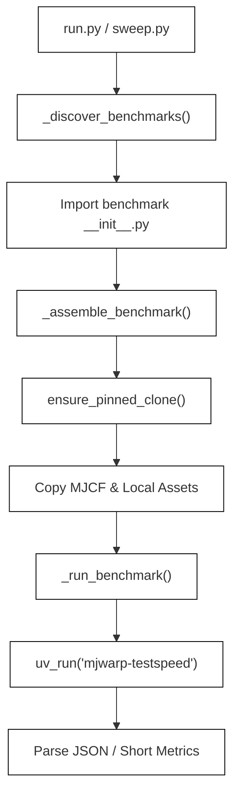
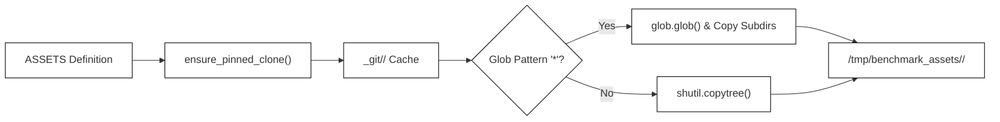
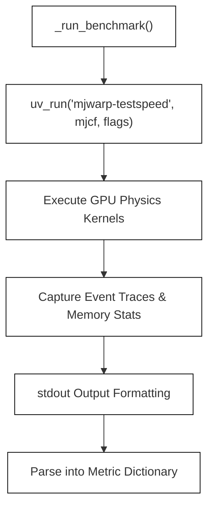

<!-- source: DeepWiki mcp.deepwiki.com · repo google-deepmind/mujoco_warp · extra page Benchmark Suite · fetched 2026-10-26 -->

# Benchmark Suite

Relevant source files

The following files were used as context for generating this wiki page:

- [benchmarks/README.md](benchmarks/README.md)
- [benchmarks/aloha/__init__.py](benchmarks/aloha/__init__.py)
- [benchmarks/aloha/lift_cloth.npz](benchmarks/aloha/lift_cloth.npz)
- [benchmarks/aloha/rollout_cloth.webp](benchmarks/aloha/rollout_cloth.webp)
- [benchmarks/aloha/scene_cloth.xml](benchmarks/aloha/scene_cloth.xml)
- [benchmarks/cloth/README.md](benchmarks/cloth/README.md)
- [benchmarks/cloth/__init__.py](benchmarks/cloth/__init__.py)
- [benchmarks/cloth/mannequin.xml](benchmarks/cloth/mannequin.xml)
- [benchmarks/cloth/rollout_cloth_render.webp](benchmarks/cloth/rollout_cloth_render.webp)
- [benchmarks/cloth/scene.xml](benchmarks/cloth/scene.xml)
- [benchmarks/common.py](benchmarks/common.py)
- [benchmarks/run.py](benchmarks/run.py)
- [benchmarks/sweep.py](benchmarks/sweep.py)
- [benchmarks/unitree_g1/README.md](benchmarks/unitree_g1/README.md)
- [benchmarks/unitree_g1/__init__.py](benchmarks/unitree_g1/__init__.py)
- [benchmarks/unitree_g1/rollout_hfield_render.webp](benchmarks/unitree_g1/rollout_hfield_render.webp)

This page documents the benchmark suite infrastructure for MuJoCo Warp (`benchmarks/`), covering driver scripts (`run.py` and `sweep.py`), asset and configuration handling (`BENCHMARKS` and `ASSETS`), Menagerie integration, and the scene corpus including Aloha, Cloth, Humanoid, and Unitree G1 variants.

---

## 1. Benchmark Architecture and Drivers

The benchmark suite is orchestrated by Python driver scripts residing in the `benchmarks/` directory. These drivers handle discovery of benchmark modules, assembly of external assets, environment execution via `uv`, and performance metric collection.

### Driver Components

*   `benchmarks/run.py`: The primary interactive driver. It discovers benchmark modules, sets up workspace directories, assembles required assets, and executes either `mjwarp-testspeed` or `mjwarp-viewer` [benchmarks/run.py:1-168]().
*   `benchmarks/sweep.py`: A historical sweep runner that iterates across Git commit ranges (`forward` or `back`) to track performance regression or improvement over time, storing results in JSONL format [benchmarks/sweep.py:18-42]().
*   `benchmarks/common.py`: Shared utilities providing shell wrappers for `git` and `uv run`, temporary directory cloning (`clone_if_needed`), and shallow pinned repository management (`ensure_pinned_clone`) [benchmarks/common.py:34-85]().

### Benchmark Driver Data Flow

*Sources: [benchmarks/run.py:57-152](), [benchmarks/sweep.py:76-156](), [benchmarks/common.py:34-85]()*

---

## 2. Configuration and Asset Management

Each benchmark domain is encapsulated in its own subdirectory (e.g., `benchmarks/aloha/`, `benchmarks/cloth/`, `benchmarks/unitree_g1/`) containing an `__init__.py` file [benchmarks/README.md:57-60](). This file defines two primary structures: `ASSETS` and `BENCHMARKS`.

### The `ASSETS` and `BENCHMARKS` Spec

*   **`ASSETS`**: A list of source repositories (typically MuJoCo Menagerie or model sub-repositories) pinned to specific Git commit references (`ref`) [benchmarks/aloha/__init__.py:1-14](), [benchmarks/unitree_g1/__init__.py:1-6]().
*   **`BENCHMARKS`**: A list of dictionary configurations specifying variant parameters such as parallel rollout count (`nworld`), constraint limits (`njmax`), contact limits (`nconmax`), and replay sequences (`replay`) [benchmarks/aloha/__init__.py:16-87](), [benchmarks/README.md:61-95]().

### Asset Assembly and Glob Expansion

When assembling benchmarks, `_assemble_benchmark` reads the tuple mapping `(asset_spec, src_subpath, dst_subpath)` [benchmarks/run.py:86-103](). If `src_subpath` contains glob wildcards (`*`), the driver matches directories matching the pattern and copies them individually, preserving subdirectory structure (e.g., YCB and GSO object datasets) [benchmarks/run.py:93-103](), [benchmarks/README.md:120-122]().

*Sources: [benchmarks/run.py:79-107](), [benchmarks/common.py:64-85](), [benchmarks/README.md:96-122]()*

---

## 3. Scene Corpus and Benchmark Varieties

The benchmark suite provides diverse physical scenarios testing rigid-body dynamics, soft-body (flex) mechanics, sensory rendering, and complex contact resolution.

### Scene Summary Table

| Scene Family | Benchmark Name | `nworld` | `nconmax` | `njmax` | Key Features |
| :--- | :--- | :--- | :--- | :--- | :--- |
| **Aloha** | `aloha_pot` | 8192 | 24 | 128 | Rigid manipulation with object replay (`lift_pot.npz`) [benchmarks/aloha/__init__.py:18-26]() |
| | `aloha_sdf` | 8192 | 32 | 226 | Signed-Distance Field (SDF) collision plugin [benchmarks/aloha/__init__.py:28-34]() |
| | `aloha_cloth` | 256 | 3600 | 6400 | Coupled rigid-flex towel manipulation [benchmarks/aloha/__init__.py:36-44]() |
| | `aloha_clutter` | 2048 | 256 | 384 | Sleeping bodies (`SLEEP` flag), YCB/GSO clutter [benchmarks/aloha/__init__.py:46-61]() |
| | `aloha_clutter_vision` | 2048 | 256 | 384 | Multi-camera rendering (`render` function) [benchmarks/aloha/__init__.py:63-86]() |
| **Cloth** | `cloth` | 256 | 3600 | 3600 | Grid flexcomp elastic shelf/towel benchmark [benchmarks/cloth/__init__.py:1-9]() |
| | `cloth_render` | 32 | 3600 | 3600 | Flex rendering pass benchmark [benchmarks/cloth/__init__.py:11-22]() |
| **Unitree G1** | `unitree_g1_flat` | 8192 | 48 | 192 | Humanoid locomotion on flat ground [benchmarks/unitree_g1/__init__.py:10-18]() |
| | `unitree_g1_hfield` | 8192 | 48 | 192 | Humanoid locomotion on heightfield terrain [benchmarks/unitree_g1/__init__.py:20-28]() |
| | `unitree_g1_hfield_render` | 8192 | 48 | 192 | Heightfield terrain with offscreen rendering [benchmarks/unitree_g1/__init__.py:30-44]() |

*Sources: [benchmarks/aloha/__init__.py:1-87](), [benchmarks/cloth/__init__.py:1-22](), [benchmarks/unitree_g1/__init__.py:1-44]()*

---

## 4. Execution Pipeline and Metrics Collection

When executing via `run.py`, benchmarks invoke `mjwarp-testspeed` with specific tracing and diagnostic flags enabled [benchmarks/run.py:129-138]().

### Execution Flags and Profiling Data

The runner passes the following standard diagnostic flags to `mjwarp-testspeed`:
*   `--event_trace=true`: Captures CUDA event timelines across physics sub-pipelines (`fwd_position`, `fwd_velocity`, `fwd_acceleration`) [benchmarks/run.py:134]().
*   `--memory=true` and `--measure_alloc=true`: Tracks GPU memory allocations and workspace footprints [benchmarks/run.py:135,137]().
*   `--measure_solver=true`: Profiles iterative constraint solver iteration counts and convergence [benchmarks/run.py:136]().

*Sources: [benchmarks/run.py:126-152](), [benchmarks/README.md:40-55]()*

---

