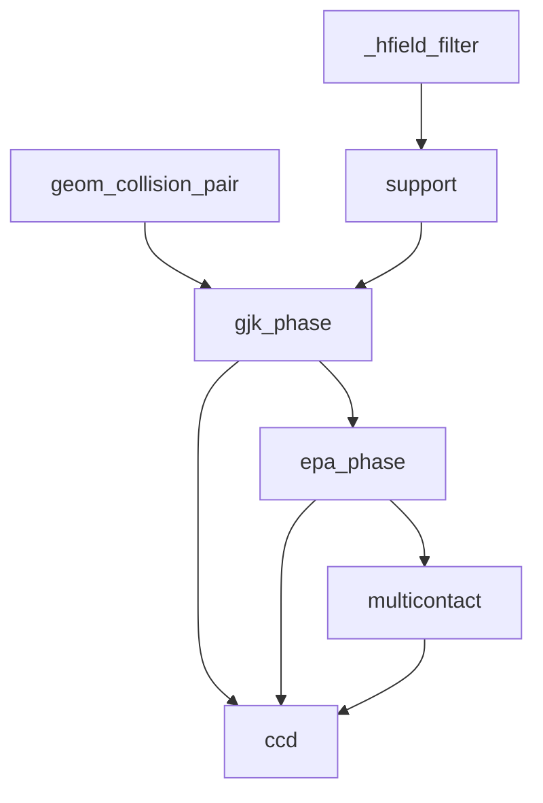
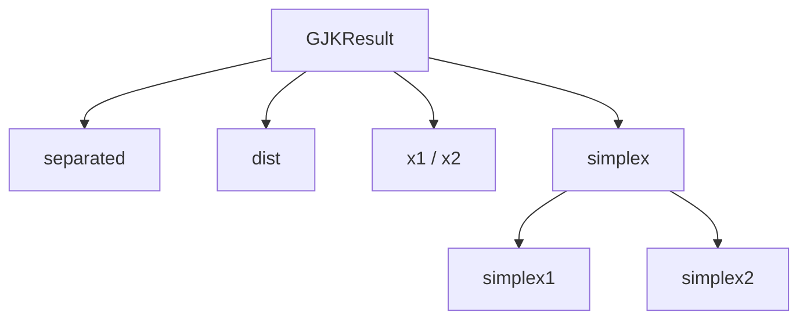
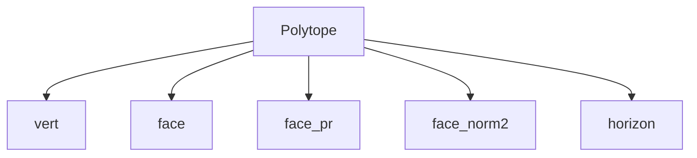

<!-- source: DeepWiki mcp.deepwiki.com · repo google-deepmind/mujoco_warp · extra page Convex Collision: GJK, EPA and Multicontact · fetched 2026-10-26 -->

# Convex Collision: GJK, EPA and Multicontact

<details>
<summary>Relevant source files</summary>

The following files were used as context for generating this wiki page:

- [mujoco_warp/_src/collision_convex.py](mujoco_warp/_src/collision_convex.py)
- [mujoco_warp/_src/collision_core.py](mujoco_warp/_src/collision_core.py)
- [mujoco_warp/_src/collision_gjk.py](mujoco_warp/_src/collision_gjk.py)
- [mujoco_warp/_src/collision_gjk_test.py](mujoco_warp/_src/collision_gjk_test.py)

</details>


## Purpose and Scope
This page details the narrowphase convex collision detection pipeline in `mujoco_warp`. It covers support mappings for diverse geometric primitives and meshes, distance and penetration queries via the Gilbert-Johnson-Keerthi (GJK) algorithm, penetration depth extraction and polytope expansion via the Expanding Polytope Algorithm (EPA), continuous collision detection (CCD), multicontact manifold generation, and heightfield-convex collision filtering. 

Sources:
- `mujoco_warp/_src/collision_gjk.py:1-2793`
- `mujoco_warp/_src/collision_convex.py:1-1527`

---

## Support Mappings and Convex Geometries
Support mappings are the foundational building blocks for convex collision algorithms. Given a direction vector in world or local frame, the support function returns the extreme point of a convex geometry along that direction.

The `support()` function in `mujoco_warp/_src/collision_gjk.py:120-206` computes support points for various geometry types (`GeomType.SPHERE`, `GeomType.BOX`, `GeomType.CAPSULE`, `GeomType.ELLIPSOID`, `GeomType.CYLINDER`, `GeomType.MESH`, and `GeomType.HFIELD`). For meshes, it supports both exhaustive vertex searching and accelerated hillclimbing over graph structures when topological adjacency data is available (`mujoco_warp/_src/collision_gjk.py:160-200`).

Support queries return a `SupportPoint` struct which encapsulates the point coordinates, cached index, and vertex index:

```
+-----------------------------------------------------------------+
| Natural Language Space        Code Entity Space                 |
|-----------------------------------------------------------------|
| Heightfield Filter ---------> _hfield_filter()                  |
| Pair Initialization --------> geom_collision_pair()             |
| Support Mapping Query ------> support()                         |
| GJK Distance/Overlap -------> gjk_phase()                       |
| EPA Polytope Expansion -----> epa_phase()                       |
| Multicontact Generation ----> multicontact()                    |
| Continuous Collision Driver -> ccd()                            |
+-----------------------------------------------------------------+
```

Title: "Convex Collision Pipeline Architecture"



Sources:
- `mujoco_warp/_src/collision_gjk.py:106-206`
- `mujoco_warp/_src/collision_core.py:34-63`

---

## GJK Phase and Distance Queries
The Gilbert-Johnson-Keerthi (GJK) distance algorithm determines the minimum distance between two convex shapes, or detects if they overlap by checking if the origin is contained within their Minkowski difference.

The GJK routine is implemented in `gjk_phase()` within `mujoco_warp/_src/collision_gjk.py`. It operates iteratively by maintaining a simplex of up to 4 vertices (`mat43` data structures) and updating closest points.

The output of GJK is captured in the `GJKResult` struct:

```
+-----------------------------------------------------------------+
| Natural Language Space        Code Entity Space                 |
|-----------------------------------------------------------------|
| GJK Result Data Container --> GJKResult                         |
| Simplex Vertices Matrix ----> simplex, simplex1, simplex2       |
| Separation Status boolean --> separated                         |
| Minimum Distance scalar ----> dist                              |
+-----------------------------------------------------------------+
```

Title: "GJK Data Structures"



Sources:
- `mujoco_warp/_src/collision_gjk.py:65-78`

---

## EPA Phase and Polytope Expansion
When GJK determines that two convex shapes overlap (i.e., the origin lies within the Minkowski difference), the Expanding Polytope Algorithm (EPA) takes over to compute the penetration depth, penetration vector, and contact normal.

EPA builds and expands a `Polytope` data structure (`mujoco_warp/_src/collision_gjk.py:81-104`), adding support points along the face normals closest to the origin until convergence. Bit flags such as `_FACE_DELETED_BIT` and `_FACE_INVALID_BIT` manage face validity and topological updates without dynamic memory allocation on the GPU:

```
+-----------------------------------------------------------------+
| Natural Language Space        Code Entity Space                 |
|-----------------------------------------------------------------|
| Polytope Data Container ------> Polytope                        |
| Face Status Bit Flags -------> _FACE_DELETED_BIT                |
| Horizon Edge Tracking --------> horizon, nhorizon               |
| Face Normal Squared Array ----> face_norm2                      |
+-----------------------------------------------------------------|
```

Title: "Polytope and EPA Representation"



Sources:
- `mujoco_warp/_src/collision_gjk.py:52-104`

---

## Continuous Collision Detection (CCD)
The continuous collision detection orchestration function `ccd()` (found in `mujoco_warp/_src/collision_gjk.py`) coordinates the execution of GJK and EPA across warp threads. It handles convergence loops, tolerance checks, and fallback mechanisms when shapes touch or interpenetrate deeply.

Sources:
- `mujoco_warp/_src/collision_gjk.py`

---

## Multicontact Manifold Generation
To prevent unrealistic jitter and support stable stacking of convex bodies, `mujoco_warp` generates rich contact manifolds via the `multicontact()` routine (`mujoco_warp/_src/collision_gjk.py`). 

This module intersects contact polygons, clips face-edge and face-face contact pairs, and handles intersection tolerances (`INTERSECT_TOL = 0.0000003`, `mujoco_warp/_src/collision_gjk.py:50`) to produce multiple valid contact points with proper depth and normal attributes.

Sources:
- `mujoco_warp/_src/collision_gjk.py:49-51`

---

## Heightfield Handling
Heightfield collisions are handled through specialized filtering and support mapping integration. The helper function `_hfield_filter()` in `mujoco_warp/_src/collision_convex.py:63-162` performs broadphase-like box-sphere and box-box tests against heightfield grid cells.

The kernel builder `ccd_hfield_kernel_builder()` (`mujoco_warp/_src/collision_convex.py:164-172`) instantiates specialized CUDA kernels that evaluate convex geoms against heightfield terrain patches using local frame support queries (`mujoco_warp/_src/collision_convex.py:143-148`).

Sources:
- `mujoco_warp/_src/collision_convex.py:63-172`

---

