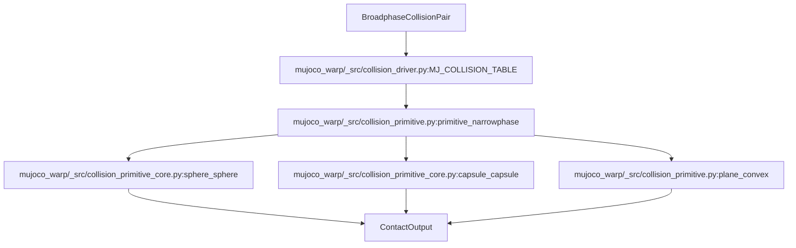
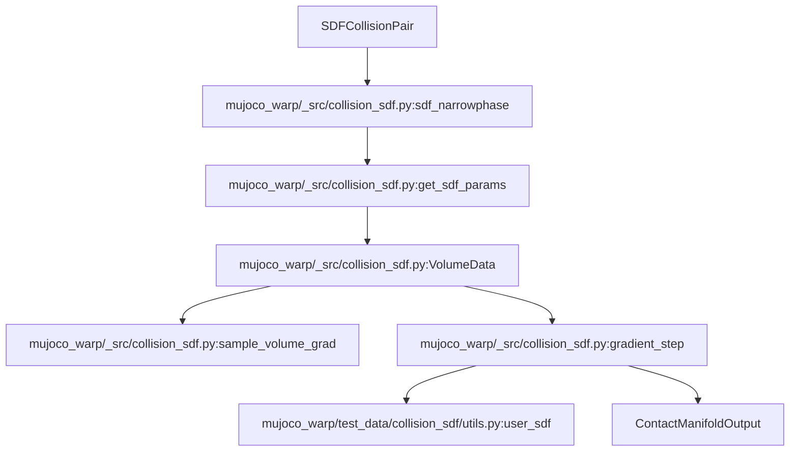

<!-- source: DeepWiki mcp.deepwiki.com · repo google-deepmind/mujoco_warp · extra page Primitive and SDF Collision · fetched 2026-10-26 -->

# Primitive and SDF Collision

Relevant source files

The following files were used as context for generating this wiki page:

- [mujoco_warp/_src/broadphase_test.py](mujoco_warp/_src/broadphase_test.py)
- [mujoco_warp/_src/collision_driver.py](mujoco_warp/_src/collision_driver.py)
- [mujoco_warp/_src/collision_driver_test.py](mujoco_warp/_src/collision_driver_test.py)
- [mujoco_warp/_src/collision_primitive.py](mujoco_warp/_src/collision_primitive.py)
- [mujoco_warp/_src/collision_primitive_core.py](mujoco_warp/_src/collision_primitive_core.py)
- [mujoco_warp/_src/collision_primitive_core_test.py](mujoco_warp/_src/collision_primitive_core_test.py)
- [mujoco_warp/_src/collision_sdf.py](mujoco_warp/_src/collision_sdf.py)
- [mujoco_warp/test_data/collision_sdf/bolt.py](mujoco_warp/test_data/collision_sdf/bolt.py)
- [mujoco_warp/test_data/collision_sdf/gear.py](mujoco_warp/test_data/collision_sdf/gear.py)
- [mujoco_warp/test_data/collision_sdf/nut.py](mujoco_warp/test_data/collision_sdf/nut.py)
- [mujoco_warp/test_data/collision_sdf/utils.py](mujoco_warp/test_data/collision_sdf/utils.py)

## Purpose and Scope
This page documents the implementation of analytical primitive collision detection and Signed Distance Field (SDF) narrowphase routines in `mujoco_warp`. It covers how analytical shapes (`sphere`, `capsule`, `box`, `cylinder`, `plane`, and `ellipsoid`) interact via direct geometric formulas in `collision_primitive.py` and `collision_primitive_core.py`, and how complex geometry and signed-distance volumes are evaluated using octree traversal and gradient-descent optimization in `collision_sdf.py`.

Sources: `mujoco_warp/_src/collision_primitive.py:1-49` [mujoco_warp/_src/collision_primitive.py:1-49](), `mujoco_warp/_src/collision_sdf.py:1-38` [mujoco_warp/_src/collision_sdf.py:1-38]()

---

## 1. Analytical Primitive Collision Architecture

Primitive-primitive and plane-primitive narrowphase collisions avoid iterative optimization by using closed-form analytical solutions. The broadphase or dispatch layer looks up pairs using `MJ_COLLISION_TABLE` defined in `mujoco_warp/_src/collision_driver.py:47-81` [mujoco_warp/_src/collision_driver.py:47-81](). When a pair matches `CollisionType.PRIMITIVE`, control routes to `primitive_narrowphase` in `mujoco_warp/_src/collision_primitive.py` [mujoco_warp/_src/collision_primitive.py:1-189](), which delegates to specific mathematical helpers in `mujoco_warp/_src/collision_primitive_core.py` [mujoco_warp/_src/collision_primitive_core.py:1-221]().

Key analytical helpers include:
- `plane_sphere`: Evaluates signed distance from a sphere center to a half-space plane [mujoco_warp/_src/collision_primitive_core.py:50-56]().
- `sphere_sphere`: Computes exact surface distance, contact point, and normal between two spheres [mujoco_warp/_src/collision_primitive_core.py:59-88]().
- `sphere_capsule`: Projects the sphere center onto the capsule centerline segment before evaluating sphere-sphere geometry [mujoco_warp/_src/collision_primitive_core.py:90-126]().
- `capsule_capsule`: Solves closest points between two line segments using parametric determinants, handling parallel and non-parallel axis cases [mujoco_warp/_src/collision_primitive_core.py:129-221]().
- `plane_convex`: Ranks support vertices in the mesh frame and extracts polygon contact features against planes [mujoco_warp/_src/collision_primitive.py:118-189]().

### Diagram: Primitive Collision Routing (Natural Language to Code Space)

Sources: `mujoco_warp/_src/collision_driver.py:47-81` [mujoco_warp/_src/collision_driver.py:47-81](), `mujoco_warp/_src/collision_primitive.py:118-189` [mujoco_warp/_src/collision_primitive.py:118-189](), `mujoco_warp/_src/collision_primitive_core.py:50-221` [mujoco_warp/_src/collision_primitive_core.py:50-221]()

---

## 2. Signed Distance Field (SDF) Narrowphase and Octree Traversal

For geometries defined via Signed Distance Fields (`GeomType.SDF` or meshes with associated volumetric data), narrowphase collision is formulated as an optimization problem. The system searches for contact points and penetration depths by traversing an octree hierarchy and performing gradient descent on the distance field.

### Core Data Structures
- `VolumeData`: Manages octree node geometry, bounding boxes (`oct_aabb`), child indices (`oct_child`), and trilinear interpolation coefficients (`oct_coeff`) [mujoco_warp/_src/collision_sdf.py:55-63]().
- `MeshData`: Stores mesh triangle indices and vertex buffers for fallback or hybrid queries [mujoco_warp/_src/collision_sdf.py:66-79]().
- `OptimizationParams`: Holds relative transformation matrices (`rel_mat`, `rel_pos`) and plugin attribute vectors (`attr1`, `attr2`) for custom SDF plugins [mujoco_warp/_src/collision_sdf.py:40-47]().

### Traversal and Gradient Descent
When evaluating SDF collisions, `get_sdf_params` extracts volume bounds and attributes [mujoco_warp/_src/collision_sdf.py:82-128](). The narrowphase execution uses `sample_volume_grad` to compute numerical or analytical gradients of the distance field [mujoco_warp/_src/collision_driver_test.py:52-54](), and `gradient_step` to advance the search position toward the zero-level set or maximum penetration depth [mujoco_warp/_src/collision_driver_test.py:57-65]().

Custom plugins (such as threaded nuts, bolts, gears, and toruses) are integrated via `register_sdf_plugins`, which binds user-defined distance functions (`nut`, `bolt`, `gear`, `torus`) and their gradients (`nut_sdf_grad`, etc.) into the Warp execution context [mujoco_warp/test_data/collision_sdf/utils.py:43-112]().

### Diagram: SDF Narrowphase and Optimization Pipeline (Natural Language to Code Space)

Sources: `mujoco_warp/_src/collision_sdf.py:40-128` [mujoco_warp/_src/collision_sdf.py:40-128](), `mujoco_warp/_src/collision_driver_test.py:45-65` [mujoco_warp/_src/collision_driver_test.py:45-65](), `mujoco_warp/test_data/collision_sdf/utils.py:43-112` [mujoco_warp/test_data/collision_sdf/utils.py:43-112]()

---

