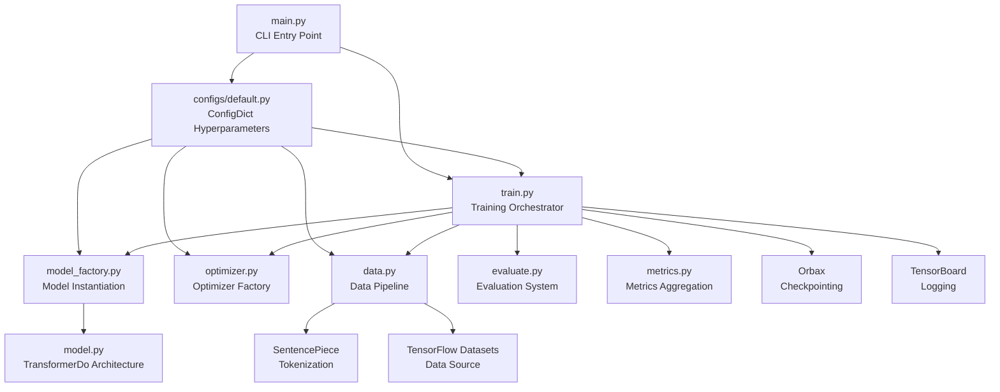
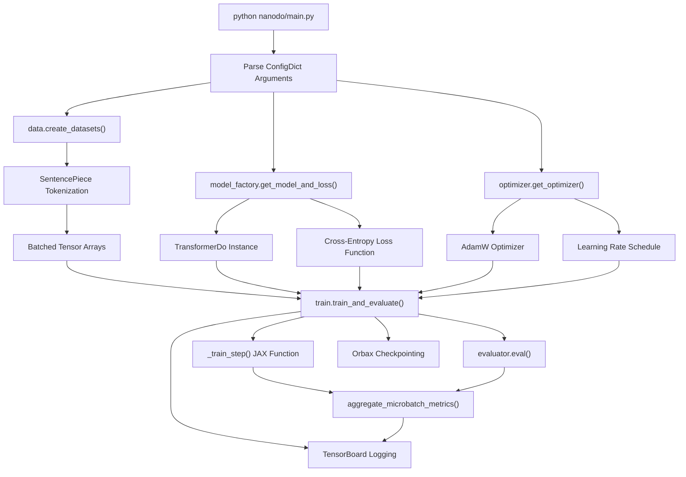

<!-- source: DeepWiki mcp.deepwiki.com · repo google-deepmind/nanodo · page 1 Overview · fetched 2026-10-26 -->

# Overview

<details>
<summary>Relevant source files</summary>

The following files were used as context for generating this wiki page:

- [README.md](README.md)
- [pyproject.toml](pyproject.toml)

</details>


This document provides a comprehensive overview of the NanoDO repository, a minimal Transformer decoder-only language model implementation in JAX designed for research purposes. It covers the core architecture, design philosophy, and key systems that comprise the framework.

For detailed information about specific subsystems, see the Core Systems documentation ([section 3](#3)). For installation and basic usage instructions, see Getting Started ([section 2](#2)).

## Purpose and Design Philosophy

NanoDO is a minimal ("nano-sized") Transformer decoder-only language model implementation built in JAX, specifically designed to be maximally hackable, forkable, and readable for researchers conducting exploratory research. The framework prioritizes code transparency over abstraction, following the principle that "magic is great for products, but harmful for research."

The core design opinions include:

- **Minimal Abstraction**: Code is designed to be self-documenting with minimal magic
- **Readable Tensor Operations**: Tensors use short mathematical names with shapes encoded in variable names rather than comments
- **Research-First**: Optimized for hackability and exploration rather than production deployment
- **JAX Ecosystem Integration**: Built entirely on JAX and its associated libraries for performance and scalability

Sources: [README.md:1-27](), [pyproject.toml:6-8]()

## Core Architecture

### High-Level System Components



The architecture follows a centralized orchestration pattern where `train.py` coordinates all major subsystems. The `main.py` CLI interface loads configuration and delegates to the training orchestrator, which manages the model, optimizer, data pipeline, and evaluation systems.

Sources: [README.md:10-17](), [pyproject.toml:51-65]()

### Data Flow and Training Pipeline



The training pipeline follows a functional programming approach using JAX's compilation and transformation capabilities. Data flows through tokenization, batching, and into compiled training/evaluation steps that update model parameters and collect metrics.

Sources: [README.md:58-66](), [nanodo/main.py](), [nanodo/train.py]()

## JAX Ecosystem Integration

NanoDO is built entirely on the JAX ecosystem, leveraging specialized libraries for each major functionality:

| Library | Purpose | Usage in NanoDO |
|---------|---------|-----------------|
| **JAX** | Numerical computing, compilation | Core tensor operations, JIT compilation |
| **Flax** | Neural network modules | `TransformerDo` model architecture |
| **Optax** | Optimization algorithms | AdamW optimizer, learning rate schedules |
| **Orbax** | Model checkpointing | Saving/loading training state |
| **Grain** | Data loading pipeline | Efficient batch processing |
| **TFDS** | Dataset access | Pre-processed language modeling datasets |
| **SentencePiece** | Tokenization | Text to token ID conversion |
| **ML Collections** | Configuration management | Hyperparameter specification via `ConfigDict` |

The integration follows JAX's functional programming paradigms, with pure functions, immutable data structures, and explicit state management through `TrainState` objects.

Sources: [README.md:10-17](), [pyproject.toml:51-65]()

## Model Architecture Specification

The `TransformerDo` architecture implements a standard decoder-only Transformer with the following key characteristics:

- **Pre-LayerNorm Architecture**: Layer normalization applied before attention and MLP blocks
- **Shared Input/Output Embeddings**: Token embeddings are tied between input and output layers
- **Learned Position Embeddings**: Positional information encoded through learnable parameters
- **GELU Activation**: Gaussian Error Linear Units in MLP layers
- **No Biases**: Follows PaLM architecture decisions for improved stability

The model is instantiated through `model_factory.get_model_and_loss()` using a `DoConfig` object that specifies layer count, hidden dimensions, attention heads, and other architectural parameters.

Sources: [README.md:29-37](), [nanodo/model.py](), [nanodo/model_factory.py]()

## Distributed Training Support

NanoDO implements Fully Sharded Data Parallel (FSDP) for scalable training across multiple devices. Model parameters and optimizer state are sharded among available devices, with JAX's compilation system handling the necessary communication patterns for parameter synchronization.

The FSDP implementation enables training of large models that exceed single-device memory capacity while maintaining the framework's simplicity and hackability principles.

Sources: [README.md:39-44](), [nanodo/fsdp.py]()

## Entry Points and Usage

The primary entry point is `main.py`, which provides a command-line interface for configuring and launching training jobs:

```bash
python nanodo/main.py \
  --config=nanodo/configs/default.py \
  --config.workdir=/tmp/nanodo_workdir \
  --config.vocab_path=path/to/sentencepiece.model
```

The CLI accepts configuration overrides through command-line flags, allowing researchers to easily modify hyperparameters without editing configuration files. All training artifacts, including checkpoints and TensorBoard logs, are written to the specified `workdir`.

Sources: [README.md:58-76](), [nanodo/main.py](), [nanodo/configs/default.py]()

---

