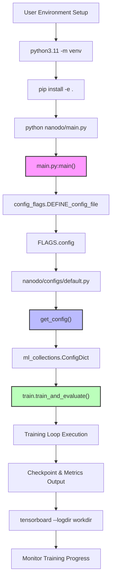
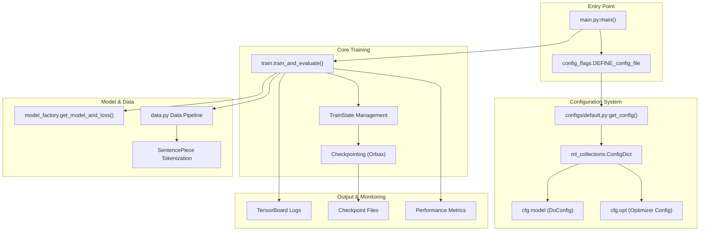

<!-- source: DeepWiki mcp.deepwiki.com · repo google-deepmind/nanodo · page 2 Getting Started · fetched 2026-10-26 -->

# Getting Started

<details>
<summary>Relevant source files</summary>

The following files were used as context for generating this wiki page:

- [README.md](README.md)
- [nanodo/configs/default.py](nanodo/configs/default.py)
- [nanodo/main.py](nanodo/main.py)

</details>


This guide provides step-by-step instructions for installing nanodo and running your first Transformer language model training job. It covers the basic setup process, configuration, and initial usage patterns to get you productive quickly.

For detailed information about the training system architecture, see [Training System](#3.1). For comprehensive configuration options, see [Model Architecture](#3.2) and [Optimization](#3.6).

## Prerequisites

Before installing nanodo, ensure you have the following:

- **Python 3.11 or higher**: The codebase requires modern Python features
- **JAX ecosystem compatibility**: Your system should support JAX installation
- **Hardware considerations**: While nanodo runs on CPU, GPU/TPU acceleration is recommended for serious training

## Installation Process

The installation follows a standard Python package setup using pip in a virtual environment:

```bash
# Create and activate virtual environment
python3.11 -m venv /tmp/nanodo_test_env
source /tmp/nanodo_test_env/bin/activate

# Install nanodo in development mode
cd [path_to_repo]
pip install -e .
```

### Hardware-Specific JAX Installation

For GPU/TPU acceleration, install the appropriate JAX version following the [JAX installation guide](https://jax.readthedocs.io/en/latest/installation.html) before running training jobs.

Sources: [README.md:46-56]()

## Getting Started Workflow



Sources: [README.md:48-66](), [nanodo/main.py:39-50](), [nanodo/configs/default.py:23-24]()

## Basic Usage

### Running Your First Training Job

Execute the following command to start a minimal training job:

```bash
python nanodo/main.py \
  --config=nanodo/configs/default.py \
  --config.workdir=/tmp/nanodo_workdir \
  --config.vocab_path=tests/testdata/sentencepiece_cc_all.32000.100extra-sentencepiece.model \
  --config.model.L=128 \
  --config.batch_size=2 \
  --config.pygrain_worker_count=0 \
  2> stderr.log
```

### Command Line Interface Structure

The CLI is built using `absl.flags` and `ml_collections.config_flags`, providing a hierarchical configuration system:

| Parameter | Purpose | Example Value |
|-----------|---------|---------------|
| `--config` | Base configuration file | `nanodo/configs/default.py` |
| `--config.workdir` | Output directory for checkpoints/logs | `/tmp/nanodo_workdir` |
| `--config.vocab_path` | SentencePiece tokenizer model | Path to `.model` file |
| `--config.model.L` | Maximum sequence length | `128` (reduced for testing) |
| `--config.batch_size` | Global batch size | `2` (reduced for testing) |
| `--config.pygrain_worker_count` | Data loading workers | `0` (single-threaded) |

### Configuration Override Pattern

The configuration system allows dot-notation overrides of any parameter defined in the base config:

```bash
# Override model architecture
--config.model.D=256          # embedding dimension
--config.model.H=4            # attention heads
--config.model.N=4            # transformer layers

# Override optimization
--config.opt.peak_learning_rate=0.001
--config.opt.num_train_steps=10000
```

Sources: [nanodo/main.py:30-36](), [README.md:58-66](), [nanodo/configs/default.py:35-57]()

## Key Components and Code Locations



Sources: [nanodo/main.py:26-50](), [nanodo/configs/default.py:23-90]()

## Understanding Training Output

### Monitoring with TensorBoard

Start TensorBoard to monitor training progress:

```bash
tensorboard --logdir /tmp/nanodo_workdir
```

### Key Metrics to Watch

The training system logs several important metrics:

| Metric Category | Key Metrics | Purpose |
|----------------|-------------|---------|
| **Training Loss** | `train/loss` | Primary optimization target |
| **Learning Rate** | `train/learning_rate` | Current LR from schedule |
| **Performance** | `train/steps_per_sec` | Training throughput |
| **Evaluation** | `eval/loss` | Validation performance |
| **Gradients** | `train/grad_norm` | Training stability indicator |

### Checkpoint Management

Checkpoints are saved to `workdir` every `checkpoint_every_steps` (default: 2000 steps). The system maintains `max_to_keep` checkpoints (default: 100) and uses Orbax for efficient checkpoint storage.

Sources: [README.md:69-73](), [nanodo/configs/default.py:59-76]()

## Performance Optimization

### Data Loading Optimization

If training is input-bound, increase the number of pygrain workers:

```bash
--config.pygrain_worker_count=16  # Increase from 0 for multi-processing
```

### Memory and Compute Optimization

For larger models or limited memory:

```bash
--config.model.remat=True         # Enable gradient checkpointing
--config.model.fsdp_enabled=True  # Enable parameter sharding
```

Sources: [README.md:75-76](), [nanodo/configs/default.py:42-43](), [nanodo/configs/default.py:85-88]()

## Next Steps

After successfully running your first training job:

1. **Explore Model Architecture**: Learn about the `TransformerDo` implementation in [Model Architecture](#3.2)
2. **Understand Data Pipeline**: Deep dive into data loading and preprocessing in [Data Pipeline](#3.3)
3. **Scale Up Training**: Learn about distributed training with [Distributed Training (FSDP)](#4.1)
4. **Custom Configurations**: Create custom config files following the patterns in [nanodo/configs/default.py:23-90]()
5. **Evaluation and Metrics**: Understand the evaluation system in [Evaluation System](#3.4)

For production deployments and advanced features, see [Advanced Features](#4).

Sources: [README.md:1-98]()

---

