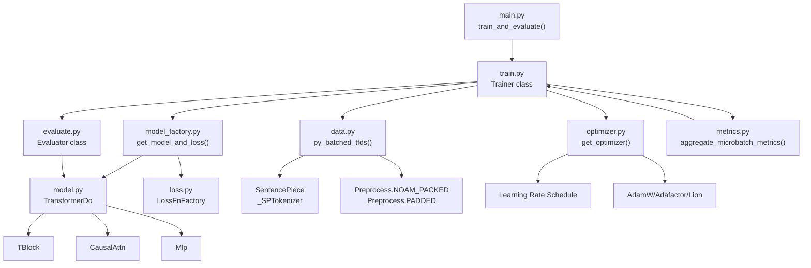
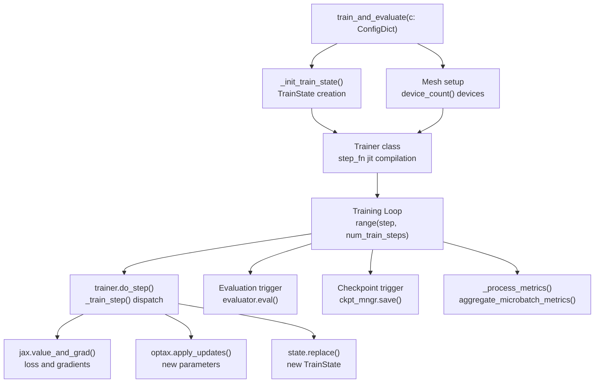
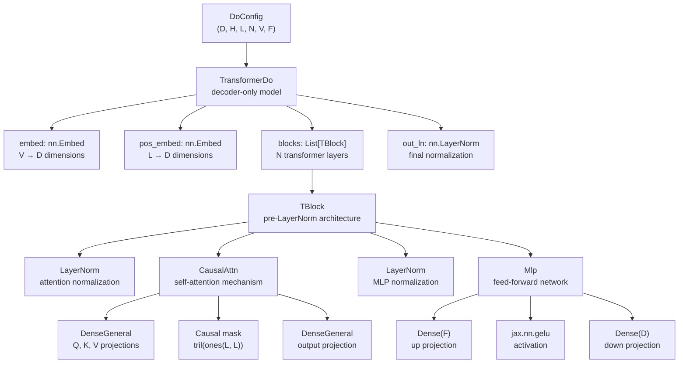
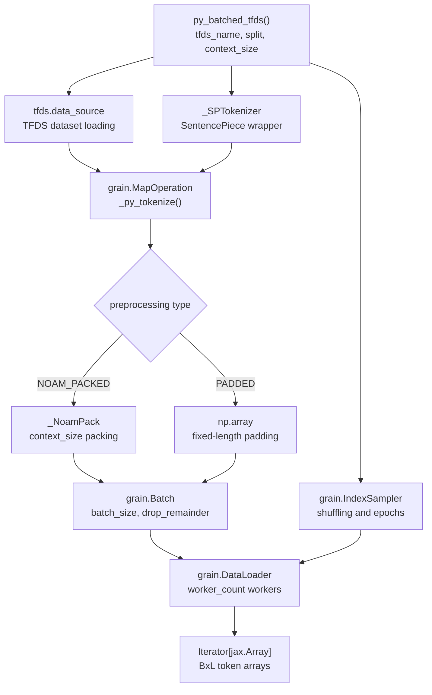
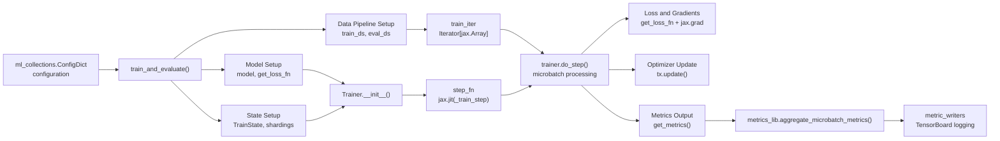

<!-- source: DeepWiki mcp.deepwiki.com · repo google-deepmind/nanodo · page 3 Core Systems · fetched 2026-10-26 -->

# Core Systems

Relevant source files

The following files were used as context for generating this wiki page:

- [nanodo/data.py](nanodo/data.py)
- [nanodo/model.py](nanodo/model.py)
- [nanodo/train.py](nanodo/train.py)

This document provides an overview of the main architectural components that comprise the nanodo framework. It covers the six primary systems that orchestrate model training: the training orchestrator, model architecture, data pipeline, evaluation system, metrics collection, and optimization components. Each system is implemented as a focused module with clear interfaces and responsibilities.

For detailed implementation guides on each system, see the individual subsections: [Training System](#3.1), [Model Architecture](#3.2), [Data Pipeline](#3.3), [Evaluation System](#3.4), [Metrics and Monitoring](#3.5), and [Optimization](#3.6).

## System Architecture Overview

The nanodo framework follows a modular design where each core system has distinct responsibilities. The training system acts as the central orchestrator, coordinating all other components through well-defined interfaces.

**Sources:** [nanodo/train.py:54-234](), [nanodo/model_factory.py](), [nanodo/data.py:39-89](), [nanodo/evaluate.py](), [nanodo/metrics.py](), [nanodo/optimizer.py]()

## Training System Core

The training system is built around the `Trainer` class and the `train_and_evaluate` function, which coordinates all training activities including gradient computation, parameter updates, and distributed execution.

**Sources:** [nanodo/train.py:54-234](), [nanodo/train.py:236-294](), [nanodo/train.py:296-324]()

## Model Architecture System

The model architecture centers on the `TransformerDo` class, which implements a decoder-only transformer using the configuration specified in `DoConfig`. The architecture follows a pre-LayerNorm design with standard transformer components.

**Sources:** [nanodo/model.py:29-46](), [nanodo/model.py:48-78](), [nanodo/model.py:97-114](), [nanodo/model.py:116-165](), [nanodo/model.py:80-94]()

## Data Pipeline System

The data pipeline is built around the `py_batched_tfds` function, which creates `grain.DataLoader` instances with configurable preprocessing strategies. The system supports both NOAM packing for training efficiency and padding for evaluation consistency.

**Sources:** [nanodo/data.py:39-89](), [nanodo/data.py:102-113](), [nanodo/data.py:115-136](), [nanodo/data.py:138-166]()

## System Integration Flow

The integration between systems follows a clear data flow pattern, with the training system coordinating all components through standardized interfaces and shared state management.

**Sources:** [nanodo/train.py:54-85](), [nanodo/train.py:112-118](), [nanodo/train.py:236-294](), [nanodo/train.py:296-324](), [nanodo/metrics.py]()

## Configuration and State Management

The framework uses `ml_collections.ConfigDict` for centralized configuration management and `flax.training.TrainState` for maintaining training state across distributed devices. The configuration system enables reproducible experiments through structured hyperparameter management.

| Component | Configuration Source | State Management |
|-----------|---------------------|------------------|
| Model Architecture | `c.model` (DoConfig fields) | `state.params` |
| Optimization | `c.opt` | `state.opt_state` |
| Data Pipeline | `c.ds_name`, `c.vocab_path` | `train_iter` checkpointing |
| Training Loop | `c.opt.num_train_steps` | `state.step` |
| Evaluation | `c.eval_every_steps` | Stateless evaluation |
| Checkpointing | `c.checkpoint_every_steps` | `orbax.CheckpointManager` |

**Sources:** [nanodo/train.py:74-85](), [nanodo/train.py:327-347](), [nanodo/train.py:350-376]()

---

