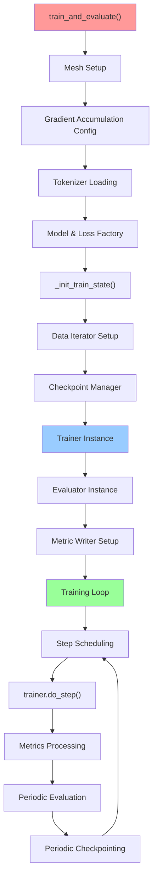
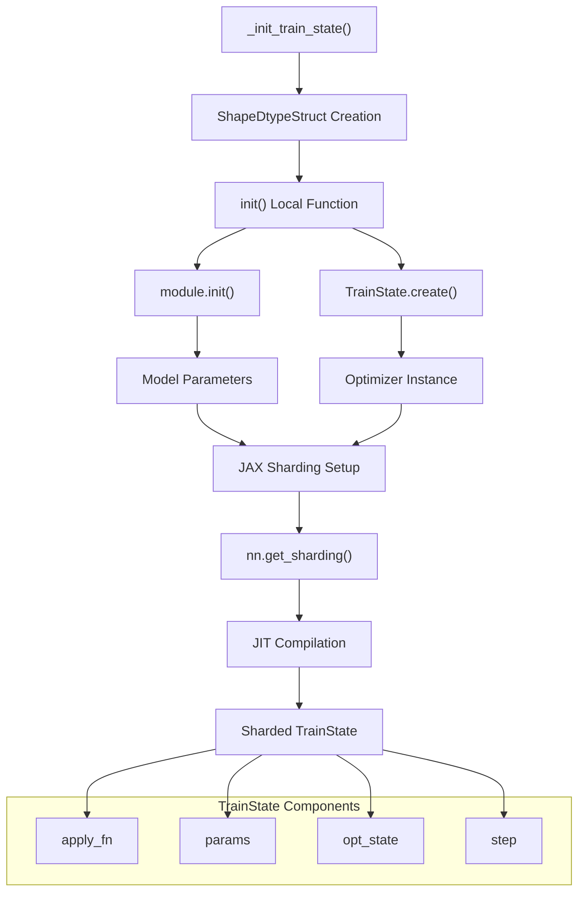
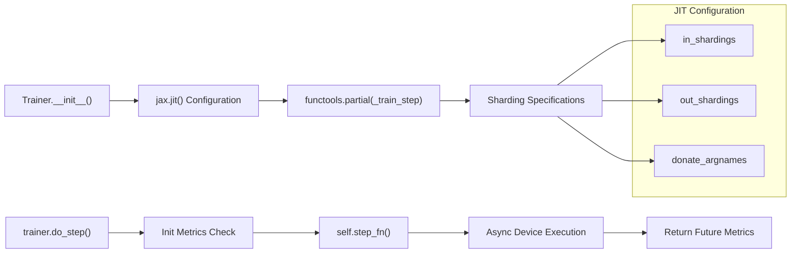
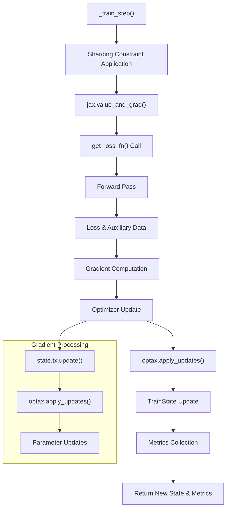
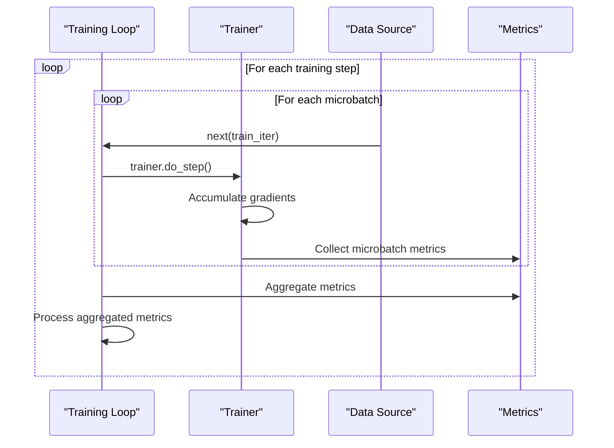
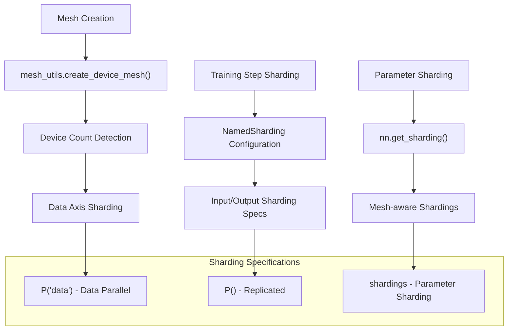
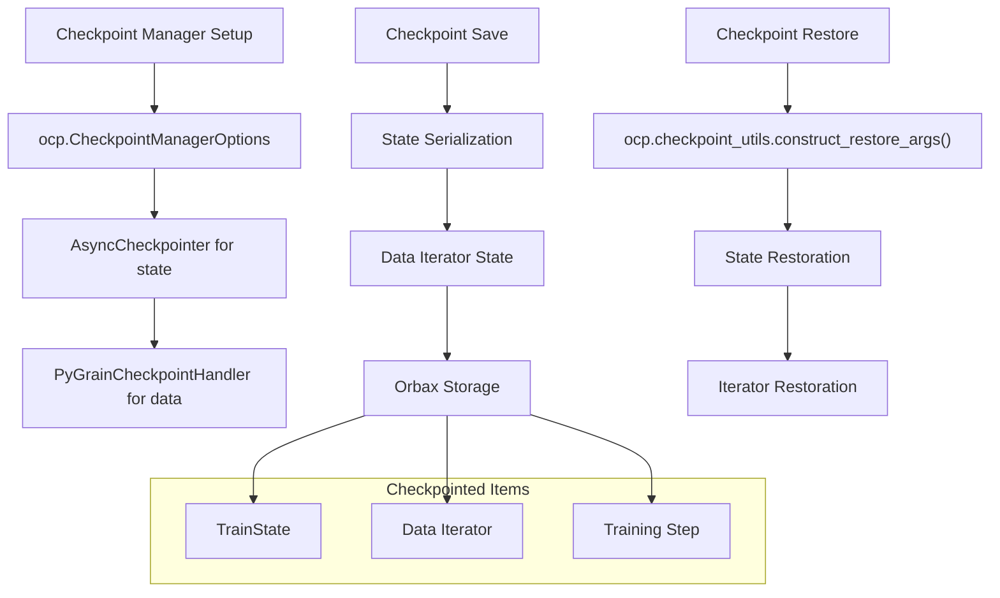
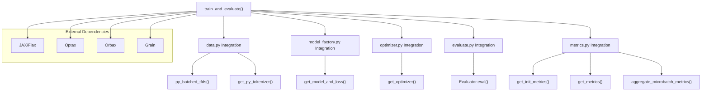
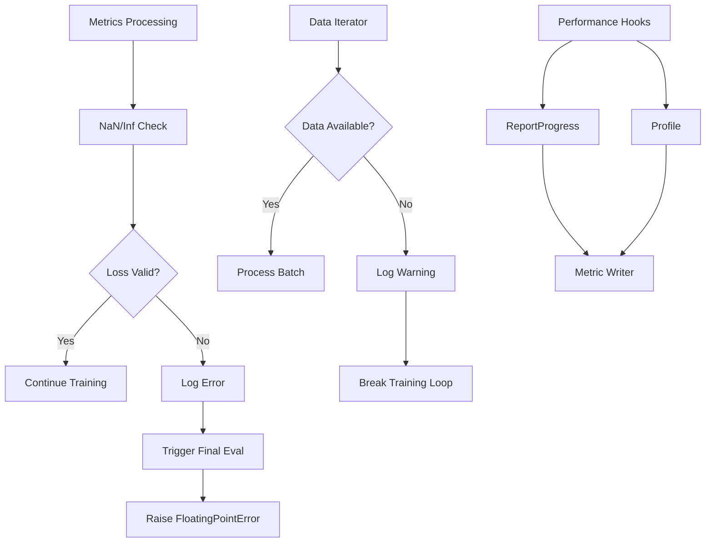

<!-- source: DeepWiki mcp.deepwiki.com · repo google-deepmind/nanodo · page 3.1 Training System · fetched 2026-10-26 -->

# Training System

Relevant source files

The following files were used as context for generating this wiki page:

- [nanodo/train.py](nanodo/train.py)
- [tests/train_test.py](tests/train_test.py)

## Purpose and Scope

The Training System is the central orchestrator for model training in nanodo. It coordinates all aspects of the training process including data loading, model forward/backward passes, optimization, evaluation, metrics collection, and checkpointing. The system is built around JAX and supports distributed training through Fully Sharded Data Parallel (FSDP).

For information about the model architecture being trained, see [Model Architecture](#3.2). For details about the data pipeline, see [Data Pipeline](#3.3). For evaluation specifics, see [Evaluation System](#3.4).

## Core Components

The training system consists of three main components:

| Component | Location | Purpose |
|-----------|----------|---------|
| `train_and_evaluate` | [nanodo/train.py:54]() | Main training orchestration function |
| `Trainer` | [nanodo/train.py:236-294]() | Executes individual training steps |
| `_train_step` | [nanodo/train.py:296-324]() | Core forward/backward pass implementation |

### Training Orchestration Flow

Sources: [nanodo/train.py:54-234]()

## Training State Management

The training system uses Flax's `TrainState` to manage model parameters, optimizer state, and training progress. State initialization and sharding are handled by the `_init_train_state` function.

Sources: [nanodo/train.py:327-347]()

## Trainer Class Architecture

The `Trainer` class encapsulates the training step execution and provides asynchronous step dispatching:

| Method | Purpose |
|--------|---------|
| `__init__` | Sets up JIT-compiled step function with proper shardings |
| `do_step` | Asynchronously dispatches training step and returns metrics |
| `get_metrics` | Downloads metrics from device to host |
| `step` | Property returning current training step |

Sources: [nanodo/train.py:236-294]()

## Core Training Step Implementation

The `_train_step` function implements the fundamental forward and backward pass:

Sources: [nanodo/train.py:296-324]()

## Gradient Accumulation Support

The training system supports gradient accumulation to simulate larger batch sizes:

| Configuration | Purpose |
|---------------|---------|
| `grad_accumulation_steps` | Number of microbatches to accumulate |
| `micro_batch_size` | Size of each microbatch |
| `batch_size` | Total effective batch size |

The training loop processes multiple microbatches per step when gradient accumulation is enabled:

Sources: [nanodo/train.py:58-66](), [nanodo/train.py:214-226]()

## Distributed Training Coordination

The training system integrates with JAX's distributed training capabilities:

Sources: [nanodo/train.py:57](), [nanodo/train.py:251-270](), [nanodo/train.py:304-307]()

## Checkpointing System

The training system provides comprehensive checkpointing support through Orbax:

| Component | Purpose |
|-----------|---------|
| `_get_ckpt_manager` | Creates checkpoint manager with state and data handlers |
| `_restore_ckpt` | Restores training state and data iterator from checkpoint |
| Automatic checkpointing | Saves checkpoints at specified intervals |

Sources: [nanodo/train.py:350-376]()

## Integration with Other Systems

The training system coordinates with multiple other nanodo components:

Sources: [nanodo/train.py:34-42](), [nanodo/train.py:77-98](), [nanodo/train.py:112-145]()

## Error Handling and Monitoring

The training system includes robust error handling and monitoring:

- **NaN/Inf Detection**: Automatic termination when loss becomes NaN or infinite
- **Performance Monitoring**: Integration with CLU for progress reporting and profiling
- **Asynchronous Metrics**: Non-blocking metrics collection to avoid training slowdowns
- **Data Exhaustion Handling**: Graceful handling when training data is exhausted

Sources: [nanodo/train.py:183-198](), [nanodo/train.py:215-220](), [nanodo/train.py:155-169]()

---

