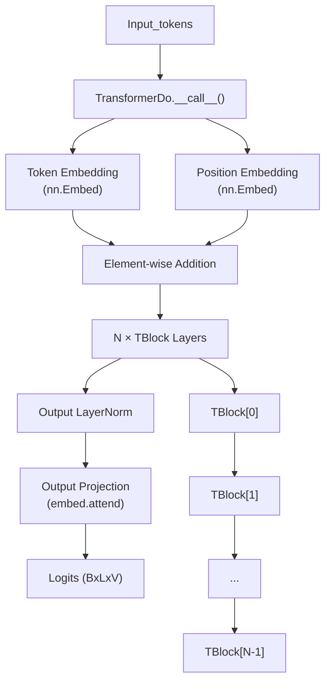
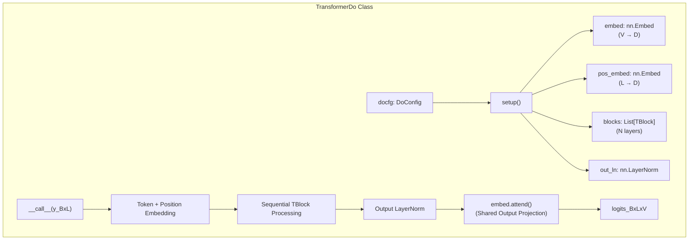
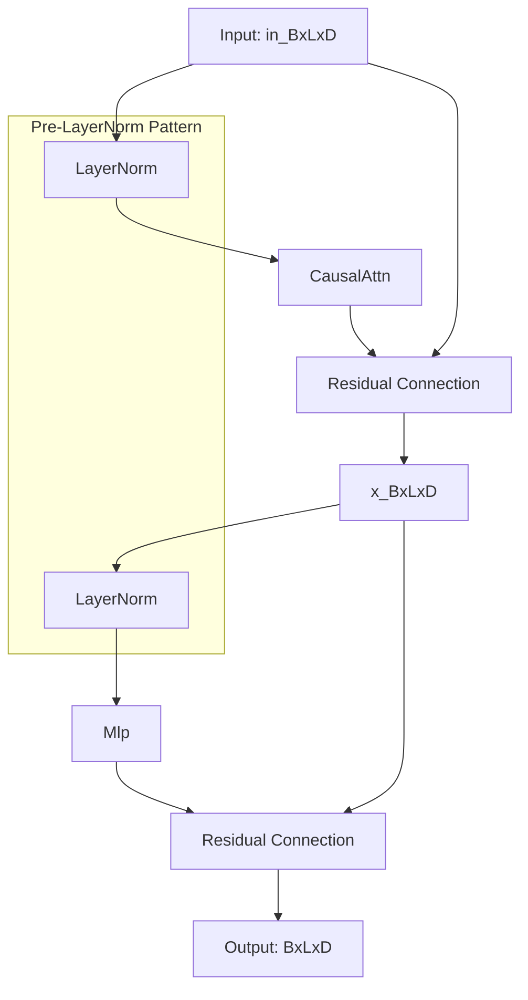
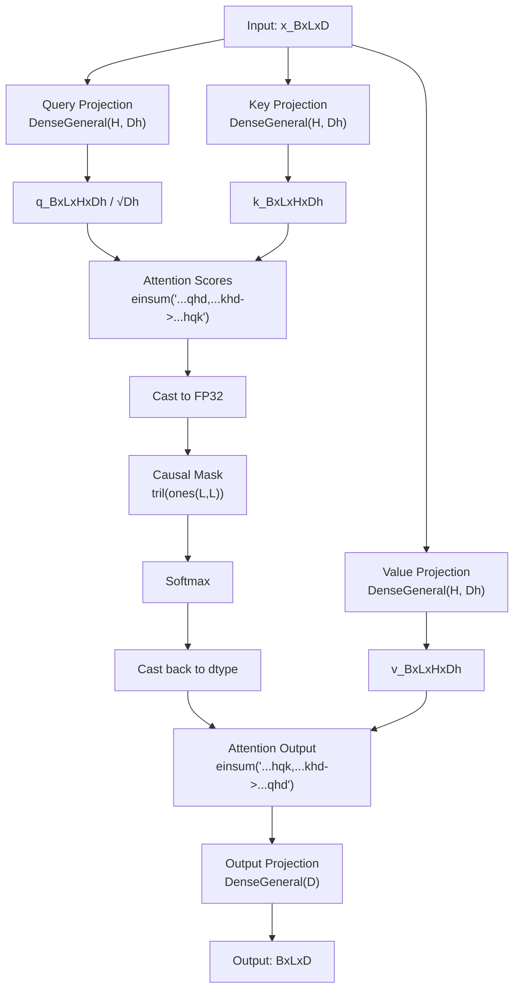
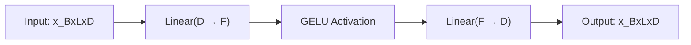
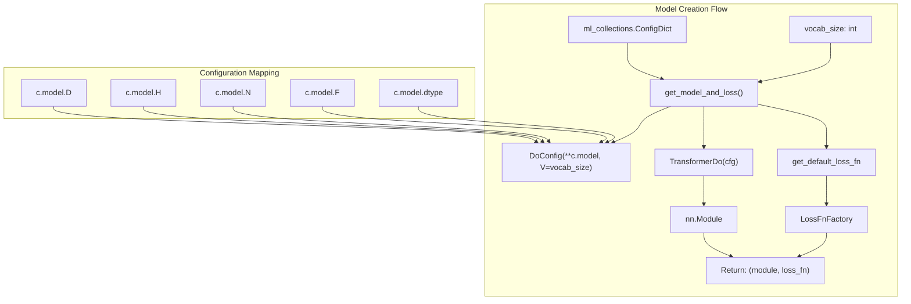

<!-- source: DeepWiki mcp.deepwiki.com · repo google-deepmind/nanodo · page 3.2 Model Architecture · fetched 2026-10-26 -->

# Model Architecture

<details>
<summary>Relevant source files</summary>

The following files were used as context for generating this wiki page:

- [nanodo/model.py](nanodo/model.py)
- [nanodo/model_factory.py](nanodo/model_factory.py)
- [nanodo/optimizer.py](nanodo/optimizer.py)
- [tests/model_factory_test.py](tests/model_factory_test.py)

</details>


This document covers the transformer decoder-only model architecture implementation in nanodo, including the core `TransformerDo` model, configuration system, and model factory patterns. It focuses on the architectural components, their relationships, and how models are instantiated and configured.

For information about loss computation and auxiliary data handling, see [Loss Functions](#4.2). For details about distributed training and parameter sharding, see [Distributed Training (FSDP)](#4.1).

## Overview

The nanodo framework implements a standard transformer decoder-only architecture with support for causal language modeling. The architecture follows modern transformer design patterns with pre-layer normalization, shared input/output embeddings, and multi-head causal self-attention.

### Core Architecture Flow



Sources: [nanodo/model.py:69-77]()

### Model Configuration System

The model architecture is controlled through the `DoConfig` dataclass, which centralizes all architectural hyperparameters:

| Parameter | Description | Type |
|-----------|-------------|------|
| `D` | Model/embedding dimension (= qkv dimension) | `int` |
| `H` | Number of attention heads | `int` |
| `L` | Maximum context/sequence length | `int` |
| `N` | Number of transformer block layers | `int` |
| `V` | Vocabulary size | `int` |
| `F` | Feed-forward inner dimension | `int` |
| `kernel_init` | Kernel parameter initializer | `nn.initializers.Initializer` |
| `embed_init` | Embedding parameter initializer | `nn.initializers.Initializer` |
| `dtype` | Model computation dtype | `jnp.dtype` |
| `fsdp_enabled` | Enable FSDP parameter sharding | `bool` |
| `remat` | Enable gradient checkpointing | `bool` |

Sources: [nanodo/model.py:29-46]()

## TransformerDo Architecture

### Model Structure



Sources: [nanodo/model.py:48-78]()

The `TransformerDo` class implements the main model architecture with the following key design decisions:

- **Shared Input/Output Embeddings**: The token embedding layer (`embed`) is reused for output projection through `embed.attend()`, reducing parameter count
- **Learned Position Embeddings**: Absolute position embeddings are learned parameters rather than sinusoidal 
- **Pre-LayerNorm Architecture**: Each transformer block applies layer normalization before the sub-layers rather than after
- **Gradient Checkpointing Support**: Optional rematerialization of transformer blocks via `nn.remat` for memory efficiency

Sources: [nanodo/model.py:52-77]()

## Transformer Block (TBlock)

### Block Internal Structure



Sources: [nanodo/model.py:97-113]()

Each `TBlock` follows the pre-layernorm transformer architecture:

1. **First Sub-layer**: LayerNorm → CausalAttn → Residual
2. **Second Sub-layer**: LayerNorm → MLP → Residual

This differs from the original transformer's post-layernorm design and is known to provide better training stability.

Sources: [nanodo/model.py:102-113]()

## Causal Self-Attention

### Attention Mechanism



Sources: [nanodo/model.py:116-165]()

The `CausalAttn` implementation includes several important details:

- **Multi-head Structure**: Input dimension `D` is split into `H` heads of dimension `Dh = D/H`
- **Scaled Dot-Product**: Query vectors are scaled by `1/√Dh` for attention stability
- **Causal Masking**: Lower triangular mask ensures autoregressive property
- **Mixed Precision**: Attention scores computed in FP32 for numerical stability, then cast back
- **No Bias Terms**: All linear projections use `use_bias=False` following modern practice

Sources: [nanodo/model.py:121-165]()

## Multi-Layer Perceptron

The `Mlp` component implements a standard 2-layer feed-forward network:



Sources: [nanodo/model.py:80-94]()

Key characteristics:
- **Expansion Factor**: Inner dimension `F` is typically `4*D` 
- **GELU Activation**: Uses `jax.nn.gelu` rather than ReLU
- **No Bias Terms**: Both linear layers use `use_bias=False`

Sources: [nanodo/model.py:87-94]()

## Model Factory System

### Factory Pattern Implementation



Sources: [nanodo/model_factory.py:28-40]()

The `get_model_and_loss` function serves as the primary entry point for model instantiation:

- **Config Integration**: Takes an `ml_collections.ConfigDict` and extracts model parameters
- **Vocabulary Binding**: Accepts `vocab_size` parameter to set the model's vocabulary dimension
- **Extensibility**: Designed to support experimental models through conditional logic
- **Loss Coupling**: Returns both the model and associated loss function factory

Sources: [nanodo/model_factory.py:28-40]()

## FSDP Integration

The model architecture includes built-in support for Fully Sharded Data Parallel training through the `fsdp` module integration:

- **Parameter Sharding**: All parameter initializers use `fsdp.init()` for proper sharding setup
- **Layer-specific Sharding**: Different layer types (`embedding`, `mlp_kernel`, `attn_in_proj`, `attn_out_proj`) have tailored sharding strategies
- **Conditional Enabling**: FSDP can be disabled via `fsdp_enabled=False` in `DoConfig`

Sources: [nanodo/model.py:57-58](), [nanodo/model.py:88](), [nanodo/model.py:132](), [nanodo/model.py:161]()

## Memory Optimization

### Gradient Checkpointing

The architecture supports gradient checkpointing (rematerialization) for memory-efficient training:

```python
block = nn.remat(TBlock) if cfg.remat else TBlock
self.blocks = [block(cfg) for _ in range(cfg.N)]
```

When `remat=True`, transformer blocks are wrapped with `nn.remat`, trading compute for memory by recomputing activations during the backward pass.

Sources: [nanodo/model.py:65-66]()

---

