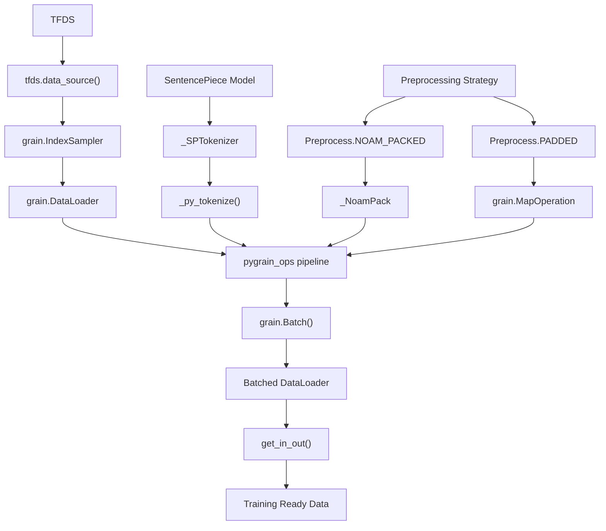
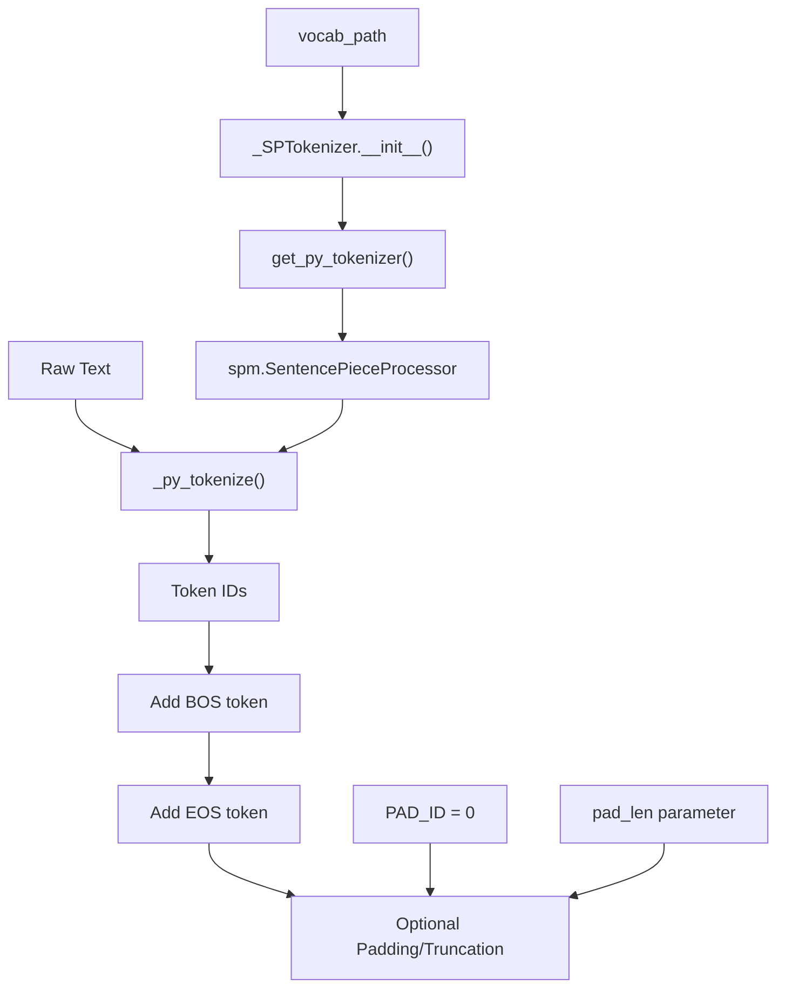
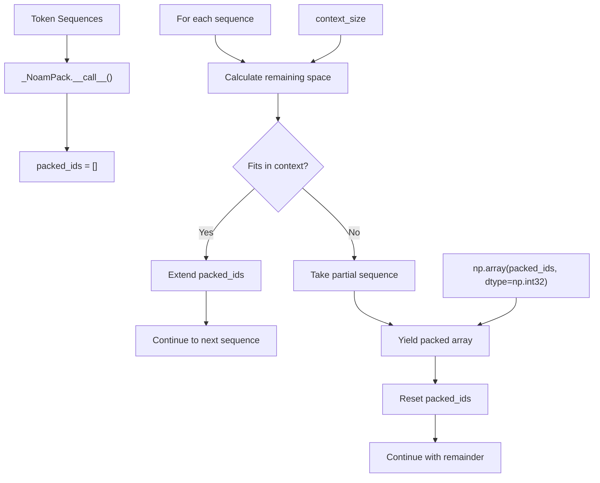
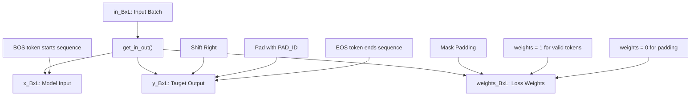
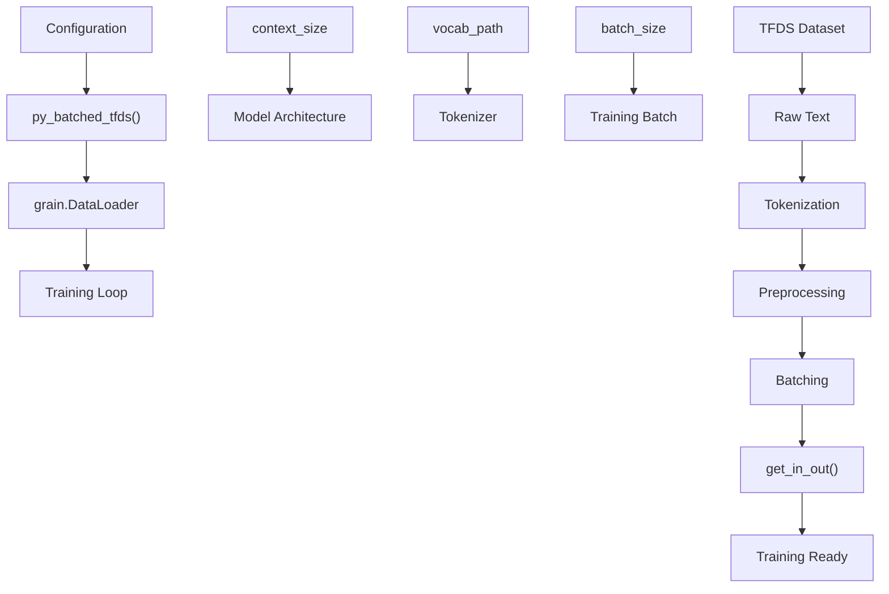

<!-- source: DeepWiki mcp.deepwiki.com · repo google-deepmind/nanodo · page 3.3 Data Pipeline · fetched 2026-10-26 -->

# Data Pipeline

Relevant source files

The following files were used as context for generating this wiki page:

- [nanodo/data.py](nanodo/data.py)
- [tests/data_test.py](tests/data_test.py)
- [tests/testdata/sentencepiece_cc_all.32000.100extra-sentencepiece.model](tests/testdata/sentencepiece_cc_all.32000.100extra-sentencepiece.model)

This document covers the data loading, preprocessing, tokenization, and batching systems in nanodo. The data pipeline is responsible for converting raw text datasets into tokenized, batched sequences ready for transformer training.

For information about how the data pipeline integrates with the training loop, see [Training System](#3.1). For details about model input processing, see [Model Architecture](#3.2).

## Overview

The nanodo data pipeline is built around the Grain library and TensorFlow Datasets (TFDS), providing efficient data loading with support for multiple preprocessing strategies. The system handles tokenization using SentencePiece, implements sequence packing for efficient training, and produces batched arrays suitable for JAX-based training.

## Core Components

### Data Loading Architecture

**Data Loading Flow**
Sources: [nanodo/data.py:39-89]()

The pipeline starts with TFDS as the data source, uses Grain's IndexSampler for efficient sampling, and applies a series of operations through the DataLoader. The main entry point is `py_batched_tfds()` which orchestrates the entire pipeline.

### Tokenization System

**Tokenization Process**
Sources: [nanodo/data.py:92-136]()

The tokenization system uses SentencePiece with a lazy-loading wrapper (`_SPTokenizer`) to handle pickling requirements. The `_py_tokenize()` function adds BOS and EOS tokens and handles optional padding or truncation based on the target sequence length.

## Preprocessing Strategies

### NOAM Packing vs Padding

| Strategy | Description | Memory Efficiency | Implementation |
|----------|-------------|------------------|----------------|
| `NOAM_PACKED` | Concatenates sequences to fill context window | High - no padding tokens | `_NoamPack` class |
| `PADDED` | Pads/truncates sequences to fixed length | Lower - includes padding | Standard padding |

### NOAM Packing Implementation

**NOAM Packing Algorithm**
Sources: [nanodo/data.py:138-166]()

The `_NoamPack` class implements efficient sequence packing by concatenating multiple sequences until the context window is filled. This approach maximizes training efficiency by eliminating padding tokens.

## Input/Output Processing

### Training Data Format

**Training Format Conversion**
Sources: [nanodo/data.py:171-186]()

The `get_in_out()` function converts raw tokenized sequences into the standard autoregressive format where:
- `x_BxL`: Input sequences starting with BOS
- `y_BxL`: Target sequences (input shifted right)
- `weights_BxL`: Binary mask for valid tokens (excludes padding)

## Configuration and Usage

### Main Pipeline Function

The `py_batched_tfds()` function serves as the primary interface with the following key parameters:

| Parameter | Type | Description |
|-----------|------|-------------|
| `tfds_name` | str | TensorFlow Datasets name |
| `split` | str | Dataset split (train/validation/test) |
| `context_size` | int | Maximum sequence length |
| `vocab_path` | str | Path to SentencePiece model |
| `batch_size` | int | Batch size for training |
| `preprocessing` | Preprocess | NOAM_PACKED or PADDED |
| `worker_count` | int | Number of parallel workers |
| `shuffle` | bool | Whether to shuffle data |

Sources: [nanodo/data.py:39-53]()

### Integration with Training

**Pipeline Integration**
Sources: [nanodo/data.py:39-89](), [nanodo/data.py:171-186]()

The data pipeline integrates seamlessly with the training system by producing batched arrays that match the expected input format for the TransformerDo model. The pipeline handles all necessary preprocessing steps automatically based on the configuration.

## Testing and Validation

The data pipeline includes comprehensive tests covering:

- **Batch Shape Validation**: Ensures correct batch and sequence dimensions
- **Tokenization Correctness**: Validates BOS/EOS token placement and padding
- **Preprocessing Strategies**: Tests both NOAM packing and padding approaches
- **Input/Output Format**: Verifies correct target generation and weight masking

Key test patterns include mock TFDS data for reproducible testing and shape validation across different preprocessing strategies.

Sources: [tests/data_test.py:47-146]()

---

